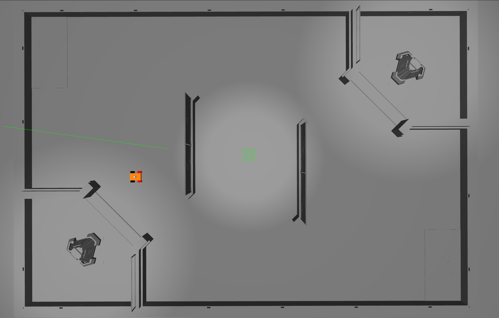
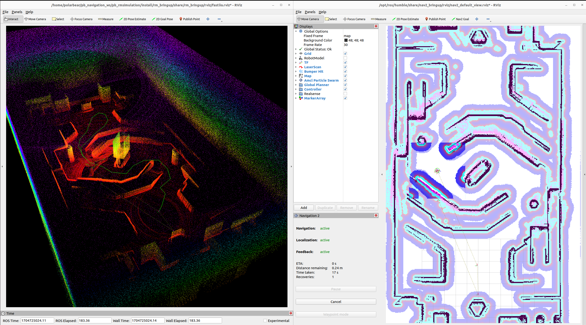
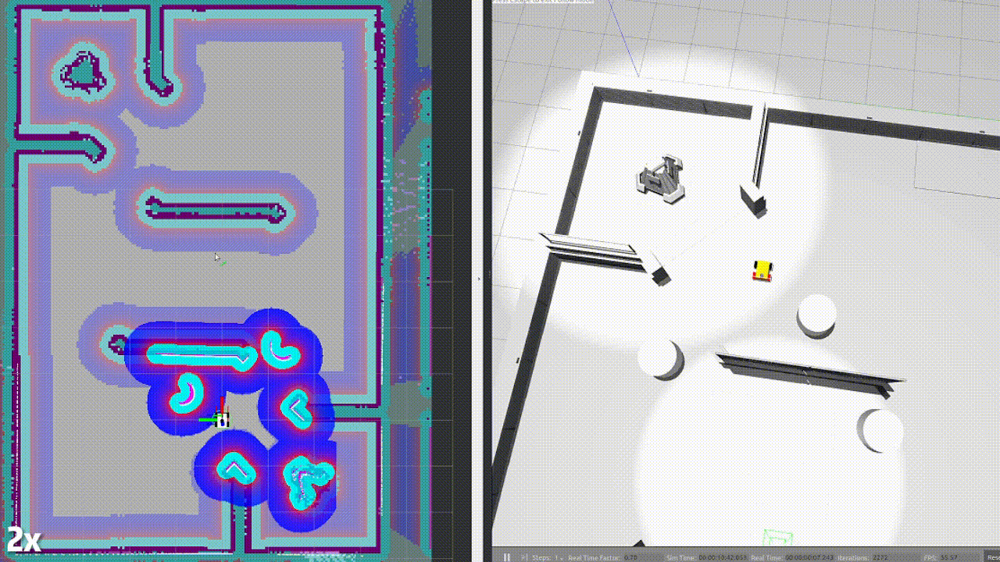
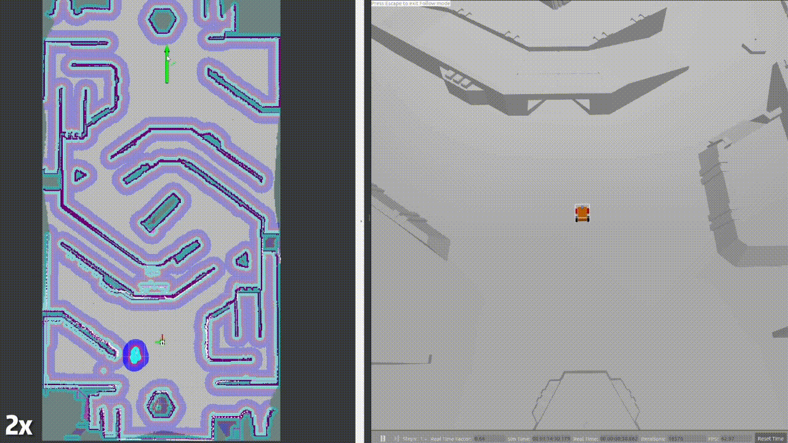
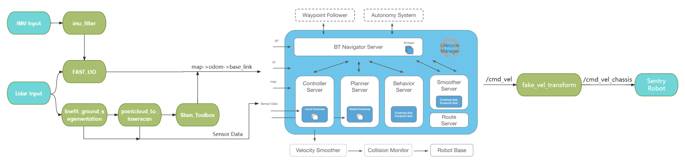

# HzMi_rmsimulation

赫兹矩阵RM仿真导航

> 本项目基于 [深圳北理莫斯科大学 北极熊战队](https://gitee.com/SMBU-POLARBEAR/HzMi_rmsimulation) 的 RM 哨兵导航仿真项目（原 `PB_RM_Simulation` / `pb_rm_simulation`）改造而来，在此向原作者 Lihan Chen 及北极熊战队致以诚挚感谢。
>
> 📄 **第三方组件署名与许可证：见 [`THIRD_PARTY_NOTICES.md`](THIRD_PARTY_NOTICES.md)**（本仓仅做集成与适配，核心算法版权归各上游原作者）。

## 一. 项目介绍

本项目使用全向移动小车，附加 Livox Mid360 雷达与 IMU，在 RMUC/RMUL 地图进行导航算法仿真，仅需要调整参数即可移植到真实机器人中导航。

早期功能演示视频：[寒假在家，怎么调车！？更适合新手宝宝的 RM 导航仿真](https://b23.tv/xSNQGmb)

|Gazebo 仿真|Fast_LIO/Point_LIO + Navigation2|
|:-:|:-:|
|||

|动态避障|
|:-:|
||

|一键偷家|
|:-:|
||

### 1.1 rm_simulation 话题接口

| **Topic name**      | **Type**                        | **Note**                         |
|:-------------------:|:-------------------------------:|:--------------------------------:|
| /livox/lidar             | livox_ros_driver2/msg/CustomMsg | Mid360 自定义消息类型   |
| /livox/lidar/pointcloud | sensor_msgs/msg/PointCloud2     | ROS2 点云消息类型                      |
| /livox/imu                | sensor_msgs/msg/Imu             | Gazebo 插件仿真 IMU                  |
| /cmd_vel            | geometry_msgs/msg/Twist         | 全向小车运动控制接口                  |

### 1.2 整体框图



## 二. 环境配置

当前开发环境为 Ubuntu22.04, ROS2 humble, Gazebo Classic 11.10.0

### 方式一：使用 Docker

本项目已配置基础 Dockerfile，并可使用 [Dev Container](https://containers.dev/) 进行仿真测试和开发。

> DevContainer 的一个特征是将代码的运行环境与代码本身完全隔离开来，在效果上类似将 workspace 挂载到了容器中。  
> 在 Docker-image 中仅仅包含有关系统的配置（例如修改 .baserc 或安装依赖包等），其本身不存储任何项目代码和工作空间，做到了代码与环境的完全隔离。  
> 可以通过 devcontainer.json 配置文件，快速修改和分发容器配置。  
> 与 VSCode 深度融合，一键启动，无需任何命令。

镜像仓库地址：[DockerHub: lihanchen2004/pb_rm_simulation](https://hub.docker.com/repository/docker/lihanchen2004/pb_rm_simulation)

> 该镜像由原作者 Lihan Chen（北极熊战队）发布，故镜像名保留 `pb_rm_simulation` 原名。

1. 安装 Docker

2. 拉取镜像

    ```sh
    docker pull lihanchen2004/pb_rm_simulation:1.0.0
    ```

3. 在宿主机 VSCode 中 安装 `ms-vscode-remote.remote-containers` 插件

4. 快捷键 `Ctrl+Shift+P`， 输入并点击 `Dev Containers:Rebuild and Reopen in Container`

### 方式二：源码安装

1. 克隆仓库

    ```sh
    git clone --recursive https://gitee.com/SMBU-POLARBEAR/HzMi_rmsimulation --depth=1
    ```

2. 安装 [Livox SDK2](https://github.com/Livox-SDK/Livox-SDK2)

    ```sh
    sudo apt install cmake
    ```

    ```sh
    git clone https://github.com/Livox-SDK/Livox-SDK2.git
    cd ./Livox-SDK2/
    mkdir build
    cd build
    cmake .. && make -j
    sudo make install
    ```

3. 安装依赖

    ```sh
    cd HzMi_rmsimulation

    rosdep install -r --from-paths src --ignore-src --rosdistro $ROS_DISTRO -y
    ```

    **额外必需的系统包**（apt 里不会由 rosdep 补齐的 Nav2 主体与 TEB 依赖）：
    ```sh
    sudo apt update
    sudo apt install -y ros-humble-navigation2 ros-humble-nav2-bringup ros-humble-nav2-rviz-plugins ros-humble-dwb-critics
    ```

    ⚠️ **python 环境要求（重要）**：本工程统一使用**系统 python 3.10**（ROS Humble 的 C 扩展是 cpython-310 编译的）。
    - 若使用 conda：`conda config --set auto_activate_base false`，或在 ROS 终端 `export PATH=/usr/bin:$PATH`（conda base 若是 3.11+ **无法用 pip 补齐**，`import rclpy` 会失败）；
    - **不要**激活仓库里的 `.venv`（它是工具链用的隔离环境，与 ROS 无关）；
    - 验证：`which python3` → `/usr/bin/python3`，且 `python3 -c "import rclpy, numpy"` 通过。

4. 编译

    ```sh
    colcon build --symlink-install
    ```

## 🚀 快速开始

> 📁 **项目布局（2026-11 重排后）**
>
> ```
> src/
> ├── nav/          规划与控制：rm_tdt_planner · rm_tdt_local_controller · rm_navigation
> │                 rm_nav_interfaces · rm_plan_msgs · rm_mpc_controller · rm_utils
> ├── bringup/      启动与资产：rm_nav_bringup（launch / map / PCD / urdf / rviz）
> ├── perception/   感知：rm_perception（patchwork 地面分割 · cloud_accumulator · pointcloud_to_laserscan …）
> ├── localization/ 定位：rm_localization（+3 子模块）· rm_zlio_bridge
> ├── simulation/   仿真：rm_simulation（world / mesh / gz 插件 / 机器人描述）
> ├── driver/       驱动：rm_driver（livox_ros_driver2 子模块）
> └── vendor/       第三方：vendor_navi_bit（BIT MINCO）· rog_map
>
> tools/scripts/    运行脚本（nav/ · mapping/ · diag/ · control/ …）
> docs/             文档（9 份，见下）
> .tmp_diag/        每次运行的日志与诊断产物
> ```
>
> 📚 **文档只有 9 份**（2026-11 合并定版）：入口 [`docs/README.md`](docs/README.md)
>
> | 文档 | 内容 |
> |---|---|
> | [`docs/README.md`](docs/README.md) | 索引（一屏）|
> | [`docs/01-architecture.md`](docs/01-architecture.md) | 架构 / 槽位矩阵 / 名词 / 路线图 |
> | [`docs/02-contracts.md`](docs/02-contracts.md) | 契约：TF / 帧 / 参数 / 仿真↔实车 |
> | [`docs/03-measurements.md`](docs/03-measurements.md) | 实测账（契约的依据）|
> | [`docs/04-issues.md`](docs/04-issues.md) | **问题与踩坑**（现象 → 根因 → 修法）|
> | [`docs/05-operations.md`](docs/05-operations.md) | **操作手册**（跑起来 / 建图 / 验收 / 三套模式 / 日志分析）|
> | [`docs/06-tdt.md`](docs/06-tdt.md) | 与 T-DT 的完整对照、代码研究、迁移记录 |
> | [`docs/07-mapping.md`](docs/07-mapping.md) | 建图 / 定位 / 地图资产 |
> | [`docs/08-sim-worlds.md`](docs/08-sim-worlds.md) | 仿真 / 场地 / 后端 |
> | [`THIRD_PARTY_NOTICES.md`](THIRD_PARTY_NOTICES.md) | 第三方组件署名与许可证 |

#### 0. 现行启动方式（本仓自己的栈）

```bash
# 一条命令起仿真（T-DT 规划+控制，默认 RCU2027 CAD 地图）
./tools/scripts/run_sim.sh

# 换模式 / 换地图 / 开 UWB
MODE=bit  ./tools/scripts/run_sim.sh          # BIT 的 MINCO 插件对（实验）
MODE=std  ./tools/scripts/run_sim.sh          # 原版 nav2（navfn+dwb）作对照
MAP_YAML=$PWD/src/bringup/rm_nav_bringup/map/RMUC2027_cad.yaml ./tools/scripts/run_sim.sh
UWB=1     ./tools/scripts/run_sim.sh          # 真值当 UWB 用，压定位跳变
```

**启动要等绿底 `READY` 横幅**（约 178 s）；**按 Ctrl-C 会把整棵进程树收干净**，日志在 `.tmp_diag/run/<时间戳>/`。

详细参数、日志分析方法、地图流程见 [`docs/05-operations.md`](docs/05-operations.md)。

> 下面「方式一 / 方式二」是**上游原版流程**（fastlio/pointlio + AMCL/slam_toolbox），
> 本仓现已改用 **zlio 定位 + T-DT 规划/控制**；保留它作为历史与兼容参考。

### 方式一：使用便捷启动脚本（推荐）

#### 1. 一键启动仿真（推荐新手）
```bash
tools/scripts/control/start_sentinel.sh
```
- 自动使用默认配置：RMUL场地 + 建图模式 + Fast-LIO
- 自动清理残留进程
- 适合日常开发和测试

#### 2. 高级启动脚本（支持参数配置）
```bash
# 查看帮助
tools/scripts/control/start_sentinel.sh --help

# 使用默认参数启动
tools/scripts/control/start_sentinel.sh

# 自定义配置启动
tools/scripts/control/start_sentinel.sh -w RMUC -m nav --lio pointlio

# 启用LIO可视化
tools/scripts/control/start_sentinel.sh --lio-rviz True
```

> 其他脚本：构建 `tools/scripts/build.sh`；建图工具 `tools/scripts/mapping/`（`generate_cartographer_pbstream.sh`、`quick_start_cartographer.sh`、`save_pcd.sh`、`save_grid_map.sh`）；配置/打包 `tools/scripts/setup_from_package.sh`、`tools/scripts/create_config_package.sh`。

### 方式二：手动启动命令

```bash
# 1. Source环境
source install/setup.bash

# 2. 启动仿真系统
ros2 launch rm_nav_bringup bringup_sim.launch.py \
    world:=RMUL \
    mode:=mapping \
    lio:=fastlio \
    lio_rviz:=False \
    nav_rviz:=True
```

## 三. 运行

### 3.1 可选参数

> 完整说明见 [`docs/05-operations.md`](docs/05-operations.md)（现行）；旧的 `smoke_test_runbook` 已并入该文档 §1。

1. `world`（默认 `RMUL2026`）:

    - 仿真模式
        - `RMUL2026` - 2026 赛季 RMUL 场地（默认）
        - `RMUL` - [2024 Robomaster 3V3 场地](https://bbs.robomaster.com/forum.php?mod=viewthread&tid=22942&extra=page%3D1)
        - `RMUC` - [2024 Robomaster 7V7 场地](https://bbs.robomaster.com/forum.php?mod=viewthread&tid=22942&extra=page%3D1)

    - 真实环境
        - 自定，world 等价于 `.pcd(ICP使用的点云图)` 文件和 `.yaml(Nav使用的栅格地图)` 的名称

2. `mode`（必填）—— **场景形态**，三种形态启动的节点集不同：
   - `mapping` - **纯建图**（Gazebo + LIO + 在线 SLAM 后端；**不起导航栈**，省 CPU 让建图更稳）
   - `slam_nav` - **边建图边导航**（在线 SLAM 直接把 `/map` 与 `map→odom` 喂给 costmap；不加载磁盘地图、不起重定位模块）
   - `nav` - **先建图后导航**（加载磁盘地图 + 必须同时指定 `localization`）

   三者对照表见 `docs/01-architecture.md` 与 `docs/05-operations.md`。

3. `lio`（默认 `fastlio`）—— 里程计/连续定位实现:
   - `fastlio` - 使用 [Fast_LIO](https://github.com/LihanChen2004/FAST_LIO/tree/ROS2)，里程计约 10Hz
   - `pointlio` - 使用 [Point_LIO](https://github.com/LihanChen2004/Point-LIO/tree/RM2024_SMBU_auto_sentry)，可以输出100+Hz的Odometry，对导航更友好，但相对的，CPU占用会更高
   - `none` - **不启动任何 LIO**（需外部提供 odom/TF，例如轮式里程计或 cartographer；此时 LIO 相关静态帧桥不会启动）

4. `localization` (仅 `mode:=nav` 时本参数有效) —— 重定位实现:
   - `slam_toolbox` - 使用 [slam_toolbox](https://github.com/SteveMacenski/slam_toolbox) localization 模式定位，动态场景中效果更好
   - `amcl` - 使用 [AMCL](https://navigation.ros.org/configuration/packages/configuring-amcl.html) 经典算法定位
   - `icp` - 使用 [icp_registration](https://github.com/baiyeweiguang/CSU-RM-Sentry/tree/main/src/localization/rm_localization/icp_registration)，仅在第一次启动或者手动设置 /initialpose 时进行点云配准。获得初始位姿后只依赖 LIO 进行定位，没有回环检测，在长时间运行后可能会出现累积误差。

    Tips:
    1. AMCL 的初始位姿已由 launch **按 `world` 自动注入**（`set_initial_pose: true`，RMUC/RMUL 为 `(0,0)`、RMUL2026 为 `(4.3,3.35)`，依据见 `docs/05-operations.md`），无需再手动给；运行中仍可用 rviz2 的 `2D Pose Estimate` 或 `/initialpose` 覆盖。
    2. 若使用 slam_toolbox 定位，需要提供 .posegraph 地图，详见 [如何保存 .pgm 和 .posegraph 地图？](https://gitee.com/SMBU-POLARBEAR/HzMi_rmsimulation/issues/I9427I)
    3. 若使用 ICP_Localization 定位，需要提供 .pcd 点云图

5. `mapper`（默认 `slam_toolbox`，`mode:=mapping` / `mode:=slam_nav` 有效）—— 在线 2D 建图后端:
   - `slam_toolbox` - online_async 建图（产出 `.pgm` + `.posegraph`）
   - `cartographer` - Cartographer 建图（产出 `.pgm` + `.pbstream`）

6. `nav`（默认 `rpp`）—— 局部规划器变体:
   - `rpp` - Regulated Pure Pursuit（默认）
   - `dwb` - DWB
   - `teb` - TEB（时间弹性带）
   - 对应参数文件：`rm_navigation/params/nav2_params_sim_{rpp,dwb,teb}.yaml`

7. `global_obstacle`（默认 `stvl`）—— **全局代价地图的实时障碍来源**（可切换槽位，便于 A/B）:
   - `stvl` - 3D 体素层（`spatio_temporal_voxel_layer`，吃 `/segmentation/obstacle`，带高度带与时间衰减）
   - `scan` - 2D 障碍层（吃 `/scan`，与 `local_costmap` 同源 → "什么算障碍"只在感知域 `p2l` 决策一处）
   - `none` - 只用 `static_layer` + `inflation_layer`（全局规划看不到实时障碍）

8. `lio_rviz`:
   - `True` - 可视化 FAST_LIO 或 Point_LIO 的点云图

9. `nav_rviz`:
   - `True` - 可视化 navigation2
   - `mode:=mapping`（不起 nav2）下也会给一块 RViz（bringup 单独补的），能看 `/map` 边建边长

10. `spin_speed`（默认 `5.0`）—— `fake_vel_transform` 的小陀螺固定角速度：
   - `5.0` - 复现上游哨兵小陀螺行为（仿真里雷达会跟着底盘转，排查导航问题时建议先设 `0.0`）
   - `0.0` - 角速度直通（等价普通 nav2）

### 3.2 仿真模式示例

- 纯建图（只建图，不起导航栈）

    ```sh
    ros2 launch rm_nav_bringup bringup_sim.launch.py \
    world:=RMUL2026 \
    mode:=mapping \
    lio:=fastlio \
    mapper:=slam_toolbox \
    lio_rviz:=False \
    nav_rviz:=True
    ```

- 边建图边导航（在线 SLAM 直接喂 costmap）

    ```sh
    ros2 launch rm_nav_bringup bringup_sim.launch.py \
    world:=RMUL2026 \
    mode:=slam_nav \
    lio:=fastlio \
    mapper:=slam_toolbox \
    lio_rviz:=False \
    nav_rviz:=True
    ```

- 已知全局地图导航

    ```sh
    ros2 launch rm_nav_bringup bringup_sim.launch.py \
    world:=RMUL \
    mode:=nav \
    lio:=fastlio \
    localization:=slam_toolbox \
    lio_rviz:=False \
    nav_rviz:=True
    ```

### 3.3 真实模式示例（已归档，仅历史参考）

> ⚠️ 按 R5，真车入口与配置已归档到 [`archive/reality_frozen/`](archive/reality_frozen/)（含 `bringup_real.launch.py`），不参与构建；本仓库只维护仿真，真车部署配置在"部署导出"阶段生成。以下示例仅作历史参考。

- 边建图边导航

    ```sh
    ros2 launch rm_nav_bringup bringup_real.launch.py \
    world:=YOUR_WORLD_NAME \
    mode:=mapping  \
    lio:=fastlio \
    lio_rviz:=False \
    nav_rviz:=True
    ```

    Tips:

    1. 保存点云 pcd 文件：需先在 [fastlio_mid360.yaml](archive/reality_frozen/fastlio_mid360_real.yaml) 中 将 `pcd_save_en` 改为 `true`，并设置 .pcd 文件的路径，运行时新开终端输入命令 `ros2 service call /map_save std_srvs/srv/Trigger`，即可保存点云文件。
    2. 保存地图：请参考 [如何保存 .pgm 和 .posegraph 地图？](https://gitee.com/SMBU-POLARBEAR/HzMi_rmsimulation/issues/I9427I)。地图名需要与 `YOUR_WORLD_NAME` 保持一致。

- 已知全局地图导航

    ```sh
    ros2 launch rm_nav_bringup bringup_real.launch.py \
    world:=YOUR_WORLD_NAME \
    mode:=nav \
    lio:=fastlio \
    localization:=slam_toolbox \
    lio_rviz:=False \
    nav_rviz:=True
    ```

    Tips: 栅格地图文件和 pcd 文件需具为相同名称，分别存放在 `src/bringup/rm_nav_bringup/map` 和 `src/bringup/rm_nav_bringup/PCD` 中，启动导航时 world 指定为文件名前缀即可。

### 3.4 小工具 - 键盘控制

```sh
ros2 run teleop_twist_keyboard teleop_twist_keyboard
```

## 四. 实车适配关键参数

1. 雷达 ip

    本导航包已内置 [livox_ros_driver2](https://gitee.com/SMBU-POLARBEAR/livox_ros_driver2_humble)，可直接修改 [MID360_config.json](./archive/reality_frozen/MID360_config.json) - `lidar_configs` - `ip`

2. 测量机器人底盘正中心到雷达的相对坐标

    x, y 距离比较重要，将影响云台旋转时解算到 base_link 的坐标准确性

    填入 [measurement_params_real.yaml](./archive/reality_frozen/measurement_params_real.yaml)

    若雷达倾斜放置，无需在此处填入 rpy，而是将点云旋转角度填入 [MID360_config.json](./archive/reality_frozen/MID360_config.json) - `extrinsic_parameter`

3. 测量雷达与地面的垂直距离

    此参数影响点云分割效果

    填入 [segmentation_real.yaml](./archive/reality_frozen/segmentation_real.yaml) - `sensor_height`

4. nav2_params

    参数很多，比较重要的是 robot_radius 和 速度相关参数。详见 [nav2官方文档](https://docs.nav2.org/)

## 后记

本仓库当前功能**暂时没做到尽善尽美**，仅供实验室自己研究参考的模板；未来要开源，**依旧有很多工作要做**。
除去各位部署时带来的难度，具体还有以下几点：

### 1. 仿真本身没调试好

笔者认为**点云模拟在这个项目中表现并不够好**。曾尝试过切换别的仿真后端、别的版本 Gazebo，但都遇到**车辆控制不理想**的问题。

### 2. 仿真雷达缺乏真实可靠的 IMU

所以**去畸变**在这个项目中表现并不好，同时给**重定位**带来了很大问题：

- 车辆碰撞地形时，**所有的 LIO 都容易失常**；
- 这方面 **zlio 表现尚可**，但留下了**重定位失败**（定位到另一个对称位置）的问题；
- 这个位置曾经尝试用**仿真定位数据当 UWB** 喂给 zlio，效果依然不好。

### 3. 并非每个模块都移植复现成功

- **ROGMap**（原作为 HKU 的 ROG-Map，本仓经 BIT 的 MINCO 栈引入）在本项目表现就不够好（笔者以为是调试问题或仿真模型问题）；
- 这个仿真**绝对无法给予自瞄合适、足够的虚拟调试条件**；
- 未来可以考虑**更换仿真后端或自研仿真**（个人感觉 Isaac 可能是个不错的选择）；
- 距离达到"**不上车实现完整的上下位机联调**"依然有非常大的差距。

### 4. 关于 `odom_level`

这是笔者自己研制添加的一条 **TF**，核心目标在于找到一个**客观、不被影响的重力系**，主要解决 **2D 建图导航**的问题。
但实车发现目前的设计理念**有其局限性**，未来会在实车上调试验证后补齐到仿真（**目前不影响各位实验代码和想法**）。

在这个地方很有趣的是：**不同的算法（FAST-LIO、Point-LIO）对于 `odom` 系的得出是不一样的**，
（这导致整个项目的 **TF 链跟正常项目都有些区别**）如果有困惑，**建议各位先学习了解各种 LIO 算法**。

> 这里说的 `odom` **不一定垂直地面**——可以按"雷达/IMU 的朝向"来理解它。

### 5. 关于 T-DT 的规划器

笔者理解 T-DT 开源的（`tdt-nav-kit`）**只有核心算法**——`YAstar`（A*）、`kinodynamicAstar`（动力学搜索）、
`MinimumSnapOsqp`（MINCO 后端）；**上下游适配与控制适配，都是笔者模仿其开源自己研制的**：

- **上游适配**：nav2 planner 插件封装、`plan_mask`（障碍掩膜）与 costmap 的对接、逃逸采样、失败快照、分层状态上报；
- **下游适配**：局部控制器（Kinodynamic 局部轨迹 → `cmd_vel`）、前视与速度参考、麦轮映射与指令延迟处理。

这些**未来还会继续优化**。也正因为这层封装是自己写的，**未来我们的导航有希望脱离 nav2**——
不再依赖 nav2 的 planner / controller 插件与行为树，而是走自己的调度。

> 上游原件保留在 `third_party/tdt-nav-kit/`（含 LICENSE）；本仓用的是
> `src/nav/rm_tdt_planner/src/tdt/` 下的副本 + `planner.cpp` / `nav_l0_perception.cpp`（适配层）、
> `src/nav/rm_tdt_local_controller/src/controller.cpp`（控制适配）。

### 6. 关于去畸变

除了**仿真现有的**点云，以及 **Point-LIO / FAST-LIO 这类本身就带逐点去畸变**的算法
（用帧内 IMU 位姿做运动补偿）之外，笔者还另外研制了一套**基于下位机数据**的去畸变办法：
用底盘/MCU 上传的高频位姿（轮式里程计、底盘 IMU）来补偿单帧点云内的运动畸变，
**思路来源于 2D 导航项目**。这套办法**目前还没有进仓库**——
未来会在实车上考察、研究，**确认合适后再加入**。

> 顺带说明：仿真里帧内运动本来近乎为零（`livox_points_plugin.cpp` 的 `offset_time` 默认是 0），
> 所以"去畸变做得好不好"在仿真里基本验证不出来——这也是第 2 点里它"表现并不好"的另一面。

## 致谢（不分先后）

本仓的导航算法框架**基于 [SMBU 北极熊（PolarBear）2024 赛季开源](https://gitee.com/SMBU-POLARBEAR/pb_rmsimulation) 修改**而来。

- **项目早期**参考了 **中南大学、南京航空航天大学、哈尔滨工业大学** 的 2024 赛季开源与车体模型；
- **今年的工作**参考、研究并学习了 **辽宁科技大学、浙江大学、武汉科技大学、RPS、北京理工大学、中国科学技术大学** 的开源；
- 并**接入了东北大学（T-DT）的 Z-Localization（zlio）与 tdt-nav-kit 两个模块**，本仓的规划器/控制器即基于后者改造。

一路走来得到了很多**学长学姐**的教导和帮助，在此感谢各位学长学姐的不吝赐教，以及各位大佬的开源。

---

## 本仓与上游的关系

本仓是在下面这些开源项目的基础上整理、改造而来（统称"上游"）。**哪些代码真的进了本仓**在最后一列说明。

| 上游项目 | 链接 | 与本仓的关系 |
|---|---|---|
| **SMBU 北极熊 24 赛季**（HzMi_rmsimulation / pb_rmsimulation） | <https://gitee.com/SMBU-POLARBEAR/pb_rmsimulation> | **主干来源**：仿真资产、world/机器人模型、nav2 参数骨架、launch 结构 |
| **SMBU 北极熊 25 赛季**（pb2025_sentry_nav） | <https://github.com/SMBU-PolarBear-Robotics-Team/pb2025_sentry_nav> | 同队后续版本，**参考**（未直接合并） |
| **z-localization** | <https://github.com/mozihe/z-localization> | **定位后端**（zlio）；本仓 `rm_zlio_bridge` 把它接进 nav2 |
| **T-DT nav kit**（东北大学 T-DT 2026） | <https://github.com/T-DT-Algorithm-2026/tdt-nav-kit> | **规划器核心算法**；本仓 `src/nav/rm_tdt_planner/src/tdt/` 为副本，插件/掩膜/逃逸/控制器为自研 |
| **navi_minco_bit** | <https://github.com/Walker152/navi_minco_bit> | **BIT 的 MINCO 规划+控制**（`MODE=bit`）；ROGMap 也经它引入 |
| **small_point_lio** | <https://github.com/yancey2023/small_point_lio> | **LIO 备选**（`lio:=small_point_lio`） |
| **COD 2026 导航** | <https://gitee.com/codnavgation/cod_-rm2026_-navigation> | **只读参考**（`third_party/cod_nav_2026`，不参与构建） |
| **中南 FYT**（CSU-RM-Sentry） | <https://github.com/baiyeweiguang/CSU-RM-Sentry> | nav2 框架沿革来源（上游作者在其基础上适配仿真） |
| **TUP-Sentry-Framework**（同济 TUP） | <https://github.com/tup-robomaster/TUP2024-Sentry-Framework><br><https://github.com/tup-robomaster/TUP2023-Sentry-Framework> | 早期参考/学习（框架与导航分层思路） |
| **哈工大 2024 哨兵规划** | <https://github.com/zzt-180/sentry_planning> | 早期参考 |
| **rose_navigation** | <https://github.com/hyheiyue/rose_navigation> | 今年参考/学习 |
| **sentry26** | <https://github.com/xiix666/sentry26> | 今年参考/学习 |
| **HWSentryNav26** | <https://github.com/Polyacetone/HWSentryNav26> | 今年参考/学习（⚠️ 链接待确认，见下） |
| **autosentry** | <https://github.com/AbabalaT/autosentry> | 今年参考/学习（⚠️ 链接待确认，见下） |

> ⚠️ **待确认**（当前从本机访问不到，可能是改名/删除/私有）：
> `Polyacetone/HWSentryNav26`、`AbabalaT/autosentry`、以及 `yancey2023/small_point_lio`（这几个我访问时报错，
> 作者确认后我会修正链接）。


**约定**：本表只说明"来源与用途"，不声称衍生关系；具体到包级/函数级的对照见
`docs/06-tdt.md`（T-DT 全链对照）与后记第 5 点（规划器哪些是上游、哪些是自研）。

