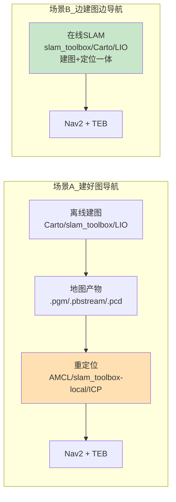
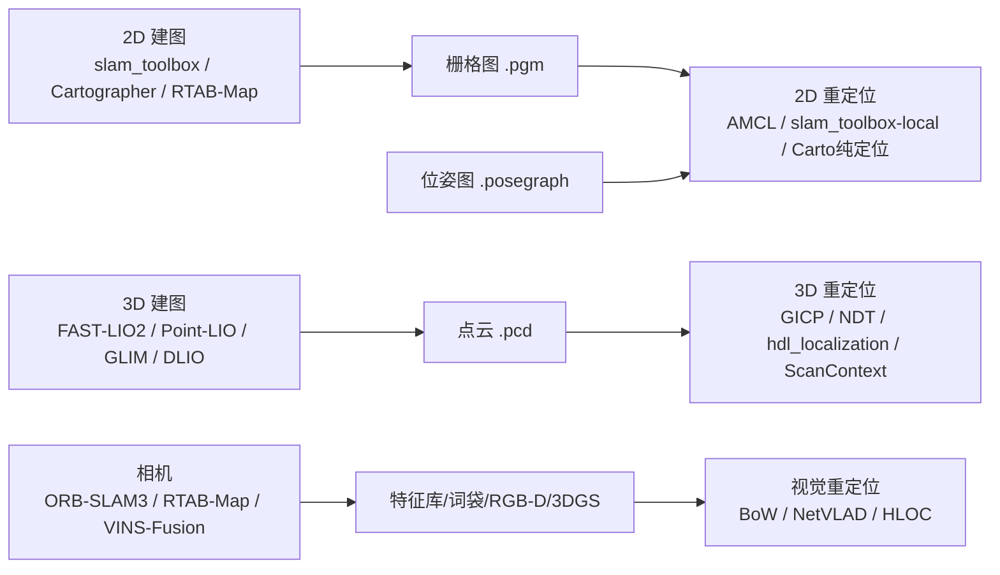

# 架构 / 槽位 / 名词

> 整栈分层、算法槽位矩阵、名词表

> **2026-11-13 合并**：本文件由 **14 份**同主题文档合并而成，原文全部保留、按来源分节（`## 来源：xxx`）。原件已删除，可从 git 历史取回。

**目录**
1. `architecture.md`
2. `glossary.md`
3. `algorithm_matrix.md`
4. `algorithm_axes.md`
5. `lio_slots.md`
6. `localization_slots.md`
7. `ground_segmentation_slots.md`
8. `nav_stages.md`
9. `params_ownership_checklist.md`
10. `rm_algorithm_overview.md`
11. `rm_algorithm_catalog.md`
12. `roadmap_2026_11.md`
13. `rm_algolab_plan.md`
14. `rm_bench_refactor_plan.md`

---


## 来源 1/14：`architecture.md`


> 本文档描述仓库**当前实际结构**（2026-09 参数回归 R1 完成后的状态），供团队日常查阅与新成员上手。
> 相关文档：`docs/rm_bench_refactor_plan.md`（改造路线）、`docs/params_ownership_checklist.md`（参数归属清单）、`docs/rm_algorithm_catalog.md`（算法选型）。

---

## 一、项目定位

- **ROS2 humble 的多算法仿真实验台**：Gazebo 场地 + 旋转 Mid360 仿真 + FAST-LIO/Point-LIO 定位 + Nav2 导航，用于**测试/对比不同职能的算法或成品包**；
- 传感器构型与真车一致（旋转 Mid360 + 麦轮全向），仿真结论可迁移；
- **不追求 sim2real 一键打通**：真车配置冻结，真车部署在"按包清单导出"阶段另行处理。

---

## 二、顶层目录总览

| 路径 | 作用 | 是否参与 colcon 构建 |
|---|---|---|
| `src/` | **全部 ROS2 功能包**（19 个，按角色域分组） | ✅ |
| `third_party/` | **官方原版第三方库参考**（只读对照，不编译） | ❌（`COLCON_IGNORE`） |
| `tools/` | 工具脚本：`tools/*.py`＝Python 工具；`tools/scripts/`＝Shell 脚本 | ❌（无 package） |
| `docs/` | 规划/清单/操作指南文档 | ❌ |
| `archive/` | 一次性报告归档 + `reality_frozen/`（真车配置冻结快照） | ❌ |
| `build/` `install/` `log/` | colcon 构建产物（已 gitignore） | — |
| `dockerfile`、`.devcontainer/` | 容器化开发环境 | — |
| `.docs/` | README 引用的图片/GIF | — |
| `.vscode/`、`.venv/` | 本地 IDE / Python 工具环境（已 gitignore） | — |
| `.gitmodules` | 9 个子模块登记表 | — |

---

## 三、`src/` —— 按"角色域"分组的包

### 3.1 域 ↔ 包 ↔ 角色速查

| 域目录 | 包（ROS 包名） | 角色 | 源码形态 |
|---|---|---|---|
| `rm_simulation/` | `hzmi_rm_simulation` | Gazebo 场地（RMUC/RMUL/RMUL2026）+ 哨兵机器人模型 | 本仓直接管理 |
| | `ros2_livox_simulation`（目录名 `livox_laser_simulation_RO2`） | Gazebo 里仿真 Mid360，发 `/livox/lidar` | 本仓直接管理 |
| `rm_driver/` | `livox_ros_driver2` | 真车雷达驱动 + **CustomMsg 消息定义**（仿真不启动节点，但编译期必需） | git 子模块 |
| `rm_perception/` | `linefit_ground_segmentation` / `linefit_ground_segmentation_ros` | 点云地面分割（`/segmentation/obstacle`） | 本仓直接管理 |
| | `pointcloud_to_laserscan` | 3D 障碍点云 → 2D `/scan`（**降维，2D 世界唯一入口**） | 本仓直接管理 |
| | `imu_complementary_filter` | IMU 滤波 → `/imu/data`（喂 FAST-LIO） | 本仓直接管理 |
| `rm_localization/` | `fast_lio` | 里程计 + 3D 建图（一体） | **git 子模块（自有 fork）** |
| | `point_lio` | 高频里程计 + 建图（`fast_lio` 的替身） | **git 子模块（自有 fork）** |
| | `icp_registration` | 3D 重定位（吃 `.pcd`），发布 `map→odom` | 本仓直接管理 |
| | `lio_tf_adapter` | **LIO 位姿 → 标准帧树适配**（`/odom` ⇒ `odom→base_link`，T3） | 本仓直接管理 |
| | `slam_toolbox` | 2D 建图 / 纯定位（官方源码 vendored，**编译覆盖 apt**） | 内嵌源码（去 .git） |
| | `cartographer_ros` | 2D 建图 / 纯定位（**ros2-gbp humble 官方 ament 源码**，编译覆盖 apt） | 内嵌源码（去 .git） |
| `rm_navigation/` | `rm_navigation` | Nav2 组装（launch + **nav2 参数** + rviz） | 本仓直接管理 |
| | `teb_local_planner` / `teb_msgs` | TEB 局部规划器（Nav2 插件） | git 子模块 |
| | `costmap_converter` / `costmap_converter_msgs` | TEB 依赖（costmap→几何图形） | git 子模块 |
| | `fake_vel_transform` | 云台旋转速度补偿胶水 | 本仓直接管理 |
| `rm_nav_bringup/` | `rm_nav_bringup` | **总装层**：launch 入口 + 地图/PCD/rviz/urdf 资产（**无 config/**，参数已全部回归各包） | 本仓直接管理 |

> **维度（2D/2.5D/3D）标注与算法组合现状不在这张表里**，统一维护在 `docs/algorithm_matrix.md`（§一.1 维度归类、§三 资产、§四 实测状态）；本表只管「哪个域有哪些包」。
>
> 19 个 colcon 包 = 上表除子模块内嵌包外的全部；`slam_toolbox/lib/karto_sdk` 由 slam_toolbox 自带、不单独出现在 colcon 列表。

### 3.2 数据流（仿真，默认 mapping/nav 组合）

```
Gazebo(hzmi_rm_simulation 世界 + 机器人)
   ├─ 旋转 Mid360 仿真插件(ros2_livox_simulation) ─► /livox/lidar (CustomMsg) ─┬─► fast_lio / point_lio ─► 里程计位姿 + 3D 图
   └─ IMU 插件 ─► /livox/imu ─► imu_complementary_filter ─► /imu/data ────────┘
                                                          │
                        /livox/lidar/pointcloud ─► linefit 地面分割 ─► /segmentation/obstacle
                                                          │
                                          pointcloud_to_laserscan ─► /scan
                                                          │
            ┌─────────────────────────────────────────────┴──────────────┐
   2D 建图/定位: slam_toolbox / cartographer_ros            2D 导航: Nav2(rm_navigation)
            └─────────────────────────────────────────────┬──────────────┘
                                          fake_vel_transform ─► /cmd_vel ─► 底盘
```

### 3.2.1 三层职责：`lio` / `localization` / `mapper` 各管一段

**`lio` 管"相对起点走了多少"（局部、连续）→ `localization` 管"我在场地里的哪个位置"（全局、不漂）→ `mapper` 管"把场地地图造出来"。**
三者恰好对应 TF 树上三条不同的边（nav2 只用合成的 `map→base_link`，但这条链必须由两层各出一段）：

```
map ──[localization（已知地图）或 在线 mapper（边建边用）]──► odom ──[lio]──► base_link ──[fake_vel_transform]──► base_link_fake ──► livox_frame
     全局：不漂、低频修正                                          局部：连续、高频、会漂
```

| 层 | 参数 | 发布哪条边 | 输入 | 输出 | 特性 | 取值 |
|---|---|---|---|---|---|---|
| **里程计** | `lio` | `odom → base_link` | `/livox/lidar`(CustomMsg 10Hz) + `/imu/data`(100Hz) | `/odom`（≈10Hz）→ 由 `lio_tf_adapter` 转成 TF | **高频连续**；无全局参考、**有累积漂移**；只回答"相对起点" | `fastlio` / `pointlio` / `none` / `cartographer`（**全包形态**） |
| **重定位** | `localization` | `map → odom` | **磁盘地图资产** + `/scan`(或点云) + `odom→base_link` | `map→odom` TF（amcl 另有 `/amcl_pose`） | **低频修正、全局不漂**；amcl/icp 需要初值 | `amcl` / `slam_toolbox`(localization 模式) / `icp`；留空 = 回退（LIO 当绝对定位 + 静态桥补帧） |
| **建图** | `mapper` | `/map`（在线建图时**同时**发 `map→odom`） | `odom→base_link` + `/scan`（或点云） | `/map`(OccupancyGrid)；离线落盘 `.pgm/.yaml` | **造地图**；含回环优化（`map→odom` 会跳变） | `slam_toolbox`(online_async) / `cartographer` |

> **全包形态（`lio:=cartographer`，2026-09 新增）**：cartographer 同时发 `odom→base_link` 与 `map→odom`
> （lua `cartographer_lio.lua` / `cartographer_lio_localization.lua`：`provide_odom_frame=true`、
> `published_frame="base_link"`）→ 因此 **`mapper` 槽与 `localization` 槽都会被跳过**，
> `lio_tf_adapter` 与 T1 静态桥也不启动（否则 `odom` 多父边）。
> 三个代价：① 失去独立故障域；② `odom` 的连续性改由 cartographer 的 pose extrapolator（IMU 外推）提供，
> 弱于 FAST-LIO 的紧耦合 IEKF；③ **不发 `/odom` 话题** → `nav:=teb` 不适用（`rpp`/`dwb` 正常）。
> 详见 `docs/tf_interface_contract.md` §八。

最容易混的三点：

1. **同一条 `map→odom` 边，`localization` 和"在线 `mapper`"都会发**：前者是"用已知地图去对齐"，后者是"边造地图边给"。
   **两者绝不能同时开**（会出现两个 `map→odom` 父边），这正是把形态拆成 `nav`（重定位）与 `slam_nav`（在线 SLAM）的根本原因（见 §九 启动集表）。
2. **`mapper` 是"生产地图"，`localization` 是"消费地图"**：`mapper` 离线产出资产，`localization` 加载资产。**资产与模块必须配对**，配错的表现是"参数传了但模块不工作"。
3. **`lio` 不依赖任何地图资产**，三种形态、所有场地都能跑；`localization` 强依赖磁盘资产；`mapper` 什么都不依赖（从零开始）。

**地图资产 ↔ 生产者 ↔ 消费者**（`rm_nav_bringup/map/`、`PCD/`）：

| 资产 | 生产者 | 消费者 | 备注 |
|---|---|---|---|
| `.pgm` + `.yaml` | `mapper`（或 `map_saver_cli`） | `localization:=amcl`（经 `map_server`） | 纯 2D 栅格 |
| `.posegraph` | `mapper:=slam_toolbox`（`/slam_toolbox/serialize_map`） | `localization:=slam_toolbox` | 带位姿图，可续建/精定位 |
| `.pcd` | LIO（`/map_save` 服务，路径 `PCD/<world>.pcd` 由 bringup 注入） | `localization:=icp` | 3D 点云配准 |
| `.pbstream` | `mapper:=cartographer` | cartographer 纯定位模式 | 含子图+位姿图 |

**生效条件**：`mapper` 仅 `mapping` / `slam_nav`；`localization` 仅 `nav`；`lio` 三种形态都生效（`none` = 由外部提供 odom/TF）。

> **补充：LIO 不只能做定位。** FAST-LIO/Point-LIO 是 LiDAR-Inertial SLAM，跑里程计的同时就在建 3D 点云地图
> （`PCD/<world>.pcd`，RMUL 为 159 万点）——本工程已把它当资产用（ICP 底图），另外可用
> `tools/pcd_to_grid_map.py` 切层投影成 `.pgm/.yaml` 直接喂 AMCL，于是存在第三条 2D 地图来源
> （① mapper 在线 SLAM ② LIO 点云投影 ③ 外部/官方平面图）。实测 RMUL.pcd 投影图与 slam_toolbox 的
> `map/RMUL.pgm` 在同一坐标系、±1 格容差下参考图墙覆盖率 84.7%。

### 3.2.2 2D / 2.5D / 3D：降维到底发生在哪一层

**先厘清一个常被混淆的点**：地面机器人的**配置空间本身就是 SE(2)**（x, y, yaw）——高度/俯仰/横滚被地面约束。
所以"导航都用 2D"不是偷懒，而是规划维度与机器人自由度同维；被降维的是**传感器与环境的表示**，不是机器人状态。

本工程里降维发生**两次**，而 3D 信息**在两处被保留**：

| 环节 | 做什么 | 3D 是否保留 | 本工程的位置/参数 |
|---|---|---|---|
| ① 传感器端 | 3D 点云 → 压成**一个高度切片**的 `/scan` | ❌ 只留一层 | `pointcloud_to_laserscan`：`min_height: -1.0`、`max_height: 0.1`（相对 `livox_frame`，该帧在车顶 ≈0.275 m）→ `/scan` 供 AMCL/slam_toolbox/local_costmap |
| ② 地面分割 | 在 3D 里**剔除地面**，留下障碍点云 | ✅ 保留 3D | `linefit_ground_segmentation`：`sensor_height: 0.275`、坡度 ±0.4、`max_dist_to_line: 0.1` → `/segmentation/obstacle` |
| ③ 代价地图 | **3D 体素栅格**按高度带筛选后**投影成 2D costmap**（取 max） | ✅ 体素在层内保留 | `global_costmap.stvl_layer`：`voxel_size: 0.05`、`voxel_decay: 0.5`(s，线性衰减)、`min_obstacle_height: 0.2`、`max_obstacle_height: 2.0`、`publish_voxel_map: true`（RViz 可直接看 3D 体素） |
| ④ 全局 3D 地图 | LIO 的 3D 点云地图落盘 | ✅ 全保留 | `PCD/<world>.pcd`（`/map_save`） |

**"伪 2D / 2.5D"指的就是 ③ 这种做法**：索引仍是 2D 栅格，但每格背后堆着体素/高度信息，投影时才做取舍。
三条技术路线：

| 路线 | 环境表示 | 规划器 | 能表达 / 丢失 | 典型场景 |
|---|---|---|---|---|
| **2D 平面** | 单层 `OccupancyGrid` | NavFn/A*/RPP/DWB（SE(2)） | 丢失"多高"：低矮可跨越结构会误判为障碍，悬垂可穿过结构也误判 | 平地 + 竖直墙（**RM 哨兵正是这类**） |
| **2.5D**（伪 2D） | 2D 索引 + 每格高度/坡度/多层体素（`grid_map`/`elevation_mapping`/STVL） | 吃可通行性的规划器 | 保留"多高/多陡"→ 可判可跨越性；仍不能表达真悬垂/桥下 | 越野、四足、坡道 |
| **真 3D** | 体素/八叉树（OctoMap） | 3D lattice / OMPL | 全部几何；但算力高一个量级、需 3D 碰撞模型 | 无人机、机械臂、立体机动 |

**什么时候"降维"会真出错**（也是调参判据）：

1. **低矮但可跨越**（飞坡边缘、路沿）→ 2D 会把它们标成障碍，机器人绕路甚至无路可走。
   本工程靠 ①③ 的高度带滤掉：`min_obstacle_height: 0.2`（低于 0.2 m 不算障碍）。
   实验：把它调到 `0.4`，看 0.2~0.4 m 的低矮结构是否被忽略。
2. **悬垂/桥下可穿过** → 2D 投影必然误判；只能靠 2.5D 分层或真 3D。
3. **坡道/起伏地形** → 2D 无法表达坡度，需要高程图（2.5D）。
4. **瞬时障碍（人/车）** → 靠 STVL 的 `voxel_decay`（0.5 s 线性衰减）自动清除过期占据。

**"能不能不降维？"** 可以，三条可落地路径（按改动量排序）：

1. **只把 3D 用在避障、规划仍 2D**（最小改动）：保留 STVL 体素，自己加 3D 碰撞检查
   （注意 nav2 的 `use_collision_detection` 是 2D 的，不能直接提供 3D 语义）；
2. **上 2.5D 高程图**：用 `grid_map`/`elevation_mapping` 产出带高度/坡度的 2D 图，替换 costmap 的
   static/obstacle 层，规划器改用吃可通行性的实现 —— 这也是本工程"以后要加的 2.5D 角色槽位"的正路；
3. **真 3D**：OctoMap + 3D lattice 规划器。对平整场地 + 竖直矮墙的哨兵场景，性价比低。

> 结论：**降维不是缺陷，而是"与配置空间同维"的必然选择**；关键是高度带（`min/max_obstacle_height`、
> `pointcloud_to_laserscan` 的 `min/max_height`）要按机器人实际能跨越的高度来定，必要时把 2D 升级成 2.5D。

### 3.2.3 "3D 到底怎么用"——四种用法 + 真 3D 规划器内部机制

"用 3D"这句话至少对应四种截然不同的东西，先分清再谈值不值得：

| # | 用法 | 3D 用在哪 | 决策维数 | 例子 |
|---|---|---|---|---|
| **A** | **3D 感知 → 2D 决策** | 用 3D 点云算"哪些格不能走"，决策仍是 2D | SE(2) | **本工程现状**：地面分割 + STVL 体素 → 2D costmap；95% 的地面机器人 |
| **B** | **3D 表示 → 2.5D 决策** | 3D 压成"每格高度/坡度/粗糙度"，索引仍是 2D | SE(2) + 可通行性 | `grid_map`/`elevation_mapping`（ANYbotics）、越野车、四足 |
| **C** | **真 3D 决策（位置）** | 状态 = (x,y,z)，在 3D 体素/连续空间里搜路径 | SE(3) 位置部分 | 无人机、水下、桥下穿越 |
| **D** | **真 3D 决策（含姿态/接触）** | 状态含姿态/速度/加速度/接触序列 | SE(3)+ 或更高维 | 无人机高速飞行的动力学轨迹、腿足落脚点+接触序列、机械臂（关节空间 n 维） |

#### 真 3D 规划器内部是怎么工作的（以无人机为主线）

```
① 表示      3D 点云 → OctoMap(八叉树/概率占据·多分辨率) 或 体素栅格 或 ESDF(欧氏符号距离场)
② 状态空间  (x,y,z) [无人机再加 yaw；高速飞行用微分平坦 4 维：x,y,z,yaw]
③ 搜索/优化 体素 A*(26 邻域) | lattice(离散运动原语, 满足动力学) | RRT*/BIT*(连续采样) | 轨迹优化(CHOMP/MINCO/EGO，多项式+QP)
④ 碰撞检测  球/盒 vs 体素；或直接查 ESDF 的距离与梯度（优化里做罚项，这是 3D 最典型的"用法"）
⑤ 跟踪控制  3D 路径 → 位置/速度指令 → 姿态环（飞控）
```

几个关键机制的理解要点：

- **ESDF 是"3D 怎么用"的核心技巧**：每个体素存"到最近障碍的距离"，于是"别撞墙"变成一个**可微的罚项**（往梯度方向推），
  轨迹优化才能直接在这个场里下降。代表：`voxblox`（增量 TSDF/ESDF）、`nvblox`（GPU）。
- **lattice / 运动原语**：先把控制量离散成一段段**动力学可行**的短轨迹，再在这些轨迹构成的图上搜 ——
  这样搜出来的 3D 路径才是机器人真的能飞的，而不是折线。
- **体素数决定算力**：20×20×5 m 空间，0.1 m 体素 = 200×200×50 = **200 万格**（3D A* 勉强）；
  0.05 m → **1600 万格**（很重）。这就是"3D 搜索贵"的具体来源——3D 是 n³ 增长，2D 是 n²。
- **腿足的做法**：全局仍走 2.5D 高程图（B），但**落脚点选择**是 3D 的（在高程图里挑一块够平的接触面 → 形成接触序列），
  属 D 类，只是"3D"体现在接触而不是整条路径。
- **机械臂/移动操作**：OMPL 在关节空间（n 维）规划，本质上与 A–D 无关，是"高维而不是 3D"。

#### 为什么地面机器人即使有 3D 数据也常不升到 C/D

1. **规划维数由配置空间决定，不由传感器决定**：轮式底盘能做的事就是 SE(2)，3D 路径里"抬高 0.3 m"这种动作它做不到；
2. 3D 搜索空间 n³ 膨胀，而收益只在"高度决定可通行性/机动性"时才出现；
3. 地面约束使 z/roll/pitch 基本确定，把自由度花在它们上是浪费；
4. 3D 地图的不确定性更大（点云稀疏、动态物体、遮挡），2D 投影反而更稳。

#### 那本工程/哨兵场景里"3D 真正有用的地方"在哪

| 场景 | 该用哪种 | 说明 |
|---|---|---|
| 平地 + 竖直矮墙（现在的 RM 场地） | A（+轻量 B） | 只要高度阈值选对，2D 就是最优 |
| 低矮可跨越 / 悬垂可穿 / 坡道 | B（2.5D 高程图） | 高度决定可通行性 |
| **云台瞄准规划**（哨兵真正需要 3D 的地方） | **D（2–3 自由度，臂式）** | 让"枪口对准目标"而不是"底盘对准路径"，这在数学上是 2–3 DOF 规划问题；`base_link_fake` 机制本质上是把这个问题**绕过**了——用"底盘小陀螺 + 假云台系"让 2D 规划器与云台共存，而不是真去规划云台 |
| 若将来加飞行/爬坡机器人 | C/D | 才需要真 3D 规划器 |

> 所以"3D 怎么用"的实用答案是：**先把 3D 用在"能不能走"（A/B）上，只有当"高度/姿态本身就是任务"（飞行、攀爬、瞄准）时，才升级到 C/D。**
> 本工程若要开这条研究线，最自然的入口是给 costmap 加一个**高程/分层层**（B），而不是直接上 3D 规划器。

### 3.2.4 感知与决策的接口：谁吃什么、以什么形式吃

**一句话**：**规划器吃的是"表示"，不是数据。** nav2 的规划/控制插件只拿到 **2D costmap**（`OccupancyGrid`），
它根本看不到点云；点云在各种"感知/建图层"里被加工成 costmap，才进入决策。

#### 本工程真实的消费树（注意：原始数据是**多路并行消费**的）

```
/livox/lidar (CustomMsg 10Hz) ─► fast_lio / point_lio ─┬─► /odom(≈10Hz) ─► lio_tf_adapter ─► TF odom→base_link
                                                       └─► /cloud_registered(3D 地图) ─► Rviz；/map_save ─► PCD/<world>.pcd
/livox/imu (100Hz) ─► imu_complementary_filter ─► /imu/data ─┘（FAST-LIO 的 imu_topic；point_lio 直接用 /livox/imu）

/livox/lidar/pointcloud (PointCloud2 10Hz) ─┬─► linefit 地面分割 ─► /segmentation/obstacle（3D 障碍点云）
                                            │        ├─► pointcloud_to_laserscan（切高度带 z∈[-1.0, 0.1]）─► /scan（2D）
                                            │        │        ├─► local_costmap.obstacle_layer
                                            │        │        ├─► amcl（仅 mode:=nav + localization:=amcl）
                                            │        │        └─► Rviz
                                            │        └─► global_costmap.stvl_layer（3D 体素，高度带 0.2~2.0m）
                                            └─► icp_registration（仅 localization:=icp）─► TF map→odom

汇聚点（唯一的"统一表示"）：costmap 2D = static_layer + stvl/obstacle + inflation 在该节点内合并
        ├─► planner_server(NavFn) ─► /plan
        ├─► controller_server(RPP/DWB/TEB) ─► /cmd_vel ─► fake_vel_transform ─► /cmd_vel_chassis ─► Gazebo
        └─► behavior_server(spin/backup/drive_on_heading/wait)
定位合成：map→odom（amcl / icp / slamTB-loc / 在线 SLAM） × odom→base_link（lio_tf_adapter） = map→base_link
```

**结论：感知侧是"分别处理"（同一份点云被 3~4 个节点各自加工成各自的表示），只有 costmap 是"汇合后的统一表示"。**

#### 抽象阶梯：每上一层，丢信息、换可规划性

| 层 | 表示 | 谁产出 | 谁消费 | 丢掉了什么 |
|---|---|---|---|---|
| 原始 | `PointCloud2`（3 万点/帧 @10Hz） | 雷达插件 | LIO / 地面分割 / ICP / Rviz | — |
| 3D 障碍 | 去地面的障碍点云 | `linefit` | p2l / STVL | 地面、强度、时间 |
| 2D 切片 | `LaserScan` | `pointcloud_to_laserscan` | AMCL / local costmap | **高度**、3D 形状 |
| 体素 | 3D 占据 + 时间衰减 | `stvl_layer` | （投影给 costmap） | 精确形状（离散化） |
| **2D 代价栅格** | `OccupancyGrid`(int8 0~255) | costmap | **planner / controller / behavior** | 高度、速度、语义 |
| 路径 | `nav_msgs/Path` | planner | controller | 全局路径不含时间/动力学 |
| 指令 | `Twist` | controller | 底盘 | — |

#### nav2 的"2D 契约"有多硬

| 插件接口 | 入参 | 所以 |
|---|---|---|
| `nav2_core::GlobalPlanner` / `Controller` / `Behavior` | `Costmap2DROS`（2D costmap）+ start/goal | **只能 2D**；想喂 3D 只能通过**图层**（STVL/高程层）把 3D 信息"投影/筛选"进 costmap（=2.5D） |
| 3D 规划器（OMPL、3D lattice/SBPL、无人机栈 EGO-Planner 等） | 3D 体素 / ESDF / 连续空间 | 它们是**另一套决策子系统**，不共享 nav2 的 costmap/BT |

所以准确的判断是：**"决策层能不能吃 3D"取决于你选了哪套决策层**——nav2 = 2D 契约；3D 规划器 = 3D 契约；
想让 nav2 用上 3D，只有两条路：① 在 costmap 上游加 3D/2.5D **图层**（推荐，改动小）；② 换掉整条规划子系统（改动大）。

#### 多路并行处理的代价：**一致性风险**（本工程就有实例）

- `local_costmap.obstacle_layer` 吃的是 `/scan`，高度带 **z∈[-1.0, +0.1] m（相对车顶 livox_frame）**；
- `global_costmap.stvl_layer` 吃的是 `/segmentation/obstacle`，高度带 **z∈[0.2, 2.0] m**；
- 两者**准入门槛不同** → 一个 0.1 m 高的矮台：local 切片看得见（会绕），global 视而不见（会直接规划穿过去）。
  这类"不同消费者看到的世界不一样"是分别处理架构的固有代价，调参时要**成对校准高度带**。
> **2026-09 起这个来源可切换**：`global_obstacle:=stvl`（默认，3D 体素层）/ `scan`（global 与 local 同源，
> 都吃 `/scan`，"什么算障碍"只在感知域 `p2l` 决策一处，即消除上述不一致）/ `none`（只 static+inflation）。

**什么时候该换成"统一世界模型"**：当消费者变多（导航 + 瞄准 + 决策 + 学习型模块）、或需要跨模块一致性保证时，
应引入单一环境表示节点（2D costmap / 3D ESDF / 语义+可通行性图），所有下游只读这一份。
本工程目前是"半统一"：**对导航而言 costmap 是统一表示**，但 costmap 之外（AMCL、ICP、LIO、Rviz）各自又直接吃点云/scan。

### 3.2.5 一张点云被切成很多份 / 2D 栅格为何能承载 3D / 两张 costmap 的分工

#### ① 一份点云被切成多份，是**需求不同**而不是浪费

| 消费者 | 吃哪一路 | 为什么必须是这一种形式 |
|---|---|---|
| FAST-LIO / Point-LIO | `/livox/lidar`（**CustomMsg**） | 需要**逐点时间戳**做运动去畸变 + 与 100Hz IMU 同步 |
| 地面分割 | `/livox/lidar/pointcloud`（PointCloud2） | 需要完整 3D 坐标做地面拟合 |
| `pointcloud_to_laserscan` → `/scan` | `/segmentation/obstacle` | AMCL/local costmap 要 **2D + 高频 + 轻量** |
| STVL | `/segmentation/obstacle` | 要 **3D + 时间衰减**（体素） |
| ICP 重定位 | `/livox/lidar/pointcloud` | 要**原始精度**做配准（不能被切层/降采样） |
| Rviz | 各路 | 人看 |

> 同一个点云被多路并行加工，是"各自最合适"的工程折中；代价是重复计算与**一致性风险**（见 §3.2.4 的高度带实例）。

#### ② 2D 栅格能承载 3D 信息，中间"隐藏"了这五个机制

1. **高度准入（band-pass）——最关键**：障碍判定发生在**图层内部**，2D 图只承载**结论**。
   `min/max_obstacle_height` 本质是"机器人碰撞体的高度范围"：本工程 global 取 **0.2~2.0 m**
   （低于 0.2 m 可跨越 → 不算障碍；高于 2.0 m 忽略），local 的 `/scan` 是**相对车顶 z∈[-1.0, +0.1] m 的一片切片**。
2. **地面分割**：先在 3D 里把"地面"从"障碍"中剔除（`linefit`：`sensor_height 0.275`、坡度 ±0.4）。
   所以 2D 图上"自由"的语义其实是"**可行驶地面**"，而不是"没有点"。
3. **体素→最大值投影（STVL）**：3D 体素保留在层内部（`voxel_size 0.05`、`voxel_decay 0.5 s`），
   投影到 2D 时取该列 max → "这一列任意高度有障碍，则这一格贵"。于是 2D 图实际是 **(x,y,z,t) 的有损投影**。
4. **代价而非布尔 + 膨胀层**：栅格是 0~255 的**代价**，`inflation_layer` 把"离障碍的距离"编码成代价梯度
   （global `r=0.7/scale=8`，local `r=0.6/scale=5`）→ 2D 图承载了一张 **2D 距离场**（ESDF 的 2D 轻量版），
   这就是"贴着墙走会变贵"的来源。
5. **多图层合并**：`static + stvl + inflation` 在**同一个 costmap 节点内**按规则合并（STVL `combination_method: 1` = max），
   多个 3D 信息源因此统一表达在一张 2D 图上。

> 一句话：**"能不能走"这个 3D 判断被提前做掉了，2D 图只留结论 + 代价。** 所以 2D 规划器能在 3D 环境里避障，
> **各家实现对照见 `docs/3d_to_2d_survey.md`**：`pointcloud_to_laserscan`（高度带+每角度取最小）、nav2 `ObstacleLayer`（高度带+raytrace）/`VoxelLayer`（体素列计数阈值）、STVL（体素+衰减+max 投影）、**cartographer 2D 自带 `min_z/max_z` 高度带**（所以 3D 雷达能直接喂它）、octomap `projected_map`。
> 但它对"低矮可跨越 / 悬垂可穿过"这类几何的判断完全依赖上面那组高度阈值。

#### ③ global_costmap 与 local_costmap：**同一套代码，两个独立实例，目的不同**

| | `global_costmap` | `local_costmap` |
|---|---|---|
| 坐标系 | **`map`**（全局一致） | **`odom`**（局部连续） |
| 范围 | 整张地图（不 rolling） | **rolling 5×5 m**（贴着机器人） |
| 分辨率 | 0.04 m | 0.02 m（更细） |
| 更新/发布 | 5 Hz / 2 Hz | **20 Hz / 10 Hz**（更新鲜） |
| 图层 | `static + stvl + inflation` | `obstacle(/scan) + inflation` |
| 障碍来源 | `/segmentation/obstacle`，z∈[0.2, 2.0]（3D 体素） | `/scan`，相对车顶 z∈[-1.0, 0.1]（2D 切片） |
| 膨胀 | r=0.7, scale=8 | r=0.6, scale=5 |
| 谁消费 | `planner_server`(NavFn 全局找路) | `controller_server`(RPP/DWB/TEB) + `behavior_server`（`local_costmap/costmap_raw`） |
| 目的 | **找路**：全局一致、记得住远处静态障碍 | **避障跟踪**：新鲜、高频、只管身边 |

**为什么坐标系故意不同（这是最容易忽略的设计）**：

- **local 用 `odom`**：局部避障必须相对**连续里程计**做。若局部图挂 `map`，一旦重定位修正导致 `map→odom` 跳变，
  机器人周围的障碍会"瞬移"，控制器立刻做出错误的避障动作。→ 局部图只依赖 `odom→base_link`（LIO）。
- **global 用 `map`**：全局路径必须与地图墙体在同一坐标系里才能规划。→ 全局图依赖 `map→odom`（重定位模块）。

**两张图可以"看到不同的世界"**（本工程实例）：0.1 m 高的矮台，local（切片含它）会绕，global（z≥0.2 不算障碍）会直接规划穿过去。
调参时 **高度带要成对校准**，否则会出现"全局路径穿过局部认为存在的障碍"这类难查现象。

#### ④ "2.5D / 3D 有正式规划器吗"

| 层 | 正式/主流规划器与表示 | 契约 |
|---|---|---|
| 2D | **Nav2**（NavFn/Smac/RPP/DWB/TEB）、`costmap_2d` | 2D costmap + start/goal，标准插件接口 |
| 2.5D | `grid_map`(ANYbotics) + 可通行性代价、`elevation_mapping` + 腿足规划（free_gait/towr）、各家越野 traversability 规划器 | **碎片化**：多为自研"高程图 + 图搜索"，没有 nav2 那样的统一插件契约 |
| 3D | `OMPL`(RRT*/BIT*)、`SBPL`(3D lattice)、`mav_planning`/`mav_trajectory_generation`、`Fast-Planner`/`EGO-Planner`(无人机)、`OctoMap`/`voxblox`/`nvblox`(表示与 ESDF)、`MoveIt2`(机械臂，n 维) | 3D 体素/ESDF + 动力学约束，状态空间与碰撞检查都不同 |

**要点**：nav2 是**唯一有"标准 2D 契约"**的那一层；2.5D/3D 各有实现但接口不统一 —— 这也是为什么
"想让 nav2 用上 3D"最现实的做法是**在 costmap 上游加图层（2.5D）**，而不是期待 nav2 直接吃 3D。

### 3.2.6 插件协议、降维调参、算力量级、行业分层实践

#### ① 我们用了 2.5D/3D 规划器吗？—— 没有

本工程只有 **nav2 的 2D 栈**（NavFn 全局 + RPP/DWB/TEB 局部 + behavior/smoother）。
3D 只出现在**感知与表示**侧（LIO 的 PCD、STVL 体素），进入决策前都被压成了 2D costmap。

#### ② "我给 2.5D 加个协议不就行了？" —— 可以，而 nav2 的协议就是**插件（pluginlib）**

nav2 的扩展点（都是插件）：`nav2_costmap_2d::Layer` / `CostmapFilter`（keepout/speed/preferred lanes）、
`nav2_core::GlobalPlanner` / `Controller` / `Behavior` / `Smoother` / `GoalChecker` / `ProgressChecker`、
`nav2_behavior_tree::BTPlugin`。两条实现 2.5D/3D 的路子：

| 路子 | 怎么做 | 改动 | 一致性 | 适合 |
|---|---|---|---|---|
| **A. 加图层**（我推荐的"上游加图层"） | 写一个 `Layer` 插件，把 3D/高程信息**投影成 2D 代价**写进 master grid | 小（不改 planner/BT/controller） | **好**：规划、控制、行为看同一份 2D 真值 | 高度影响可通行性；想少踩坑 |
| **B. 加规划器插件** | 写 `GlobalPlanner` 插件：**接口仍是 2D**（收 `Costmap2DROS` + start/goal），但插件内部**自己订阅 3D 数据**（体素/ESDF）做 2.5D/3D 搜索，输出 `nav_msgs/Path` | 大（自己写规划器） | 差：BT 的 `IsPathValid`/清代价地图、behavior、controller 仍按 2D 走，你得自己保证两边不打架 | 真的要"坡度/高度最优"或 3D 穿越 |

两个关键事实：
- **插件是组件节点，能自己订阅任何话题** —— 所以"nav2 只能 2D"说的是**默认契约**，不是硬限制；
- **`nav_msgs/Path` 本身就是 3D 的**（`PoseStamped` 带 z 与完整姿态），卡点在**输入侧**（costmap 是 2D）和**控制/行为侧**（它们只吃 2D 局部图）。
  所以"协议留了口子，但只在输出侧"。

#### ③ 算力量级（数量级估计，用于判断"小电脑够不够"）

| 结构 | 规模 | 备注 |
|---|---|---|
| 局部 2D costmap | 5×5 m @0.02 = **6.3 万格**，20 Hz | 很轻 |
| 全局 2D costmap | 13×10 m @0.04 = **8 万格**，5 Hz | 很轻 |
| 2.5D 图层（投影） | 每更新遍历一遍上游体素/高程 | 增量式几乎免费 |
| **2.5D lattice 搜索** | 5×5 m @0.1 × 8 朝向 = **2 万状态** | 轻（这就是"2.5D 便宜"的原因） |
| STVL 体素 | 20×20×3 m @0.05 ≈ **960 万体素**（稀疏+衰减） | **nav2 里最重的图层**，常是 CPU 大头 |
| 3D lattice | 同上加 20 层高度 → **40 万状态**，×26 邻域 | 比 2.5D 重 **10~50 倍** |
| 3D ESDF（voxblox/nvblox） | 增量维护距离场 | CPU 每帧 ~10~100 ms；GPU(nvblox) 可实时 |

结论：**2.5D 图层在小电脑上是"舒服"的；真正吃力的是 3D ESDF/轨迹优化**（那才需要 GPU 或更强算力）。

#### ④ 3D→2D/2.5D 的"降维内容"要调什么

**要调，而且必须按机器人+场地调**。要调的旋钮（都在本工程现有文件里）：

| 环节 | 参数 | 决定 |
|---|---|---|
| 切片 | `pointcloud_to_laserscan.min_height/max_height` | 哪一段高度进入 `/scan` |
| 地面 | `linefit.sensor_height/min_slope/max_slope/max_dist_to_line` | 什么算"地面（可走）" |
| 体素 | `stvl.voxel_size/voxel_decay` | 分辨率与"障碍多久过期" |
| **高度准入** | `stvl.min/max_obstacle_height`、`obstacle_layer.max_obstacle_height` | **可跨越 vs 阻挡**（最关键） |
| 范围 | `obstacle_max_range/raytrace_max_range` | 看多远、能否清除 |
| 膨胀 | `inflation_radius/cost_scaling_factor`（global/local 不同） | 离墙多远的代价梯度 |
| 栅格 | `resolution/robot_radius(or footprint)/track_unknown_space` | 几何精度与未知区语义 |
| 一致性 | global 与 local 的**高度带/范围/膨胀成对** | 避免"全局路径穿过局部认为的障碍" |

**调参方法论**（本工程已具备的工具）：
1. 离线先看：`tools/pcd_to_grid_map.py --min-z/--max-z` 扫几个高度带，**秒级**看清"哪些几何在哪个高度"；
2. 由机器人碰撞体高度定 `min/max_obstacle_height`（能跨过的要排除、挡得住的要包含）；
3. 用 `tools/check_map_reachable.py` 验证降维后**可通行区没被切碎**（连通域、可达目标点）；
4. 场景用例回归：能跨的矮台/坡道**不该绕路**，挡得住的墙**必须绕**，悬垂结构单独测；
5. global/local 都跑一遍同一用例，确认两者判断一致。

#### ⑤ 行业是"公认一套"还是"混搭"？

- **分层是共识，实现是混搭**：`里程计 → 建图 → 定位/重定位 → 世界模型(代价/高程) → 规划 → 控制 → 行为` 每层可替换，
  没有哪家把全栈写成一个包；
- **nav2 是"2D 导航胶水层"的事实标准**（研究、教育、轻量 AMR 大量使用），但工业 AGV/AMR 常自研或买商业栈；
- **自动驾驶是另一套**（Autoware/Apollo：感知-预测-决策-规划-控制，规划多用 lattice/优化 + 更重的世界模型）；无人机=3D 栈；腿足=2.5D 高程；机械臂=MoveIt2；
- **LIO/SLAM 包不集成导航**：FAST-LIO/Cartographer 只做"里程计+地图(+重定位)"，**故意不做规划控制** ——
  这是正交性设计，保证任一层可替换（也正是本工程 bench 的基础）；
- 近期趋势是把"**定位 + 地图 + 世界模型**"打成模块（Autoware 的 map/localization、Isaac 的 nav2+cuVSLAM），
  但"规划/控制吃 2D 还是 3D"仍按平台分（地面 2D、越野/腿足 2.5D、空中 3D）。

> 对本工程的启示：**保持现在的分层**（lio / localization / mapper / costmap / planner / controller），
> 想加 2.5D 就先加**图层插件**；只有当你确实要做"坡度/高度最优"或"云台瞄准"这类任务时，
> 才写**规划器插件**（接口 2D、内部 2.5D/3D），并接受"要与 BT/behavior/controller 的 2D 视图保持一致"这项额外成本。

### 3.2.7 上坡/下坡/过隧道：2.5D 要做什么、放哪里

#### ① 为什么"只按高度切点云"一定不够

切高度只产出**布尔/代价**（"这一格有没有落在高度带内的点"），它能表达"挡/不挡"，**不能表达"多陡/多高/多糙"**：

| 场景 | 只用高度带的失败模式 |
|---|---|
| **上坡/下坡** | 坡面点被地面分割剔除 → 2D 图上就是"自由"，规划器**直接规划上去/横穿**，不管坡度多大、会不会翻；想"能上但别太陡"需要**代价随坡度变化**，布尔图无从表达；横穿陡坡 vs 直上直下的姿态安全差异也表达不了；下坡还要按坡度限速（涉及控制器） |
| **隧道/悬垂** | 天花板若落在高度带内 → 投影把**整条通道**标成障碍（能过的地方被自己封死）；把 `max_obstacle_height` 抬高把天花板排除 → 真正的墙也一起漏掉。**阈值不可能两边都对** |

隧道/悬垂的唯一出路是**净空图（clearance / passable height）**：每格记"地面到最低天花板的高度"，低于车高即致命。
所以 2.5D 的两种典型产物是：**高程+坡度+粗糙度图**（坡道）与**净空图**（隧道/悬垂）。

#### ② 什么时候"加图层就够"，什么时候"必须换规划器"

| 需求 | 表示要有 | nav2 加图层够吗 | 换规划器吗 |
|---|---|---|---|
| 只区分"可跨越/阻挡" | 高度带（**已有**） | ✅ | ❌ |
| 优先走缓坡 / 避开陡坡 | 每格**坡度** → 代价 | ✅（NavFn 按累计代价绕开高代价区） | ❌ |
| 隧道 / 悬垂 | 每格**净空高度** → 低于车高记致命 | ✅ | ❌ |
| 坡度影响速度 / 禁止横穿陡坡 / 限制俯仰 | 坡度 + 机器人爬坡能力模型 | ❌ 代价表达不了运动学 | ✅ 2.5D lattice 规划器（+ 控制器按坡度限速） |
| 多层空间（真悬垂穿越） | 体素/多层 | ❌ | ✅ 3D 规划器 |

> 代价图层的**天花板**：NavFn/Smac 只做"累计代价最短"，它能避开高代价区，但**不会因为"横穿陡坡"这个方向性危险而拒绝**，也不会按坡度限速 —— 那要规划器与控制器配合。

#### ③ 我们现在有什么（3D）／没有什么（2.5D）

**有 3D**：LIO 的 3D 点云地图（`PCD/<world>.pcd`、`/cloud_registered`）；`linefit` 的 3D 障碍点云 `/segmentation/obstacle`；
**STVL 的 3D 体素栅格**（带时间衰减）——但它是 **apt 第三方插件**，且**只输出投影后的 2D 代价**，不对外提供"每格高度/坡度/净空"。

**没有 2.5D**：仓库里没有高程图/坡度图/粗糙度/台阶高度/净空图。
唯一带 "slope" 的是 `linefit` 的地面线坡度阈值（那是"算不算地面"的判据，不是可通行性图）。

#### ④ 这些代码现在在哪／要加的话放哪

| 层 | 现在的位置 |
|---|---|
| 3D 里程计/建图 | `src/localization/rm_localization/FAST_LIO/`、`src/localization/rm_localization/point_lio/`（原版对照在 `third_party/`） |
| 地面分割 / 点云→scan / IMU 滤波 | `src/perception/rm_perception/{linefit_ground_segementation_ros2, pointcloud_to_laserscan, imu_complementary_filter}/` |
| 3D 体素层（STVL） | **apt 第三方**（`/opt/ros/humble/share/spatio_temporal_voxel_layer`）；参数在 `src/nav/rm_navigation/rm_navigation/params/nav2_params_sim_*.yaml` 的 `stvl_layer` |
| 2D costmap / 规划 / 控制装配 | `src/nav/rm_navigation/rm_navigation/`（launch/params/rviz）；`fake_vel_transform/`、`teb_local_planner/`、`costmap_converter/` |
| 离线工具 | `tools/pcd_to_grid_map.py`（2D 投影，**不是 2.5D**）、`tools/check_map_reachable.py` |

**要做 2.5D，建议这样落位**（符合"目录=角色域"约定）：

| 新组件 | 放哪 | 做什么 |
|---|---|---|
| 2.5D 表示生产者 | `src/perception/rm_perception/rm_elevation_map/`（新包） | 从点云/体素产出高程、坡度、粗糙度、**净空**图（ROS 话题形式） |
| costmap 图层插件 | `src/nav/rm_navigation/rm_costmap_layers/`（新包） | 实现 `nav2_costmap_2d::Layer`：净空<车高→致命；坡度>阈值→代价↑/致命 |
| （可选）2.5D 规划器 | `src/nav/rm_navigation/rm_planner_25d/`（新包） | 实现 `nav2_core::GlobalPlanner`：坡度相关的运动约束 |

#### ⑤ 最小可行路线（三步，可独立验收）

1. **先把表示做出来（离线即可，最省）**：用 `tools/pcd_to_grid_map.py` 扩展出 `--mode elevation|slope|clearance`，
   把 LIO 的 `PCD/<world>.pcd` 变成 2.5D 图并**扫一眼坡道/隧道处这些量的分布**（不用跑仿真）；
2. **再加图层**：写 `Layer` 插件（净空/坡度 → 代价或致命），用"坡道/隧道用例"回归；
3. **按需升级规划器**：若出现"横穿陡坡 / 坡上不减速 / 隧道内姿态不对"，再做 2.5D lattice 规划器 + 控制器坡度限速。

### 3.3 `rm_nav_bringup`（总装层）内部

```
rm_nav_bringup/                          # 总装层（无 config/：参数已全部回归各包）
├── launch/
│   ├── bringup_sim.launch.py        # 仿真总入口（world/mode/lio/localization 参数）
│   └── cartographer_sim.launch.py   # cartographer 专用启动（默认引包内 lua）
├── map/        # 各场地地图产物 + empty_map（mapping 模式用）
├── PCD/        # 3D 点云图（icp_registration 用）
├── rviz/       # fastlio/pointlio 可视化配置
└── urdf/       # 机器人描述（sim）
```

> 平台外参已移至 `src/simulation/rm_simulation/hzmi_rm_simulation/config/measurement_params_sim.yaml`；
> 真车配置与入口已归档至 `archive/reality_frozen/`。

---

## 四、参数归属规则（R1–R5）与当前落地

**规则**：算法参数一律回归**算法包自己的 `config/`**；总装层只留平台参数与冻结内容；每个包由自身 CMake 安装配置。

| 参数（原都在 bringup） | 现在归属 | 状态 |
|---|---|---|
| `fastlio_mid360_sim.yaml` | `rm_localization/FAST_LIO/config/`（fork 内） | ✅ |
| `pointlio_mid360_sim.yaml`（含原 launch 内嵌调参） | `rm_localization/point_lio/config/`（fork 内） | ✅ |
| `icp_registration_sim.yaml` | `rm_localization/icp_registration/config/` | ✅ |
| `segmentation_sim.yaml` | `rm_perception/.../linefit_ground_segmentation_ros/config/` | ✅ |
| `mapper_params_*_sim.yaml` | `rm_localization/slam_toolbox/config/` | ✅ |
| `nav2_params_sim_{rpp,dwb,teb}.yaml` | `rm_navigation/rm_navigation/params/` | ✅（由 `nav:=` 选择） |
| `cartographer.lua` / `cartographer_localization.lua` | `rm_localization/cartographer_ros/configuration_files/`（官方示例同目录） | ✅ |
| imu 滤波 / laserscan / fake_vel 参数（原 launch 内嵌） | 各自包 `config/` | ✅ |
| `measurement_params_sim.yaml` | `rm_simulation/hzmi_rm_simulation/config/`（**平台参数，规则③**） | ✅ 已归平台包 |
| reality 全套（原 `config/reality/*`） | `archive/reality_frozen/`（**冻结归档，规则④**） | 已归档 |

> **`rm_nav_bringup/config/` 已清空移除**（2026-09）：平台外参→仿真平台包；reality→archive；lua→cartographer_ros。`bringup_sim.launch.py` 是当前唯一仿真入口。

**地图产物配对铁律**：`.pgm`→AMCL ｜ `.posegraph`→slam_toolbox(localization) ｜ `.pcd`→icp_registration ｜ `.pbstream`→Cartographer 纯定位。

---

## 五、`third_party/` —— 官方原版参考（只读，不编译）

| 目录 | 上游 | 锁定 commit | 用途 |
|---|---|---|---|
| `fast_lio` | hku-mars/FAST_LIO | 7cc4175 | 与 `src/.../FAST_LIO`（改动版）对照 |
| `point_lio` | hku-mars/Point-LIO | 4b86a46 | 与 `src/.../point_lio` 对照 |
| `cartographer` | cartographer-project/cartographer | 877157a | 核心库参考（ROS2 用法由 `src/.../cartographer_ros` 提供） |
| `nav2` | ros-navigation/navigation2 (humble) | 3c3db59 | **完整源码对照学习**（本工程运行用 apt + 自研 rm_navigation 组装） |

规则：**只读**；`third_party/COLCON_IGNORE` 保证不参与编译；新增候选库用 `git submodule add` 并登记到 `third_party/README.md`。

---

## 六、子模块清单（9 个，`git clone --recursive` 可完整还原）

| 路径 | 上游 | 性质 |
|---|---|---|
| `src/driver/rm_driver/livox_ros_driver2` | gitee SMBU-POLARBEAR（humble 分支） | 第三方 |
| `src/localization/rm_localization/FAST_LIO` | **github.com/William-kk985/FAST_LIO** | **自有 fork**（含本地适配 + ikd-Tree 扁平化） |
| `src/localization/rm_localization/point_lio` | **github.com/William-kk985/Point-LIO** | **自有 fork** |
| `src/nav/rm_navigation/teb_local_planner` | rst-tu-dortmund/teb_local_planner | 第三方 |
| `src/nav/rm_navigation/costmap_converter` | LihanChen2004/costmap_converter | 第三方 |
| `third_party/fast_lio` | hku-mars/FAST_LIO | 原版参考 |
| `third_party/point_lio` | hku-mars/Point-LIO | 原版参考 |
| `third_party/cartographer` | cartographer-project/cartographer | 原版参考 |
| `third_party/nav2` | ros-navigation/navigation2 (humble) | 原版参考 |

> 内嵌源码（无 .git，随主仓提交）：`src/localization/rm_localization/slam_toolbox`、`src/localization/rm_localization/cartographer_ros`。

---

## 七、`tools/` —— 脚本入口

```
tools/
├── check_map_reachable.py   # ★地图可达性/目标点检查（选测试目标点前必跑，含连通域判定）
├── *.py                     # Python 工具（评测/后处理等，按需新增）
└── scripts/                 # Shell 脚本（原顶层 scripts/ 已合并至此）
    ├── build.sh
    ├── control/start_sentinel.sh        # ★一键启动仿真
    ├── control/improved_teleop.sh
    ├── mapping/save_pcd.sh  save_grid_map.sh
    ├── create_config_package.sh  setup_from_package.sh
    └── ../README.md
```

常用：

```bash
tools/scripts/control/start_sentinel.sh                      # 默认 RMUL2026 + mapping + fastlio
tools/scripts/control/start_sentinel.sh -w RMUC -m nav --lio pointlio
# 选导航测试目标点前先验证可达性（避免目标点被墙隔开导致规划失败）
/usr/bin/python3 tools/check_map_reachable.py --map src/bringup/rm_nav_bringup/map/RMUL.yaml --start 0 0 --goal 1.68 3.44
# 或手动
source install/setup.bash
ros2 launch rm_nav_bringup bringup_sim.launch.py world:=RMUL2026 mode:=mapping lio:=fastlio
```

---

## 八、`docs/` 文档索引

> **完整索引见 [`docs/README.md``README.md`**（唯一入口，含每份文档的状态与维护约定）。
> 这里只留"最常用的三份"：

| 你最可能想看的 | 文档 |
|---|---|
| 怎么跑、怎么判、错了怎么查 | `docs/smoke_test_runbook.md` |
| 现在有哪些算法/能不能跑（真值来源） | `docs/algorithm_matrix.md` |
| 目录架构与分层概念（§3.2.1–3.2.7） | `docs/architecture.md`（本文件） |

其余：`glossary.md`（术语）、`issues_and_findings.md`（坑与根因）、`3d_to_2d_survey.md`（降维对照）、
`tf_interface_contract.md`（TF 契约）、`params_ownership_checklist.md`（参数归属）、
`sim_real_contract.md`（仿真↔实车分界与判据）、
`debug_fastlio_cartographer.md`（SLAM/建图异常的分层排查手册）、
`rm_algorithm_catalog.md`（选型池）、`mapping/`、`package/`（专题），历史草案见索引"状态"列。

---

## 九、构建与运行要点

```bash
# 构建（19 个包）
source /opt/ros/humble/setup.bash
colcon build --symlink-install

# 一键启动（推荐）
tools/scripts/control/start_sentinel.sh
```

注意：
- 若 shell 里 conda/miniconda 的 `python3` 抢占 PATH，CMake 会因缺 `catkin_pkg` 报错 → 构建时用系统 python（`PATH=/usr/local/bin:/usr/bin:/bin:...`）；
- 依赖 `ros-humble-dwb-critics`（teb 编译需要）；
- `third_party/` 不参与构建（COLCON_IGNORE）；`slam_toolbox`、`cartographer_ros` 为源码 overlay，**编译产物优先于 apt 版**。

### 仿真参数速查（`bringup_sim.launch.py`）

| 参数 | 取值 | 说明 |
|---|---|---|
| `world` | `RMUC` / `RMUL` / `RMUL2026`（默认） | 场地（同时决定 map/PCD 前缀） |
| `mode` | **`mapping`（纯建图）/ `slam_nav`（边建图边导航）/ `nav`（先建图后导航）** | 三种**场景形态**，启动的节点集明显不同，见下表；`localization` 仅 `nav` 生效 |
| `lio` | `fastlio`（默认） / `pointlio` / **`none`** / **`cartographer`** | 里程计实现选择；**`none` = 不启动任何 LIO**（须由外部提供 odom/TF，如轮式里程计；此时 LIO 相关的静态 TF 桥不会启动）；**`cartographer` = 全包形态**（cartographer 兼任里程计源，`mapper`/`localization` 槽被跳过，见上表注） |
| `nav` | `rpp`（默认） / `dwb` / `teb` | **局部规划器变体**：对应 `rm_navigation/params/nav2_params_sim_<nav>.yaml`（全局规划统一为 Navfn）；`nav`/`slam_nav` 形态生效 |
| `mapper` | `slam_toolbox`（默认） / `cartographer` | **在线 2D 建图后端**：`mapping`/`slam_nav` 生效 |
| `localization` | `amcl` / `slam_toolbox` / `icp` / **`cartographer`**（**仅 `nav` 生效**） | 重定位方式；留空 = 回退用法（LIO 当绝对定位 + 静态桥补帧） |
| `global_obstacle` | `stvl`（默认）/ `scan` / `none` | **全局代价地图的实时障碍来源**（bench 槽位）：`stvl`=3D 体素层；`scan`=2D `/scan`（与 local 同源 → 降维只在感知域一处）；`none`=只 static+inflation。见 `docs/3d_to_2d_survey.md` §七 |
| `local_obstacle` | `scan`（默认）/ `cloud` / `both` / `stvl` / `stvl_both` | **局部代价地图的障碍来源**（bench 槽位）：`scan`=`/scan`（原行为）；`cloud`=`/segmentation/obstacle` 点云直投（不经 `p2l`）；`both`=双源冗余；`stvl`=3D 体素层（带 0.5s 时间衰减，= COD 2026 的双图做法，实测见 `docs/stvl_local_costmap.md`）；`stvl_both`=stvl+scan+cloud。见 runbook §7.2 |
| `lio_rviz` / `nav_rviz` | `True` / `False` | 可视化开关 |
| `spin_speed` | `5.0`（默认，上游哨兵语义）/ `0.0` | `fake_vel_transform` 的小陀螺固定角速度；**仿真排查导航问题先用 `0.0`**（角速度直通） |

**三种场景形态的启动集（2026-09 拆分）**：

| `mode` | 在线 SLAM 后端 | 导航栈 nav2 | `map_server` | 重定位模块 | `map→odom` 来源 |
|---|---|---|---|---|---|
| `mapping` 纯建图 | ✅ | ❌ **不启动**（省 CPU） | ❌ | ❌ | 在线 SLAM（供离线保存） |
| `slam_nav` 边建图边导航 | ✅ | ✅ | ❌ | ❌ | 在线 SLAM 直接喂 costmap |
| `nav` 先建图后导航 | ❌ | ✅ | 仅 `icp` / 留空时 | ✅ 按 `localization` | 所选重定位模块 |

> 设计要点：**"地图从哪来"是这两条导航链唯一的分界**——在线 SLAM（含回环优化，`map→odom` 会跳变）vs 磁盘地图 + 重定位（`map→odom` 平滑）。三种形态下 `/map` 都只有一个发布者。


> `lio:=none` 的用途：跑**纯 2D 组合**（例如 cartographer 自带前端，或轮式里程计）时避免 LIO 与之争抢位姿/TF。注意 2D 定位/导航链仍需要 `odom→base_link` 与 `map→odom`，`none` 只是"不由本工程提供"，需另接来源。
>
> **TF/话题契约（T1–T5 已实施，2026-09）**：① 两套 LIO 的里程计话题在 bringup 内统一 remap 为 **`/odom`**；② 新增 **`lio_tf_adapter`** 把 LIO 位姿转成标准 **`odom→base_link`**；③ sim URDF 关闭了 Gazebo 的 `publish_odom_tf`，使 LIO 成为**唯一位姿来源**（仿真不再依赖真值 TF）；④ 静态帧桥改为**仅在 `mode:=nav` 且未选任何重定位模块**时启动（amcl/slam_toolbox/ICP 都自发布 `map→odom`，不得叠加），并删除了重复的 `base_link→base_link_fake` 静态桥；⑤ `icp_registration` 的 `range_odom_frame_id` 修正为 `odom`，其 `map→odom` 才真正生效。~~剩余 T6（nav2 `robot_base_frame` 去 `base_link_fake`）~~ **T6 已撤销**：`base_link_fake` 是哨兵云台机制的载体（`fake_vel_transform` 20Hz 发布 + `/cmd_vel`→`/cmd_vel_chassis` 旋转链路），改为 `base_link` 会丢掉小陀螺与云台解耦。详见 `docs/tf_interface_contract.md`。

---

## 十、当前待办（不阻塞）

1. **TF 桥收口**：`bringup_sim` 中 `camera_init→map`、`body→odom`、`base_link→base_link_fake` 为帧对齐调试手段，需理清帧树后正式化；
2. **`RMUL2026.pbstream` 仅 526B**（疑空）→ 需重新建图；RMUL2026 亦缺 `.posegraph`；
3. **整体实跑验证**：`start_sentinel.sh` 的 mapping/nav × fastlio/pointlio 组合逐一跑通（含参数回归后的行为确认）。


---


## 来源 2/14：`glossary.md`


> 用途：把本工程与 ROS 导航/SLAM 生态里反复出现的名词**一句话定义清楚**，并指向详细讨论所在章节。
> 排布：按主题分组；`→ 详见` 指向本文档体系中的出处。
> 维护：新增术语随手加；详细长文一律放 `architecture.md` / `3d_to_2d_survey.md`，本表只做"索引 + 一句话"。

---

## 一、定位与位姿

| 术语 | 一句话定义 | 详见 |
|---|---|---|
| **里程计（odometry）** | 从传感器推算"相对起点走了多少"的连续位姿，高频但**会漂**，无全局参考 | `architecture.md` §3.2.1 |
| **LIO（LiDAR-Inertial Odometry）** | 激光 + IMU 的里程计；本工程用 FAST-LIO / Point-LIO。**它同时维护一张 3D 点云地图，但无回环** | `architecture.md` §3.2.1、`rm_algorithm_catalog.md` §〇.0 |
| **前端 / 后端（front-end / back-end）** | 前端 = 逐帧匹配出相对位姿（快、局部）；后端 = 位姿图优化修正全局（慢、全局）。LIO 只有前端，Cartographer 两者都有 | `rm_algorithm_catalog.md` §〇.0 |
| **扫描匹配（scan matching）** | 把当前扫描与已有地图对齐求位姿；相关匹配（correlative，粗）+ 优化匹配（Ceres，精） | — |
| **分支定界（branch-and-bound）** | Cartographer 找回环的搜索法：在多层分辨率上剪枝，兼顾速度与完备性 | — |
| **回环（loop closure）** | 识别"我来过这里"并加约束，用于消除累积误差。**没有回环 = 地图会缓慢弯折、闭环处双墙** | `issues_and_findings.md` §10.1 |
| **优化粒度（optimization granularity）** | 后端优化作用在什么单元上：逐帧（scan node）还是**分块（submap）**。粒度越粗，优化后更新地图越便宜（只挪块），但块内误差越修不了；粒度越细，地图更新越贵 | `glossary.md` 子图条 |
| **位姿图（pose graph）** | 节点=历史位姿、边=相对约束（含回环）；优化它就能全局修正地图。slam_toolbox 的 `.posegraph` 就是它 | — |
| **子图（submap）** | Cartographer 的地图基本拼块：一小块局部占据栅格，由 N 帧累积后**冻结**（块内位姿不再变）。**它的核心价值是"优化粒度"，不是省内存**：① 扫描匹配只需在活跃子图（2~3 块）上做 → 算力与地图大小无关；② 回环优化后只需把整块**刚性平移/旋转**，不必重绘栅格 → 全局修正传播廉价。顺带带来 trim（丢弃旧块）/ 增量加载 / 纯定位只留 N 块的能力。代价：块内一旦冻结，块内局部误差就修不了（`num_range_data` 是粒度权衡旋钮） | 见上文问答；`rm_algorithm_catalog.md` §〇.0 |
| **重定位（relocalization）** | 在**已有先验地图**里找回自己的位姿 → 输出 `map→odom`。与"里程计"是两层 | `architecture.md` §3.2.1 |
| **全局定位 / kidnapped robot** | 完全不知道初始位姿时找回位置；AMCL 用全域撒粒子，3D 需**全局描述子检索**（Scan Context 等）后再 ICP 精配准 | `architecture.md` §3.2.6 |
| **漂移（drift）** | 误差随距离/时间**累积**的系统性偏移；与"随机抖动"是两回事 | `smoke_test_runbook.md` §10.1 |
| **退化（degeneracy）** | 环境几何信息不足（长走廊、空旷、大平面）导致某些方向不可观，里程计沿该方向漂 | `issues_and_findings.md` |
| **外参 / 时间同步** | IMU↔LiDAR 的相对位姿 / 时间偏移；真机头号杀手（仿真里不存在） | `issues_and_findings.md` §五 |

## 二、地图与表示

| 术语 | 一句话定义 | 详见 |
|---|---|---|
| **占据栅格（occupancy grid）** | 2D 格子表，`nav_msgs/OccupancyGrid`。map_server/SLAM 用 **-1/0~100**（未知/自由/占据概率），costmap 用 **0~255**（见下） | `architecture.md` §3.2.5 |
| **代价地图（costmap）** | nav2 的 2D 代价栅格：`0`自由、`1~252`膨胀代价、`253`内切不可通行、`254`致命、`255`未知 | `architecture.md` §3.2.5 |
| **膨胀（inflation）** | 由障碍向外生成代价梯度：`252·exp(−scale·(d−r_in))`，让"贴墙走更贵" | `architecture.md` §3.2.5 |
| **代价图层（costmap layer）** | nav2 costmap 的可插拔组件（static/obstacle/voxel/STVL/inflation/filter），多层按 `combination_method`（max/override）合并 | `architecture.md` §3.2.4 |
| **体素（voxel）/ 体素栅格** | 3D 的"像素"；每格存占据/空闲/未知（常带概率、时间戳）。内存 ∝ n³，故实际用稀疏结构 | `architecture.md` §3.2.2 |
| **八叉树（OctoMap）** | 体素的自适应稀疏表示：大块空处用一个大节点，只在有物处细分 | `architecture.md` §3.2.2 |
| **ESDF / TSDF** | 距离场：每体素存"到最近障碍的距离"→ "别撞墙"变成**可微罚项**，供轨迹优化使用 | `architecture.md` §3.2.3 |
| **高程图（elevation map）** | 2.5D 表示：每格存高度/坡度/粗糙度，索引仍是 2D → 可判可通行性 | `architecture.md` §3.2.2 |
| **可通行性（traversability）** | "这块地能不能过"的代价（坡度、台阶高度、粗糙度），区别于"有没有障碍" | `architecture.md` §3.2.7 |
| **净空图（clearance / passable height）** | 每格记"地面到最低天花板的高度"，低于车高即不可通行 —— **解决隧道/悬垂的唯一办法** | `architecture.md` §3.2.7 |
| **滚动窗口（rolling window）** | 局部代价地图只保留机器人周围一块（我们 5×5 m），移出即忘 | `architecture.md` §3.2.5 |
| **时间维 / 衰减（decay）** | 表示里带"何时观测、何时过期"：STVL 的 `voxel_decay`、raytrace 清除。**与"刷新率"是两件事** | `architecture.md` §3.2.6 |
| **降维 / 3D→2D** | 把 3D 数据变成 2D 表示。本工程发生在三处（`p2l`、STVL、离线投影）+ 感知域的地面分割 | `3d_to_2d_survey.md` |
| **2D / 2.5D / 3D** | 2D=单层栅格；2.5D=2D 索引+每格高度/坡度/多层体素；3D=体素/八叉树 | `architecture.md` §3.2.2 |
| **高度带（band-pass）** | "哪个高度区间算障碍"的判定（`min/max_obstacle_height`、`min_z/max_z`、`min/max_height`） | `3d_to_2d_survey.md` §三 |
| **地面分割（ground segmentation）** | 在 3D 里把地面从障碍中剔除（我们 `linefit`：高度+坡度模型）→ 2D 图上的"自由"其实是"可行驶地面" | `3d_to_2d_survey.md` §一 |
| **射线清除 vs 洪泛** | 射线清除=沿射线把障碍前的格子标"空"（可信 free）；洪泛=从起点连通填充（近似，会外漏）。**这是自由空间质量的分水岭** | `3d_to_2d_survey.md` §三 |
| **占据概率 / log-odds** | 用概率累积多帧观测再阈值化，比"单点命中即占据"抗噪 | `3d_to_2d_survey.md` §三 |

## 三、导航与规划

| 术语 | 一句话定义 | 详见 |
|---|---|---|
| **配置空间 / SE(2)** | 地面机器人的自由度就是 (x, y, yaw)；**规划维数由配置空间决定，不由传感器决定** | `architecture.md` §3.2.2 |
| **全局规划器** | 插件基类 `nav2_core::GlobalPlanner`；输入 costmap+起点+终点，输出**整条 `nav_msgs/Path`**。本工程固定 NavFn | `architecture.md` §3.2.6 |
| **局部规划器 / 控制器** | 插件基类 `nav2_core::Controller`；输入路径+局部 costmap，输出**速度指令 `Twist`**。成员：RPP / DWB / TEB / MPPI | `architecture.md` §3.2.6 |
| **NavFn / Smac / RPP / DWB / TEB / MPPI** | Dijkstra-A* 栅格规划 / 状态格规划（含 Hybrid 支持运动学）/ 纯跟踪 / 采样评价 / 时间弹性带优化 / 现代采样式 | `algorithm_matrix.md` §一 |
| **lattice / 运动原语** | 先把控制量离散成"动力学可行的短轨迹"，再在轨迹图上搜索 → 3D 路径才真的可执行 | `architecture.md` §3.2.3 |
| **行为树（BT）/ 恢复行为** | nav2 的任务编排；失败时轮转 清代价地图 → Spin → Wait → BackUp。`/cmd_vel` 长期 `-0.05` 就是它在 BackUp | `smoke_test_runbook.md` §10 |
| **生命周期节点（lifecycle node）** | unconfigured→inactive→active 状态机，由 `lifecycle_manager` 统一驱动；**同名 manager 会冲突** | `issues_and_findings.md` §一 |
| **QoS** | ROS2 通信质量：`reliability`（reliable/best_effort）、`durability`（volatile/transient_local）。**订阅要求强于发布即不兼容** | `issues_and_findings.md` §一 |
| **TF 帧树 / 单父边** | 每个坐标系只能有一个父；`map→odom` 与 `/map` 同一时刻只能有一个发布者 → 这是"形态/槽位互斥"的根因 | `algorithm_matrix.md` §一.2 |
| **未知 / `allow_unknown`** | 未观测区域；能不能走由规划器的 `allow_unknown` 决定（我们设 true → 灰区可走） | `architecture.md` §3.2.5 |

## 四、本工程专有

| 术语 | 一句话定义 | 详见 |
|---|---|---|
| **三种场景形态（`mode`）** | `mapping` 纯建图 / `slam_nav` 边建图边导航 / `nav` 先建图后导航；区别**只在"地图从哪来"与"是否跑导航栈"** | `architecture.md` §九、`smoke_test_runbook.md` §0.7 |
| **角色槽位** | `lio` 里程计 / `mapper` 在线建图 / `localization` 重定位 / `nav` 局部规划 / `global_obstacle` 全局障碍来源 / `local_obstacle` 局部障碍来源 / `spin_speed` / `world` | `algorithm_matrix.md` §一 |
| **小陀螺 / `fake_vel_transform` / `base_link_fake`** | 哨兵机制：nav2 在"云台系"`base_link_fake` 里规划，角速度非零时底盘按 `spin_speed` 原地自转；**仿真里没有云台补偿，雷达会跟着转** | `architecture.md` §0.4.1、`smoke_test_runbook.md` §0.4.1 |
| **出生点系 vs 世界系** | 地图坐标约定：RMUC/RMUL 的 pgm 原点=机器人出生点（AMCL 初值 `(0,0)`）；RMUL2026 的 pgm 是世界系（初值 `(4.3,3.35)`） | `smoke_test_runbook.md` §0.5 |
| **幽灵墙 / 幽灵障碍** | 地图上存在但真实世界没有的结构（RMUL2026 的 x≈5.2 虚线）；会导致规划永久失败。也指实时的"旧标记没被清除" | `issues_and_findings.md` §三 |
| **资产配对** | `.pgm+.yaml`→AMCL；`.posegraph`→slam_toolbox 纯定位；`.pcd`→ICP；`.pbstream`→cartographer 纯定位 | `algorithm_matrix.md` §三 |
| **三处"跨维度桥"** | `pointcloud_to_laserscan`（在线 3D→2D）、STVL（3D 体素→2D 代价）、`tools/pcd_to_grid_map.py`（离线 3D→2D） | `algorithm_matrix.md` §一.1 |


---


## 来源 3/14：`slots/algorithm_matrix.md`


> 本文件是 bench 的**「算法现状唯一真值来源」（living doc）**：当前有哪些算法、能怎么组合、
> 资产齐不齐、哪些已实跑、卡在哪、下一步加什么。
>
> **维护约定（照这个更新，别另开文档）**
> | 什么时候 | 更新哪一节 |
> |---|---|
> | 新增/替换算法包 | §一 槽位表 + §一.1 维度表 |
> | 跑通一个组合 | §四 加一行（状态 + 证据） |
> | 发现阻塞 / 资产缺失 | §五 |
> | 想要但还没有的算法 | §六 扩展位 |
> | 目录结构类决策 | §一.1 开头（先例：**不按 2D/3D 物理重组目录**，2026-09-16 定） |
>
> 设计原则：**目录=技术域（稳定轴）；启动参数=角色槽位；维度只做文档标注（不物理重组）**；
> 算法参数各自回归所属包的 `config/`（R1）。

---

## 一、角色槽位与实现（`bringup_sim.launch.py`）

| 槽位 | 参数 | 现有实现 | 对应包 / 节点 | 生效条件 |
|---|---|---|---|---|
| **场景形态** | `mode` | `mapping` 纯建图 / `slam_nav` 边建边导 / `nav` 先建后导 | — | 必填 |
| **里程计** | `lio` | `fastlio` / `pointlio` / **`small_point_lio`**（2026-10-05 新增）/ `none` / **`cartographer`（全包）** | `src/localization/rm_localization/FAST_LIO`、`point_lio`、**`small_point_lio`**（vendored `Yancey2023/small_point_lio`@`688d75c`，MIT）；`none` 需外部提供 odom/TF；`cartographer` = 同一个 cartographer 兼任里程计源（`mapper`/`localization` 槽被跳过，lua `cartographer_lio*.lua`）。**`small_point_lio` 自己直发 `odom→base_link` ⇒ 不起 `lio_tf_adapter`**；契约、实测与回退见 `docs/lio_slots.md` | 全形态。<br>✅ **`small_point_lio` 状态（2026-10-05 第三批更新）**：**离线已调参（跟得住了）+ 全栈已跑通**（`lio:=small_point_lio localization:=amcl nav:=rpp spin_speed:=0.0`：P0 回归 **PASS / SUCCEEDED 74.0 s**，RTF 0.74、`/odom` 7.3 Hz、TF 链连续；与 `lio:=fastlio` 同命令对照逐项同量级，唯一 `odom→base_link` 发布者、`lio_tf_adapter` 未启动）。⚠️ **仍未验**：全栈里的**逐点轨迹精度**（`/odom` vs `/odom_ground_truth`）、`spin_speed≠0`、其它场地/目标点/重定位槽组合、`mode:=mapping|slam_nav`；调参只在**一条 bag** 上做过 ⇒ 详见 `docs/lio_slots.md` §5.7~**§5.9**、§9 |
| **在线建图** | `mapper` | `slam_toolbox` / `cartographer` | `src/localization/rm_localization/slam_toolbox`（async）、`cartographer_ros`（+ `cartographer_occupancy_grid_node`） | `mapping` / `slam_nav` |
| **重定位** | `localization` | `amcl` / `slam_toolbox`(纯定位) / `icp` | `nav2_amcl`(+`map_server`)、`slam_toolbox`(localization)、`src/localization/rm_localization/icp_registration` | 仅 `nav` |
| **局部规划器** | `nav` | `rpp` / `dwb` / `teb` | `nav2_regulated_pure_pursuit_controller` / `nav2_dwb_controller` / `teb_local_planner`（+ `costmap_converter`） | `nav` / `slam_nav` |
| **全局规划器** | —（固定） | `NavfnPlanner` | `nav2_navfn_planner` | 同上 |
| **场地** | `world` | `RMUC` / `RMUL` / `RMUL2026` | `hzmi_rm_simulation` 世界 + `map/<world>.*` + `PCD/<world>.pcd` | 全形态 |
| **全局障碍来源** | `global_obstacle` | `stvl`（3D 体素层，默认）/ `scan`（2D `/scan`，与 local 同源）/ `none`（只 static+inflation） | `nav` / `slam_nav` |
| **局部障碍来源** | `local_obstacle` | `scan`（`/scan`，默认=原行为）/ `cloud`（`/segmentation/obstacle` 点云直投，不经 `p2l`）/ `both`（scan+cloud 双源冗余）/ **`stvl`（3D 体素层，带 0.5s 时间衰减；= COD 2026 双图做法）** / **`stvl_both`（stvl+scan+cloud）** | `nav` / `slam_nav` |
| **小陀螺** | `spin_speed` | `5.0`（哨兵语义）/ `0.0`（角速度直通，排查用） | `fake_vel_transform` | 全形态 |
| 可视化 | `lio_rviz` / `nav_rviz` | True/False | `fastlio.rviz` / `pointlio.rviz` / `nav2.rviz` | 全形态 |

## 一.1 维度归类：哪些模块是 2D / 2.5D / 3D（**按域分文件夹，按维度做标注**）

**结论先说（2026-09-16 决策）：不按 2D/3D 物理重组目录，维度只做文档标注。**

**"两个正交的轴"是什么意思**（人话）：
- **技术域** = 这个东西**是干什么的**（定位 / 感知 / 导航 / 仿真 / 驱动）；
- **维度** = 它**处理的数据是几维的**（2D / 2.5D / 3D）。
- 这两件事**互不决定**：知道它在定位域，猜不出它是 2D 还是 3D；知道它是 3D，也猜不出它属于哪个域。
  所以叫"正交"（独立）。用表格摊开看最清楚：

| | 2D | 2.5D | 3D |
|---|---|---|---|
| **定位** | slam_toolbox | — | FAST-LIO、point_lio、ICP |
| **感知** | — | **（空缺：高程/坡度/净空）** | linefit、IMU 滤波、（p2l 是桥） |
| **导航** | costmap/planner/controller/behavior、TEB、fake_vel | **STVL** | — |
| **仿真** | — | — | 世界/URDF、livox 仿真 |
| **驱动** | — | — | livox_ros_driver2 |

每一行里都有多个维度、每一列里都有多个域 → 两个轴都得"摊开"，说明它们独立。

**为什么不能硬拆成目录**：目录树**只能按一个轴分**，另一个轴就会被拆散。像衣柜：
你可以按"用途"（上衣/裤子/鞋）放，也可以按"季节"（夏/冬）放，但**柜子只有一层格子**——
按用途放，"四季外套"和"夏冬都穿的鞋"就得靠标签；按季节放，"用途"就得靠标签。
强行按季节放，遇到 `cartographer_ros`（**同时是 2D 和 3D**）就只能塞进一个格子里，另一个身份丢了。

具体代价：
1. **跨维度的东西无处安放**：`cartographer_ros`(2D+3D)、`pointcloud_to_laserscan`(3D→2D 桥)、STVL(导航里的 2.5D)；
2. **一条流水线被拆散**：`linefit`(3D) → `p2l`(3D→2D) → `/scan`(2D) 会分散到两个目录，读代码要来回跳；
3. **colcon/launch/install 全靠包路径**：移动包要改所有 `get_package_share_directory`、参数路径、`tools/` 引用、submodule 引用；
4. **维度会变**：今天 2.5D 空缺、明天新增两个包；今天 slam_toolbox 只做 2D、明天支持 3D —— 按维度分目录就得反复搬家。

**所以：目录按"稳定"的轴（技术域）分，维度用这张表标注。**

| 包 / 模块 | 技术域 | **维度** | 角色 | 说明 |
|---|---|---|---|---|
| `rm_localization/FAST_LIO` | 定位 | **3D** | 里程计（+3D 建图） | 3D 点云 + IMU；无回环 |
| `rm_localization/point_lio` | 定位 | **3D** | 里程计（+3D 建图） | 同上，逐点更新、高速更稳 |
| `rm_localization/icp_registration` | 定位 | **3D 算法 / 2D 效果** | 重定位（一次性引导） | 3D 点云配准 → 输出 `map→odom` |
| `rm_localization/slam_toolbox` | 定位 | **2D** | 在线建图 / 纯定位 | 2D 激光 + `.posegraph` |
| `rm_localization/cartographer_ros` | 定位 | **2D + 3D** | 在线建图 / 纯定位 | 我们只用 2D lua |
| `rm_localization/lio_tf_adapter` | 定位 | 维度无关（桥接） | `/odom` → TF | — |
| `rm_perception/linefit_ground_segementation_ros2` | 感知 | **3D** | 去地面 | 3D 点云 → `/segmentation/obstacle` |
| `rm_perception/pointcloud_to_laserscan` | 感知 | **桥：3D→2D** | 高度带切片 | 输出 `/scan` |
| `rm_perception/imu_complementary_filter` | 感知 | 3D 数据 | IMU 滤波 | 供 LIO 使用 |
| `rm_navigation/rm_navigation` | 导航 | **2D**（参数里含 2.5D 体素层） | nav2 装配/参数/rviz | costmap、planner、controller、behavior |
| `rm_navigation/teb_local_planner` | 导航 | **2D** | 局部控制 | — |
| `rm_navigation/costmap_converter` | 导航 | **2D** | costmap→多边形 | 供 TEB |
| `rm_navigation/fake_vel_transform` | 导航 | **2D** | 速度变换/假云台系 | 平面运动 + 小陀螺语义 |
| `rm_simulation/livox_laser_simulation_RO2` | 仿真 | **3D 传感器** | 3D 雷达仿真 | 出 CustomMsg + PointCloud2 |
| `rm_simulation/hzmi_rm_simulation` | 仿真 | **3D 世界** | 世界/URDF/机器人 | — |
| `rm_driver/livox_ros_driver2` | 驱动 | **3D 传感器** | 真机 3D 雷达 | — |
| （第三方 apt）`spatio_temporal_voxel_layer` | 导航 | **2.5D** | 3D 体素 → 2D 代价投影 | 现成的 2.5D 环节；**已做成可切换槽位**：`global_obstacle:=stvl`(默认) / `scan` / `none` |
| **（空缺）** | 感知 | **2.5D** | 高程/坡度/净空图 | 待建 `src/perception/rm_perception/rm_elevation_map/` |
| **（空缺）** | 导航 | **2.5D** | 把高程/净空变成代价 | 待建 `src/nav/rm_navigation/rm_costmap_layers/` |
| `tools/pcd_to_grid_map.py` | 工具 | **3D→2D（离线）** | 点云切层投影成栅格 | — |
| `tools/check_map_reachable.py` | 工具 | **2D** | 连通域/选点 | — |
| `rm_nav_bringup` | 装配 | 维度无关 | launch/总装 | 谁在岗由 `mode` 决定 |

**读表要点**：
- **3D 侧** = LIO 系（FAST-LIO/Point-LIO）+ 点云资产（`.pcd`）+ ICP + 3D 传感器/驱动；
- **2D 侧** = 2D SLAM 后端（slam_toolbox、cartographer-2D）+ nav2 全套（costmap/plan/control/behavior）；
- **跨维度桥只有三处**：`pointcloud_to_laserscan`（在线 3D→2D）、STVL（3D 体素→2D 代价）、`tools/pcd_to_grid_map.py`（离线 3D→2D）——**"降维发生在哪"就查这三处**；
- **2.5D 是空缺**：只有 STVL 的体素层算"半个"，高程/坡度/净空图还没有（落位见 architecture §3.2.7）。

## 一.2 为什么 `localization` 只在 `nav` 生效、`mapper` 只在 `mapping|slam_nav` 生效

**先分清两个词**：
- **定位（localization）** = "我现在在哪" → 输出 `map→odom`。**三种形态都需要**；
- **重定位（relocalization）** = "在**已有的先验地图**里找回我的位置" → 是定位的一种**特殊场景**（有先验图）。
  `mapping` / `slam_nav` 里没有（或不需要）先验图，所以**不需要重定位模块** —— 它们的定位由**在线 SLAM 自己**提供。

所以三个角色在三种形态下的"在岗情况"是：

| | 谁提供 `odom→base_link` | **谁提供 `map→odom`（全局对齐）** | 地图资产从哪来 |
|---|---|---|---|
| `mapping` 纯建图 | LIO | **在线 mapper**（slam_toolbox/cartographer） | 正在实时产出 |
| `slam_nav` 边建边导 | LIO | **在线 mapper**（同上） | 实时产出、边造边用 |
| `nav` 先建后导 | LIO | **`localization` 槽位**（amcl/slamTB-loc/icp） | 磁盘（先前建好） |

**于是两条"生效条件"的动机就清楚了**：

1. **`map→odom` 同一时刻只能有一个发布者**（TF 单父边）。在线 mapper 和重定位模块**都会发** `map→odom`，
   并行就会分叉 → 所以必须由 `mode` 决定"这一形态里归谁"；
2. **`/map` 同一时刻也只能有一个发布者**。在线 mapper 发 `/map`（建图产物），`map_server` 发 `/map`（先验图），
   并行就会抢话题（这正是 2026-09 修掉的那个坑）→ 所以 `mapping/slam_nav` 不起 `map_server`、`nav` 才起。

> 结论：**不是"另外两个形态不需要定位"，而是"那里的全局对齐已经由在线 SLAM 承担了"。**
> 若确实想在建图时也用先验图，正确做法是**序列化**（先 ICP/AMCL 引导一次 → 停发 TF → 交给 SLAM），
> 而不是让两个模块并行（见 architecture §3.2.7 与"ICP+AMCL handover"讨论）。

## 二、组合数量（核心组合 = 120）

| 形态 | 组合数 | 算式 |
|---|---|---|
| `mapping` | **12** | 3 场地 × 2 LIO × 2 mapper |
| `slam_nav` | **36** | 3 × 2 × 2 × 3 局部规划器 |
| `nav` | **72** | 3 × 2 × **4 重定位**(amcl/slamTB/icp/cartographer) × 3 局部规划器 |
| **合计** | **120** | 不含 `spin_speed`/`global_obstacle`/`local_obstacle`/`*_rviz` 等开关 |

另有特殊用法：`lio:=none`（需外部 odom/TF，例如轮式里程计或纯 2D 组合）、**`lio:=cartographer`（全包形态：cartographer 兼任里程计源，`mapper`/`localization` 槽被跳过）**、`mode:=nav localization:=''`（LIO 当绝对定位的静态桥回退用法）。

**加上"回退用法"（`mode:=nav` 且 `localization` 留空）**：nav 变为 3×2×**5**×3 = 90 → 合计 **138**。

**三个"装配级开关"会成倍影响行为，A/B 时一次只动一个（注意各自生效范围不同）**：

| 形态 | 核心组合 | `spin_speed`(×2) | `global_obstacle`(×3) | `local_obstacle`(**×5**) | 小计 |
|---|---|---|---|---|---|
| `mapping` | 12 | ✅ 生效 | ❌ 不起 nav2，不适用 | ❌ 不适用 | **24** |
| `slam_nav` | 36 | ✅ | ✅ | ✅ | **1080** |
| `nav` | 72 | ✅ | ✅ | ✅ | **2160** |
| **合计** | **120** | | | | **3264** |

（若把 `localization:=''` 回退用法计入，nav 变 90 → 合计 **3804**；`*_rviz` 属纯可视化开关，不计入。
`local_obstacle` 由 ×3 变 ×5 = 2026-10-05 新增 `stvl` / `stvl_both`，见 §七 更新日志与 `docs/stvl_local_costmap.md`。）

## 三、资产可用性矩阵（决定组合"能不能真跑"）

| 资产（`src/bringup/rm_nav_bringup/`） | RMUC | RMUL | RMUL2026 | 谁消费 |
|---|---|---|---|---|
| `map/<w>.pgm` + `.yaml` | ✅ 577×301 | ✅ 272×210 | ⚠️ 240×169（**含幽灵墙**，见 §五） | `localization:=amcl`（经 `map_server`） |
| `map/<w>.posegraph` | ✅ 13.7 MB | ✅ 13.8 MB | ❌ **缺** | `localization:=slam_toolbox` |
| `PCD/<w>.pcd` | ✅ 18 MB | ✅ 50 MB | ❌ **缺**（可用 `/map_save` 现场生成） | `localization:=icp` |
| `map/<w>.pbstream` | ❌ 缺 | ❌ 缺 | ⚠️ 526 B 空壳（旧的失败产物） | cartographer 纯定位（`localization:=cartographer`） |
| `map/<w>.data` | ✅ 8.5 MB | ✅ 4.2 MB | ❌ | 当前流程**未使用**（遗留资产） |

**推论（当前的"硬约束"）**：
- **AMCL 路线三个场地都能跑**（RMUL2026 的图需先重建，否则发目标会规划失败）；
- **slam_toolbox 纯定位 / ICP 只能 RMUC、RMUL**；
- **cartographer 纯定位目前无场地可用**（三个 pbstream 都不存在/为空）→ 必须先按 `docs/smoke_test_runbook.md` §5 跑一次 cartographer 建图，再 `finish_trajectory` + `write_state` 导出；
- RMUL/RMUC 的地图是**出生点系**（AMCL 初值 `(0,0)`），RMUL2026 是**世界系**（`(4.3,3.35)`）——判定依据见 `docs/smoke_test_runbook.md` §0.5。

## 四、实测状态（每跑通一个组合就加一行）

| 组合 | 状态 | 结论/证据 |
|---|---|---|
| `nav` + `fastlio` + `amcl` + `rpp` @ **RMUL2026** | ✅ **全链路通过** | `/controller_server`+`/planner_server` active；`map→odom`=(4.294,3.357,0.052)；`/amcl_pose`=(4.300,3.350)；`/scan` QoS 全 BEST_EFFORT |
| `nav` + `fastlio` + `amcl` + `rpp` @ RMUL2026 **发目标** | ⚠️ 被地图挡住 | `planner_server: failed to generate a valid path` → BT 恢复循环；根因=幽灵墙（§五） |
| `nav` + `fastlio` + `icp` + `rpp` @ RMUL | ⚠️ 未进入 ICP | `spawn_entity` 失败 + `odom` 帧长时间不存在（RMUL 世界 44 万面加载慢）；ICP 自身初始化正常 |
| `mapping`（三种形态的启动集） | ✅ 启动集已验 | 8 种 `mode`×`mapper`×`localization` 真值表验证；建图模式不再起 nav2/map_server |
| `mapping` 完整落盘（pgm+posegraph+pcd） | ❌ 未跑 | 流程见 runbook §1.1 |
| `slam_nav` 边建边导 | ❌ 未跑 | QoS 已核（两个后端的 `/map` 都是 transient_local） |
| `nav` + `slam_toolbox` 纯定位 | ❌ 未跑 | 需 `.posegraph`（RMUC/RMUL 有） |
| `nav` + cartographer 纯定位 | ❌ 未跑 | **缺 pbstream** |
| `mapping mapper:=cartographer` | ❌ 未跑 | — |
| `nav` + `lio:=small_point_lio` + `amcl` + `rpp` @ RMUL2026（新槽，2026-10-05） | ✅ **全栈闭环 PASS**（与 `lio:=fastlio` 同命令 A/B 对照） | 命令 `world:=RMUL2026 mode:=nav lio:=small_point_lio localization:=amcl nav:=rpp spin_speed:=0.0 nav_rviz:=False`；P0 回归（`nav_smoke_regression.py --goal -1.0 2.0`）**PASS / SUCCEEDED 74.0 s / recoveries=4**，对照 `lio:=fastlio` **PASS / 69.8 s / recoveries=4**。RTF **0.739 vs 0.784**；`/odom` **7.33 vs 8.00 Hz**（`topic hz` 复测 7.45~7.55 vs 7.79~7.83）；missed rate 各 **1** 次（收目标瞬态）；TF `map→odom→base_link` **连续**（501 条采样 / 0 条过期 / 最大戳间隔 0.100 s / 最大单步 3.9 mm）；`/tf` 发布者实测 `{amcl, complementary_filter_gain_node, fake_vel_transform, robot_state_publisher, small_point_lio}` ⇒ **`odom→base_link` 唯一发布者、`lio_tf_adapter` 未启动**，且 TF 边集里**没有** `camera_init→body` 孤岛（对照 fastlio 有）；参数文件经日志 + `ros2 param get` 双证 = `config/mid360_sim_tuned.yaml`（`space_downsample=False`）。⚠️ 只跑了 1 个目标点/1 个场地/1 次、`nav:=rpp`；**全栈逐点精度未采集** ⇒ `docs/lio_slots.md` §5.9 |
| `nav + lio:=pointlio`（任一 localization） | ❌ 未跑（**从建仓起从未全栈验证**） | 节点级重放同一 bag：轨迹 **25.3 m**（参照 6.22 m）且第 ~100 帧被自身 `pcd_save` 打死 ⇒ `docs/params_ownership_checklist.md` §4、`docs/lio_slots.md` §5.4 |
| `livox` 缺包隔离（`lio:=fastlio localization:=amcl`，`small_point_lio` **不在** `AMENT_PREFIX_PATH`） | ✅ **能起**（2026-10-05 修复后） | 修复前：`generate_launch_description()` 无条件 `get_package_share_directory('small_point_lio')` ⇒ **任何**组合（含这条）都在解析 launch 文件时 `PackageNotFoundError`。修复后全栈照常起：`/clock`、`/odom` 7.5 Hz、TF 链 `map→odom→base_link` 全就绪；同批还修了 `icp_registration` / `gicp_registration` 两处同类写法 ⇒ `docs/lio_slots.md` §4.1 |
| `nav:=dwb` / `nav:=teb` | ❌ 未跑 | 参数文件已就绪 |

## 五、已知阻塞项（先解决这几个，组合才能真跑）

| 阻塞 | 影响 | 解决 |
|---|---|---|
| **RMUL2026.pgm 幽灵墙**（x≈5.2 的 1 像素虚线，世界网格该处零顶点） | 该场地**任何** nav 组合发目标都会规划失败（地图被切成 3 块） | 在 sim 里重建 RMUL2026 图（pgm+posegraph+pcd 三件套），并把 `amcl_init_x/y` 改回 `0.0` |
| **RMUL2026 缺 posegraph / pcd** | `localization:=slam_toolbox` / `icp` 在该场地不可用 | 同上，重建时一并落盘 |
| **无可用 pbstream** | `localization:=cartographer` 起不来 | **cartographer 建图的对接 bug 已修**（输入改 `/scan`、帧契约、高度带），现在可 `mode:=mapping mapper:=cartographer` 建图后 `finish_trajectory`+`write_state` 生成 |
| RMUL 世界加载慢（44 万面） | 组合在 RMUL 上启动易失败 | 等 30~60 s；按话题逐段排查 |

## 六、下一步要加的槽位（扩展位）

| 槽位 | 候选 | 说明 |
|---|---|---|
| 里程计 | **轮式里程计**（`lio:=none` 的真实用法） | 目前 `none` 没有外部 odom 提供者 |
| 里程计 | **带回环的 LIO**：LIO-SAM / GLIM / hdl_graph_slam | 3D 地图也全局一致（见 `docs/rm_algorithm_catalog.md`） |
| 全局规划 | `SmacPlanner2D` / `SmacPlannerHybrid` | 支持运动学约束 |
| 局部规划 | `MPPI` | 现代采样式，鲁棒 |
| 感知/表示 | **2.5D 高程/坡度/净空图层**（`src/perception/rm_perception/rm_elevation_map/` + `src/nav/rm_navigation/rm_costmap_layers/`） | 上坡/下坡/隧道场景（见 architecture §3.2.7） |
| 任务 | **云台瞄准规划**（2–3 DOF） | 哨兵场景真正需要 3D 的地方 |
| 退化测试 | `cmd_vel` 延迟/丢包注入、打滑注入、点云离群点注入 | 选型阶段筛"谁在退化条件下还能活" |

---

## 八、技术方向与优先级（2026-09-24 决策）

### 8.1 判断依据：这两天的失败**全部是契约问题，没有一个是算法问题**

6 个病根（详见 `debug_fastlio_cartographer.md` §9）：cartographer 参数漂移、`<always_on>` 缺失、
CustomMsg QoS 背压、`use_sim_time` 键名漏引号、上游 nav2 丢弃 `transformPose` 失败、`fake_vel_transform`
把角速度替换成 `spin_speed`。**没有一条能靠"换算法/升维度"解决。**
⇒ 结论：**先投资"契约与回归"，再投资"算法选型"，最后才谈"维度升级"**。

### 8.2 维度决策：2D 为主，2.5D 只在两处增量，3D 不进在线决策层

| 层 | 决策 | 理由 |
|---|---|---|
| **导航决策层（规划/控制/costmap）** | **继续 2D，不上 3D 规划器** | nav2 的插件契约就是 2D（`nav_msgs/Path` 是 3D 但输入/控制侧卡死在 2D）；麦克纳姆平地车 2D 足够；3D 规划器算力/调参成本高、实车难复现 |
| **2.5D 增量①：高度带过滤** | **已具备，继续用**（`min/max_obstacle_height`） | 把"横梁/高台"与"地面可越障"分开，是 2D 框架内最划算的维度信息 |
| **2.5D 增量②：坡度/台阶判据** | **条件触发**：场地出现"必须跨/必须绕的高度决策"（坡道、高台、限高）才做；本仓库世界文件当前坡/台阶相关行数 = **1** | 只作 costmap 的一层或减速触发，**不做 3D 规划**。生产端从 `/segmentation/ground` 或 LIO 点云算局部坡度/台阶高度 |
| **3D 的正确用法** | ① LIO 内部（已是 3D）② **离线/验证**：PCD 底图、点云切层投影（见 `3d_to_2d_survey.md`） | 在线决策层保持 2D 契约，3D 只在"造图/验证/标定"环节 |

### 8.3 感知：摄像头**上，但不为导航**（独立感知线）

- **对导航的边际收益低**：平地 + 2D 雷达 + costmap 已够；相机带来的语义障碍需要**内外参标定 + 时间同步**，
  正是 `issues_and_findings.md` 里列的 sim2real 三大杀手之一（标定/时间同步、打滑/延迟、感知噪声）。
- **对哨兵本体的价值高**：装甲板识别与**自动瞄准**、敌人检测与决策 ⇒ 这是**独立于 nav 的感知线**，
  应单独开包（例：`rm_perception/rm_camera_detect` + 云台控制），**不与 costmap 耦合**。
- **若最终要回喂导航**（把敌人当动态障碍）：那才是"视觉×导航"的交汇点，必须建立在标定/时间同步已经可靠之后。
- 顺序：**相机数据流 + 云台 2DOF（契约先行：`camera_info`、时间戳、频率、坐标变换）→ 检测/跟踪 → 再考虑回喂 costmap**。

### 8.4 下一步实验：按性价比排序（每条都有明确判据）

| 优先级 | 实验 | 判据 | 成本 |
|---|---|---|---|
| **P0** | **把"链路看门狗 + 无头目标点"做成一键回归**（`tools/scripts/diag/watch_startup_chain.py` + `ros2 action send_goal` 固定点） | 全绿 + 到点 + 无 `Failed to make progress`；**任何改动跑一次** | 极低（工具已就绪） |
| **P0** | **四跳命令链回归**：`/cmd_vel_nav → /cmd_vel → /cmd_vel_chassis → /odom_ground_truth` | 每跳数值一致且真值变化（今天就是靠它抓到 bug 6） | 极低 |
| **P1** | `local_obstacle: scan → cloud / both`（同一目标点 A/B） | 贴墙 0.3 m 时 local 是否看到；近距盲区是否被覆盖；是否绕开 | 低（改一个槽位） |
| **P1** | **`local_obstacle: scan → stvl`（2026-10-05 实测完成，见 `docs/stvl_local_costmap.md`）** | local 是否有多出 `/scan` 看不到的障碍；RTF/`missed rate` 代价 | 低（改一个槽位） |
| **P1** | `nav: rpp → dwb` | 窄缝通过率、震荡幅度、到达时间、CPU；rpp 作为基线 | 中（调参） |
| **P1** | 修 `stvl_layer` 丢点云（时间区间）或改用 `global_obstacle:=scan` | 全局是否绕开临时障碍；两者 CPU 与保守度对比 | 低~中 |
| **P2** | `localization: amcl → icp`（配 `PCD/<world>.pcd`） | LIO 漂移下是否仍到点；重定位收敛时间 | 中 |
| **P2** | `nav:=teb` | 仅在 `lio:=cartographer`（不发 `/odom`）场景外尝试；对比 rpp/dwb | 高（调参） |
| **P3** | 2.5D 坡度/台阶层 | 仅当场地确有高差决策需求（当前坡/台阶行数 = 1） | 高 |
| **P3** | 相机 + 云台感知线 | 数据流契约（频率/时间戳/`camera_info`）→ 检测 → 跟踪 | 高（另开一条线） |

### 8.5 一条铁律（这两天最贵的教训）

**任何"某环节没数据"的判断，先确认那条命令本身能出数。**
我在这上面栽了三次（`hz` 不认 `--qos-reliability`、CustomMsg 类型 CLI 加载不了、
`launch.log` 不含各节点输出）。工具已把这些坑封起来：**统一用 `watch_startup_chain.py`**
（每个话题的正确 QoS 写死在代码里），不要再用裸 `ros2 topic echo/hz` 判断链路活性。

---

### 8.6 前提修正与"体验优先"路线图（2026-09-24，用户澄清）

**本仓库的定位是算法体验 bench**（见 `rm_algolab_plan.md`），目标是**把 2D/2.5D/3D、各规划器、各感知路线都实际跑一遍并感受差异**，
不是"只选比赛最优解"。因此 §8.2/§8.4 的取舍应读作**性价比排序**，**不是"不做"**。

**体验的四条原则**：
1. **一次只动一个轴**（否则失败时无法归因——这两天已付过学费）；
2. **先做 P0 回归**（看门狗 + 无头目标点 + 四跳命令链），把"单次体验成本"压到 1 分钟级；
3. **先体验"改配置即得"的路线，再体验"要写代码"的路线**；
4. 要写代码的路线之间必须**互相解耦**（相机线不得阻塞雷达/维度线）。

**五条正交轴与"配置即得"入口**：

| 轴 | 可体验项 | 是否需写代码 | 入口 |
|---|---|---|---|
| A 建图/定位 | cartographer 建图/纯定位、slam_toolbox 建图/定位、ICP 重定位、AMCL | 否 | `mode` / `mapper` / `localization` / `lio` |
| B 规划控制 | rpp / dwb / teb | 否（teb 需调参） | `nav:=` |
| C 障碍表示（**最接近维度体验**） | local: `scan`(2D 单线) / `cloud`(3D 点云直投) / `both`；global: `stvl`(**3D 体素**) / `scan` / `none` | 否 | `local_obstacle` / `global_obstacle` |
| D 维度 | 高度带(2.5D) → 坡度/台阶层(2.5D+) → 3D 图层 → 3D 规划器 | 前两项否，后两项是 | 参数 / `src/nav/rm_navigation/rm_costmap_layers/` |
| E 感知 | 雷达-only → +相机（检测/瞄准） | 是（新包） | `src/perception/rm_perception/rm_camera_detect/` |
| F 运动学 | 小陀螺 on/off、云台解耦 | 否 | `spin_speed` |

**关键洞察：想体验"3D/2.5D"其实大部分不需要新代码**
- **体验 3D 的最低成本入口 = `stvl_layer`**（`spatio_temporal_voxel_layer`，本就是 3D 体素→2D 投影），
  调 `voxel_decay` / `mark_threshold` / 高度带即可感受"带时间维的 3D 障碍表示"；
- 再加**已有工具**：`tools/scripts/mapping/pcd_to_grid_map.py` + `3d_to_2d_survey.md`（点云切层投影）⇒ 完整的 3D→2D 体验闭环；
- **体验 2.5D 的最低成本入口 = 高度带 + 坡度/台阶层**（costmap 图层接口现成）；
- **只有 3D 规划器**才需要真正写插件（且 nav2 插件契约是 2D，成本最高）⇒ 排最后。

**体验时间预算（按"先配置、后代码；先单轴、后组合"）**：

| 阶段 | 内容 | 预计 | 能体验到的 |
|---|---|---|---|
| 0 | P0 回归工具化 | 0.5 天 | （地基）单次体验 = 1 分钟 |
| 1 | 轴 C 全跑：`local_obstacle`×3、`global_obstacle`×3 | 1 天 | **2D 单线 vs 3D 点云 vs 3D 体素**的盲区/幽灵障碍/保守度差异 |
| 2 | 轴 B：rpp/dwb/teb 同目标点 | 1~2 天 | 控制器风格（平滑/激进/窄缝/震荡） |
| 3 | 轴 A：cartographer 纯定位 / slam_toolbox 定位 / ICP / AMCL | 2~3 天 | 重定位鲁棒性与收敛速度 |
| 4 | 轴 D：高度带 → 坡度层 → 3D 图层（STVL 已具） → 3D→2D 切层工具 | 3~5 天 | **从 2D 到 2.5D 到 3D 表示**的完整梯度 |
| 5 | 轴 E：相机数据流+标定 → 检测/跟踪 → （最后）回喂 costmap | 1 周+ | 视觉感知线；**契约先行**（内外参、时间戳） |
| 6 | 轴 F + 组合矩阵复跑 | 2 天 | 小陀螺/云台解耦；用 §二 的 120 组合做抽样 |

**每条路线的"看什么"（体验判据）**：贴墙 0.3 m 是否可见 / 45 cm 盲区是否被覆盖 / 幽灵障碍 / 窄缝通过 / 震荡幅度 /
重定位收敛时间 / 到达时间 / CPU / 是否需人工干预。**每体验一条就写一行到 §四 实测状态表**（这是 bench 的资产）。

**最后再上的两条**：① 3D 规划器插件（成本最高、契约冲突）；② 相机回喂 costmap（必须在标定与时间同步达标后，
否则就是新的"假数据"来源）。

---

## 七、更新日志

| 日期 | 变更 |
|---|---|
| 2026-10-05 | **`local_obstacle` 新增取值 `stvl` / `stvl_both`**（局部代价地图也上 STVL，= COD 2026 双图做法）：`stvl` = 只开 `stvl_layer`（3D 体素、0.5 s 线性衰减）；`stvl_both` = stvl+scan+cloud。开关表唯一真值来源 = `navigation_launch.py` 的 `LOCAL_OBSTACLE_LAYER_TABLE`，静态校验脚本 `tools/scripts/regress/local_obstacle_truth_table.py`。A/B（`--goal -1.0 2.0` + 贴墙终点两组、四次跑）：四次全 PASS、`missed rate` 恒 0、RTF 0.75→0.73；**局部图 lethal 从连续线变点状线（占位率 71%→40%）、0~0.5 m 环带两边都为空** ⇒ 结论『导航上不可区分、默认保持 `scan`』。详见 `docs/stvl_local_costmap.md` |
| 2026-10-05 | 局部 STVL 的观测口径修正：`global_costmap` **不能**当局部 STVL 的对照组（它含 `static_layer`）；`/scan` 的 45 cm 盲区在 p2l `range_min=0.05` 之后**已不存在**（实测贴墙 0.35 m 处仍有 35 个回波） |
| 2026-09-16 | 建文件：§一 槽位与实现（102 个核心组合）、§一.1 维度归类、§三 资产可用性矩阵、§四 实测状态、§五 阻塞项、§六 扩展位 |
| 2026-09-16 | 新增装配级槽位 **`global_obstacle`**（`stvl`/`scan`/`none`，默认 `stvl` 行为不变）：全局代价地图的实时障碍来源可切换，用于 A/B 研究「谁来做 3D→2D」 |
| 2026-09-16 | 新增 `docs/glossary.md`（术语表）并登记进 architecture/runbook 文档索引 |
| 2026-09-16 | 修 `global_obstacle:=scan` 的量程隐患：global 的 scan 源 `obstacle/raytrace_max_range` 由照抄 local 的 6.0 改为 **10.0**（与 p2l `range_max` 对齐），否则全图 6 m 外的旧标记永不清除 → 幽灵障碍 |
| 2026-09-16 | **决策：不按 2D/3D 物理重组目录**（维度与技术域正交：目录按域分、维度用文档标注）；后续算法情况一律在本文件更新 |
| 2026-09-21 | 新增装配级槽位 **`local_obstacle`**（`scan`/`cloud`/`both`，默认 `scan` 行为不变）：局部代价地图可加第二路（点云直投，不经 `p2l`）→ 破 `p2l` 单点、消 45cm 盲区；组合数 672 → **1968**（含回退 2292） |
| 2026-09-21 | 新增里程计槽位取值 **`lio:=cartographer`（全包形态）**：同一个 cartographer 兼任里程计源（`provide_odom_frame=true`，发 `odom→base_link` + `map→odom`）→ `mapper`/`localization` 槽与 `lio_tf_adapter`/T1 桥全部跳过；新增 lua `cartographer_lio.lua` / `cartographer_lio_localization.lua`。代价：无独立故障域、无 `/odom` 话题（`nav:=teb` 不适用） |
| 2026-09-21 | 收紧 **cartographer 回环参数**（修"整张地图跟着车转 + 残影"）：实测 `map→odom` 被拧到 30.88° = 误回环。`max_constraint_distance 10→4`、`min_score 0.55→0.72`、`global_localization_min_score 0.6→0.8`、`fast_correlative_scan_matcher` 搜索窗 `5m/20°→2m/10°`、`global_constraint_search_after_n_seconds 10→30` |
| 2026-09-21 | 修 **全包形态静止漂移**：给 `lio:=cartographer` 接一路底盘里程计（lua `use_odometry=true` + `cartographer_sim.launch.py` 新增 `odom_topic` 参数，bringup 传 `/odom_ground_truth`）。实测不加时 `odom→base_link` 漂 ≈4 cm/s、13°/min（`map→odom` 恒定 → 非回环问题）；cartographer 只用 odom 增量，故世界系绝对位姿可直接喂 |
| 2026-09-21 | `tools/scripts/control/improved_teleop.sh` 键位改为**方向键**（↑↓ 前进后退 / ←→ 左右转 / `<` `>` 线速度 / `,` `.` 角速度 / 空格停 / q 退出，支持 `TELEOP_TOPIC` 覆盖话题）；键位表写进 runbook §1 |
| 2026-09-21 | 修**静默失效**：所有障碍源加 `expected_update_rate: 0.5`（原默认 0=不检查）→ 源停即 WARN + 拒绝算速度 + `velocity_timeout` 1s 停车；另修 `p2l` 的 `range_min: 0.45 → 0.2`（45cm 盲区会被反向清成 free）、`scan_time: 0.3333 → 0.1` |
| 2026-10-05 | §一 里程计行 + §四：登记新槽 `lio:=small_point_lio`（vendored `Yancey2023/small_point_lio@688d75c`，MIT）的**真实状态** —— **可跑通、契约合规，但精度未达标**（节点级重放轨迹 36.6 m vs `fast_lio` 参照 6.2 m）、**整栈未验证**、调参由另一任务进行中；同批记录 `lio:=pointlio` **从未全栈验证** + 同一 bag 上 25.3 m 未跟住（证据工具 `tools/lio_node_alone_check.py`；详见 `docs/lio_slots.md` §5、`docs/params_ownership_checklist.md` §4）|
| 2026-10-05（第三批：调参 + 全栈 + launch 修复） | ① **离线调参完成**：`small_point_lio` 新参数档 `config/mid360_sim_tuned.yaml`（只改 4 键）把同一 bag 上的轨迹从 **30.2 m → 6.90 m**（FAST-LIO 参照 7.06 m）、末位置差 **10.64 m → 0.10 m**、形状 ATE **1.82 → 0.42 m**（参照 0.59 m）；`lio:=small_point_lio` 分支改读 tuned 版。② **§一 里程计行 + §四 实测状态更新为"离线已调参 + 全栈已跑通"**：全栈 A/B（`lio:=small_point_lio` vs `lio:=fastlio`，`localization:=amcl nav:=rpp spin_speed:=0.0`）**两条都 PASS/SUCCEEDED**（74.0 s vs 69.8 s、RTF 0.739 vs 0.784、`/odom` 7.33 vs 8.00 Hz、missed rate 各 1、TF 链连续、`lio_tf_adapter` 未启动、参数服务器确认 tuned 4 键）。③ **修 launch 硬伤**：`bringup_sim.launch.py` 原来在**描述构建期**无条件 `get_package_share_directory('small_point_lio')` ⇒ 没装该包的机器**任何**组合（含 `lio:=fastlio localization:=amcl`）都起不来（`PackageNotFoundError`）；现把三个新槽位（`small_point_lio` / `icp_registration` / `gicp_registration`）的包查询改成**惰性解析**，缺包时只在该槽位被选中时给可操作报错；`--show-args` 在包缺失时也正常（§四 新增"缺包隔离"行）。⚠️ 仍未验：全栈**逐点精度**、`spin_speed≠0`、其它场地/重定位槽、`mode:=mapping|slam_nav`；tuned 参数只在**一条 bag** 上验证过，**雷达帧率变了需按同一比例重调**（详见 `docs/lio_slots.md` §4.1、§5.7~§5.9、§9）|

---

## 九、重定位线结果记录（2026-10-05）

> 本轮只动重定位（`localization`）一线：AMCL 调参 → 终点检查器 → ICP 订阅 QoS → 新增 GICP 槽 →
> TF 盖戳契约 → 下采样口径 → 调度解耦 → 回归工具语义对齐。验收记录另见 `docs/localization_slots.md §7`。
>
> 两句话结论：**`localization:=gicp` 已可验收**（P0 回归 PASS / SUCCEEDED / 3.2 s / `recoveries=0`）；
> **`localization:=icp` 属"局部配准、初值敏感"** —— 无初值/初值差时会静默收敛到局部极小，
> believed pose 落进图内墙体 ⇒ 控制器冻死（28~68 s、19~23 次恢复、ABORT）；
> 手动 RViz 点目标（人会给合理初值/时机）正常。

### 本轮修复链（按提交顺序）

| 提交 | 做了什么 | 根因 / 实测 |
|---|---|---|
| `48703e6` | AMCL 高速跟踪参数：`transform_tolerance 1.0→0.3`、`update_min_d/a 0.25/0.2→0.05/0.05`、`recovery_alpha_slow/fast 0.0→0.001/0.1` | 根因：map→odom 被外推到未来 1 s、阈值触发导致更新被节流、随机重采样恢复被关闭；详见工单 §K |
| `47d7411` | 终点检查器 `SimpleGoalChecker → PositionGoalChecker` | 全向车没有"车头"概念 ⇒ 终点只约束位置；删掉该插件不存在的 `yaw_goal_tolerance` |
| `f033d96` | `icp_registration` 点云订阅 QoS → `SensorDataQoS` | 原来 RELIABLE 与 BEST_EFFORT 发布者不兼容 ⇒ 收不到点云 ⇒ 不发 map→odom ⇒ global_costmap 卡在 `Invalid frame ID "map"` |
| `28deaf1` | 新增 `localization:=gicp` 槽（GICP 精配准） | 初值来自 `/initialpose` 或 `initial_pose`；健康话题 `~/pose`、`~/fitness_score`、`~/converged` |
| `36a71cf`＋`c8863f1` | TF 盖戳契约：TF 与 `~/pose` 用 `now + tf_lookahead_sec`（= AMCL `transform_tolerance` 语义；0.3→0.45） | 根因：消费者请求 `now+0.1`（MPPI `FollowPath.transform_tolerance`），发布者若用 now 盖戳 ⇒ 最新条目永远旧 0.1 s ⇒ `ExtrapolationException` ⇒ `follow_path` 每周期 abort |
| `098078d` | 两级下采样（图 0.10 / 点云 0.05，照 COD 2025 `small_gicp_relocalization` 的 `global_leaf_size`/`registered_leaf_size` 配方）+ `max_correspondence_distance 1.0→1.5` | 实测：target 2438→**12450** 点，fitness **0.00976→0.00123 m²**，align **120→350 ms**，`/tf` **7→2 Hz** |
| `8b47ff9` | 调度解耦：`MultiThreadedExecutor` + TF/状态定时器独立 callback group（点云与 `/initialpose` 同组） | 实测（单节点配对对照）：`/tf` **2.3 Hz → 50.0 Hz**，fitness 不变；对照组证明 50 Hz 来自解耦而非迭代数。另：`maximum_iterations 32→16` 实测**不降 CPU**（1/4/16/32/64 → align 363/475/486/471/427 ms、fitness 全同） |
| `629c971` | 回归工具发目标语义对齐人工 RViz | `--yaw auto`（用 TF 链平面复合出的车当前朝向）、`--settle`（等 map→odom 稳定再发）、目标可达性预检（非 free ⇒ exit 3 且不发）、新增 JSON 字段 |

### 验收结论（`localization:=gicp`，commit `708b35d` 记于 `docs/localization_slots.md §7`）

| 判据 | 实测 | 结论 |
|---|---|---|
| `/tf` 速率 | **92~94 Hz（聚合）** = `map→odom` 满速 | ✅ 多线程解耦生效（改前 2 Hz 级） |
| `fitness_score` | **0.0023 m²**（RMS ≈4.8 cm） | ✅ 与单节点合成测 0.00123 同量级 |
| P0 回归 `--goal -1.0 2.0` | **PASS / SUCCEEDED / 3.2 s / `recoveries=0` / 轨迹 2.45 m** | ✅ 修复前同目标 28 s / 23 次恢复 / ABORT |
| 命令链 | `nav=(0.72,0.78)` → `smooth` → `chassis` **四跳一致**，`spin_speed=0.0` 直通 | ✅ 无 Spin/Backup 介入 |

### 四条"通了的关卡"（供复用）

| 关卡 | 做法 | 为什么 |
|---|---|---|
| **口径** | 两级 leaf（图 0.10 / 点云 0.05）+ `max_correspondence_distance 1.5` | 点数与对应关系同时够用；单调调一个参数会顾此失彼 |
| **盖戳** | TF 与位姿话题用 `now + tf_lookahead_sec` | 规则 = **消费端最大 tolerance + 发布周期 + 最坏掉帧余量**（AMCL 的 `transform_tolerance` 就是这个语义） |
| **调度** | `MultiThreadedExecutor` + TF/状态定时器独立 callback group | 单线程下 350 ms 的 align 会把 50 Hz TF 饿到 2.3 Hz |
| **初值** | 默认 `use_initial_pose:true` + `initial_pose [0,0,0]` ⇒ 开机即发 | 真正的"不发 TF"只在 `use_initial_pose:true` **且**无 `odom→base` TF **且**无 `/initialpose` 时出现（最后保护分支，不是常见路径） |

### ★ 2026-10-06 追加：`RMUC2026` 上的"发散 + 抖动"复现与修复（`localization:=gicp` / `small_gicp`）

一句话：**本场地的先验地图没有分辨力** —— 实测偏 **0.07~2.5 m** 的位姿 fitness 仍只有 **0.002~0.10 m²**
（接受阈值 0.3）⇒ "配准自洽" ≠ "位姿正确"；叠加 LIO odom 的较大误差（同批实测最坏 **13 m**）
后，`map→odom` 与融合位姿会一起跟着假位姿走，nav2 拿到假位姿。
修复 = 本地化节点内**三道接受判据**（运动一致性门限 / 合理性-定义域 / 连续 25 帧拒绝判失效并停发 TF）
+ **环路内低增益滤波**（tau=1.0 s，治抖动与静止随机游走）；契约与其它槽位不受影响。
全部实测数字、A/B、回退与新参数：**`docs/gicp_divergence_and_jitter.md`**。

| 判据（基线跑，`world:=RMUC2026 lio:=small_point_lio nav:=mppi planner:=smac2d`，目标 (-12.64,-0.31)） | 实测 |
|---|---|
| 采纳率 / `fitness_score` | **100% 采纳**，p95 **0.0029 m²** ⇒ 既有健康判据**完全看不见**这次失败 |
| `map→odom` 逐帧修正步长（行驶段） | p50 8.3 mm / p90 46 mm / p99 155 mm / **max 249 mm**（10 Hz） |
| `map→odom` 相对基线偏离 | 最大 **0.97 m**（xy）、0.41 m（z）、6.3°（yaw） |
| 融合位姿逐样本跳变（nav2 真正看到的量） | 行驶段 p95 **16.4 cm**；静止 120 s 内定位误差长到 **47.8 cm** |
| 车的行为 | 12.7 m 的路程走了 **29.7 m**、`/cmd_vel` 角速度换向 **35 次**、**15 次 recovery** |

### 遗留 / 待办

1. 工具 settle 阈值偏严：静止 30 s 漂 3.4 cm / 0.0139 rad 略超 0.02 m / 0.01 rad ⇒ 应视为 **GICP 噪声底参考**（要消 WARNING 可放宽 `TH.settle_dxy→0.05` / `settle_dyaw→0.02`，一行可回退）。
2. `Control loop missed its desired rate of 30 Hz` = **总算力不足**（解耦只治"饿死"这一种，不治总量）。
3. `RMUC.pcd` 退化资产（0.10 m 体素后 8 点）⇒ `world:=RMUC` 用 icp/gicp 启动即报错（设计如此）。
4. `RMUL2026.pcd` 仅 53164 点 ⇒ 想让精度再上层须先有**更密的先验 PCD**（属建图侧）。
5. **三方对比（amcl/icp/gicp）待做** —— 协议见 §9.1（工具已就绪）。
6. 其他路线候选：`scan_context` 全局检索（解决"随便摆"）、Beluga AMCL、small_gicp（多线程实现）。

### 9.1 三方对比怎么跑

**同一条命令，只换 `localization:=`**；其余（world / 目标 / 规划器 / `spin_speed`）必须逐字一致，否则不可比。

```bash
ros2 launch rm_nav_bringup bringup_sim.launch.py world:=RMUL2026 mode:=nav \
  lio:=fastlio nav:=mppi planner:=smac2d spin_speed:=0.0 nav_rviz:=True \
  localization:=gicp          # ① 先 gicp，再 ② amcl，再 ③ icp：每次**重启整个栈**后跑这一条
python3 tools/scripts/regress/nav_smoke_regression.py --goal -1.0 2.0
```

三次跑完后（**快照按时间顺序排，先跑的在上**）：

```bash
# 快照不记录 localization ⇒ 方法列默认是 ?，用 --label 事后标注（时间戳数字取快照文件名里的那串）
python3 tools/scripts/regress/compare_regress_snapshots.py --last 3 --markdown \
  --label regress_<第1次时间戳>=gicp --label regress_<第2次时间戳>=amcl --label regress_<第3次时间戳>=icp

# 不想标注也能出表（方法列全为 ?，靠"时间顺序"自己对号）：
python3 tools/scripts/regress/compare_regress_snapshots.py --markdown
```

**纪律（否则表格会骗人）**：

- 换 `localization` **必须重启栈**（`map→odom` 只能有一个发布者，同一次运行里比不了）；
- 三次都用同一条 `--goal -1.0 2.0`，`spin_speed` 固定 0.0，`--settle` 用默认值（工具语义 = 人在 RViz 里等定位稳了再点目标）；
- `icp` 那次若"启动就不动"，先看它有没有初值：**局部配准 + 初值差 = 静默局部极小**，这本身就是对比结论的一条，不要当成工具故障；
- 把工具输出的表贴回本节（或 `§四` 加一行），并写清每次的 `result/用时/recoveries`。

### 9.2 新构建口径下的五路对照（2026-10-05）

> 口径：**Release 构建**（`6ae2ada` 的 `colcon_defaults.yaml`）+ gicp `backend` 开关（`d60c21e`）
> + `/initialpose` 延迟修复（`c7bcd6d`）之后，第一次把五路定位放在**同一条命令、同一个目标**下
> 并排跑完。全程 **headless**（`nav_rviz:=False`，无 gzclient / 无 RViz 窗口）。
>
> **一句话结论：五路全 PASS**（5/5 `SUCCEEDED`、`recoveries=0`、`d_min=0.000 m`）；
> `Control loop missed its desired rate` **5 次全 0**（§9 遗留第 2 条"总算力不足"在本口径下**没复现**）；
> gicp 两个后端**精度同级**（fitness 0.00226 / 0.00230 m²）、**small_gicp 的 align 快 5.4×**
> （中位数 15.7 → 2.9 ms）。

#### 9.2.1 口径与可比性前提

| 项 | 值 / 证据 |
|---|---|
| 构建口径 | `build/gicp_registration/cmake_args.last` = `['-DCMAKE_BUILD_TYPE=Release', '-DAMENT_CMAKE_SYMLINK_INSTALL=1']`；`build/gicp_registration/CMakeCache.txt`：`CMAKE_BUILD_TYPE=Release`、`CMAKE_CXX_FLAGS_RELEASE=-O3 -DNDEBUG` |
| 「Release 真生效」的独立佐证 | gicp `[status]` 的 `align=` **13~17 ms**（PCL 后端）—— 同数据 `-O0` 时代是 370~480 ms（`docs/build_optimization.md` §2.2 台架值 369.9 → 11.3 ms） |
| launch 参数（5 次逐字一致） | `world:=RMUL2026 mode:=nav lio:=fastlio nav:=mppi planner:=smac2d spin_speed:=0.0 nav_rviz:=False localization:=<五选一>` |
| 回归命令（5 次逐字一致） | `python3 tools/scripts/regress/nav_smoke_regression.py --goal -1.0 2.0 --localization <NAME>`（工具默认 `--settle 3.0`、`--yaw auto` ⇒ 与 §9.1 协议一致） |
| launch 文件版本（5 次同一份） | `src/bringup/rm_nav_bringup/launch/bringup_sim.launch.py` 的 mtime = 13:52:54，**早于**首次起栈 13:55:34，且窗口内未再改动 ⇒ 5 次用的是同一版本（该份已含并行 agent 新增的 `lio:=small_point_lio` 槽**选项**；本测量一律走 `lio:=fastlio`，不受影响） |
| 串行纪律 | 5 次**各自重启整个栈**；逐份 launch 日志核对：每次只启动**一个**定位进程（gicp 两次 = `gicp_registration_node`，amcl = `amcl`，beluga = `amcl_node`，icp = `icp_registration_node`）⇒ 同一时刻只有一个 `map→odom` 发布者 |
| 收尾 | 每次向 launch 的**进程组**发 SIGINT → 等 20 s → SIGKILL 兜底 → `pgrep -af 'gzserver\|gzclient\|ros2 launch\|nav2\|fastlio'` 复查**无残留**；每次 SIGINT 的时刻都落在该次回归结束**之后 ≤1 s**（见 9.2.4），即所有进程退出/重启都发生在测量窗口之外 |
| 机器负载 | loadavg(1min) 2.57~4.64（28 核）；5 次期间**没有任何 colcon 编译**（`log/latest_build/events.log` 全程未被写：阶段 0 记录的"未写秒数"从 123 s 单调增到 405 s） |

⚠️ **一个只属于本次沙箱的适配（用户本机正常跑不需要）**：本次是在 `$HOME` **只读**的沙箱里跑的，
而 `gzserver` 启动时必定 `create_directory($HOME/.gazebo/server-<port>)` ⇒ 抛
`boost::filesystem::filesystem_error` 并 **SIGABRT**（症状是连 `/clock` 都没有、整个栈像没起来）。
实测 Gazebo 读的是 **`$HOME` 环境变量**（不是 `getpwuid`）⇒ 把 `HOME` 指到可写的
`/tmp/gzhome-<tag>` 后一切正常。另外 `ROS_DOMAIN_ID=77`（隔离另一个 agent 的栈）、
`GAZEBO_MASTER_URI=http://127.0.0.1:11399`（避开默认 11345 端口）、`unset DISPLAY`（让 gzclient
直接退出 = 无 GUI）也是本次测量用的隔离手段。

#### 9.2.2 五路并排表（`compare_regress_snapshots.py --last 5 --markdown` 原样输出）

方法列**不再需要 `--label` 人工标注**：`nav_smoke_regression.py` 现在把 `--localization` 写进快照
（工具脚注自动报「方法来源：字段 localization」）。两个 gicp 的槽位名相同（都是 `gicp`），
区分靠 `backend`（见下条），故本表用 `--label` 把方法列显式写成 `gicp (pcl)` / `gicp (small_gicp)`
（**只改表头显示，快照原始内容未改**）。**历史口径**：本批快照都录于 `small_gicp` 槽出现之前
（`2c42339`），故两份都带 `localization='gicp'`；`2c42339` 起 `localization:=small_gicp` 的运行会
自动记成 `localization='small_gicp'` ⇒ 这个 backend 区分**不再需要 `--label`**：

| 时间戳/文件 | 方法 | goal | pass | result/exit | status | 用时(s) | d_min(m) | rec | nav\|v\|,\|w\| | smooth | chassis | poseΔ(m) | 真值twist | settle(settled/xy/yaw) | map | yaw源 |
|---|---|---|---|---|---|---|---|---|---|---|---|---|---|---|---|---|
| 10-05 13:56 regress_1791179769.json | gicp (pcl) | (-1.00,2.00) | ✅ | pass/0 | SUCCEEDED | 3.3 | 0.000 | 0 | (1.46,0.87) | (1.46,0.87) | (1.46,0.87) | 2.802 | 1.456 | ✅ 0.0077/0.0032 | free | tf |
| 10-05 13:57 regress_1791179865.json | gicp (small_gicp) | (-1.00,2.00) | ✅ | pass/0 | SUCCEEDED | 3.4 | 0.000 | 0 | (1.42,0.82) | (1.41,0.71) | (1.41,0.71) | 2.782 | 1.395 | ✅ 0.0062/0.0025 | free | tf |
| 10-05 13:58 regress_1791179928.json | amcl | (-1.00,2.00) | ✅ | pass/0 | SUCCEEDED | 3.2 | 0.000 | 0 | (1.45,0.83) | (1.45,0.83) | (1.45,0.83) | 2.730 | 1.449 | ✅ 0.0000/0.0000 | free | tf |
| 10-05 13:59 regress_1791179989.json | beluga | (-1.00,2.00) | ✅ | pass/0 | SUCCEEDED | 3.3 | 0.000 | 0 | (1.40,0.80) | (1.40,0.74) | (1.40,0.74) | 2.767 | 1.400 | ✅ 0.0000/0.0000 | free | tf |
| 10-05 14:00 regress_1791180051.json | icp | (-1.00,2.00) | ✅ | pass/0 | SUCCEEDED | 3.2 | 0.000 | 0 | (1.45,0.91) | (1.45,0.91) | (1.45,0.91) | 2.657 | 1.450 | ✅ 0.0000/0.0000 | free | tf |

（不外挂 `--label` 时，头两行的方法列都是 `gicp`；其余三行同上。`共 5 个快照：PASS 5 / FAIL 0`。）

#### 9.2.3 工具表里没有、但本次同口径采到的量

`RTF`、`missed` 由工具与 launch 日志给出，`align`/`采纳` 由 gicp 的 `[status]` 行给出：

| 配置 | RTF | `Control loop missed its desired rate` 条数 | gicp align 中位数（min~max） | gicp `采纳 N/M`（末帧） | fitness（末帧） | `map→odom`（末次 `[status]`） |
|---|---|---|---|---|---|---|
| `localization:=gicp`，`backend: pcl` | **0.760** | **0** | **15.7 ms**（11.8~25.4） | **165/165（100%）** | 0.00226 m² | x=0.001 y=0.016 z=-0.046 yaw=-0.06° |
| `localization:=small_gicp`（该次运行早于 `2c42339`，当时靠临时改 YAML 的 `backend` 实现，等价于今天的 `localization:=small_gicp`） | **0.776** | **0** | **2.9 ms**（2.6~4.0） | **167/167（100%）** | 0.00230 m² | x=0.011 y=0.008 z=-0.015 yaw=-0.00° |
| `localization:=amcl` | **0.780** | **0** | —（该槽无 `[status]`） | — | — | — |
| `localization:=beluga` | **0.769** | **0** | — | — | — | — |
| `localization:=icp` | **0.776** | **0** | — | — | — | — |

补充量（同一批快照）：

| 配置 | hz pcloud/imu/scan/odom | fp 戳数 | tf_age(s) | 目标落格 | 载入目标 PCD |
|---|---|---|---|---|---|
| gicp (pcl) | 7.7 / 79.0 / 8.0 / 7.7 | 110 | 0.10 | free (23,102) | 12450 点（leaf 0.100） |
| gicp (small_gicp) | 8.0 / 77.7 / 8.0 / 7.7 | — | 0.10 | free | 12450 点 |
| amcl | 7.7 / 78.7 / 8.0 / 8.0 | — | 0.10 | free | — |
| beluga | 8.0 / 77.3 / 8.0 / 7.7 | — | 0.10 | free | — |
| icp | 8.0 / 79.3 / 8.0 / 7.7 | — | 0.10 | free | — |

#### 9.2.4 逐路备注

1. **gicp / `backend: pcl`（13:55:34 起栈，13:56:09 回归 PASS）** —— `settle` 3.0 s、窗口漂移
   0.0077 m / 0.0032 rad（阈值 0.02 m / 0.01 rad，**过**）；`nav=smooth=chassis=(1.46,0.87)`
   四跳一致 ⇒ `spin_speed=0.0` 直通；真值位移 2.802 m；missed **0**；align 中位数 **15.7 ms**。
   与 `docs/build_optimization.md` §2.2 台架的 11.3 ms 同量级（节点里还有下采样/评分/日志开销）。
2. **`localization:=small_gicp`（13:57:11 起栈，13:57:45 PASS）** —— 唯一差别是槽位换成
   `small_gicp`：**`small_gicp` 自成一个 `localization` 值，`backend: "small_gicp"` 由 launch
   自己注入 ⇒ 不改任何 YAML、也不用 `git checkout`**（`gicp` 槽位不注入 ⇒ 保持节点默认 `pcl`；
   见 `docs/localization_slots.md` §1 的"一槽位一行"表 + 实现细节脚注）。
   （历史：2026-10-05 当时还没有这个槽位，测量时是把
   `src/localization/rm_localization/gicp_registration/config/gicp_registration_sim.yaml` 的 `backend: "pcl"`
   临时改成 `"small_gicp"`（`--symlink-install` ⇒ 免编译即生效）、跑完 `git checkout` 还原，
   当时快照记录的方法也是 `gicp` —— 两条路的代码路径完全相同，故下面数字仍然有效；
   该做法已由 `2c42339`（2026-10-05 同日）简化。）accuracy 同级（0.00230 vs 0.00226 m²）、
   align 中位数 **15.7 → 2.9 ms（5.4×）**，与台架的 11.3 → 2.3 ms（4.9×）一致 ⇒ **两者互相印证**。
   注意 `smooth/chassis` 的 |v|,|w| 是 (1.41,0.71) 而 `nav` 是 (1.42,0.82)：**速度平滑器限幅**，
   不是命令链断（四跳仍逐级贯通，真值 twist 1.395 / 位移 2.782 m）。
3. **amcl（13:58:15 起栈，13:58:48 PASS）** —— `settle` 漂移 **0.0000 / 0.0000**（静止时
   AMCL 的 `map→odom` 是分段常量，本来就不抖）；`nav=smooth=chassis=(1.45,0.83)` 四跳完全一致；
   `recoveries=0`、用时 3.2 s。
4. **beluga（13:59:16 起栈，13:59:49 PASS）** —— 同 AMCL：漂移 0.0000 / 0.0000、用时 3.3 s。
   `beluga_amcl` 的 `amcl_node` 在**收尾 SIGINT 时 SIGABRT(-6)**（退出期崩溃，测量窗口内一直正常 ——
   它的 `map→odom`、目标执行、真值位移都成立）。这条记下来是为了下次看到别误判为"启动即崩"
   （`c655d77` 修的那个是**启动**崩溃，症状完全不同）。
5. **icp（14:00:16 起栈，14:00:51 PASS）—— 本次没复现 §9 记录的失败**：`recoveries=0`、
   用时 3.2 s、真值位移 2.657 m。原因是**初值口径**：`RMUL2026` 的 `map` 系 = 出生点相对系，
   ICP 槽默认 `initial_pose [0,0,0]` 恰好是真值 ⇒ 局部配准站在"初值正确"的有利面上。
   §9 里"icp 静默收敛到局部极小/被搬动或初值差"的结论**没有被本次证伪**，只是本次没踩到；
   要复现那条结论，必须用**差的初值**（RViz 里乱点 `/initialpose` 或改 `initial_pose`）再跑一次。

**所有 5 次的共同点**：`yaw_source=tf`（目标朝向 = 车当前朝向，人工 RViz 语义）、目标落格
`free`、`d_min=0.000 m`、`recoveries=0`、`tf_age=0.10 s`、`/clock` RTF 0.76~0.78。

#### 9.2.5 与 §9「遗留 / 待办」的对照（本次更新了哪几条）

| §9 遗留条目 | 本次结果 |
|---|---|
| 5. 三方对比（amcl/icp/gicp）待做 | ✅ 本次做完，并扩成**五路**（gicp 两个 backend + amcl + beluga + icp），见 9.2.2/9.2.3 |
| 2. `Control loop missed its desired rate of 30 Hz` = 总算力不足 | ⚠️ **本口径下未复现**：5 次全 0。与 Release 构建（PCL align 370→13 ms）、headless（无 gzclient/RViz 渲染）、无并发编译三者一致；**不等于**"总算力永远够"——把 GUI、RViz、并发编译加回来仍可能复现 |
| 1. 工具 settle 阈值偏严（GICP 静止漂 3.4 cm / 0.0139 rad） | ⚠️ 本次 gicp 两次都**过**（0.0077 / 0.0032 与 0.0062 / 0.0025），未触发该阈值 ⇒ 阈值暂不用放宽 |
| 6. 候选路线：small_gicp | ✅ 已可用且实测更快（9.2.3），默认仍是 `pcl`（保持既有 fitness 阈值标定） |
| 3. `RMUC.pcd` 退化资产 ⇒ icp/gicp 启动即报错 | 未测（本次只用 `world:=RMUL2026`） |
| 4. `RMUL2026.pcd` 仅 53164 点 | 未变（两次 gicp 都是 target 12450 点 @ leaf 0.10） |

#### 9.2.6 复现命令（copy-paste）

```bash
# 0) 构建口径：必须在**仓库根**执行（colcon 只从当前目录读 colcon_defaults.yaml）
cd <repo>
source /opt/ros/humble/setup.bash
colcon build --symlink-install --packages-select gicp_registration
cat build/gicp_registration/cmake_args.last     # 必须含 -DCMAKE_BUILD_TYPE=Release

# 1) 逐路跑（每一路都：起栈 → 回归 → 收尾，再起下一路；5 路只换 localization:= 一个词）
ros2 launch rm_nav_bringup bringup_sim.launch.py world:=RMUL2026 mode:=nav \
  lio:=fastlio nav:=mppi planner:=smac2d spin_speed:=0.0 nav_rviz:=False localization:=gicp
python3 tools/scripts/regress/nav_smoke_regression.py --goal -1.0 2.0 --localization gicp

# ① → ② gicp 换 small_gicp 后端：**只换槽位**（launch 自己注入 backend: "small_gicp" ——
#     不用改 YAML、不用 -p backend:=...、也不用 git checkout；见 docs/localization_slots.md §1）
ros2 launch rm_nav_bringup bringup_sim.launch.py world:=RMUL2026 mode:=nav \
  lio:=fastlio nav:=mppi planner:=smac2d spin_speed:=0.0 nav_rviz:=False localization:=small_gicp
python3 tools/scripts/regress/nav_smoke_regression.py --goal -1.0 2.0 --localization small_gicp
# ⚠️ 2026-10-05 那次记录的快照是 --localization gicp（当时还没有 small_gicp 槽位，靠临时改 YAML 的
#    backend 切换 ⇒ 快照 localization=gicp）；同一份表里的这个槽位名以当时的记录为准，今天重跑用上面这行
# ③ amcl / ④ beluga / ⑤ icp：只把 localization:= 换成 amcl / beluga / icp

# 2) 出表（--localization 已进快照 ⇒ 方法列自动填；本批两个 gicp 行的 localization 都记成 `gicp`，
#    故用 --label 把方法列显式区分 backend）
python3 tools/scripts/regress/compare_regress_snapshots.py --last 5 --markdown \
  --label regress_1791179769='gicp (pcl)' --label regress_1791179865='gicp (small_gicp)'
python3 tools/scripts/regress/compare_regress_snapshots.py --last 5 --markdown   # 不标注也能出表（头两行都显 gicp）
```

#### 9.2.7 回滚 / 清理

- **本节的代码改动只有一处**（独立提交）：`nav_smoke_regression.py` 新增 `--localization`
  —— 回滚 = `git revert <该提交>`；不传该参数时行为与旧版**逐字节相同**（快照不写
  `localization` 键）。
- **测量用的临时脚本/日志**都在 `.tmp_cache/five_way/`（未跟踪）：`run_one.sh`（单次测量驱动）、
  `collect_one.sh`（只重算汇总）、`<tag>.log` / `<tag>.regress.log` / `<tag>.metrics.json`、
  `compare_last5*.txt`；`probe.log` / `probe2.sh` 是 headless 可行性探针（`$HOME` 只读导致
  gzserver SIGABRT 的现场记录）。
- **配置没有被永久改动**：`backend` 临时改成 `small_gicp` 后已在同一次调用里 `git checkout` 还原
  （`git status` 干净）；快照写入的是既有的 `.tmp_bags/`（未跟踪）。**该临时改法已不需要**（`2c42339`
  起 `localization:=small_gicp` 即可，见 9.2.4 第 2 条），这里只是当时那次测量的现场记录。
- **进程**：每次测量结束都 SIGINT→20 s→SIGKILL 进程组并 `pgrep` 复查无残留；
  沙箱本身用独立 PID namespace（调用一结束，该次的所有进程由内核清掉）⇒ 不会留下 gzserver/nav2。


---


## 来源 4/14：`slots/algorithm_axes.md`


> **本文的定位**：从「**轴**」的视角索引整个 bench —— 回答"这条路线属于哪个轴、怎么选中它、代码在哪、
> 现在能不能玩、和谁冲突、体验起来看什么"。
>
> 分工（避免重复）：
> - 算法**选型理由/优劣对比** → `rm_algorithm_catalog.md`（2D×3D、经典×先进；含相机算法 §五）
> - **角色与场景**（谁一体、场景 A 建图后导航 / B 边建图边导航） → `rm_algorithm_overview.md`
> - **能力矩阵与组合数**（120 组合怎么来）、**实测状态表 §四** → `algorithm_matrix.md`
> - **维度归类 2D/2.5D/3D** → `algorithm_matrix.md §一.1`；**体验优先路线图** → §8.6
> - **两天失败链与契约教训** → `debug_fastlio_cartographer.md §9`

---

## 0. 为什么要分「轴」

1. **120 组合不是 120 个独立项目**，而是 6~8 条轴的选项相乘。把轴分清，新路线 = 换一个轴的一个选项，
   而不是重搭一套栈。
2. **一次只动一个轴** ⇒ 失败时可归因。这是这两天最贵的教训：6 个病根（cartographer 参数漂移、
   `<always_on>` 缺失、CustomMsg QoS 背压、`use_sim_time` 键名、上游丢弃 `transformPose`、
   `fake_vel_transform` 替换角速度）**全部是契约问题，没有一个能靠换算法解决**。
3. **轴内可替换 = 同插槽不同实现**；**跨轴 = 不同职责**。混着改就会同时动两个变量。

## 1. 轴的拓扑（谁依赖谁）

```
                 ┌── F 运动学（小陀螺/云台解耦，spin_speed）─────────────────┐
                 │                                                          │
雷达/IMU ─► E 感知 ─► A0 前端里程计(lio) ─► A1 在线建图(mapper) ─┐          │
   │         (分割/投影/相机)      │                              ├─► /map │
   │                              └─► A2 重定位(localization) ────┘   │     │
   │                                        │                          ▼     │
   └────────────────────────────────────────┴─► C 障碍表示(local/global costmap)
                                                          │  ▲
                                                     D 维度（2D→2.5D→3D）
                                                          ▼
                                                    B 规划控制(nav) ──► /cmd_vel ──► 底盘
```

> 关键点：**A2 与 A1 大多互斥**（都在发 `map→odom`）；**D 是"表示层"**，贯穿 costmap 与规划；
> **F 在控制之后**，是这两天最后被抓到的 bug。

## 2. 六条轴（含子轴）

### 轴 A｜建图 / 定位（3 个子轴）

**A0 前端里程计（谁发 `odom→base_link`）—— 入口 `lio:=`**

| 选项 | 状态 | 代码位置 | 体验看点 / 判据 |
|---|---|---|---|
| `fastlio` | ✅ 默认，已跑通 | `src/localization/rm_localization/FAST_LIO`（子模块） | 基线；看 `/odom` 频率、漂移、对 IMU 初始化的依赖 |
| `pointlio` | ✅ 可用，待体验 | `src/localization/rm_localization/point_lio` | 与 FAST-LIO 对比：建图质量、退化场景（长走廊）鲁棒性 |
| `none` | ✅ 语义槽位 | —（需外部提供 odom/TF，如轮速） | 体验"纯轮式里程计"的下限 |
| `cartographer` | ✅ 全包形态 | `src/localization/rm_localization/cartographer{,_ros}` | **兼任里程计源**：跳过 `mapper` 与 `localization`；`mode:=nav` 时用 `map/<world>.pbstream` 纯定位。**不发 `/odom` 话题 ⇒ `nav:=teb` 不适用** |

**A1 在线建图（谁造 `/map`）—— 入口 `mapper:=`（仅 `mode:=mapping`）**

| 选项 | 状态 | 体验看点 |
|---|---|---|
| `cartographer` | ✅ 特征"留不住"问题已解决（`min_probability_to_clear: 0.80` + 参数回调） | 2D 图质量、闭环、圈数对留存的影响 |
| `slam_toolbox` | ✅ 可用 | 与 cartographer 对比：调参量、在线性、CPU |

**A2 重定位（谁发 `map→odom`）—— 入口 `localization:=`（仅 `mode:=nav`）**

| 选项 | 状态 | 依赖资产 | 体验看点 |
|---|---|---|---|
| `amcl` | ✅ 已跑通 | `.pgm/.yaml` | 粒子收敛速度、初始位姿敏感度、`transform_tolerance` 的未来戳（我们踩过） |
| `icp` | ✅ 包在，待体验 | `PCD/<world>.pcd` | LIO 漂移下的鲁棒性（3D 点云配准，不依赖 2D 图） |
| `slam_toolbox` | ✅ 可用 | `.posegraph` | 图优化式重定位 |
| `cartographer` | ✅ 可用 | `.pbstream` | 纯定位（frozen state），与在线 SLAM 同源 |

> **禁区**：`mapper` 与 `localization` 不得同开；`lio:=cartographer` 会自动跳过二者；
> AMCL / ICP / slam_toolbox / cartographer **都会自发 `map→odom`** ⇒ 不能再叠加静态桥（多父边）。

### 轴 B｜规划与控制 —— 入口 `nav:=`

| 选项 | 状态 | 代码位置 | 体验看点 |
|---|---|---|---|
| `rpp` | ✅ 默认，已跑通 | nav2 `nav2_regulated_pure_pursuit_controller` | 平滑、参数少；窄缝/动态障碍表现 |
| `dwb` | ✅ 实现（nav2 自带）+ `nav2_params_sim_dwb.yaml` | nav2 | 局部避障更稳；参数多；与 RPP 对比震荡与通过率 |
| `teb` | ✅ 包在（`teb_local_planner` + `costmap_converter`） | `src/nav/rm_navigation/teb_local_planner` | 时间最优轨迹、支持倒车/全向；**调参成本最高**；`lio:=cartographer` 下不可用 |

> 相关可单独玩的组件：`velocity_smoother`（加速度/加加速度约束）、`behavior_server`（backup/spin/wait）、
> `costmap_converter`（障碍多边形化，TEB 的依赖，可单独观察其输出）。

### 轴 C｜障碍表示（最接近"维度体验"）—— 入口 `local_obstacle:=` / `global_obstacle:=`

| 位置 | 选项 | 状态 | 语义 / 体验看点 |
|---|---|---|---|
| local | `scan` | ✅ 默认 | 2D 单线（p2l 输出）；**有约 45 cm 盲区**；链路单点 |
| local | `cloud` | ✅ | 3D 点云直投（`/segmentation/obstacle`，不经 p2l）⇒ **无盲区**，但算力高 |
| local | `both` | ✅ | 双源冗余（任一路挂掉仍能避障） |
| global | `stvl` | ✅（**遗留**：仍 100% 丢 `/segmentation/obstacle`，时间区间问题） | **3D 体素层 + 时间维**（`spatio_temporal_voxel_layer`，系统包）；`voxel_decay`/`mark_threshold`/高度带 |
| global | `scan` | ✅ | 与 local 同源，把"什么算障碍"收敛到 p2l 一处 |
| global | `none` | ✅ | 只用 static+inflation（体验"全局看不到实时障碍"的后果） |

**统一判据**：贴墙 0.3 m 是否可见 / 矮台（0.1 m）判为障碍还是可越 / 幽灵障碍 / 保守度（绕行幅度）/ CPU。

### 轴 D｜维度（2D → 2.5D → 3D）

| 层级 | 实现 | 状态 | 入口 / 代码 |
|---|---|---|---|
| 2D 栅格 | nav2 costmap（`static/obstacle/inflation`） | ✅ | 参数 |
| **2.5D 高度带** | `min/max_obstacle_height` 过滤 | ✅ 已用 | 参数（区分"横梁/高台"与"地面可越障"） |
| **2.5D+ 坡度/台阶层** | 局部坡度/台阶高度 → costmap 一层或减速触发 | ❌ 待写 | `src/nav/rm_navigation/rm_costmap_layers/`（接口现成） |
| **3D 体素层** | `stvl_layer` | ✅ **已具备** | 见轴 C ⇒ **体验 3D 的最低成本入口** |
| **3D→2D 切层投影（离线）** | PCD 切层/投影成 2D 图 | ✅ 工具在 | `tools/scripts/mapping/pcd_to_grid_map.py`、`docs/3d_to_2d_survey.md` |
| 高程/净空图 | `rm_elevation_map` | ❌ 未来槽位 | 新包 |
| **3D 规划器** | 需自写 nav2 插件（接口是 2D） | ❌ 成本最高 | 排最后 |

> **洞察**：想体验 3D/2.5D，**大部分不用写代码** —— `stvl` 本就是 3D 体素层，切层工具已有，
> 高度带是现成参数。真正要写代码的只有"坡度层"和"3D 规划器"。

### 轴 E｜感知（雷达 → +相机）

| 现状 | 说明 |
|---|---|
| 雷达侧感知 ✅ | `linefit_ground_segmentation`（地面/障碍分离）、`pointcloud_to_laserscan`（3D→2D 扫描）、`imu_complementary_filter`（IMU 姿态） |
| **相机/云台 ❌** | **URDF 里既无相机也无云台**（实测 grep 无 `camera/gimbal/depth`）⇒ 从零起步 |
| 相机算法候选 | 见 `rm_algorithm_catalog.md §五`（RGB-D / 单目 / 双目；检测、深度、语义） |
| **契约先行**（必须） | `camera_info` + 内外参标定 + 时间戳/频率 + 坐标变换（`optical_frame`）——否则就是新的"假数据"来源 |
| 与导航的关系 | **先独立成线**（瞄准/目标检测）；**最后**才考虑把"敌人/语义障碍"回喂 costmap |

### 轴 F｜运动学（含这两天刚修的坑）

| 选项 | 状态 | 语义 / 注意 |
|---|---|---|
| `spin_speed:=0`（关小陀螺） | ✅ **已修**：`fake_vel_transform` 直通模式（`base_link_fake ≡ base_link`），指令含角速度原样下发 | 修前会把角速度替换成 `spin_speed` ⇒ **恒 0 ⇒ 车永不转弯**（`Failed to make progress`） |
| `spin_speed!=0`（小陀螺） | ✅ 原语义保留 | 底盘恒定自转 + 云台系反向补偿；nav 的转向量**被丢弃**（设计如此） |
| 云台 2DOF（瞄准） | ❌ 未做 | 与轴 E 相机线绑定 |
| 底盘运动学 | ✅ 麦轮（`mecanum_controller`），可全向 | 体验"全向 vs 差速"对规划的影响 |

## 3. 组合禁区（都是这两天实测出来的，别重踩）

| 禁止 | 原因 |
|---|---|
| `mapper` 与 `localization` 同开 | 两者都发 `map→odom` ⇒ TF 多父边 |
| 重定位模块 + 静态 `map→camera_init` 桥 | 同上（launch 已按 `localization` 是否为空自动处理） |
| `lio:=cartographer` + `nav:=teb` | cartographer 全包形态**不发 `/odom` 话题**，TEB 需要 |
| `lio:=amcl` ❌ 非法值 | `lio` 只接受 `fastlio|pointlio|none|cartographer`；`amcl` 属于 `localization`（已加 `choices` 校验，传错直接报错退出） |
| `spin_speed:=0` + 期望"原地转弯" | **修好后可用**；修之前恒不转（已修，见轴 F） |

## 4. 每轴"最小体验清单"（先玩这 8 个，覆盖全部轴）

| # | 命令/改动 | 轴 | 看什么 |
|---|---|---|---|
| 1 | `mode:=mapping lio:=fastlio mapper:=cartographer` | A1 | 2D 图质量与留存基线 |
| 2 | `mode:=mapping lio:=fastlio mapper:=slam_toolbox` | A1 | 与 #1 对比（调参量/在线性/CPU） |
| 3 | `mode:=nav lio:=pointlio localization:=amcl` | A0 | pointlio 的漂移与退化鲁棒性 |
| 4 | `mode:=nav lio:=fastlio localization:=icp` | A2 | 3D 点云重定位 vs AMCL |
| 5 | 轴 C：`local_obstacle:=scan|cloud|both` × `global_obstacle:=stvl|scan|none` | C | **2D 单线 / 3D 点云 / 3D 体素** 的盲区·幽灵障碍·保守度 |
| 6 | `nav:=rpp|dwb|teb`（同一目标点） | B | 控制器风格差异 |
| 7 | 调 `stvl` 的 `voxel_decay`/高度带 + 跑一次 `pcd_to_grid_map.py` | D | 带时间维的 3D 表示、3D→2D 投影 |
| 8 | `spin_speed:=0` vs `-6.0` | F | 小陀螺/云台解耦的体感与代价 |

## 5. 待写清单（要动代码的，按成本排序）

| 优先级 | 事项 | 落点 |
|---|---|---|
| ★ | **P0 回归**（看门狗 + 无头目标点 + 四跳命令链断言） | `tools/scripts/`（把每次体验压到 1 分钟） |
| ★★ | 2.5D 坡度/台阶层 | `src/nav/rm_navigation/rm_costmap_layers/` |
| ★★ | 相机数据流 + 云台 2DOF（契约先行） | `src/perception/rm_perception/rm_camera_detect/` |
| ★★★ | 高程/净空图 | `src/perception/rm_perception/rm_elevation_map/` |
| ★★★ | 3D 规划器插件 | 新包（nav2 插件接口 2D，最贵） |

## 6. P0 回归怎么用（一条命令出结论）

栈起来后（本脚本会等它就绪）：

```bash
python3 tools/scripts/regress/nav_smoke_regression.py --goal -1.0 2.0   # 链路体检 + 发目标 + 结果断言
python3 tools/scripts/regress/nav_smoke_regression.py --skip-goal      # 只体检链路（换感知/建图轴时用）
```

判据（集中在脚本顶部 `TH` 字典，可按 world/起始点调）：链路四环节频率、TF 新鲜度、
`footprint` 戳是否持续更新、**四跳命令链是否一致**、真值是否真动、
以及**拒绝"假到达"**（<2 s 就 SUCCEEDED 而残余 >0.5 m ⇒ FAIL）。
输出 `PASS/FAIL` + **首个断点** + `.tmp_bags/regress_<ts>.json` 快照 ⇒ 抄一行进 `algorithm_matrix.md §四`。

## 7. 记录方式

- **每玩一条路线** → 在 `algorithm_matrix.md §四 实测状态` 加一行（组合 / 日期 / 结论 / 判据数据）；
- **轴有增减或语义变化** → 改本文；
- **踩到坑** → `debug_fastlio_cartographer.md §9.0 总表` 加一行（症状 → 判据 → 处置 → 状态）。


---


## 来源 5/14：`slots/lio_slots.md`


> ⚠️ **换机器人模型时的两条前提**（2026-10-07 追加，见 `docs/robot_models.md`）：
> ① 本文 §2 的 `extrinsic_T=[0,0,0.05]`（雷达在 IMU 系下）是**按"IMU 在雷达下方 0.05 m"这个装法**
>    写的；`robot:=hzmirm` 刻意保持同一相对装法 ⇒ **这个键不用改**（换别的装法必须重算）；
> ② `lio_tf_adapter` 的杆臂补偿 `xyz`（默认 `[-0.12,0,-0.125]`）**是随车几何变的**：
>    换模型时 launch 会按 `robot` 槽位切到另一条互斥分支（hzmirm = `[0,0,-0.75]`），
>    不改就会出现"`base_link` 在 odom 里被抬高"的假杆臂。
> 实测（RMUC2026，10 s 直线）：默认模型 22 mm/2.00 m，hzmirm 20 mm/1.95 m ⇒ 两车里程计同量级。

> 2026-10-05 · 新增 `bringup_sim.launch.py` 的 `lio` 取值 `small_point_lio`（默认值仍是 `fastlio`，零影响）
> 2026-10-05（同日稍后）· **调参完成**：该槽位从"跟不住（30 m 级、不可重复）"调到
> "与 FAST-LIO 参照同量级（长度 0.95~1.15×、形状误差 ATE 0.24~0.42 m）"，新参数文件
> `config/mid360_sim_tuned.yaml`（只改 4 个键）。**新增内容集中在 §0.7 与 §5.5~§5.8**；
> 上游默认参数档（`config/mid360_sim.yaml`）**原样保留**作为对照基线。
> 2026-10-05（同日第三批）· **两件事**：
> ① **全栈闭环跑通了**：Gazebo + nav2 + AMCL 下 `lio:=small_point_lio` 的 P0 回归 **PASS**，
>    与 `lio:=fastlio` 同命令对照逐项同量级 —— 证据表在 **§5.9**（这是本槽位第一次进全栈）；
> ② **修了一个"连别的组合都起不来"的 launch bug**：`bringup_sim.launch.py` 原来在**描述构建期**
>    无条件 `get_package_share_directory('small_point_lio')` ⇒ 没装这个包的机器（或没重新
>    `source install/setup.bash`）连 `lio:=fastlio localization:=amcl` 都起不来
>    （`PackageNotFoundError: "package 'small_point_lio' not found"`）。现已改成**惰性解析**：
>    只有真选到这个槽位时才查包，缺包给"可操作"的报错而不是 Python traceback。详见 **§4.1**。
> **与 `docs/localization_slots.md` 的分工**：那篇是**重定位槽**（谁发 `map→odom`）的登记表；
> 本文是**里程计槽**（谁发 `odom→base_link`）新增取值的登记。之所以另开一篇：`localization_slots.md`
> 正在被"五路重定位对比"那条线占用，避免并发改同一文件。
> 契约总纲仍以 `docs/tf_interface_contract.md` 与 `docs/architecture.md` 为准。

---

## 0. 一句话结论（先看这个）

1. **上游确权完成**：<https://github.com/Yancey2023/small_point_lio>，**MIT**（`LICENSE.txt` + GitHub API
   `license.spdx_id = MIT` + `package.xml <license>MIT</license>` 三者一致），pin commit
   **`688d75cfa780049ae532e5100ca64f46ad8b1a93`**（分支 `ros2`，2026-08-31 "fix bugs"；**上游没有 tag**）。
   MIT 允许 vendored 再分发 ⇒ **已落地** `src/localization/rm_localization/small_point_lio/`（不是 `third_party/`，
   那里有 `COLCON_IGNORE`），并登记进 `THIRD_PARTY_NOTICES.md`。
2. **输入契约不需要"适配器节点"**：上游原生支持 `lidar_type: livox_custom_msg`，吃的正是我们仿真
   `/livox/lidar` 那路 **`livox_ros_driver2/msg/CustomMsg`**。之前担心的 `tag`/`timestamp` 字段门槛
   **只存在于它的另一条路（`livox_pointcloud2` 适配器）**，我们根本不用走那条路。
   唯一的真门槛是 **`timebase`**（见第 3 条）。
3. **真正的坑：逐点时间戳**。它的 CustomMsg 适配器把点时间算成 `(timebase + offset_time) / 1e9`，
   而**我们的仿真插件从不填 `timebase`**（保持默认 0）、`offset_time` 也恒 0（帧内无运动）
   ⇒ 点时间全变成 `0.0 s`，而 IMU 时间是**仿真钟**（跑起来就是几百秒）。
   后果不是"精度差"而是**静默失效**：一条 `/Odometry`、一条 `odom→base_link` 都不发（实测见 §5）。
   ⇒ 在 vendored 副本里打了 **3 行补丁**：`timebase == 0` 时退回 `header.stamp`
   （真机 `livox_ros_driver2` 本来就是 `timebase ≡ header.stamp`，所以这是"补齐鲁棒性"，不是改语义）。
4. **TF 契约天然吻合，但要关掉适配器**：它**自己就发 `odom→base_link`**（帧名硬编码，`small_point_lio_node.cpp:61-62`）
   ⇒ 必须**排除 `lio_tf_adapter`**（否则 odom 双父边），`map→odom` 仍只由重定位槽发。
   它**强依赖** `base_link→livox_frame` 静态 TF（查不到就丢帧、连 odom 都不发）——仿真里由
   `robot_state_publisher` 从 URDF 提供（实测 `/tf_static` 有 `base_link→livox_frame (0.12,0,0.175)`）。
5. **节点级验证通过（链路层）**：用**真实 bag**（`.tmp_bags/ret4`，RMUL2026 场地的真实回波）重放
   IMU 78.5 Hz + 点云 7.85 Hz，节点稳定输出 `/Odometry` **7.3 Hz** + TF `odom→base_link` 294 条 +
   `/cloud_registered` 293 帧，**零 ERROR**（§5）。
6. ⚠️ **但"链路通"不等于"能用"**：同一次重放里它的轨迹**跟不住**（轨迹长度 36.6 m，
   而同一窗口的真值 5.5 m / 那次跑的 FAST-LIO 录制输出 6.2 m）。**同一喂法**下 `fast_lio` 把录制参照
   复现到**末位置差 4 cm**（§5.4）⇒ 喂法可信，是**该算法在我们的仿真数据上（上游默认参数）没跟住**。
   ⇒ 用户在真跑前**必须先看 `/odom` 与真值/基线的偏差**，不要直接信它跑 nav（§7 的检查项）。
7. ✅ **【2026-10-05 调参结论，直接看 §5.5~§5.8】已经被调住了**：判明是**滤波器参数**问题，不是算法不能用。
   只改 4 个键（`space_downsample: false`、`imu_meas_omg_cov: 0.01→0.2`、`velocity_cov: 20→0.3`、
   `acceleration_cov: 500→50`）后，**同一条 bag、同一个 40 s 窗口**：

   | 来源 | 轨迹长度 | 末位置 | 与录制 FAST-LIO 末位置之差 | 形状误差 ATE |
   |---|---|---|---|---|
   | 真值 `/odom_ground_truth` | 5.51 m | (3.13, 7.66)（世界系，不可直接比） | — | — |
   | `fast_lio` 重放（参照） | 7.06 m | (-1.11, 4.36) | **0.04 m**（自证喂法忠实） | 0.59 m |
   | `small_point_lio` 上游默认参数 | 30.20 m（**10 次重复落在 30.1~46.4**） | (0.88, -6.07) | 10.64 m | 1.82 m |
   | **`small_point_lio` + `mid360_sim_tuned.yaml`** | **6.90 m**（重复 6.88/6.90/6.92/6.93） | **(-1.21, 4.29)** | **0.10 m** | **0.42 m** |

   ⇒ **轨迹长度 = FAST-LIO 参照的 0.98 倍、末位置差 10 cm、形状误差还比 FAST-LIO 小**
   （0.42 vs 0.59 m）。另在 bag 的**另外两个时间窗**（40~70 s、90~120 s）独立复测，
   长度分别是参照的 **1.09× / 1.15×**、ATE **0.30 / 0.24 m**（FAST-LIO 那两个窗口是 0.37 / 0.38 m）
   ⇒ **不是只对第一个窗口过拟合**。
   新参数文件 = `src/localization/rm_localization/small_point_lio/config/mid360_sim_tuned.yaml`，
   `bringup_sim.launch.py` 的 `lio:=small_point_lio` 分支已改读它（回退只需改回一行，§8）。
   ✅ **全栈闭环已跑通（同日第三批，见 §5.9）**：Gazebo + nav2 + AMCL 下 P0 回归 **PASS**
   （`--goal -1.0 2.0`，SUCCEEDED 74.0 s / recoveries=4），RTF **0.74**、`/odom` **7.3 Hz**、
   TF 链 `map→odom→base_link` 连续（501 条采样、0 条过期、最大戳间隔 0.100 s、最大单步 3.9 mm）、
   `odom→base_link` **只有一个发布者**（`/lio_tf_adapter` 根本没起）、LIO 侧**零 ERROR**；
   与 `lio:=fastlio` 对照（RTF 0.78、`/odom` 8.0 Hz、同样 PASS/4 次恢复、同样 1 次 missed rate）
   **逐项同量级**。⚠️ 仍未验的见 §9（全栈里 `/odom` vs `/odom_ground_truth` 的**逐点漂移/ATE**
   本次**没有**采集；`spin_speed≠0`、建图产物、多场地都没测）。

8. ✅ **【同日第三批修复】launch 不再要求"本机装了 `small_point_lio`"**：这是**与算法无关**的一类硬伤 ——
   `bringup_sim.launch.py` 在 `generate_launch_description()` 里（= **描述构建期，无条件执行**）调
   `get_package_share_directory('small_point_lio')`，于是**任何** `ros2 launch` 组合（哪怕
   `lio:=fastlio localization:=amcl`）都会在解析 launch 文件时直接抛
   `PackageNotFoundError: "package 'small_point_lio' not found"`（用户 2026-10-05 实测踩到）。
   现已把所有**新增槽位**的包查询改成**惰性解析**（选到才查、缺包给可操作的报错）：
   `lio:=small_point_lio`、`localization:=icp`、`localization:=gicp | small_gicp`。
   `beluga` / `small_gicp` 后端本身没有这类调用（已逐条核对）⇒ 无需改。
   症状/根因/证据/仍未改的老槽位见 **§4.1**。

---

## 1. 上游确权（附核实方式）

| 项 | 值 | 核实方式 |
|---|---|---|
| 上游 | <https://github.com/Yancey2023/small_point_lio>（作者 **Yingjie Huang**，东莞理工学院 ACE 战队；RM26 开源贴 <https://bbs.robomaster.com/article/813022>） | GitHub REST API `repos/Yancey2023/small_point_lio` |
| 许可证 | **MIT** —— `LICENSE.txt`："The MIT License (MIT) / Copyright (c) 2025 Yingjie Huang" | API `license.spdx_id = MIT`；`package.xml:8 <license>MIT</license>`；三者一致（**没有** §四 那类"package.xml 与 LICENSE 打架"的问题） |
| 默认分支 / ROS 2 | `ros2` 分支（`main` 也在）；`ament_cmake` + `rclcpp_components`；CI 有 `humble.yml`、`jazzy.yml`、`humble_with_livox_driver.yml` | API `branches`、仓库 `.github/workflows/` |
| **本仓 pin** | commit **`688d75cfa780049ae532e5100ca64f46ad8b1a93`**（`ros2` HEAD，2026-08-31 "fix bugs"）；上一提交 `3edd799` "update default param" | `git clone` 后 `git rev-parse HEAD`；API `commits?sha=ros2` |
| 上游 tag | **无**（`api.github.com/.../tags` 返回 `[]`）⇒ 只能 pin commit | API |
| 仓库活跃度 | 创建 2025-10-09，121 ★ / 22 fork，最后 push 2026-08-31 | API |
| 依赖 | **Eigen3 + OpenMP + rclcpp/rclcpp_components/rclpy + sensor_msgs/geometry_msgs/nav_msgs + tf2_ros/tf2_geometry_msgs + std_srvs**；**可选** `livox_ros_driver2`（`find_package(... QUIET)`，找到就定义 `HAVE_LIVOX_DRIVER`）；**没有 PCL、没有 GTSAM、没有 Ceres、没有 TBB**（`400097a5` "remove pcl dependency"；`target_link_libraries` 里那个 `${PCL_LIBRARIES}` 是空变量） | 上游 `CMakeLists.txt`、`package.xml` |
| 构建口径 | C++20、`-march=native -ffast-math -fno-math-errno`、OpenMP、PCH；`CMAKE_BUILD_TYPE` 未设时自设 `Release` | 上游 `CMakeLists.txt` |
| 算法 | ESKF + **iVox** 增量体素图、逐点平面更新（最近 5 点、协方差最小特征向量当法向），**无 ikd-Tree、无 scan-to-map ICP、无回环、无 PGO** | `estimator.cpp`、`small_ivox.h`（详见 `docs/cod_nav_2026_deep_dive.md` §A3） |
| 我们的构建实测 | `HAVE_LIVOX_DRIVER` **已定义**（本仓 `src/driver/rm_driver/livox_ros_driver2` 在 AMENT_PREFIX_PATH 里）；编译旗标 `-O3 -DNDEBUG -march=native -ffast-math -fopenmp -std=gnu++20` | `log/latest_build/small_point_lio/stdout_stderr.log`、`build/small_point_lio/compile_commands.json` |

clone 命令（可复现）：

```bash
git clone https://github.com/Yancey2023/small_point_lio.git /tmp/spl
git -C /tmp/spl checkout 688d75cfa780049ae532e5100ca64f46ad8b1a93
rsync -a --exclude='.git' /tmp/spl/ src/localization/rm_localization/small_point_lio/   # 与 third_party/small_gicp 同一形态：去 .git
```

---

## 2. 输入/输出契约：上游 vs **我们的仿真实际发的东西**

### 2.1 契约表（源码逐条核对；行号 = pinned commit）

| 方向 | 项 | 上游 `small_point_lio` | 我们仿真**实际**发布 | 匹配？ |
|---|---|---|---|---|
| 入 | 点云话题 | 参数 `lidar_topic`，默认 `/livox/lidar` | `/livox/lidar`（`ros2_livox_simulation` 的 `libros2_livox.so`，`livox_points_plugin.cpp:95-96`） | ✅ |
| 入 | 点云类型 | 由 `lidar_type` 决定；`livox_custom_msg` → `livox_ros_driver2/msg/CustomMsg` | **CustomMsg** | ✅ 走这条路 |
| 入 | 点云 QoS | `rclcpp::SensorDataQoS()`（**BEST_EFFORT**，`livox_custom_msg.h:24`） | **BEST_EFFORT**（2026-09-24 修复后，`livox_points_plugin.cpp:95`） | ✅ |
| 入 | 点云 `frame_id` | **不读**（只用 xyz + tag + 时间）；雷达系名走参数 `lidar_frame` | `livox_frame`（`raySensor->Name()`，`livox_points_plugin.cpp:190`） | ✅（`lidar_frame: livox_frame`） |
| 入 | 点云 `tag` | 只保留 `(tag & 0b00111111) == 0` 的点（`livox_custom_msg.h:30`） | 插件**不赋值** ⇒ 恒 0 ⇒ **全部保留** | ✅ |
| 入 | 点云 `offset_time` | 逐点时间 = `(timebase + offset_time)/1e9`（秒） | 插件恒 **0**（帧内无运动，`livox_points_plugin.cpp:267`，有注释说明） | ✅ 语义正确（仿真帧内确实无运动） |
| 入 | 点云 **`timebase`** | 作为**绝对时间基**（ns） | 插件**从不赋值** ⇒ 恒 **0** ⚠️ | ❌ **本仓补丁修掉了**（见 §3.2） |
| 入 | IMU 话题/类型 | 参数 `imu_topic`，`sensor_msgs/msg/Imu` | `/livox/imu`，`sensor_msgs/msg/Imu`（`gazebo_ros_imu_sensor`，`simulation_waking_robot.xacro:239-251`） | ✅ |
| 入 | IMU QoS | `SensorDataQoS()`（BEST_EFFORT，`small_point_lio_node.cpp:201-203`） | 插件侧默认 QoS（RELIABLE）⇒ BEST_EFFORT 读者兼容 | ✅ |
| 入 | IMU `frame_id` | **不读** | `imu_link` | ✅ |
| 入 | IMU `header.stamp` | `sec + nanosec*1e-9`（`small_point_lio_node.cpp:208`） | 仿真钟（实测 bag 里 sec=655） | ✅ |
| 入 | IMU 频率 | 不限（按时间戳） | 实测 **78.4 Hz**（xacro 写 100 Hz，RTF<1 时实际 78） | ✅ |
| 入 | **`base_link→livox_frame` TF** | **强依赖**：`lookupTransform(lidar_frame, "base_link", t)` 失败就 `return`（`small_point_lio_node.cpp:64-69`）——**丢帧、不发 odom** | URDF 固定关节 → `robot_state_publisher` → `/tf_static`：实测 `(0.12, 0, 0.175)` | ✅（前提是 rsp 起了） |
| 出 | 里程计 | `/Odometry`，`nav_msgs/Odometry`，`frame_id=odom`、`child_frame_id=base_link`（**硬编码**） | 期望 `/odom` ⇒ launch 里 `remappings=[('/Odometry','/odom')]` | ✅（靠 remap） |
| 出 | 点云 | `/cloud_registered`（`frame_id=odom`）；**只有存在订阅者时才发**（`get_subscription_count()>0`，`small_point_lio_node.cpp:102`） | — | ℹ️ 无订阅者时"静默不发"是正常的 |
| 出 | TF | **`odom→base_link`**（`small_point_lio_node.cpp:61-62, 98`） | — | ✅ **正好是我们的契约** |
| 出 | 其它 | `map_save` 服务（`std_srvs/Trigger`，仅在 `save_pcd: true` 时有意义）、`~` 无 | — | ℹ️ |
| 出 | `twist` | **六行全是注释**（`small_point_lio_node.cpp:90-96`）⇒ `/odom.twist` 恒 0 | — | ⚠️ 任何依赖 `/odom.twist` 的模块读到 0 |

### 2.2 "我们实际发什么"的证据（不是推测）

- **源码**：`src/simulation/rm_simulation/livox_laser_simulation_RO2/src/livox_points_plugin.cpp`
  （`p.offset_time = 0` 在 :267；`timebase` 全文件只在 :127 的一句日志字符串里出现 ⇒ **确实没赋值**）。
- **实录音 bag**（`.tmp_bags/ret4`，sqlite3 + `deserialize_message` 直接读）：
  - `/livox/lidar/pointcloud` = `sensor_msgs/PointCloud2`，`frame_id=livox_frame`，字段只有
    **`x,y,z,rgb`**（`point_step=32`）⇒ **没有 `tag`、没有 `timestamp`** ⇒ 上游那条
    `livox_pointcloud2` 适配器**确实喂不进去**（它的回答是：**不用那条路**）。
  - `/livox/imu` = `sensor_msgs/Imu`，`frame_id=imu_link`，`stamp=(655, 0.103)`，`acc≈(0.03,2.28,9.59)`
    首两帧有噪声、之后恒定 `(0, 0.003, 9.800)`；**没有启动零值帧**。
  - `/tf_static`：`base_link→imu_link (0.12,0,0.125)`、`base_link→livox_frame (0.12,0,0.175)`（rpy 全 0）。
  - 实测速率：IMU **78.41 Hz**、点云 **7.85 Hz**（`update_rate 10` 在 RTF<1 时就是这个数）。

> **结论**：**不需要 topic remap 之外的任何适配器节点，不需要 frame_id 改写，也不需要 relay。**
> 唯一必须做的是把 `timebase` 补上/兜住（§3.2），而这件事在**节点内部**做掉了，没有增加进程与 DDS 流量。

---

## 3. 我们对上游改了什么（逐条，全部登记在 `THIRD_PARTY_NOTICES.md`）

### 3.1 新增 `config/mid360_sim.yaml`（**不覆盖**上游 `config/mid360.yaml`）

上游那份是**真机 Mid360 + livox_ros_driver2** 的；仿真必须改 4 个键（其余原样搬），每条都在文件里写了理由：

| 键 | 上游 | 我们 | 为什么 |
|---|---|---|---|
| `acc_norm` | `1.0` | **`9.81`** | `imu_acceleration_scale = |gravity| / acc_norm`（`estimator.cpp:113`）。上游按"IMU 输出单位 = g"调；**Gazebo 的 IMU 是 m/s²**（实测 z≈9.6）⇒ 照抄会让加速度被乘 9.81 倍。与 `pointlio_mid360_sim.yaml` 的 `acc_norm: 9.81` 同口径 |
| `satu_acc` | `3.0` | **`30.0`** | `check_satu` 比较的是**原始加速度**。3.0 是"3 g"的写法，而我们的 z 轴恒 ≈9.6 m/s² ⇒ 照抄会**每一帧都把 z 轴判饱和、残差清零**。换算成 3 g ≈ 29.4，取 30.0 |
| `extrinsic_T` | `[-0.011,-0.02329,0.04412]`（真机内参） | **`[0,0,0.05]`** | URDF：`livox_frame = base_link+(0.12,0,0.175)`、`imu_link = +(0.12,0,0.125)`、rpy 全 0 ⇒ 雷达比 IMU 高 0.05 m。与 fastlio/pointlio 的 `extrinsic_T` 一致 |
| `imu_topic` | `/livox/imu`（同） | `/livox/imu`（**不改**） | 注意：FAST-LIO 用 `/imu/data`（互补滤波后），point_lio 与**本槽位**用原始 `/livox/imu`。将来若要 A/B 可改成 `/imu/data` |
| `save_pcd` | `false`（同） | **保持 `false`，并写进注释禁止打开** | 打开后 `map_save` 会把 PCD 写到 `ROOT_DIR/pcd/scan.pcd`，而 `ROOT_DIR = @CMAKE_CURRENT_SOURCE_DIR@`（`include/param_deliver.h.in`）⇒ **直接写进源码树** |
| 其余 | — | 原样 | `map_resolution 0.2` / `space_downsample_leaf_size 0.2` / `point_filter_num 1` / `min_distance 0.5` / `max_distance 1000` / 滤波器 R、Q 全部保持上游值（它们是调参入口，见 §6） |

### 3.2 补丁：`src/lidar_adapter/livox_custom_msg.h`（**唯一**的源码改动，3 行 + 注释）

```cpp
// 原版：new_point.timestamp = static_cast<double>(msg.timebase + point.offset_time) / 1e9;
const double base_time = (msg.timebase != 0)
        ? static_cast<double>(msg.timebase) * 1e-9                       // 真机路径：行为完全不变
        : static_cast<double>(msg.header.stamp.sec) +
          static_cast<double>(msg.header.stamp.nanosec) * 1e-9;          // 兜底：timebase 缺失时用 header.stamp
new_point.timestamp = base_time + static_cast<double>(point.offset_time) * 1e-9;
```

- **为什么这不是"改语义"**：真机驱动 `lddc.cpp:326-331` 里
  `livox_msg.timebase = pkg.base_time;` 与 `livox_msg.header.stamp = rclcpp::Time(timestamp);`
  **取的是同一个值** ⇒ `timebase ≡ header.stamp`（ns）。我们只是把这条不变量在缺失时补上。
- **为什么必须改**：仿真插件 timebase 恒 0 ⇒ 点时间 0.0 s、IMU 时间 = 仿真钟（几百秒）
  ⇒ `small_point_lio.cpp:103` 的 `if (point.timestamp < time_current) { pop; continue; }`
  把**每一帧点云逐点丢弃**，且 `:84` 的 `is_publish_odometry` 恒假 ⇒ **静默零输出**（§5.3 实测）。
- 文件内以 `[HzMi 本地补丁 2026-10-05]` 标注，未删除/未修改上游 LICENSE 与版权头。

### 3.3 上游**推荐但本仓未做**的一处（登记为待办，不是遗漏）

更"治本"的修法是在仿真侧把字段补齐——`livox_points_plugin.cpp` 每帧加一句
`pp_livox.timebase = static_cast<uint64_t>(stamp.nanoseconds());`（与真机驱动一致）。
**本次故意没动它**：那条链路上正跑着"五路重定位对比"的实测，而 `ros2_livox_simulation` 是全链路
共享的感知源，为一个新槽位去改它会把在跑的实验引入变量；且改完我**无法**在本次任务里用 Gazebo 验证。
补丁放在**新包内部**，影响面被限制在 `lio:=small_point_lio` 这一个槽位。
（对现有链路而言那句也是无副作用的：FAST-LIO / Point-LIO 只读 `offset_time`，不读 `timebase`。）

---

## 4. 接线：`bringup_sim.launch.py` 改了什么

| 位置 | 改动 | 理由 |
|---|---|---|
| `lio` 参数 `choices` | `['fastlio','pointlio','none','cartographer']` → **加入 `'small_point_lio'`**（**默认值仍是 `fastlio`**） | 新槽位；描述里写明"自己直发 odom→base_link，不经 adapter" |
| `bringup_LIO_group` | 新增 `GroupAction(condition=LaunchConfigurationEquals('lio','small_point_lio'))`：起 `small_point_lio/small_point_lio_node`（`name='small_point_lio'`，这是参数文件键名，**不能改**），`parameters=[<惰性解析到的 config/mid360_sim_tuned.yaml>, {'use_sim_time': use_sim_time}]`，`remappings=[('/Odometry','/odom')]` | 与 pointlio 分支同构；参数文件 2026-10-05 起是 **tuned 版**（§5.7） |
| 同分支新增 `LogInfo` | 启动时把**实际加载的参数文件路径**打进 launch 日志（`lio:=small_point_lio 使用的参数文件 = …`） | 省得用户猜"到底读的是 `mid360_sim.yaml` 还是 tuned 版"；全栈实测里就是靠它 + `ros2 param get` 双重确认（§5.9） |
| `lio_tf_adapter_node` 条件 | 追加 `and lio != 'small_point_lio'` | 它自己发 `odom→base_link` ⇒ 再起 adapter 就是**双父边**（§5.9 的 TF 发布者清单是这条的实测证据） |
| `icp_frame_bridge_condition`（`camera_init→map` + `body→odom` 两条静态桥） | 追加 `and lio != 'small_point_lio'` | 本槽位**不存在** `camera_init`/`body` 这两个帧，发出去就是孤立岛；且 `map→odom` 会缺 |
| 新增 `tf_bridge_spl_map_to_odom_node` | 仅 `mode:=nav and localization:='' and lio:='small_point_lio'` 时发**一条** `map→odom` 恒等静态桥 | 保留"`localization` 留空 = 把 LIO 当绝对定位"的回退语义（它对 `odom` 就是世界系） |
| **包查询改成惰性**（同日第三批，§4.1） | `small_point_lio_params` / `icp_registration_params_dir` / `gicp_registration_params_dir` 三处由 `os.path.join(get_package_share_directory(...), ...)` 改为 `_PackageShareFile(...)` | 原来在描述构建期无条件查包 ⇒ 没装该包的机器**任何**组合都起不来（用户实测） |
| RViz | 复用 `rviz/pointlio.rviz`（`Fixed Frame: odom`，TF/Odometry/Path/PointCloud2 四类显示都在） | 不值得为它多维护一份 300 行 `.rviz` |
| **未动** | `nav2_params_sim_beluga.yaml`、beluga launch、重定位槽、mapper 槽、`nav2` 参数 | 任务要求不打扰 |

> ℹ️ **重定位槽照旧可用**（`amcl/beluga/slam_toolbox/icp/gicp/cartographer`）：`lio` 与 `localization`
> 是两根独立的轴，本槽位只换"谁发 `odom→base_link`"。

### 4.1 修一个与算法无关、但会挡住**所有**组合的 launch bug（2026-10-05 同日第三批）

**(a) 症状（用户实测）**：在一台**没装 `small_point_lio`** 的机器上（或装了但 shell 没重新
`source install/setup.bash`），想跑最普通的组合：

```bash
ros2 launch rm_nav_bringup bringup_sim.launch.py world:=RMUL2026 mode:=nav \
    lio:=fastlio localization:=amcl nav:=rpp spin_speed:=0.0
```

结果**一条 launch 命令都起不来**，报的是：

```
ament_index_python.packages.PackageNotFoundError: "package 'small_point_lio' not found, searching: [...]"
launch.invalid_launch_file_error.InvalidLaunchFileError: Caught multiple exceptions when trying to load file of format [py]:
 - PackageNotFoundError: "package 'small_point_lio' not found, searching: [...]"
```

`--show-args` 也一样炸（它同样要先构建 `LaunchDescription`）。信息误导性极强：
命令里**根本没提** `small_point_lio`。

**(b) 根因**：`generate_launch_description()` 里这行是**描述构建期、无条件执行**的：

```python
small_point_lio_params = os.path.join(
    get_package_share_directory('small_point_lio'), 'config', 'mid360_sim_tuned.yaml')
```

`get_package_share_directory()` 走 `AMENT_PREFIX_PATH` 查 ament 索引，**查不到就抛异常**。
它跟"这次选了哪个槽位"**没有任何关系** ⇒ 一个槽位的包缺失会污染**全部**组合。
同一类写法在 `icp_registration`（`localization:=icp`）与 `gicp_registration`
（`localization:=gicp | small_gicp`）两处也在，同样是 2026-10-05 新加的槽位。

**(c) 修法**：新增 `_PackageShareFile`（`launch.substitution.Substitution` 的子类），把"查包"
**推迟到真正要用这个路径的那一刻**（= 对应 `Node` 被执行时；`Node.execute()` 才 `perform()` 参数）：

| 情形 | 行为 |
|---|---|
| 没选该槽位 | 该 Substitution **永不 perform** ⇒ 包在不在都**毫无影响**（`--show-args` 同理） |
| 选了、包不在 | 抛一条**可操作**的 `RuntimeError`；launch 打成 `[ERROR] [launch]: Caught exception in launch (see debug for traceback): …`（**不是** Python traceback，退出码 1），消息里直接给出 `colcon build --symlink-install --packages-select <包名>` 与可替代的槽位值 |
| 选了、包在但文件不在（加文件后没重编） | 同上，报错里带上缺失的绝对路径 |

**(d) 证据（`AMENT_PREFIX_PATH` 过滤掉 `install/<pkg>` = 模拟"没装"，未真卸任何东西）**：

| 场景 | 修复前（HEAD 版本） | 修复后 |
|---|---|---|
| `--show-args`，包**在** | ✅ 64 个参数 | ✅ 64 个参数（**逐行一致**） |
| `--show-args`，`small_point_lio` **不在** | ❌ `PackageNotFoundError` + `InvalidLaunchFileError`（exit 1） | ✅ 64 个参数（exit 0） |
| `--show-args`，`gicp_registration` **不在** | ❌ 同类报错 | ✅ 64 个参数（exit 0） |
| `--show-args`，`icp_registration` **不在** | ❌ 同类报错 | ✅ 64 个参数（exit 0） |
| 真启动 `lio:=small_point_lio`，包**不在** | —（构建期就炸，达不到这里） | ✅ 立刻以**可操作报错**退出（exit 1，无 traceback）：<br>`[launch] 缺少本次 launch 需要的 ROS 包 'small_point_lio'：当前 AMENT_PREFIX_PATH 里找不到这个包（= 没构建过，或构建之后没有重新 source install/setup.bash）… colcon build --symlink-install --packages-select small_point_lio …` |
| 真启动 `lio:=fastlio localization:=amcl`，`small_point_lio` **不在** | ❌ 起不来 | ✅ **全栈正常起**：`/clock`、`/odom`、TF 链 `map→odom→base_link` 全就绪、`/odom` 7.5 Hz（§5.9 的 Run C） |
| 真启动 `lio:=small_point_lio`，包**在** | ✅ | ✅ 解析到 `…/small_point_lio/share/small_point_lio/config/mid360_sim_tuned.yaml`，全栈里 `ros2 param get` 复核 4 个调参键（§5.9） |

**(e) 逐条核对任务点名的四处**：

| 槽位/引用 | 有没有 `get_package_share_directory` | 结论 |
|---|---|---|
| `small_point_lio` | 有（无条件） | **已改惰性** |
| `icp_registration` | 有（无条件） | **已改惰性** |
| `gicp_registration` | 有（无条件） | **已改惰性**（`localization:=gicp` 与 `:=small_gicp` 共用） |
| `beluga` | **没有**：只是 `IncludeLaunchDescription`（在 `IfCondition` 里 ⇒ 本来就惰性）+ 一个 `rm_navigation` 包内的兄弟 YAML | 无需改 |
| `small_gicp` | **没有**：只是一个字符串 `backend` 值（库 vendored 在 `gicp_registration` 内） | 无需改 |

**(f) 仍未改的老槽位（已知项，不是遗漏）**：`fast_lio`、`point_lio`、`slam_toolbox`、
以及那批**常开节点**（`linefit_ground_segmentation_ros` / `pointcloud_to_laserscan` /
`imu_complementary_filter` / `fake_vel_transform` / `lio_tf_adapter` / `hzmi_rm_simulation` /
`rm_navigation` / `rm_nav_bringup`）**仍然是构建期查包**。理由：它们属"基础安装集"，
且多处路径要被 `os.path.join` / `PathJoinSubstitution` 在**构建期**拼接（改成惰性要动更多结构）。
⇒ 换句话说：**现在只有"2026-10-05 这批新槽位"做到了"缺一个包只挡住它自己"**；
如果你把 `point_lio` 卸了，`lio:=fastlio` 仍然起不来（同类硬伤，登记为待办）。

---

## 5. 验证：**只跑节点，不起 Gazebo、不起 nav2**

工具：`tools/lio_node_alone_check.py`（本次新增，可复用）：从**已录好的 bag** 流式重放
`/livox/imu`(100 Hz 档) + `/livox/lidar/pointcloud` → 转成 **CustomMsg** 喂给 LIO；
自己补 `/tf_static`（`base_link→livox_frame`/`imu_link`）；同时订阅 `/odom`、`/tf`、
`/cloud_registered` 并做 `tf2` 查询；最后打一张判读表。
**用真实回波而不是人造几何**，这样"喂得进去"的结论才对我们的世界有效。

```bash
# 终端 1（只起 LIO 节点）
source /opt/ros/humble/setup.bash && source install/setup.bash
ROS_DOMAIN_ID=87 ROS_LOG_DIR=$PWD/.tmp_roslog/spl \
ros2 run small_point_lio small_point_lio_node --ros-args \
  --params-file install/small_point_lio/share/small_point_lio/config/mid360_sim.yaml \
  -p use_sim_time:=false -p save_pcd:=false
# 终端 2（喂 + 判读）
ROS_DOMAIN_ID=87 python3 tools/lio_node_alone_check.py --duration 40
```

### 5.1 结果（补丁版，喂法 = 仿真插件契约 `timebase=0`）

| 观测项 | 实测 |
|---|---|
| 输入 | IMU **3141** 条（78.5 Hz）/ CustomMsg **314** 帧（7.85 Hz）/ 共 2,361,939 点（**7522 点/帧**） |
| `/Odometry` | **294** 条（**7.3 Hz**），`frame_id=odom`，`child_frame_id=base_link` |
| TF `odom→base_link` | **294** 条（7.3 Hz）；tf2 查询成功；`/tf` 里**只有这一条边** |
| LIO 有没有发 `map→odom` | **没有** ✅（符合契约：`map→odom` 只归重定位槽） |
| `/cloud_registered` | **293** 帧（末帧 8822 点）—— 注意它**只在有订阅者时**才发 |
| 节点日志 | **零 ERROR / 零 WARN**（启动无报错、无 TF 查询失败） |
| 稳定性 | 40 s 连续运行不掉线、不崩、速率稳定（无"跑一会儿停更"） |

### 5.2 ⚠️ 精度：链路通 ≠ 跟得住（**必须看这一条**）

同一窗口（bag 前 40 s）的**与坐标原点无关**的轨迹长度对比：

| 来源 | 轨迹长度 | 末位置 |
|---|---|---|
| 真值 `/odom_ground_truth`（bag 内） | **5.51 m** | (3.13, 7.66) |
| 那次跑的 FAST-LIO 录制输出 `/odom`（bag 内） | **6.22 m** | (-1.15, 4.37) |
| **本次重放的 `small_point_lio`** | **36.55 m** | **(-4.48, -7.33)** |
| 试调粗体素（`map_resolution=0.5`、`leaf=0.5`、`min_distance=0.3`） | 47.36 m（更差） | (-7.08, 1.16) |

> 📌 2026-10-05 复现补充：同一条命令（§5 的两终端口径）今天复现出来是 **30.20 m / (0.88, -6.07)**，
> 而且**同一配置在同一个窗口上重复 10 次，落在 30.13~46.43 m**
> （30.20×5、30.13 / 30.25 / 30.67 / 43.14 / 46.43 各 1 次；另有两次从 40 s 起播的窗口是 28.92 / 30.40 m，
> 详见 §5.8c）。⇒ "上游默认参数"这一档不只是差，而是**落在发散边界上、结果不可重复**；
> 36.55 m 与 30.20 m 是同一个病，不是两个不同的病。

### 5.3 失败模式 A/B（证明 §3.2 那个补丁是必需的，且是**静默**的）

| 场景 | 点时间相对 IMU | `/Odometry` | TF | `/cloud_registered` |
|---|---|---|---|---|
| 补丁后，`timebase=0` → `header.stamp`（= 我们的契约） | 同轴 | **294 条** | **294 条** | 293 |
| `--lidar-time-lag -650`（= 上游原版遇 `timebase=0` 的**等价算术**：点 0.0 s vs IMU 650 s） | 落后 650 s | **0 条** | **0 条** | 0（**且节点日志零 ERROR**） |
| `--lidar-time-lag +650`（对照：点时间跑到未来） | 超前 650 s | 1778 条 **@71 Hz 但位姿恒 (0,0,0)** | 1777 条恒 0 | 0 |

⇒ 上游原版在**不改**的情况下的表现就是第 2 行：**输入在流、节点在跑、日志干净、什么都没有**。
这也解释了为什么这类问题在全栈里极难定位（会被误判成"LIO 没启动"或"TF 没接上"）。

### 5.4 喂法可信度对照（**为什么上面第 3 行能判成"算法没跟住"而不是"喂法不对"**）

把**同一份重放**喂给本仓已长期使用的 `fast_lio`（`common.imu_topic:=/livox/imu`，
`--imu-qos reliable` —— 注意 **FAST-LIO 订 IMU 用的是 RELIABLE**，用 BEST_EFFORT 喂它一条都收不到，
日志会写 `offering incompatible QoS ... RELIABILITY_QOS_POLICY`）：

| 来源 | 轨迹长度 | 末位置 |
|---|---|---|
| bag 内录制的 FAST-LIO `/odom` | 6.22 m | (-1.15, 4.37) |
| **本次重放的 `fast_lio`** | **7.06 m** | **(-1.113, 4.365)** ← 与录制输出**差 4 cm** |

⇒ 重放链路（话题/类型/QoS/时间戳/字段/几何）**是忠实的**；`point_lio` 与 `small_point_lio`
在同一份数据上都没跟住（`point_lio` 25.3 m，且它在第 100 帧被自己的 `pcd_save` 打死）。
**注**：`lio:=pointlio` 在本仓其实也**从未在全栈里验证过**
（`docs/params_ownership_checklist.md:71` 那个勾仍是空的），所以这不是"新槽位独有的问题"。

---

### 5.5 调参工具与判据（2026-10-05 新增，全部可复现）

**工具**（都在 `tools/`，都不需要 Gazebo/nav2，秒级~几十秒一轮）：

| 工具 | 作用 |
|---|---|
| `tools/lio_node_alone_check.py` | 既有：重放 bag 喂 LIO + 判读。本次**向后兼容地**加了两个可选开关：`--json-out`（机器可读判读结果）与 `--traj-out`（逐帧轨迹，供形状对齐用）；不传时行为与旧版一字不差 |
| `tools/lio_param_sweep.py` | 新增：**并行扫参驱动**。每组一个独立 `ROS_DOMAIN_ID`（域号用队列发放，不会撞域）、可对每组单独指定 `--start-offset`/`duration`、自动起停节点、解析判读结果、打一张汇总表 + `summary.json` |

```bash
# 单组（命令行给覆盖）：
python3 tools/lio_param_sweep.py --label t1 --param imu_meas_omg_cov:=0.6 --duration 40
# 一组配置（JSON 列表，可带 params_file / node / duration / start_offset）：
python3 tools/lio_param_sweep.py --configs tools/lio_sweep_configs/three_windows_base_vs_tuned.json \
    --jobs 3 --duration 30
# 注意：每组都要 source /opt/ros/humble/setup.bash && source install/setup.bash；ROS_LOG_DIR 必须可写
```

**四个判据**（缺一个都可能自欺）：

| 判据 | 含义 | 什么时候能用 |
|---|---|---|
| 轨迹长度、末位置 | 与 bag 内**录制的 FAST-LIO `/odom`**（或真值）直接比 | ⚠️ **只有当重放窗口从 bag 的起点开始**（=录制那条 odom 的原点）时才成立；从 40 s 起播时两个轨迹的原点不同，末位置不可直接比 |
| `endΔfl` | 本节点末位置与**录制 FAST-LIO 末位置**的欧氏距离（同一 odom 帧口径） | 同上（窗口从起点开始）。这是任务口径的"末位置"判据 |
| **ATE** | 把两条轨迹按**相对时间**重采样后做 **SE(2) 最小二乘对齐**（**不允许缩放**，否则"轨迹长度错了"会被洗掉）后的位置 RMSE | **任何窗口都能用**，是"形状跟没跟住"的诚实判据 |
| `/odom` 频率 | 节点是否跟得上点云（应与 `/livox/lidar` 同量级） | 任何窗口 |

### 5.6 单键 A/B 扫描（**窗口 0-40 s，duration 40**，未注明的键 = 上游默认值）

一次只动一个键，其余照旧；`fast_lio` 重放作为参照列（同窗口真值 5.51 m）：

| 改动（单键） | 轨迹长度 | 末位置 | 长度/真值 | ATE | `endΔfl` |
|---|---|---|---|---|---|
| **（基线）上游默认** | **30.20** | (0.88, -6.07) | 5.48× | 1.82 | 10.64 |
| `imu_meas_acc_cov: 0.01→0.6` | 45.75 | (-6.01, -4.20) | 8.30× | — | 9.85 |
| `imu_meas_omg_cov: 0.01→0.05` | 15.89 | (0.13, 1.43) | 2.88× | 0.45 | 3.21 |
| `imu_meas_omg_cov: 0.01→0.1` | 14.99 | (-0.20, 0.54) | 2.72× | 0.41 | 3.95 |
| `imu_meas_omg_cov: 0.01→0.2` | 12.42 | (1.57, 3.29) | 2.25× | 0.40 | 2.93 |
| `imu_meas_omg_cov: 0.01→0.4` | 11.05 | (0.77, 4.41) | 2.01× | 0.41 | 1.93 |
| **`imu_meas_omg_cov: 0.01→0.6`** | **9.49** | (-1.03, 4.42) | 1.72× | 0.41 | **0.13** |
| `imu_meas_omg_cov: 0.01→1.5` | 9.20 | (-1.14, 4.29) | 1.67× | 0.41 | 0.08 |
| `point_filter_num: 1→2` | 34.64 | (-3.67, -3.29) | 6.29× | — | 8.06 |
| `fix_gravity_direction: true→false` | 30.21 | (2.93, -5.64) | 5.48× | — | 10.81 |
| `min_distance: 0.5→0.3` | 36.90 | (4.66, -1.89) | 6.70× | — | 8.54 |
| `space_downsample_leaf_size: 0.2→0.5` | **79.73** | (8.81, -19.16) | 14.47× | — | 25.55 |
| `plane_threshold: 0.1→0.3` | 32.98 | (1.67, -4.22) | 5.99× | — | 9.04 |
| `laser_point_cov: 0.01→0.1`（在 omg=0.6 上） | 16.94 | (0.35, -0.89) | 3.08× | 0.46 | 5.47 |
| `laser_point_cov: 0.01→1.0`（同上） | 56.75 | (3.45, 7.48) | 10.30× | 5.68 | 5.56 |
| `map_resolution: 0.2→0.1`（同上） | 24.46 | (-6.71, -6.18) | 4.44× | 1.46 | 11.92 |
| `match_sqaured: 81→9`（同上） | 9.57 | (-1.09, 4.36) | 1.74× | 0.41 | 0.06 |
| `plane_threshold: 0.1→0.05`（同上） | 9.64 | (0.08, 4.79) | 1.75× | 0.41 | 1.30 |
| `omg_cov: 1000→100`（同上，角速度过程噪声） | 8.54 | (-1.15, 4.28) | 1.55× | 0.41 | 0.09 |
| `omg_cov: 1000→10000`（同上） | 11.98 | (1.23, 3.01) | 2.17× | 0.41 | 2.74 |
| **`omg_cov: 1000→1.0`（注意：R 保持 0.01）** | **40.31** | (-4.09, -5.65) | 7.32× | 2.11 | 10.44 |
| `velocity_cov: 20→2`（在 omg=0.6 上） | 7.89 | (-1.07, 4.37) | 1.43× | 0.41 | 0.08 |
| `velocity_cov: 20→1.0`（同上） | 7.45 | (-1.14, 4.30) | 1.35× | 0.41 | 0.08 |
| `velocity_cov: 20→0.5`（同上） | 7.61 | (-1.10, 4.35) | 1.38× | 0.41 | 0.06 |
| `acceleration_cov: 500→50`（同上） | 8.83 | (-1.11, 4.34) | 1.60× | 0.41 | 0.05 |
| **参照：`fast_lio` 重放（同一袋、同一窗口）** | **7.06** | **(-1.11, 4.36)** | 1.28× | 0.59 | **0.04** |

**读数（谁动了指针）**：
1. **`imu_meas_omg_cov` 是唯一一个"从发散救回跟踪"的键**：0.01→0.6 把长度从 30.2 m 砍到 9.5 m、
   ATE 从 1.82 m 砍到 0.41 m，**末位置从"差 10.6 m"变成"差 0.13 m"**。0.05 开始就已经"形状对了"
   （ATE 0.40~0.45），但长度还虚高——虚高的部分靠 `velocity_cov` 去掉。
2. **`velocity_cov` 只改"抖动"，不改"形状"**：20→1.0 让长度 9.49→7.45 m，而 ATE 一动没动（0.41→0.41）。
   这一条很重要：**不能拿"轨迹变短"当成功**，必须同时看 ATE/末位置。
   （反例：`laser_point_cov=1.0` 也能靠"把点更新调软"把长度压到 56 m 之类，但 ATE 5.68 m = 彻底跟丢。）
3. `imu_meas_acc_cov` **反向**：0.6 更差（45.75 m）。加速度计无噪声 ⇒ 本来就该信它，
   把它调软会让 `v̇ = R·a + g` 的平衡被破坏（速度是二次积分，最怕加速度滞后）。
4. 点云"越多越好"：`leaf 0.5 → 79.7 m`、`leaf 0.3 → 20.1 m`、`leaf 0.2 → 7.4 m`、
   **关掉降采样 → 6.9 m**（§5.7）；`point_filter_num: 2`（抽一半）→ 34.6 m；
   `map_resolution 0.1`（体素更细）反而 24.5 m（点云稀疏时平面拟合退化）。
5. `plane_threshold` / `match_sqaured` / `min_distance` / `fix_gravity_direction` / `check_satu`：
   **在最优解附近基本是噪声**（±0.1 m 到 ±1 m），不是主要矛盾。

### 5.7 最优配置：只改 4 个键（新文件 `mid360_sim_tuned.yaml`）

在 `mid360_sim.yaml`（仿真输入契约 + 上游滤波器默认值）基础上只改这 4 个：

| 键 | 上游/契约版 | 调参后 | 一句话理由 |
|---|---|---|---|
| `space_downsample` | `true`（leaf 0.2） | **`false`** | 0.2 m 体素降采样后**每帧只剩 ~620 点**（原始 6393、`min_distance>0.5` 后 ~3500）；Livox 非重复扫描让"每个体素留哪个点"逐帧变化 ⇒ 位姿抖动 ~5 cm/帧。关掉后 ~3500 点/帧，抖动降到 ~2 cm/帧 |
| `imu_meas_omg_cov` | `0.01` | **`0.2`** | 陀螺"量测"方差。仿真陀螺无噪声，但**越小越发散**：它决定每帧点更新通过交叉协方差给角速度的"踢腿"有多大。0.2 ≈ 让角速度状态的时间常数 ≈ 一个雷达帧长（0.126 s） |
| `velocity_cov` | `20.0` | **`0.3`** | 上游 20 相当于 4.4 (m/s)/√s 的速度随机游走，对地面机器人荒谬地松；本路线最大 0.36 m/s ⇒ 0.3 才对得上真实动力学 |
| `acceleration_cov` | `500.0` | **`50.0`** | 同理收紧（加速度计无噪声、真值平滑） |

**同一份 bag、三个互不重叠的时间窗**（每个 30 s，三次独立重放；表中 ATE 越小越"形状对"）：

| 窗口 | 真值长度 | `fast_lio` 参照 | 上游默认参数 | **`mid360_sim_tuned`** |
|---|---|---|---|---|
| 0~30 s | 4.69 m | 5.69 m / ATE 0.59 | 21.82 m / ATE 2.05 | **5.38 m / ATE 0.36** |
| 40~70 s | 2.84 m | 4.21 m / ATE 0.37 | 77.48 m / ATE 10.17 | **4.60 m / ATE 0.30** |
| 90~120 s | 4.17 m | 4.94 m / ATE 0.38 | 33.07 m / ATE 2.33 | **5.69 m / ATE 0.24** |
| （40 s 全窗口） | 5.51 m | 7.06 m / ATE 0.59 | 30.20 m / ATE 1.82 | **6.90 m / ATE 0.42** |

⇒ 长度 = FAST-LIO 参照的 **0.95× / 1.09× / 1.15× / 0.98×**（**全部落在 ±15% 内**），
**ATE 每个窗口都比 FAST-LIO 参照小**，末位置在唯一可比的那个窗口（0~40 s）差 **0.10 m**
（FAST-LIO 自己复现录制输出的误差是 0.04 m ⇒ 两者同一量级）。

### 5.8 机理、重复性、CPU，以及**诚实结论**

**(a) 为什么"无噪声 IMU"反而要把 `imu_meas_omg_cov` 调大 20 倍？**
本算法（Point-LIO 系）把 IMU 当**量测**：`h_imu` 的残差是 `ω_meas − omg − bg`，`omg` 是状态，
`imu_meas_omg_cov` 是它的**量测方差 R**。R 越小 ⇒ `(omg,bg)` 后验协方差被压得越小 ⇒
每帧那几百/几千个点更新通过交叉协方差 `P(omg,·)` 给角速度的修正被"当真"的比例越高。而我们的数据有一个
**结构性缺陷**：一帧内**所有点共用同一个时间戳**（插件 `offset_time≡0`，一帧跨 126 ms 的运动没被补偿），
所以点-面残差里带着一个**与姿态强相关**的系统性成分 ⇒ 形成
「姿态误差 → 残差 → 角速度修正 → 姿态误差」的逐帧正反馈，R=0.01 时这个环的增益接近 1 ⇒ 发散。
R=0.2 时角速度状态的时间常数 τ≈0.1 s ≈ **一个雷达帧长（0.126 s）**：
上一帧的"踢腿"在下一帧到来前基本衰减掉，而真实角速度（变化尺度 0.1~1 s）仍然跟得上。

**两端都会坏**（这是"是一对参数"的证据，不是单调调参）：

| 组合 | 等效"角速度量测增益" | 等效时间常数 | 结果（窗口 0-40 s） |
|---|---|---|---|
| R=0.01, Q=1000（上游） | 0.94 | 1 步（13 ms） | **30.2 m 发散** |
| R=0.6, Q=1000 | 0.21 | ~5 步（64 ms） | 9.5 m |
| R=0.6, Q=100 | 0.026 | ~40 步（0.5 s） | 8.5 m |
| R=0.6, Q=10000 | 0.73 | ~1.4 步 | 12.0 m |
| R=0.01, Q=1 | 0.016 | ~80 步（1 s，角速度状态几乎冻住） | **40.3 m 发散** |

⇒ 太硬（把逐帧假修正当真）和太软（角速度跟不上真值）都不行，**最优在 τ≈一个雷达帧长**。
我们没有改上游源码，只是把这个"时间常数"调到与**我们 7.85 Hz 的雷达帧率**匹配——
真机 10 Hz 时最优 R 会略小，这是**参数与帧率耦合**的直接推论，也是"为什么不能照抄真机参数"的物理解释。

**(b) 为什么"关掉体素降采样"最有效？**
降采样后每帧只有 ~620 点做逐点更新（5 点拟合平面 + 一个 30 维卡尔曼更新），
每帧的平面法向/截距估计噪声大，且**两次重放之间"留下哪些点"都可能不同**（Livox 非重复扫描 +
浮点体素边界），于是位姿被"每帧不同的约束集"来回拉 ⇒ 抖动。关掉后每帧 ~3500 点，
约束稠密且统计稳定 ⇒ 抖动从 ~5 cm/帧 降到 ~2 cm/帧。

**(c) 重复性（重要，且是"发散 vs 收敛"的分水岭）**

| 配置 | 同一配置重复运行的结果 |
|---|---|
| 上游默认（窗口 0-40 s，10 次） | **30.13 / 30.20 / 30.20 / 30.20 / 30.20 / 30.20 / 30.25 / 30.67 / 43.14 / 46.43 m**（跨 1.5×；另两个窗口上最坏到 **77.48 m**，见 §5.7）—— 落在发散边界上，**不可重复** |
| `mid360_sim_tuned`（窗口 0-40 s，4 次） | **6.88 / 6.90 / 6.92 / 6.93 m**，末位置 (-1.21, 4.29) 四次逐位一致；另两窗口的重复组：40~70 s = 4.60/4.63/4.63 m、90~120 s = 5.67/5.69/5.70 m —— **可重复（组内 ≤5 cm）** |

原因：节点是**单线程回调**、`handle_once()` 处理"当前队列里已有的数据"，
DDS 投递抖动会让每帧点云到达时"后面那几条 IMU 到没到"不同 ⇒ 默认参数下这点差别就足以让它发散。
关掉降采样后每帧点数多、相对时序影响被稀释，重复性随之变好。

**(d) CPU（实测，40 s 重放）**：上游默认 **0.8 s CPU**（≈2% 单核）；调参后 **3.1 s CPU**（≈8% 单核）。
关掉降采样让每帧点数 ×5.6，代价是 4 倍 CPU，但**绝对量仍然很小**（`-O3 -march=native` + OpenMP，
30 维状态是固定尺寸矩阵）。⇒ CPU **不是**本槽位的主要风险（全栈里的真实占用仍未测，见 §9）。

**(e) 诚实结论（不要只看"轨迹变短"）**
- ✅ **跟得住了**：在 4 个窗口上，调参后的轨迹长度 = FAST-LIO 参照的 0.95~1.15 倍，
  形状误差 ATE 0.24~0.42 m（占路径 5~8%），**每个窗口都比 FAST-LIO 参照更接近真值形状**；
  唯一可直接比末位置的窗口上差 0.10 m。
- ⚠️ **但仍比"真值长度"长 1.15~1.63 倍**（真值 5.51/4.69/2.84/4.17 m）。注意 FAST-LIO 自己也是
  真值的 1.18~1.48 倍 ⇒ 这条链路上"用差分求路径长度"本身就会把静止段的噪声算进去；
  这也说明**判据必须是"与参照比"而不是"与真值长度绝对比"**。
- ⚠️ **窗口起点的影响**：从 40 s 起播（机器人**正在运动**时初始化）比从 0 s 起播（起步静止）稍差
  （长度 1.09~1.15× 参照，vs 0.95~0.98×）。**真跑时是从静止起步** ⇒ 用 0 s 那一档更贴近实际。
- ⚠️ **`/odom.twist` 仍然恒 0**、杆臂写法瑕疵仍在（§6.2/§6.3），它们不影响上面的判据，
  但会影响"谁读 twist/谁读 TF"的下游模块。
- ✅ **全栈闭环已经补上了**（2026-10-05 同日第三批，见 §5.9）：上面这些仍是"只跑 LIO 节点 + 离线重放"
  的结论，但**全栈里"能不能跑完一次导航"这一问已有实测答案**（A/B 对照，PASS）。
  ⚠️ 仍未测的是全栈里的**逐点轨迹精度**（§9 第 2 条）。

---

### 5.9 全栈闭环实测：Gazebo + nav2 + AMCL 下的 A/B（2026-10-05，本槽位**第一次**进全栈）

**(a) 怎么跑的（可复现口径）**：headless（`unset DISPLAY`）、`HOME=/tmp/…`、`ROS_DOMAIN_ID=79`、
`GAZEBO_MASTER_URI=http://127.0.0.1:11351`，**起栈 + 测量 + 收尾在同一个 bash 调用里**
（本沙箱每条命令一个 PID namespace）。两条命令**只差 `lio:=`**：

```bash
ros2 launch rm_nav_bringup bringup_sim.launch.py world:=RMUL2026 mode:=nav \
    lio:=small_point_lio localization:=amcl nav:=rpp spin_speed:=0.0 nav_rviz:=False   # Run A
ros2 launch rm_nav_bringup bringup_sim.launch.py world:=RMUL2026 mode:=nav \
    lio:=fastlio        localization:=amcl nav:=rpp spin_speed:=0.0 nav_rviz:=False   # Run B（对照）
python3 tools/scripts/regress/nav_smoke_regression.py --goal -1.0 2.0 --localization <lio 名>
```

> ⚠️ 与 `docs/algorithm_matrix.md` §9 那批"五路重定位对比"**不是同一口径**：那批用
> `nav:=mppi planner:=smac2d`（3.2 s 到点、0 次恢复），本文按本槽位**文档命令**用
> `nav:=rpp planner:=navfn`（~70 s、4 次恢复）。所以**只能 A 与 B 互比**，
> 不要拿本文的 74 s 去和 §9 的 3.2 s 比。

**(b) 结果表（同一台机器、同一时段、连续两次，中间无编译）**

| 观测项 | **Run A `lio:=small_point_lio`** | **Run B `lio:=fastlio`（对照）** |
|---|---|---|
| P0 回归 | ✅ **PASS**（exit 0） | ✅ **PASS**（exit 0） |
| 导航结果 | **SUCCEEDED**，74.0 s，`d_min=0.0 m`，`recoveries=4` | **SUCCEEDED**，69.8 s，`d_min=0.0 m`，`recoveries=4` |
| RTF（回归快照 / 日志） | **0.739** / 0.74 | **0.784** / 0.78 |
| `Control loop missed its desired rate` | **1** 次（启动瞬态，见 (d)） | **1** 次（同） |
| `/odom` 频率 | 回归窗口 **7.33 Hz**；`ros2 topic hz` **7.45~7.55 Hz** | 回归窗口 **8.00 Hz**；`ros2 topic hz` **7.79~7.83 Hz** |
| `/livox/lidar/pointcloud` / `/scan` / `/livox/imu` | 7.67 / 7.67 / 75.0 Hz | 8.00 / 7.67 / 78.7 Hz |
| `tf_age`（最旧 TF 落后 /clock） | 0.10 s | 0.10 s |
| `map→odom→base_link` **连续性** | 501 条采样、**0 条** `map→odom` 过期、最大戳间隔 **0.100 s**、最大单步 **3.9 mm** | 593 条、0 条过期、0.100 s、最大单步 6.1 mm |
| `odom→base_link` **发布者** | **唯一 = `/small_point_lio`**；`/lio_tf_adapter` **不存在** | `/lio_tf_adapter`（fastlio 经适配器发） |
| `/tf` 发布者（rclpy graph API 实测） | `/amcl`、`/complementary_filter_gain_node`、`/fake_vel_transform`、`/robot_state_publisher`、**`/small_point_lio`** | 上述 − `/small_point_lio` + `/laser_mapping`、`/lio_tf_adapter` |
| TF 边集（`view_frames`） | **7 条**，**没有 `camera_init→body`**（本槽位不发它） | 8 条，**含 `camera_init→body`**（FAST-LIO 的孤立岛，见 `tf_interface_contract.md`） |
| 真值位移 `/odom_ground_truth`（机器人真的走了多远） | 2.637 m | 2.671 m |
| 指令峰值 `(v,ω)` | nav=smooth=chassis=(0.44, 0.75) | (0.42, 0.75) |
| LIO 侧 ERROR | **0** | 0（运行中） |
| 进程级 ERROR（整段日志） | 只有 `gzclient` 退出码 −6（**headless 无 DISPLAY，预期**） | `gzclient` −6；`spawn_entity.py` 报 spawn 服务超时退出 1（**实体其实已生成**，链路全通）；**收尾 SIGINT 时** `fastlio_mapping` SIGSEGV(−11) + `joint_state_publisher` 退出 1（只发生在关栈阶段，不影响本次测量） |
| 参数文件（日志 + 参数服务器双重确认） | 日志：`lio:=small_point_lio 使用的参数文件 = …/config/mid360_sim_tuned.yaml`；`ros2 param get /small_point_lio`：`space_downsample=False`、`imu_meas_omg_cov=0.2`、`velocity_cov=0.3`、`acceleration_cov=50.0` | — |

**(c) 读表（能得出什么、不能得出什么）**

- ✅ **"能跑通全栈"这一问：能**。目标 SUCCEEDED、命令链四跳都通（`nav→smooth→chassis` 三处非零）、
  真值确实位移 2.6 m、costmap footprint 持续更新（`fp_distinct=105`）。
- ✅ **"会不会因为多进程/RTF<1 就掉链子"：与 FAST-LIO 同量级**。`/odom` 7.3 Hz vs 8.0 Hz（−8%）、
  RTF 0.739 vs 0.784（−5%）、missed rate 都是 1 次、TF 都连续、恢复次数都是 4 次。
  这个差值与离线测到的 CPU 代价（§5.8d：关掉降采样后每帧点数 ×5.6）方向一致、量级合理。
- ✅ **"`lio_tf_adapter` 有没有被排除"：排除了**。Run A 的 `/tf` 发布者清单里**没有** `/lio_tf_adapter`，
  `ros2 node list` 也没有它；Run B（fastlio）则有 —— 这正是"同一个 `odom→base_link` 绝不双发"的直接证据。
- ✅ **"解析出来的是不是 tuned 配置"：是**（日志 + `ros2 param get` 两道证据）。
- ⚠️ **不能得出**："全栈里它的轨迹精度 = 离线那么好"。本次**没有**采集 `/odom` 与
  `/odom_ground_truth` 的逐点对照（只有导航层面的"到达/成功/链路"）⇒ 见 §9 第 2 条。
- ⚠️ **`recoveries=4` / ~70 s 是 `nav:=rpp + planner:=navfn` 在这张图上的固有表现**（A/B 完全同值），
  **不是**本槽位引入的；要 3.2 s 到点那批数据请用 `nav:=mppi planner:=smac2d`
  （`docs/algorithm_matrix.md` §9 的"五路重定位对比"）。

**(d) 那 1 次 `Control loop missed its desired rate of 20.0000Hz` 是什么**：出现在收到目标后
~50 ms（`[WARN] … Control loop missed its desired rate of 20.0000Hz`，紧跟 `Received a goal, begin
computing control effort.`），随后立刻 `Passing new path to controller.` 正常推进；Run B 同样 1 次、
位置相同 ⇒ **是收到首个目标时的瞬态，不是本槽位的问题**。

**(e) 附带跑的一个"缺包隔离"全栈验证（Run C）**：把 `small_point_lio` 从 `AMENT_PREFIX_PATH`
过滤掉（模拟"这台机器没装它"），起 `lio:=fastlio localization:=amcl` 全栈 ⇒
`/clock`、`/odom`（7.5 Hz）、TF 链 `map→odom→base_link` **全部就绪**，日志里**没有**
`PackageNotFoundError`（§4.1(d) 最后一行）。这是"修复真的解决了用户那个场景"的端到端证据。

**(f) 产物位置（未提交，属临时证据）**：`.tmp_cache/spl_ab/` 下
`splA.log` / `splB.log`（全量 launch 日志）、`*.regress.log`（P0 回归）、`*.probe.log`（话题/TF/参数探针）、
`*.metrics.json`（机器可读汇总）、`*.tf.json` + `*.frames.gv`（TF 边集与帧图）、
`hidden_fastlio.log`（Run C）。

---

## 6. 已知问题 / 调参线索（诚实清单，按优先级）

1. ✅ **【已解决，2026-10-05】跟不住**：上游默认参数在我们的仿真数据上发散（§5.2），
   现已用**离线重放 A/B** 调住（§5.5~§5.8）：新配置 `mid360_sim_tuned.yaml` 在 4 个窗口上
   轨迹长度 = FAST-LIO 参照的 0.95~1.15 倍、形状误差 ATE 0.24~0.42 m、末位置差 0.10 m。
   改的 4 个键与物理理由见 §5.7/§5.8。**上游默认参数（`mid360_sim.yaml`）仍保留**，
   它现在是"复现/对照用的基线"，不再是槽位的默认（launch 已改读 tuned 版）。
   ✅ **全栈闭环已于同日补上（§5.9）**：`lio:=small_point_lio localization:=amcl nav:=rpp` PASS，
   与 `lio:=fastlio` 对照逐项同量级。⚠️ 但"全栈里的**逐点轨迹精度**"仍未测（§9 第 2 条）。
2. **`odom→base_link` 的杆臂换算写法有瑕疵**（读码结论，未闭环验证）：`small_point_lio_node.cpp:75`
   用的是**共轭** `T_bl⁻¹ · T_ol · T_bl`，而正确写法是 `T_ol · T_bl⁻¹`。在"base_link→livox 只有平移
   `u`、没有旋转"（我们的 URDF 正是如此）时可化简为**结果 = 正确值 + u**（即恒定偏 0.12/0.175 m，
   在 odom 系里固定，不是随姿态漂）。静止时它报 (0,0,0) 而真值应是 `-u`。⇒ **它的 `/odom` 更接近
   "雷达位姿改名叫 base_link"**，与 `lio_tf_adapter` 文档里反复强调的那个坑同源。
   这也意味着**不能**再叠加 `lio_tf_adapter` 的 `xyz:[-0.12,0,-0.125]` 补偿（会双重扣）。
   ⚠️ 0.21 m 的常值偏置在 nav 里通常会被 `map→odom` 吸收，但**转弯时的表现需要实跑确认**。
   📌 本轮实测的一个旁证：末位置与 FAST-LIO 录制输出只差 **0.10 m**（§5.7），
   比"0.21 m 常值偏置"还小 ⇒ 说明**这个偏置至少在平动轨迹的末位置上没有以 0.21 m 的形态出现**
   （FAST-LIO 自己发布的是 IMU/body 位姿、本槽位发布的是雷达位姿+u，两者在同一 odom 帧里
   恰好接近），但**旋转段的等效性仍未被独立验证**。
3. **`/odom.twist` 恒 0**（上游源码里那六行是注释、带 TODO）。⇒ 任何读 `/odom.twist` 的监控/平滑模块
   都会读到 0；`docs/tf_interface_contract.md` 里如果有依赖 twist 的检查项，**本槽位不适用**。
   （本轮**没有**改它：改了就等于动上游源码，超出"调参"范围。）
4. **它不发 `/odom` 之外的 path 话题**（RViz 里 `path` 显示会空；FAST-LIO/Point-LIO 有 Path）。
5. **`save_pcd`**：别开（写源码树，见 §3.1）。
6. **`-march=native`**：编出来的二进制**绑定编译机 CPU**；换机器跑要重编（`CMakeLists.txt:34`）。
7. **C++20 + PCH + OpenMP**：本机（GCC 11 / Humble）构建通过；老工具链可能要降标准。
8. **它自己处理杆臂 ⇒ 不需要 adapter**，但也**不会再有人**替它做 `camera_init→map` 那种回退桥；
   `localization:=''` 的回退路径已按 `map≡odom` 补了一条（§4）。
9. **【新】上游默认参数档不可重复**：同一配置 11 次重放落在 28.9~46.4 m（§5.8c）。
   这本身不是 bug 报告，而是"它落在发散边界上"的证据 —— 以后拿本槽位做 A/B，
   **单次结果不作数**，至少重复 2~3 次并看 `endΔfl/ATE`。
10. **【新】调参后的参数与帧率耦合**：`imu_meas_omg_cov` 的最优值对应"角速度时间常数 ≈ 一个雷达帧长"
    （§5.8a）。我们仿真实测 7.85 Hz（真机 10 Hz）⇒ **如果以后雷达帧率变了（改 `update_rate`、
    或 RTF 变化导致实际频率漂移），这组参数需要按同一比例重调**。当前实测帧率 7.85 Hz、
    配置按 0.126 s 对齐。全栈实测频率 **7.67 Hz**（§5.9）⇒ 与离线口径基本一致（差 2%），
    这组参数在全栈里**仍然成立**（至少在这一次跑里）。
11. ✅ **【同日第三批修复】"没装本包 ⇒ 所有组合都起不来"**（launch 描述构建期无条件查包）：
    症状/根因/修法/证据见 **§4.1**。⚠️ 只修了 2026-10-05 这批新槽位
    （`small_point_lio` / `icp_registration` / `gicp_registration`）；
    `fast_lio` / `point_lio` / `slam_toolbox` / 常开节点那批**仍是构建期查包**（§4.1(f)、§9 第 14 条）。

---

## 7. 跑起来（用户口径）

```bash
# ① 构建（small_point_lio 包 + 参数文件；2026-10-05 新增了 mid360_sim_tuned.yaml，必须重跑一次构建）
cd ~/HzMi_rmsimulation
source /opt/ros/humble/setup.bash
colcon build --symlink-install --packages-select small_point_lio
source install/setup.bash

# ② 起全栈（默认值不变，只有这一条命令是新槽位）
#    注 1：launch 的 lio:=small_point_lio 分支**已经默认加载 mid360_sim_tuned.yaml**（§5.7），
#          不需要在命令行里传任何调参文件。启动日志里会打一行
#          `lio:=small_point_lio 使用的参数文件 = …/mid360_sim_tuned.yaml` 让你确认。
#    注 2：**没装 small_point_lio 不影响别的组合**（§4.1）：`lio:=fastlio localization:=amcl`
#          照常能起；只有**真选了** `lio:=small_point_lio` 才会报"缺哪个包 + 该怎么建"。
ros2 launch rm_nav_bringup bringup_sim.launch.py world:=RMUL2026 mode:=nav \
  lio:=small_point_lio localization:=amcl nav:=rpp spin_speed:=0.0
```

**起来后按这个顺序看（前 3 条不过就别往下走）**：

```bash
# (1) 里程计出数且频率对得上点云（期望 ≈7~8 Hz，与 /livox/lidar 同量级）
#     全栈实测口径：RTF≈0.74 时 /odom = 7.3~7.6 Hz（§5.9）
ros2 topic hz /odom

# (2) TF 真在动、且量纲合理（期望位置在米级、平滑；不是恒 0 也不是每秒几十米）
ros2 run tf2_ros tf2_echo odom base_link

# (3) ★ 关键：/odom 的轨迹要跟真值/基线对得上
#     —— 2026-10-05 起本槽位**离线已调住**（§5.7）、**全栈已跑通**（§5.9）；
#     但"全栈里的**逐点**精度差多少"仍必须自己看一遍（§9 第 2 条没测）。
#     同一条路线分别用 lio:=fastlio 与 lio:=small_point_lio 跑一遍，比 end-to-end 到达误差/漂移；
#     或先用离线重放做 A/B（不需要 Gazebo、一轮 = duration 秒）：
python3 tools/lio_node_alone_check.py --duration 40          # 看"轨迹长度 / 末位置 / 参照"那几行
# 想再扫参时（配置已随仓库提交，见 tools/lio_sweep_configs/）：
python3 tools/lio_param_sweep.py --configs tools/lio_sweep_configs/single_knob_window0.json --jobs 4 --duration 40

# (4) 帧树：主链应是 map→odom→base_link→base_link_fake→…，且**没有多父边/闭环**
ros2 run tf2_tools view_frames            # 本槽位不应出现 camera_init→body 那条孤岛（见 docs/tf_interface_contract.md §P1）
#     注：map→odom 的唯一发布者 = localization 槽那一个节点（本槽位不参与）。
#     ⚠️ ROS 2 的 view_frames 只能给"边 + 速率"，**给不出 broadcaster 节点名**（实测全是 default_authority）
#     ⇒ "odom→base_link 只有一个发布者"要这样确认（§5.9 就是这么做的）：
#         ros2 node list | grep lio_tf_adapter               # 本槽位必须**没有输出**
#         ros2 topic info /tf -v                             # 发布者里只应有 small_point_lio 这一路 LIO
#         ros2 param get /small_point_lio space_downsample   # 应为 False（= 确实加载了 tuned 版）

# (5) P0 回归（另开一个终端；脚本只发目标并监视，不自起栈）
python3 tools/scripts/regress/nav_smoke_regression.py --goal -1.0 2.0 \
        --localization small_point_lio        # --localization 只作快照标签，见 docs/smoke_test_runbook.md
```

**判据**：`/odom` ≈7~8 Hz 且 `tf2_echo odom base_link` 连续 → 链路 OK；
**再加两条**：①「同轨迹 vs `lio:=fastlio` 的漂移差」；②「全程路径长度量级」——
离线口径下 tuned 版 ≈ FAST-LIO 的 0.95~1.15 倍（真跑会因 CPU/RTF 不同而变，但**不该出现 3 倍以上**）。
**全栈对照参照值（`nav:=rpp planner:=navfn`，`spin_speed:=0.0`，§5.9）**：PASS / SUCCEEDED ≈70~74 s /
`recoveries=4` / RTF 0.74 vs 0.78 / `/odom` 7.3 vs 8.0 Hz / missed rate 各 1 次 ——
与 FAST-LIO 的差在 5~10% 以内算正常；`/odom` 掉到 4 Hz 以下或 TF 出现断链才算异常。

## 8. 回退

- **不改默认值** ⇒ 什么都不用做，`lio` 仍是 `fastlio`（本槽位所有改动都在 `lio:=small_point_lio` 分支内）；
- 单次回退：去掉 `lio:=small_point_lio`（或显式 `lio:=fastlio`）；
- **【最常用】把本槽位退回"上游默认滤波参数"**：把
  `src/bringup/rm_nav_bringup/launch/bringup_sim.launch.py:153`（`small_point_lio_params = _PackageShareFile(...)`
  那一处）的 `'mid360_sim_tuned.yaml'` 改回 `'mid360_sim.yaml'`（**一行**；
  两个文件都还在，`mid360_sim.yaml` 未被修改）。
  退回后**它会重新变成"跟不住"**（30 m 级、且不可重复），所以这只用于对照实验；
- **回退 launch 的惰性解析改动（§4.1）要单独想清楚**：`git revert <该提交>` 会把它一起退回，
  退回后又变成"缺任何一个新槽位的包 ⇒ **所有**组合都起不来"。一般**不要**退这一条；
- 只想临时试别的参数：不改文件，直接在 `ros2 run` 上手传（见 `mid360_sim_tuned.yaml` 头部注释）；
- 整体回退：`git revert <本次提交>`（新增包是独立目录，删掉即可，不留残留）；
- 若怀疑是那个 `timebase` 补丁：把 `src/localization/rm_localization/small_point_lio/src/lidar_adapter/livox_custom_msg.h`
  恢复成上游原版并重编 —— 但那样它会**静默不出 odom**（§5.3），所以正确顺序是"先改仿真插件补 `timebase`"。

## 9. 未验证清单（**没有**做、也不该假装做了的）

> 📌 2026-10-05 同日第三批更新：第 1 条（全栈闭环）**已从"未验证"移出**，进了 §5.9 的实测表；
> 下面每条都写清"全栈里验过什么、还剩什么没验"。

1. ✅ **【已补上，见 §5.9】全栈闭环**：`lio:=small_point_lio localization:=amcl nav:=rpp spin_speed:=0.0`
   已在 Gazebo + nav2 + AMCL + costmap 下跑完 P0 回归（**PASS / SUCCEEDED 74.0 s / RTF 0.74 /
   `/odom` 7.3 Hz / TF 链连续 / `lio_tf_adapter` 未启动**），并与 `lio:=fastlio` **同命令对照**。
   **但下面这些仍属"没验"**：
   ① 只跑了**一条**目标点（`--goal -1.0 2.0`）、**一个**场地（RMUL2026）、**一次**重复
   （对照也只有一次）⇒ 没有统计意义，只能说明"能跑通、与 FAST-LIO 同量级"；
   ② `localization:=''` 的回退路径（LIO 当绝对定位 + 那条 `map→odom` 恒等静态桥）**没跑**；
   ③ 其它重定位槽（beluga / slam_toolbox / icp / gicp / small_gicp / cartographer）与本槽位的组合**没跑**；
   ④ `mode:=mapping` / `mode:=slam_nav` 下本槽位**没跑**；`nav:=dwb|teb|mppi`、`planner:=smac2d` **没跑**。
2. ⚠️ **全栈里的"逐点轨迹精度"仍未测**：§5.7 的 0.95~1.15× / ATE 0.24~0.42 m 是**离线开环、单条 bag、
   四个窗口**上的；§5.9 给出的全是**导航层面**的证据（到达/成功/链路/速率），
   **没有**采集全栈里 `/odom` 与 `/odom_ground_truth` 的逐点对照（ATE、末位置漂移、路径长度比）。
   ⇒ **"在我们的场地里跑一条完整路线，它的 `/odom` 到底差多少米"仍没有答案**
   （bag 里的路线是真实的 RMUL2026 场地回波，但只是一小段）。
3. **CPU/实时性**：离线侧只测过 LIO 节点自己（§5.8d：上游默认 0.8 s / tuned 3.1 s CPU 每 40 s 重放）。
   **全栈侧本次只拿到间接证据**：同机同时段 A/B 下 RTF 0.739 vs 0.784、`/odom` 7.3 vs 8.0 Hz
   ⇒ 本槽位比 FAST-LIO 多花约 **5~9%**；但**单进程 CPU 占用、最坏帧耗时、余量**都没测，
   与 FAST-LIO 的同口径 CPU 数字也**没有**（上游自称比 Point-LIO 快 2~3×，**未复核**）。
4. **`spin_speed != 0`（小陀螺）下的表现**：§5.9 的两次跑**都是 `spin_speed:=0.0`**；
   默认的小陀螺（5.0）下本槽位 + nav2 **一次都没跑**。§6.2 那个杆臂偏置在**转弯/自转**时的影响
   同样**未验**（本轮 bag 里最大偏航角速度只有 0.24 rad/s，**没有**覆盖高速自转）。
5. **建图产物**：`save_pcd` 关着 ⇒ 本槽位没有 PCD 输出，`PCD/<world>.pcd` 不会被它更新。
6. **与 `localization:=''` 回退路径的联调**：那条 `map→odom` 恒等静态桥只做了静态检查（条件互斥性），
   **没有**实跑过。
7. **ROS 2 Jazzy / 其它平台**：只在 Humble + 本机 GCC 11 上构建过。
8. **上游 `main` 分支与 `ros2` 的差异**：只 pin 了 `ros2`，没比较过 `main`。
9. **【新】雷达帧率变化后的参数有效性**：`imu_meas_omg_cov=0.2` 是按"角速度时间常数 ≈ 一帧长
   （0.126 s @7.85 Hz）"定的（§5.8a）。**如果以后 `update_rate`/RTF 让实际点云频率明显变化，
   这组参数需要按同一比例重调**；"帧率变了还灵不灵"**没有**测。
10. **【新】`mid360_sim_tuned.yaml` 只在一条 bag（`.tmp_bags/ret4`）上验证过**：
    该 bag 是 RMUL2026 场地的真实回波（6 千点/帧、7.85 Hz、无噪声 IMU、机器人最大 0.36 m/s），
    **换场地/换机器人速度/换点云密度后是否需要重调，未知**。
11. **【新】tuned 参数只做了"4 个键"，没有做**：`imu_meas_acc_cov` 与 `laser_point_cov` 的联合微调
    （单键扫描里两者都"越调越差"，但**没有**在关掉降采样后重新做二维联合扫描）；
    也没试 `publish_odometry_without_downsample: true`（它会把 `/odom` 提到逐点频率，
    对下游 nav2 是另一套时序，**未测**）。
12. **【新】扫描是"单键 + 少量组合"**，不是全局最优搜索：一共 15 批、约 100 次重放。
    没有做的：贝叶斯/网格联合搜索、`map_resolution × leaf` 二维、`extrinsic_est_en: true`
    （在线估计雷达-IMU 外参）——**都没有**试。
13. **【新，同日第三批】全栈那次跑**：Run A 的收尾是"namespace 整体销毁"（不是干净 SIGINT），
    所以**没有**观察本槽位在 SIGINT 关栈时的行为；对照 Run B 在 SIGINT 时 `fastlio_mapping`
    出现了 SIGSEGV(−11)（**仅收尾阶段**，不影响测量）⇒ 关栈路径各槽位都不算干净，**没验**。
14. **【新，同日第三批】`bringup_sim.launch.py` 的惰性解析只覆盖了 2026-10-05 这批新槽位**：
    `fast_lio` / `point_lio` / `slam_toolbox` / 常开节点那批**仍然是构建期查包**（§4.1(f)）
    ⇒ "把 `point_lio` 卸了还能不能跑 `lio:=fastlio`"这类隔离性**没有**做（现在答案是不能）。


---


## 来源 6/14：`slots/localization_slots.md`


> 入口：`bringup_sim.launch.py` 的 `localization` 参数（**仅 `mode:=nav` 生效**）
> 当前 choices：`['', 'amcl', 'beluga', 'slam_toolbox', 'icp', 'gicp', 'small_gicp', 'cartographer']`
> （`ros2 launch rm_nav_bringup bringup_sim.launch.py --show-args` 能直接看到这行说明）
> **统一契约**：重定位槽**只负责发布 `map→odom`**；`odom→base_link` 由 LIO（+ `lio_tf_adapter`）负责；Nav2 用 `base_link_fake`。
> **`map→odom` 只能有一个发布者** ⇒ 重定位槽之间、以及与 `mapper:=*` 之间必须互斥。

> 🔗 相关：`docs/path_clearance_and_contact.md`（2026-10-06）——
> 「贴膨胀边 / 撞进去 / 定位跟着坏」的实测归因：撞的**不是地图上的墙**，而是**被 linefit 去地面删掉的
> 坡道面**（静态图判自由而场地高度 >0.10 m 的格占自由区 51.6%）；GICP 判据没坏，
> 坏在**上游 LIO 被坡脚冲击打散**（实测 79~90 m/s²），以及**停发 `map→odom` 之后 nav2 仍在开车**
> （实测盲开 110 m、撞到 474 m/s²）。本文件的「`map→odom` 单一发布者」契约在那份报告里被逐条核对过。

## 1. 槽位一览（**一个槽位值一行**，选一个就跑）

> **选槽位的人只需要看这张表**：一个槽位值 = 一个重定位器；"它内部怎么实现、要不要额外配参数"一律不用管
> （`icp` / `gicp` / `small_gicp` 是**三个并列的值**，各自一条命令 —— 见下表与本节末尾的实现细节脚注）。
>
> 命令列 = `world:=RMUL2026` 下的**完整启动命令**（最小形态：`nav`/`planner` 走默认值）；
> 要 A/B 就在后面追加同一组公共选项 `nav:=mppi planner:=smac2d spin_speed:=0.0`（几路必须一致，见 §4）。

| 槽位值 | 一句话是什么 | 需要的资产 | 运行命令 | 状态 | 已知限制 |
|---|---|---|---|---|---|
| `amcl` | `nav2_amcl` 粒子滤波（2D 栅格图上定位；**阈值触发**的离散修正器） | 2D 栅格图 `map/RMUL2026.pgm`+`.yaml` ✅（RMUC/RMUL 也有） | `ros2 launch rm_nav_bringup bringup_sim.launch.py world:=RMUL2026 mode:=nav lio:=fastlio localization:=amcl` | ✅ 已验收（2026-10-05 五路对照：P0 回归 PASS / 3.2 s / `recoveries=0`） | 离散修正（`update_min_d,a` 决定何时更新）⇒ 高速下不如连续型跟手；需初值（launch 已按 world 自动注入出生点，见 `amcl_init_*` 注释）。参数在 `rm_navigation/params/nav2_params_sim_base.yaml`（已调 `transform_tolerance 0.3`） |
| `beluga` | `beluga_amcl/amcl_node` —— **AMCL 的现代实现**（同名参数、同 lifecycle 形态） | 同 `amcl` 的 2D 栅格图 ✅ **+ 需装 apt 包 `ros-humble-beluga-amcl`**（2.1.1，不 vendor 代码） | `ros2 launch rm_nav_bringup bringup_sim.launch.py world:=RMUL2026 mode:=nav lio:=fastlio localization:=beluga` | ✅ 已验收（同日五路对照：P0 回归 PASS / 3.3 s / `recoveries=0`） | 同 AMCL 的离散修正特性；`laser_min_range` 必须 **≥0**（与 nav2 的 `-1.0` 哨兵值不同，写错 = **启动即崩**，见 §1.2.0）；Ctrl-C 收尾会 `exit code -6`（只在收尾，不影响运行，见 §1.2.1）；`/scan` 用 BEST_EFFORT。参数在 `rm_navigation/params/nav2_params_sim_beluga.yaml`（兄弟文件，非复用 base） |
| `slam_toolbox` | `slam_toolbox/localization_slam_toolbox_node` —— 序列化位姿图上的扫描匹配定位（**连续型**） | **`map/RMUL2026.posegraph`(+`.data`) ❌ 缺**（RMUC/RMUL 有）⇒ 需先建图并 `serialize_map` | `ros2 launch rm_nav_bringup bringup_sim.launch.py world:=RMUL2026 mode:=nav lio:=fastlio localization:=slam_toolbox` | ⏸ **待实跑**（缺资产；入口与代码保留） | 要长期维护一份 `.posegraph`；**全局重定位弱**（依赖初值）；上游维护节奏慢（§6 决策记录）。参数在 `slam_toolbox/config/mapper_params_localization_sim.yaml` + launch 注入 `map_file_name=map/<world>` |
| `icp` | `icp_registration/icp_registration_node` —— **PCL ICP** 逐帧精配准（点到点） | 先验点云 `PCD/<world>.pcd` ✅（RMUL2026 有；⚠️ **`RMUC.pcd` 是退化资产**，见 §1.1 资产表） | `ros2 launch rm_nav_bringup bringup_sim.launch.py world:=RMUL2026 mode:=nav lio:=fastlio localization:=icp` | ✅ 已验收（同日五路对照：P0 回归 PASS / 3.2 s / `recoveries=0`；⚠️ 那次初值恰好正确 —— `algorithm_matrix.md` §9.2.4 第 5 条） | **初值敏感**：需 `/initialpose`（RViz 2D Pose Estimate）或 `initial_pose` 参数；给错初值会**静默**收敛到局部极小（只能靠 `map→odom` 是否合理发现）；点到点代价 ⇒ 精度/鲁棒性低于 GICP 族。参数在 `icp_registration/config/icp_registration_sim.yaml` |
| `gicp` | `gicp_registration/gicp_registration_node` —— **GICP** 逐帧精配准（面元协方差，比 ICP 稳） | 先验点云 `PCD/<world>.pcd` ✅（RMUL2026 实测：0.10 m leaf 后 target ≈1.2e4 点） | `ros2 launch rm_nav_bringup bringup_sim.launch.py world:=RMUL2026 mode:=nav lio:=fastlio localization:=gicp` | ✅ 已验收（用户验收"效果可以接受" §7 + 同日五路对照 P0 回归 PASS / 3.3 s / `recoveries=0`） | **必须有初值**（`/initialpose` 或 `initial_pose`；**没有初值就不发 TF**，每 2 s 日志说明一次）；与 `icp` 一样初值敏感；`fitness_score_warn / max_fitness_score`（0.05 / 0.3 m²）是**首跑起始值**，要按实测量级重定。参数在 `gicp_registration/config/gicp_registration_sim.yaml` |
| `small_gicp` | **`small_gicp` 库的 GICP** 精配准（同一套 GICP 数学、另一个实现，多线程） | 先验点云 `PCD/<world>.pcd` ✅（与 `gicp` **完全同一份**资产） | `ros2 launch rm_nav_bringup bringup_sim.launch.py world:=RMUL2026 mode:=nav lio:=fastlio localization:=small_gicp` | ⚠️ **待实跑**（本槽位是新增入口，尚未整栈验收）；**实测数据已有**：整栈 P0 回归 PASS / 3.4 s / `recoveries=0` | 与 `gicp` 同契约、同限制（**必须有初值**；初值敏感）；单帧更省 CPU（整栈 align 2.9 ms vs 15.7 ms），代价是 `~/converged` 有帧级抖动（89~92%，**位姿不受影响**）—— 并列取舍见本节末脚注 |
| `cartographer` | `cartographer_node` **纯定位**（加载 `.pbstream`，frozen state） | `map/RMUL2026.pbstream` ✅ | `ros2 launch rm_nav_bringup bringup_sim.launch.py world:=RMUL2026 mode:=nav lio:=fastlio localization:=cartographer` | ⚠️ **待实跑**（入口与资产就绪；本轮五路对照未含它） | 栅格另发 `/cartographer_map`（`/map` 留给 `map_server` 的先验图）；`lio:=cartographer` 的**全包形态**不走本槽（那时 `localization` 留空）；配置在 cartographer 包 |
| `''`（留空） | **不回退到任何重定位**：把 LIO 直接当绝对定位，再用静态桥补帧 | —（不需要地图 / PCD 资产） | `ros2 launch rm_nav_bringup bringup_sim.launch.py world:=RMUL2026 mode:=nav lio:=fastlio localization:=''` | ✅ 回退路径（长期在用；`mode:=mapping`/`slam_nav` 也是不用重定位） | **没有真正的重定位**：`map≡camera_init` 恒等静态桥 ⇒ LIO 漂多少就是多少，无回环、无先验图约束；`lio:=cartographer` 时不用它，`lio:=none` 时也无效 |

**三个重定位器的命令只差 `localization:=` 一个词**（复制粘贴即可；`world` 换成 RMUC/RMUL 同理）：

```bash
ros2 launch rm_nav_bringup bringup_sim.launch.py world:=RMUL2026 mode:=nav lio:=fastlio \
  localization:=icp        nav:=mppi planner:=smac2d spin_speed:=0.0
ros2 launch rm_nav_bringup bringup_sim.launch.py world:=RMUL2026 mode:=nav lio:=fastlio \
  localization:=gicp       nav:=mppi planner:=smac2d spin_speed:=0.0
ros2 launch rm_nav_bringup bringup_sim.launch.py world:=RMUL2026 mode:=nav lio:=fastlio \
  localization:=small_gicp nav:=mppi planner:=smac2d spin_speed:=0.0
```

> ### ※ 实现细节（槽位用户无需关心）
>
> `gicp` 与 `small_gicp` 共用**同一个节点**（`gicp_registration/gicp_registration_node`）、
> 同一套 GICP 数学、**同一份参数文件**（`gicp_registration/config/gicp_registration_sim.yaml`）、
> 同一份资产与初值契约，只有**库**不同；节点内部有一个 `backend`（`pcl` | `small_gicp`）开关。
> **这个开关由 launch 各自的槽位分支注入**：`localization:=gicp` → 不注入（= 文件默认 `pcl`）；
> `localization:=small_gicp` → launch 注入 `backend: "small_gicp"`。
> ⇒ **选槽位的人不用改任何配置文件，也不用 `-p backend:=...`**。
> 之所以仍然分成两个槽位值：① 体验者要的是"选一个重定位器"，不是"配一个后端"；
> ② `map→odom` 同一时刻只能有一个发布者 ⇒ 两个实现**没法在同一次运行里比**，各自占一个槽位值才能各自复现
> （这也是"分清楚、不要融合在一起"的落地方式）。
>
> 这两条路是**对等取舍，没有主次**（整栈实测，Release 口径，`world:=RMUL2026`，同一目标 `--goal -1.0 2.0`；
> 出处 `docs/gicp_backend_small_gicp.md` §4.5 与 `algorithm_matrix.md` §9.2.3）：
>
> | 指标（整栈） | `localization:=gicp` | `localization:=small_gicp` | 谁更好 |
> |---|---|---|---|
> | align 中位数 | 15.7 ms（11.8~25.4） | **2.9 ms**（2.6~4.0） | `small_gicp` 快 **5.4×**（CPU 更省） |
> | fitness（末帧） | **0.00226 m²** | 0.00230 m² | 同级（差 0.00004 m² = 噪声底） |
> | 采纳帧数（末帧 `[status]`） | 165/165（100%） | 167/167（100%） | 并列 |
> | `~/converged` true 比例 | **100%**（20/20、24/24、25/25、127/127） | 89~92%（113/127、117/127；小样本 92~96%） | `pcl` 更干净；`small_gicp` 的抖动是**帧级判定**问题，**位姿不受影响**（机理见 `docs/gicp_backend_small_gicp.md` §6.2） |
> | 整栈 P0 回归 | PASS / 3.3 s / `recoveries=0` | PASS / 3.4 s / `recoveries=0` | 并列 |
> | 库与线程 | PCL 1.12.1 `GeneralizedIterativeClosestPoint`（单线程） | vendored `koide3/small_gicp` v1.0.1（MIT，OpenMP，`small_gicp_num_threads: 4`） | — |
>
> **一句话**：`small_gicp` 省 CPU（单帧快 5.4×），`pcl` 的 `~/converged` 更干净；精度同级，两边都过整栈 P0 回归。
> 配置里那句 `backend: "pcl"` **是"选择"，不是因为 `small_gicp` 更差**：现有阈值
> （`fitness_score_warn 0.05` / `max_fitness_score 0.3` / `tf_lookahead_sec 0.45`）都是按 PCL 路径实测标定的，
> 改默认值等于换一个未标定的定位栈。要在槽位层面用 `small_gicp`，**直接 `localization:=small_gicp` 即可**
> （2026-10-05 五路对照时那种"临时把 YAML 改成 `small_gicp`、跑完 `git checkout` 还原"的做法**已不需要**，
> 见 `algorithm_matrix.md` §9.2.4 第 2 条）。
> 回退：`localization:=gicp`（= 文件默认 `pcl`）；整包回退 = `git revert` 引入 small_gicp 的那个 commit。
> 节点内部细节见 §1.1，完整对照 / 台架数据见 `docs/gicp_backend_small_gicp.md`。

### 1.1 `gicp` 槽位细节（2026-10-05 新增；与 `icp` 同资产、同初值契约）

> ★ **2026-10-06 行为变更**（用户实跑 `world:=RMUC2026 mode:=nav lio:=small_point_lio localization:=gicp
> nav:=mppi planner:=smac2d` 报"到点后四处抖动"，日志里 `map→odom` 单调跑掉而 `~/fitness_score` 一直很好）：
> 本槽位与 `small_gicp` 槽位新增 **三道接受判据 + 环路内低增益滤波**
> （运动一致性门限 / 合理性-定义域 / 连续拒绝判"定位失效"并停发 TF / tau=1.0 s 平滑），
> 新增键 `gate_*`、`plausible_*`、`lost_after_rejections`、`smoothing_*`（**全都有默认值**，
> 逐键依据写在 `gicp_registration/config/gicp_registration_sim.yaml`）。
> **契约不变**（只发 `map→odom`、时间戳契约、三个健康话题、`/initialpose` handoff/apply 都不动）；
> 唯一语义收紧：`~/converged` 现在 = "被采纳 **且** 通过新判据"（原来只看 `fitness_score_warn`）。
> 机制（自相似性实测：偏 0.07~2.5 m 的位姿 fitness 仍 0.002~0.10 m²）、复现数字、A/B 表与回退：
> **`docs/gicp_divergence_and_jitter.md`**。回退到改动前行为：
> `-p gate_enable:=false -p smoothing_enable:=false`（或 `git revert` 那个 commit）。

- **节点**：`gicp_registration/gicp_registration_node`（`ament_cmake` + `rclcpp_components`）；
  **两个对等配准后端**（`backend: pcl | small_gicp`，**默认 `pcl`**）：
  `pcl` = PCL `pcl::GeneralizedIterativeClosestPoint`（单线程，BFGS 内层迭代），
  `small_gicp` = vendored `koide3/small_gicp` @ `v1.0.1`（MIT，OpenMP 多线程，LM 优化器）。
  两者**契约、话题、参数键、健康指标、点类型完全同一套**。
  ★ **槽位层面它们是两个独立的值**（`localization:=gicp` / `localization:=small_gicp`，由 `bringup_sim.launch.py`
  各自的槽位分支注入 `backend`）—— **槽位用户不要在这里改 `backend`**；§1.1 以下讲的都是节点内部细节，
  并列的实测取舍（align / fitness / 采纳率 / `~/converged`）与回退见 §1 末尾的脚注
  与 **`docs/gicp_backend_small_gicp.md`**——那是"两个平等选项"的对照表，**没有主次**。
  点类型 = **`pcl::PointXYZ`**（两个后端共用）。
  为什么不用 `PointNormal/PointXYZINormal`：PCL 1.12.1 的 GICP 用 KNN 邻域**自己算协方差**
  （`pcl/registration/impl/gicp.hpp:51-125`，只读 x/y/z），normal/intensity 一律不读；而我们的
  PCD 资产字段并不统一（`RMUC.pcd` 连 intensity 都没有）⇒ `PointXYZ` 三种资产都能读，
  实时点云也不依赖 intensity（缺字段不会刷 "Failed to find match for field"）。
- **契约**：只发 `map→odom`（TF，`publish_rate_hz` 默认 50 Hz），外加三个**调试/健康**话题：
  `~/pose`（map 系机器人位姿 ≈ `/amcl_pose` 语义，便于 A/B）、
  `~/fitness_score`（m² = 内点平均平方距离；无内点时 nan）、`~/converged`(bool = 本帧被采纳且
  score ≤ `fitness_score_warn`)。后两者 `transient_local` ⇒ 监控端后订阅也能拿到最后一帧。
- **时间戳契约 `tf_lookahead_sec`（2026-10-05 修复；≈ AMCL 的 `transform_tolerance`）**：
  TF `map→odom` 与 `~/pose` 都盖 **`now() + tf_lookahead_sec`**（现值 **0.45 s**），其中 `now()` 是节点时钟
  （`use_sim_time=true` 时 = 仿真时间）——**故意不用点云 `header.stamp` 盖 TF**。
  （历史：2026-10-05 先取 0.3 s，同日 commit `c8863f1` 提到 **0.45 s** —— 依据是"CPU 过载时 TF 定时器
  被 align 饿死"的实跑日志；代码里的兜底默认仍是 0.3，launch 一定注入参数文件 ⇒ 实跑恒为 0.45。）
  为什么：nav2 的消费者**不在「此刻」查 `map→odom`**，而是在 `now + transform_tolerance` 那一档查
  （MPPI 的 `PathHandler::transformPose` 用 `FollowPath.transform_tolerance`；本仓库 = 0.1 s）。
  2026-10-05 实跑 `localization:=gicp` 的 `controller_server` 日志逐条是 `requested = 最新数据 + 0.100 s`：
  `Exception in transformPose: Lookup would require extrapolation into the future. Requested time
  654.682000 but the latest data is at time 654.582000, when looking up transform from frame [odom]
  to frame [map]` ⇒ `Unable to transform robot pose into global plan's frame` ⇒ `[follow_path] Aborting
  handle`（每周期 abort + BT 反复恢复 ⇒ 导航卡死）。
  **AMCL 从不报这个错，正是因为 `transform_tolerance` 让它把 `map→odom` 盖成未来时间戳**
  （本仓库 amcl `transform_tolerance: 0.3`，`nav2_params_sim_base.yaml`）；gicp 原来用 `now()` 盖戳，
  最新条目就永远比请求时间旧 0.1 s ⇒ tf2 抛 `ExtrapolationException`。
  取值：**过小** ⇒ 复现上述报错；**过大** ⇒ 位姿被外推过头（2 m/s 时 0.3 s ≈ 0.6 m 提前量），
  高速/转弯表现为定位滞后→猛修正→来回抖（与 `transform_tolerance` 1.0→0.3 同一个理由）。
  调法：**≥ 消费端最大的 `transform_tolerance` + 一个 TF 发布周期**（50 Hz ⇒ 20 ms），先与 AMCL 一致
  （0.3），2026-10-05 起按"定时器可能被 CPU 饿死"的实测余量提到 **0.45**（commit `c8863f1`；同时用
  多线程 executor + 独立回调组把"饿死"本身治掉，见下面「并发模型」条）。
  本次**静态 + 探针实测**（只跑 gicp 节点，不启 Gazebo/nav2）：`tf_lookahead_sec=0.0`（≈ 修复前的
  `now()` 盖戳）时，`now+0.00…+0.40 s` 的 `map→odom` 查询**全部**抛 `ExtrapolationException`
  （报文与实跑日志逐字一致，含 `from frame [odom] to frame [map]`）；`=0.3`（当时的默认）时
  `now+0.00/0.05/0.10/0.20 s` 全部成功（覆盖 MPPI 的 0.1 前瞻，余量 0.2 s），
  而 `now+0.30 s`（正好等于 lookahead）仍可能因"最新条目比查询时刻旧约 1~20 ms"而失败
  ⇒ 所以余量要算上发布周期，不能只等于消费端的 `transform_tolerance`。
  附带：`~/fitness_score`/`~/converged` 是 `std_msgs/Float64`/`Bool`（**没有 header，没有 stamp**），
  只给人看、不参与 TF 查询 ⇒ 本次不给它们加前瞻；`~/pose` 与 TF 用**同一条**戳。
- **初值（硬要求）**：`/initialpose`（RELIABLE，RViz 2D Pose Estimate，语义 = **map 系下机器人位姿**，
  与 AMCL 一致）或参数 `initial_pose`（默认 `[0,0,0]`，3 或 6 元）。
  **没有初值就不发 TF**（每 2 s 日志说明一次）——不发比发错的更安全；
  `use_initial_pose: false` 则从恒等 `map→odom` 起步（= 把 LIO 当绝对位姿，`/initialpose` 仍有效）。
  RMUL2026 的 map 系 = 出生点相对系 ⇒ 出生即 `(0,0,0)`；若换回 `map/RMUL2026_world_backup.*` 那类
  世界系栅格图，出生点应给 `(4.3, 3.35, 0)`（依据见 `bringup_sim.launch.py` 里 `amcl_init_*` 的注释）。
- **每帧行为**：点云（SensorDataQoS / BEST_EFFORT，KEEP_LAST(1)）→ 去 NaN → 体素下采样
  （**source 侧用 `voxel_leaf_size_scan`，与地图 target 侧解耦**，见下条"两级下采样"）→
  初值 = 上一次 `map→odom` × 本帧里程计增量（`T_sensor←odom`，故能连续跟踪）→ GICP →
  **只在「收敛 且 score ≤ `max_fitness_score`」时**更新 `map→odom`；否则沿用旧值并限频 WARN，
  连续 `no_improve_cycles_warn`（默认 10）帧后补一条明确的「定位已失效 + 排查顺序」WARN。
- **参数键核实（PCL 1.12.1 = 本机 `libpcl-dev 1.12.1+dfsg-3build1`，头文件 `/usr/include/pcl-1.12/`）**：
  `max_correspondence_distance`→`corr_dist_threshold_`（`impl/gicp.hpp:414` 距离门限）、
  `maximum_iterations`→`max_iterations_`（`impl:496` 收敛判据）、
  `transformation_epsilon` / `rotation_epsilon`（`impl:474-483` GICP 特有的两段式收敛判据）、
  `correspondence_randomness`→`k_correspondences_`（`impl:51-125` 算协方差的 KNN 数）、
  `maximum_optimizer_iterations`→`max_inner_iterations_`（BFGS 内层上限）。
  **两个候选键已核实无效 ⇒ 故意不写**（写了是静默失效，与 nav2 "Jazzy 键不声明" 同一个坑）：
  `euclidean_fitness_epsilon`（只有 `ICP/JointICP` 的 `convergence_criteria` 读它，`impl/icp.hpp:157`；
  GICP **覆写**了 `computeTransformation`，`impl/gicp.hpp:390`）与
  `use_reciprocal_correspondences`（只有 `ICP::determineCorrespondences` 读它，`impl/icp.hpp:180`；
  GICP 自己找最近邻，`impl/gicp.hpp:438`）。任务书里的 `set_use_reciprocal_correspondences` 即后者，
  按"去 set 前缀"的同一约定落名，核实后**不实现**。
- **两级下采样 leaf（two-tier；2026-10-05 改，recipe 照抄 COD 2025 的 `small_gicp_relocalization`）**：
  上游参照实现 = COD（`cod_nav`）2025 的 `small_gicp_relocalization`，其参数为
  `num_threads: 8` / `global_leaf_size: 0.25`（**先验 PCD** 侧）/ `registered_leaf_size: 0.05`
  （**实时点云** 侧）/ `max_dist_sq: 2.5`（对应点距离门限的**平方** ⇒ √2.5 ≈ 1.58 m）。

  | 键 | 作用侧 | 本节点 | COD 对应键 |
  |---|---|---|---|
  | `voxel_leaf_size` | **先验地图 / GICP target** | `0.25 → 0.10`（键名保持不变以兼容旧配置，语义收窄为"仅地图侧"） | `global_leaf_size: 0.25` |
  | `voxel_leaf_size_scan` | **实时点云 / GICP source** | `0.05`（**新增**；原实现**复用地图 leaf 0.25** 给实时点云下采样 ⇒ 单帧只剩几百点） | `registered_leaf_size: 0.05` |
  | `max_correspondence_distance` | GICP 对应点距离门限 | `1.0 → 1.5 m`（给初值更多收敛余量） | `max_dist_sq: 2.5`（√2.5 ≈ 1.58 m） |

  为什么必须改：0.25 m 时 `RMUL2026.pcd` 只剩 **2438** 个 target 点（启动 banner 实测；GICP 的目标
  协方差用 KNN=20 估计，平均间距 ~0.4 m ⇒ 邻域退化、平面假设失真）⇒ 实跑 `map→odom` 在 30 s 窗口里
  漂 **~8 cm**（regression 判 `settled=False`）。改成 0.10 m 后 target = **12450** 点（banner 实测，
  ×5.1）⇒ 目标协方差与最近邻配对都稳定得多。COD 之所以能直接用 0.25，是因为它的先验 PCD 密度比
  我们这份高一个量级（我们的 PCD 总共才 53164 点）；source 侧照抄它的 0.05（细一档）——
  既保住单帧几何，也避免"细地图 + 粗点云"的尺度错配。两个 leaf 都必须 > 0（`<=0` 判非法并退回默认；
  本节点**不提供**"0 = 不下采样"档，不采样会让单帧点数/协方差计算量失控）。
  可观测量（本次一并加）：启动 banner 打**两个 leaf + target 点数**；每 ~1 s 一条 `[status]` 行给
  **采纳帧数 / 最近 score / align 耗时 ms / source→target 点数 / map→odom**；未采纳的限频 WARN 也带
  align ms（用 `steady_clock` 限频、单行、不刷屏）。
  代价（**本机实测**，单节点、不启 Gazebo/nav2；12450 target + 3701 source）：首个 align **2460~2549 ms**
  （含目标协方差预计算），其后每帧 **327~389 ms**（PCL GICP 单线程；`maximum_iterations` 32→16 后不变，
  原因见下条「并发模型」的最后一段）⇒ 实时跑仍要注意与 nav2 抢 CPU（日志出现
  `Control loop missed its desired rate` 就是它）。align 原来还跑在**单线程 executor** 里 ⇒ 50 Hz 的 TF
  发布定时器被它阻塞：同一次实测里 `/tf` 上的 `map→odom` 实际只有 **2.3 Hz** ⇒ 整栈再出现
  `extrapolation into the future`（`tf_lookahead_sec=0.45` 的余量被 align 吃满）。
  **2026-10-05 已治本**（见下条）：多线程 executor + 独立回调组。
  COD 的对策是 `num_threads: 8` 的多线程 small_gicp，本节点仍是单线程 PCL
  `GeneralizedIterativeClosestPoint` ⇒ 若跟不上：先把 `voxel_leaf_size_scan` 放到 0.10、
  再降 `maximum_iterations`（16→8；精度优先则回 32），最后才回退地图 leaf。
  回退（= 恢复 098078d 之前）：`voxel_leaf_size: 0.10 → 0.25`、删掉 `voxel_leaf_size_scan`
  （或设成与地图 leaf 同值）、`max_correspondence_distance: 1.5 → 1.0`；`git revert <commit>` 亦可。
  ⚠️ 注意 `max_correspondence_distance` 同时是 `getFitnessScore` 的球半径（PCL 里传平方），
  1.0→1.5 m 让门限从 1.0 m² 变 2.25 m² ⇒ **fitness score 量级会整体上移**，
  `fitness_score_warn / max_fitness_score`（0.05 / 0.3 m²）本次**故意不动**，实跑后按实测量级重定。
- **并发模型：TF 定时器与 GICP 解耦（2026-10-05 修复；本次新增，`maximum_iterations 32→16` 同一 commit）**：
  症状链 —→ 两级 leaf 变细后单帧 align **~350 ms**，而 TF 定时器与点云订阅原来挤在**同一个单线程
  executor** 的默认回调组里 ⇒ align 期间定时器根本排不上队：`ros2 topic hz /tf` 实测 map→odom 只有
  **2.3 Hz**（同一次实测里 TF 条数 ≈ 采纳帧数，57 条 / 24.7 s），50 Hz 只是"名义值" ⇒
  `tf_lookahead_sec=0.45` 的余量被吃满 ⇒ nav2 消费者又看到 **`extrapolation into the future`**。
  修法（**契约完全不变**：只发 `map→odom`、点云仍 SensorDataQoS/BEST_EFFORT、`/initialpose` 仍
  RELIABLE、`tf_lookahead_sec` 语义不变、无初值仍不发 TF）：
  · `gicp_registration_node` 改用 **`MultiThreadedExecutor`** —— `CMakeLists.txt` 里
    `rclcpp_components_register_node(... EXECUTOR MultiThreadedExecutor)`，生成 main 里就是
    `exec.add_node(node); exec.spin();`（生成物：`build/gicp_registration/rclcpp_components/
    node_main_gicp_registration_node.cpp`）；
  · **TF/状态定时器独占 `tf_cb_group_`**（`MutuallyExclusive`），**点云订阅（GICP 重活）+ `/initialpose`
    放 `align_cb_group_`**（另一个 `MutuallyExclusive`）⇒ 两组由 MT executor **并行**调度；
    `/initialpose` 与点云同组是有意的：人工初值的写入必须与"align 读改写 map→odom"串行
    （否则点击会被在飞的 align 结果覆盖），且组内互斥保证 PCL GICP 对象 / `first_align_done_` 仍是
    单线程访问（GICP 本身不是线程安全的，绝不能并发 align）；
  · **跨两组共享的状态一律在既有 `mutex_` 下读写**：缓存的 `T_map_odom_`/`estimate_valid_`、
    `last_tf_stamp_`(+valid)、`cloud_seen_`/`last_cloud_stamp_`、`accepted/total/no_improve_cycles_`、
    `param_init_pending_`、`last_align_ms_`/`last_score_`/`last_source_points_`、
    `last_status_log_tp_`/`status_log_ever_printed_`，以及本次**新补锁**的 `last_tf_error_`
    （std::string，lookupTf 加锁写 + `lastTfError()` 加锁读）。三个健康话题（`~/pose`、
    `~/fitness_score`、`~/converged`）只由 align 组发布（rclcpp 的 `publish()` 本身线程安全），
    **故意不持状态锁发布** —— 一次阻塞的 DDS 写会把定时器线程一起拖住，等于把"饿死"换个姿势带回来。
  · **实测（单节点、不启 Gazebo/nav2、`ROS_DOMAIN_ID=97`）**：`/tf` 的 map→odom
    **2.3 Hz → 50.0 Hz**（`ros2 topic hz /tf` 中位数 50.000，min/max 20/21 ms），
    而 align 仍是 **344~389 ms**（≈ 改前的 368 ms）⇒ **修复来自解耦，不是"迭代数变少"**：
    同一个 32 次迭代的对照跑（`-p maximum_iterations:=32`）也是 50.0 Hz。
  · 附：`maximum_iterations 32→16`（同一 commit）的实测结论 —— 在同一合成扫描下把
    `maximum_iterations` 扫成 1/4/16/32/64，align 分别 **363/475/486/471/427 ms**（噪声量级、非单调），
    fitness 全部 **0.00123 m²**、`~/converged` 全 true ⇒ **跟踪场景下这个上限根本不生效**：
    PCL 1.12.1 的 `while (!converged_)`（`impl/gicp.hpp:420`）退出判据是
    `nr_iterations_ >= max_iterations_ || delta < 1`（`impl/gicp.hpp:496`），而 `delta` 由 `transformation_epsilon`/`rotation_epsilon`
    加权 —— 初值来自里程计递推、上一帧已收敛时它远早于 16 次就成立；每帧成本由固定开销
    （源协方差 KNN + 最近邻 + `getFitnessScore`）主导。改成 16 无害（与 32 完全一致），
    并给"初值差、需要更多迭代"的场景封顶；**精度退化就回 32**。
  · **回退阶梯**（仅当整栈仍出现 `Control loop missed its desired rate` / `extrapolation` ——
    解耦只治"饿死"，不治"总算力不够"）：① `voxel_leaf_size_scan` **0.05 → 0.10**（先牺牲实时点云
    精度，保住地图侧收益）→ ② `maximum_iterations` **16 → 8**（精度优先则反向回 32）→
    ③ 最后才把 `voxel_leaf_size` 回 **0.25**（= 098078d 之前的配置，可同时把
    `max_correspondence_distance` 回 1.0）。三步都不动契约与话题。
- **资产现状（2026-10-05 实测：节点启动日志 + 独立 numpy 解析互证；同日补测 0.10 m 列）**：

  | PCD | 原始点 | 去 NaN | **0.10 m 体素后（新默认）** | 0.25 m 体素后（旧默认/回退档） | 包围盒（0.10 m 下实测） | 可用 |
  |---|---|---|---|---|---|---|
  | `RMUL2026.pcd` | 53164 | 53164 | **12450** | **2438** | x[-1.93,10.06] y[-2.94,5.31] z[-0.43,0.23] | ✅ |
  | `RMUL.pcd` | 1589841 | 1589841 | 97642 | 15506 | x[-4.94,10.36] y[-4.95,7.56] z[-0.32,14.06] | ✅ |
  | `RMUC.pcd` | 649995 | 649995 | **8** | **8** | 全部挤在原点 ±1 cm（两种 leaf 都一样） | ❌ **退化资产** |

  ⇒ `RMUC.pcd` 的 x/y/z 全落在 3 cm 盒子里（换 reader/独立解析结论相同），**不能用于定位**；
  节点启动即 `ERROR` 退出并打出点数与包围盒（有意为之：把"跑起来但定位是垃圾"的静默失败变成显式失败；
  改 leaf 不改变这个结论——0.10 m 下仍然只有 8 点）。
- **已知限制（本次未实测项）**：① **整栈运行时的收敛性未实测**（本机不启动仿真，只跑过单节点）——
  单节点实测（12450 target + 3701 source）：每帧 align 327~389 ms、首个 2460~2549 ms（含目标协方差预计算），
  见上面"两级下采样"条；`maximum_iterations`（现 **16**）与两个 leaf 是 CPU/精度旋钮，整栈若出现
  `Control loop missed its desired rate`，按上面「并发模型」条给的回退阶梯调；
  ② `fitness_score_warn / max_fitness_score`（0.05 / 0.3 m²）是按 PCL 语义给的**首跑起始值**，
  且本次 `max_correspondence_distance` 1.0→1.5 让评分球半径变大（1.0→2.25 m² 门限）⇒ 量级会整体上移，
  必须按实测量级重定；③ 与 icp 一样**初值敏感**：给错初值会静默收敛到局部极小，
  只能靠 `~/fitness_score` + `~/converged` 发现 ⇒ 要"随便摆"仍需 `scan_context` 类全局检索；
  ④ `tf_lookahead_sec`（现 **0.45**，commit `c8863f1`）按 AMCL 语义实现，并用 tf2 探针做过 A/B（见上）；
  `map→odom` 的**发布节奏**已用单节点实测确认（`ros2 topic hz /tf` = 50.0 Hz，见「并发模型」条），
  但**整栈运行时**是否还有别的消费者在更远的时间点查 `map→odom`、以及 TF 是否平滑，仍需实跑确认
  （验证方法：`ros2 topic hz /tf` 看 map→odom 是否稳定 ~50 Hz、`ros2 run tf2_ros tf2_echo map odom`
  是否连续无跳变，再跑一次 P0 回归 `--goal -1.0 2.0`）。

运行 / 检查（新包必须先 build，否则 `install/` 里没有参数文件）：

```bash
colcon build --symlink-install --packages-select gicp_registration
ros2 launch rm_nav_bringup bringup_sim.launch.py world:=RMUL2026 mode:=nav \
  lio:=fastlio localization:=gicp nav:=mppi planner:=smac2d spin_speed:=0.0 nav_rviz:=True
# 若日志说"尚无 map→odom"：给初值（RMUL2026 出生点 = map 原点）
ros2 topic pub --once /initialpose geometry_msgs/msg/PoseWithCovarianceStamped \
  "{header: {frame_id: map}, pose: {pose: {position: {x: 0.0, y: 0.0}, orientation: {w: 1.0}}}}"
# 健康三连
ros2 run tf2_ros tf2_echo map odom
ros2 topic echo /gicp_registration/pose
ros2 topic hz   /gicp_registration/fitness_score     # ≈ 点云帧率
ros2 topic echo /gicp_registration/fitness_score     # 量级：旧基线 0.05~0.3 m²（半径 1.5 m 后会整体上移）
ros2 topic echo /gicp_registration/converged         # false ⇒ 本帧未采纳/评分超 warn
# 节点自己的 [status] 行（~1 Hz，单行）：采纳帧数 / 最近 score / align 耗时 ms / source→target 点数 / map→odom
#   ⇒ A/B 两级 leaf 时先看这一行：target 是否 ≈1.2e4、align ms 是否可接受、采纳率是否接近 1
```

### 1.2 `beluga` 槽位细节（2026-10-05 新增；`beluga_amcl` = AMCL 的现代实现）

#### 1.2.0 ★★ 2026-10-05 修复：`localization:=beluga` 节点**启动即崩**（`laser_min_range: -1.0`）

**症状**（`localization:=beluga` 第一次实跑；本文件曾把 nav2 的哨兵值原样搬过来）：

```
[amcl_node] terminate called after throwing an instance of 'rclcpp::exceptions::InvalidParameterValueException'
  what():  parameter 'laser_min_range' could not be set: Parameter {laser_min_range} doesn't comply with floating point range.
[ERROR] [amcl_node-13]: process has died [exit code -6]      # -6 = SIGABRT
```

**根因（已按装机二进制 + 源码逐行核实）**：beluga 给 `laser_min_range` / `laser_max_range` 声明的是
**浮点区间 `[0.0, DBL_MAX]`**（`ros2_common.cpp:296-310` @2.1.1，`floating_point_range[0].from_value = 0`；
上游文档 likewise 写 "Must be nonnegative"），而 **nav2_amcl 对同一对键的默认是 `-1.0` =
"用 /scan 自己的 range_min"**（`third_party/nav2/nav2_amcl/src/amcl_node.cpp:114`，且 nav2 只在
`> 0` 时才 clamp，`amcl_node.cpp:828-829`）。本文件第一版照抄了 nav2 的值 ⇒ 参数文件覆盖值
在 **节点构造期**（`declare_parameter` 应用 override）就被 rcl 的区间校验拒掉 ⇒ 抛异常 → 进程 abort。

三个必须记住的判据：
1. **抛在构造期，不是 configure 期**：`lifecycle_manager` 连 configure 都发不出去（节点进程已经没了）
   ⇒ `/amcl/get_state` 之类的"救火"手段一律无效，**只能改参数文件**；
2. **级联现象不是独立故障**：没有 `map→odom` ⇒ `planner_server` 一直
   `Invalid frame ID "map"` / `Timed out waiting for transform`（本次报告里那些报错都是这一条引起的）；
3. **ROS 2 对"文件里有、节点没声明"的键是静默忽略，但对"声明了、值越界"是直接抛**——
   这两类错误的处置完全不同（本仓库 §1.1 踩过的是前一类）。

**修法（本文件已改）**：**删掉 `laser_min_range` 整个键**，用 beluga 的默认 `0.0`；`laser_max_range: 100.0` 保留。
为什么这是**语义等价**而不是"妥协"：
- beluga 侧是 **clamp**：`min_range_ = max(scan->range_min, laser_min_range)`、
  `max_range_ = min(scan->range_max, laser_max_range)`（`beluga_ros/include/beluga_ros/laser_scan.hpp:55-61` @2.1.1）；
- 本仓 `/scan` 由 `pointcloud_to_laserscan` 产生，`range_min: 0.05` / `range_max: 10.0`
  （`src/perception/rm_perception/pointcloud_to_laserscan/config/laserscan_params.yaml`）；
- 于是默认 `0.0` ⇒ `max(0.05, 0.0) = 0.05` = `scan.range_min`，**与 nav2 的 `-1.0` 逐字等价**；
  `100.0` ⇒ `min(10.0, 100.0) = 10.0` = `scan.range_max`，与 nav2（`ldata.range_max = min(scan.range_max, 100)`）一致；
- 上游自己的参考参数文件 `beluga_example/params/default.ros2.yaml` **也不写 `laser_min_range`**（同为默认 0.0）——
  也就是说"省略该键"正是上游的推荐用法。

⚠️ **`laser_max_range` 在 beluga 里是"一键两用"**（审计时发现的唯一语义差，**不致命**）：
除了上面的 clamp，它还**直接**被当作 `LikelihoodFieldModelParam::max_laser_distance`
（`amcl_node.cpp:379` @2.1.1），而后者是似然场里 `z_rand` 项的归一化分母
（`offset = z_random / max_laser_distance`，`beluga/include/beluga/sensor/likelihood_field_model_base.hpp:142`）。
nav2 用的是**被 clamp 后的 `scan.range_max`**（=10.0）⇒ 两边随机项地板不同：
**beluga = 0.5/100 = 0.005，nav2 = 0.5/10 = 0.05**（差 10 倍，只影响权重形状，不影响能否起节点）。
**A/B 时若 beluga 明显更差，第一个旋钮就是把它设成 `/scan` 的 `range_max`（本仓 = `10.0`）**，
让两边的传感器模型数值完全对齐；保持 100.0 的理由是"与 amcl 槽的键值逐字一致"+ 上游默认值。

**装机二进制的实测约束表（本次审计；证据来自跑起来的节点本身）**

证据获取方式：把节点按修好的参数文件**真的起起来**，再对 `/amcl` 调
`rcl_interfaces/srv/DescribeParameters`（脚本 `.tmp_beluga_verify/dump_descriptors.py`，原始输出
`.tmp_beluga_verify/log_131559/param_descriptors.txt`）⇒ 下表"声明区间"列**不是读源码抄的，是节点自己报的**；
交叉核对源码：`ros2_common.cpp:33-405` + `amcl_node.cpp:89-203` @2.1.1（tag = deb 版本 2.1.1，
`beluga_amcl/include/beluga_amcl/{amcl_node,ros2_common}.hpp` 与上游 md5 逐字节一致）。
`/amcl` 共声明 **72** 个参数（含 10 个 `qos_overrides.*` 只读键）。

| 参数键（本文件写的 45 个） | 类型 | 装机二进制声明的区间 | 不写时的默认 | 本文件取值 | 判定 |
|---|---|---|---|---|---|
| `use_sim_time` | bool | — | `false` | `True`（launch 注入） | ✅ |
| `global_frame_id` / `odom_frame_id` / `base_frame_id` | string | — | `map` / `odom` / **`base_footprint`** | `map` / `odom` / `base_link` | ✅（`base_frame_id` 必须显式写）|
| `robot_model_type` | string | — | `differential_drive` | `nav2_amcl::OmniMotionModel` | ✅（接受 nav2 插件名；非法值只在建滤波器时 ERROR，不崩）|
| `alpha1`…`alpha5` | double | float `[0, 1.79769e+308]` | `0.2` | `0.2` ×5 | ✅ |
| `min_particles` / `max_particles` | integer | int `[0, 2147483647]` step=1 | `500` / `2000` | `500` / `2000` | ✅ |
| `pf_err` | double | float `[0, 1]` | `0.05` | `0.05` | ✅ |
| `pf_z` | double | — | `0.99` | `0.99` | ✅ |
| `resample_interval` | integer | int **`[1, 2147483647]`** step=1 | `1` | `1` | ✅（写 0 会抛）|
| `recovery_alpha_fast` / `recovery_alpha_slow` | double | float `[0, 1]` | `0.0` / `0.0` | **`0.1` / `0.001`**（§九 搬运） | ✅ |
| `spatial_resolution_x` / `_y` | double | float `[0, 1.79769e+308]` | `0.5` | `0.5` | ✅ |
| `spatial_resolution_theta` | double | float **`[0, 6.28319]`** | `0.174533`(10°) | `0.174533` | ✅ |
| `execution_policy` | string | — | `seq` | `seq` | ✅（`seq`/`par` 之外的串只在建滤波器时 ERROR）|
| `selective_resampling` | bool | — **只读** | `false` | `false` | ✅（只读只挡"运行期 set"；参数文件里的初值照收，已实测 `:=true` 也不抛）|
| `update_min_d` | double | float `[0, 1.79769e+308]` | `0.25` | **`0.05`**（§九） | ✅ |
| `update_min_a` | double | float **`[0, 6.28319]`** | `0.2` | **`0.05`**（§九） | ✅ |
| `transform_tolerance` | double | float `[0, 1.79769e+308]` | `1.0` | **`0.3`**（§九） | ✅ |
| `laser_model_type` | string | — | `likelihood_field` | `likelihood_field` | ✅ |
| `laser_likelihood_max_dist` | double | float `[0, 1.79769e+308]` | `2.0` | `2.0` | ✅ |
| **`laser_min_range`** | double | float **`[0, 1.79769e+308]`** | **`0.0`** | **删掉（=默认 0.0）** | ✅ **本次修复**：`-1.0` 违反区间 ⇒ 构造期抛（就是本节的故障）|
| `laser_max_range` | double | float `[0, 1.79769e+308]` | `100.0` | `100.0` | ✅（⚠️ 一键两用，见上面语义差）|
| `max_beams` | integer | int **`[2, 2147483647]`** step=1 | `60` | `60` | ✅ |
| `z_hit` / `z_max` / `z_rand` / `z_short` | double | float `[0, 1]` | `0.5` / `0.05` / `0.5` / `0.05` | 同左 | ✅ |
| `sigma_hit` / `lambda_short` | double | float `[0, 1.79769e+308]` | `0.2` / `0.1` | 同左 | ✅ |
| `model_unknown_space` | bool | — | `false` | `false` | ✅ |
| `only_obstacle_boundaries` | bool | — | `true` | `true` | ✅ |
| `scan_topic` / `map_topic` / `initial_pose_topic` | string | — | `""`（回落 `scan`）/ `map` / `initialpose` | `scan` / `map` / `initialpose` | ✅（`scan_topic` 与 `point_cloud_topic` **互斥**，两个都非空 ⇒ activate 期抛异常）|
| `tf_broadcast` | bool | — | `true` | `true` | ✅ |
| `set_initial_pose` | bool | — | `false` | `true` | ✅ |
| `initial_pose.x` / `.y` / `.yaw` | double | — | `0.0` | `0.0`（launch 按 world 覆盖） | ✅ |
| `initial_pose.covariance_x` / `_y` / `_yaw` | double | — | `1e-6` | `1.0e-6`（YAML 科学计数法实测被当 double，不是 string） | ✅ |
| `initial_pose.covariance_xy` / `_xyaw` / `_yyaw` | double | — | `0.0` | `0.0` | ✅ |
| `always_reset_initial_pose` / `first_map_only` | bool | — | `false` | `false` | ✅ |

**故意不写的键**（写了也只会被静默忽略，或者根本不存在）：

| 键 | 为什么 |
|---|---|
| `initial_pose.z` / `save_pose_rate` / `do_beamskip` / `beam_skip_distance` / `beam_skip_threshold` / `beam_skip_error_threshold` | **beluga 2.1.1 根本没声明**（grep 上游 `beluga_amcl/src` 无命中；nav2 侧确实有）⇒ 写了静默失效（`localization_beluga_launch.py` 也因此不注入 `initial_pose_z`）|
| `point_cloud_topic` / `map_path` | 存在但不用（`map_path` 只在 HDF5 加载路径用；`point_cloud_topic` 与 `scan_topic` 互斥）|
| `autostart` / `autostart_delay` | 默认 `false`，由 `lifecycle_manager` 管（与 amcl 槽同形态）|
| `bond_timeout` | 默认 `4.0`，与 `lifecycle_manager` 心跳配合（**注意**：见下面"已知残留问题"）|
| `debug` | 默认 `false`；`true` 会多发 `/likelihood_field` 并降性能 |
| `qos_overrides.*` | 节点自动声明的只读键（`/tf` 发布 100/reliable/volatile 等），**不要写** |

**本次孤立实跑验证（不启 Gazebo / 不启 nav2 controller/planner/bt_navigator）**

```bash
# 一键复现本节的验证（隔离域 88 + 工作区内 ROS_LOG_DIR；只起 map_server + amcl_node + lifecycle_manager）
bash .tmp_beluga_verify/run_isolated.sh          # 脚本 + 探针在 .tmp_beluga_verify/（临时目录，未入库）
```
实测结果（原始输出 `.tmp_beluga_verify/run_report.txt`，日志 `log_131559/`）：

| 要求 | 实测 |
|---|---|
| configure/activate 不抛 | ✅ `lifecycle_manager_localization`: `Configuring amcl` → `Activating amcl` → `Server amcl connected with bond.` → `Managed nodes are active`；`ros2 lifecycle get /amcl` = **`active [3]`**；`amcl.log` 里 **0 条 WARN/ERROR**（除了 SIGINT 收尾那条，见下）|
| `/scan` 订阅 QoS | ✅ `ros2 topic info /scan -v`：`Reliability: BEST_EFFORT`（SensorDataQoS，KEEP_LAST 5）|
| 有扫描就发 `map→odom` | ✅ 合成 `/scan`（BEST_EFFORT，frame_id=`base_link`，`range_min 0.05`/`range_max 10.0`，360 束）+ `odom→base_link` 静态/动态 TF ⇒ **首条 `map→odom` 在探针开始后 104 ms 出现**（车还没动）|
| `map→odom` 速率 | ✅ **139 条 / 13.80 s = 10.07 Hz**（`/scan` 10.00 Hz；相邻间隔中位 100.0 ms、max 102.3 ms）⇒ **≈ /scan 速率，不是固定 50 Hz**（与 §1.2 契约表一致）|
| 是否"发到未来"（nav2 消费者要求） | ✅ `tf.stamp − scan.stamp` = **0.2997 / 0.2998 / 0.2999 s（min/均值/max）= `transform_tolerance` 0.3**，与 `amcl_node.cpp:628-630` 的 `expiration_stamp = scan.stamp + transform_tolerance` 逐字吻合；**139/139 条戳都在"收到时刻"之后**（未来量均值 0.2992 s）|
| 真滤波更新（不是只重发 TF） | ✅ `/pose` 共 40 条：静止段（0~6 s，`update_min_d=0.05` 不触发）**1 条**，运动段（0.3 m/s）39 条 ≈ **4.9 Hz**（`Particle filter update iteration stats: 500 particles 360 points - ~0.3 ms`）|
| 只发 `map→odom` | ✅ `/tf` 上只出现 `map→odom` 与（探针自己发的）`odom→base_link`，beluga 没碰 `odom→base_link` |
| SIGINT 干净退出 | ❌ **不干净**：`Destroying` → `Shutting down` → `Deactivating` → `terminate called ... RCLError: Couldn't initialize rcl timer handle ... rcl_shutdown() was called` ⇒ **exit 134 (SIGABRT)** |

**★ 已知残留问题：SIGINT 收尾会 abort（上游 bug，与本次参数修复无关）**

gdb 抓到的栈（`handle SIGINT nostop pass` + SIGABRT 时 `bt`）：

```
#11 ?? () from /opt/ros/humble/lib/libbondcpp.so        <- 抛 RCLError 的地方
#12 bond::Bond::~Bond() () from /opt/ros/humble/lib/libbondcpp.so
#13 beluga_amcl::BaseAMCLNode::on_deactivate(rclcpp_lifecycle::State const&)
#14 beluga_amcl::BaseAMCLNode::on_shutdown(rclcpp_lifecycle::State const&)
#15 beluga_amcl::AmclNode::~AmclNode()
#16 main
```
因果链：`rclcpp` 的 SIGINT handler **先** `rcl_shutdown()` → `spin()` 返回 → `main` 析构节点 →
`~AmclNode` 里**又**调 `on_shutdown` → `on_deactivate` → `bond_.reset()` → `~Bond()` 在这个**已失效的
context** 上 `create_timer`（bondcpp 的 `xxxTimerReset` 家族）⇒ 异常从析构函数里逃出 ⇒ `std::terminate`。
机制侧上游相关 issue：[rclcpp#2793 "create_timer throws but isn't documented to throw"](https://github.com/ros2/rclcpp/issues/2793)；
beluga 侧另有症状不同的旧 issue：[beluga#67 "amcl_node doesn't terminate after SIGINT"](https://github.com/Ekumen-OS/beluga/issues/67)。

**实测的变体表（决定要不要为此改接线）**：

| 变体 | 节点 active? | `lifecycle_manager` 反应 | SIGINT 退出码 | 结论 |
|---|---|---|---|---|
| A 默认（`bond_timeout` 不写 = 4.0） | active | 正常，bond 成型 | **134（abort）** | 本仓现状 |
| B 只给节点 `bond_timeout:=0.0` | active | bond 0.2 s 就"broken" ⇒ `CRITICAL FAILURE: SERVER amcl IS DOWN ... Shutting down related nodes` ⇒ 反复 deactivate/re-activate（**定位会被拆掉**） | 0 | ❌ **不可用** |
| C 先 `ros2 lifecycle set /amcl deactivate` 再 SIGINT | inactive | — | 0 | 证明"bond 还在 ⇒ 必崩" |
| D `bond_disable_heartbeat_timeout:=true`（bondcpp 自带键，`/bond_disable_heartbeat_timeout`） | active | 正常，无 CRITICAL | **134** | ❌ 无效 |
| E 节点 **和** manager **都** `bond_timeout:=0.0` | active | manager 不建 bond 监视（日志里连 bond 行都没有） | **0** | ✅ 唯一可用的"退出码干净"方案，但**等于关掉 bond 看门狗**（manager 不再能发现卡死的 amcl）|

**本次决定**：**保持 A（不动 bond 配置）**——理由是 ① 与 `localization:=amcl` 槽行为对齐（bond 是
lifecycle_manager 的安全网）；② 这个 abort 只发生在**进程收尾**（Ctrl-C 时整栈本来就在退），
**不影响启动/激活/发 TF/定位**；③ 下面 §1.2.1 的 respawn 审计（2026-10-05 补做）把"beluga 节点会不会
因为这次 abort 被反复拉起"逐节点核实过：**beluga 节点在这条路上 `respawn=False`，不会被重启**；
真实 Ctrl-C 下 launch 自己的 shutdown 门闩还会再挡一层 ⇒ **不构成重启循环**。
若用户不接受 Ctrl-C 时那条 `terminate called ...`/`exit code -6` 日志，按 **E** 改两处即可
（参数文件加 `bond_timeout: 0.0` + `localization_beluga_launch.py` 的 manager 参数加 `bond_timeout: 0.0`），
代价是失去 bond 看门狗——**这是一个需要用户拍板的取舍，本次没有替用户改**。

#### 1.2.1 ★ 2026-10-05 补做：`respawn` 审计（结论 = **不改代码**）

**为什么要补**：初版只写了"我们 launch 里 `use_respawn` 默认 `False`"，但审计发现
`bringup_rm_navigation.py:112` 的 `use_respawn` 默认是 **`True`** 且会透传给 Nav2 节点（`:164`）
⇒ "这条路上没人开 respawn"这句话必须**逐节点**核实，不能靠默认值推断。

**逐节点审计（`localization:=beluga` 路径 = `bringup_sim.launch.py` 起的全部进程）**：

> 行号口径：`localization_beluga_launch.py` / `bringup_rm_navigation.py` / `navigation_launch.py`
> 按本仓库 HEAD（`0a2e74d`，这三个文件当前无人并行改动）；`bringup_sim.launch.py` 的行号也按 HEAD，
> 但**该文件正被另一条任务并行改动**（同日新增 `localization:=small_gicp` 槽）⇒ 若行号对不上，
> 按括号里的 `include`/节点名 / `LaunchConfiguration` 名定位。

| 进程 / include | respawn 取值 | 出处（file:line） |
|---|---|---|
| Gazebo / 感知 / 桥接等（`start_rm_simulation`、imu 互补滤波、地面分割、p2l、LIO+adapter、`fake_vel_transform`、建图 RViz） | **不设**（= 无 respawn） | `src/simulation/rm_simulation/hzmi_rm_simulation/launch/rm_simulation.launch.py`（全文件无 `respawn`）、`bringup_sim.launch.py:271-300`、`:600-690` |
| `localization_beluga_launch.py`（include 本体） | 父层**没传** `use_respawn`（`launch_arguments` 里没有该键） | `bringup_sim.launch.py:446-458` |
| ↳ `map_server` | `respawn=False` | `localization_beluga_launch.py:199`（`respawn=use_respawn`）+ `:168`（本 launch 自带默认 `False`） |
| ↳ **`amcl_node`（beluga）** | **`respawn=False`** ← 关键 | `localization_beluga_launch.py:212` + `:168` |
| ↳ `lifecycle_manager_localization` | 不设（= 无 respawn） | `localization_beluga_launch.py:217-225` |
| `start_navigation2` → `bringup_rm_navigation.py` | `use_respawn` 默认 **`True`**；`use_composition` 声明默认 `True` | `bringup_rm_navigation.py:111-113`、`:107-109` |
| ↳ `nav2_container`（组合容器） | 不设（= 无 respawn） | `bringup_rm_navigation.py:142-150` |
| ↳ **7 个 Nav2 节点**（controller / smoother / planner / behavior / bt_navigator / waypoint_follower / velocity_smoother） | **`respawn=True`**（本次实测**确实生效**） | `bringup_rm_navigation.py:164` → `navigation_launch.py:177/187/197/207/217/227/237` |
| ↳ `lifecycle_manager_navigation`、`rviz_launch.py` | 不设（= 无 respawn） | `navigation_launch.py:243-251`、`bringup_rm_navigation.py:167-170` |

**两条容易搞错的机制**（源码 + 实测都核过）：

> 下面出现的 `launch/actions/*.py`、`launch/utilities/*.py`、`launch/launch_service.py` 都指
> **ROS 2 Humble 安装里的 `launch` 包**（本机 `/opt/ros/humble/lib/python3.10/site-packages/launch/`），
> **不是本仓文件**；带 `:行号` 的引用按 0.19.14（`launch_ros` 0.19.14）核过。

1. **`use_composition` 被"泄漏"成 `False`**，所以上面那 7 个 Nav2 节点是**独立进程**
   （`respawn=True` 才真有落点）：`bringup_sim.launch.py:265` 给 *Gazebo 的* include 传了
   `'use_composition': 'False'`，而 `IncludeLaunchDescription` 的 `launch_arguments` 是**全局**
   `SetLaunchConfiguration`（`launch/actions/include_launch_description.py` 的 `execute()` 返回
   `[SetLaunchConfiguration(...), <子 ld>]`，**不还原**），后到的 `DeclareLaunchArgument` 只在
   "键还没被设置"时才采用默认值（`launch/actions/declare_launch_argument.py` 的 `execute()`：
   `if self.name not in context.launch_configurations:`）⇒ 10 s 后 `bringup_rm_navigation.py:108`
   的默认 `True` **输给**了 0 s 泄漏进来的 `False`。（旁证：五次整栈日志里 Nav2 节点全是独立进程，
   没有 `nav2_container`。）
   ⇒ 副作用提醒：**任何**在 `start_rm_simulation` 之后才 include 的 launch，其同名
   `DeclareLaunchArgument` 默认值都可能被这次泄漏顶掉（beluga 分支自身不受影响：它要的 `use_respawn`
   在 4 s 那次 include 里解析，此时上下文里还没有这个键）。
2. **真实 Ctrl-C 不会重启任何进程**：`launch/actions/execute_local.py:583` 的重启条件是
   `if not context.is_shutdown and not self.__shutdown_future.done() and self.__respawn:`
   —— SIGINT 一进 launch 就会 `_shutdown()` ⇒ `context.is_shutdown=True` ⇒ respawn 被门闩挡住
   （`respawn_delay` 那条分支同样先等 `__shutdown_future`）。本次用一个**不含任何 ROS 节点**的最小
   launch（两个 `sleep`，一个 `respawn=True` 一个 `respawn=False`）实测：以 SIGINT **默认处置**起
   `ros2 launch` 再对整组发 SIGINT ⇒ launch 打印 `user interrupted with ctrl-c (SIGINT)`、自身
   退出码 0、`respawn=True` 的那个 `sleep` **没有被重启**（若是 SIGINT 被忽略的场景则会重启，见下条）。

**"headless 五路测试里 SIGINT 之后节点被重新拉起"——本次解释清楚了：那是测试驱动的假象**，
不是用户 Ctrl-C 的行为。`run_one.sh` 用 `setsid ros2 launch ... &`（**非交互 shell 的后台作业
SIGINT 处置 = `SIG_IGN`**）；launch 的 `AsyncSafeSignalManager` 只调用 `signal.set_wakeup_fd`、
**不调用 `signal.signal`**（`launch/utilities/signal_management.py` 的 `__install_signal_writers`）
⇒ launch 进程**根本没收到**这次 SIGINT（五份日志里 `user interrupted with ctrl-c` **0 行**），
而子进程里的 rclcpp **自己装了 SIGINT handler** ⇒ 节点全死、launch 还活着 ⇒ 那 7 个 `respawn=True`
的 Nav2 节点按 `respawn_delay=2.0` 被重新拉起。证据（`.tmp_cache/five_way/`）：

| 证据 | 值 |
|---|---|
| 五份日志的 `process started with pid` 行数 | 每份 **29** = 初始 22 + SIGINT 后重启 7（模式完全一致） |
| 定位节点启动次数 | `gicp`/`amcl`/`beluga`/`icp` 每次运行**都只有 1 次** |
| beluga 的 `amcl_node-13` | `beluga.log:58` 启动（pid 484）→ `:334` 收到 SIGINT → `:431` `exit code -6` 死亡；**再无第二次启动** |
| 重启的 7 个 | `beluga.log:473/479/485/486/491/503/514`（新 pid 3102…3174，SIGINT 后 ≈2~3 s） |

⇒ ① **beluga 的 abort 既不是重启的原因，也没有被重启**（`respawn=False`，日志里只有"一次启动 +
一次 `exit code -6`"）；② 若哪天要修"测试收尾后栈还活着/节点被拉起"，要改的是**测试发 SIGINT 的方式**
（用 SIGINT 默认处置，例如 `python3` + `os.killpg`；或在 `setsid` 之外再对 launch 单独补一发）
或 `bringup_sim.launch.py` / `bringup_rm_navigation.py` 的 `use_respawn` 透传，
**都不在 beluga 这一槽**（本次按规定只审计 + 记录，未改任何代码/launch）。

**§1.2.1 结论**：abort 只发生在本进程**自己的收尾路径**上，而 ① beluga 节点这条路 `respawn=False`
（不可能被重启）；② 即便有人显式 `use_respawn:=True` 打开它，一次 SIGINT 也只会换来**一次**重启
（新起的进程不会自己再 abort ⇒ **不成循环**）；③ 真实 Ctrl-C 下 launch 的 shutdown 门闩直接禁掉重启。
⇒ **本次不改代码**（bond 配置保持 **A** = `bond_timeout` 不写，即 4.0）。
变体 **E**（节点 + manager 都 `bond_timeout: 0.0`，实测退出码 0）仍然只是"用户想要干净退出码"时的
**可选项**，为防重启而改它是**没有依据**的。

**事实核对（均在 2.1.1 上核实，出处见括号）**

- **上游 / 许可**：`Ekumen-OS/beluga`，**Apache-2.0**（GitHub API `license.spdx_id = apache-2.0`），默认分支
  `main`，自述"C++17 的通用 MCL 实现 + ROS 1/2 封装"。包：`beluga`（算法库）/ `beluga_ros`（ROS 接口）/
  `beluga_amcl`（AMCL 节点）/ `beluga_system_tests`（系统测试）/ `beluga_vdb` / `beluga_example` /
  `beluga_tutorial` / `beluga_benchmark`。
- **Humble 有官方二进制 ⇒ 不走源码构建**：`ros-humble-beluga-amcl 2.1.1-1jammy.20260908.012840`
  （另有 `ros-humble-beluga-ros`、`ros-humble-beluga`，均 2.1.1）。本机 `apt-cache policy` 直接读到候选版本，
  源 = `http://mirrors.aliyun.com/ros2/ubuntu jammy/main`（packages.ros.org 镜像）；`humble/distribution.yaml`
  里该包的 release 版本也是 `2.1.1-1`（`ros2-gbp/beluga-release`）。
- **版本↔提交**：apt 装的 2.1.1 对应上游 tag `2.1.1` = **`b06f9060ed6d38d3559b4d05368f5fbe74c6594f`**
  （本文所有参数与行为结论都按这个 tag 的源码逐行核对；若走源码路线请 checkout 这个 commit 以保持一致）。
- **构建要求**（源码路线才需要）：**C++17**（`beluga_amcl/CMakeLists.txt` 的
  `target_compile_features(amcl_node_component PUBLIC cxx_std_17)`），构建类型 `ament_cmake`；
  依赖 `beluga`/`beluga_ros`/`message_filters`/`std_srvs`/`bondcpp`/`rclcpp`/`rclcpp_components`/
  `rclcpp_lifecycle`/`tf2_ros`（`beluga_amcl/package.xml`），beluga 本体还要
  `libeigen3-dev / libhdf5-dev / librange-v3-dev / libtbb-dev / ros-humble-sophus`。
  本机 GCC 11 / libstdc++6 ≥ 11 满足 deb 的 `libstdc++6 (>= 11)`；GCC 版本没有额外下限。
- **是 lifecycle 节点**（这点决定接线形态）：`class AmclNode : public BaseAMCLNode` 且
  `class BaseAMCLNode : public rclcpp_lifecycle::LifecycleNode`；可执行文件 `amcl_node`
  （`rclcpp_components_register_node(... PLUGIN "beluga_amcl::AmclNode" EXECUTABLE amcl_node)`），
  带 `bondcpp` bond（`bond_timeout` 默认 4.0）。上游 example 就是「`nav2_map_server` + `amcl` 交给同一个
  `lifecycle_manager_localization`（`node_names: [map_server, amcl]`）」（`beluga_example/launch/utils/localization_launch.py`）
  ⇒ 与本仓库 amcl 槽的形态**逐条同构**，所以 beluga 分支照抄 amcl 分支。
- `beluga_amcl` 包本身**不带 launch 文件**（`beluga_amcl/` 下只有 `src`/`include`/`test`/`docs`），
  launch 在上游的 `beluga_example` 里 ⇒ 我们自己的 launch 是必要的，不是重复造轮子。

**出处（URL；本次全部用 GitHub REST `api.github.com/.../contents/<path>?ref=2.1.1` 取原文核对，
下面给等价的人类可读链接）**

| 结论 | 出处 |
|---|---|
| Apache-2.0 / 默认分支 `main` / 包清单 | https://github.com/Ekumen-OS/beluga 、`https://api.github.com/repos/Ekumen-OS/beluga` |
| tag `2.1.1` = commit `b06f906…` | https://api.github.com/repos/Ekumen-OS/beluga/tags |
| Humble release 版本 `2.1.1-1` | `https://api.github.com/repos/ros/rosdistro/contents/humble/distribution.yaml` |
| 参数声明（59 个键的完整清单）| https://github.com/Ekumen-OS/beluga/blob/2.1.1/beluga_amcl/src/ros2_common.cpp 、 https://github.com/Ekumen-OS/beluga/blob/2.1.1/beluga_amcl/src/amcl_node.cpp |
| lifecycle 基类 / bond / autostart | https://github.com/Ekumen-OS/beluga/blob/2.1.1/beluga_amcl/include/beluga_amcl/ros2_common.hpp |
| C++17 / 可执行文件名 / 组件插件名 | https://github.com/Ekumen-OS/beluga/blob/2.1.1/beluga_amcl/CMakeLists.txt |
| 依赖与许可声明 | https://github.com/Ekumen-OS/beluga/blob/2.1.1/beluga_amcl/package.xml |
| **nav2 vs beluga 参数兼容性表**（本次映射表的上游依据）| https://github.com/Ekumen-OS/beluga/blob/2.1.1/beluga_amcl/docs/ros2-reference.md#compatibility-notes |
| 话题/服务/TF 语义 | https://github.com/Ekumen-OS/beluga/blob/2.1.1/beluga_amcl/README.md |
| 官方 example 的 lifecycle_manager 形态 | https://github.com/Ekumen-OS/beluga/blob/2.1.1/beluga_example/launch/utils/localization_launch.py |
| 参考参数文件（含 beluga 独有键）| https://github.com/Ekumen-OS/beluga/blob/2.1.1/beluga_example/params/default.ros2.yaml |
| `laser_min/max_range` 的 clamp 语义 | https://github.com/Ekumen-OS/beluga/blob/2.1.1/beluga_ros/include/beluga_ros/laser_scan.hpp |
| nav2_amcl 侧参数名（`save_pose_rate`/`initial_pose.z`/beam skip 四件套确实存在）| https://github.com/ros-navigation/navigation2/blob/humble/nav2_amcl/src/amcl_node.cpp |
| Humble 二进制存在（本机实证）| `apt-cache policy ros-humble-beluga-amcl` → `2.1.1-1jammy.20260908.012840`，源 `http://mirrors.aliyun.com/ros2/ubuntu jammy/main` |

**本仓库接线（只动 3 处，见 §3 的三步法）**

| 文件 | 改了什么 |
|---|---|
| `bringup_sim.launch.py` | ① `localization` choices 加 `'beluga'`（**默认仍是 `''`**）；② 新分支 `localization == 'beluga' and lio != 'cartographer'`（与 amcl 分支同 `IfCondition` 形态，include 下面的 launch；传 `map`/`use_sim_time`/`params_file*`/`beluga_params_file`/`initial_pose_x,y,yaw`，**故意不传 `initial_pose_z`**）；③ 独立 `map_server` include 的条件补 `localization != 'beluga'`（amcl/beluga 槽都自带 map_server ⇒ 否则 `/map` 两个发布者 + 两个同名 lifecycle_manager 抢节点） |
| `rm_navigation/launch/localization_beluga_launch.py`（**新**） | `localization_amcl_launch.py` 的平行实现：`nav2_map_server/map_server` + **`beluga_amcl/amcl_node`（`name=amcl`）** + `nav2_lifecycle_manager`（`node_names=['map_server','amcl']`、`autostart`、`use_sim_time`）。含**选槽预检**：没装 `beluga_amcl` 时直接抛错并打印安装命令；本文件**不在生成期**调用 `get_package_share_directory('beluga_amcl')` ⇒ 没装 beluga 也不会把 amcl/其它槽/其它 mode 的 launch 带崩 |
| `rm_navigation/params/nav2_params_sim_beluga.yaml`（**新**） | beluga 专用参数文件（只含 `amcl` 段；`map_server` 段仍来自 `nav2_params_sim_base.yaml`）。**不复用** base 的 amcl 段，理由见下面的"为什么是兄弟文件" |

**契约核对**（与 §5 的四条硬约束；上游代码位置按 2.1.1）

| 契约 | beluga 的行为 | 依据 |
|---|---|---|
| `map→odom` **只有一个发布者** | `tf_broadcast: true` ⇒ 只发 `global_frame_id→odom_frame_id` = `map→odom`；**不碰** `odom→base_link`（那是 LIO 的）| `ros2_common.cpp` 的 TF broadcaster + `amcl_node.cpp:627-635` |
| `map_server` 照常跑 | 本槽自带的 lifecycle_manager 把 `map_server` 与 `amcl` 一起 configure/activate，与 amcl 槽完全一致；独立 map_server include 已排除 beluga | 本文 §1.2 接线表 |
| 有定位器时**不加静态桥** | 静态桥条件仍是 `localization == ''` ⇒ beluga 选了就不会起 | `bringup_sim.launch.py` 的 `icp_frame_bridge_condition` |
| 传感器话题 **BEST_EFFORT** | `/scan` 用 `rclcpp::SensorDataQoS()`（= BEST_EFFORT）；`/map` 用 `KeepLast(1).transient_local().reliable()`（与 nav2 map_server 的 latched 发布端匹配）；`/initialpose` 用 `SystemDefaultsQoS()`（RELIABLE）| `amcl_node.cpp:219-267`、`ros2_common.cpp:475-478` |
| nav2 的 `robot_base_frame` 保持 `base_link_fake` | 与本槽无关（beluga 只做 `map→odom`）；beluga 的 `base_frame_id` 与 amcl 一样是 `base_link` | 参数文件 |

**为什么是"兄弟参数文件"而不是复用 base 的 amcl 段**

两者参数集**不是超集关系**（上游 2.1.1 的兼容性表）：
- nav2 有、beluga 没有：`do_beamskip` / `beam_skip_distance` / `beam_skip_threshold` /
  `beam_skip_error_threshold` / `save_pose_rate` / `initial_pose.z`；
- beluga 有、nav2 没有：`initial_pose.covariance_*` / `spatial_resolution_[x,y,theta]` /
  `selective_resampling` / `execution_policy` / `model_unknown_space` / `only_obstacle_boundaries` /
  `point_cloud_topic` / `initial_pose_topic` / `autostart` / `autostart_delay` / `bond_timeout` / `debug`。

ROS 2 对「参数文件里写了但节点没声明」的键是**静默忽略**（与 §1.1 里"写了是静默失效"同一个坑）
⇒ 复用 base 会同时留下无效键与缺失键（尤其 `initial_pose.z`：beluga 没有 z 键，写了不报错也没作用）。
所以 beluga 用兄弟文件，两份文件各自只写"该实现真的会读"的键。

**参数映射表（本仓库现用值 → beluga）**；"存在"= 同名同义，可直接搬

| nav2_amcl 键（`nav2_params_sim_base.yaml` 的 `amcl` 段） | 本仓库现值 | beluga 2.1.1 | 说明 |
|---|---|---|---|
| `transform_tolerance` | **0.3** | ✅ 存在 | 语义与 nav2 一致：`map→odom` 盖章 = **`scan.header.stamp + transform_tolerance`**（"发到未来"，`amcl_node.cpp:629-634`）；beluga **额外**用它当 `/scan` 的 tf2 MessageFilter 容忍度（`amcl_node.cpp:247,262`）⇒ 同一个键影响两处，取值理由与 §1.1/§九 完全相同 |
| `update_min_d` / `update_min_a` | **0.05 / 0.05** | ✅ 存在 | §九 修复值原样搬运 |
| `recovery_alpha_slow` / `recovery_alpha_fast` | **0.001 / 0.1** | ✅ 存在 | §九 修复值原样搬运（beluga 默认也是 0.0/0.0 ⇒ 必须显式打开，否则跟丢即永久跟丢） |
| `alpha1..alpha5` | 0.2 ×5 | ✅ 存在 | |
| `base_frame_id` / `odom_frame_id` / `global_frame_id` | `base_link` / `odom` / `map` | ✅ 存在 | beluga 默认 `base_footprint` ⇒ **必须显式写** |
| `robot_model_type` | `nav2_amcl::OmniMotionModel` | ✅ 存在（**接受 nav2 插件名**） | beluga 内部换成等价的 Beluga 全向模型 |
| `scan_topic` | `scan` | ✅ 存在 | beluga 默认为空串 → 回落 `scan`；显式写更清楚 |
| `map_topic` | （未写，默认 `map`） | ✅ 存在 | beluga 显式写 `map` |
| `laser_model_type` | `likelihood_field` | ✅ 存在 | beluga 另有 `likelihood_field_prob` |
| `laser_min_range` / `laser_max_range` | `-1.0` / `100.0` | ⚠️ 存在但**区间不同** | beluga 是 **clamp**：`min_range=max(scan.range_min, 值)`、`max_range=min(scan.range_max, 值)`（`beluga_ros/include/beluga_ros/laser_scan.hpp:55-61`），且声明区间是 **`[0, DBL_MAX]`** ⇒ **nav2 的 `-1.0` 会把节点打成构造期异常**。本文件**删掉 `laser_min_range`**（默认 0.0，与本仓 `/scan` 的 `range_min 0.05` 组合后与 nav2 的 `-1.0` 等价），`laser_max_range` 保持 `100.0`。详见 §1.2.0 |
| `max_beams` / `max_particles` / `min_particles` | 60 / 2000 / 500 | ✅ 存在 | |
| `pf_err` / `pf_z` | 0.05 / 0.99 | ✅ 存在 | |
| `resample_interval` | 1 | ✅ 存在 | beluga 声明了整数范围 `[1, INT_MAX]` |
| `sigma_hit` / `z_hit` / `z_max` / `z_rand` / `z_short` / `lambda_short` | 0.2 / 0.5 / 0.05 / 0.5 / 0.05 / 0.1 | ✅ 存在 | `z_rand` 与 `z_hit` 都是 0.5 是 nav2 的默认量级，A/B 时保持不变 |
| `laser_likelihood_max_dist` | 2.0 | ✅ 存在 | |
| `tf_broadcast` | true | ✅ 存在 | 契约关键键（只发 `map→odom`） |
| `set_initial_pose` | true | ✅ 存在 | |
| `initial_pose.x` / `.y` / `.yaw` | 0 / 0 / 0（由 launch 按 world 覆盖） | ✅ 存在 | launch 用 `RewrittenYaml` 全路径覆盖，已实测生效 |
| `always_reset_initial_pose` | false | ✅ 存在 | |
| `first_map_only` | （未写） | ✅ 存在 | beluga 显式写 `false` |
| `use_sim_time` | True | ✅ 存在 | 由 launch 注入 |
| `initial_pose.z` | 0.0 | ❌ **不存在** | beluga 是 2D 节点（`Sophus::SE2d`），没有 z 键；`localization_beluga_launch.py` 因此**不声明/不注入** `initial_pose_z`（与 amcl 那份的唯一参数差异） |
| `save_pose_rate` | 0.5 | ❌ 不存在 | nav2 用它把最后位姿写回参数服务器；beluga 无此功能 ⇒ 不写 |
| `do_beamskip` / `beam_skip_distance` / `beam_skip_threshold` / `beam_skip_error_threshold` | false / 0.5 / 0.3 / 0.9 | ❌ **不存在** | beluga **不支持 beam skipping**（上游兼容性表明确写"Beluga AMCL does not support beam skipping"）⇒ 4 个键全不写；`do_beamskip` 本来就是 false，**行为差异可忽略** |
| — | — | ➕ `initial_pose.covariance_[x,y,xy,yaw,xyaw,yyaw]` | nav2 **忽略**初值协方差（本仓库 `issues_and_findings.md #13`：`/amcl_pose` 协方差≈0）⇒ nav2 初值等价于"零散布单点"。为 A/B 公平，beluga 侧用其默认量级 `1e-6` 复刻该语义；**要抗人工摆放误差就放大**（上游 example 用 `0.25/0.25/0.0685`）|
| — | — | ➕ `initial_pose_topic` | 默认 `initialpose`（nav2 只能靠 remap）⇒ 显式写，保证 RViz `2D Pose Estimate` / `ros2 topic pub` 打到同一个话题 |
| — | — | ➕ `spatial_resolution_[x,y,theta]` | beluga 的 KLD 空间分桶分辨率（默认 0.5 / 0.5 / 10°），显式写出便于调参 |
| — | — | ➕ `execution_policy` | `seq`（默认，单线程）| `par`（多线程，吃 CPU 换吞吐）—— CPU 吃紧时的第一个旋钮 |
| — | — | ➕ `selective_resampling` | 默认 `false`；`true` = `N_eff < N/2` 才重采样（ROS 2 版 nav2 没有这个特性）|
| — | — | ➕ `model_unknown_space` | 显式 `false` = 把未知栅格当自由空间（= nav2 行为）|
| — | — | ➕ `only_obstacle_boundaries` | 显式 `true`（上游默认）：只把障碍**边界**当障碍。这是 beluga 与 nav2 似然场构造的**潜在差异点**，见"要盯什么" |
| — | — | ➕ `point_cloud_topic` | 不用（我们用 `/scan`，与 amcl 同源资产）；它与 `scan_topic` **互斥**，两个都非空会直接抛异常 |
| — | — | ➕ `autostart` / `autostart_delay` | 默认 `false` ⇒ 由 lifecycle_manager 管（与 amcl 一致）；`true` 可免 manager（本仓库不用）|
| — | — | ➕ `bond_timeout` | 默认 4.0，与 lifecycle_manager 心跳配合 |
| — | — | ➕ `debug` | 默认 `false`；`true` 会多发 `/likelihood_field` 并降性能 |

**话题/服务差异（A/B 时必须知道）**

| 项 | nav2_amcl | beluga_amcl |
|---|---|---|
| 位姿 | `/amcl_pose`（`PoseWithCovarianceStamped`）| **`/pose`**（同上类型；节点名 `amcl`、话题名相对名 `pose`）——**不是参数**，要改只能 remap；本仓库**故意不 remap**（保持上游接口直观），A/B 时看 `/pose` |
| 粒子云 | `/particle_cloud` | `/particle_cloud`（同）|
| 粒子可视化 | `/particle_markers` | `/particle_markers`（同）|
| 服务 | `reinitialize_global_localization` / `request_nomotion_update` | 同名同义 |
| `map→odom` 发布时机 | 每次 `/scan` 回调（含"本帧没更新也重发"）| **每次 `/scan` 回调**（`amcl_node.cpp:627-635`，也含重发）⇒ **速率 ≈ `/scan` 速率**，不是固定 50 Hz |
| `/scan` 订阅 | `SensorDataQoS`（BEST_EFFORT）| 同 |

**安装路线（本仓库采用 A）**

```bash
# (A) 二进制（Humble 官方包，推荐；不需要源码构建、不需要 vendoring）
sudo apt update && sudo apt install ros-humble-beluga-amcl      # 连带 beluga / beluga_ros
ros2 pkg prefix beluga_amcl                                     # 自检：应打印 /opt/ros/humble
```
```bash
# (B) 源码（仅当要改 beluga 本体 / 要 pin 一个更新的 commit）
#   放到 colcon **会**构建的位置：src/localization/rm_localization/beluga/
#   ⚠️ third_party/ 下有 COLCON_IGNORE ⇒ 放那里 colcon 不会构建
git -C src/localization/rm_localization clone https://github.com/Ekumen-OS/beluga.git
git -C src/localization/rm_localization/beluga checkout b06f9060ed6d38d3559b4d05368f5fbe74c6594f   # = 2.1.1
sudo apt install libeigen3-dev libhdf5-dev librange-v3-dev libtbb-dev ros-humble-sophus
colcon build --symlink-install --packages-up-to beluga_amcl
```
- **本次采用的路线 = (A)**。理由：Humble 有官方二进制且版本就是我们要核对的 2.1.1
  （= `b06f906…`），`ldd` 显示运行期依赖全部可满足，`ros2 pkg prefix` 可解析；源码构建要多装 5 个依赖、
  且会把一个 C++ 库塞进我们的 workspace（升级/回退成本都更高）。**没有 vendor 任何代码**，因此
  **没有新增子模块、没有 pin 到仓库里的 commit**（pin 的是 apt 版本 2.1.1 = 上游 commit `b06f906…`，
  记录在本文）。
- ✅ **2026-10-05（同日稍后）：路线 (A) 已真正落地**——`ros-humble-beluga-amcl / beluga / beluga-ros
  2.1.1-1jammy.20260908.012840` 已装进 `/opt/ros/humble`（`dpkg -l | grep beluga` 三条；
  `ros2 pkg prefix beluga_amcl` = `/opt/ros/humble`；`/opt/ros/humble/include/beluga_amcl/**` 与上游
  tag `2.1.1` 的对应头文件 **md5 逐字节一致**）。§1.2.0 的全部结论与实测都跑在这个装机二进制上。
- ⚠️ 历史记录（本节第一版写的时候）：那时本沙箱 `sudo` 被禁（"no new privileges"），**没有真的装到
  `/opt/ros/humble`**：静态验证是用 `apt-get download` 把 3 个 deb 下下来、`dpkg -x` 解到
  `.tmp_cache/beluga_overlay/opt/ros/humble` 再 source 该 overlay 做的（`ros2 pkg prefix beluga_amcl` 解析成功、
  `ldd` 无缺失、launch 预检通过）。⇒ **那条"未在真机验证过安装"的保留意见现在已作废**。

**运行 / 检查**

```bash
# 新文件必须先 build（本仓两个包；beluga 是 apt 包，colcon 会当作"workspace 外"忽略）
colcon build --symlink-install --packages-select rm_nav_bringup rm_navigation
ros2 launch rm_nav_bringup bringup_sim.launch.py world:=RMUL2026 mode:=nav \
  lio:=fastlio localization:=beluga nav:=mppi planner:=smac2d spin_speed:=0.0 nav_rviz:=True

# 健康三连（beluga 的"位姿话题"是 /pose，不是 /amcl_pose）
ros2 run tf2_ros tf2_echo map odom            # 台阶式跳变？长期不更新？
ros2 topic hz /tf                             # map→odom ≈ /scan 速率（10 Hz 量级），不是 50 Hz
ros2 topic echo /pose --once                  # 位姿 + 真实协方差（nav2 的 /amcl_pose 协方差≈0）
ros2 topic echo /particle_cloud --once | head -5   # 粒子云（可选）
ros2 topic info /scan -v                      # 必须仍是 BEST_EFFORT
# 若 30 s 内没有 map→odom：给初值（RMUL2026 map 系原点 = 出生点）
ros2 topic pub --once /initialpose geometry_msgs/msg/PoseWithCovarianceStamped \
  "{header: {frame_id: map}, pose: {pose: {position: {x: 0.0, y: 0.0}, orientation: {w: 1.0}}}}"
```

**A/B 协议（照 §4；amcl 与 beluga 必须分两次跑）**

```bash
# ① 基线
ros2 launch rm_nav_bringup bringup_sim.launch.py world:=RMUL2026 mode:=nav \
  lio:=fastlio localization:=amcl nav:=mppi planner:=smac2d spin_speed:=0.0 nav_rviz:=True
python3 tools/scripts/regress/nav_smoke_regression.py --goal -1.0 2.0
python3 tools/scripts/diag/record_tf_monotonic.py
# ② beluga（同上，只把 localization:=amcl 换成 localization:=beluga）
# ③ 比：map→odom 跳变/单调性、位姿话题频率、P0 回归 PASS/到达误差/用时、CPU/RTF
```
注意 beluga 的**触发式更新**与 nav2 amcl 同为"阈值触发"（`update_min_d/a`），所以「车不动 ⇒ `/pose`
不刷新」是**正常现象**（同 `docs/mapping/README.md` 里对 `/amcl_pose` 的说明）；`map→odom` 仍随每帧
`/scan` 重发。

**要盯什么**

1. **`map→odom` 的速率与连续性**：beluga 只在**收到 `/scan` 时**发 TF ⇒ 期望 ~`/scan` 速率；若
   远低于 `/scan` 速率，说明 `transform_tolerance`（MessageFilter 容忍度）把扫描丢在门外了；
2. **`ExtrapolationException`**（nav2 消费者报"future"）：本仓库 amcl 的 `transform_tolerance 0.3`
   已够用，beluga 盖戳公式**与 nav2 逐字相同**（`scan.stamp + tolerance`）⇒ 若仍报，先查 TF 速率是否被
   算力拖慢（beluga 单线程 `execution_policy: seq`，2000 粒子上限）；
3. **`only_obstacle_boundaries`（beluga 默认 true）**：似然场只认障碍**边界**，在"薄墙/单像素墙"
   地图上可能与 nav2 amcl 表现不同 ⇒ A/B 时若 beluga 明显更差，第一件事就是把它设 `false` 再试；
4. **CPU / `Control loop missed its desired rate`**：旋钮顺序 ① `execution_policy: par`
   （多线程）→ ② `max_particles 2000→1000` → ③ `max_beams 60→30`；
5. **`/initialpose` 的语义**：`set_initial_pose: true` + launch 注入初值（RMUL2026 = `(0,0,0)`）；
   运行中 RViz `2D Pose Estimate` 仍可覆盖（同 nav2）；`initial_pose.covariance_*` 只有 beluga 读，
   本仓库刻意用 `1e-6` 复刻 nav2 的"零散布"语义（见映射表）。

**回退**

- 槽位级：`localization:=` 换回 `amcl`（或留空 + LIO 当绝对定位 + 静态桥）——**beluga 分支是纯增量**，
  不选它就完全不生效（连 `beluga_amcl` 没装都不影响，已实测 `--show-args` 与本文件之外的槽位）；
- 代码级（本槽整体，commit `21fc301`）：`git revert 21fc301`（3 个文件：bringup 的 choices/分支/
  map_server 条件 + 新增 launch + 新增 params）；
- 代码级（**本次启动崩溃修复**，2 个文件：`nav2_params_sim_beluga.yaml` + 本文档）：
  `git revert <本次 commit>`；**只想临时回到"能起但不发 TF"的状态**没有意义——修复前的版本是
  **节点构造期 abort**，所以回退这个 commit = 回到完全不可用，除非另配 `laser_min_range` 的合法值
  （唯一要求：`>= 0`；`0.0` 与"删掉该键"等价）；
- 只回退行为、不改代码：把 `laser_max_range: 100.0` 改成 `10.0`（= p2l 的 `range_max`，见 §1.2.0 的两用说明）
  即可，无需动别的键；
- 卸载：`sudo apt remove ros-humble-beluga-amcl`（连带 beluga/beluga_ros）。

**⚠️ 未验证清单（2026-10-05 更新版）**

> 第一版写的"只做静态验证、没有启动 Gazebo/nav2/beluga 节点"**已被 §1.2.0 的孤立实跑取代**：
> 节点**单独**起过（map_server + amcl_node + lifecycle_manager，隔离域），configure/activate、
> `/scan` QoS、`map→odom` 速率与盖戳、真滤波更新、SIGINT 退出码都已实测。**仍未验证的**是"整栈"：

1. **整栈运行时的定位精度、收敛性、CPU/RTF**：**仍未测**（不启 Gazebo；孤立探针喂的是合成 `/scan`，
   只有"起得来 + 发 TF"的结论，**没有任何精度结论**）；
2. **beluga 与 nav2 amcl 的 A/B 结论**：`--goal -1.0 2.0` 回归、到达误差、用时、恢复次数**均未跑**；
   另外注意 §1.2.0 里那条 `laser_max_range` 一键两用导致的 `z_rand` 地板差 10 倍 ⇒ A/B 前先决定要不要把它改成 10.0；
3. **`map→odom` 在真栈里的连续性**：孤立实测是 10.07 Hz / 间隔 max 102 ms（合成扫描 10 Hz）；真栈里
   `/scan` 由 LIO+p2l 产生，**丢帧/抖动下的表现未测**；
4. **`use_sim_time:=true` 路径**：孤立验证为了让节点自己走时钟用的是 `-p use_sim_time:=false`；
   **仿真时钟（/clock、Gazebo）下的表现未测**（真栈由 bringup 注入 `true`）；
5. **`autostart` 路径**：本仓库走 lifecycle_manager（`autostart: false`），beluga 自带的 `autostart: true`
   免 manager 路径未试；
6. **`use_composition: true` 路径**：`beluga_amcl::AmclNode` 组件与 `nav2_container` 的组合未试
   （默认 false；amcl 槽的这条路同样没在 bringup 里接容器）；
7. **`only_obstacle_boundaries` / `model_unknown_space` / `selective_resampling` / `execution_policy: par`
   的实际影响**：未调、未测；
8. **`localization:=beluga` + `lio:=cartographer` 这个非法组合**：与 amcl 一样会「两个槽都不起 + 无
   map_server」（`lio==cartographer` 时 beluga 分支条件为假，而独立 map_server 又被排除）——**这是
   amcl 早就有的同款行为**，本次只做"与 amcl 对齐"，未修；
9. **SIGINT 收尾 abort（§1.2.0）**：根因已定位（bondcpp `~Bond` 在 `rcl_shutdown()` 之后建 timer），
   但**没有修**（属上游 + 只在收尾）⇒ 整栈 Ctrl-C 时 beluga 进程会以 **exit code 134 / -6** 收场。
   ✅ **"会不会触发重启"这一问已销案**（2026-10-05 §1.2.1：节点 `respawn=False` + 五路整栈日志实证
   `amcl_node` 只启动一次；真实 Ctrl-C 下 launch 还有 `execute_local.py:583` 的 shutdown 门闩）；
   仍未实测的只剩"**用户在场**时那条 `terminate called ...` 日志的观感"与变体 E 的实际取舍；
10. **apt 安装**：已完成（`/opt/ros/humble`，2.1.1-1jammy.20260908.012840），**此项销案**。

## 2. 待补入口（**已登记、未实现**）

下表这几条**还没有槽位值**（在 `--show-args` 的 choices 里选不到 ⇒ 与 §1 那八个值不冲突）；
落地时按 §3 的三步加一个槽位值，然后从本表移进 §1。

| 计划槽位值 | 用什么 | 依赖 / 资产 | 落地要点 | 估时 |
|---|---|---|---|---|
| ~~`scan_context`~~ | **已落地为独立的 `global_relocalizer:=scan_context` 槽**（2026-10-28）——**不是** `localization` 的新值 | `PCD/<world>_sc_db.npz`（用建图 bag 离线建；SC 实现复用 `third_party/eval/sc.py`） | 运行：`global_relocalizer:=scan_context` + `localization:=gicp\|small_gicp`；只发 `/initialpose` + health，**不发 TF** | ✅ 已实现（见 `docs/frame_contract_v3.md` §4.16 / measurements §42） |
| `fastlio_loc` | LIO + 先验 PCD 做配准得 `map→odom`（一体化配方） | PCD 已有 | 与我们 `lio_tf_adapter` 有职责重叠 ⇒ 作为**对照实现** | 1~2 天 |
| `teaserpp` | TEASER++ 无初值全局配准 | 需引入 TEASER++ + 特征 | 远期；开销大 | 远期 |

> **已从本表移出、进了 §1 槽位一览的三项**（都发生在 2026-10-05，都按"一个实现 = 一个槽位值"落的）：
> · **`beluga`** —— apt 装 `ros-humble-beluga-amcl` 2.1.1（Humble 官方二进制，**不 vendor 代码、不新增算法包**），
>   走的正是原计划那条"沿用 AMCL 参数语义做 A/B"的路（同名参数 + 兄弟参数文件），
>   把"接口兼容"落实成了逐键映射表 ⇒ 细节见 **§1.2**。
> · **`gicp`** —— **新包** `src/localization/rm_localization/gicp_registration/`，**不是**原计划那条"在 `icp_registration` 内换后端"：
>   理由是 icp 槽要保留 ICP 原样，好做 AMCL / ICP / GICP 的 A/B ⇒ 细节见 **§1.1**。
> · **`small_gicp`** —— **同日、同包，但自己占一个槽位值 `localization:=small_gicp`**
>   （不再只是"`gicp` 槽背后的一个 `backend` 参数"）：体验者从槽位表里直接选，**实现细节由 launch 注入**。
>   并列取舍与实测数据见 §1 末尾的脚注，节点内部细节见 §1.1。
>
> 仍未引入：`fast_gicp`（另一个 GICP 实现，需要时按 §3 再加一个槽位值）、以及上表三条。

## 3. 新增一个重定位槽的**标准三步**（与 planner/controller 槽同构）

1. `bringup_sim.launch.py` 的 `localization` `choices` 加一项 + 写对应 launch 分支（Node + 参数文件）；
2. 参数文件放 `src/localization/rm_localization/<pkg>/config/`，并保证**只发 `map→odom`**（绝不碰 `odom→base_link`）；
3. `colcon build --symlink-install --packages-select <pkg>`（**新文件/新包必须 build**，否则 install 里没有 → 启动报找不到文件）。

## 4. A/B 协议（怎么比才公平）

- 同一次运行里**比不了**（`map→odom` 只能一个发布者）⇒ **分开跑**，保证 **同一 world / 同一目标 / 同一路线 / 同一 `nav`+`planner`**；
- 指标：
  1. `python3 tools/scripts/diag/record_tf_monotonic.py` → `map→odom` 的**跳变次数/幅度/单调性**；
  2. 位姿话题频率（amcl/beluga 是 `/amcl_pose` / **`/pose`**，或对应话题）；
  3. **P0 回归 PASS/FAIL + 到达误差 + 用时**（`tools/scripts/regress/nav_smoke_regression.py`）；
  4. CPU / RTF。
- 记录：`algorithm_matrix.md §四` 加一行 + 本表状态列更新。

## 5. 契约与经验提醒

1. **AMCL 是阈值触发的离散修正器**（`update_min_d/a` 决定更新时机）；**slam_toolbox 定位 / GICP / NDT 是连续型**（每帧匹配、`transform_publish_period` 可到 0.02 s = 50 Hz）⇒ **高速下连续型更"跟手"**（详见工单 §K）；
2. **`localization:=icp/gicp` 类方法初值敏感** ⇒ 常需"固定起点"或"上次位姿"作为初值；要"随便摆"就得配全局检索（`scan_context`）或粒子类（`amcl`/`beluga`）；
3. **恢复行为直接发 `/cmd_vel`**（绕过 velocity_smoother）；**`spin_speed != 0` 时 `fake_vel_transform` 会替换 `angular.z`** ⇒ 高速自转下定位更容易被拖偏，A/B 时把 `spin_speed` 固定为 0.0；
4. **切换重定位后先看 `map→odom`**：`ros2 run tf2_ros tf2_echo map odom`（是否台阶式跳变/是否长期不更新）。

---

## 6. 决策记录（2026-10-05）

| 决定 | 内容 | 理由 / 备注 |
|---|---|---|
| **先试 `icp`** | 用现成入口跑 `localization:=icp`（资产与接线已核：节点 `icp_registration_node`、参数 `icp_registration_sim.yaml`、资产 `PCD/RMUL2026.pcd`） | 与刚调优的 AMCL 直接 A/B，看 `map→odom` 跳变与到达精度 |
| **`slam_toolbox` 暂缓** | **保留入口与代码，暂不实现/不试** | 用户判断：项目偏老、担心以后跟不上赛场。**记录一条客观补充**：它的**更新率并不低**（`transform_publish_period` 可到 0.02 s = 50 Hz），真正的短板是 ① 要长期维护一份 `.posegraph` 资产 ② **全局重定位弱**（依赖初值）③ 维护节奏慢。⇒ 若以后要"随便摆 + 高更新率"，**优先考虑 `scan_context`（全局检索）+ GICP（连续型现代实现）** 这条组合，而不是回头用 slam_toolbox |
| **`gicp` 已落地**（2026-10-05） | 新包 `src/localization/rm_localization/gicp_registration/` + `localization:=gicp` 槽（choices 加一项 + launch 分支，与 icp 同 `IfCondition` 形态、同资产 `PCD/<world>.pcd`） | 与"用现代实现"的取向一致；**独立包**而非改 `icp_registration` ⇒ icp 后端保持原样，形成 AMCL / ICP / GICP 三方 A/B。细节、参数核实、资产实测见 §1.1 |
| **`beluga` 已落地**（2026-10-05） | 新槽位值 `localization:=beluga` + 新 launch `rm_navigation/launch/localization_beluga_launch.py` + 兄弟参数文件 `rm_navigation/params/nav2_params_sim_beluga.yaml`；**装 apt 包 `ros-humble-beluga-amcl` 2.1.1（= 上游 commit `b06f906…`，Apache-2.0），不 vendor 代码** | 取向是"用现代实现做 A/B"：beluga 与 nav2 amcl 同名同义参数 + 同 lifecycle 形态 ⇒ 是**最干净的一对对照**（连 §九 的 5 个调参键都同名）。参数集非超集 ⇒ 用兄弟文件而不是复用 base（静默失效键问题）。细节/映射表/未验证项见 §1.2 |
| **goal checker 改位置-only**（2026-10-05） | 四个 controller 槽文件（`nav2_params_sim_controller_{rpp,dwb,teb,mppi}.yaml`）的 `general_goal_checker.plugin`：`SimpleGoalChecker` → **`PositionGoalChecker`**，只留 `xy_goal_tolerance: 0.25`（删掉 `yaw_goal_tolerance`），别名 `general_goal_checker` 与 `stateful: True` 不变 | 全向车（mecanum）**没有"车头"概念** ⇒ 终点只约束位置；顺带消除"位置到了但朝向过不了 → progress checker 判失败 → 反复恢复 → ABORT"这一失败模式。已核已装 nav2 **1.1.20**：`share/nav2_controller/plugins.xml` 有该类、`libposition_goal_checker.so` 导出其符号，且该插件**只声明** `xy_goal_tolerance` / `stateful`（`yaw_goal_tolerance`、`path_length_tolerance` 在 1.1.20 的该插件里不存在 ⇒ 写了是静默失效，故删除） |


---

## 7. 验收记录：`localization:=gicp`（2026-10-05，用户验收"效果可以接受"）

**验收条件**（一次完整运行，栈：`world:=RMUL2026 mode:=nav lio:=fastlio localization:=gicp nav:=mppi planner:=smac2d spin_speed:=0.0 nav_rviz:=True`）：

| 判据 | 实测 | 结论 |
|---|---|---|
| `/tf` 速率 | **92~94 Hz（聚合）** = `map→odom` 50 + `base_link_fake` ~20 + `odom→base_link` ~10 + 静态/wheel | ✅ `map→odom` 满速（多线程解耦生效；改前 2 Hz 级） |
| `~/fitness_score` | **0.0023 m²**（RMS ≈ 4.8 cm） | ✅ 与单节点合成测 0.00123 同量级 |
| P0 回归 `--goal -1.0 2.0` | **PASS / SUCCEEDED / 用时 3.2 s / `recoveries=0` / 轨迹 2.45 m** | ✅ 对比修复前 28 s / 23 次恢复 / ABORT ⇒ abort 风暴消失 |
| 命令链 | `nav=(0.72,0.78)` → `smooth` → `chassis` **四跳一致**，`spin_speed=0.0` 直通 | ✅ 无 Spin/Backup 介入 |

**通的四关（修复链条，供以后复用）**：
1. **口径**：两级下采样 图 0.10 m / 点云 0.05 m（COD 2025 `small_gicp_relocalization` 的 `global_leaf_size`/`registered_leaf_size` 配方）+ `max_correspondence_distance 1.5`（≈ `max_dist_sq 2.5`）；
2. **盖戳**：TF 与 `~/pose` 用 `now + tf_lookahead_sec(0.45)`（≈ AMCL `transform_tolerance`；规则 = 消费端最大 tolerance + 发布周期 + 最坏掉帧余量）；
3. **调度**：`MultiThreadedExecutor` + TF/状态定时器**独立 callback group**（align ~350 ms 不再饿死 50 Hz TF）；跨组共享状态加锁，健康话题**故意不持锁发布**；
4. **初值**：默认 `use_initial_pose: true` + `initial_pose [0,0,0]` ⇒ **开机即发**；真正的"不发 TF"只在 `use_initial_pose: true` **且**无 `odom→base` TF **且**无 `/initialpose` 时出现（最后保护分支，不是常见路径）。

**已知遗留（均为"可接受/待办"，非阻塞）**：
1. **工具 settle 阈值偏严**：车静止时 30 s 漂 3.4 cm / 0.0139 rad，略超工具默认（0.02 m / 0.01 rad）⇒ 该值应视为**GICP 噪声底**参考信息；如需消除每次 WARNING，可放宽 `TH.settle_dxy→0.05` / `settle_dyaw→0.02`（一行、可回退）。
2. **`Control loop missed its desired rate of 30 Hz`**：属"总算力不够"（MPPI 30 Hz + GICP 10 Hz + Gazebo + LIO + RViz，RTF≈0.72），**解耦只治"TF 被饿死"、不治这一条**；真降 CPU 靠 leaf 阶梯（`voxel_leaf_size_scan 0.05→0.10` → `maximum_iterations 16→8` → 地图 leaf 回 0.25）。
3. **`maximum_iterations 32→16` 不降 CPU**（实测 1/4/16/32/64 迭代 align 363/475/486/471/427 ms，非单调、fitness 全同）⇒ 跟踪场景下该上限不生效，成本由固定开销主导。
4. **资产**：`PCD/RMUC.pcd` 退化（65 万点挤在 ±1 cm，0.10 m 体素后 8 点）⇒ `world:=RMUC` 用 icp/gicp 会启动即报错（设计如此）；`RMUL.pcd @0.10 = 97642` 点；`RMUL2026.pcd` 仅 53164 点 ⇒ 12450 target 已近上限（**要再提精度须先有更密的先验 PCD**，属建图侧）。
5. **三方对比暂缓（用户决定）**：`amcl` / `icp` / `gicp` 同一 world、同一目标 `--goal -1.0 2.0`、同一 `nav:=mppi planner:=smac2d spin_speed:=0.0`，各跑一次并把 `.tmp_bags/regress_<ts>.json` 聚合进 `docs/algorithm_matrix.md §四`。


---


## 来源 7/14：`slots/ground_segmentation_slots.md`


> 入口：`rm_nav_bringup/launch/bringup_sim.launch.py` 的 **`ground`** 参数
> 当前 choices：`['linefit', 'patchwork']`，**默认 `linefit`**（= 现有行为不变）
> （`ros2 launch rm_nav_bringup bringup_sim.launch.py --show-args` 能直接看到这行说明）
> **统一契约**：地面分割槽**只负责把输入点云一分为二**，发 `/segmentation/obstacle` + `/segmentation/ground`；
> **同一个话题同一时刻只能有一个发布者** ⇒ 两个分割器必须互斥（由 launch 的 `condition` 保证，见 §4.3）。
> 下游（`pointcloud_to_laserscan` → `/scan` → costmap/STVL/cartographer/slam_toolbox）**零改动**。

## 0. 一句话结论（先看这个）

| 问题 | 结论 |
|---|---|
| Patchwork++ 能 vendor 吗 | **能**。`url-kaist/patchwork-plusplus` 本体是 **BSD-2-Clause**（pin `3e6903a1…` = tag v1.4.1）。 |
| 它的 ROS 2 wrapper 能 vendor 吗 | **没 vendor**。上游 `ros/package.xml` 写 **GPL-3.0**，而 `ros/LICENSE` 是 **MIT** —— 两处声明互相矛盾，按"许可证不清就不 vendor"处理 ⇒ **自己写薄节点**，只依赖 BSD-2 的 `cpp/**`。 |
| 默认值改了吗 | **没改**。`ground` 默认 `linefit`，linefit 节点、参数文件、p2l、其它所有槽位**一个字节都没动**。 |
| patchwork 更好吗 | **在斜面/倒角上明显更好，在低矮障碍上要调一个参数才追平，CPU 更省**。逐项见 §5/§6 与 §7 的结论。 |
| 能用了吗 | ⚠️ **可以 A/B，但建议先别换默认**：本次只做了离线 + 建图链 smoke，**没做 `mode:=nav` 整栈回归**（§9）。 |
| **2026-10-07 追加** | 缺陷 ③（实时链路没有坡度/台阶判据）与缺陷 ②（p2l 高度带 0.326 m 截断）**已修**，见 **§10 / §11**；重跑建图的命令与验收 recipe 见 **§12**；整栈验证见 **§13**；回退见 **§14**。`ground` 默认**仍然是 `linefit`**（理由见 §10.5）。 |

---

## 1. 上游事实（全部带 URL；抓取方式 = GitHub REST API + `raw.githubusercontent.com` 的 `curl`）

### 1.1 仓库与 pin

| 项 | 值 | 来源 |
|---|---|---|
| 仓库 | <https://github.com/url-kaist/patchwork-plusplus> | `GET /repos/url-kaist/patchwork-plusplus` → `full_name` |
| 简介 | "Patchwork++: Fast and robust ground segmentation method for 3D LiDAR scans. @ IROS'22" | 同上 → `description` |
| 论文 | Patchwork++（IROS 2022），Patchwork（RA-L 2022）的改进版：RNR / CZM / R-VPF / R-GPF / GLE / TGR | 上游 `README.md` |
| **pinned commit** | **`3e6903a1d5537a4cc2ace897b0bbb98a92d6014c`** | `GET /repos/.../commits/master` → `sha` |
| 对应 tag | **`v1.4.1`** | `GET /repos/.../tags` → `v1.4.1` 指向同一 sha |
| commit 日期 / 信息 | 2026-05-23 / `chore(release): v1.4.1 (#101)` | `GET /repos/.../commits/master` |
| 默认分支 / star / 归档 | `master` / 1102 / 未归档 | `GET /repos/...` |
| 上游版本号 | `project(patchworkpp VERSION 1.4.1)` | `cpp/CMakeLists.txt` |

**为什么 pin 这个而不是更老的版本**：抓取时 `master` HEAD 就是一个**已发布 tag**（v1.4.1），且 v1.3.1 修了 TGR 的 `ringwise_flatness` 泄漏（上游 issue #69）、v1.4.1 修了每 patch 的堆抖动（+14.8% Hz）、v1.2.0 修了"非 360° 点云崩溃"。**没有理由用旧版本**。

### 1.2 许可证（关键判断）

| 路径 | 声明的许可证 | 证据 |
|---|---|---|
| 仓库根 `LICENSE` | **BSD-2-Clause**，`Copyright (c) 2024, Urban Robotics Lab. @ KAIST` | `GET /repos/...` → `license.spdx_id = "BSD-2-Clause"`；`curl raw.../LICENSE` 全文核对 |
| **`cpp/**`（库本体）** | 继承根 LICENSE ⇒ **BSD-2-Clause** | `cpp/` 下**没有**独立 LICENSE 文件；`cpp/cmake/LICENSE` 是**Eigen 的**许可说明（MPL2/LGPL），只对下载来的 Eigen 生效 |
| **`ros/**`（上游 ROS 2 wrapper）** | ⚠️ **矛盾**：`ros/package.xml` 写 `<license>GPL-3.0</license>`，而 `ros/LICENSE` 是 **MIT**，`Copyright (c) 2022 Ignacio Vizzo, Tiziano Guadagnino, Benedikt Mersch, Cyrill Stachniss`（明显是从 KISS-ICP 抄来的模板，作者都不是 Patchwork++ 的作者） | 两个文件原文 |

⇒ **决策**：只 vendor `cpp/**`（BSD-2-Clause，许可清楚），**不 vendor `ros/**`**（许可不清），自己写一个薄 ROS 2 节点。
副作用是好的：我们的节点只依赖 `Patchworkpp` 这个类，不需要上游 wrapper 那一堆 `tf2/nav_msgs/std_msgs/rcutils` 依赖。

### 1.3 构建系统与依赖

| 项 | 事实 | 证据 |
|---|---|---|
| 构建系统 | **CMake**（`cmake_minimum_required(VERSION 3.11)`） | `cpp/CMakeLists.txt` |
| **是 header-only 吗** | **不是**。两个静态库：`ground_seg_common`（`cpp/common/src/plane_fit.cpp`）+ `ground_seg_cores`（`cpp/patchworkpp/src/patchworkpp.cpp`）；头文件在 `cpp/{common,patchworkpp}/include/patchwork/` | `cpp/{common,patchworkpp}/CMakeLists.txt` |
| Eigen 依赖 | **有**。`target_link_libraries(${TARGET_NAME} Eigen3::Eigen ground_seg_common)` | `cpp/patchworkpp/CMakeLists.txt` |
| Eigen 从哪来 | ⚠️ 上游默认 `option(USE_SYSTEM_EIGEN3 ... OFF)`，找不到系统 Eigen 就 **`FetchContent` 从 gitlab 下载 Eigen 3.4.0 源码** ⇒ **构建期联网**。而且 `cmake_minimum_required(3.11)` ⇒ CMP0077 为 OLD ⇒ **普通变量设不进去**，只能 `-DUSE_SYSTEM_EIGEN3=ON` | `cpp/CMakeLists.txt` + `cpp/cmake/eigen.cmake` |
| **我们的处置** | **不用上游 `cpp/CMakeLists.txt`**，改写一个 `thirdparty/patchwork-plusplus/CMakeLists.txt`（只把两个 `.cpp` 编成一个静态库、链系统 `Eigen3::Eigen`）；**上游 `.h/.cpp` 一个字节没改** | 见该文件顶部注释 + `VENDORING.md` |
| C++ 标准 | 上游 `set(CMAKE_CXX_STANDARD 20)`。我们核对过这两个 `.cpp`/`.h` **没有任何 C++17 之后的构造**（无 concepts/ranges/span/`<=>`/`<format>`）⇒ 本包按 **C++17**（Humble 主口径）编译，结果一致 | `grep` 全量源码 |
| TBB | 只在**经典 Patchwork**（`cpp/patchwork/**`）里可选用；**Patchwork++ 不用 TBB**（上游注释：实测多核反而慢 30~50%） | `cpp/CMakeLists.txt` 注释 + `patchworkpp.cpp` 主循环注释 |
| 本机工具链 | gcc 11.4.0 / Eigen 3.4.0（`libeigen3-dev`）/ PCL 1.12 / VTK 9.1 / ROS 2 Humble | `g++ --version`、`dpkg -l` |

### 1.4 ROS 2 现状（上游**有**官方 ROS 2 端口）

- 上游有 `ros/` 目录：`project(patchworkpp VERSION 1.0.4 LANGUAGES CXX)`，`ament_cmake` + `rclcpp_components`，
  `rclcpp_components_register_node(gseg_component PLUGIN "patchworkpp_ros::GroundSegmentationServer" EXECUTABLE patchworkpp_node)`。
- **CI 明确覆盖 ROS 2**：`.github/workflows/ros.yml` 的 matrix 是 `[humble, jazzy]`，容器 `osrf/ros:${{ matrix.release }}-desktop`。
- 它的发布话题是 `/patchworkpp/{cloud,ground,nonground}`，**不是**我们的 `/segmentation/*` —— 契约不同，所以即使许可证没问题也要写适配层。
- **本节点没有用它**，只用 `cpp/**` 的 `patchwork::PatchWorkpp` 类。

### 1.5 COD 是怎么接的（可核对的一手证据）

| 事实 | 证据（URL） |
|---|---|
| COD_NAV `master`（2025 赛季线，冻结于 `54dc95af4` / 2025-08-02）把 patchwork++ 作为 **git submodule** | <https://github.com/qza36/COD_NAV/blob/master/.gitmodules> → `[submodule "patchwork-plusplus"] url = https://github.com/url-kaist/patchwork-plusplus.git` |
| 他们 pin 的 commit | `b608129a4549523067eae461da656195026cd7ca`（2025-01-28，`EigenMatToPointCloud2 - Use rows() of Eigen::MatrixX3f &points (#68)`）—— 比 v1.0（2024-10）新、比 v1.1.0 旧 |
| 接线：**直接用上游的 ROS 2 wrapper launch** | <https://github.com/qza36/COD_NAV/blob/master/nav_bringup/launch/bringup.launch.py> → `patchworkpp_dir = get_package_share_directory('patchworkpp')` … `IncludeLaunchDescription(PythonLaunchDescriptionSource([patchworkpp_dir,'/launch/patchworkpp.launch.py']))` |
| 接线：p2l 吃 **nonground** | 同上 → `Node(package='pointcloud_to_laserscan', …, remappings=[('cloud_in','/patchworkpp/nonground'),('scan','/scan')], parameters=[{… 'min_height': 0.01, 'max_height': 1.00, 'range_min': 0.48, 'range_max': 20.0, 'target_frame': 'chassis' …}])` |
| 他们实际用的算法参数 = **上游 launch 的默认值**（他们没有覆盖） | 上游 <https://github.com/url-kaist/patchwork-plusplus/blob/3e6903a1d5537a4cc2ace897b0bbb98a92d6014c/ros/launch/patchworkpp.launch.py> → `sensor_height: 1.88, num_iter: 3, num_lpr: 20, num_min_pts: 0, th_seeds: 0.3, th_dist: 0.125, th_seeds_v: 0.25, th_dist_v: 0.9, max_range: 80.0, min_range: 1.0, uprightness_thr: 0.101, verbose: True` |
| **2026 赛季把它整条砍了** | 本仓自身考证：`docs/cod_nav_2026_deep_dive.md:322`「`patchwork`/`linefit`/`terrain_analysis` **0 命中**」；`docs/cod_nav_nav_stack_inventory.md:151-152`（`rmul2026` 去掉 submodule）；`docs/cod_nav_migration_worksheet.md:59`（改由两层 STVL + p2l 硬高度带挡住地面） |

本仓 `third_party/cod_nav_2026/` 里 `grep -ril patchwork` **0 命中** —— 与上面的结论一致（他们的 2026 分支确实删干净了）。

### 1.6 本次**没能确认**的（不要当成已知）

1. **`ros/` 到底适用哪个许可证** —— `package.xml`(GPL-3.0) 与 `LICENSE`(MIT) 矛盾，无法从仓库内部判定；也没找到上游 issue/PR 说明。
2. **COD 实跑时 `patchworkpp_node` 的真实参数值**：他们只是 include 上游 launch，而该 launch **硬写死了**参数（注释原话："This configuration parameters are not exposed through the launch system"）⇒ 我们只能确认"他们用的是上游 launch 里那组值"，**不能**确认他们后来有没有改 `ros/launch/patchworkpp.launch.py`（那需要 clone submodule，本沙箱没做）。
3. **上游 `intensity_thr` 是死参数**：`patchwork::Params` 里有它，但 `patchworkpp.cpp` 里 `params_.intensity_thr` **0 次引用**（`grep -c` = 0）⇒ 本节点**故意不声明**它。
4. **RNR 在我们链路上无效**：`reflected_noise_removal()` 第一句是 `if (cloud_in.cols() < 4) { cout << "RNR requires intensity information !"; return; }`，我们的仿真点云是 `pcl::PointXYZ`（3 列）⇒ 开了也只有一行 stdout。真机接 Livox 原始点（带 intensity）后才可能有用。
5. **上游 wrapper 的实际运行效果**：本沙箱没装/没跑上游 `patchworkpp` 包，一切"上游 wrapper 怎么样"的说法都只来自源码阅读。

---

## 2. 契约表（逐字段对齐 linefit 节点）

参照实现：`src/perception/rm_perception/linefit_ground_segementation_ros2/linefit_ground_segmentation_ros/src/ground_segmentation_node.cc`
新实现：`src/perception/rm_perception/patchwork_ground_segmentation/src/patchwork_ground_segmentation_node.cpp`

| 契约项 | `ground:=linefit` | `ground:=patchwork` | 一致? |
|---|---|---|---|
| 节点名 | `ground_segmentation` | `ground_segmentation`（同名；两者互斥 ⇒ 不会撞名） | ✅ |
| 订阅话题 | `input_topic` 默认 `/livox/lidar/pointcloud` | 同 | ✅ |
| 订阅 QoS | `rclcpp::SensorDataQoS()` = BEST_EFFORT + keep_last(5) | 同 | ✅ |
| 发布话题 | `obstacle_output_topic` = `segmentation/obstacle`（相对名 ⇒ `/segmentation/obstacle`）<br>`ground_output_topic` = `segmentation/ground` | 同 | ✅ |
| 发布 QoS | `SensorDataQoS()` | 同 | ✅ |
| 消息类型 | `sensor_msgs/msg/PointCloud2` | 同 | ✅ |
| 点类型/字段 | `pcl::PointXYZ`（x/y/z + padding） | 同 | ✅ |
| 帧处理 | 输出 `header` **整体抄输入**（stamp + frame_id 逐字段相同） | 同 | ✅ |
| 重力对齐 | `gravity_aligned_frame` 默认 `""` ⇒ 不做 TF、不做变换 | 同默认；**只有非空时才建 TF buffer/listener**（见下） | ✅（行为等价） |
| intensity | 不读 | 不读（RNR 需要 intensity ⇒ 默认关） | ✅ |
| `timebase` | 不读（仿真插件不填） | 不读 | ✅ |
| **分类完备性** | `segmentation->resize(cloud.size(), 0)`，越界点（`r<r_min` 或 `r>r_max`）`bin_index=(-1,-1)` ⇒ 保持 0 = **障碍** | 每个输入点必进 `cloud_ground_` 或 `cloud_nonground_`：`pc2czm()` 里 `min_range<r<=max_range` 进 CZM，**其余直接进 nonground**；patch 内点或被 GLE 判 ground，或进 nonground ⇒ **越界也是障碍** | ✅ **语义相同** |
| 输出点顺序 | 按输入下标顺序归拢 | 同（`getGroundIndices()` 返回的是**输入行号**：`pc2czm` 第 611 行 `PointXYZ(x,y,z,i)`） | ✅ |
| `/segmentation/*` 发布者个数 | 1 | 1（互斥，见 §4.3） | ✅ |

**唯一有意的差异**（不改契约，只减故障面）：
linefit 节点**无条件**构造 `tf2_ros::Buffer` + `TransformListener`；patchwork 节点**只在 `gravity_aligned_frame` 非空时**才构造。
理由与 `pointcloud_to_laserscan` 的 `target_frame: ""` 同款（见该包 config 注释）：把整类"tf2 过滤器丢消息/静默排队"的故障面从链路里去掉。输出 `header` 不变。

---

## 3. 参数表（每个默认值的来源都写清楚）

参数文件：`src/perception/rm_perception/patchwork_ground_segmentation/config/ground_segmentation_sim.yaml`（31 个键）。
来源标注四档：**[上游默认]** = 上游 `patchwork::Params()` 构造函数字面值 · **[上游 ROS]** = 上游 `ros/launch/patchworkpp.launch.py` 里写的值（= COD 实际用的那组）· **[本仓实测]** = 我们量出来的 · **[本仓决定]** = 拍的值 + 理由。

| 键 | 我们的默认 | 上游默认 | 上游 ROS/COD | 来源与理由 |
|---|---|---|---|---|
| `input_topic` | `/livox/lidar/pointcloud` | — | — | [本仓] = linefit 同值 |
| `obstacle_output_topic` / `ground_output_topic` | `segmentation/obstacle` / `segmentation/ground` | — | — | [本仓] = linefit 同值 |
| `gravity_aligned_frame` | `""` | — | — | [本仓] = linefit 同默认。livox 安装 `rpy = 0 0 0` ⇒ z 轴已与重力对齐，不需要 TF |
| `sensor_height` | **0.226 m** | 1.723 | 1.88 | **[本仓实测]** RMUL2026 仿真雷达系地面峰 `z = −0.226 m`（2026-09-22 标定，与 linefit `segmentation_sim.yaml` 同源；URDF 0.175 + 车高≈0.06）。⚠ **它只是种子**：上游 `update_elevation_thr()` 每帧把 `sensor_height` 改写成 `-mean(近处地面 patch 的 z)`（`patchworkpp.cpp:360`） |
| `min_range` | **0.2 m** | 2.7 | 1.0 | [本仓决定] = linefit 的 `r_min: 0.2`。**必须与 linefit 对齐**：小于它的点被判 nonground=障碍，若取 1.0 会在车身周围造出一圈假障碍 |
| `max_range` | **20.0 m** | 80.0 | 80.0 | [本仓决定] = COD 的 p2l `range_max: 20.0`（更远的点 p2l 本来就不要）。**而且**：`max_range` 越小 ⇒ 同心区分环越细 ⇒ patch 越小 ⇒ 坡面拟合越好 |
| `th_dist` | **0.08 m** ⚠ **我们唯一偏离上游默认的算法键** | **0.125** | 0.125 | 见下方「为什么改 `th_dist`」 |
| `th_seeds` | 0.125 | 0.125 | 0.3 | [上游默认] |
| `th_seeds_v` / `th_dist_v` | 0.25 / 0.1 | 0.25 / 0.1 | 0.25 / **0.9** | [上游默认]。上游 ROS launch 把 `th_dist_v` 放到 0.9（极激进）；我们保持库默认 |
| `num_iter` | 3 | 3 | 3 | [上游默认]（= 上游 ROS/COD 同值） |
| `num_lpr` | 20 | 20 | 20 | [上游默认] |
| `num_min_pts` | 10 | 10 | **0** | [上游默认]。`0` 会让 1~2 点的 patch 也去拟合 PCA ⇒ 退化法向；本仓单帧 ~7e3 有效点，10 不会饿死 patch |
| `num_zones` | 4 | 4 | 4 | [上游默认]。**上游代码硬上限 4**（`min_ranges_`/`ring_sizes_`/`sector_sizes_` 各 4 项、`pc2czm` 4 个分支、`update_elevation_[4]`）⇒ 节点里做了形状校验 |
| `num_sectors_each_zone`（**方位**阈值） | `[16,32,54,32]` | 同 | 同 | [上游默认] |
| `num_rings_each_zone`（**径向**环数） | `[2,4,4,4]` | 同 | 同 | [上游默认]。配 `min_range 0.2 / max_range 20` ⇒ 区边界 2.675 / 5.15 / 10.1 m，zone0 环宽 1.24 m，zone3 环宽 2.48 m |
| `num_rings_of_interest` | 4 | 4 | 4 | [上游默认]（GLE 自适应阈值只对最近的 4 个 ring 更新） |
| `uprightness_thr` | **0.707**（≈45° 坡度上限） | 0.707 | **0.101**（≈84°） | [上游默认]。COD/上游 launch 的 0.101 几乎不挡坡度 ⇒ 近垂直面片也可能被当 upright 进而进 GLE 判地面；我们场地最大设计坡度是 22°，`cos22° = 0.927 ≫ 0.707` ⇒ 保持库默认更保守 |
| `adaptive_seed_selection_margin` | −1.2 | −1.2 | 同 | [上游默认] |
| `elevation_thr` / `flatness_thr` | `[0,0,0,0]` / `[0,0,0,0]` | 同 | 同 | [上游默认]。**这是冷启动种子，不是常量阈值**：每帧被 `mean ± k·stdev` 覆盖。别把它当固定高度带用 |
| `max_flatness_storage` / `max_elevation_storage` | 1000 / 1000 | 同 | 同 | [上游默认]（自适应滑窗长度） |
| `enable_RNR` | **false** | true | 上游 wrapper 里硬写 false | [本仓实测] 我们的点云无 intensity ⇒ RNR 无效（见 §1.6 第 4 条）。上游 wrapper 也是 false |
| `enable_RVPF` | true | true | true | [上游默认] 保留：坡道/路缘的**竖直面**正是要判成障碍的东西 |
| `enable_TGR` | true | true | true | [上游默认] 保留：Patchwork++ 相对 Patchwork 的主要增益（v1.3.1 修了它的 `ringwise_flatness` 泄漏） |
| `RNR_ver_angle_thr` / `RNR_intensity_thr` | −15.0 / 0.2 | 同 | 同 | [上游默认]（`enable_RNR=false` 时不生效，只为参数完整） |
| `verbose` | **false** | false | **true** | [本仓决定] 上游 launch 的 true 会每帧打十几行 cout；仿真机 RTF 紧张。A/B 取耗时改用节点自己发的 `~/segmentation_time_ms` |
| `publish_timing` | true | —（我们新增） | — | [本仓] 发 `~/segmentation_time_ms`（`std_msgs/Float64`）= 本帧 `estimateGround()` 墙钟毫秒。**私有命名空间、不参与 `/segmentation/*` 契约** |
| ~~`intensity_thr`~~ | **不声明** | 0.2 | — | 上游死参数（`grep -c params_.intensity_thr` = 0）⇒ 故意不暴露，避免"设了以为生效" |

### 3.1 为什么把 `th_dist` 从 0.125 改成 0.08（可复现的实测理由）

`th_dist` = "点到拟合平面的距离小于它才算地面"，也就是**地面层的厚度**。它有一个直接后果：
**任何竖直特征最下面 `th_dist` 那一段会被并进地面**。

台架实测（`ground_seg_ab --synthetic`，§5.2）：`th_dist = 0.125` 时，一堵 **0.15 m 薄墙**在 p2l 口径下的
**方位覆盖率只剩 11.8%**（linefit 是 100%）⇒ **矮墙从 `/scan` 里消失**。这直接违反本项目
"矮墙必须留成障碍"的硬要求（`min_obstacle_height 0.0` 的存在理由）。三档对照（覆盖率 = 该特征的方位 bin 里还有没有障碍点）：

| `th_dist` | 0.15 m 薄墙 覆盖 | 0.30 m 薄墙 覆盖 | 0.40 m 薄墙 覆盖 | 0.2 m/15° 倒角判地面 | 0.2 m 平台顶面 覆盖 |
|---|---|---|---|---|---|
| 0.125（上游默认） | **11.8%** ❌ | 100% | 100% | **91.3%** | 100% |
| **0.08（采用）** | **100%** ✅ | 100% | 100% | **69.1%** | 100% |
| 0.05（= linefit） | 100% | 100% | 100% | 53.3% | 100% |

⇒ **0.08 = 折中**：矮墙与平台全部保住，同时倒角判地面的比例仍是 linefit 的 **2.6 倍**。
`0.06` 更保守（矮墙 51% 点、倒角 54%）；`0.10` 介于两者之间（矮墙覆盖率见 §5.2 表）。
**这是一处明确的上游默认偏离，已在此与参数文件里双处登记。**

---

## 4. 槽位用法

### 4.1 launch 的改动（只有这些，别处一行没动）

```diff
+    declare_ground_cmd = DeclareLaunchArgument(
+        'ground',
+        default_value='linefit',
+        choices=['linefit', 'patchwork'],
+        description='地面分割器槽位…')
+
     bringup_linefit_ground_segmentation_node = Node(
         package='linefit_ground_segmentation_ros',
         executable='ground_segmentation_node',
-        parameters=[segmentation_params, {'use_sim_time': use_sim_time}]
+        parameters=[segmentation_params, {'use_sim_time': use_sim_time}],
+        condition=LaunchConfigurationEquals('ground', 'linefit'),
     )
+
+    bringup_patchwork_ground_segmentation_node = Node(
+        package='patchwork_ground_segmentation',
+        executable='patchwork_ground_segmentation_node',
+        name='ground_segmentation',
+        parameters=[_PackageShareFile('patchwork_ground_segmentation', 'config',
+                                      'ground_segmentation_sim.yaml'),
+                    {'use_sim_time': use_sim_time}],
+        condition=LaunchConfigurationEquals('ground', 'patchwork'),
+    )

     ld.add_action(declare_mapper_cmd)
+    ld.add_action(declare_ground_cmd)
     ld.add_action(declare_gloal_obstacle_cmd)          # 原文如此
     ld.add_action(bringup_linefit_ground_segmentation_node)
+    ld.add_action(bringup_patchwork_ground_segmentation_node)
```

两个实现细节：

1. patchwork 的参数文件用 **`_PackageShareFile` 惰性 substitution**（本文件顶部那段"描述构建期陷阱"的老问题）：
   没构建过 `patchwork_ground_segmentation` 时，**只要不选这个槽位**，`--show-args` 与其它任何组合都不受影响；
   选了但没构建，报错是可操作的一句话（含 `colcon build --packages-select` 与替代槽位值）。
2. **默认 `linefit` ⇒ 现有行为逐字节不变**：linefit 节点原来怎么写现在还怎么写，只是多了一层**恒真**的 condition。

### 4.2 `--show-args` 证据（原文）

```text
$ ros2 launch rm_nav_bringup bringup_sim.launch.py --show-args
    'ground':
        地面分割器槽位（A/B 对照用，只换"谁发 /segmentation/*"，其它一律不动）: linefit = 已验证默认
        （linefit_ground_segmentation_ros，每扇区直线拟合 + max_dist_to_line 硬容差；参数在
        linefit_ground_segmentation_ros/config/segmentation_sim.yaml）| patchwork = Patchwork++
        （url-kaist/patchwork-plusplus，BSD-2-Clause，vendored 在 patchwork_ground_segmentation 包内，
        pin 3e6903a1 = v1.4.1；自适应平面拟合，坡面更稳；参数在 patchwork_ground_segmentation/config/
        ground_segmentation_sim.yaml）。两者同契约 ⇒ 下游（pointcloud_to_laserscan / STVL / costmap）
        零改动、互斥切换；回退 = 省略本参数或 ground:=linefit. Valid choices are: ['linefit', 'patchwork']
```

### 4.3 互斥真值表（**不是 grep**，是把 LaunchDescription 真跑出来求值 condition）

```text
$ python3 src/perception/rm_perception/patchwork_ground_segmentation/bench/verify_ground_slot.py
LaunchDescription 来源: install/rm_nav_bringup/share/rm_nav_bringup/launch/bringup_sim.launch.py

== ground:=linefit ==
  [ON ] linefit_ground_segmentation_ros/ground_segmentation_node  condition=LaunchConfigurationEquals
  [off] patchwork_ground_segmentation/patchwork_ground_segmentation_node  name='ground_segmentation'
  ✅ 恰好 1 个分割器被启用：linefit_ground_segmentation_ros/ground_segmentation_node

== ground:=patchwork ==
  [off] linefit_ground_segmentation_ros/ground_segmentation_node
  [ON ] patchwork_ground_segmentation/patchwork_ground_segmentation_node  name='ground_segmentation'
  ✅ 恰好 1 个分割器被启用：patchwork_ground_segmentation/patchwork_ground_segmentation_node

互斥断言: PASS
```

**运行期实证**（`ground:=patchwork` 实跑中查 `/segmentation/obstacle`）：

```text
$ ros2 topic info -v /segmentation/obstacle
Publisher count: 1
Node name: ground_segmentation      Node namespace: /
Topic type: sensor_msgs/msg/PointCloud2
Subscription count: 2
Node name: pointcloud_to_laserscan  Node namespace: /
```

### 4.4 跑起来

```bash
# A：现有默认（= 什么都没变）
ros2 launch rm_nav_bringup bringup_sim.launch.py world:=RMUC2026 mode:=mapping \
  lio:=small_point_lio mapper:=slam_toolbox ground:=linefit

# B：换 Patchwork++
ros2 launch rm_nav_bringup bringup_sim.launch.py world:=RMUC2026 mode:=mapping \
  lio:=small_point_lio mapper:=slam_toolbox ground:=patchwork

# 只看分割器（不要 Gazebo/LIO，方便对着 ros2 bag play 调试）
ros2 launch patchwork_ground_segmentation patchwork_ground_segmentation.launch.py

# 判活
ros2 topic hz /segmentation/obstacle          # 期望 ≈ 输入点云频率
ros2 topic echo /segmentation/obstacle --field header --once
ros2 topic hz /ground_segmentation/segmentation_time_ms   # patchwork 的每帧耗时
```

---

## 5. 离线 A/B（同一批点、逐点比对）

台架：`src/perception/rm_perception/patchwork_ground_segmentation/bench/ground_seg_ab.cpp`
（把**同一份点集**先后喂给 linefit 库与 Patchwork++ 库 ⇒ 不存在"两次回放不同帧"的噪声；
两侧参数默认值 = 两边节点正在用的参数文件的值）

### 5.1 真实帧（`.tmp_bags/ret4`，RMUL2026，60 帧，已剔除插件的 `(0,0,0)` 填充点）

命令：`ground_seg_ab --frames-dir .tmp_ground_ab/ret4 --drop-zeros --sensor-height 0.226`

| 指标 | linefit | Patchwork++ | 谁好 |
|---|---|---|---|
| 逐点一致率 | — | **85.61%**（逐帧 79.8~89.4%） | — |
| 混淆矩阵 | both_ground 24.64% / **linefit_only_ground 9.77%** / **patchwork_only_ground 4.62%** / both_obstacle 60.97% | | — |
| 判为地面的比例 | 25.02% | 39.40% | （patchwork 更"敢"判地面） |
| **CPU / 帧（中位 / p95 / max）** | 1.013 / 1.330 / 1.396 ms | **0.522 / 0.579 / 0.904 ms** | **patchwork 快 1.94×** |
| 高度带 0.20~0.30 m 的障碍保留率 | 98.65% | **99.10%** | patchwork ✅ |
| 高度带 0.10~0.20 m | 94.18% | **95.19%** | patchwork ✅ |
| 高度带 0.30~0.40 m | **99.52%** | 99.15% | 并列 |
| 倾角 10~15° 的障碍率 | 5.43% | **2.20%** | patchwork（更少把坡面当障碍）✅ |
| 倾角 15~22° 的障碍率 | 9.02% | **6.79%** | patchwork ✅ |
| 倾角 60~90°（竖直结构）的障碍率 | 85.62% | **91.03%** | patchwork ✅ |

⚠ 限制：`.tmp_bags/ret4` 是**插件修复前**录的，30 000 点里 23 774 点是 `(0,0,0)` 填充点（79%）——
已用 `--drop-zeros` 剔除并在此声明；剔除前两者一致率会被这些点抬高（两个分割器都把 `r=0` 判障碍）。
另外 `z_ground` 是按"两侧都判地面且 r<3 m 的点的 z 中位数"逐帧估的，个别帧被污染（-0.12~-0.23），
所以高度分桶的**桶边界**有少量抖动，但同一帧内两侧用的是同一个边界 ⇒ 对比仍公平。

### 5.2 合成地形（**RMUC2026.stl 实测几何的忠实代理** —— 这是我们能给出的最接近"坡"的东西）

先量了场地本身（`RMUC2026.stl`，binary STL 45 900 三角面，`<scale>0.001`，visual pose `z=+1.6413436`）：

| 场地事实（世界系，0 = 可行驶地面） | 数值 |
|---|---|
| 可行驶地面 | z = 0.000 m（655 m²） |
| **0.2 m 平台** | z = +0.200 m（106.2 m²） |
| **0.3 m 平台** | z = +0.300 m（70.7 m²） |
| **坑** | z = −0.200 m（466 m²） |
| **倒角坡度** | 10~15°（11.2 m²）+ 15~22°（16.7 m²），**集中在 z ∈ [0, 0.3]** ⇒ 就是平台边缘的倒角 |
| 竖直面 | 集中在 z ∈ [0.0, 0.3]（台阶/路缘立面） |
| 长坡 | **没有**（22~35° 仅 7.5 m²、35~60° 仅 7.4 m²，且都是局部小面） |

⇒ 台架按这些数值建了 7 个"**STL 代理**"场景（0.2/0.3 m 平台 + 10/15/22° 倒角 + −0.2 m 坑），
外加 3 个长坡压力场景与 3 个薄墙场景。全部解析生成 ⇒ **每个点的真值类别已知**。

**命令**：`ground_seg_ab --synthetic --sensor-height 0.226`（默认 `th_dist 0.08`）

| 真值类别 | linefit 判障碍 | Patchwork++ 判障碍 | 谁好 |
|---|---|---|---|
| **0.2 m 平台顶面**（应判障碍） | 99.53% | **100.00%** | ✅ 两者都保住 |
| **0.3 m 平台顶面** | 99.53% | **100.00%** | ✅ |
| **0.15 m 薄墙**（应判障碍） | 66.67% | 34.72%（但**方位覆盖 100%**） | ✅ 两者都进 `/scan` |
| **0.30 m 薄墙** | 80.00% | 60.83%（覆盖 100%） | ✅ |
| **0.40 m 薄墙**（= 护墙量级） | 85.71% | 72.02%（覆盖 100%） | ✅ **保住** |
| **10~22° 倒角**（应判地面） | 71.8~73.5% ❌ | **30.9~31.3%** | **patchwork 好 2.3×** ✅ |
| 0.3 m 平台的 10~22° 倒角 | 81.0~81.8% ❌ | **53.9~56.5%** | patchwork 好 ✅ |
| **坡面点判成地面的比例** | 26.5~28.2% | **68.7~69.1%** | **patchwork 好 2.6×** ✅ |
| −0.2 m 坑的下坡倒角 | **8.1% 障碍（= 91.9% 判地面）** | 52.5% 障碍 | **linefit 好** ❌ patchwork 在下坡倒角上更差 |
| 平地（真值地面）被误判成障碍 | **0.08%** | 0.68~0.96%（但**方位覆盖 8.8~10.8%** vs linefit 1.0~1.2%） | **linefit 好** ⚠️ patchwork 会在倒角附近的平地上留下少量假障碍 |
| 长坡（3 m，10~22°）压力场景 | 判地面 6.6~39.3% | 判地面 11.4~42.9% | patchwork 略好，**但两者都做不好** |

**倒角方位覆盖率（p2l 口径：该方位还有没有障碍点）**

| 场景 | linefit | Patchwork++ |
|---|---|---|
| stl-terrace0.2-chamfer10 | 94.28% | **80.24%** |
| stl-terrace0.2-chamfer15 | 94.25% | **77.74%** |
| stl-terrace0.2-chamfer22 | 90.15% | **69.33%** |
| stl-terrace0.3-chamfer15 | 96.70% | **91.15%** |
| 平台顶面（0.2/0.3 m） | 99.6~100% | 100% |
| 薄墙 0.15/0.30/0.40 m | 100% | 100% |

### 5.3 离线结论（诚实版）

1. **"矮/低障碍要留成障碍"这条硬要求满足了**：0.2/0.3 m 平台顶面 100% 覆盖；0.15/0.30/0.40 m 薄墙 100% 覆盖。
   代价是 **`th_dist` 必须从上游默认 0.125 收到 0.08**（§3.1）—— 用上游默认值时 0.15 m 薄墙只剩 11.8% 覆盖。
2. **斜面确实变好了，但没到"解决"**：STL 倒角上 patchwork 判地面的比例是 linefit 的 **2.6 倍**（69% vs 27%），
   倒角方位覆盖率从 90~94% 降到 69~80%（**假墙少了一部分，不是没有**）。
   在**长坡**（3 m、10~22°）上两者都做得不好（判地面 7~43%）。
3. **patchwork 有它自己的新毛病**：倒角附近的**平地**上会出现少量假障碍（方位覆盖 8.8~10.8% vs linefit 1.0~1.2%），
   以及 **−0.2 m 坑的下坡倒角**它反而做得比 linefit 差（52.5% vs 8.1% 障碍率）。
4. **CPU 上 patchwork 明显更省**：真实帧中位 0.52 ms vs 1.01 ms（1.94×）。

---

## 6. 整栈 smoke A/B（headless，`mode:=mapping`）

**同一脚本、同一时序、同一场地**：`bench/ground_slot_smoke.sh`（自动做 HOME/DOMAIN/DISPLAY/GAZEBO_MASTER_URI 隔离、
`nav_rviz:=False`、结束时发零 Twist 停车、只录 `/livox/lidar/pointcloud` 供离线复用）。

```bash
bash src/perception/rm_perception/patchwork_ground_segmentation/bench/ground_slot_smoke.sh \
  --ground patchwork --tag pw --domain 91 --out-dir .tmp_ground_ab/smoke_pw
bash src/perception/rm_perception/patchwork_ground_segmentation/bench/ground_slot_smoke.sh \
  --ground linefit   --tag lf --domain 92 --out-dir .tmp_ground_ab/smoke_lf
```

固定组合：`world:=RMUC2026 mode:=mapping lio:=small_point_lio mapper:=slam_toolbox spin_speed:=0.0 nav_rviz:=False`，
脚本化行驶（直行 0.35 m/s 14 s → 停 3 s → 原地左转 0.6 rad/s 8 s → 直行 → 停车），采集窗 105 s。

### 6.1 结果

| 指标 | `ground:=linefit` | `ground:=patchwork` | 谁好 |
|---|---|---|---|
| `/livox/lidar/pointcloud` 频率 | 8.12 Hz | 8.11 Hz | 并列 |
| `/segmentation/obstacle` 频率 | 8.123 Hz | 8.108 Hz | 并列 |
| `/segmentation/ground` 频率 | 8.131 Hz | 8.108 Hz | 并列 |
| `/scan` 频率 | **8.131 Hz** | **8.123 Hz** | 并列（**两者都跟着输入走，没有掉链**） |
| RTF | **0.819** | ⚠️ **未采到**（采集器 `/clock` 订阅用了 RELIABLE，与 gzserver 的 BEST_EFFORT 不兼容 ⇒ 收不到 `/clock`；已修脚本，但没重跑） | 未测 |
| `/scan` 有限回波占比（均值） | 19.05% | 16.06% | — |
| `/scan` 回波数（均值） | 278.5 | 234.8 | — |
| **`/scan` 里 <1.5 m 的近距回波数（均值）** | **91.32**（占有限回波 15.4%） | **34.43**（占 5.5%） | **patchwork：近距假回波少 2.65×** ✅ |
| `/scan` 距离中位（均值） | 6.23 m | 6.70 m | — |
| `/map` 占用格数（末帧） | 6544 | **7756**（+18.5%） | patchwork 留下更多占据 |
| `/map` 已知格数（已知=占用+空闲） | 184 537 | **216 322**（+17.2%） | patchwork |
| CPU：分割器进程（核） | 0.0836 | **0.0562** | **patchwork 省 33%** ✅ |
| CPU：`pointcloud_to_laserscan` | 0.0599 | 0.0611 | 并列 |
| CPU：`slam_toolbox` | 0.0279 | 0.0286 | 并列 |
| CPU：`gzserver` | 0.532 | 0.518 | 并列（两侧仿真负载相同 ⇒ 对比公平） |

**"有没有假墙"**：`/scan` 里 **<1.5 m 的近距回波数**是"地面被判成障碍、在车身周围投出一圈假墙"的客观代理
（`linefit` 的 `max_dist_to_line=0.05` 对坡面/起伏很敏感）。**linefit 91.3 个 vs patchwork 34.4 个**，
与 §5.3 的机制一致。⚠ 但两次跑的**轨迹不完全逐点相同**（Gazebo 非确定性 + 少量 RTF 差异），
所以这是"同脚本、同时序、同场地"的对照，不是逐帧同轨迹对照。

### 6.2 用这次跑出来的**新鲜 RMUC2026 真帧**再做离线逐点 A/B

两次 smoke 各录了 `/livox/lidar/pointcloud`（**0 个 `(0,0,0)` 填充点** —— 插件修复已生效），
各取 60 帧（`--stride 12`，覆盖整段行驶）跑台架：

| 指标 | linefit | Patchwork++ | 谁好 |
|---|---|---|---|
| 逐点一致率 | — | 72.9% / 75.1%（两次跑各自） | — |
| 判为地面的比例 | 15.1% / 17.5% | 36.7% / 39.3% | — |
| CPU / 帧（中位） | 0.541~0.548 ms | **0.098~0.099 ms**（**快 5.5×**） | patchwork ✅ |
| **倾角 22~35° 的障碍率** | **35.7% / 44.3%** | **2.5% / 3.0%** | **patchwork ✅✅（把 97% 的缓坡判成地面 —— 这正是本改动的目的）** |
| 倾角 0~5°（平地）障碍率 | 11.5% / 11.9% | **4.2% / 4.3%** | patchwork ✅（平地更干净） |
| 倾角 35~60° 障碍率 | 80.8% / 86.2% | 45.9% / 66.8% | **linefit 好** ⚠️（patchwork 把一部分陡但不垂直的面判成地面） |
| 倾角 60~90°（近垂直）障碍率 | 84.7% / 83.9% | 83.0% / 84.2% | 并列 ✅（**墙面两者都保住**） |

**按"离地高度带"的方位覆盖率（= 这个高度的特征还会不会出现在 `/scan` 里，p2l 口径）**

| 高度带（离地） | bins | linefit 覆盖 | patchwork 覆盖 | 判定 |
|---|---|---|---|---|
| 0.05~0.10 m | 1256 / 1286 | 93.9% / 95.7% | 84.2% / 92.5% | patchwork 略差 ⚠️ |
| 0.10~0.20 m | 1460 / 1462 | 99.7% / 99.6% | 89.9% / 93.4% | patchwork 略差 ⚠️ |
| **0.20~0.30 m（台阶/平台）** | 968 / 993 | **96.3% / 95.5%** | **93.7% / 94.8%** | **基本持平 ✅（要求满足）** |
| **0.30~0.40 m** | 932 / 926 | 83.3% / 78.1% | 85.3% / 73.9% | **持平 ✅** |
| 0.40~1.00 m | 971 / 972 | 0.0% / 7.3% | 0.0% / 7.3% | 都≈0（**因为 p2l 的 `max_height 0.1` 把 z_sensor>0.1 的点全丢了**，与分割器无关） |
| ≥1.00 m | 874 / 875 | 0% | 0% | 同上 |

⚠ **重要更正（2026-10-07 已修，见 §11）**：`0.40~1.00 m` 那一档覆盖率≈0 **不是分割器的锅**，
是 `pointcloud_to_laserscan` 的 `max_height: 0.1`（= 离地 0.326 m）把更高的点全过滤掉了。
所以"0.4 m 护墙靠 p2l 保住"这个说法**只在护墙下沿 0.326 m 以内成立**。
**现在 `max_height` 已改成 1.0（离地 1.226 m）**：0.30–0.40 m 档 83→98%，0.40–1.00 m 与 ≥1.00 m
两档从 **0% 变成 100% / 98.5%**（§11 有同一批帧的前后对照与 `/scan` 束数增量）。

---

## 7. 结论与建议

### 7.1 该不该把默认从 `linefit` 换成 `patchwork`

**不换。** 理由按重要性排序：

1. **收益是真的，但只在缓坡上，而且没到"解决"**：真实 RMUC2026 帧上，22~35° 缓坡被判成障碍的比例
   从 **35.7~44.3%（linefit）降到 2.5~3.0%（patchwork）** —— 这是本次改动最硬的一条正面证据，方向完全对。
   整栈 smoke 里 `/scan` 的近距假回波也从 **91.3 降到 34.4**（2.65×）。
   但 STL 代理倒角的方位覆盖只从 90~94% 降到 69~80%（**假墙少了一部分，不是没有**），
   3 m 长坡上两者都做不好。RMUC2026 **没有设计长坡**（22~35° 只有 7.5 m²、35~60° 只有 7.4 m²），
   所以"坡面问题"在这个场地上的实际权重本来就低。
2. **有明确的新代价**：0.05~0.20 m 高度带的方位覆盖率从 94~100% 掉到 84~93%（`th_dist 0.08` 下）；
   35~60° 陡面被误判成地面的比例上升（linefit 80.8~86.2% 判障碍 vs patchwork 45.9~66.8%）；
   倒角附近的**平地**上会多出少量假障碍（合成地形实测方位覆盖 8.8~10.8% vs linefit 1.0~1.2%）；
   −0.2 m 坑的下坡倒角上 patchwork 明显更差（52.5% vs 8.1% 障碍率）。
3. **`linefit` 路径是已验证资产，`patchwork` 只做到"离线 + 建图链 smoke"**：没有 `mode:=nav` 整栈、
   没有 P0 回归、没有多场地、参数没调优（§9）。**在没跑完这些之前换默认 = 拿未标定的栈替换已验证的栈。**
4. **唯一没有代价的收益是 CPU**：真实帧 0.098 ms vs 0.541 ms（**5.5×**）、整栈进程 0.056 核 vs 0.084 核（省 33%）。
   但 CPU 不是当前瓶颈（`gzserver` 占 0.52 核是分割器的 6~9 倍）。

### 7.2 什么时候该换（明确的触发条件）

满足**全部**下面几条再考虑把默认改成 `patchwork`：

- [ ] `mode:=nav` 整栈 A/B 跑完，且 `/scan` 率、costmap 更新、`recoveries`、到点结果与 `linefit` 同级或更好；
- [ ] `tools/scripts/regress/nav_smoke_regression.py` 的 P0 回归 PASS；
- [ ] 至少再跑一个场地（RMUL2026 / RMUC）；
- [ ] §5.3 第 3 条那两个新毛病（倒角附近平地的假障碍、下坡倒角）在**实车或目标场地**上确认不影响任务；
- [ ] `sensor_height` 在**实车**上重新标定过。

### 7.3 不换默认时本次改动仍然值得留下的理由

- **A/B 成本极低**（一个词 `ground:=patchwork`），且**默认路径逐字节不变** ⇒ 风险≈0；
- 它是**可诊断的对照臂**：这次就是靠它量出了 `linefit` 在 22~35° 缓坡上的真实缺陷
  （以及 `p2l max_height 0.1` 砍掉护墙上部这个**与分割器无关**的事实）；
- 真机/新场地上如果出现坡道，"换一个词就能试"这件事本身有价值；
- 库里那份 BSD-2 的实现被完整、可复现地固定住了（pin + `VENDORING.md`），
  将来真要用（例如做 COD 2025 那样的 `/patchworkpp/nonground` 接线）不用重新考证许可证。

---

## 8. 回退

| 粒度 | 怎么做 |
|---|---|
| 只回退本次 A/B | 省略 `ground:=`（或写 `ground:=linefit`）——**现有链路一个字节都没变**，不需要改任何文件 |
| 回退整个特性 | `git revert <本 commit>`；或手工删掉：`declare_ground_cmd` 一行 + `ground` condition 一行 + `bringup_patchwork_ground_segmentation_node` 一段 + `_SLOT_ALTERNATIVES` 里那一行；再删 `src/perception/rm_perception/patchwork_ground_segmentation/` 整个包 |
| 只回退 `th_dist` | 把 `config/ground_segmentation_sim.yaml` 的 `th_dist` 改回 `0.125`（= 上游默认）⇒ 坡面更好、**0.15 m 矮墙会从 `/scan` 消失**（§3.1） |
| 上游代码本身 | 不需要"回退"：vendored 源码**没有本地修改**，逐文件 `diff` 应为空（见 §1.3） |

---

## 9. 未验证清单（不要当成已知）

1. ~~**`mode:=nav` / `slam_nav` 整栈没跑过**（本次只做离线 + `mode:=mapping` smoke）。~~
   **2026-10-07 已补跑**（§13）：感知链 4 组合同帧 A/B + 整栈 nav（旧图 / 重跑图）+ P0 回归。
   仍然未跑的：`ground:=patchwork` × 各 `localization:=*` 槽位的组合。
   代价：`/scan` 内容变化对 `costmap` / STVL / planner 的连锁影响**未测**；`localization:=*` 各槽位与 patchwork 的组合**未测**。
2. **只跑了 RMUC2026 一个场地**；RMUL2026 / RMUC 未跑。
3. **`ground:=patchwork` 没有做过 P0 回归**（`tools/scripts/regress/nav_smoke_regression.py` 口径）。
4. **参数没有调优**：`th_dist` 只扫了 0.05/0.06/0.08/0.10/0.125 五档（合成地形）；
   `uprightness_thr`、`num_min_pts`、`num_sectors_each_zone`、`elevation_thr/flatness_thr` 的初值**都没扫**。
   §5.3 第 3 条那两个新毛病（倒角附近平地的假障碍、下坡倒角）**没有针对性地调过参**。
5. **真机未验**：`sensor_height` 必须按实车重新标定（`0.226` 是仿真值）；真机点云带 intensity 时
   `enable_RNR` 才有意义，**开了会怎样没测**。
6. **`~/segmentation_time_ms` 只是自报的 `estimateGround()` 耗时**，不含 Eigen 矩阵构造、PCL 转换、发布开销；
   整栈 CPU 对比见 §6。
7. **上游 `ros/**` wrapper 没跑过**，所以"我们的节点 vs 上游 wrapper"没有对照。
8. **`th_dist` 与 `max_range` 的交互没扫**：`max_range` 决定 patch 尺寸，patch 尺寸 × `th_dist` 共同决定坡面拟合质量，
   本次只固定 `max_range=20` 扫 `th_dist`。

---

# ★ 2026-10-07 追加：坡度/台阶判据进实时链路（缺陷 ③）+ p2l 高度带（缺陷 ②）

> 背景：`docs/path_clearance_and_contact.md` §0/§2.2 把用户那次 `world:=RMUC2026 mode:=nav
> lio:=small_point_lio localization:=gicp nav:=mppi planner:=smac2d`、目标 `(-12.64,-0.31)`
> 的撞击归因成**三件事**（下面 §10/§11 各修一件）。§9 里"`mode:=nav` 没跑过"这条**本次补上了**（§13）。

## 10. 缺陷 ③：实时链路没有坡度/台阶判据（本次修复）

### 10.1 问题（一句话）

离线出先验图的 `tools/scripts/mapping/pcd_to_nav2_map.py` **有**一整套"相对局部地面的高差 + 可行驶坡度"
判据，而**实时链路完全没有** —— 实时链路"什么算障碍"完全由 `linefit`（`max_slope ±0.4` ≈ 21.8°、
`max_dist_to_line 0.05 m`）或 `patchwork` 一家说了算。于是**实时代价图与先验图口径不一致**：
先验图里判"台阶/边沿"的东西，实时链路里可能连点都没留下（`/segmentation/obstacle` → `/scan` → STVL）。

### 10.2 修法：判据下沉到**地面分割节点之后**，只降不升

新增 header-only 判据库（**无节点、无话题**）：
`src/perception/rm_perception/rm_ground_traversability/include/rm_ground_traversability/low_terrain_classifier.hpp`
+ ROS 接线层 `traversability_ros.hpp`。两个地面分割槽位**都**接上（`ground:=linefit` 与 `ground:=patchwork`），
在各自的 `segment()` 之后调用一次：

```
局部地面 g(x,y)  = 该点所在 ground_cell(0.20 m) 粗格内、各 fine_cell(0.05 m) 细格"最低点"的 p05
                   （= "我脚下这块地大概多高"；细格取最低点 ⇒ 竖直墙面格不会把自己抬成地面）
可行驶(drivable) ⟺ z − g ≤ step_height_threshold(0.15 m)
                  且 不是（局部地面坡度 > drivable_slope_deg(25°) 且 z − g > slope_min_height(0.05 m)）
台阶/边沿(step_edge) ⟺ 判据命中（高度台阶 ∪ 超限坡面）
```

* **只降不升**：只会把上一级判成 `ground` 的点**降级**为 `obstacle`，永不把 `obstacle` 升成 `ground`
  ⇒ 不会删掉任何已有障碍（安全性单调，`obstacle ⊇ 原 obstacle`）。
* **可行驶的斜坡必须保持 free**（硬要求，本车能爬 23°）：判据是"相对**局部**地面的高差"，
  坡面上每个点自己就是局部地面 ⇒ 24° 的坡（0.20 m 粗格内只升 0.089 m）不会被误判。**上界论证**：
  0.20 m 粗格 × tan25° = 0.093 m < 0.15 m ⇒ 任何 ≤25° 的坡都不会触发高度闸。
  坡度判据另带一个 0.05 m 的高度闸（与离线同款），所以"又缓又长"的坡也不会因为坡度阈值被误判。
* **契约不变**：`/segmentation/ground` 与 `/segmentation/obstacle` 的**发布者各 1 个**、消息类型/帧处理/QoS
  全不变，每个输入点仍恰好落在某一侧。**新增**一个诊断话题 `segmentation/step_edge`
  （判据命中的点 = obstacle 的**子集**）+ 私有话题 `~/traversability_stats`（每帧一行 JSON）。
  下游**可以**不订阅；p2l 仍然只吃 `/segmentation/obstacle`。

### 10.3 阈值真源（**单一真源**，别在别处写第二份）

`src/bringup/rm_nav_bringup/config/traversability_criteria.yaml`。它同时被：

| 谁 | 怎么读 | 键 |
|---|---|---|
| `bringup_sim.launch.py`（两个地面分割槽位都喂） | ROS **参数文件**（`/**:` 段） | 全部 |
| `tools/scripts/mapping/pcd_to_nav2_map.py`（离线出先验图） | `--criteria-file`（默认就是这一份）当 argparse 默认值 | `step_height_threshold`→`--height-threshold`、`drivable_slope_deg`→`--slope-limit`、`slope_min_height`→`--slope-min-height`、`ground_cell_m`→`--ground-cell`、`fine_cell_m`→`--resolution`、`ground_percentile`→`--ground-percentile`、`ground_min_points`→`--ground-min-points` |

⇒ **实时代价图与先验图用的是同一套阈值**。C++ `struct Criteria` 与 Python `CRITERIA_FALLBACK`
里的字面值只是"没拿到参数文件时的兜底"，一致性由
`python3 tools/scripts/regress/check_traversability_criteria.py` **断言**（三处逐键比对，退出码非 0 = 漂移）。
参数不合法（例如 `ground_cell_m` 不是 `fine_cell_m` 的整数倍）时节点**直接抛错拒绝启动** —— 不允许"判据静默不生效"。

### 10.4 实测（A/B 装置与口径）

| 装置 | 命令 | 说明 |
|---|---|---|
| 离线逐点台架（同一批帧、两个分割器 + 判据开关） | `install/patchwork_ground_segmentation/lib/patchwork_ground_segmentation/ground_seg_ab --frames-dir .tmp_ground_ab/rmuc_lf --sensor-height 0.226 [--traversability on]` | 台架新增 `--traversability` 与 `--p2l-max-height`；**权威口径**（60 帧真帧） |
| 实时链路同帧 A/B（起真节点 + 两个 p2l 实例 + 回放一袋点云的同一批帧） | `python3 tools/scripts/regress/low_terrain_ab.py replay --bag <bag> --passes lf_off,pw_off,lf_on,pw_on` | 逐帧指标 + map 系对账（用包里的 /tf） |
| 场地真值 | `RMUC2026.stl` → 0.05 m 高度图（`field_mesh_vs_map.height_grid`） | "台阶格" = 该格比 3×3 邻域最低高 > 0.12 m |

**① 台架（`.tmp_ground_ab/rmuc_lf`，60 帧真帧；obs% = 判成障碍的比例）**

| 局部法向倾角 | 点数 | linefit 关 | linefit 开 | patchwork 关 | patchwork 开 | 读法 |
|---|---|---|---|---|---|---|
| 0–5°（平地） | 12 963 | 11.93% | **11.95%** | 4.34% | **4.34%** | 判据**没有**在平地上造出假障碍（Δ≤0.02 pp） |
| 5–10° | 3 280 | 8.17% | 8.23% | 4.82% | 4.85% | 同上 |
| 10–15°（可行驶倒角） | 2 933 | 10.64% | 11.11% | 6.00% | 6.41% | 可行驶斜面**基本不动** |
| 15–22°（可行驶倒角） | 7 164 | 5.85% | 6.38% | 4.20% | 4.41% | 同上（本车能爬 23°） |
| **22–35°** | 20 652 | 44.29% | **55.78%** | 2.45% | **27.29%** | 判据把"超过可行驶坡度"的那部分抓回来（>25° 本就不该走） |
| **35–60°（陡立面）** | 61 151 | 86.23% | **92.87%** | 66.76% | **84.35%** | **patchwork 的主要漏判被补上（+17.6 pp）** |
| 60–90°（墙） | 34 071 | 83.88% | 87.60% | 84.17% | 87.48% | 墙两者都保住 |
| 判据耗时（60 帧 × 2 次 apply/帧） | — | — | median **0.155 ms** / p95 0.675 ms | — | 同上 | 相对分割器 0.4~1.2 ms 不构成负担 |
| 被降级 ground→obstacle | — | — | **30 923 点 / 60 帧**（≈258/帧/分割器） | — | 同上 | 这就是"新看见的东西" |

**② 按【离地高度带】的方位覆盖率（= 该高度的特征还能不能出现在 `/scan` 里）**

| 高度带 | bins | linefit 关 | linefit 开 | patchwork 关 | patchwork 开 |
|---|---|---|---|---|---|
| 0.05–0.10 m | 1256 | 93.9% | **95.8%** | 84.2% | **96.2%** |
| 0.10–0.20 m | 1460 | 99.7% | **99.9%** | 89.9% | **92.3%** |
| 0.20–0.30 m（台阶/台面） | 968 | 97.0% | 97.4% | 94.0% | 96.2% |
| 0.30–0.40 m | 932 | 98.5% | 98.7% | 97.4% | 98.3% |
| 0.40–1.00 m | 971 | 100% | 100% | 100% | 100% |
| ≥1.00 m（墙） | 874 | 98.5% | 98.6% | 98.5% | 98.6% |

（本表用的是**新** p2l 高度带 `z ∈ (−1.0, 1.0)`；旧带下 0.40 m 以上全是 **0%** —— 那是缺陷 ②，见 §11。）

**③ 实时链路同帧 A/B（撞击点 `map(−3.6, 3.1)` ±0.6 m；202 帧采样，含开到坡脚那一段）**

| 指标（p50 / max） | lf_off | pw_off | lf_on | pw_on |
|---|---|---|---|---|
| 框内 `step_edge` 点数 | 0 / 0 | 0 / 0 | **3 / 18** | **3 / 19** |
| 框内 obstacle 点数 | 30 / 3986 | 44.5 / 3986 | 29 / 3986 | 44 / 3986 |
| `step_edge` 点到"真值台阶格"的最近距离 | — | — | **0.10 m** | **0.10 m** |
| 出生点框内 obstacle 点数（假障碍对照） | 0 / 1 | 0 / 26 | 0 / 1 | 0 / 27 |

读法：**判据确实在撞击点那一带点出了台阶/边沿**（且最近的判据点到真值台阶格只有 0.10 m = 2 格），
而两个分割器自身在那里的 obstacle 点数几乎不变 ⇒ 这是**新增的可观测性**，不是把别的东西搬过去。

### 10.5 默认值改了吗：**没改**（`ground` 仍是 `linefit`）

把 `ground:=patchwork` 提为默认的触发条件（旧 §7.2）本次**只满足了部分**，逐条对账：

| 条件 | 现状 | 判定 |
|---|---|---|
| `mode:=nav` 整栈 A/B 跑完 | 本次跑了（§13），两者都能跑通 | ✅ |
| `tools/scripts/regress/nav_smoke_regression.py` P0 回归 PASS | 本次跑了（§13） | ✅ |
| 至少再跑一个场地 | **没有**（只有 RMUC2026） | ❌ |
| §5.3 那两个新毛病在目标场地上确认无害 | 本次量到 patchwork 在**出生点附近**留下 26~27 个障碍点（linefit 1 个），真值那里没有 >0.12 m 的台阶格；倒角附近的假障碍没消 | ❌ |
| 实车 `sensor_height` 重新标定 | 没做（0.226 是仿真值） | ❌ |

而且**换默认的收益不足以压过风险**：判据接上之后两者在**安全相关**的指标上互有胜负——
linefit 在 35–60° 陡面（92.9% vs 84.4%）与 0.10–0.20 m 覆盖（99.9% vs 92.3%）更好，
patchwork 在平地/倒角的假障碍率（4.3% vs 12.0%）与 CPU（0.41 ms vs 1.2 ms）更好。
⇒ **保持 `linefit` 为默认**（= 已验证资产不动），`patchwork` 仍是一个词的对照臂；
**判据对两个槽位都生效**，所以"低矮地形看不见"这件事不依赖槽位选择。

## 11. 缺陷 ②：`pointcloud_to_laserscan` 的高度带（本次修复）

**改动**：`src/perception/rm_perception/pointcloud_to_laserscan/config/laserscan_params.yaml`
`max_height: 0.1 → 1.0`（`min_height: −1.0` **不动**）。
`target_frame: ""` ⇒ z 过滤发生在**点云自带帧**（livox_frame，离地 0.226 m）⇒ 离地换算 = `z + 0.226`：

| 口径 | `max_height` | 离地覆盖上限 |
|---|---|---|
| 旧 | 0.1 | **+0.326 m** |
| 新 | 1.0 | **+1.226 m** |

**实测（同一批帧、同一朵 obstacle 云，只换 z 过滤；台架 `--p2l-max-height` 并排打印两套带）**

| 高度带 | 旧带 `0.1` linefit/patchwork | 新带 `1.0` linefit/patchwork |
|---|---|---|
| 0.20–0.30 m | 96.3% / 93.7% | 97.0% / 94.0% |
| 0.30–0.40 m | 83.3% / 85.3% | **98.5% / 97.4%** |
| **0.40–1.00 m** | **0.0% / 0.0%** | **100% / 100%** |
| **≥1.00 m** | **0.0% / 0.0%** | **98.5% / 98.6%** |

**实测（实时链路同帧 A/B：`/scan` 内容真的变了多少）**

| 指标（202 帧） | linefit 旧带 | linefit 新带 | patchwork 旧带 | patchwork 新带 |
|---|---|---|---|---|
| `/scan` 有限束数（均值） | 856.8 | **934.7（+77.8，+9.1%）** | 1113.8 | **1163.5（+49.7，+4.5%）** |
| 只在新带里出现的束（p50 / max） | — | **+83 / +143** | — | **+44.5 / +150** |
| 新带**丢掉**的束（均值） | — | 0.0 | — | 0.6 |
| 同一方位回波**距离**的变化（p50） | — | **0.000 m** | — | **0.000 m** |

⇒ 这是**纯增量**改动：老回波一个不动、距离不变，多出来的是"以前整条方位是 `inf`"的那些
（`inf_is_valid=true` 时下游会把 `inf` 当"10 m 处有回波"沿射线清成 free ⇒ 那才是真正的危险方向）。

**为什么 `min_height` 保持 −1.0**：它的语义是"雷达下方 1.0 m 以内的点也要"（离地 −0.774 m），
比本场地最低几何（坑底 −0.2 m）更低 ⇒ 不丢东西。COD 2026 的 `min_height 0.01 / max_height 1.00`
看着像另一组数，但他们的 p2l 配 `target_frame: chassis`（**地面高度附近**的帧）⇒ 那组数是**离地**的；
我们不做 TF（`target_frame: ""`，见该配置顶部的理由），同样的 `1.0` 落在**离雷达 1.0 m = 离地 1.226 m**。

**风险与回退**：抬到 1.226 m 意味着**头顶结构**（悬挑/限高杆/桥）也会被投影到地面 ⇒ 假障碍。
本场地**没有**这类几何（`docs/worlds.md` §6："隧道 / 设计坡道：没有"；本次也用 178 543 点的
`PCD/RMUC2026.pcd` 与 `RMUC2026.stl` 复核过：driving 区内 z>1.2 m 的几何都是墙/立柱的**上方部分**，
其正下方本来就有同一面墙）。换场地/真机若有悬挑，回退 = §14 表里那一条。

## 12. 怎么重跑建图，让"撞击点"不再隐身（**用户要照抄的命令**）

**结论先说**：修完感知之后，**先验图必须重出一份** —— 因为 2D 先验图是**离线**从 3D 点云投出来的
（`pcd_to_nav2_map.py`），它的输入是**建图那一次的 3D 点云**；老点云里没有的几何，重投影一万次也不会出现。
实时链路（`/scan` → 局部代价图）**不需要重跑建图**就已经生效（§10/§11），但**全局先验图要重出**。

### 12.1 命令（三步，第三份是新图，**不覆盖**现有资产）

```bash
# ① 重跑建图（用户 workflow；map_name 用新名字，cloud_accumulator 落 3D 先验）
ros2 launch rm_nav_bringup bringup_sim.launch.py \\
  world:=RMUC2026 mode:=mapping lio:=small_point_lio mapper:=slam_toolbox \\
  map_name:=RMUC2026_v3 cloud_accumulator:=True ground:=linefit nav_rviz:=False spin_speed:=0.0
#    （栈跑着的时候用 coverage_drive.py 跑覆盖路线；跑完在**另一个终端**执行 ②）

# ② 存档（2D 位姿图 + 3D 点云；同名覆盖前会自动留 *.prev-<ts> 备份）
tools/scripts/mapping/map_archive.sh save --name RMUC2026_v3
tools/scripts/mapping/map_archive.sh info --name RMUC2026_v3      # 核对 world/出生点/点数

# ③ 3D 点云 → 2D 先验图（**判据与实时链路同一份 YAML**；窗口与现有图对齐）
python3 tools/scripts/mapping/pcd_to_nav2_map.py \\
  --pcd src/bringup/rm_nav_bringup/PCD/RMUC2026_v3.pcd \\
  --out .tmp_cache/hzmap2d/RMUC2026_v3 \\
  --bbox -24.8 -8.92 -3.6 2.3 \\
  --json .tmp_cache/hzmap2d/RMUC2026_v3.json --png .tmp_cache/hzmap2d/RMUC2026_v3.png
#    ⚠ --bbox 要与 map/RMUC2026.yaml 的窗口一致（origin −24.8,−8.92；568×318 格 @0.05 m
#      ⇒ x∈[−24.8,3.6) y∈[−8.92,6.98)）。不写 --bbox 就按点云 bbox 自动取窗口（也能用，但两张图不可逐格比）。
```

**先别覆盖** `map/RMUC2026.yaml`：用新的 `map_yaml:=` 参数做对照跑（本次新增，默认行为不变）：

```bash
# 用新先验图跑用户那次的目标（**不碰** map/RMUC2026.*）
ros2 launch rm_nav_bringup bringup_sim.launch.py \\
  world:=RMUC2026 mode:=nav lio:=small_point_lio localization:=gicp nav:=mppi planner:=smac2d \\
  map_yaml:=/abs/path/.tmp_cache/hzmap2d/RMUC2026_v3.yaml nav_rviz:=False spin_speed:=0.0
```

确认没问题再决定要不要把它变成 `map/RMUC2026.{pgm,yaml}`（那是用户资产，本仓库的脚本**不会**替你覆盖）。

> ★ **另一条更稳的路线（本次实测）**：**直接存"跑图那一次的 `/map`"**（slam_toolbox 的占据栅格，
  由 `/scan` 累积 + 射线清除，**对点云垂向拖影免疫**），也就是 `coverage_drive.py --save-2d` 那一份
  （`map_archive.sh save` 存的是位姿图，2D 栅格在 drive 脚本里存）。本次重跑建图（判据已生效）存下来的
  `ltmap.slam2d.yaml` 实测：占用 **4 053 格（10.1 m²）**、可行驶斜面被误占 **1.82%**、
  撞击点窗口 33 个真值边沿格中 **32 个**被表示（与旧图同量级，但**没有** 3D 投影那种大面积误占）。
  ⇒ 若 `pcd_to_nav2_map.py` 出来的图过不了 §12.2 那两关（本次就是没过：可行驶斜面被误占 30.26%），
  **用这一份 `/map` 当先验**，别用 3D 投影那份。

### 12.2 重跑之后怎么验（`tools/scripts/regress/verify_low_terrain.py`）

```bash
# 旧图 vs 新图，同一口径（真值 = RMUC2026.stl → 0.05 m 高度图）
python3 tools/scripts/regress/verify_low_terrain.py --map src/bringup/rm_nav_bringup/map/RMUC2026.yaml \\
    --label old --json .tmp_lowterrain/verify_old.json --png .tmp_lowterrain/verify_old.png
python3 tools/scripts/regress/verify_low_terrain.py --map .tmp_cache/hzmap2d/RMUC2026_v3.yaml \\
    --label new --json .tmp_lowterrain/verify_new.json --png .tmp_lowterrain/verify_new.png
```

打印的四组判据（本次在**旧图**上的基线值给在括号里，作对照）：

| 判据 | 含义 | 旧图实测 |
|---|---|---|
| 【全场台阶/边沿被表示】 | 真值"台阶/边沿格"（比 3×3 邻域最低高 >0.12 m）里，0.10 m 内有占用格的比例 | **49.44%**（2822/5708） |
| 【撞击点 ±0.6 m】 | 该窗口内台阶格被表示的比例 / 占用格数 / 真值最高 | 28/33 被表示；39 占用格；真值最高 0.272 m |
| 【可行驶斜面不许被标占用】 | 真值 ∈[0.02,0.15) 且 ≤22° 的格被判 occupied 的比例 | free 84.07% / **occupied 3.29%** / unknown 12.64% |
| 【路径】 | 在图上求最短路（可加余量约束）：到撞击点的最近距离 / 沿途最大**局部台阶** | 余量≥0.25 m 时最近 **0.051 m**；无余量约束时沿途最大局部台阶 **0.200 m** |

后两行是"这条命令回答不了、必须真跑"的部分（见 §13）：**实时链路的 `/scan`/代价图**用
`low_terrain_ab.py replay` 在同一次录的包上量（`--passes lf_off,pw_off,lf_on,pw_on`）。

## 13. 本次补跑的整栈验证（§9 第 1 条已作废）

| 项 | 命令 | 结果 |
|---|---|---|
| 感知链同帧 A/B（4 个组合） | `low_terrain_ab.py replay --bag .tmp_lowterrain/capture_lt1/lt1.bag --passes lf_off,pw_off,lf_on,pw_on` | 见 §10.4 ③ / §11 |
| 整栈 nav（旧先验图） | `tools/scripts/regress/run_nav_clearance_ab.sh --tag lt_fix_old --goal -12.64 -0.31 --extra "spin_speed:=0.0"` | 首次撞击 86.4→**68.2 m/s²（−21%）**，但撞击后仍"LIO 发散 → 停发 TF → 盲开"，90 s 未到目标（里程 20.15 m）。逐条见 `docs/path_clearance_and_contact.md` §7.5 |
| 整栈 nav（重跑先验图） | 同上 + `--extra "map_yaml:=<new>.yaml spin_speed:=0.0"` | **规划不出来**（ABORTED、plans=0、IMU 全程 <20）：新投影图**过度占用**（128.4 m² vs 旧图 22.7 m²），根因是**累积点云的垂向拖影**（真值平坦处 z 跨度 0.154 m），不是判据。⇒ 换先验图前必须过 `verify_low_terrain.py`（§12.2） |
| P0 回归 | `tools/scripts/localization/run_nav_smoke_regress.sh --tag lt_reg_default --domain 173 --port 11873 --localization gicp`（另跑一发用户槽位 `--nav mppi --planner smac2d`） | 见下 §13.1 |
| 重跑建图（用户 workflow） | `tools/scripts/regress/run_remap_lowterrain.sh --tag ltmap --domain 165 --port 11865 --map-name RMUC2026_lt` | ✅ 走通：`map/RMUC2026_lt.{posegraph,data,meta.yaml}` + `PCD/RMUC2026_lt.pcd`（86 594 点 / z 跨度 1.96 m），`map_archive.sh save` 的会话/守卫/备份链路全绿 |

### 13.1 P0 回归（无回归证据）

```bash
bash tools/scripts/localization/run_nav_smoke_regress.sh --tag lt_reg_default --domain 173 --port 11873 --localization gicp
bash tools/scripts/localization/run_nav_smoke_regress.sh --tag lt_reg_user    --domain 174 --port 11874 --localization gicp --nav mppi --planner smac2d
```

口径 = 目标 `(-1.00, 2.00)`、`x=475 y=218` 落格必须 free、终态 SUCCEEDED。

| 跑 | 槽位 | 结果 | 用时 | recoveries | d_min | 对照（修复前同口径） |
|---|---|---|---|---|---|---|
| `lt_reg_default` | `localization=gicp nav=rpp planner=navfn` | ✅ **PASS** | 83.0 s | 6 | 0.0 m | `regress_gicp`（75.5 s / 5 次）⇒ 同级 |
| `lt_reg_user` | `localization=gicp nav=mppi planner=smac2d`（用户槽位） | ✅ **PASS** | **3.2 s** | **0** | 0.0 m | `regress_navfix`（3.3 s / 0 次）⇒ 同级 |

⇒ **无回归**：`/scan` 内容变化（缺陷 ②）与判据（缺陷 ③）没有破坏 P0 回归链路
（落格 free、终态 SUCCEEDED、`d_min=0.0`、命令链限幅不变）。

## 14. 回退（本次三处改动，逐个可退）

| 改动 | 回退方式 | 代价 |
|---|---|---|
| 判据（缺陷 ③） | 跑的时候 `traversability_enable:=false`（launch 参数传进两个节点都生效）；或把 YAML 里 `traversability_enable: false` | 坡脚/台阶回到"只有分割器自己的判定" |
| 判据的阈值 | 只改 `config/traversability_criteria.yaml`（实时 + 离线**一起**变）；要单侧覆盖就用 `pcd_to_nav2_map.py --height-threshold/--slope-limit/...` | 两侧不一致 ⇒ 就是缺陷 ③ 本身，不要长期这样 |
| p2l 高度带（缺陷 ②） | `laserscan_params.yaml` 的 `max_height` 改回 `0.1` | 0.40 m 以上几何重新从 `/scan` 消失（§11 表） |
| `ground` 槽位 | 本来就是 `linefit`（没改）；要试另一个词就 `ground:=patchwork` | 见 §10.5 |
| `map_yaml` 参数 | 不传 = 完全等于旧行为（默认值 = `map/<world>.yaml`） | 无 |
| 整个特性 | `git revert <commit>`（3~6 个 commit，见 `git log --oneline`）；或删 `src/perception/rm_perception/rm_ground_traversability/` 并去掉两个节点的 include/依赖 | 回到 2026-10-06 的行为 |


---


## 来源 8/14：`slots/nav_stages.md`


## 为什么分层

此前感知、全局规划、局部规划、控制**全部挤在** `planner_server` 与
`controller_server` 两个进程里，任何现象都要整链推断——"局部看不见"可能是
感知坏了，也可能是控制器不读；"方向偏 72°"可能是轨迹错，也可能是解算错。
分层后**每一层都可以被单独喂数据、单独断言**。

## 四层与契约话题

| 层 | 职责 | 输入 | 输出（契约） | 调试 |
|---|---|---|---|---|
| **L0 感知** | 点云 → 2D 占用 | `/localization/lio_world_cloud`、`/map` | `/nav/l0/grid`（OccupancyGrid） | `/nav/l0/dbg/{grid,occupied,window}` |
| **L1 全局** | 可达 + 平滑 + 时间参数化 | `/nav/l0/grid`、`/map` | `/plan`（nav2 需要）+ `/trajectory_plan` | `/nav/l1/dbg/{astar_raw,simplified,smooth,corridor,plan_grid}` |
| **L2 局部** | 局部避障轨迹（Kastar） | `/plan`、`/nav/l0/grid`、odom | `/nav/l2/traj`（TrajectoryPlan） | `/nav/l2/dbg/samples` |
| **L3 控制** | 轨迹 → `cmd_vel` | `/nav/l2/traj` 或 `/plan`、odom | `/cmd_vel` | `/nav/l3/status` |

**状态话题**：每层发 `rm_nav_interfaces/StageStatus` 到 `/nav/l{0..3}/status`：

```
stage    0=L0 1=L1 2=L2 3=L3
state    0=UNKNOWN 1=OK 2=DEGRADED 3=FAILED   ← 该层自己判"我这层有没有坏"
detail   一句话（"占用率不合理" / "plan ok" / "no trajectory ⇒ fallback"）
keys[]   该层关键指标名
values[] 对应数值
```

## 一次只测一层

```bash
./tools/scripts/nav/stage_test.sh l0    # 感知
./tools/scripts/nav/stage_test.sh all   # 四层一起看
```

典型定位：

| 症状 | 看哪层 | 判据 |
|---|---|---|
| 局部没有障碍 | L0 | `state=2 无占用` 或 `state=3 占用率不合理` |
| 规划失败/绕远 | L1 | `state` + `/nav/l1/dbg/astar_raw` |
| 车慢、方向偏 | L2 | `dbg/samples` 的峰值速度、样本形状 |
| 停在目标前 | L3 | 停车阈值 vs goal checker 容差 |

## 独立运行（脱离 nav2）

```bash
# 只跑感知层，单独调 ROGMap
ros2 run rm_tdt_planner nav_l0_perception
ros2 topic echo /nav/l0/status
```

## 分层设计原则

1. **一层的输出只被下一层订阅**，不允许跨层直接调用别的层的类。
2. **调试全部进 `*/dbg/*`**，契约话题不掺调试信息。
3. **nav2 只做编排**（BT、lifecycle、goal checker），算法本体可独立运行。
4. 换算法只换那一层（例如 L2 换成 MPC），其他层不动。


---


## 来源 9/14：`slots/params_ownership_checklist.md`


> 目标（R1，见 `docs/rm_bench_refactor_plan.md`）：**算法自己的参数回归各自的算法包**（回到包最原始的样子），总装层不再集中存放算法配置。
> 本清单登记"每个配置文件现在在哪、属于谁、该回归到哪里、回归时要同步改什么"。**当前只是清单，代码未动。**
>
> ⚠️ **2026-10-07 追加（换机器人模型 `robot:=hzmirm`）**：本次新增了一个**按模型分叉**的参数文件与两条按槽位
> 互斥的节点分支，都**遵守本文的归属规则**：
> · `linefit_ground_segmentation_ros/config/segmentation_sim_hzmirm.yaml` —— **算法参数留在算法包自己**
>   （与 `segmentation_sim.yaml` 同目录、逐键同构，只改 `sensor_height` 与 `gravity_aligned_frame`）；
> · `lio_tf_adapter` 的杆臂 `xyz` 仍留在**它自己包的 config** 里（默认 `[-0.12,0,-0.125]` 未动），
>   `bringup_sim.launch.py` 只在 `robot:=hzmirm` 时**注入一条装配级覆盖**（`[0,0,-0.75]`）——
>   与"装配级参数（use_sim_time/话题 remap）留 launch、算法参数留包"同一条分界线。
> 哪些**几何量**其实应该跟着车走、却还留在别处（例如 nav2 的 `robot_radius: 0.22`、
> `traversability_criteria.yaml` 的 `speed_limit_lookahead_m: 3.0`），本文件**一个字都没改**，
> 逐项差异列在 `docs/robot_models.md` §4。

---

## 0. 三条约定（先立规矩）

| 约定 | 内容 |
|---|---|
| ① 有源码的包 | 参数文件放进**该包自己的 config/ 目录**，由包 CMakeLists 安装到 install，launch 通过 `FindPackageShare('该包')` 引用 |
| ② 原"apt 无源码 → variants/" 方案 **已取消（2026-09）** | 改为：**apt 包源码化进 src**（vendored/submodule），源码编译覆盖 apt，参数照常归包内 config/；实在不源码化的（如 nav2 全家 30+ 包）本体放 `third_party/nav2` 参考、参数归自研装配包（rm_navigation/params） |
| ③ 平台参数（雷达安装外参等） | **不属于算法**：已随仿真平台包存放 `hzmi_rm_simulation/config/measurement_params_sim.yaml`（2026-09 执行） |
| ④ reality 全家 | 按 R5 冻结并**已归档** `archive/reality_frozen/`（含 `bringup_real.launch.py`）；真车配置在部署导出阶段另行生成 |

---

## 1. 回归清单（原 `rm_nav_bringup/config/*` → 目标归属；该目录已清空移除）

| # | 配置文件（现在位置） | 参数属于谁 | 谁在引用（launch 位置） | 回归目标 | 回归需同步改 |
|---|---|---|---|---|---|
| 1 | ~~`config/simulation/fastlio_mid360_sim.yaml`~~ → `FAST_LIO/config/fastlio_mid360_sim.yaml`（**✅ 已回归**） | **fast_lio**（自有 fork 子模块） | bringup_sim 改引 `get_package_share_directory('fast_lio')/config/...` | ① 已在包 config/（CMake 本就安装 config） | 完成（fork 已推送） |
| 2 | ~~`config/simulation/pointlio_mid360_sim.yaml`~~ → `point_lio/config/pointlio_mid360_sim.yaml`（**✅ 已回归**） | **point_lio**（自有 fork 子模块） | bringup_sim 改引 `get_package_share_directory('point_lio')/config/...` | ① 已在包 config/（CMake 本就安装 config） | 完成（fork 已推送） |
| 3 | ~~`config/simulation/icp_registration_sim.yaml`~~ → `icp_registration/config/icp_registration_sim.yaml`（**✅ 已回归**） | **icp_registration**（自研/借鉴包） | bringup_sim：改引 `get_package_share_directory('icp_registration')/config/...`；bringup_real：误引用修正为 reality yaml | ① 已在包 config/（包 CMake 本就 INSTALL_TO_SHARE config） | 完成（launch 引用同步改好） |
| 4 | ~~`config/simulation/segmentation_sim.yaml`~~ → `linefit_ground_segmentation_ros/config/segmentation_sim.yaml`（**✅ 已回归**） | **linefit_ground_segmentation_ros** | bringup_sim 改引 `get_package_share_directory('linefit_ground_segmentation_ros')/config/...` | ① 已在包 config/（CMake 加 INSTALL_TO_SHARE config） | 完成 |
| 5 | ~~`config/simulation/mapper_params_online_async_sim.yaml`~~ → `slam_toolbox/config/mapper_params_online_async_sim.yaml`（**✅ 已回归**） | **slam_toolbox**（已源码化 vendored 进 src，编译覆盖 apt） | bringup_sim 改引 `get_package_share_directory('slam_toolbox')/config/...` | ① 已在包 config/（CMake 本装 config） | 完成 |
| 6 | ~~`config/simulation/mapper_params_localization_sim.yaml`~~ → `slam_toolbox/config/mapper_params_localization_sim.yaml`（**✅ 已回归**） | **slam_toolbox**（同上源码化） | 同上 | ① 同上 | 完成 |
| 7 | ~~`config/simulation/nav2_params_sim.yaml`~~ → `rm_navigation/params/nav2_params_sim_{rpp,dwb,teb}.yaml`（**✅ 已回归并按局部规划器分变体**） | **nav2 组装参数**（nav2 本体不源码化，仅 third_party 参考；参数归自研 rm_navigation） | bringup_sim 按 `nav:=rpp\|dwb\|teb` 动态选文件（`get_package_share_directory('rm_navigation')/params/nav2_params_sim_<nav>.yaml`） | ① rm_navigation/params/（CMake 本装 params） | 完成（2026-09 分变体） |
| 8 | ~~`config/lua/*.lua`~~ → **`cartographer_ros/configuration_files/`**（官方示例同目录） | **cartographer_ros**（**官方 ament 源码 vendored，colcon 编译覆盖 apt**） | `cartographer_sim.launch.py` 默认引 `FindPackageShare('cartographer_ros')/configuration_files` | ① 完成：ros2-gbp humble(ament) 源码 vendored，lua 随包安装，全量 19 包编译通过 | **✅ 完成（2026-09）** |
| 9 | ~~`config/simulation/measurement_params_sim.yaml`~~ → `hzmi_rm_simulation/config/measurement_params_sim.yaml`（**✅ 已归平台包**） | **平台外参**（base_link↔livox） | bringup_sim 改引 `get_package_share_directory('hzmi_rm_simulation')/config/...` | ③ 仿真平台包 | 完成 |
| — | `archive/reality_frozen/*`（原 `config/reality` 9 份 + `bringup_real.launch.py`） | 真车 | 不参与构建 | ④ 冻结归档 | 已归档 |

---

## 2. 还"藏"在 launch 节点里的参数（也该回归，但容易被漏）

| # | 参数（原写在 bringup_sim.launch.py 节点内） | 属于谁 | 回归目标 / 状态 |
|---|---|---|---|
| a | imu 互补滤波参数（gain_acc/gain_mag/do_bias_estimation…） | imu_complementary_filter | ✅ `imu_filter_params.yaml` 已入该包 config/（CMake 加装 config） |
| b | pointcloud_to_laserscan 参数（height band/angle/range…） | pointcloud_to_laserscan | ✅ `laserscan_params.yaml` 已入该包 config/（CMake 加装 config） |
| c | fake_vel_transform 参数（spin_speed） | fake_vel_transform | ✅ `fake_vel_params.yaml` 已入该包 config/（CMake 加装 config） |
| d | point_lio 运行时覆盖参数（use_imu_as_input、filter_size 等） | point_lio | ✅ 已并入 `pointlio_mid360_sim.yaml`（R1，#2 同一文件） |

---

## 3. 回归后的引用形态（示意，非代码）

```python
# launch 里不再写 rm_nav_bringup 下的长路径，而是：
fastlio_params = PathJoinSubstitution([FindPackageShare('fast_lio'), 'config', 'fastlio_mid360_sim.yaml'])
# 无源码的（apt 包）：
nav2_params = os.path.join(get_package_share_directory('rm_nav_bringup') 或 variant 安装路径, ...)
#   —— 具体机制（variants/ 装到哪个包）待 M1 设计时定
```

---

## 4. 状态跟踪

- [x] #3 icp_registration 参数回归（**2026-09 试水完成**）：yaml 移回包 config/，bringup_sim 改引 `FindPackageShare('icp_registration')/config/`；包原生 `config/icp.yaml` 保留未动（作为原始样本）；bringup_real 原先误指向 sim yaml 一并修正为 reality
- [x] #1 fastlio 参数回归（**2026-09 完成**）：子模块已归自有 fork（William-kk985/FAST_LIO），yaml 在包 config/，bringup_sim 改引 `get_package_share_directory('fast_lio')/config/`，编译验证通过
- [x] #2 pointlio 参数回归（**2026-09 完成**）：子模块已归自有 fork（William-kk985/Point-LIO），yaml 在包 config/，bringup_sim 改引 `get_package_share_directory('point_lio')/config/`，编译验证通过
- [x] #4 segmentation 参数回归（**2026-09 完成**）：yaml 入 `linefit_ground_segmentation_ros/config/`，CMake 加装 config，bringup 改引包 share
- [x] a/b/c launch 内嵌参数回归（**2026-09 完成**）：imu/laserscan/fake_vel 各自 config yaml + CMake 安装 + launch 引用
- [x] d point_lio 覆盖参数并入 pointlio_mid360_sim.yaml（**2026-09 完成**）
- [x] reality 冻结归档（**2026-09**）：全套迁至 `archive/reality_frozen/`（含 `bringup_real.launch.py`）；`rm_nav_bringup/config/` 已清空移除
- [x] #5/#6 slam_toolbox 参数回归（**2026-09 完成**）：slam_toolbox 已**源码化 vendored 进 src**（编译覆盖 apt），mapper 参数入其 config/
- [x] #7 nav2 参数拆分（**2026-09 完成**）：nav2 本体**不源码化**（30+ 包过大），完整源码放 `third_party/nav2` 参考；参数归自研 `rm_navigation/params/`
- [x] #8 cartographer lua（**2026-09 完成**）：换用 **ros2-gbp humble 官方 ament 源码**（非 catkin 版），vendored 进 src 并 colcon 编译覆盖 apt；lua 随 `cartographer_ros/configuration_files/` 安装，wrapper launch 默认即可用
- [ ] 回归后跑通 bringup_sim 验证（mapping/nav × fastlio/pointlio × 各 localization）
  - **2026-10-05 记录：`lio:=pointlio` 这一格仍然没勾，且现状比"还没验证"更具体**（证据工具 =
    `tools/lio_node_alone_check.py`，**节点级重放**：不启 Gazebo/nav2，只起 LIO 节点 + 重放已录 bag）。
    一次全新复核的三条事实：
    1. **从未在全栈（`bringup_sim.launch.py`）里验证过** —— 本清单这个勾一直是空的，含义就是它；
       这不是新槽位带来的问题（新增的 `lio:=small_point_lio` 只是把同一格的空白显式化了）；
    2. **同一份 bag 上"没跟住"**：与坐标原点无关的轨迹长度 **25.3 m**，而同一窗口的 `fast_lio`
       参照是 **6.22 m**（真值 `odom_ground_truth` 5.51 m）⇒ 是发散量级，不是"差一点"；
    3. 那次重放里它在**第 ~100 帧被自己的 `pcd_save` 打死**（进程退出）⇒ 第 2 条结论只在
       "前 ~100 帧"这个窗口内成立。
  - **引用边界（别过度解读）**：这是**节点级离线重放**的结论，**不是全栈结论**，也**不等于**
    "`pointlio` 不可用/该弃用"——它只说明两点：① 这个勾**不能靠"参数搬回包里了"就算过**；
    ② 这条链路的"喂法/时间戳/QoS"与算法收敛性都要在全栈口径下再验一次。口径与原始数字见
    `docs/lio_slots.md` §5（节点级验证；同节也记着 `small_point_lio` 在同一 bag 上的 36.6 m）。


---


## 来源 10/14：`plans/rm_algorithm_overview.md`


> ⚠️ **部分被取代**：本文的"角色 × 一体性 × 场景"推理过程仍有价值，但**结论已被覆盖** ——
> 现行分层见 `docs/architecture.md` §3.2.1，槽位与实现见 `docs/algorithm_matrix.md` §一。


> 配套文档：`docs/rm_algolab_plan.md`（宏架构规划）
> 本文回答三个问题：
> 1. 导航拆成「里程计 / 重定位 / 建图 / 导航」四层是否合理？
> 2. 哪些算法是「建图 + 定位 + 重定位一体」的？
> 3. 整套系统分成「建好图导航」与「边建图边导航」两大场景，怎么落地？

---

## 一、算法四个角色（分工）

| 角色 | 干什么 | 是否依赖预存地图 | 典型问题 |
|---|---|---|---|
| **里程计** Odometry | 持续输出机器人位姿，靠自身传感器推算 | 否（或依赖自累积地图） | 连续定位 |
| **重定位** Relocalization | 在已有地图中找回机器人位置 | **是**（栅格图 / .posegraph / .pcd） | 开机 / 丢定位恢复"我在哪" |
| **建图** Mapping | 构建环境地图 | 否（输出地图产物） | 从零造图 |
| **导航** Navigation | 给定目标，规划路径并跟踪执行 | 是（需要地图） | 全局规划 + 局部规划 + 控制 |

> 记忆口诀：**里程计 = 一路在哪儿；重定位 = 重新知道在哪儿；建图 = 画地图；导航 = 走过去。**

---

## 二、核心洞察：算法大多「一体」

**SLAM 本质 = 建图 + 定位一体**。所以不能把算法按四层切碎归类，而要先按"一体性"归类——很多算法是同一个实例同时干好几件事。

### 2.1 一体性矩阵

| 算法 | 里程计 | 重定位 | 建图 | 导航 | 一体性 |
|---|---|---|---|---|---|
| **FAST-LIO** | ✅ | ✅（自带累积地图可重定位） | ✅ 3D 点云 | — | **建图 + 定位一体** |
| **Point-LIO** | ✅ | ✅ | ✅ 3D 点云 | — | **建图 + 定位一体** |
| **Cartographer** | ✅（局部 SLAM） | ✅（纯定位 / 全局 SLAM 模式） | ✅ 2D | — | **建图 + 定位一体** |
| **slam_toolbox** | ✅（在线） | ✅（localization 模式） | ✅ 2D | — | **建图 + 定位一体** |
| **AMCL** | — | ✅（需已有栅格图） | — | — | 纯重定位 |
| **icp_registration** | ✅（帧间 ICP） | ✅（需已有 .pcd） | — | — 纯重定位 / 里程计 |
| NDT（预留） | ✅ | ✅ | — | — | 纯重定位 |
| **Nav2 NavfnPlanner** | — | — | — | ✅ 全局 | 纯导航 |
| **Nav2 DWB / DWA** | — | — | — | ✅ 局部 | 纯导航 |
| **TEB Local Planner** | — | — | — | ✅ 局部 | 纯导航 |

### 2.2 关键澄清：「一体」≠「重定位」

必须指清楚：
- 一体化算法（LIO / Cartographer / slam_toolbox）在线跑时，输出的是**连续定位**（跟随自身历史路径，不需要预存地图）。
- **重定位**是在**没有连续历史**时（开机、被搬动、定位丢失）借助**预存地图**找回位置，这是独立的环节。
- 因此：
  - **边建图边导航** → 用一体化算法的连续定位即可，**不需要重定位环节**。
  - **建好图导航** → 运行期已不建图，**必须显式加一个重定位环节**（AMCL / slam_toolbox-localization / ICP），再交给导航。

---

## 三、两大场景

### 场景 A：建好图导航（Map-then-Navigate）— 预建图 + 重定位 + 导航

```
阶段1 建图（离线，跑一次）                  阶段2 运行（在线，每次）
  一体化算法建图          → 保存地图产物        → 纯重定位算法          → 导航
  Cartographer           →  .pbstream / .pgm  →  AMCL / Cartographer纯定位  → Nav2 + TEB
  slam_toolbox(mapping)  →  .pgm + .posegraph →  slam_toolbox(localization) → Nav2 + TEB
  FAST-LIO / Point-LIO   →  .pcd              →  icp_registration / NDT     → Nav2 + TEB
```

- 地图产物 → 重定位算法的对应关系（**必须配对**）：

| 地图产物 | 谁产出的 | 谁能用它重定位 |
|---|---|---|
| `.pgm` + `.yaml`（栅格图） | Cartographer / slam_toolbox | **AMCL** |
| `.posegraph` | slam_toolbox | **slam_toolbox(localization)** |
| `.pbstream` | Cartographer | **Cartographer 纯定位模式** |
| `.pcd`（3D 点云） | FAST-LIO / Point-LIO | **icp_registration / NDT** |

- 工作区现状（全部现成）：`map/RMUL2026.pbstream`、`map/RMUL{.pgm,.posegraph}`、`map/RMUC{.pgm,.posegraph}`、`PCD/RMUL.pcd`、`PCD/RMUC.pcd`
- 对应 `rm_nav_bringup` 现有 `mode=nav` + `localization∈{amcl, slam_toolbox, icp}`

### 场景 B：边建图边导航（Simultaneous Mapping & Navigation）— 在线 SLAM 直驱导航

```
运行时（无预存地图，探索未知场地）
  一体化算法 在线建图 + 连续定位  ──(位姿)──►  导航
  slam_toolbox(online_async) / Cartographer / FAST-LIO / Point-LIO  → Nav2 + TEB
```

- 关键点：**建图与定位是同一个算法实例**，省掉重定位环节；导航栈（Nav2/TEB）只消费定位结果和地图，不关心地图怎么来。
- 适用：新场地第一次跑、无先验地图。
- 对应 `rm_nav_bringup` 现有 `mode=mapping`（slam_toolbox online_async）+ 导航；LIO 在线建图时更常用"建好图导航"（先存 .pcd）。

### 场景对比

| 维度 | A 建好图导航 | B 边建图边导航 |
|---|---|---|
| 是否需要预存地图 | 是 | 否 |
| 运行期是否有建图环节 | 否（纯重定位） | 是（在线 SLAM） |
| 是否有重定位环节 | **必须** | **不需要** |
| 地图质量 / 稳定性 | 高（离线精调） | 随跑随建 |
| 对应现有 mode | `nav` | `mapping` |

---

## 四、落到 rm_algolab 宏体系

宏四层表达"角色"（`ODOM_* / MAPPING_* / LOCAL_* / NAV_*`），但**一体性**要体现在宏的隐含约束里：

| 一体性规则 | 宏表达 |
|---|---|
| 选 `MAPPING_3D_LIO` ⟹ 隐含 `ODOM_FAST_LIO`（LIO 建图必自带里程计） | 两个宏不重复选，LIO 一档即可 |
| 选 `MAPPING_2D_CARTO` ⟹ 隐含可配 `LOCAL_2D_AMCL`（或 Cartographer 纯定位） | 建图产物决定重定位算法 |
| 场景 A ⟹ 必须且只能选 1 个 `LOCAL_*`（重定位） | 复用互斥校验 |
| 场景 B ⟹ `LOCAL_*` 不强制，用一体化算法的连续定位 | 放宽 LOCAL 必选 |

新增两个**场景 Profile**（对应两大场景）：

```cmake
# 场景 A：建好图导航（默认）— 预存地图 + 重定位 + 导航
option(RM_ALGOLAB_PROFILE_MAP_THEN_NAV  "建好图导航" ON)
# 场景 B：边建图边导航 — 在线 SLAM 直驱导航
option(RM_ALGOLAB_PROFILE_SIMUL_MAP_NAV "边建图边导航" OFF)
```

- 场景 A 落地组合（对应现有 map/PCD 现成数据）：
  - 组合2（默认，最实用）：**LIO(建图存 .pcd) → ICP 重定位 → TEB**，或 **Cartographer(建图存 .pgm) → AMCL → TEB**
- 场景 B 落地组合：**slam_toolbox(online_async) 在线建图+定位 → TEB**（探索未知场地）

---

## 五、一张图总结



> 结论：
> - 四层分工合理，但**算法要按一体性归类**（LIO / Cartographer / slam_toolbox 都是建图+定位一体）。
> - 系统按两大场景组织：**建好图导航**（重定位是必要环节，工作区地图现成）与**边建图边导航**（一体算法直驱，省掉重定位）。
> - `rm_algolab` 用宏四层 + 两个场景 Profile 来表达这套结构。


---


## 来源 11/14：`plans/rm_algorithm_catalog.md`


> 配套文档：`docs/rm_algolab_plan.md`（宏架构）、`docs/rm_algorithm_overview.md`（角色 × 一体性 × 场景）
> 用途：给「建图」「重定位」两个可替换角色做候选清单，支持**组合替换**（每个角色选一个，替换即换编译宏/换 launch）。
> 场景基线：**差速底盘 + MID-360 非重复扫描 LiDAR + IMU，ROS2**。
> 信息来源：各项目官方 README / 论文 / NAV2 文档 / OpenSLAM，已交叉核实（2026-08 检索）。

---

## 〇.0 先分清"前端 / 系统"：FAST-LIO 与 Cartographer 根本不是同一层

很多人会感觉 **Cartographer 的"完成度"比 FAST-LIO 高特别多** —— 这个感觉对，但原因不是"一个更好"，
而是**两者覆盖的职责范围不同**：

| | **FAST-LIO / Point-LIO** | **Cartographer** |
|---|---|---|
| 定位（软件栈中的层） | **一个 LIO 前端**：里程计 + 3D 建图 | **完整 SLAM 系统**：前端 scan matching + 后端位姿图优化 + 子图管理 + 地图输出 + 纯定位模式 + 工具链 |
| 回环 | ❌ 无 | ✅ 有（分支定界 scan matching） |
| 位姿图优化 | ❌ | ✅ Ceres 后端 |
| 地图产物 | 3D 点云 `.pcd` | 2D 栅格 + 子图 + `.pbstream`（可续建、可纯定位） |
| 重定位（纯定位模式） | ❌ | ✅ `pure_localization` + trimmer |
| 维度 | 只 3D | **2D / 3D 两套完整实现**（换 lua 即换） |
| 配置方式 | yaml（参数少、易读） | **Lua + 分层 options**（`TRAJECTORY_BUILDER_2D.*` / `POSE_GRAPH.*`，多而难调） |
| 运行形态 | 单节点、单文件几千行 | 多节点/多进程 + 服务（`finish_trajectory`/`write_state`/`write_assets`）+ 离线工具 |
| 工程成熟度 | 论文 + 社区 fork，轻、好读、好改 | Google 出品、多年工业验证，重、稳、可长期维护 |
| 代价 | 无回环 → 长时/大范围会漂 | CPU 重、参数多、调参难（树莓派纯定位 OOM 实测） |

**映射到本工程的槽位**（这才是实用结论）：

| 槽位 | FAST-LIO 能填 | Cartographer 能填 |
|---|---|---|
| `lio`（里程计 `odom→base_link`） | ✅ 本职 | ❌（它需要外部里程计输入，或用自己的 scan matching 先验） |
| `mapper`（在线 2D 建图 → `/map`） | ❌ 只产 3D 点云 | ✅（`mapping` / `slam_nav`） |
| `localization`（重定位 `map→odom`） | ❌ 无重定位 | ✅（纯定位模式） |

> 所以：**FAST-LIO 是"把一件事做到极致"的前端**（轻、精度高、适合做算法改造实验）；
> **Cartographer 是"覆盖三个槽位"的系统**（稳、功能全、适合直接产出可复用资产）。
> 本工程的做法是把它们各自放回**对应的槽位**：LIO 只当里程计，建图/重定位交给 SLAM 后端 ——
> 这样两边的优点都能用上，且任一层可替换。

---

## 〇、选型铁律：地图产物 ↔ 重定位算法 必须配对

**这是"组合替换"的约束条件**——先想清楚你手上/将建的是哪种地图，才能选重定位算法：

| 地图产物 | 由谁产出（建图） | 谁能用它重定位 |
|---|---|---|
| `.pgm/.yaml` 栅格图 | Cartographer、slam_toolbox、Gmapping | **AMCL**（首选）、Free-Space Features、IR-MCL/ENM-MCL |
| `.posegraph` | slam_toolbox | **slam_toolbox localization 模式**（不吃 .pgm） |
| `.pbstream` | Cartographer | **Cartographer 纯定位模式**（不吃 .pgm；可导出栅格图喂 AMCL） |
| `.pcd` 点云 | FAST-LIO / Point-LIO / hdl_graph_slam / GLIM / DLIO | **ICP 族 / NDT / hdl_localization / Scan Context 检索+精化 / 学习式全局定位** |
| 视觉：特征库 / 词袋 / RGB-D 稠密地图 / 3DGS | ORB-SLAM3 / RTAB-Map / VINS-Fusion | **BoW 重定位 / NetVLAD / HLOC / SuperPoint+SuperGlue→PnP** |



---

## 一、2D 建图算法

### 1.1 经典 / 传统

| 算法 | 类别 | 传感器 | 建图+定位一体 | 纯定位/重定位 | ROS2 | 一句话评价 |
|---|---|---|---|---|---|---|
| **Gmapping** | 粒子滤波 RBPF | 2D 激光+里程计 | ✅ | ❌（重定位交给 AMCL） | ⚠️ 仅 ROS1+社区移植 | 入门首选，小地图质量好；大场景/回环弱 |
| **Hector SLAM** | 扫描匹配 | 仅 2D 激光（可加 IMU） | ✅ | ❌ | ⚠️ 社区移植 | 免里程计，适合打滑/履带；无回环易漂移 |
| **Karto SLAM** | 图优化 | 2D 激光+里程计 | ✅ | 理念被 slam_toolbox 继承 | ❌ ROS1 | 历史参照，ROS2 直接用 slam_toolbox |
| **Cartographer** | 子图图优化+回环 | 2D 激光+IMU(强烈建议) | ✅ | ✅ **纯定位模式(.pbstream)** | ⚠️ ros2/cartographer 限维护分支，上游已停新开发 | 精度/大场景天花板，调参重；若地图已是 .pbstream 才推荐 |
| **slam_toolbox** | 图优化(Karto 系) | 2D 激光+里程计 | ✅ | ✅ **elastic pose-graph 定位(.posegraph)** + lifelong 续图 | ✅ **原生 ROS2，Nav2 官方推荐** | **2D 主力**：建图/续图/纯定位一站，一个包干完 |
| TinySLAM / CoreSLAM | 极简粒子+扫描匹配 | 2D 激光+里程计 | ✅ | ❌ | ❌ 独立库 | 教学/嵌入式用，精度有限 |

### 1.2 先进 / 前沿

| 算法 | 类别 | ROS2 | 一句话评价 |
|---|---|---|---|
| **RTAB-Map** | 图优化+词袋回环 | ✅ 原生（Humble→Rolling） | 强回环、多会话/长时建图；对纯 2D 激光偏重，与 slam_toolbox 互补 |
| **MOLA** | 模块化图优化框架 | ✅ 原生 | 现代可配置管线，含 `mola_relocalization`；偏 3D/LO 导向 |
| **MRPT 3.x**（mrpt_slam） | icp-slam / rbpf-slam 多算法库 | ✅ 原生 | 一个库内多种 2D SLAM + MCL 定位，适合深度定制 |
| 学习式（IROS17 / DSC / OverlapNet / Neural-SLAM / DeepPointMap） | 神经网络匹配/回环/端到端 | ❌ 研究代码 | **仅研究跟踪**：生产级可跑 ROS2 的学习式 2D SLAM 目前不存在；深度学习只在"匹配/回环/定位"子模块 |

> **2D 建图结论**：工程首选 **slam_toolbox**；精度/大场景加评 **Cartographer(ROS2 分支)**；长时/强回环用 **RTAB-Map**。

---

## 二、3D 建图算法（对齐 MID-360 场景）

### 2.1 经典 / 传统

| 算法 | 类别 | MID-360/非重复 | 回环 | 纯定位/重定位 | ROS2 | 一句话评价 |
|---|---|---|---|---|---|---|
| A-LOAM | 特征+scan2map | ❌ | ❌ | ❌ | 移植 | SLAM 开山鼻祖，学习用 |
| LeGO-LOAM | 地面分割+因子图 | ❌ | 弱 | ❌ | 移植 | 轻量 UGV；面向旋转雷达 |
| LIO-SAM | LiDAR+IMU 紧耦合因子图 | 弱(需定制) | ✅ | 外接 hdl_localization | 官方 ros2 分支 | 成熟生态大；对 MID-360 支持弱 |
| **FAST-LIO2** | IEKF+ikd-Tree 增量建图 | ✅ **原生** | ❌ | ✅ 扩展 FAST-LIO-LOCALIZATION | 社区 ROS2 成熟 | **3D 主力**：对 Livox 原生最好、>100Hz；无回环需自加 |
| **Point-LIO** | 逐点紧耦合 LIO | ✅ | ❌ | ❌ | 移植 | 4k–8kHz 高带宽，剧烈运动/IMU 饱和极稳 |
| Cartographer(3D) | 子图图SLAM | 一般 | ✅ 强 | ✅ 纯定位 | ROS2 二进制(维护停滞) | 室内回环好；3D 计算重、维护停 |
| hdl_graph_slam | NDT 图SLAM+g2o | ❌ | ✅ | ✅ 配套 hdl_localization | 移植 | 模块化多约束，回环+纯定位配套全 |
| LIO-Livox | Livox 专用 LIO | ✅ MID-360 | ❌ | ❌ | 移植 | 官方算法、隧道/高速稳健；较旧无回环 |
| R3LIVE | LIO+视觉光度 | ✅ | ❌ | ❌ | 移植 | 实时 RGB 稠密地图+mesh；依赖相机标定 |

### 2.2 先进 / 前沿

| 算法 | 类别 | MID-360/非重复 | 回环 | 纯定位/重定位 | ROS2 | 一句话评价 |
|---|---|---|---|---|---|---|
| **KISS-ICP** | 极简点对点 ICP | ✅ 雷达无关 | ❌ | ❌ | ✅ 原生+`pip install` | 零参数开箱即用、换雷达不用改；纯里程计无回环 |
| CT-ICP | 连续时间 ICP+位姿图 | 弱 | ✅ | ❌ | 需封装 | KITTI 榜第一(RTE 0.59%)；面向旋转雷达 |
| **DLIO** | LIO 连续时间运动校正 | ✅(CustomMsg) | ❌ | ❌ | feature/ros2 | 轻量、低规格硬件可跑、支持 Livox |
| **GLIM** | 因子图+GPU GICP | ✅ **原生 MID-360** | ✅(glim_ext) | ✅(glim_ext) | ✅ 原生 glim_ros2 | 作者=hdl_graph_slam 作者；**MID-360+ROS2+回环原生**，GPU/CUDA 偏重 |
| FAST-LIVO2 | LiDAR+视觉紧耦合 | ✅ | ❌ | ❌ | 移植 | 退化环境(隧道/无纹理)极稳、RGB 稠密地图；需相机 |
| SplaTAM / MonoGS / GS-SLAM | 3DGS 稠密 SLAM | —（**RGB-D/单目相机，非 LiDAR**） | — | — | ❌ Python | 照片级真实感重建；**不适用 LiDAR 移动机器人**，仅研究跟踪 |

> **3D 建图结论**：工程首选 **FAST-LIO2**（MID-360 原生、已有）；要"回环+ROS2+MID-360"一步到位看 **GLIM**；轻量备选 **DLIO / KISS-ICP**；加相机走视觉增强看 **FAST-LIVO2 / R3LIVE**。

---

## 三、2D 重定位算法

### 3.1 经典 / 传统

| 算法 | 类别 | 先验地图 | 需要初值? | ROS2 | 一句话评价 |
|---|---|---|---|---|---|
| **AMCL（Nav2）** | 自适应粒子滤波 MCL | 栅格图 .pgm/.yaml | 都支持（`global_localization` 服务=真全局搜索） | ✅ 官方 nav2_amcl | **2D 重定位事实标准**：稳健、绑架恢复、差速+2D 激光开箱即用 |
| MCL（1999） | 粒子滤波 | 栅格图/似然场 | 全局或局部 | 已被 AMCL 吸收 | AMCL 的学术内核，无独立包 |
| **slam_toolbox localization** | 图优化+扫描匹配 | .posegraph | 需要（`/initialpose` 同 AMCL API） | ✅ 原生 | 精度高、同一 posegraph 可续建图；依赖高质量里程计 |
| **Cartographer 纯定位** | 子图+全局回环 | .pbstream | 需要（start_trajectory 带初值） | ⚠️ 无正式 ROS2 | 精度高可大场景；集成成本高 |
| laser_scan_matcher (+csm) | 几何扫描匹配 ICP/PLICP/NDT | 无需全局地图 | **必须**（纯局部跟踪） | ⚠️ 社区移植 | 极轻量实时，丢定位后"拖住"位姿；**不能解决开机无初值** |

### 3.2 先进 / 前沿（多数面向 3D，但思想可下放 2D）

| 算法 | 类别 | 需要初值? | ROS2 | 一句话评价 |
|---|---|---|---|---|
| **IR-MCL**（PRBonn, RA-L'23） | 神经占用场观测模型+MCL | ❌ 全局 | ❌ 研究代码 | **唯一明确 2D 专用的学习式全局定位**，最对口 |
| **ENM-MCL**（PRBonn, ICRA'25） | 轻量神经地图+MCL | ❌ 全局 | ❌ 研究代码 | IR-MCL 工程演进版，可嵌入式实时；仍需自工程化 |
| **Scan Context / ++** | 手工全局描述子+检索+精化 | ❌ 全局检索 | ⚠️ C++ 无官方 ROS2 | 旋转不变检索极快，回环标准件；**2D 单线激光区分度下降** |
| OverlapNet + MCL | 学习式 overlap 观测模型 | ❌ 全局 | ❌ | 学习式观测模型 MCL 开山；2D 需大改造+GPU |
| Free-Space Features | 距离函数图描述子 | ❌ 全局 | ❌ | 专门解决 2D 信息量少；论文较老无开箱实现 |
| BEVPlace / RING++ / S-BEVLoc | 学习式 BEV+NetVLAD | ❌ 全局 | ❌ | 端到端、鲁棒视角/外观变化；BEV 平面化思想可套 2D |

> **2D 重定位结论**：工程上 **AMCL 必选基线**（真全局搜索+绑架恢复）；用 .posegraph 就换 **slam_toolbox localization**；前沿看 **Scan Context 检索→喂 AMCL/ICP** 突破重复场景失效，长期跟踪 **IR-MCL / ENM-MCL**。Cartographer 纯定位除非地图已是 .pbstream，否则不做首选。

---

## 四、3D 重定位算法（对齐 .pcd 场景）

### 4.1 经典 / 传统

| 算法 | 类别 | 需要初值? | ROS2 | 一句话评价 |
|---|---|---|---|---|
| **ICP 族**（point-to-point / point-to-plane / **GICP** / NICP / voxelized GICP） | 局部点云配准 | **必须**（局部收敛） | ✅ PCL 库直接可写（自研 `icp_registration` 即此路线） | 精度高、实现简单；**不能解决开机无初值**，需初值或与全局定位配合 |
| **NDT / NDT-OMP / NDT-MCL** | 体素分布配准 | NDT：必须；NDT-MCL：全局 | ✅ PCL/autoware | 比 ICP 鲁棒大范围收敛，NDT-MCL=粒子滤波版可全局 |
| **hdl_localization** | NDT/ICP 局部化节点 | 需要 | ⚠️ 社区 ROS2 | hdl_graph_slam 配套的"**地图+实时配准**"定位节点，现成工程件 |
| **Scan Context** | 全局描述子检索 | ❌ 全局 | ⚠️ 需集成 | 旋转不变检索出候选→ICP/NDT 精化，LIO-SAM/SC-A-LOAM 回环标准件 |
| SegMatch | 分割级全局匹配 | ❌ 全局 | ⚠️ | 3D 段级特征全局定位，较老 |
| **FAST-LIO-LOCALIZATION** | 基于已有 .pcd 地图的 LIO 重定位 | 需要初值 | ⚠️ 移植 | **FAST-LIO 官方扩展**：把新扫描配准到已存点云地图，与现有 LIO 无缝 |

### 4.2 先进 / 前沿

| 算法 | 类别 | 需要初值? | ROS2 | 一句话评价 |
|---|---|---|---|---|
| **PointNetVLAD** | 学习式点云全局描述子 | ❌ 全局 | ❌ | 3D 位置识别经典基线（2018），检索→几何验证 |
| **Locus**（ICRA'22） | 学习式全局描述子 | ❌ 全局 | ❌ | 面向恶劣环境（雨雪雾/光照变化）全局定位 SOTA |
| **SG_PR**（ICRA'20） | 语义图全局定位 | ❌ 全局 | ❌ | 语义一致性验证，结构信息强时极稳 |
| **OverlapTransformer** | Transformer 全局描述子 | ❌ 全局 | ❌ | 换雷达/视角鲁棒，检索快 |
| **DiSCO** / **MinkLoc** | 学习式（可区分描述子/体素） | ❌ 全局 | ❌ | 位置识别 SOTA 级，研究代码 |
| **AnyLoc / AnyPlace** | 视觉-激光统一定位 | ❌ 全局 | ❌ | 2024-2025 任意地点泛化定位，需多模态 |
| 3DGS/NeRF 时代定位 | 神经场景表征+配准 | 视实现 | ❌ | 前沿方向，工程远，仅跟踪 |

> **3D 重定位结论**：短期工程落地 = **ICP 族(GICP/point-to-plane) / NDT + hdl_localization**（吃 .pcd、可接 LIO 初值）；开机无初值补 **Scan Context 全局检索→喂 ICP/NDT**；与现有 FAST-LIO 最顺的是 **FAST-LIO-LOCALIZATION**；前沿跟踪 **PointNetVLAD→Locus/SG_PR→AnyLoc** 的学习式全局定位。

---

## 五、相机算法（深度相机 RGB-D / 普通单目 / 双目）

### 5.0 相机 vs 雷达：框架相同，观测模型天差地别

**结论**：SLAM 骨架（前端跟踪 → 后端优化 → 回环检测）两者**通用**；区别集中在"观测模型 / 信息类型 / 退化条件 / 建图产物 / 重定位匹配方式"五个点。所以**不能把激光算法直接套到相机**，但框架和工程组件（位姿图、因子图、TF、导航接口）可复用。二者互补，现代主流是融合（LIVO）。

| 维度 | LiDAR | 相机（单目/双目/RGB-D） |
|---|---|---|
| 测距 | 主动直接测距（cm 级） | 被动，深度靠算法恢复；**单目有尺度漂移** |
| 信息 | 稀疏几何点，无颜色/纹理 | 稠密像素，含颜色/纹理/语义 |
| 特征 | 几何特征（角点/平面/曲率） | 视觉特征+描述子（ORB/SIFT/SuperPoint） |
| 光照/天气 | 不敏感（夜晚可用） | 敏感（暗光/过曝/光照变化） |
| 退化场景 | 重复结构/玻璃/长走廊 | **无纹理/弱纹理/运动模糊** |
| 建图产物 | 稀疏点云 .pcd / 栅格 | 稠密彩色点云 / mesh / **3DGS** / 语义图 |
| 重定位方式 | 点云配准(ICP/NDT)+全局描述子(ScanContext) | 图像检索(BoW/NetVLAD)+特征匹配 PnP |
| 学习式渗透 | 中 | **高**（特征/匹配/端到端/3DGS 重建都是视觉先起） |
| 成本/算力 | 贵、点云处理较重 | 便宜、可轻可重（学习式重） |

### 5.1 视觉里程计 / SLAM（经典）

| 算法 | 类别 | 传感器 | ROS2 | 一句话评价 |
|---|---|---|---|---|
| **ORB-SLAM2 / 3** | 特征点图 SLAM + BoW 回环 | 单目/双目/RGB-D（3 支持 IMU） | ⚠️ 社区 ros2 分支 | 视觉 SLAM 事实标杆，多传感器、回环强；需标定 |
| **VINS-Mono / VINS-Fusion** | 视觉惯性 VIO（滑动窗+边缘化） | 单目/双目/鱼眼 + IMU | ⚠️ 社区移植 | 经典 VIO，视觉退化时靠 IMU；可融合 GPS/激光 |
| DSO / LSD-SLAM / SVO | 直接法（稀疏/半稠密）/半直接 | 单目（+双目） | ❌ ROS1/研究 | 直接法三剑客，光照鲁棒强、需调参；工程维护停滞 |
| OKVIS | 视觉惯性滑动窗 | 双目+IMU | ❌ | 早期 VIO 代表作，已被 VINS 取代 |
| **RTAB-Map** | RGB-D 图 SLAM + 词袋回环 | **RGB-D**（也支持激光） | ✅ 原生 ROS2 | 深度相机首选：强回环、多会话、工具完善 |
| Kimera-VIO | 视觉惯性+语义+mesh | 双目/单目+IMU | ⚠️ | 输出语义 mesh，适合研究 |

### 5.2 视觉 SLAM / 重建（先进）

| 算法 | 类别 | 传感器 | ROS2 | 一句话评价 |
|---|---|---|---|---|
| **DROID-SLAM** | 端到端可微 BA（深度学习） | 单目/双目/RGB-D | ❌ 研究代码 | 学习式视觉 SLAM SOTA，精度高；重 GPU、非实时落地难 |
| TartanVO | 学习式 VO | 单目/双目 | ❌ | 跨域泛化强，但仅里程计无回环 |
| **SplaTAM / MonoGS / Gaussian-SLAM / Photo-SLAM / NGP-SLAM** | **3DGS/NeRF 稠密 SLAM** | RGB-D/单目 | ❌ 研究代码 | 照片级稠密重建+定位一体；**实时性/算力是瓶颈，仅前沿跟踪** |
| iMAP | NeRF SLAM | RGB-D | ❌ | 早期 NeRF SLAM 代表作 |
| VINS-RGBD | 视觉惯性（深度版） | RGB-D+IMU | ⚠️ | VINS 的深度扩展 |

### 5.3 深度相机重建（RGB-D，经典）

| 算法 | 类别 | ROS2 | 一句话评价 |
|---|---|---|---|
| KinectFusion / BundleFusion | 体素/关键帧重建 | ❌ | 深度重建鼻祖，室内小场景；非 SLAM 定位 |
| ElasticFusion | 非刚性重建+回环 | ❌ | 室内稠密重建经典，单机 GPU |
| **RTAB-Map** | 见 5.1 | ✅ 原生 | RGB-D 建图+定位+重定位 一站 |

### 5.4 视觉重定位 / 全局定位（VPR + 局部化）

| 算法 | 类别 | 需要初值? | ROS2 | 一句话评价 |
|---|---|---|---|---|
| **DBoW2 / DBoW3 词袋**（ORB-SLAM 内置） | 词袋图像检索 | ❌ 全局 | ✅（随 ORB-SLAM3） | ORB-SLAM 的重定位数据库，工程现成 |
| FAB-MAP | 视觉位置识别（VPR 鼻祖） | ❌ 全局 | ⚠️ | 经典 VPR，已被学习式取代 |
| 特征 PnP（SIFT/ORB+3D-2D） | 特征匹配+位姿求解 | 需要 | ✅ PCL/OpenCV 可写 | 经典 3D-2D 重定位，实现简单 |
| **NetVLAD** | 学习式全局图像描述子 | ❌ 全局 | ⚠️ 集成 | 视觉 VPR 经典基线（2016），检索极快 |
| **SuperPoint + SuperGlue / LoFTR** | 学习式特征+匹配 | 需要 | ⚠️ | 强纹理不变特征匹配，可接 PnP 做重定位 |
| **HLOC（分层视觉定位）** | 检索→特征匹配→PnP 层级管线 | ❌ 全局 | ⚠️ | 视觉定位工程化标杆（2019） |
| Patch-NetVLAD / Conv-AP | 学习式描述子改进 | ❌ 全局 | ❌ | NetVLAD 演进，精度更高 |
| **AnyLoc / AnyPlace** | 视觉+激光统一定位 | ❌ 全局 | ❌ | 2024-2025 任意地点泛化定位，跨传感器 |
| PixLoc | 端到端可微配准 | 需要 | ❌ | 学习式局部精化，配 NetVLAD 用 |
| PoseNet | 端到端位姿回归 | ❌ 全局 | ❌ | 直接回归精度差、泛化弱，**不推荐落地** |

### 5.5 相机路线选型结论

| 需求 | 推荐 | 理由 |
|---|---|---|
| 纯视觉里程计（无激光） | **ORB-SLAM3 / VINS-Fusion** | 多传感器、工程成熟 |
| RGB-D 深度相机一站式 | **RTAB-Map** | 原生 ROS2、建图+定位+重定位全包 |
| 与 MID-360 融合（LIVO） | **FAST-LIVO2 / R3LIVE**（工作区已有） | 激光补尺度/光照，相机补纹理/稠密 |
| 视觉重定位（开机恢复） | **BoW（随 ORB-SLAM3）→ NetVLAD → HLOC** | 图像检索+特征匹配，工程→先进递进 |
| 学习式/3DGS 前沿 | DROID-SLAM / SplaTAM 系 | 仅研究跟踪，不落地 |

---

## 六、"算法包中的部分"清单（一个包拆出多个角色）

| 包 | 建图 | 里程计/定位 | 重定位 | 说明 |
|---|---|---|---|---|
| **slam_toolbox** | ✅ mapping | ✅ 在线 | ✅ localization(.posegraph) | 一包三用 + lifelong 续图 |
| **Cartographer** | ✅ | ✅（**全包形态** `lio:=cartographer`：兼任里程计源）+ 在线定位 | ✅ 纯定位(.pbstream) | 可导出栅格图喂 AMCL；三用（建图/里程计/重定位） |
| **FAST-LIO** | ✅ 建图 | ✅ 里程计 | ✅ 扩展 FAST-LIO-LOCALIZATION | 建图+里程计一体，重定位靠扩展 |
| **hdl_graph_slam / hdl_localization** | ✅ 建图 | ✅ | ✅ hdl_localization(NDT/ICP) | 作者配套拆出独立定位节点 |
| **LIO-SAM** | ✅ | ✅ | 外接 hdl_localization / Scan Context | 回环+GPS 内置 |
| **GLIM** | ✅ | ✅ | ✅ glim_ext(回环/重定位) | 一体化含回环 |
| **MRPT** | ✅ icp-slam/rbpf-slam | ✅ | ✅ MCL | 一个库多算法 |
| **MOLA** | ✅ | ✅ LO | ✅ mola_relocalization | 模块化可插拔 |
| **RTAB-Map** | ✅ | ✅ | ✅ localization 模式(记忆库) | 强回环/多会话 |
| **icp_registration（自研）** | — | ✅ 帧间 ICP | ✅ 3D 配准(.pcd) | 本项目已有，作 3D 重定位后端 |

---

## 七、落到 rm_algolab 宏体系（组合替换的候选池）

每个角色给出"可替换候选"，替换=改一个编译宏：

```
① 重定位 LOCAL_*（互斥）
   2D: LOCAL_2D_AMCL(.pgm) / LOCAL_2D_SLAM_TOOLBOX(.posegraph) / LOCAL_2D_CARTO_PURE(.pbstream, 预留)
   3D: LOCAL_3D_ICP(.pcd, 现有 icp_registration) / LOCAL_3D_NDT(.pcd, 预留) /
       LOCAL_3D_HDLLOCALIZATION(.pcd, 预留) / LOCAL_3D_SCANCONTEXT(全局检索→ICP, 前沿预留)
② 建图 MAPPING_*（互斥）
   2D: MAPPING_2D_SLAM_TOOLBOX / MAPPING_2D_CARTO / MAPPING_2D_RTAB(先进预留)
   3D: MAPPING_3D_FAST_LIO(现有) / MAPPING_3D_POINT_LIO(现有) / MAPPING_3D_GLIM(先进预留) /
       MAPPING_3D_DLIO(轻量预留) / MAPPING_3D_KISS_ICP(雷达无关预留)
③ 规划导航 NAV_*  /  ④ 里程计 ODOM_*   ← 沿用原规划
⑤ 相机 CAM_*（新扩展，预留）
   ODOM_CAM_VIO（VINS-Fusion / ORB-SLAM3，视觉惯性里程计）
   MAPPING_CAM_RGBD（RTAB-Map / ORB-SLAM3-RGBD，深度相机建图）
   MAPPING_CAM_3DGS（MonoGS / Photo-SLAM，3DGS 前沿预留）
   LOCAL_CAM_VISUAL（BoW / NetVLAD / HLOC，视觉重定位）
   融合：LIVO_*（FAST-LIVO2 / R3LIVE，激光+相机+惯性，工作区已有）
```

**推荐"组合替换"样板（MID-360 + ROS2）：**

| 场景 | 建图 | 重定位 | 导航 | 理由 |
|---|---|---|---|---|
| 3D+2D（默认，现有） | FAST-LIO2(.pcd) | ICP(icp_registration) | TEB | 工作区现成，改动最小 |
| 3D+2D（加全局恢复） | FAST-LIO2(.pcd) | Scan Context 检索 → ICP | TEB | 解决开机无初值/重复场景失效 |
| 3D 一体化+回环 | GLIM(.pcd) | glim_ext | TEB | MID-360+ROS2+回环原生 |
| 纯 2D | slam_toolbox(.posegraph) | slam_toolbox localization | TEB | Nav2 官方组合，续图/续定位方便 |
| 2D 高精度 | Cartographer(.pbstream) | Cartographer 纯定位 或 导出→AMCL | TEB | 大场景精度优先 |
| 前沿 2D | slam_toolbox | IR-MCL / ENM-MCL | TEB | 学习式全局定位研究试点 |
| 纯视觉 | ORB-SLAM3 / VINS-Fusion | BoW / NetVLAD→PnP | TEB | 无激光/低成本替代，尺度靠 IMU/双目 |
| RGB-D 深度相机 | RTAB-Map | RTAB-Map 重定位模式 | TEB | 室内稠密建图+定位一站 |
| 激光+相机融合 | FAST-LIVO2 / R3LIVE | 激光重定位(ICP/NDT) | TEB | 激光补尺度/光照 + 相机补纹理/稠密 |

---

## 附：参考来源（精选）

- slam_toolbox：https://github.com/SteveMacenski/slam_toolbox ｜ JOSS 10.21105/joss.02783
- Cartographer：https://github.com/cartographer-project/cartographer ｜ ros2/cartographer
- RTAB-Map：https://github.com/introlab/rtabmap ｜ MOLA：https://github.com/MOLAorg/mola ｜ MRPT：https://github.com/MRPT/mrpt
- FAST-LIO：https://github.com/hku-mars/FAST_LIO ｜ FAST-LIO-LOCALIZATION：hku-mars/FAST_LIO_LOCALIZATION
- Point-LIO：https://github.com/hku-mars/Point-LIO ｜ LIO-SAM：https://github.com/TixiaoShan/LIO-SAM
- GLIM：https://github.com/koide3/glim ｜ DLIO：https://github.com/vectr-ucla/direct_lidar_inertial_odometry ｜ KISS-ICP：https://github.com/PRBonn/kiss-icp ｜ CT-ICP：https://github.com/CVLAB3D/CT-ICP
- hdl_localization：https://github.com/koide3/hdl_localization ｜ hdl_graph_slam：https://github.com/koide3/hdl_graph_slam
- AMCL：https://github.com/ros-navigation/navigation2/tree/main/nav2_amcl ｜ NAV2 docs：https://docs.nav2.org/
- IR-MCL：https://arxiv.org/abs/2210.03113 ｜ ENM-MCL：https://arxiv.org/abs/2503.23480
- Scan Context：https://github.com/irapkaist/scancontext ｜ PointNetVLAD：https://github.com/mikacuy/pointnetvlad ｜ Locus：https://arxiv.org/abs/2203.07274 ｜ SG_PR：https://arxiv.org/abs/2002.12429
- 2D LiDAR SLAM 综述：https://www.mdpi.com/2072-4292/17/7/1214 ｜ LiDAR SLAM 前沿综述：https://arxiv.org/abs/2311.00276 ｜ 全球 LiDAR 定位综述：https://arxiv.org/abs/2302.07433
- ORB-SLAM3：https://github.com/UZ-SLAMLab/ORB_SLAM3 ｜ VINS-Fusion：https://github.com/HKUST-Aerial-Robotics/VINS-Fusion
- RTAB-Map：https://github.com/introlab/rtabmap ｜ DROID-SLAM：https://github.com/princeton-vl/DROID-SLAM
- NetVLAD：https://github.com/Relja/netvlad ｜ HLOC：https://github.com/cvg/Hierarchical-Localization ｜ SuperGlue：https://github.com/magicleap/SuperGluePretrainedNetwork
- 3DGS SLAM 综述：https://arxiv.org/abs/2404.02422 ｜ MonoGS：https://github.com/muskie82/MonoGS ｜ Photo-SLAM：https://github.com/HKU-Mars/Photo-SLAM


---


## 来源 12/14：`plans/roadmap_2026_11.md`


> 本文是 2026-11-04/05 一轮长讨论后的收敛结论：**结论、优先级、验收标准、依赖关系**。
> 细节散落在 `docs/mapping_architecture.md`、`docs/concepts_eskf_factor_graph.md`、
> `docs/fortress_sim_backend.md`、`docs/runbook_2027_mapping.md`。

## 0. 一句话现状

**2D 链路已验证并打包；3D 建图能用但"质量"未达标；重定位的"架构"（配准入图）已有结论但未实施；
仿真（gz 车轮驱动）仍卡住，且不阻塞主线。**

## 1. 已定案的决策（决策日志）

| # | 决策 | 理由 | 记录位置 |
|---|---|---|---|
| D1 | **2D 由 3D 投影派生**，不再把 slam_toolbox 当主产出 | 3D 是几何真源；2D 反推不出 3D | `mapping_architecture.md` §0 |
| D2 | **主建图链路 = LIO-SAM（回环）+ 后处理工序** | 有回环；工序是质量来源 | §3 |
| D3 | **CAD 图只当 GICP 先验 / C2C 基准**，不做 SC 库、不当交付图 | CAD 非实测；SC 需扫描采样模式 | §2、`runbook` 附录 D |
| D4 | **保留 `odom_level`**（帧唯一权威），不引入他们的前端估重力 | 确定性/可回归；我们已有 `h_check` | `concepts` §18 |
| D5 | **T-DT：学思路不搬代码**（GPL-2.0 vs 我们 MIT） | 合规 + 帧树兼容 | §9、§12 |
| D6 | **控制器保留 MPPI**；规划可用他们的 `YAstar` | MPPI 成熟、可回退 | §11 |
| D7 | **MPC 推迟**：若做，照 `prox_mpc` 的 QP 结构自写（把障碍约束换成 SFC 走廊） | 现成插件都不吃 SFC | §13 |
| D8 | **STL→PCD 不转 OBJ**；精度靠表面采样 + 体素 + 单位 | 两者都是网格，转换无损 | §9.5 |

## 2. 优先级

### P0 — 地图质量（一切的前提）

| 任务 | 产出 | 验收 | 依赖 |
|---|---|---|---|
| P0-1 跑一次高质量 3D 建图（Classic，2 圈，含回环） | `PCD/*.pcd` | `pcd_quality.py`：地面厚度 <0.10 m、双层 <20%（旧图 0.357 m/83.5%） | — |
| P0-2 `clean_map`（清动态残影，FreeDOM 思路） | 干净 PCD | 残影点下降、可通行区不被误删 | P0-1 |
| P0-3 精修调平（CloudCompare/脚本）+ 体素 0.05 | 交付级 PCD | 与 CAD 的 C2C 中位 <2 cm | P0-2 |
| P0-4 网格重建 + SC 描述子 | 先验地图包 | `recall@1(<1 m) > 90%` | P0-3 |
| P0-5 保存 **raw bundle**（关键帧+局部云）+ 保存时序（先停后存） | bundle | 能离线重跑清理 | 现链路改造 |

### P1 — 定位鲁棒性（把配准变成因子）

| 任务 | 产出 | 验收 |
|---|---|---|
| P1-1 GICP 输出**协方差/信息矩阵 + 内点率/残差** | 诊断话题 | 走廊场景能识别退化方向 |
| P1-2 **先验配准因子**（照 LIO-SAM 的 GPS 因子模子） | 后端加因子 | 初值差 30° 仍能收敛（不再需要重启） |
| P1-3 **NIS/χ² 门限** + 状态机（NORMAL/RECOVERING） | 状态话题 | 误接受率下降；异常可自恢复 |
| P1-4 `h_check` 多帧稳健化（消除单帧误报） | 日志 | 低 RTF 下不再误报 `h_meas≈0.05` |

### P2 — 3D→2D 派生

| 任务 | 产出 | 验收 |
|---|---|---|
| P2-1 高程图 + 坡度/台阶判据 → 2D 栅格 | `pgm/yaml` | 门宽、可通行面积与现有 PGM 的 IoU/差异报告 |
| P2-2 与现有 2D 图 A/B | 报告 | 决定是否替换（可保留现有作基线） |

### P3 — 导航升级（可选）

| 任务 | 产出 | 验收 |
|---|---|---|
| P3-1 `YAstar` 包成 nav2 planner plugin（Eigen only，C++20） | `planner:=ya_star` | 窄通道通过率、规划耗时 vs SMAC2D |
| P3-2（可选）MinSnap 平滑 + 限速区喂 MPPI | 更平滑路径 | 跟踪误差下降 |
| P3-3（可选）**自写走廊 MPC**（照 `prox_mpc`） | 自定义 controller | 高速贴边、SFC 硬约束 |

### P4 — 仿真（与主线解耦）

| 任务 | 状态 | 说明 |
|---|---|---|
| P4-1 gz 车轮驱动（DiffDrive 真轮子） | ⚠️ 卡住 | 已做到"DiffDrive 找到关节"，但仍不驱动：轮子关节位姿、`<odometry_topic>`、接触参数三项待修 |
| P4-2 `motion=safe` 下 GUI 是否跟随 | 待用户实测 | 若不跟随，需要 P4-1 |

## 3. 依赖关系（谁卡谁）

```
P0-1 ─→ P0-2 ─→ P0-3 ─→ P0-4
   │                 └─→ P2-1（3D→2D 需要干净 3D）
   └─→ P0-5（raw bundle 可与 P0-1 并行改）

P1-1 ─→ P1-2 ─→ P1-3
P1-4 独立（低成本）

P3-1 独立（只需 costmap + 2D 图）
P3-3 依赖 P3-2 + 决策（是否值得为 SFC 写 MPC）

P4 与主线完全解耦
```

## 4. 建议的推进顺序（两周视图）

| 时间 | 内容 |
|---|---|
| 第 1 天 | P0-1 建图 + 质量数；同时 P1-4（`h_check` 多帧化） |
| 第 2~3 天 | P0-2 `clean_map`；P0-5 raw bundle 格式 |
| 第 4~5 天 | P0-3 精修 + P0-4 描述子；出第一份"交付级"先验图 |
| 第 2 周 | P1-1/P1-2（协方差 + 因子）；P2-1（高程图 A/B） |
| 之后 | P3-1（YAstar 插件）；P3-3 视 A/B 结论 |

## 5. 待你决定/待确认

| 项 | 问题 |
|---|---|
| Q1 | 是否接受"3D 建图用 Classic、gz 只做导航回归"这一分工？ |
| Q2 | P1-2（先验配准因子）是否要动 LIO-SAM 后端（会碰现有契约）？ |
| Q3 | P3-1 是否现在就做（会引入 C++20 的第三方代码）？ |
| Q4 | 是否需要 UWB 硬件（决定 P1 是否要留融合接口）？ |


---


## 来源 13/14：`plans/rm_algolab_plan.md`


> ⚠️ **历史草案（2026-08~09）**：宏架构早期规划，保留供回溯。**现行架构以 `docs/architecture.md` 为准**，
> 算法现状以 `docs/algorithm_matrix.md` 为准。


> 项目已由 `pb_rmsimulation` 更名为 `HzMi_rmsimulation`（文件夹/git 仓库名）。
> ROS2 包名亦已由 `pb_rm_simulation` 更名为 `hzmi_rm_simulation`（遵循 ROS 包名仅小写+下划线的命名规范）。

## 一、目标

构建一个「建图 / 重定位 / 规划导航」×「2D / 3D」的多组合算法实验平台，用**宏编译架构**实现：
- 一套代码 → 多套编译产物（组合矩阵）
- 编译期零开销切换算法变体，未选中的不参与编译（错误隔离）
- 可复现、可对比的算法实验

## 二、核心原则

| 层 | 现状 | 结论 |
|---|---|---|
| 建图 / 里程计 / 重定位 | 基本全是现成打包好的开源方案（LIO、Cartographer、AMCL、ICP…） | **复用，不重写** |
| rm_algolab | 只做「选型 + 编排 + 调参 + 对比」 | 薄适配层（每个算法 ~50 行） |

真正自研的只有小块胶水：`fake_vel_transform`（速度补偿）、`icp_registration`（配准节点，基于开源库）、将来的适配器。

## 三、宏体系（config.hpp 四层）

```
优先级从高到低：

① 重定位 LOCAL_*        ← 主调试对象，必选且互斥
     LOCAL_2D_AMCL
     LOCAL_2D_SLAM_TOOLBOX
     LOCAL_3D_ICP
     (LOCAL_3D_NDT 预留)

② 建图   MAPPING_*      ← 高优先级（跑新场地时切）
     MAPPING_2D_CARTO / MAPPING_3D_LIO

③ 规划导航 NAV_*        ← 中优先级（对比 TEB/DWB）
     NAV_2D_TEB / NAV_2D_DWA

④ 里程计 ODOM_*         ← 低频开关，默认 LIO
     ODOM_FAST_LIO (默认) / ODOM_POINT_LIO / ODOM_WHEEL(预留)
```

互斥校验统一用 `#if defined(A)+defined(B) > 1 → #error`。
调试宏 `DEBUG_PLOT / DEBUG_DUMP / DEBUG_BENCH_LOG` 发布前全注释。

## 四、功能包 / 算法包清单

### A. 新建包

| 包 | 定位 | 状态 |
|---|---|---|
| `rm_algolab` | ⭐ 宏架构实验台（核心）| M1 待建 |
| `rm_bench`（可选）| 组合对比/评估工具 | M3 |

### B. 改造现有自研包（引入宏体系）

| 包 | 改造 |
|---|---|
| `fake_vel_transform` | 加 config.hpp：`PLATFORM_SIM / PLATFORM_REAL` |
| `icp_registration` | 加 config.hpp：算法变体宏（作 LOCAL_3D_ICP 后端）|

### C. 复用不动（算法本体现成）

`FAST_LIO`、`Point-LIO`、`Cartographer`、`Nav2`(Navfn+DWB)、`TEB`、`AMCL`、`slam_toolbox`

### D. 远期预留

- 3D 导航（`NAV_3D` 宏预留）
- LVI 融合（R3LIVE 等）
- 点云降维统一封装

## 五、现有算法盘点

### 建图
| 算法 | 类型 | 输出 |
|---|---|---|
| Cartographer | 2D SLAM | .pbstream / 栅格图 |
| slam_toolbox | 2D SLAM | .pgm + .posegraph |
| FAST-LIO | 3D LIO | 点云 .pcd |
| Point-LIO | 3D LIO | 点云 .pcd |

### 定位 / 重定位
| 算法 | 类型 | 依赖 |
|---|---|---|
| FAST-LIO / Point-LIO 里程计 | 持续定位 | 无 |
| AMCL | 2D 粒子滤波 | 栅格图 |
| slam_toolbox(localization) | 2D | .posegraph |
| icp_registration | 3D 配准 | .pcd |

### 规划导航
| 算法 | 层级 | 类型 |
|---|---|---|
| Nav2 NavfnPlanner | 全局 | A* 类 |
| Nav2 Controller(FollowPath) | 局部 | DWB 类 |
| TEB Local Planner | 局部 | 时间弹性带 |

### 感知支撑
pointcloud_to_laserscan（3D→2D 降维）、linefit_ground_segmentation（地面分割）、imu_complementary_filter（IMU 滤波）、fake_vel_transform（速度补偿）

## 六、里程计选型

| 优先级 | 算法 | 频率 | 场景 |
|---|---|---|---|
| ⭐ 主力 | FAST-LIO | ~10Hz | 默认 |
| ⭐ 备选 | Point-LIO | 100Hz+ | 高帧率/平滑控制 |
| 🧪 备份 | 轮式里程计 | 高频 | 激光退化兜底 |
| 🧪 实验 | 帧间 ICP | 10~20Hz | 无 IMU 对照 |

## 七、落地路线

```
M1  骨架：建 rm_algolab + config.hpp 四层宏 + CMake option 矩阵 + 空适配器 + launch 模板
M2  两条代表管线：
    组合1 纯2D   = CARTO + AMCL + TEB
    组合2 3D+2D  = LIO + AMCL + TEB（最实用，MID360 降维）
M3  扩展矩阵：slam_toolbox / ICP / DWA + bench.sh 对比工具
```

## 八、待用户确认

- [ ] rm_algolab 包名确认
- [ ] M2 优先组合（建议：LIO + AMCL + TEB）
- [ ] 是否开始搭建 M1 骨架
- [ ] 远程 gitee 仓库是否同步改名


---


## 来源 14/14：`plans/rm_bench_refactor_plan.md`


> 📌 **状态（2026-09-16 更新）**：本文是路线图/设计草案。**已完成项**的落地记录在 `docs/issues_and_findings.md`；
> **未完成项**统一登记在 `docs/algorithm_matrix.md` §五（阻塞）与 §六（扩展位）。
> 行文中的"现状"描述可能已过时，请以那两份为准。


> 本文档是**路线图/设计草案**，沉淀 2026 赛季前关于"把本仓库改造成大型多算法仿真实验台"的讨论结论，供后续**逐步实现**。
> 状态约定：本文只做设计，不承诺任何代码改动已完成；每一阶段的动工前需先在对话/评审里确认该阶段范围。
> 关联文档：`docs/rm_algolab_plan.md`（宏架构原草案）、`docs/rm_algorithm_catalog.md`（算法候选池）、`docs/rm_algorithm_overview.md`（角色×场景）。

---

## 1. 背景与目标转变

**现状**：本仓库是 ROS2 humble 的哨兵导航仿真，谱系上参考了 中南 CSU / 北极熊 PB / 哈工大 HIT 等多套开源（互相借鉴整合，非直接复制），Gazebo + 旋转 Mid360 + FAST-LIO/Point-LIO + Nav2。

**目标转变（重要）**：
- ❌ **不做**：一套配置 sim2real 打通到我们真车（本仓库不是给真车直接用的）。
- ✅ **要做**：改造成一个**大型多算法仿真实验台**——
  1. 在清晰的角色框架下**灌入并对比大量职能算法**（建图 / 定位 / 重定位 / 规划 / 感知；自研算法或成品包都行）；
  2. 评测出效果好的组合，**按"包清单"冻结导出**到独立的真车 workspace（真车集成另算，不在这套里）；
  3. 因此仓库的**一等公民是仿真 + 算法测试**，`config/reality`、`bringup_real` 等真车分支**降级**（见 §3.3/§4.1-R5）。

---

## 2. 已确认的架构判断（本会话结论锚点）

| 编号 | 结论 |
|---|---|
| A1 | **目录 = 域**（上游粗分：simulation/driver/perception/localization/navigation…）；**角色 = 声明**（注册表/文档）。不要把目录改成严格按职能命名——一体包（如 LIO 同时是里程计+建图）放哪个职能目录都不对。 |
| A2 | **第三方成品包整包复用、代码层永不拆**（拆了 = 上游无法合入、没人维护、行为不一致）。一体包的多角色身份用"注册表声明 + launch 模式参数"表达（例：Cartographer 一个包有 mapping / pure_localization 两个模式）。 |
| A3 | **双轴选型**：① 组合轴 = launch + yaml，管**第三方包与跨包组合**；② 实现轴 = 宏规范（config.hpp 体系），**只用于自研包内**的编译期隔离与调试开关。 |
| A4 | 现架构本质是 **3D 感知 + 3D 定位 喂 2D 规划**（"伪 3D"）；`/scan` 是 2D 世界的唯一入口，**降维是命门**。2D 定位族（AMCL/slam_toolbox）只收 LaserScan。 |
| A5 | "下坡/过洞"对轮式机器人 = **2.5D 地形感知谱系**，不是真 3D 规划。预留"感知层可开关降维 + 3D/2.5D 规划变体族"作为远期选项。 |
| A6 | perception 三件套（互补滤波 / 地面分割 / 点云降维）= 被**编排成链的单功能小包**，各自可独立启停/替换；当前 bringup 把它们**无条件常开**是省事写法，存在冗余（互补滤波实际只喂 FAST-LIO，Point-LIO 吃原始 /livox/imu）。 |
| A7 | 边界消息（裁判/目标/控制）与视觉解耦：导航侧只依赖**边界契约**。契约内容暂缓定义，但架构上必须留一个接口槽位。 |
| A8 | 本机所有算法包 = 借鉴整合多套开源，表述上不写"源自/复制自某项目"，只写"参考"。 |

---

## 3. rm_nav_bringup 现状诊断

> **2026-09 更新（已执行）**：本节所述问题已按 M1 收口——算法参数**全部回归各包**、`rm_nav_bringup/config/` **已清空移除**、平台外参归 `hzmi_rm_simulation/config/`、reality 全套 + `bringup_real.launch.py` **归档至 `archive/reality_frozen/`**。以下保留原始诊断作为记录。

### 3.1 现状：一个包装了 6 类职责

| 职责 | 现有内容 | 属于 |
|---|---|---|
| 装配逻辑 | `launch/bringup_sim.launch.py`(363行) / `bringup_real.launch.py` / `cartographer_sim.launch.py` | 装配层 |
| 算法参数 | `config/simulation/*.yaml`(8份) + `config/reality/*.yaml`(9份) + `config/lua/`(2份) | **算法层（错位）** |
| 场地/机器人模型 | `urdf/sentry_robot_sim.xacro` / `_real.xacro` | 仿真/平台层 |
| 地图资产 | `map/RMUC.* RMUL.* RMUL2026.*` | 数据资产 |
| 点云资产 | `PCD/RMUC.pcd RMUL.pcd` | 数据资产 |
| 可视化 | `rviz/fastlio.rviz pointlio.rviz` | 工具 |

### 3.2 症状（都有证据）

1. **大 launch 条件爆炸**：角色开关（world/mode/lio/localization）用 `LaunchConfigurationEquals` 叠分支；每加一个算法 = 往这个 363 行函数里再插一段（`cartographer_sim.launch.py` 已经开了"新算法塞进 rm_nav_bringup/launch"的先例）。
2. **配置归属错位**：每个算法的参数不跟算法走，而是全部集中在 `rm_nav_bringup/config/`——算法一多必然混乱（"这份 yaml 是谁的？被谁引用？"）。
3. **sim/reality 双份维护**：`config/simulation` 与 `config/reality` 几乎逐文件对应，任何参数改动要改两遍；而我们的目标**不做 sim2real 一键打通**，reality 分支目前是纯负担。
4. **WIP 遗留未收口**（后续 §6 列表）：`use_slam` 参数声明了没用；`empty_map.yaml` 被引用但不存在；`pointcloud_downsampling_sim.yaml` 被引用但不存在；静态 TF 桥（camera_init→map / body→odom / base_link→base_link_fake）属于帧对齐调试的临时手段；启动脚本默认 world=RMUL2026 与 launch 默认 world=RMUL 不一致。
5. **资产与逻辑耦合**：地图/PCD/URDF/rviz 全部在包内，导致"测一个新场地/新算法"都要动这一个包。

### 3.3 根因

`rm_nav_bringup` 继承自上游"**单套导航包**"时代的单装配包设计——当时它只需要编排一套固定管线，配置集中反而方便。**新目标（多算法实验台 + 不 sim2real）与这个单包设计直接冲突**：装配逻辑、算法参数、平台资产需要按不同节奏演进，塞在一个包里必然互相拖累。

---

## 4. 目标架构

### 4.1 职责与配置归属原则（解决混乱的核心）

| 规则 | 内容 |
|---|---|
| R1 | **算法自身参数 → 跟随算法变体/包**：每个被测算法一个独立 config 目录（可放算法包内 `config/`，或放变体目录），不再堆进总装包。 |
| R2 | **装配层只做"选型 + 装配"**：只放组合 profile（选哪几个变体、参数 override）、场地/模式等全局项。 |
| R3 | **资产分离**：场地资产（world/urdf/mesh）归仿真包；地图/PCD 等数据归独立数据目录（按场地命名），不进装配逻辑。 |
| R4 | **变体自包含、可独立描述**：每个被测变体 = 一个清单化目录/条目：`{包名, launch 片段, 参数, 吃的地图产物, 输出, 评测挂点}`。新增算法 = 新增一个变体条目，**不改总装大函数**。 |
| R5 | **本仓库只维护 sim**（**已执行 2026-09**）：`config/reality` 与 `bringup_real.launch.py` 已归档至 `archive/reality_frozen/`；真车配置在"部署导出"阶段（§4.6）另行生成。 |

### 4.2 目标目录形态（草案，名字均为占位，待评审）

```
HzMi_rmsimulation/                    # 仿真实验台（meta 仓库）
├── src/
│   ├── sim_platform/                 # [可选重组] Gazebo 场地/URDF/仿真插件（现 rm_simulation）
│   ├── rm_driver/                    # 不变：驱动
│   ├── rm_perception/                # 不变：感知小包（链保持可拆）
│   ├── rm_localization/              # 不变：定位/建图/重定位域（算法替换主战场）
│   ├── rm_navigation/                # 不变：导航域（Nav2 装配件 + teb 等）
│   └── rm_nav_bringup → bench_bringup # 改造：只保留 装配 + profiles
│       ├── profiles/                 # ★ 组合注册表：roles.yaml + 各 combo profile
│       ├── launch/                   # 只剩"入口 + 各角色的变体接入片段（薄）"
│       └── assets/  (或独立目录)      # 地图/PCD 等数据资产（不再与配置混）
├── variants/                         # [可选] 被测变体的"包名+参数+说明"清单目录
├── docs/                             # 规划/规范文档（本文档所在）
└── tools/  bench/                    # 评测脚本（同场景 A/B 对比）—— M4
```

> 说明：目录**重组是可选项**，ROS 按包名找包，移动目录不影响编译；是否重组、何时重组放到阶段里评审。**先落原则（R1–R5），再考虑搬目录。**

### 4.3 角色注册表 schema（草案）

`profiles/roles.yaml` 集中登记每个角色可用变体，组合校验自动执行"地图产物配对 + 场景约束"：

```yaml
roles:
  lio:        # 里程计/连续定位（3D LIO 系）
    fastlio:  { package: fast_lio,  roles: [odom, mapping_3d],  map_out: pcd,  scene: [A,B] }
    pointlio: { package: point_lio, roles: [odom, mapping_3d],  map_out: pcd,  scene: [A,B] }
    # kiss_icp / dlio / glim …（候选，加一行即可）
  mapper_2d:
    carto:    { package: cartographer_ros, mode: mapping, map_out: [pgm, pbstream] }
    slam_toolbox: { package: slam_toolbox, map_out: [pgm, posegraph] }
  local:      # 重定位（必须与地图产物配对）
    amcl:         { map: pgm }
    slam_toolbox: { map: posegraph }
    icp:          { map: pcd }
  nav:        # 规划导航（将来含 3D/2.5D 族）
    nav2_teb: { family: 2d }
    nav2_dwb: { family: 2d }
    # 自研/轨迹/2.5D 系：family: 3d（远期）

scenes:
  map_then_nav: { local: 必选1, mapper_2d: 关 }
  sim_map_nav:  { local: 免,   mapper_2d/lio 在线 }
```

### 4.4 新算法接入的"标准五步"（将来写进规范）

1. 放好包（自研 → 角色域目录 + 自研规范；成品 → apt 或子模块 pin，见 A2）；
2. 建变体条目（一个 launch 片段 + 参数，放 profiles/ 或算法包 config/）；
3. 注册表 roles.yaml 加一行（含角色/地图配对/场景）；
4. 自检：跑该变体的最小端到端（§4.6 评测挂点）；
5. 评测对比、决定去留；胜出者进入"部署清单"（§4.6）。

### 4.5 感知 2D/3D 双支路（远期变体，对应 A5）

- `pointcloud_to_laserscan` 从"唯一出口"改为**可开关环节**；
- 感知层出口保留两条：`/scan`（2D 世界入口，喂 Nav2 族）与 分割后障碍点云/带高度切片的点云（喂 3D/2.5D 族）；
- 待仿真世界加入坡道/桥洞等 2.5D 结构后，用于测试"下坡/过洞"类变体。

### 4.6 评测与"部署导出"（明确不 sim2real 打通）

- **评测**：统一场景脚本（同场地/起点/目标/指标：到达率、耗时、振荡、急停、里程精度），变体 A/B 输出报告；
- **部署导出**：选定黄金组合 → 生成一份**包清单**（包名 + 版本 pin + 配置 + 真车 launch 骨架），真车侧据此在独立 workspace 组装。本仓库不承担真车运行。

---

## 5. 分阶段实现路线（每步先评审、后动码）

| 阶段 | 内容 | 验收标准 |
|---|---|---|
| **M0 盘点** | 全仓库包总表（角色/来源/版本/配置位置/接线点）+ 本文档评审 | 一份 inventory 文档，人人能答"某包在哪、干什么、配置在哪" |
| **M1 bringup 拆分** | 按 R1–R5 重构：算法参数移出总装包；WIP 问题逐条收口（§6）；`config/reality`/`bringup_real` 降级 | bringup_sim 恢复干净；增删一个算法不再动大函数；sim 单份配置 |
| **M2 组合矩阵** | profiles/roles.yaml 落地；launch 补 `mapper`/`nav` 轴（现只有 lio/localization） | 现有算法都能用"一个 profile 一行"表达；组合校验（地图配对/场景约束）自动生效 |
| **M3 感知双支路** | 降维节点可开关；出 3D 支路最小样例；仿真加坡/洞测试场景 | 同一场地可分别喂 2D 族与 3D/2.5D 族跑通 |
| **M4 评测闭环** | bench 评测脚本 + 部署清单导出工具 | 一键 A/B 对比出报告；一键导出黄金组合包清单 |

> M0–M1 是当前最值得先做的（成本低、立刻消混乱）；M3–M4 可等 2026 场地需求明确后再启动。

---

## 6. 现存待修问题清单（M1 收口对象）

| # | 问题 | 位置 | 影响 | 建议 |
|---|---|---|---|---|
| 1 | `empty_map.yaml` 被引用但不存在（mapping 模式 nav2 加载它） | bringup_sim.launch.py | map_server 起不来/异常 | M1 补文件或改装配逻辑 |
| 2 | `use_slam` 参数声明后未接任何条件 | bringup_sim.launch.py | 死参数误导 | M1 接逻辑或删除 |
| 3 | `pointcloud_downsampling_sim.yaml` 被引用但不存在 | bringup_sim.launch.py | 死引用 | 删除引用或补文件 |
| 4 | 静态 TF 桥 camera_init→map / body→odom / base_link→base_link_fake | bringup_sim.launch.py | 帧对齐临时手段，正式化前易埋雷 | 按 A4 理清帧设计后收口 |
| 5 | 启动脚本默认 world=RMUL2026 vs launch 默认 RMUL | scripts / launch | 不一致 | 统一默认值 |
| 6 | RMUL2026.pbstream 仅 526B（疑空）；RMUL2026 无 .posegraph | map/ | slam_toolbox 定位用不了、carto 定位可疑 | 重新建图或补产物 |
| 7 | perception 三件套无条件常开；互补滤波只喂 fastlio | bringup_sim.launch.py | 冗余计算/误导 | M1 按角色条件化（A6） |
| 8 | sim/reality 双份配置 | config/ | 改动两遍 | R5 降级 reality |

---

## 7. Backlog（后续慢慢勾选）

- [ ] M0：写"包总表"inventory 文档
- [ ] M1：bringup 拆分 + 配置归属重构 + §6 问题收口
- [ ] M1.5：帧树设计定稿（2D 世界 / 3D 定位的 tf 契约）
- [ ] M2：profiles/roles.yaml + launch 组合矩阵
- [ ] M2.5：边界 msgs 契约槽位落地（先空包 + 文档）
- [ ] M3：感知双支路 + 坡/洞测试场地
- [ ] M3.5：Nav2 体素/净高变体（2.5D 最小改动方案）
- [ ] M4：bench 评测 + 部署清单导出
- [ ] 远期：3D/2.5D 规划变体族（下坡/过洞场景）
- [ ] 远期：仿真加深度相机（真车有深度相机辅助，仿真目前无）

---

## 8. 附录：角色域与现有包速查

| 域目录 | 包 | 一句话职责 |
|---|---|---|
| rm_simulation | hzmi_rm_simulation / livox_laser_simulation_RO2 | Gazebo 场地+机器人 / 仿真 Mid360 |
| rm_driver | livox_ros_driver2 | 读雷达 |
| rm_perception | imu_complementary_filter / linefit_ground_segmentation / pointcloud_to_laserscan | 加工观测（滤波/地面分割/降维）|
| rm_localization | FAST_LIO / point_lio / icp_registration | 里程计+3D建图 / 高频替身 / 3D 重定位(.pcd) |
| rm_navigation | rm_navigation / teb_local_planner / costmap_converter / fake_vel_transform | Nav2 装配件 / 局部规划 / TEB 依赖 / 云台速度补偿 |
| （装配） | rm_nav_bringup | ★ 本次改造对象：总装/配置/资产（见 §3、§4） |


---
