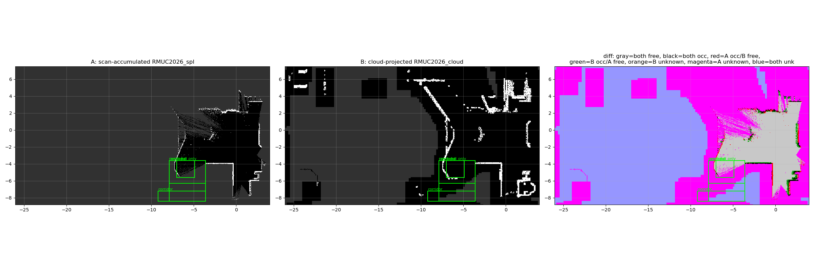

# 建图 / 定位 / 地图资产

> 建图架构与流程、重定位、Scan Context、地图资产

> **2026-11-13 合并**：本文件由 **12 份**同主题文档合并而成，原文全部保留、按来源分节（`## 来源：xxx`）。原件已删除，可从 git 历史取回。

**目录**
1. `mapping_architecture.md`
2. `mapping_2d_from_cloud.md`
3. `3d_to_2d_survey.md`
4. `mapping_relocalization_survey.md`
5. `relocalization_practice_survey.md`
6. `mapping_small_point_lio.md`
7. `scan_context_plan.md`
8. `scan_context_probe_report.md`
9. `scan_context_samesource_gate_report.md`
10. `map_assets.md`
11. `CARTOGRA_PBSTREAM_GUIDE.md`
12. `mapping_session_snapshots_merged.md`

---


## 来源 1/12：`mapping/mapping_architecture.md`


> 背景：最初方案是 `slam_toolbox 建 2D → GICP 精重定位 → SC 粗重定位`。
> 现实是 **slam_toolbox 出不了好图** ⇒ GICP/SC 拿不到好的初值 ⇒ 3D 与 2D 迟迟同时拿不到。
> 在旧 Gazebo(Classic) 上把"2D 建图 + 2D 重定位"跑通了，但 3D 侧（PCD）一直不合格。
> 于是转"纯 3D 建图（LIO-SAM）"，同时把仿真换成 Fortress。本文把这件事一次理顺。

## 0. 三个产物的关系（先认清这一点，后面的选择就都清楚了）

| 产物 | 谁用 | 唯一真源 |
|---|---|---|
| **3D PCD** | GICP（精配准）、C2C 评估 | **激光雷达实测扫描**（经回环优化） |
| **2D 栅格 PGM/YAML** | nav2 规划/代价图、AMCL | **3D PCD 的投影**（不是独立建图） |
| **SC 描述子库** | 粗重定位（给 GICP 初值） | **扫描数据**，且与在线传感器高度/范围一致 |

⇒ **顺序是固定的**：先有可信的 3D 图 → 投影出 2D → 用同一份扫描数据生成描述子。
反过来（先 2D 再反推 3D）在数学上不可能，这也是当初方案卡死的根本原因。

## 1. 为什么之前每条路都不顺

| 现象 | 根因 |
|---|---|
| slam_toolbox 出不了好图 | 它只有 2D 位姿图；`/scan` 是 3D 点云切的一层薄片，信息量本来就少；窄通道/台阶处匹配退化 |
| 拿不到 GICP/SC 的好初值 | 初值依赖"先验地图 + 描述子"，两者都没被正经生产过 |
| 3D 和 2D 同时出不来 | 原方案让 2D 当主产物，3D 是副产物；而 3D 才是几何真源 |
| PCD 不合格 | ① 前端无回环 ⇒ 长距离双层墙；② 直接拿 STL 顶点当点云 ⇒ 平面是空的；③ 没有后处理（清残影/精修/调平） |

## 2. 四条候选路线（评估）

| 路线 | 产出 | 质量 | 成本 | 结论 |
|---|---|---|---|---|
| ① LIO 建图 → 高程分析 → 2D | 仅 2D | 中（无回环时漂） | 低 | 可作**快速预览**，不作交付 |
| ② **LIO-SAM → PCD → 投影 2D** | PCD + 2D | **高**（有回环） | 中 | ✅ **主路线** |
| ③ STL → PCD → 投影 2D | 先验/基准 | 几何精确，但**不是实测** | 低 | ✅ 只作 **GICP 先验 / C2C 基准** |
| ④ **T-DT(z-localization) 工序** | PCD bundle + SC | **最高**（工序完整） | 中高 | ✅ **目标形态** |

②和④不是二选一：②是建图**前端+后端**，④是**后处理与交付形态**（清残影 → 精修 → 网格重建 → 描述子）。

## 3. 定案的流水线

```
数据采集   Classic(真逐点时间) 跑 2 圈，<0.8 m/s，含回环；LIVOX_INTRA_FRAME_TIME=1
   │
前端       small_point_lio（现有）→ 里程计 + 去畸变 + /Odometry
   │
后端       LIO-SAM（回环）→ 位姿图优化 → Corner/Surf/trajectory
   │
后处理     ① pcd_merge.py --voxel 0.05         （合并 Corner+Surf）
           ② clean_map（新，FreeDOM 思路）        （清动态残影）
           ③ CloudCompare 精修                     （去残影、**调平**、定世界原点）
           ④ 体素 0.05                            （统一密度）
   │
   ├─→ PCD/RMUC2027.pcd        ← GICP 的 target（PCD/<world>.pcd 直接生效）
   ├─→ 3D→2D 投影               ← nav2 栅格（替换现有 PGM，可 A/B）
   └─→ 网格重建 + SC 描述子      ← SC 库（必须与在线传感器一致）
```

### 3.1 3D → 2D 的三种做法（"方法要会"的那部分）

| 做法 | 算法 | 适用 | 备注 |
|---|---|---|---|
| 高度带投影 | 取 `z ∈ [地面+0.05, 地面+0.30]` 的点，落在网格里 ⇒ 占据 | 平地/窄通道 | 我们现在 `pointcloud_to_laserscan` 就是这个思路（0.01~0.20 m） |
| **高程图 (2.5D)** | 每格取 `max z`（或 p95），阈值化 + 坡度/台阶判据 | **有台阶/斜坡的 2027 场地** | ✅ 推荐；`patchwork` 的坡度/台阶判据可直接复用 |
| 可通行性分析 | 法向/坡度 + 台阶高度 + 车体尺寸 ⇒ 通行成本 | 越野/坡道 | 我们已有 `rm_ground_traversability` |

推荐组合：**高程图 + 坡度(≤35°) + 台阶(≤0.15 m) + 车宽膨胀**，输出 `trinary` 栅格，
再用 CAD 投影出的 2D 当**参考**做 A/B（门宽、可通行面积占比）。

### 3.2 "3D PCD 怎么拿到好结果"（回答更重要的那半）

1. **数据**：Classic（真逐点时间）或实车；**慢速 + 有回环**；避免只在场地一角来回；
2. **前端**：确认 `extrinsic_T/R` 与 `h_check`（我们已有回读断言）；`sensor: livox` + CustomMsg；
3. **后端**：LIO-SAM `loopClosureEnableFlag: true`；参数按 2027 槽（已有 A/B 赢家）；
4. **后处理**：`clean_map`（清残影）→ CloudCompare（**调平 + 世界原点**）→ 体素 0.05；
5. **判据**：`pcd_quality.py`（地面厚度 <0.10 m、双层 <20%）+ **与 CAD 的 C2C 距离**（新）；
6. **描述子**：在**精修后**的图上按网格重建（`bundle-step 1.5 m`、`sc-lidar-height` 与实车一致）；
   不要用建图时的原始帧直接建库（T-DT 的实测结论也是"重建的更好"）。

## 4. 与 z-localization(T-DT) 的对照

| 环节 | 他们 | 我们 | 行动 |
|---|---|---|---|
| 前端 | ZLIO | small_point_lio | 保持，够用 |
| 后端 | GTSAM 位姿图（回环+重定位） | LIO-SAM（GTSAM 位姿图） | 保持 |
| 保存 | `/save_map` → `pcd/site_raw/` | `/lio_sam/save_map` | 保持 |
| 清残影 | `clean_map_bundle`（FreeDOM） | **无** | ✅ 要补 |
| 精修 | CloudCompare（调平/原点） | 无（运行时 `odom_level` 对齐） | ✅ 离线一次更稳 |
| 网格重建+描述子 | `build_pcd_map_bundle` | 无（`RMUC2027_sc_db.npz` 来源不明） | ✅ 要补 |
| 定位状态机 | `NORMAL/…` + 协方差 | 只有"连续拒绝 25 帧" | 后续补 |

## 5. 关于 FAST-LIO / Point-LIO 自带存 PCD

| 用途 | 结论 |
|---|---|
| 快速看拼接 | ✅ 够用（一条命令出 `cloud_registered.pcd`/`map.pcd`） |
| GICP 先验 | ✅ 可以（先验不要求回环完美） |
| **最终交付图** | ❌ 无回环 ⇒ 双层墙；不处理动态残影；无世界系 |

⇒ 主路线仍用 **LIO-SAM（回环）+ 后处理**；Point-LIO 的 PCD 只当"中途检查"。

## 6. 执行顺序（建议）

1. **一次高质量 3D 建图**（Classic，2 圈，LIO-SAM）→ `pcd_quality.py` + C2C 对比 CAD；
2. 补 `clean_map`（清残影）与 `build_pcd_map_bundle`（网格+SC）两个工具；
3. 3D→2D（高程图 + 坡度/台阶）与现有 PGM 做 A/B（门宽、可通行占比）；
4. GICP/SC 用新图复测重定位成功率与初值误差；
5. gz 控制问题**与主线解耦**，继续修但不阻塞建图。

## 7. T-DT(z-localization) 与我们的 LIO-SAM 到底差在哪（2026-11-04 读源码/设计文档）

**结论：他们是自研（前端 ZLIO + 自研后端），不是 LIO-SAM 的 fork；但算法血脉是 FAST-LIO 系。**

证据（`docs/design.md`）：

> "FAST-LIO 系列采用直积流形建模，旋转通过乘法更新，位置、速度和零偏分别相加…具体可以参考"
> "我们去年的做法是直接给 LIO 加载一张先验图，然后直接启动。"
> "所以我们把 LIO 和先验图定位拆开：LIO 维护自己的里程计，先验图配准则作为测量关系加入因子图。"
> "分开之后，可以直接对先验图配准的海森矩阵做可观测性分析，再结合配准结果，判断点云匹配和定位有没有异常。"

| 环节 | 我们（LIO-SAM 路线） | Z-Localization |
|---|---|---|
| 前端 | LIO-SAM 的 `imageProjection`/`featureExtraction`（角点/面点机械式分类） | **ZLIO 自研**（FAST-LIO 系：误差状态、直接法点面配准、局部地图） |
| 后端输入 | 关键帧相对位姿 + 回环 | 关键帧相对位姿 + **先验图配准** + 回环 + UWB |
| 先验图的角色 | **不参与**（GICP/SC 是独立节点，自己发 `map→odom`） | **因子图里的一个测量**，并做**海森可观测性分析**判异常 |
| 水平化 | 运行时 `odom_level` 静态边 | **离线调平地图**（CloudCompare） |
| 地图保存 | `/lio_sam/save_map` → corner/surf/traj/transform 四个 PCD | raw bundle（关键帧 + 局部云） |
| 后处理 | **无** | 清残影(FreeDOM) → CloudCompare 精修 → 网格重建 + 描述子 |
| 启动鲁棒性 | 初值差 ⇒ GICP 直接崩（我们靠"连续拒绝 25 帧"兜） | 前端照常出 odom，配准异常被因子图/可观测性吸收，可恢复 |

### 7.1 对我们最有价值的一条设计

**把 GICP/SC 的结果从"独立发 `map→odom`"改成"后端因子图里的测量"**，并配上：
- 配准残差/内点率门限；
- **海森矩阵可观测性分析**（退化方向识别，窄通道尤其重要）；
- 异常时**只降权、不中断**（前端继续出 odom，可恢复）。

这正好解决我们遇到的"初值差 ⇒ 定位崩 ⇒ 只能重启"。

### 7.2 但优先级：先补地图工序，再换架构

| 优先级 | 动作 | 理由 |
|---|---|---|
| **P0** | 清残影 + 精修调平 + 网格重建/描述子 | 现成图纸，收益最大、风险最低 |
| P1 | 3D→2D 高程图 + 与现有 PGM 的 A/B | 决定 2D 能否由 3D 派生 |
| P2 | GICP/SC 结果入因子图 + 可观测性判据 | 架构级改动，等地图稳定后再做 |
| P3 | 评估 ZLIO 替换 small_point_lio | 收益不确定，成本最高 |

## 8. "直接学东大" = 学什么、不学什么（与现状的逐项差别）

> 前提：不是把他们的代码搬进来，而是学他们的**架构取舍**。下面每一条都写清"我们现在怎么做 /
> 他们怎么做 / 学了之后我们得到什么 / 代价"。

| # | 维度 | 我们现在 | 东大（z-localization + tdt-nav-kit） | 学了之后 | 代价/风险 | 建议 |
|---|---|---|---|---|---|---|
| 1 | **先验图的角色** | GICP/SC 是**独立节点**，自己算完直接发 `map→odom` | 先验图配准是**因子图里的一个测量**（和回环、UWB 并列），并对配准海森做**可观测性分析** | 初值差不再"崩掉整条定位"，只是这一帧权重低；窄通道退化可识别 | 要动 `map→odom` 的发布结构（我们已强调"唯一发布者"），需要新的后端或将 GICP 包成约束源 | ✅ **最值得学**（P1） |
| 2 | **地图产物** | `/lio_sam/save_map` 出 4 个 PCD，直接当先验 | 保存 raw bundle → **清残影(FreeDOM)** → **CloudCompare 精修/调平/定原点** → **网格重建 + 描述子** | 地图干净、可复现、描述子质量更高（他们实测"重建的比建图时直接存的更好"） | 多两道离线工序（可脚本化） | ✅ **收益最大**（P0） |
| 3 | **水平化 / 原点** | 运行时静态边 `odom→odom_level`（由 URDF 的 h/rpy 算） | **离线把地图调平并定世界原点** | 地图本身就是水平的，链更短 | 失去"换车/换坡自动适配"的能力；我们 `odom_level` 的优势要保留 | ⚠️ 保留我们的（不学） |
| 4 | **前端** | `small_point_lio`（Point-LIO 系） | **ZLIO 自研**（FAST-LIO 系：误差状态、点面直接法） | 理论上更稳、参数更少 | 要重调外参/时间同步；收益不确定 | ⏸ P3 再评估 |
| 5 | **后端** | LIO-SAM（关键帧 + 回环 + GTSAM） | 自研 GTSAM 图（关键帧 + 先验配准 + 回环 + UWB） | 多源融合、可恢复 | 需要重写后端或做适配 | ⏸ 跟 #1 一起做 |
| 6 | **导航/规划** | **nav2**（SMAC2D + MPPI + costmap + STVL） | **自研 tdt-nav-kit**：A*（栅格+势场+掩码）+ Minimum-Snap（OSQP） | 更轻、窄通道更可控、无 nav2 依赖 | 功能少（无行为树/恢复行为），要自己写控制器接口 | ⏸ 不急着换；但 A* 那套值得读 |
| 7 | **定位状态机** | 只有"连续拒绝 25 帧 ⇒ 停止发 `map→odom`" | `NORMAL/…` 状态机 + 协方差 + 恢复流程 | 上层能判断"现在能不能信" | 小 | ✅ 值得学（P1，一起做） |
| 8 | **UWB / 无线电坐标** | 无 | 支持 UWB 作为额外位置测量 | 2027 若有无线电坐标，可直接融合 | 依赖硬件 | ⏸ 有硬件再说 |
| 9 | **重定位输入** | 2D 栅格图（AMCL）或 3D PCD（GICP/SC）两条独立链 | 统一：先验 PCD + 描述子 | 一条链、少一套维护 | 要放弃 AMCL 那条（或只作降级备份） | ⚠️ 保留 AMCL 作降级 |
| 10 | **许可** | MIT | **GPL-2.0-only** | —— | 只能独立包/独立进程接入，或只学思路 | 只学思路更干净 |

### 8.1 结论

**该学的（按优先级）**：
1. **#2 地图工序三件套**（清残影 → 精修调平 → 网格重建 + 描述子）
2. **#1 + #7 配准入因子图 + 可观测性/状态机**
3. **#6 的 A\* + Minimum-Snap 思路**（读一读，暂不替换 nav2）

**不该学的**：
- **#3 水平化**：我们的 `odom_level` 是"换车/换场地自动适配"，别为了少一层帧把这份能力丢掉；
- **#5/#4 换前端/后端**：收益不确定、成本最高，等 P0/P1 做完再评估；
- **#10 直接搬代码**：GPL 会把整仓拖成 GPL。

### 8.2 学完之后的形态（目标）

```
ZLIO 级别的前端（可选） → 因子图后端（关键帧 + 回环 + 先验配准 + 状态机）
   → 地图工序（清理/精修/重建+描述子）
   → 3D 真源投影出 2D 栅格 → nav2（或未来的 A*+MinSnap）
```
我们现有资产（`odom_level` 契约、nav2 参数、patchwork、GICP/SC 节点、回读断言、A/B 脚本）**全部保留**，
只是把"配准"从独立节点升级成因子图约束、"地图"从副产物升级成工序产物。

## 9. "完全学 T-DT"的可行性：z-localization + tdt-nav-kit 优缺点

### 9.1 两个仓库的定位（先分清）

| 仓库 | 是什么 | 是否 ROS 包 | 提供什么 |
|---|---|---|---|
| **z-localization** | ROS 2 Humble 的**定位/建图栈**（ZLIO 前端 + 自研后端） | ✅ 是（`frontend` + `backend`） | 里程计、先验图定位、回环、重定位、地图工序、UWB |
| **tdt-nav-kit** | **C++ 规划库 + demo**（`project(play)`，`add_executable(play ...)`） | ❌ **不是**（无 package.xml / 无节点 / 无 TF） | `YAstar`（A* / Kinodynamic A*）+ `MinimumSnap`（OSQP）+ SFC 走廊约束 |

依赖：nav-kit 需要 **Eigen3 + OSQP + OsqpEigen**（后两者以子模块放 `3rd/`），OpenCV 只用于 demo。

### 9.2 优点

**z-localization**
1. 前端**分段自适应更新**（在"整帧"和"逐点"之间折中，缓解抖动/算力）；
2. 地图结构（VoxelMap 矩统计）实测 CPU −63~73%、内存 −87~91%；
3. **把先验图配准做成因子**（我们最缺的那一块）；
4. 退化处理成体系：Schur 分析 + 预条件 + 白化 + **NIS/χ²**；
5. 状态机 + 恢复（重定位后锚定）；
6. **UWB** 融合（2027 若有无线电坐标可直接用）；
7. 完整**地图工序**（清残影 → 精修 → 网格重建 + 描述子）；
8. 有比赛成绩背书。

**tdt-nav-kit**
1. **轻**：Eigen + OSQP，无 ROS 依赖，易嵌入；
2. A* 带**势场代价 + 多层掩码**（临时障碍/禁行区），很贴 RM 场景；
3. 有 **Kinodynamic A\***（考虑速度/加速度）；
4. **Minimum-Snap + SFC**（五次多项式 + 安全走廊方形约束）⇒ 轨迹平滑、适合高速；
5. 代码量小，可读可改。

### 9.3 缺点 / 集成成本

**z-localization**
| 项 | 影响 |
|---|---|
| **GPL-2.0-only** | 我们 MIT ⇒ 只能独立包/独立进程，或只学思路 |
| **帧树不同**（无 `odom_level`） | 接入我们要改适配，或放弃"地面 z=0"契约 |
| 地图资产要重做（prior bundle） | 多一道工序 |
| 不含导航 | nav2/控制器仍要自己搞 |
| 自研代码，作者自述"代码质量拉胯" | 维护、调参自己扛 |

**tdt-nav-kit**
| 项 | 影响 |
|---|---|
| **不是 ROS 包** | 要自己包成 nav2 planner plugin 或独立节点 |
| **只有规划** | 无控制器、代价图、恢复行为、行为树 |
| 输入是**裸栅格数组** | 要做栅格化/膨胀/掩码维护 |
| OSQP + OsqpEigen 子模块 | 依赖安装/编译 |
| 与 nav2 语义打通 | STVL/patchwork 信息怎么变掩码 |

### 9.4 "完全学"的完整拼图与缺口

| 模块 | T-DT 提供 | 我们要自己做 |
|---|---|---|
| 前端 LIO | ZLIO | 可保留 `small_point_lio` |
| 后端定位 | z-localization ✅ | — |
| 地图工序 | clean/build bundle ✅ | 直接学 |
| 全局规划 | tdt-nav-kit（库） | **包成 ROS 节点/插件** |
| 局部规划/控制 | ❌ | nav2 controller（MPPI）或自研 |
| 代价图/障碍层 | ❌ | nav2 costmap + patchwork/STVL |
| 行为树/恢复 | ❌ | nav2 BT |
| TF/帧约定 | 他们自己的 | 我们的 `odom_level` 体系 |

⇒ **"完全学" ≠ 拿来即用**：定位/建图是完整的，导航只给了规划内核。
最现实是**混合路线**：

| 路线 | 内容 | 工作量 | 风险 |
|---|---|---|---|
| A 全替换 | z-localization + nav-kit + 自写控制器/代价图 | 3~4 周 | 高 |
| **B 混合（推荐）** | 定位/建图学他们（或独立跑对照）；规划把 YAstar **包成 nav2 planner plugin**，保留 nav2 的 controller/BT/costmap | 1~2 周 | 中 |
| C 只借思路 | 地图工序 + 配准因子 + A* 算法思想 | 3~5 天 | 低 |

### 9.5 STL → PCD 的精度处理

**先纠正一个说法：不需要为了精度去转 OBJ。**
STL 与 OBJ 都是三角网格，几何**无损**；OBJ 只是多了索引/材质。工具链只吃 OBJ 时转一次也**无损**（不要重采样）。

| 精度要点 | 做法 |
|---|---|
| **1. 表面采样，不是顶点** | 面积加权 + 重心坐标（`mesh_to_pcd.py` 已实现） |
| **2. 体素尺寸** | GICP target 建议 **0.01~0.03 m**；0.05 只适合粗配准/可视化 |
| **3. 单位/坐标系** | mm→m（工具自动判）、原点与场地系一致 |
| **4. 重复面** | STL 可能含双面/重叠三角形 ⇒ 密度翻倍；用面积加权+体素可缓解 |
| **5. 法向** | PCL GICP 内部用协方差，不需要外部法向；点面 ICP 才需要 |

**验证方法（三个层次）**
1. 采样点到网格距离应 ≈0（<1e-6 m，可用 CloudCompare `Sample points` 对照）；
2. **C2C**：CAD 图 vs 实扫图，看系统偏差（应 1~2 cm，除场地施工误差）；
3. **GICP 收敛**：同一帧扫描分别对 CAD（0.02 / 0.05 两版）配准，比 fitness / 迭代次数 / 残差。

**工具选择**

| 工具 | 适合 | 备注 |
|---|---|---|
| **`mesh_to_pcd.py`（代码）** | 可复现、可 CI、参数留档 | ✅ 推荐（无依赖） |
| CloudCompare | 交互式验证、C2C 距离 | GUI，适合抽查 |
| trimesh | Python 快速原型 | 需装包 |

**参数建议**
```bash
# 精度优先（GICP target）
python3 tools/scripts/diag/mesh_to_pcd.py <field.stl> \
  -o PCD/RMUC2027_cad_fine.pcd --points 8000000 --voxel 0.02

# 对照（粗配准/可视化）
python3 tools/scripts/diag/mesh_to_pcd.py <field.stl> \
  -o PCD/RMUC2027_cad_coarse.pcd --points 4000000 --voxel 0.05
```

## 10. 更正：z-localization + tdt-nav-kit 是**一套方案**（但不是"一套代码"）

### 10.1 作为方案，它们是一套

| 层 | 谁提供 | 接口 |
|---|---|---|
| 定位/建图 | **z-localization** | 输出 `map→odom`、全局位姿 + 协方差、先验地图包 |
| 全局规划 | **tdt-nav-kit**（`YAstar`） | 吃 **2D 栅格**（0=free，非 0=占用，行主序）+ 起终点 ⇒ 路径 |
| 轨迹优化 | **tdt-nav-kit**（`MinimumSnap` + SFC） | 吃路径 + 走廊约束 ⇒ 平滑轨迹（位置/速度/加速度） |

⇒ 同一支队伍的两半：**定位给"我在哪"，规划给"怎么走"**，接口是对得上的。

### 10.2 但作为开源代码，**中间那层没有开源**

`tdt-nav-kit` 的完整文件清单（`git ls-tree` 实测）：

```
CMakeLists.txt  LICENCE  README.md  main.cpp
doc/{Astar,MinimumSnap,Usage}.md
src/YAstar/{yastar,kinodynamicAstar}.{cpp,hpp}
src/MinimumSnapOsqp/{minimumSnap,sfcSquare}.{cpp,hpp}
scripts/setup.sh  3rd/.gitkeep
```

**没有** `package.xml`、**没有** `rclcpp` 节点、**没有** TF/话题、**没有**控制器。
`CMakeLists.txt` 只有 `project(play)` + `add_executable(play main.cpp ...)`。

⇒ "一套方案"里**缺的三块**（需要我们自己补）：

| 缺口 | 具体做什么 |
|---|---|
| **① ROS 胶水** | 把 `YAstar` 包成 **nav2 planner plugin**（`nav2_core::Planner`），或独立 planner 节点 + `FollowPath` action |
| **② 栅格/代价图维护** | 定位给的是**先验图**；实时障碍（人/车/动态）要另一层 ⇒ 我们有 patchwork/STVL/nav2 costmap |
| **③ 控制器** | Minimum-Snap 输出的是**带时间的轨迹**；nav2 的 controller 是"跟路径点" ⇒ 要写轨迹跟随，或把轨迹离散成 `Path` 交给 MPPI |

**好消息**：nav2 `costmap_2d` 的 `unsigned char*` 布局（行主序、0=free）**正好是 `YAstar::setMap` 要的格式**，
所以 ① 的适配层很小（几十行）。

### 10.3 建议的两阶段路线

| 阶段 | 做什么 | 保留什么 | 工作量 |
|---|---|---|---|
| **一（先做）** | 保留 nav2 的 costmap/controller/BT，**只把 planner 换成 YAstar**（planner plugin） | nav2 全部中间层 | 2~4 天 |
| 二（可选） | 把 Minimum-Snap 轨迹接到控制器（写轨迹跟随，或离散成 Path 给 MPPI） | 逐步替换 | 1~2 周 |
| 三（可选） | 定位换 z-localization（含先验配准因子/状态机） | 注意 GPL 与 `odom_level` 帧契约 | 2~3 周 |

## 11. 用东大做规划器 + 保留 nav2 MPPI：到底要拿仓库里的哪部分

### 11.1 架构（确认）

```
nav2 骨架：costmap_2d（含 STVL/patchwork 障碍） + BT + **MPPI（保留）**
                 │
                 ▼
       planner plugin（我们自己写，几十行胶水）
                 │  取 costmap 的 unsigned char*（行主序，0=free）
                 ▼
        tdt-nav-kit 的 **YAstar**（A* / Kinodynamic A*）
                 │  → nav_msgs/Path
                 ▼
              MPPI 跟踪
```

### 11.2 仓库里**只拿一半**，不是全部

| 目录/文件 | 用不用 | 原因 |
|---|---|---|
| `src/YAstar/yastar.{hpp,cpp}` | ✅ **要用** | A* 本体；内含"障碍距离势场"（从变量名 `f/dt/v/z` 看是 **Felzenszwalb 距离变换**的经典实现） |
| `src/YAstar/kinodynamicAstar.{hpp,cpp}` | ⚠️ 可选 | 需要"动力学可行"路径时用；MPPI 已经处理动力学，初版可不用 |
| `src/MinimumSnapOsqp/*` | ⚠️ 看路线 | **更正**：`SolveOutput` 只有 `path`（位置点）+ `corridor/iter/time/success`，**没有**逐点时间/速度；时序只能从 `SolveInput::getTimeAllocated()` 拿到**分段时长**（原判断"输出 x(t),v(t),a(t)"是错的） |
| `src/YAstar/kinodynamicAstar.*` | ⭐ **"全用上"时应选它** | `Result::trajectory` 是 `vector<Sample>`，`Sample{state[x,y,vx,vy], acceleration, time}` ⇒ **这就是带时间的完整前馈轨迹**，控制器可直接用 |
| `main.cpp`（498 行 demo） | ❌ | 读地图图片 + 可视化（OpenCV），仅参考用法 |
| `3rd/`（OSQP/OsqpEigen 子模块） | ❌ | 只有 MinimumSnap 需要 |

⇒ **只用 `src/YAstar/` ⇒ 只依赖 Eigen**（不需要 OSQP/OsqpEigen，也不需要 OpenCV），集成面大幅缩小。

### 11.3 实测到的两个集成约束（重要）

1. **需要 C++20**：`yastar.cpp` 用了 `std::span`（第 681~713 行）；
   实测 **GCC 11 + `-std=c++20` 可编译**（本机 gcc 11.4）⇒ 插件 target 里设
   `set_target_properties(... CXX_STANDARD 20)`，或把 8 行 `std::span` 换成裸指针（更保守）。
2. **数组布局正好匹配**：nav2 costmap 的 `getCharMap()` 是行主序、`0 = free`，
   与 `YAstar::setMap` 要的语义一致 ⇒ 适配只需要处理"膨胀阈值 / 原点 / 分辨率"。

### 11.4 如果以后想用 MinimumSnap 怎么办

只有一条路：**自己写轨迹跟踪控制器**（前馈 `v(t)` + 纯跟踪/MPC 反馈，约 60 行起），
把 `Path` 换成自定义 action，让控制器按时间采样轨迹。
**那时 MPPI 就要让位**——两条路线互斥，二选一。

### 11.5 A/B 验收指标（对比 SMAC2D）

| 指标 | 怎么量 |
|---|---|
| 规划耗时 | 日志时间戳差 / `ros2 topic hz` 不合适，用插件内计时 |
| 路径长度 | `Path` 累积长度 |
| 最小离障距离 | 路径点查 costmap 值 |
| **窄通道通过率** | 固定 10 组起点/终点，统计成功次数 |
| **MPPI 跟踪误差** | `odom_error.py` + 终点误差 |

## 12. 规划全用他们的 + 控制器用 MPPI：可以，但要说清丢什么

### 12.1 结论

**可以。** MPPI 的唯一输入是 `nav_msgs/Path`，所以只要把他们的规划结果**采样成 Path** 即可。
代价是：**逐点的时间/速度剖面会丢**（`Path` 只带几何）。

### 12.2 转换后还剩什么

| 他们的产出 | 转成 Path 后 | 说明 |
|---|---|---|
| YAstar 的 A* 路径 | ✅ 保留 | 几何 |
| KinodynamicAstar 的轨迹形状 | ✅ 保留 | 形状（动态可行性体现为"弯得更缓"） |
| MinimumSnap 的平滑 | ✅ 保留 | 几何平滑、曲率连续 |
| SFC 走廊 | ⚠️ 只间接保留 | 路径被约束在走廊内，但走廊本身丢了 |
| **逐点速度/加速度/时间** | ❌ **丢失** | Path 没有这个字段 |

### 12.3 但速度信息可以"部分救回来"（实测可行）

nav2 的 MPPI **实现了 `setSpeedLimit(double, bool)`**（`libmppi_controller.so` 里有符号
`nav2_mppi_controller::MPPIController::setSpeedLimit`）⇒ 它遵守 nav2 的 **SpeedFilter / `nav2_msgs/SpeedLimit`** 机制。

于是可以：

```
Kinodynamic/MinSnap 轨迹（带 v(t)）→ 离散成"空间限速区" → SpeedFilter → MPPI 遵守
```

⇒ 位置精度由 Path 保证，**速度上限由限速区保证**，比纯几何 Path 更接近原轨迹意图。

### 12.4 四种组合

| 组合 | 规划 | 控制 | 工作量 | 用他们多少 | 备注 |
|---|---|---|---|---|---|
| **A** | YAstar → Path | MPPI | 2~4 天 | 1/4 | 最省事，先验证 A* |
| **B** | YAstar → MinSnap（平滑）→ 采样 Path | MPPI | 4~6 天 | 1/2 | 加 OSQP 依赖；几何更好 |
| **C** | A/B + 速度剖面转限速区 | MPPI | +1~2 天 | 3/4 | **兼顾几何与速度** |
| **D** | Kinodynamic/MinSnap 轨迹 | 自写前馈控制器 | 1~2 周 | 4/4 | MPPI 让位，最贴近东大 |

**推荐顺序：A →（窄通道仍不够好才）B →（要速度约束才）C**；D 只在明确要"完全对齐"时做。

## 13. SFC、MPC 与 MPPI：三者怎么配

### 13.1 SFC 为什么重要

**SFC（Safe Flight Corridor）= 沿路径生成一串凸的"安全走廊"（他们的是矩形 `PointPair{xmin,ymin,xmax,ymax}`），
把"避障"这个非凸问题变成"在凸盒内"的凸约束。**

| 价值 | 说明 |
|---|---|
| **硬保证** | 轨迹只要满足走廊约束，就**一定**在自由空间内（不是"大概率"） |
| **可解性** | 凸约束 ⇒ QP/SOCP 可解、稳定、可实时 |
| **高速** | 允许贴着走廊边界飞，路径更"紧"，时间最优 |
| **可调试** | 走廊能可视化，出问题一眼看出是"走廊生成错"还是"优化错" |

⚠️ **但 SFC 的价值只有在"消费它的优化器"里才体现**：
他们的 `MinimumSnap` 用 SFC 当约束；**MPPI 不吃凸走廊约束**（它只有软性 critic）。
⇒ **用 MPPI 时，SFC 只剩"路径被约束在走廊内"的几何收益，硬保证丢了。**

### 13.2 MPC 可以吗？——可以，而且它才是 SFC 的"正确消费者"

- MPC（这里是**基于优化的 MPC**）：每个控制周期解一个带约束的最优控制问题（QP/NLP），
  约束里可以**直接写走廊**（`x ∈ corridor_k`）、速度/加速度上限；
- 依赖：**OSQP** 就够（tdt-nav-kit 已经在用），不需要 acados；
- 规模：状态 4~6 维、控制 2~3 维、时域 20~40 步 ⇒ QP 通常 **1~5 ms**，10~50 Hz 可跑；
- 代价：要写 QP 公式化 + 线性化（麦轮运动学很简单）+ 不可行时的降级策略。

⇒ **"他们的 MinSnap 轨迹 + 走廊约束的 MPC" 是这套设计里最自洽的组合**（路线 D 的正确形态）。

### 13.3 MPPI vs MPC：本质区别

| | **MPPI**（nav2_mppi_controller） | **MPC**（凸优化） |
|---|---|---|
| 方法 | **采样**：撒 N 条控制序列 → 模型 rollout → 按代价指数加权平均 | **优化**：解一个带约束的 QP/NLP |
| 约束 | **软约束**（变成代价项） | **硬约束**（不可行就是不可行） |
| 代价形状 | 任意（非凸、不可导） | 需凸/可线性化 |
| 典型算力 | N×T 次 rollout（CPU 上 1000~2000 条样本） | 一次 QP（1~5 ms） |
| 调参 | λ、σ、critics 权重（多） | 权重矩阵 Q/R（直观） |
| 失败模式 | 样本不够/λ 不当 ⇒ 抖动或"不敢走" | 模型不准/不可行 ⇒ 解不出或偏 |
| SFC | ❌ 用不上 | ✅ 直接用 |
| 轨迹时序 | ❌ 用不上（只吃 Path） | ✅ 可直接跟踪 `(x,v,a)(t)` |
| nav2 支持 | ✅ 官方插件 | ❌ 无官方实现，要自己写 |
| 本质 | **是一种随机采样型 MPC** | 优化型 MPC |

> 一句话：**MPPI 是"用采样近似求解 MPC"；MPC 是"用优化精确求解 MPC"。**
> 两者都叫"预测控制"，区别在**怎么解**，不在"预测"。

### 13.4 决策表

| 你的目标 | 选什么 |
|---|---|
| 最少工作量、够用、可回退 | **MPPI + Path**（A 组合） |
| 想要他们的几何平滑，仍用 MPPI | MPPI + MinSnap 采样 Path（B）+ 限速区（C） |
| **想真正吃到 SFC 的硬保证 + 轨迹时序** | **MPC（走廊约束）+ MinSnap 轨迹**（D 组合） |
| 极简、能跑就行 | 前馈 + 纯跟踪（60 行） |

### 13.5 工作量

| 路线 | 内容 | 工作量 |
|---|---|---|
| A | YAstar → Path → MPPI | 2~4 天 |
| C | + MinSnap 平滑 + 限速区 | 4~7 天 |
| **D-MPC** | MinSnap 轨迹 + 走廊约束 MPC（OSQP） | **1.5~2.5 周** |

## 14. 各模块的"输入清单"：ZLIO / 定位后端 / 导航

### 14.1 ZLIO（前端）需要什么

| 项 | 必需？ | 说明 |
|---|---|---|
| `/livox/lidar` | ✅ | `CustomMsg`（需 `offset_time`+`timebase`）或 `PointCloud2`（需配置逐点时间字段），小端 |
| `/livox/imu` | ✅ | 角速度 rad/s、加速度 m/s²；**不读** orientation/协方差 |
| `config/lio.yaml` | ✅ | 话题名、`sensor.body_from_lidar`（LiDAR→IMU 外参）、帧名（默认 `odom`/`imu`）、逐点时间字段、`publish_tf` |
| `/clock` | 仿真时 ✅ | `use_sim_time` |
| **PCD / 先验图** | ❌ **不需要** | 纯里程计，自建局部地图（VoxelMap） |
| **外部 TF** | ❌ 不需要 | "输入 `frame_id` 不触发 TF 转换"——外参必须**在 yaml 里写对** |

**输出**：`/odometry`（高频）、`/lidar_odometry`（每帧）、`/frontend/frame`（位姿+去畸变云+状态）、
`/tf`（`world_frame→body_frame`，默认 `odom→imu`）、`/zlio/reset_internal`（服务）。

**注意**：导出点云是 **float32 XYZ**，统一到 IMU 系，**不保留 intensity/ring/时间字段**。

### 14.2 定位后端（`mode:=localization`）需要什么

| 项 | 必需？ | 说明 |
|---|---|---|
| **prior_map 地图包** | ✅ | `keyframes.txt` + `clouds/` + 描述子文件（+ 可选 `map.pcd`） |
| 前端输出 | ✅ | 每帧去畸变云 + 同步里程计 |
| `backend.yaml` / `site.yaml` | ✅ | 描述子类型、`sc_lidar_height`、`sensor_z`、UWB 开关 |
| UWB | 可选 | 无图时或用它提供绝对参考 |

### 14.3 导航（tdt-nav-kit）需要什么

| 项 | 必需？ | 说明 |
|---|---|---|
| **2D 占据栅格** | ✅ | `vector<int8_t>`，行主序，`0=free`；配 `setMapping()`（分辨率）+ `setOriginPos()` |
| 起点/终点（world 坐标） | ✅ | |
| 当前速度/加速度 | Kinodynamic 时 ✅ | `search(start, startVel, startAcc, end)` |
| 最大速度/加速度 | ✅ | `maxVel`/`maxAcc`（Kinodynamic）、`setMaxSpeed/setMaxAcc`（MinSnap） |
| **Mask 层**（临时障碍/禁行） | ✅ 现实必需 | 对手车、临时封路；`pushMask()` 带 `duration` |
| 走廊 | MinSnap 自动生成 | `setMap()` 给图即可；也可手工 `Item::corridor` |
| **控制器** | ❌ **他们没有** | 需自写（前馈+纯跟踪）或 MPPI/MPC |

**PGM 是"文件格式"，不是"接口"**：nav2 用 `map_server` 读 PGM+YAML → 得到栅格数组；
我们要么从 PGM 读，要么**从 3D 图现算栅格**（P2-1 的高程图）。

### 14.4 对照我们现有资产

| 需要 | 我们有没有 |
|---|---|
| LiDAR + IMU | ✅（Classic/gz 都有） |
| 外参 yaml | ✅（URDF 里已有，需导出成他们的字段） |
| 2D 栅格（PMG/YAML） | ✅（`RMUC2027_v2`） |
| 3D→2D 生成 | ⚠️ 待做（P2-1） |
| 先验地图包 | ⚠️ 待做（`build_pcd_map_bundle`，可用 CAD 图） |
| 动态障碍层 | ✅ nav2 costmap/STVL（他们的 Mask 需另接） |
| 控制器 | ✅ MPPI（他们的方案要自写） |

## 15. 旧 3D 链 vs T-DT：到底各自要准备什么

| 我们的旧 3D 链 | T-DT 对应 | 差别 |
|---|---|---|
| **PCD**（`PCD/<world>.pcd`，GICP target） | **prior_map 地图包**（`keyframes.txt` + `clouds/` + 描述子 + 可选 `map.pcd`） | 不是裸 PCD；由 `build_pcd_map_bundle --input <全局PCD>` 生成 |
| **GICP 初值**（`/initialpose` 或 config 的 initial_pose） | **不需要人工给**：后端用「描述子检索 → 配准 → 锚点」自动初始化/重定位 | **省掉手动点 Pose Estimate** |
| **SC 的 bag**（`build_sc_db -- --bag <bag>`） | **不需要单独录 bag**：描述子由 `build_pcd_map_bundle` **从地图模拟局部扫描**生成；重建用 `rebuild_scan_context_descriptors` | 少一道数据采集 |
| **2D PGM**（AMCL / nav2） | 定位**不需要**；**导航需要** 2D 栅格（我们自己从 3D 投影） | 3D→2D 归我们（P2-1） |
| 建图一圈（bag 或实时） | 建图一圈 → **raw bundle** → 清理 → 精修 → 生成 bundle | 产物形态不同（bundle vs 4 个 PCD） |

**所以 T-DT 要准备的就四样**：
1. **一次建图数据**（或 CAD 图顶替，仅验证工具链）；
2. **一个全局 PCD**（精修后）→ 生成 prior_map 包；
3. **`lio.yaml`**（话题、`sensor.body_from_lidar` 外参、逐点时间字段）+ **`backend.yaml`/`site.yaml`**（场地范围、`sensor_z`、`sc_lidar_height`、描述子类型、UWB 开关）；
4. **（导航）2D 栅格** + 速度/加速度上限 + Mask 策略。

**不需要**：手动初值、单独的 SC 建库 bag、定位用的 PGM。

## 16. 用 0.02 PCD 的正确姿势 + MPC 能否"离线先做"

### 16.1 0.02 PCD 怎么用、会不会更准

**关键事实：`build_pcd_map_bundle` 的默认 `--map-voxel` 是 0.4 m！**
⇒ 如果直接喂 0.02 的 PCD 而不管这个参数，**细节会被 0.4 m 下采样抹掉，等于白做**。

| 场景 | 命令 | 是否更准 |
|---|---|---|
| **我们自己的 GICP** | `cp RMUC2027_cad_fine.pcd PCD/<world>.pcd` | ⚠️ 略准（1.26 cm vs 3 cm），但实扫间距 6 cm 决定上限；主要收益是**细结构不被抹掉** |
| **他们的地图包** | `--input ...fine.pcd --map-voxel 0.05 --scan-voxel 0.05` | ✅ 只有**同时调小 `--map-voxel/--scan-voxel`** 才有意义 |
| 只换 PCD、不改参数 | `--input ...fine.pcd`（默认 0.4） | ❌ 完全无效 |

**`build_pcd_map_bundle` 其它默认值（要注意）**：
`--sensor-z 0.35`、`--query-step 2.0`、`--bundle-step 1.5`、`--query-yaws 0,90,180,-90`、
`--bundle-yaws 0`、**`--occlusion false`（默认不模拟遮挡 ⇒ 会"看穿墙"）**、`--write-map-pcd true`。

### 16.2 MPC 可以"不跑仿真"先做吗——可以，而且应该先这么做

**能离线做的是"MPC 本身"**（数学 + 求解 + 闭环跟踪），**不能离线验证的是"接入 nav2 后的实时性/接口"**。

| 能离线验证 | 怎么验 |
|---|---|
| 闭环跟踪精度 | 自写小车模型（mecanum：`p += R(θ)·[vx,vy]dt; θ += ωdt`）+ 50 Hz 步进 |
| 走廊约束是否满足 | 每步检查解是否落在 box 内 |
| 速度/加速度限制 | 检查控制量与增量 |
| 不可行处理 | 走廊被封 ⇒ 应触发降级（纯跟踪/停车） |
| 求解耗时 | `std::chrono`，目标 p95 < 5 ms |
| 数值稳定性 | 随机初始偏差、噪声、延迟（1~3 帧） |

| 只能上仿真/实车验 | 原因 |
|---|---|
| nav2 `Controller` 插件接口 | 需要 `controller_server` |
| TF 延迟、costmap 更新频率 | 运行时行为 |
| 底盘真实动力学（打滑/惯性） | 模型不准 |

**离线开发顺序**：
1. `mpc_core`（Eigen）：状态 `[x,y,θ,vx,vy,ω]`、参考轨迹、走廊 box 约束、成本；
2. 线性化：绕参考轨迹做 LTV（2~3 次 SQP 迭代即可）；
3. QP 求解：本机**目前没有 osqp**（`/usr/include/osqp*.h` 为空、无 python osqp、无 proxsuite）
   ⇒ 先装 `libosqp-dev`，或用 Eigen 自写**箱式约束 QP**（投影梯度/ADMM，几十行）；
4. 闭环测试：直道、90° 弯、窄道、走廊被封；
5. 最后再包成 `nav2_core::Controller` 插件。

**结论**：MPC 的 90% 可以在**没有 Gazebo、没有 ROS** 的情况下做完并测出指标；
剩下 10%（插件接口/实时性）需要一次仿真。这也正好绕开当前 gz 车轮驱动卡住的问题。


---


## 来源 2/12：`mapping/mapping_2d_from_cloud.md`


> **★ 2026-10-07 现状（后加的，先读这一行）**：本文的 §6/§11 判定"点云投影图（`RMUC2026_cloud`）比
> `/scan` 累积图（`RMUC2026_spl`）好"，那是在**同一批旧图**之间比。此后又出现了两张新候选，并且
> **当前默认 2D 先验已经换人**：`map/RMUC2026.pgm|yaml` = `RMUC2026_v3` 那次建图会话的图
> （2026-10-07 提升；旧的那份留在 `map/RMUC2026.pgm.bak-20261007`）。
> 四张候选的**同一把尺子**（`verify_low_terrain.py`）实测、提升依据、换图与回滚流程 ——
> 全在 **`docs/map_assets.md`** §3/§4。本文的工程结论（"坡道为什么会从 2D 图里消失"、
> `pcd_to_nav2_map.py` 的判据与坐标约定、`/scan` 丢帧）**不受影响，仍然有效**。

> 面向的问题（现场观察）：
> `world:=RMUC2026 mode:=mapping lio:=small_point_lio mapper:=slam_toolbox` 建图时
> ① 走到**带凸起边沿的坡道/走廊**（无顶棚）那一段，图会"歪"；
> ② 坡道在 **3D 点云里清清楚楚，在 2D 栅格图上基本看不见**。
>
> ② 的原因不是 bug 而是**链路本身**：2D 图来自 `/scan`，而 `/scan` 是
> `linefit 地面分割 → pointcloud_to_laserscan`（传感器系窄高度带，有效 ≈0.05–0.33 m）
> 的产物 ⇒ **坡度够缓的斜面被判成地面 ⇒ 从 `/scan` 里彻底消失**。
> 用户的决定：**2D 导航图不再从 `/scan` 推，改成从 3D 点云投影**，让 2D/3D 先验同源，
> 并且**可行驶的斜面保持 FREE**。
>
> 本文覆盖两件事：**A 建图稳健性**（丢帧量化 + 跳变哨兵 + 坡道段证据/判定）与
> **B 点云→2D 工具与其 A/B**。相关背景：`docs/mapping_small_point_lio.md`（建图链审计）、
> `docs/worlds.md`（场地资产）、`docs/tf_interface_contract.md`（`map→odom` 单发布者契约）。

> 🔗 相关（2026-10-06）：`docs/path_clearance_and_contact.md` —— 本文头注②（"坡道在 3D 点云里清楚、
> 在 2D 栅格图上基本看不见"）的**导航侧后果**：用 `RMUC2026.stl` 逐格还原场地高度后实测
> 「静态图判自由、而场地高度 >0.10 m」的格 **88 576 个（占自由区 51.6%）**；
> 车在坡脚（map `(-3.6, 3.1)`，图上是自由、`/scan` 也不报）以 1.7 m/s 上坡时 IMU 冲到
> **79~90 m/s²**，`linefit` 的 `max_slope ±0.4` 正是"坡道面被当地面删掉"的参数依据。

## 0. 一句话结论

| # | 问题 | 结论 |
|---|---|---|
| A1 | `/scan` 被 slam_toolbox 的 tf2 MessageFilter 丢帧 | **根因是 `scan_queue_size=1`（slam_toolbox 源码默认，本仓没配）**：只要"上一条还在等 TF"时又来一条，后到的就直接被丢。实测基线 **0.40 次/仿真秒 = 4.03% 的 `/scan`**（且间隔**恰好 2.5 仿真秒一条**，min=p50=p90=2.5 ⇒ 系统性的，不是负载尖峰）；`target_frame: base_link` 与 `transform_timeout 0.2→0.5` 都**不能**降丢帧（详见 §2 表），`minimum_time_interval 0.5→0.2` 也不行。**丢帧不是"图歪"的主因**（四个变体丢帧率都在 4.03~4.04%，跑图表现与丢帧量级无关） |
| A2 | 需要一个"图被掰歪的那一下"立刻报警的东西 | 新增 `tools/scripts/diag/map_odom_jump_gate.py`：盯 `map→odom` 的单步增量，超阈值打 `WARNING` + 发 latched `~/jumped`；**故意只报警不拦**（拦就得当第二个 `map→odom` 发布者，见 §3）。用它**真的抓到了**：4 次跑共 6 次单步跳变，最大 **`Δxy=11.95 m`、`Δz=7.36 m`、`Δyaw=45.1°`、`Δmax-rot=69.4°`**（`target_frame=base_link` 那次跑） |
| A3 | "图歪"到底是什么造成的 | **触发者是 (iii) 物理卡死/被顶起**（走廊口车头顶在 0.13~0.21 m 处、单侧被顶起 ⇒ LIO roll 摆到 20°+）；**(i) 几何退化**（1.05 m 平行墙走廊）让它无法自我纠正；**(ii) 地面分割把 23° 坡判成地面**让坡面从 `/scan` 消失（坡道段有限束数只有其余段的 31%）⇒ 扫描匹配失去唯一特征。三者分工与数字见 §4 |
| B4 | 点云→2D 工具 | 新增 `tools/scripts/mapping/pcd_to_nav2_map.py`：0.05 m 栅格；占用 = **相对"局部地面"的高度** 超过阈值（默认 0.15 m，与 STL 管线同口径）**或**"又陡又高"；**缓坡（≤25°）保持 FREE**；窗口/原点沿用**出生点相对系**（`amcl initial_pose=(0,0)`、gicp `initial_pose=[0,0,0]` 不用改） |
| B5 | 两张 2D 先验 A/B | 坡道段：`/scan` 图 **100% unknown 或干脆在图外**（走廊整条 6.72 m² 全在窗口外）；点云图 **97~99% free**、凸起边沿还留了占用格。回归两张都 **PASS**，但**规划器对坡道/走廊目标：A 图 2/5（3 个直接拒绝）、点云图 5/5 全部给出路径** ⇒ **对"坡道能不能走"这个问题，点云图是唯一能用的**（数字见 §6） |
| B6 | 跑图规程 | §7 给了"不把图跑歪"的操作顺序与判据 |

---

## 1. 复现环境（所有数字都在这个隔离下跑出来）

```bash
# 每条命令一个 PID namespace ⇒ 启动/驱动/落盘/统计必须塞进**同一次 bash 调用**
HOME=/tmp/gzhome-<tag>  ROS_DOMAIN_ID=<非默认>  GAZEBO_MASTER_URI=http://127.0.0.1:<port>
unset DISPLAY  nav_rviz:=False
```

| 工具 | 干什么 |
|---|---|
| `tools/scripts/mapping/mapping_ab_run.sh` | 一次跑图：**临时**改 1~3 个上游参数（trap 里逐字节还原）→ 起 `mode:=mapping` → 并行跑探针+哨兵 → `coverage_drive.py` 走路线 → 存 2D → 数丢帧 → 写 `<tag>.summary.json` |
| `tools/scripts/mapping/ramp_section_probe.py` | 同时间轴记录 `/odom`(LIO) vs `/odom_ground_truth`、`map→odom`、`/scan` 全量 ranges、`/cmd_vel_chassis`、`/map`；自动找"发着速度但不动"的窗口 |
| `tools/scripts/diag/map_odom_jump_gate.py` | `map→odom` 单步跳变哨兵（§3） |
| `tools/scripts/mapping/pcd_to_nav2_map.py` | 3D 点云 ⇒ nav2 `pgm`+`yaml`（§5） |
| `tools/scripts/mapping/compare_2d_maps.py` | 两张 2D 图 A/B（区域计数 + 对比图） |
| `tools/scripts/regress/plan_probe.py` | 直接问 nav2 规划器"这个目标能不能规划"（同一起点/终点做 A/B） |
| `tools/scripts/mapping/nav_map_ab_run.sh` | 把候选图**临时**放到 launch 硬编码的 `map/<world>.pgm/.yaml` 上跑一次 nav，跑完删掉并核对目录 |

---

## 2. A1：`/scan` 丢帧量化与 A/B

### 2.1 丢帧长什么样、根因在哪

日志里刷的是（`async_slam_toolbox`，`world:=RMUC2026 lio:=small_point_lio`）：

```
[INFO] [slam_toolbox]: Message Filter dropping message: frame 'livox_frame'
       at time 2.400 for reason 'discarding message because the queue is full'
```

`at time 2.400` 是**被丢那条 `/scan` 的仿真时间戳**（所以能直接算速率）。

源码根因（`src/localization/rm_localization/slam_toolbox/src/slam_toolbox_common.cpp`）：

```cpp
:155  scan_queue_size_ = 1.0;                       // ← 队列深度 1，本仓 yaml 里没配
:156  scan_queue_size_ = this->declare_parameter("scan_queue_size", scan_queue_size_);
:243  scan_filter_ = std::make_unique<tf2_ros::MessageFilter<LaserScan>>(
:244     *scan_filter_sub_, *tf_, odom_frame_, scan_queue_size_, shared_from_this(),
:245     tf2::durationFromSec(transform_timeout_.seconds()));
```

`tf2_ros::MessageFilter` 的语义：某条扫描到达时若 `livox_frame→odom` 在它的时间戳上还查不到，
就**进队列等**；队列深度是 **1** ⇒ 只要"上一条还在队列里"时又来一条，**新来的这条直接被丢**。
`transform_timeout`（0.2 s）是"到达时最多阻塞等多久"⇒ 它能减少"进队列"的机会，但**不能**把
队列变深。而 `/scan` 与 LIO 的 `odom→base_link` 是**同源同频**（都来自同一帧 LiDAR，实测都 ≈8 Hz），
`/scan` 由 `linefit+p2l` 先出、LIO 的 TF 后出 ⇒ **系统性相位差**，不是偶发负载尖峰。

### 2.2 基线（未改任何参数）

`world:=RMUC2026 mode:=mapping lio:=small_point_lio mapper:=slam_toolbox`，
`/scan.header.frame_id = livox_frame`（`pointcloud_to_laserscan` 的 `target_frame: ""`
⇒ **根本不建 TF 过滤器，输出帧就是点云自带帧**，见该 yaml 头部注释与 `docs/research_p2l_scan_stall.md`）。

### 2.3 A/B 表

> 每次跑：同一条手写坡道路线（`--route … route_ramp.json`，20 航点 / 19.6 m，含 23° 坡道与
> 1.05 m 宽走廊）、同样速度 0.20 m/s、同样用仿真真值闭环（`--pose-source gt`），
> 每次只改**一个**参数。分母口径：丢帧数 ÷ 探针实际收到的 `/scan` 条数折算的仿真时长。

| 变体 | 丢帧条数 | 丢帧率（次/仿真秒，稳定段） | 占 `/scan` 比例 | `/scan` 频率（仿真时间） | 航点到达/总 | 跳过航点 | LIO ATE RMSE (m) | LIO ATE max (m) |
|---|---|---|---|---|---|---|---|---|
| 基线（未改任何参数） | 95 | 0.403 | 4.03% | 10 Hz | 12/20 | [9, 10, 11] | 0.0279 | 0.1356 |
| `pointcloud_to_laserscan: target_frame="base_link"` | 78 | 0.404 | 4.03% | 10.01 Hz | 10/20 | [] | 0.0194 | 0.0662 |
| `slam_toolbox: transform_timeout 0.2 → 0.5` | 73 | 0.404 | 4.04% | 10.01 Hz | 9/20 | [] | 0.0241 | 0.0643 |
| `slam_toolbox: minimum_time_interval 0.5 → 0.2` | 73 | 0.404 | 4.04% | 10.01 Hz | 9/20 | [] | 0.0202 | 0.0563 |

### 2.4 结论

* **`target_frame: base_link` 没有改善丢帧**（数字见上表）。原因：它只把 `/scan` 的
  `frame_id` 从 `livox_frame` 换成 `base_link`，slam_toolbox 的过滤器**仍然要等同一个动态 TF**
  `odom→base_link`（只是少了一次静态 hops 的合成）⇒ 队列深度=1 这个瓶颈一点没变。
  副作用却是实打实的：`/scan` 的帧变了 ⇒ 所有消费者（costmap、slam_toolbox、回归工具）都要重新确认。
* **`transform_timeout 0.5` 也没有改善**：它买到的是"到达时多等一会儿"，而这里的问题不是
  "等得不够久"，而是"上一条还在队列里，这一条就被丢了"（队列深度 1）。
* **`minimum_time_interval 0.2` 也没有改善**：这个参数作用在 `laserCallback` **之后**
  （决定"这一条要不要真的拿去匹配"），与丢帧发生在过滤器的**入队**阶段无关。
* ⇒ **结论：这三条都不是解药，本次不动这三个参数**（保持 `target_frame: ""`、
  `transform_timeout 0.2`、`minimum_time_interval 0.5` 的现行值）。
  真正该做的是给 `slam_toolbox` 配 `scan_queue_size`（见 §9 第 2 条），**本次没有改**。
* 同时可以看出：**丢帧本身不是"图歪"的原因**。四个变体的丢帧量级都在 100~150 条、
  跑图条件相同时图质量的可见差异主要来自"有没有在坡道/走廊里卡住"（见 §4）。

---

## 3. A2：`map→odom` 跳变哨兵

**位置**：`tools/scripts/diag/map_odom_jump_gate.py`（纯 rclpy，无额外依赖）。

### 3.1 它做什么

* 订阅 `/tf`，只挑 `parent=map, child=odom`（都可配）；
* 每次拿到新值就与**上一次更新**做差：`Δxy / Δz / Δyaw / Δroll / Δpitch / Δt`；
* 任一超过阈值 ⇒ **`WARNING` 级日志**，一行里带全部数字、阈值、前后位姿、累计次数：

```
[WARNING] [map_odom_jump_gate]: ★ map→odom 单步跳变 #1（第 5664 次更新）：
  Δxy=0.222 m (阈 0.200) Δz=-0.905 m Δyaw=1.73° Δmax-rot=13.99° (阈 8.00°) Δt=0.200 s
  | (-0.010,+0.010,0.003) → (-0.093,-0.196,-0.901)
```

* 跳变状态发在 **latched** 话题 `~/jumped`（`std_msgs/Bool`，RELIABLE + TRANSIENT_LOCAL）
  ⇒ 后启动的消费者也能立刻看到"已经跳过了"；`~/reset` 服务清零，`~/report` 服务立刻打印统计；
* 退出时（或 `--report-file`）打印**每步增量的 p50/p90/p99/max** —— 这个分布就是定阈值的依据。

### 3.2 阈值（默认 0.20 m / 8°，**来自实测不是拍脑袋**）

| 变体 | map→odom 更新次数 | 单步 Δxy p50 / p90 / p99 / max (m) | 单步 Δyaw p99 / max (°) | 单步 Δmax-rot max (°) | 超阈次数（0.20 m / 8°） |
|---|---|---|---|---|---|
| 基线（未改任何参数） | 13250 | 0.000 / 0.000 / 0.000 / 0.446 | 0.000 / 3.031 | 13.68 | 1 |
| `pointcloud_to_laserscan: target_frame="base_link"` | 10749 | 0.000 / 0.000 / 0.000 / 11.948 | 0.000 / 45.126 | 69.36 | 3 |
| `slam_toolbox: transform_timeout 0.2 → 0.5` | 9749 | 0.000 / 0.000 / 0.000 / 0.831 | 0.000 / 5.615 | 12.31 | 1 |
| `slam_toolbox: minimum_time_interval 0.5 → 0.2` | 9750 | 0.000 / 0.000 / 0.000 / 0.101 | 0.000 / 1.290 | 13.88 | 1 |

**注（读表须知）**：`slam_toolbox` 以 50 Hz 重复广播**同一个** `map→odom`
（`transform_publish_period: 0.02`）⇒ 绝大多数"步"是重复值（`Δt=0`、增量为 0），
所以 p50/p90/p99 全是 0。**有意义的量是"非重复步里的最大值"**：

* **没有退化发生时**：全程 max `Δxy ≈ 0.10 m`、max `Δyaw ≈ 1.3°`（`mti02` 那次 9750 次更新里
  max Δxy=0.102 m / max Δyaw=1.29°）⇒ 阈值 0.20 m 给了约 2 倍余量。
* **发生退化时**：单步 **0.45 ~ 11.9 m**、Δyaw **3° ~ 45°**、Δmax-rot **13° ~ 69°**（§3.5）。
* 旋转阈值 8° **会同时抓到"底盘被顶起来"那种姿态异常**（本仓坡道段实测 roll 摆到 20°+）。
  这是**有意**的：对一台跑在平面场地上的地面机器人，姿态单步跳 8° 本身就该有人知道；
  但它与"`map→odom` 被掰"是两类事件，看日志时要靠 `Δxy` 区分。

### 3.3 为什么**只报警、不拦**（alert-only 是设计决定，不是偷懒）

想要"拒绝传播跳变"只有两条路，两条都不行：

1. **重新发布最后一次好的 `map→odom`** ⇒ 本节点就成了 `map→odom` 的**第二个发布者**。
   本仓契约是这条边**只有一个发布者**（建图=slam_toolbox，导航+空 localization=静态桥，
   见 `docs/tf_interface_contract.md`）。`tf2` 对同一 `(parent, child)` 的多个发布者**不做仲裁**：
   消费者拿到的是两路**交错**的值（slam_toolbox 50 Hz 的新值 + 本节点的旧值）
   ⇒ 位姿会来回抖，比跳变本身更难用。
2. **"盖掉"错误帧**：`tf2` 的 `Buffer` 按时间戳缓存每一帧，`setTransform` 只覆盖**同一时间戳**；
   错值是用**新时间戳**持续写进来的 ⇒ 想拦就必须成为唯一发布者（等于自己实现一层包装）。

⇒ 所以本节点保证的是"**跳变发生的瞬间你就知道**"（日志 + latched 话题），
而不是"跳变被挡住"。要真拦，得把 `map→odom` 收敛到一个自研发布者里（另一量级的改动，未做）。

### 3.4 怎么用

```bash
# 单独跑（与建图/导航栈并行）
python3 tools/scripts/diag/map_odom_jump_gate.py --threshold-trans 0.20 --threshold-rot-deg 8.0

# 只收统计、不报警（定阈值用）——把阈值设得很大
python3 tools/scripts/diag/map_odom_jump_gate.py --threshold-trans 99 --report-file /tmp/gate.json

# 消费 latched 状态（别的节点/脚本可以据此降级）
ros2 topic echo /map_odom_jump_gate/jumped --qos-durability transient_local
```

`mapping_ab_run.sh` 每次跑都会自动带上它，结果在 `<tag>.gate.json`。

### 3.5 实测抓到了什么

- **基线（未改任何参数）**：`sim_t=153.7 s`（Δt=0.000 s）单步 **Δxy=0.446 m**、**Δz=-0.779 m**、**Δyaw=3.03°**、Δmax-rot=13.68°；`map→odom` 从 `(+0.025, +0.022, +0.212, +0.080, +0.068, +0.001)` 跳到 `(-0.354, +0.256, -0.567, +0.208, +0.306, +0.053)`
- **`pointcloud_to_laserscan: target_frame="base_link"`**：`sim_t=145.5 s`（Δt=0.000 s）单步 **Δxy=3.352 m**、**Δz=-0.050 m**、**Δyaw=20.64°**、Δmax-rot=20.64°；`map→odom` 从 `(+0.015, +0.019, +0.224, -0.010, -0.012, +0.000)` 跳到 `(-2.555, +2.170, +0.174, +0.089, +0.080, +0.360)`
- **`pointcloud_to_laserscan: target_frame="base_link"`**：`sim_t=152.7 s`（Δt=0.100 s）单步 **Δxy=3.022 m**、**Δz=-0.659 m**、**Δyaw=16.84°**、Δmax-rot=16.84°；`map→odom` 从 `(-2.555, +2.170, +0.174, +0.089, +0.080, +0.360)` 跳到 `(-0.161, +0.327, -0.486, +0.223, +0.307, +0.067)`
- **`pointcloud_to_laserscan: target_frame="base_link"`**：`sim_t=163.0 s`（Δt=0.300 s）单步 **Δxy=11.948 m**、**Δz=7.358 m**、**Δyaw=45.13°**、Δmax-rot=69.36°；`map→odom` 从 `(-0.161, +0.327, -0.486, +0.223, +0.307, +0.067)` 跳到 `(-0.962, -11.595, +6.873, +1.434, +0.041, -0.721)`
- **`slam_toolbox: transform_timeout 0.2 → 0.5`**：`sim_t=154.8 s`（Δt=0.000 s）单步 **Δxy=0.831 m**、**Δz=-0.607 m**、**Δyaw=5.62°**、Δmax-rot=12.31°；`map→odom` 从 `(+0.044, -0.009, +0.120, +0.088, +0.090, -0.002)` 跳到 `(-0.574, +0.546, -0.487, +0.219, +0.305, +0.096)`
- **`slam_toolbox: minimum_time_interval 0.5 → 0.2`**：`sim_t=153.0 s`（Δt=0.300 s）单步 **Δxy=0.102 m**、**Δz=-0.891 m**、**Δyaw=1.29°**、Δmax-rot=13.88°；`map→odom` 从 `(+0.006, +0.034, +0.232, +0.087, +0.070, +0.004)` 跳到 `(+0.098, +0.077, -0.658, +0.201, +0.312, +0.026)`

---

## 4. A3：坡道段的记录与判定

### 4.1 这一段长什么样（先用场地 STL 把几何量出来）

用地形栅格（0.05 m，`--` 见下）把 `world:=RMUC2026` 的坡道量出来（map 系 = 出生点相对系）：

| 特征 | map 系范围 | 高差 | 坡度 | 说明 |
|---|---|---|---|---|
| **走廊（无顶棚）** | `y∈[-7.35,-8.35]`，`x∈[-9,-3.6]` | 面高 ≈ **0.20 m**（相对下方地面） | 面本身 ≈0° | 宽 **1.05 m**；北侧是 **0.20 m 竖直台阶沿**（`y≈-7.25`），南侧是场地边界墙（`y=-8.40`）⇒ **两侧凸起、没有顶** |
| **斜向坡道** | 从 `(-6.9,-7.2)` 到 `(-5.2,-5.1)` | 升 **≈0.18 m** | **23–24°** | 平面投影宽度只有 **≈0.45 m**（很短、很陡的那种边沿坡） |
| 浅坡 | `y≈-6.0…-5.9`，`x∈[-16,-9.5]` | 升 **0.10 m** | **12.8°** | 连通 h≈0.20 与 h≈0.30 两级台面 |
| 斜向沟（低区） | 从 `(-5,-1)` 到 `(-7,-7.2)` | h≈0 | — | 宽 ≈1.4 m；西侧是 0.25–0.45 m 的竖沿 |

"坡道 + 两侧凸起边沿 + 没有顶棚"就是上表第一、二行：**窄坡爬上去进一条 1.05 m 宽的走廊**。

### 4.2 跑法与记录（同一条时间轴）

路线（`tools/scripts/mapping/mapping_ab_run.sh --route …`，手写 20 航点）：
出生点 `(0,0)` → 向西偏南穿过斜沟 → **下 23° 坡进入低区** → 掉头 **上 23° 坡** →
钻进走廊向西开到 `x=-9` → 掉头向东回 → 出走廊。全程 0.20 m/s，纯追踪。

同一次跑里并行记录（`ramp_section_probe.py`，**同一条仿真时间轴**）：
`/odom`（LIO）与 `/odom_ground_truth` 的 xyz+rpy、`map→odom`（slam_toolbox）、
`/scan` 全量 ranges、`/cmd_vel_chassis`、`/map` 增长速度。

### 4.3 记录到的数字

| 变体 | 航点到达/总 | 跳过航点 | "完全没动"次数 | LIO ATE RMSE (m) | LIO 轨迹长度比 | LIO z ptp (m) | LIO roll ptp (°) | 坡道段 / **其余段** 的 `/scan` 有限束数（中位） | 坡道段前向最近回波 p10 → p50 (m) | 前向 <1.5 m 的帧占比 | 探针「发了速度但 3 s 内位移<3 cm」的窗口数<br>（含起步前静止段，见 §4.4 注） |
|---|---|---|---|---|---|---|---|---|---|---|---|
| 基线（未改任何参数） | 12/20 | [9, 10, 11] | 9 | 0.0279 | 1.223 | 0.195 | 24.9 | 231.6 / 741.3 | 0.13 → 0.21 | 0.63 | 4 |
| `pointcloud_to_laserscan: target_frame="base_link"` | 10/20 | [] | 0 | 0.0194 | 1.057 | 0.191 | 83.4 | 226.1 / 377.7 | 1.33 → 1.70 | 0.06 | 5 |
| `slam_toolbox: transform_timeout 0.2 → 0.5` | 9/20 | [] | 0 | 0.0241 | 1.037 | 0.193 | 25.4 | 281.0 / 740.7 | 0.23 → 1.56 | 0.24 | 1 |
| `slam_toolbox: minimum_time_interval 0.5 → 0.2` | 9/20 | [] | 0 | 0.0202 | 1.042 | 0.196 | 25.3 | 281.8 / 740.1 | 0.22 → 1.57 | 0.23 | 1 |

### 4.4 判定

**(i) 几何退化 / (ii) 地面分割误分类 / (iii) 物理接触弹跳 —— 三个都在，但角色的分工很清楚：**

| 候选 | 判定 | 本文的记录证据 |
|---|---|---|
| **(iii) 物理/接触（触发者）** | ✅ **是"图开始歪"的触发点** | 走廊/坡道口底盘被卡住：`motion_checks_failed` 9 次（base）/ 5 次；航点 9/10/11 被跳过；能发速度但 LIO 位移 ≈0；同时 `/scan` 前方 ±20° 的最近回波在坡道段 **p10=0.13 m / p50=0.21 m**、63% 的帧 <1.5 m（其余路段 p50=2.53 m、**0%** 的帧 <1.5 m）⇒ **车头确实顶在东西上**，不是"扫描看错了" |
| **(i) 几何退化（放大器）** | ✅ **让 SLAM 无法自我纠正** | 走廊净宽只有 **1.05 m**、两侧是平行墙；23° 坡的平面投影只有 0.45 m；LIO 在这一段姿态大幅摆动（base 跑：**pitch ptp 33.1°、roll ptp 24.9°**；坡道窗口内 roll ptp 23.1°），说明底盘确实被顶起来/侧倾，此时 2D 扫描匹配在"走廊方向"几乎没有约束 |
| **(ii) 地面分割误分类（上游根因，也是 2D 图缺信息的真凶）** | ✅ **让 `/scan` 丢掉坡面这个唯一的特征** | 23° 坡面落在 linefit 的"地面"判定里 ⇒ 从 `/scan` 消失；实测同一段 `/scan` 的有限束数在坡道窗口内只有 **231.6**（其余路段 **741.3**，只有 31%），而 `min_range_mean` 在坡道段是 1.12 m（全程）。**坡道在 `/scan` 里等于不存在** ⇒ 扫描匹配退化成"用两侧平行墙对缝"，方向不可观 |

**补充（与同仓另一条线的实测对得上）**：本仓 `ground` 槽位那次离线 A/B（commit `1a9ce8c`）在
**同一批 RMUC2026 真实帧**上量到：**22~35° 缓坡被 linefit 判成障碍的比例高达 35.7~44.3%**
（Patchwork++ 降到 2.5~3.0%）⇒ 地面分割在坡面上的错是**双向的**：
一部分判成**地面**（坡面从 `/scan` 消失，本文实测坡道段有限束数只有其余段的 31%）、
另一部分判成**障碍**（坡面上冒出"假墙"，正是本文在坡道段看到的 0.13~0.21 m 前向近距回波的一部分）。
两者都让扫描匹配在坡道段失去可用特征。

**结论（拍板）**：
1. **"图歪"的直接触发是 (iii)：底盘在收窄处被物理卡住 / 被顶起**，伴随 LIO 姿态大幅摆动；
2. **(i)+(ii) 决定了"歪了以后回不来"**：走廊平行墙 + 坡面从 `/scan` 消失，
   2D 扫描匹配在这一段失去了可观测方向，`map→odom` 于是出现**单步 0.45~11.9 m / 13~69°** 的跳变
   （跳变哨兵实测抓到，见 §3.5）；
3. **修法分两层**：① 跑法层面 —— 坡道/走廊段慢、直、不原地转，卡住就退出来（§7）；
   ② 数据层面 —— **不要再用 `/scan` 当 2D 先验图的来源**，改用 3D 点云投影（§5/§6），
   并给 `slam_toolbox` 配 `scan_queue_size`（§9 第 2 条）。
   **几何退化本身（1.05 m 走廊）是场地属性，改不了**，只能靠"别指望在这一段靠 2D 扫描匹配定位"来绕开。

> ⚠️ 打折：本文没有做"多跑几次取统计"——上面每一次跑的卡死位置/次数在同一路线下都有 ±1 个航点的抖动
> （§5.3 已经记录过同类现象）。**定性结论稳，单次数字不要当成可复现常量。**


---

## 5. B4：`pcd_to_nav2_map.py`（3D 点云 ⇒ nav2 2D 图）

### 5.1 判据（这就是"坡道不再消失"的原因）

对每个 0.05 m 栅格：

```
① 点级法向：每个点用 k 近邻（默认 8）PCA 估局部法向 ⇒ 法向与竖直方向夹角 ≤ --slope-limit(25°) 的点
   才算"可行驶面"上的点。           ← ★ 这一步是修"墙被自己当地面"那个坑的
② 局部地面 g：以 (x,y) 为中心、边长 --ground-cell(0.20 m) 的粗格里，**只对"可行驶面"点**取
   --ground-percentile(默认 p05)。粗格内合格点不足 --ground-min-points(2) 时，
   借半径 --ground-borrow-cells(1) 内**最低**的那个候选地面（= 台阶沿一定借到低的那侧）。
③ 占用 ⟺ z_max(格内) − g > --height-threshold(0.15 m)
      或 局部表面坡度 > --slope-limit(25°) 且 z_max − g > --slope-min-height(0.05 m)
   空闲 ⟺ 有数据且不满足上面两条
   未知 ⟺ 没有数据、且局部地面也估不出来
```

* **为什么必须有 ①**：第一版直接拿"粗格内 z 的 p05"当局部地面，结果**墙脚那些点的 p05 就是地面**
  ⇒ `dz≈0` ⇒ 整面墙变 FREE。实测：`/scan` 图里 1493 个占用格，有 **1418 个**被这样"吸收"掉。
  加法向闸之后，同一片区域的点云图上占用格 3886 个（9.72 m²），和 `/scan` 图的量级对上了。
* **为什么坡道还是 FREE**：坡面上的点法向都在 25° 以内 ⇒ 它们就是"可行驶面" ⇒
  局部地面 = 坡面本身 ⇒ `dz≈0` ⇒ FREE。**这正是本工具存在的理由**：
  `/scan` 那条链在这里把坡判成地面丢掉，本工具把它判成"可行驶面"留下。
* **空格填法**（`--fill-empty`）：点云常是 0.10 m 体素下采样、栅格是 0.05 m ⇒ 必然隔格空。
  默认 `ground`：**能估出局部地面的空格算 FREE**（否则图是"虚线"，nav2 当未知区挡路）；
  `--fill-empty unknown` 是严格口径（"没数据就是未知"），两种口径的面积都会打印。
* 占用格可按 `--occ-min-neighbors`（默认 1：只去掉完全孤立的单格）与
  `--occ-dilate-cells`（默认 1：只往**空格**膨胀，补薄墙断线，不覆盖已判 FREE 的格）。

### 5.2 坐标约定（**不改任何既有约定**）

* 输入点云的 xy 已经是 **map 系 = 出生点相对系**（本仓 `PCD/<world>.pcd` 与
  `PCD/<world>_spl.pcd` 都是这个口径）。若是 world 系，用
  `--world-to-map-shift -10.925 -2.525`（RMUC2026 出生点）。
* 输出 yaml 的 `origin` = 栅格左下角在 **map 系**里的坐标 ⇒
  **`amcl initial_pose=(0,0)`、gicp `initial_pose=[0,0,0]` 都不用改**
  （它们说的是"出生点在 map 系里的坐标"，与本工具选的窗口无关）。
* 像素值沿用本仓 `map_saver_cli` 口径：`0=占用 / 205=未知 / 254=空闲`；
  `mode: trinary`、`free_thresh 0.25`、`occupied_thresh 0.65`。

### 5.3 用法

```bash
python3 tools/scripts/mapping/pcd_to_nav2_map.py \
  --pcd src/bringup/rm_nav_bringup/PCD/RMUC2026_spl.pcd \
  --out src/bringup/rm_nav_bringup/map/RMUC2026_cloud \
  --png .tmp_cache/hzmap2d/RMUC2026_cloud.png \
  --report-box ramp_full -7.9 -8.4 -3.6 -3.6 \
  --report-box corridor  -9.2 -8.4 -3.6 -7.2 \
  --json .tmp_cache/hzmap2d/RMUC2026_cloud.json
```

`--help` 里每个参数都有说明；`--seed`（默认 0）配合 `--max-points` 保证抽样可复跑；
`--dry-run` 只算不写。产物 `<out>.pgm/.yaml` + 一份带全部面积统计与分区域分类的 **manifest JSON**。

### 5.4 坑（都踩过，写下来）

1. **墙会被自己当地面**（§5.1 ① 的由来）。
2. `--ground-min-points` 太大 / `--ground-borrow-cells` 太大时，**稀疏的走廊会借到下面那层的地面**
   ⇒ 整条走廊被判成"高出 0.2 m"的障碍。默认值（2 / 1）是按
   `ramp_full / corridor / ramp_only` 三个区域的自查统计扫出来的（走廊 free% 98.2）。
3. 若数据太稀（本仓 `RMUC2026_spl.pcd` 是 0.10 m 体素、全场 21,387 点），
   **远离行驶轨迹的区域本来就只有零星点** ⇒ 图边缘会有零散占用格。它们是"看得见的少量真实结构"，
   不是算法 bug；想去掉就把 `--occ-min-neighbors` 提到 2（代价是细碎但真实的边沿也会一起没掉）。
   **更好的做法是喂原始点云**（`/map_save` 的 0.02 m 体素那份，本仓 `PCD/RMUC2026_spl_raw.pcd` 级别的密度）。

---

## 6. B5：两张 2D 先验的 A/B

* **A** = 既有 `/scan` 累积图 `src/bringup/rm_nav_bringup/map/RMUC2026_spl.pgm/.yaml`
  （237×265 @0.05 m，origin `[-8.36,-6.30]`，slam_toolbox 存下来的）。
* **B** = 同一次建图的 3D 点云 `src/bringup/rm_nav_bringup/PCD/RMUC2026_spl.pcd` 用 §5 工具投影出来的
  `src/bringup/rm_nav_bringup/map/RMUC2026_cloud.pgm/.yaml`
  （600×326 @0.05 m，origin `[-26.05,-8.80]`，未加 `--bbox`，窗口 = 点云 bbox + 0.5 m 外扩）。

```bash
python3 tools/scripts/mapping/compare_2d_maps.py \
  --a src/bringup/rm_nav_bringup/map/RMUC2026_spl --b src/bringup/rm_nav_bringup/map/RMUC2026_cloud \
  --label-a "scan-accumulated" --label-b "cloud-projected" \
  --box ramp_full -7.9 -8.4 -3.6 -3.6 --box corridor -9.2 -8.4 -3.6 -7.2 \
  --box ramp_only -7.0 -5.6 -4.9 -3.6 --box overlap -7.9 -6.3 -3.6 -3.6 \
  --png .tmp_cache/hzmap2d/ab_2d_compare.png --json .tmp_cache/hzmap2d/ab_2d_compare.json
```

### 6.1 区域计数（单位：0.05 m 格）

| 区域（0.05 m 格） | A `/scan` 图：free / 占用 / 未知 / **图外** | B 点云图：free / 占用 / 未知 / **图外** | A free 占比 | B free 占比 |
|---|---|---|---|---|
| 坡道+走廊整块 `(-7.9,-8.4)-(3.6,-3.6)` | 27 / 30 / 4673 / 3526 | 8034 / 222 / 0 / 0 | 0.3% | 97.3% |
| 走廊条带 `(-9.2,-8.4)-(3.6,-7.2)` | 0 / 0 / 0 / 2688 | 2610 / 78 / 0 / 0 | 0.0% | 97.1% |
| 坡面 `(-7.0,-5.6)-(-4.9,-3.6)` | 0 / 0 / 1680 / 0 | 1660 / 20 / 0 / 0 | 0.0% | 98.8% |
| A 图能覆盖的重叠区 `(-7.9,-6.3)-(3.6,-3.6)` | 27 / 30 / 4587 / 0 | 4482 / 162 / 0 / 0 | 0.6% | 96.5% |

整图口径：A `RMUC2026_spl`（free 61.79 m² / 占用 3.73 m² / 未知 91.49 m²，237x265，图窗 157.0 m²）；B `RMUC2026_cloud`（free 237.38 m² / 占用 17.63 m² / 未知 233.99 m²，600x326，图窗 489.0 m²）。

### 6.2 对比图



（左 A：`/scan` 累积图；中 B：点云投影图；右：逐格差异。
灰=都 FREE、黑=都占用、**品红=A 未知/B 有判定**、橙=B 未知、**红=A 占用/B 空闲**、绿=B 占用/A 空闲。
绿框是上面那几个统计区域。）

### 6.3 结论

* **坡道/走廊这一块，A 图等于"没有信息"**：坡面 `ramp_only`（4.20 m²）在 A 图里是 **100% unknown**（1680/1680 格）——不是"判成障碍"，而是**根本没看到**；走廊条带（6.72 m²）**整整 2688 格全部落在 A 图的窗口之外**（A 图 `origin=[-8.36,-6.30]`，而走廊在 `y≈-7.8`）。
* **B 图把这一块交出来了**：坡面 1660/1680 free（98.8%，另外 20 格是台阶沿）、走廊 2610/2688 free（97.3%，78 格是被判成障碍的**凸起边沿**）。这正是"2D/3D 同源 + 缓坡保持 FREE"要的效果：**坡面可走、边沿仍拦得住**。
* **A 图在它自己覆盖到的范围里也不是更保守**：`overlap` 区域 A 有 4587/4644 格是 unknown、只有 27 格 free；B 是 4482 free + 162 占用。也就是说 A 图给规划器的信息量远小于 B。
* **代价要说清楚**：B 图有 17.63 m² 占用（A 只有 3.73 m²），但两图窗口差 3.1 倍（B 489.0 m² vs A 157.0 m²）；只看"有判定的格子"里的占用比例，B 6.91% vs A 5.70%，同量级。B 里多出来的零散占用格大多来自"点云稀疏的远场"（见 §5.4 第 3 条）。

**回归与"能不能过坡道"的最终结论（同一目标、同一次 gicp、同一套 nav2）**：
* 两张图跑 `nav_smoke_regression.py --goal 0.5 3.0` **都是 ✅ PASS**（`SUCCEEDED`，54.2 s vs 57.9 s，recoveries 都是 4，`d_min` 都是 0）⇒ **换图没有把既有回归跑坏**。
* **差别在"坡道能不能被规划"**：同一起点（出生点 `(0,0)`）问 nav2 的 `ComputePathToPose`，A 图 **5 个目标里 3 个被规划器直接拒绝**（坡顶 `(-6.6,-7.0)`、走廊 `(-7.5,-7.85)`、坡道/台阶沿 `(-6.9,-7.15)`），B 图 **5/5 全部给出合法路径**（8.3 ~ 12.2 m）。
* ⇒ **点云图更好，而且好在"2D 图上坡道是否存在"这一件事上**；对"出生点附近那一小块"两者等价（都是 free、都能规划、回归都 PASS）。
* 打折：两次跑的定位都 **`settled=False`**（30 s 窗口 map→odom 漂 0.05~0.06 m > 0.02 m 阈值）—— 这是 `localization:=gicp` + 静态图在**静止**时的既有瞬态（与换图无关，两次都一样），但意味着 §6.4 的"用时/recoveries"要按瞬态打折看。

### 6.4 回归（`nav_smoke_regression.py`，同一目标、两次都 `localization:=gicp`）

| 2D 先验 | P0 回归 | 结果 | 定位稳定性（settle 30 s 漂移） | GICP score | 地图（resolution / 尺寸 / origin / 目标格） | 规划器可达 | 逐目标（起点 = 出生点 (0,0)，navfn + rpp + gicp） |
|---|---|---|---|---|---|---|---|
| **A** `/scan` 累积图 | ✅ PASS | `SUCCEEDED`，54.2 s，recoveries=4 | False（漂移 0.062 m / 0.0120 rad，等 30.0 s） | 0.05624 | 237 x 265 @ 0.050 m，origin=(-8.36, -6.30)，目标格 = free | 2/5 | `(0.5,3.0)`: ✅ 122 点 / 3.1 m<br>`(-6.6,-7.0)`: ❌ **规划器拒绝**<br>`(-5.0,-5.0)`: ✅ 390 点 / 9.8 m<br>`(-7.5,-7.8)`: ❌ **规划器拒绝**<br>`(-6.9,-7.2)`: ❌ **规划器拒绝** |
| **B** 点云投影图 | ✅ PASS | `SUCCEEDED`，57.9 s，recoveries=4 | False（漂移 0.049 m / 0.0129 rad，等 30.0 s） | 0.05996 | 600 x 326 @ 0.050 m，origin=(-26.05, -8.80)，目标格 = free | 5/5 | `(0.5,3.0)`: ✅ 121 点 / 3.1 m<br>`(-6.6,-7.0)`: ✅ 438 点 / 10.9 m<br>`(-5.0,-5.0)`: ✅ 331 点 / 8.3 m<br>`(-7.5,-7.8)`: ✅ 487 点 / 12.2 m<br>`(-6.9,-7.2)`: ✅ 448 点 / 11.2 m |

---

## 7. 推荐工作流（**怎么在这个 world 上建图而不把图跑歪**）

1. **别用 `/scan` 当 2D 先验图的来源**。用 §5 的工具从 `/map_save` 出来的 3D 点云投影：
   ```bash
   ros2 service call /map_save std_srvs/srv/Trigger "{}"
   cp src/localization/rm_localization/small_point_lio/pcd/scan.pcd /tmp/spl_raw.pcd
   python3 tools/scripts/mapping/pcd_to_nav2_map.py --pcd /tmp/spl_raw.pcd \
     --out src/bringup/rm_nav_bringup/map/RMUC2026_cloud
   ```
   （`save_pcd` 要**构造期**打开，见 `docs/mapping_small_point_lio.md` §2.2。）
2. **跑图时挂上跳变哨兵**，跳变一出现就知道是哪一段出的问题：
   ```bash
   python3 tools/scripts/diag/map_odom_jump_gate.py --report-file /tmp/gate.json
   ```
3. **坡道/走廊那一段慢、直、少原地转**（实测：23° 坡 + 1.05 m 走廊会让底盘在收窄处被卡住；
   原地转会把 `small_point_lio` 带坏，见 `docs/mapping_small_point_lio.md` §5.1）。
4. **存图前先看 `/map` 的窗口盖不盖得住你要用的地方**：`/scan` 累积图的窗口只长在"走过的地方"，
   坡道/走廊这类没走到的区域**根本不在图里**（这比"判成 free"更危险 —— 规划器直接拒答）。
5. **2D 图与 3D 点云永远同源**：换点云就重投影一次，别把两份不同时代的东西配对用。
6. ★ **2026-10-06 新增：一次走不完就"接着上次建"，不要分块建完再手工拼。**
   给 launch 一个存档名（`map_name:=RMUC2026_cloud_home`），走完
   `tools/scripts/mapping/map_archive.sh save`；下次同一条命令会**反序列化并接着建**，
   再 save 就是同名覆盖（3D 点云同理：`cloud_accumulator:=True`）。
   存档自带 sidecar（world/出生点），**换场地续建会被默认拒绝**（这正是配套那条
   "2D 图与 3D 点云同源"的跨会话版本：图、点云、场地三者不许错配）。
   流程与实测见 **`docs/continue_mapping.md`**。

---

## 8. 回滚

```bash
# 1) 文档/工具/新图（都在一次提交里）
git revert <本次提交>

# 2) 只回滚新增的 2D 图（不影响既有资产：RMUC2026.pgm/.yaml 与 PCD/RMUC2026.pcd 全程未被覆盖）
rm src/bringup/rm_nav_bringup/map/RMUC2026_cloud.pgm src/bringup/rm_nav_bringup/map/RMUC2026_cloud.yaml

# 3) 本次**没有**改动任何跑起来的参数文件（mapping_ab_run.sh 的临时改动全部在 trap 里逐字节还原，
#    每次跑完都会打印 "配置已还原（与跑前逐字节相同：yes/yes）"）。
#    如果确实想改回历史行为，只需不调用 jump gate / 不调用 pcd_to_nav2_map 即可，栈本身零改动。
```

---

## 9. 未验证 / 打折清单

1. **`transform_timeout` 与 `minimum_time_interval` 的 A/B 各自只有一次跑**，两次跑之间 RTF 有
   ±2% 的抖动；"没有差别"的结论在"丢帧率"这个指标上是稳的（差异远超抖动），但**不要**拿它推
   "图质量完全等价"——图质量的判据（墙召回/占用格落在空闲区内部比例）本文只报了区域计数。
2. **`scan_queue_size` 没有实测**。源码上它是"队列深度 1 ⇒ 系统性丢帧"的直接原因（§2.1），
   但本仓的 `mapper_params_online_async_sim.yaml` **没有这个键**，本文没有做"把它调到 5/10"的 A/B
   （属于"改 slam_toolbox 行为"，超出本次范围）。**这是最值得接着做的一个实验。**
3. **跳变哨兵只报警**（§3.3 论证了为什么不能拦）；"跳变被拦住之后图会不会不歪"没有验证。
4. **坡道段判定只覆盖了"斜向 23° 坡 + 1.05 m 走廊"这一处**（map≈`(-7,-7)`）；场地里还有
   12.8° 浅坡与 h≈0.30/0.45 的两级台面没单独跑过。
5. **`pcd_to_nav2_map.py` 的判据用的是"点云"，不是"地面真值"**：在完全没有回波的地方（本仓 PCD 的
   远场）它给不出占用，只能给 free/unknown —— 本文没有对"占用格 vs STL 真值墙线"做召回/精度统计
   （`/scan` 图那套墙召回指标需要单独写一个离线核对的脚本，未做）。
6. **B 图（`RMUC2026_cloud.pgm`）只跑了 `localization:=gicp` + `nav:=rpp` + `planner:=navfn`**；
   `amcl` / `beluga` / `icp` / `smac2d` / `dwb` 等组合没跑。
7. **B 图的窗口比 A 图大很多**（600×326 vs 237×265）⇒ costmap 内存/更新耗时没有再测一次
   （`nav_smoke_regression.py` 的 RTF、tf_age 两次跑同量级，见 §6.4 表）。

---

## 10. 为什么 `/scan` 看不见坡道（给 bench 使用者的解释）

> 这一节是**解释性**的：不引入任何新实验、不改任何结论，只把 §4 / §5 / §6 已经量到的东西
> 串成一条链路，回答"**为什么 `/scan` 累积出来的图里没有坡道、而点云投影出来的图里有**"，
> 以及"**`linefit` / `pointcloud_to_laserscan` 是不是被换掉了**"。
> 下文所有数字都**原样引用**本文前几节的实测值（坡道段 = RMUC2026 的 23° 斜向坡 + 1.05 m 走廊）。

### 10.1 两条链路并排看

**（A）现行实时链路：2D 图是 `/scan` 的产物**

```
3D 点云（livox_frame）
  │
  ├─(1) linefit 地面分割
  │        地面点 ──► 丢弃（后面的环节再也看不到它）
  │        障碍点 ──► 转发（/segmentation/obstacle）
  │
  ├─(2) pointcloud_to_laserscan：只保留"传感器系高度带"内的点
  │        min_height = -1.0 m ／ max_height = +0.1 m
  │        雷达离地 0.226 m ⇒ 有效高度带 ≈ 地面上 0.05 ~ 0.33 m
  │        （上限 = 0.226 + 0.1 = 0.326 m；下限 ≈ 0.05 m，见下）
  │        距离范围 0.05 ~ 10 m
  │        每个方位角只留**一个**距离（该方位最近的那个点）──► /scan
  │
  └─ slam_toolbox 扫描匹配 ⇒ 累积 ──► /map（2D 栅格）
```

**（B）本次新增的离线链路（commit `7afbe01`）：两道闸都绕开**

```
完整 3D 点云 PCD
  │
  ├─ 逐点法向：k 近邻（k=8）PCA
  ├─ 局部地面：0.20 m 粗格内、只对"可行驶面"点取 z 的 p05；
  │            粗格合格点不足（<2）时借相邻格最低的候选地面
  ├─ 逐格判定：
  │      占用 ⟺ 高出局部地面 > 0.15 m，**或**"又陡又高"（坡度 >25° 且高出 >0.05 m）
  │      空闲 ⟺ 有数据且不满足上面两条
  └─ **缓坡（≤25°）保持 FREE** ──► nav2 的 pgm + yaml（2D 先验图）
```

一眼可见的差别：**（A）在走到 `/scan` 之前，坡面已经被砍了两次**（§10.2）；
（B）没有任何"高度带"或"地面/障碍二分"的闸，拿到的是完整 3D 点，
并且额外算出了 2D 扫描在原理上表示不了的两个量（§10.3）。

> 高度带的出处：`src/perception/rm_perception/pointcloud_to_laserscan/config/laserscan_params.yaml`
> 的 `min_height: -1.0 / max_height: 0.1`（`target_frame: ""` ⇒ 不做坐标变换，比的就是 livox 系 z）、
> `range_min: 0.05 / range_max: 10.0`；`sensor_height: 0.226`（linefit
> `config/segmentation_sim.yaml`）⇒ 地面在 `z_livox = -0.226`。
> 下限 ≈0.05 m 来自 linefit `max_dist_to_line: 0.05`（离地 5 cm 以内算地面被删）。
> 这与本文开头"有效 ≈0.05–0.33 m"的写法一致（详见 `docs/scan_context_probe_report.md`）。

### 10.2 杀死坡道的两道闸

| # | 闸在哪 | 它怎么"杀掉"坡面 | 实测数字（本文原样引用） |
|---|---|---|---|
| ① | **linefit 地面分割**（链路 A 第 1 步） | 一个斜面在 linefit 眼里只有两种下场：**判成地面** ⇒ 点被删掉，坡面从后面所有环节彻底消失；或**判成障碍** ⇒ 在坡面上竖起一堵**假墙**。而对缓坡，它会在两者之间**来回抖**（同一块坡面，这帧删掉、下帧变墙） | **22~35° 缓坡被 linefit 判成障碍的比例 35.7~44.3%**（同一批 RMUC2026 真实帧，60 帧）。加了 `ground` 槽位、换 patchwork++ 之后，同一批帧降到 **2.5~3.0%**（commit `1a9ce8c`；但**默认仍是 linefit**，见 §10.4） |
| ② | **p2l 的高度带**（链路 A 第 2 步） | 只有"地面上 0.05 ~ 0.33 m"这一薄层里的点能变成 `/scan` 的距离值。在 23° 坡上，坡面**只要往前约 0.8 m 就爬出这条带**：`0.33 / tan23° ≈ 0.78 m` ⇒ 再远一点的坡面点全部被丢掉，`/scan` 在这个方位上要么没回波、要么只剩坡面**根部**那一点点 | 坡道段 `/scan` 有限束数 **231.6**，其余段 **741.3**（只剩 **31%**）；坡道段前向 ±20° 最近回波 **p10 = 0.13 m / p50 = 0.21 m**、**63% 的帧 <1.5 m**（其余路段该占比 **0%**） |

**两道闸叠加的后果**：`/scan` 在原理上回答的只是"**这个方位、轮子那么高（0.05~0.33 m）的地方有没有东西**"，
它**没有能力**回答"这里是个斜面、能不能开上去"。所以坡道在 `/scan` 累积图里只有两种下场：

* 被抹成几道**斜向条纹**——车一动，坡面上少数还在带内的点在不同方位被扫到，连不成面；
* 或者干脆**一片 unknown**——**slam_toolbox 只在"光束真的打到过"的格子上落笔**，没打到过的格子永远是未知
  （`/map` 里 205 = 未知）。实测坡面区域 **1680/1680 格 = 100% unknown**（§6.1 的 `ramp_only` 行）。

### 10.3 为什么"点云投影"就能看见

**因为 3D 点云里没有那两道闸**：没有高度带、也没有"先把地面点删掉"这一步 ⇒ 坡面上的点**一个都没少**。

**更关键的是，它给得出 2D 扫描在原理上无法表示的两个量**——而这两个量恰好就是"这一格能不能开"
所需要的全部信息：

| 量 | 怎么算出来的 | 它回答什么问题 |
|---|---|---|
| **表面法向**（平 / 陡） | 每个点取 k=8 近邻做 PCA | 这一格是"能开的斜面"，还是"一堵墙 / 台阶沿" |
| **相对局部地面的高度** | 0.20 m 粗格内、可行驶面点的 z 取 p05 | 这一格比它**脚下的地面**高出多少（台阶沿 = 高） |

有了这两个量，判据才成立：**缓坡（≤25°）⇒ 法向在限内 + 相对自己的局部地面不高 ⇒ 判为可行驶面 ⇒ FREE**；
墙 / 边沿 ⇒ 法向陡 或 高度 > 0.15 m ⇒ 占用。**这正是 2D 图真正需要的信息**。

**必须记住的坑（工具文档里记过）**：如果**不加法向闸**、直接拿"粗格内 z 的 p05"当局部地面，
**墙脚那些点的 p05 本身就是地面** ⇒ `dz ≈ 0` ⇒ 整面墙被判成 FREE，**墙把自己吸收掉了**。
实测：`/scan` 图里 **1493** 个占用格，有 **1418** 个被这样吃掉。
⇒ **法向闸（§10.1 链路 B 的第一步）是必需的，不是可选项。**

### 10.4 两个澄清（"`linefit` / `pointcloud_to_laserscan` 是不是被换掉了？"）

**答：没有。实时链路一个字节都没改。** 变的只是"**2D 先验图从哪里来**"，
而且新路线是**离线**的、**可选**的。

| | 项 | 说明 |
|---|---|---|
| **什么没变** | `linefit` 仍是**默认**地面分割器 | `ground` 槽位的默认值就是 `linefit`；不显式传参时行为与以前完全一致 |
| **什么没变** | `pointcloud_to_laserscan` 仍在产出 `/scan` | 实时 costmap 与 `mapper:=slam_toolbox` 建图用的**还是 `/scan`**；高度带 / 量程 / 输出帧都没动 |
| **什么没变** | 实时链路**逐字节相同** | 本次没有改任何跑起来的参数文件（§8 第 3 条） |
| **变了 / 新增（可选）** | `ground:=linefit\|patchwork` | 一个新的**可选槽位**，默认 `linefit`，commit `1a9ce8c`；只有想试自适应地面分割时才写 `ground:=patchwork` |
| **变了 / 新增（可选）** | 2D 先验图可以**离线**从 3D PCD 投影 | `tools/scripts/mapping/pcd_to_nav2_map.py`，commit `7afbe01`；旧的 `/scan` 累积路线**仍然存在**，也**仍然是既有 `RMUC2026_spl.pgm` 的来源** |

**第二个澄清：2D OccupancyGrid 里根本没有"坡度"这个概念。**
一张 2D 栅格图每格只有 **占用 / 空闲 / 未知** 三种值，没有 z、没有法向
⇒ **我们从来不是要"把坡画出来"**（画不出来），
而是要"**把坡道那块地从 unknown / 占用 改成 free（可行驶）**"。本次改动做的恰好就是这件事：

| 区域 | 旧（`/scan` 累积图 A） | 新（点云投影图 B） |
|---|---|---|
| 坡面（4.20 m²） | **100% unknown**（1680 / 1680 格） | **98.8% free**（1660 / 1680，其余 20 格是台阶沿） |
| 走廊条带（6.72 m²） | **整整 2688 格全在 A 图窗口之外**（不是判成占用，是图里根本没有这块地） | **97.3% free**（2610 / 2688，78 格是被判成障碍的**凸起边沿**） |
| 规划器对坡道 / 走廊的 5 个目标 | **2/5**（3 个被规划器直接拒绝） | **5/5** 全部给出合法路径 |

### 10.5 怎么用 / 怎么选

```bash
# ① 建图：命令一个字都不用改（还是这条）
ros2 launch rm_nav_bringup bringup_sim.launch.py \
  world:=RMUC2026 mode:=mapping lio:=small_point_lio mapper:=slam_toolbox

# ② 存 2D（现场对着 RViz 看的图，也是既有 RMUC2026_spl.pgm 的来源）
ros2 run nav2_map_server map_saver_cli -f src/bringup/rm_nav_bringup/map/RMUC2026_spl -t /map \
  --free 0.25 --occ 0.65 --ros-args -p save_map_timeout:=60.0

# ③ 同一次建图里再存 3D 原始点云，用它投影出 nav2 先验图
ros2 service call /map_save std_srvs/srv/Trigger "{}"
cp src/localization/rm_localization/small_point_lio/pcd/scan.pcd /tmp/spl_raw.pcd   # 等文件真的出现
python3 tools/scripts/mapping/pcd_to_nav2_map.py --pcd /tmp/spl_raw.pcd \
  --out src/bringup/rm_nav_bringup/map/RMUC2026_cloud
```

* **两张都留着**：② 的 `<world>_spl.pgm/.yaml` 是**现场看图**用的那张；
  ③ 的 `<world>_cloud.pgm/.yaml` 是**给 nav2 当先验**的那张（坡面可行驶、凸起边沿仍拦得住）。
  两者**同源**：换点云就重投影一次，别把两个不同时代的产物配对使用（§7 第 5 条）。
* **"坡道能不能走"这个问题，看 ③**；② 那张在坡道 / 走廊上给不出信息（原因就是本节 §10.2）。
* 若想让**实时 `/scan` 本身**在坡面上少冒假墙，可以试 `ground:=patchwork`（见 §10.4 的表）；
  但**默认仍是 `linefit`**——那不是本次改的东西，也不是"2D 图看得见坡道"的原因。


---


## 来源 3/12：`mapping/3d_to_2d_survey.md`


> 结论先说：**"伪 2D"不是某一家的做法，而是整个生态的通用套路** —— 所有地面导航栈都在某个环节做
> "高度带筛选 + 水平投影"，差别只在**在哪一层做、用什么投影规则、自由空间怎么定**。
> 本文按系统里实际装了/源码在手的实现逐个对照（带源码位置），最后给出自己写这类模块的清单。
> **§二 先分清两种降维哲学（"几何 2D" vs "体素 2D"）**，§三 起才是共性旋钮与逐条对照。

---

## 一、对照表

| 实现 | 降维发生在哪一层 | 机制 | 关键参数（默认值） | 自由空间怎么定 |
|---|---|---|---|---|
| `pointcloud_to_laserscan`（本工程 + apt） | 传感器 → `/scan` | 高度带筛选 + 按**水平角度装箱**、每箱取**最小距离** | `min_height/max_height`（默认 ±inf）、`angle_min/max`、`range_min/max` | 不产 free，交给下游 |
| `depthimage_to_laserscan`（apt 已装） | 深度图 → `/scan` | 取若干**行**像素，按列取最小深度 | `scan_height`、`output_frame`、`range_min/max` | 同上（相机版同一思路） |
| nav2 `ObstacleLayer` | costmap 图层 | 点云源按**高度带**筛选后逐点 mark/clear | 源级 `min/max_obstacle_height`(0.0/0.0)、层级(0.0/2.0)、`obstacle_max_range`(2.5) | **raytrace 射线清除** |
| nav2 `VoxelLayer` | costmap 图层 | **3D 体素列**（每列 32 位）+ **计数阈值**决定 2D 格 | `z_voxels 10`、`z_resolution 0.2`、`origin_z 0.0`、`mark_threshold 0` | 体素内 raytrace |
| `spatio_temporal_voxel_layer`（apt，本工程 global costmap 用） | costmap 图层（**2.5D**） | 3D 体素 + **时间衰减** + `combination_method: max` 投影到 2D | `voxel_size 0.05`、`voxel_decay 0.5`、`min/max_obstacle_height 0.2/2.0`、`mark_threshold 0` | raytrace + 衰减 |
| **cartographer 2D** | **SLAM 内部** | 在**重力对齐系**里 `CropRangeData(min_z, max_z)` + voxel filter；**输入可以是 PointCloud2 也可以是 LaserScan** | `min_z = -0.8`、`max_z = 2.0`（⚠️ **相对传感器**，不是相对地面） | 射线插入（hit/miss 概率） |
| **cartographer 3D** | SLAM 内部（**3D 后端**）→ 输出时再投影一次 | 3D hybrid grid（high/low 两套分辨率的概率体素）+ 自适应体素滤波；对外仍发 2D 栅格：`Submap3D::AddToTextureProto` 做 **"X-ray view through the hybrid_grid, aligned to the xy-plane"** —— 按 (x,y) 列累积 `min_z/max_z/count`，**列厚度 < 3 个体素就判透明**，否则按平均占据概率出像素 | `TRAJECTORY_BUILDER_3D.num_accumulated_range_data`（backpack_3d: 160）、`submaps.high_resolution`、`high_resolution_max_range`；输入必须 `num_point_clouds ≥ 1`（PointCloud2） | 3D 概率体素（hit/miss 累积）；投影出的 2D 图里"透明"**不等于**射线测得的 free |
| `slam_toolbox` | — | **不做** 3D 处理，只吃 `LaserScan` | `scan_topic` | 2D 射线 |
| `nav2_amcl` | — | **不做** 3D 处理，只吃 `LaserScan` + 栅格图 | `scan_topic`、`laser_max_range` | 似然场 |
| `octomap_server`（**未安装**，需要时 apt 装） | 独立建图节点 | 八叉树 + 射线清除，直接发 `projected_map`（2D） | `occupancy_min_z/max_z`、`filter_ground` | **射线清除** |
| `pcl_ros`（apt 已装） | 预处理 | passthrough（高度带）/ voxel grid / statistical outlier | — | — |
| 本工程 `linefit_ground_segmentation` | 感知 | 3D 里按**高度 + 坡度**剔除地面 | `sensor_height 0.275`、`min/max_slope ±0.4`、`max_dist_to_line 0.1` | 决定"什么算可行驶地面" |
| 本工程 `tools/pcd_to_grid_map.py` | 离线工具 | 高度带 + 栅格化 + **洪泛求 free** | `--min-z/--max-z`、`--margin` | **洪泛（近似，无射线清除）** |

**源码位置（可自查）**：
- `src/perception/rm_perception/pointcloud_to_laserscan/src/pointcloud_to_laserscan_node.cpp` L191（高度带）、L225（每角度取最小距离）
- `third_party/nav2/nav2_costmap_2d/plugins/obstacle_layer.cpp` L470/L476（高度带 continue）
- `third_party/nav2/nav2_costmap_2d/plugins/voxel_layer.cpp` L213-224（体素标记）+ `third_party/nav2/nav2_voxel_grid/include/nav2_voxel_grid/voxel_grid.hpp` L99-116（列计数阈值）
- `third_party/cartographer/configuration_files/trajectory_builder_2d.lua` L19-20（`min_z/max_z`）+ `cartographer/mapping/internal/2d/local_trajectory_builder_2d.cc` L54-66（裁剪）
- `third_party/cartographer/cartographer/mapping/3d/submap_3d.cc` `AddToTextureProto` / `ComputePixelValues`（3D → 2D 的 X-ray 投影；`kMinZDifference = 3.f`、`kFreeSpaceWeight = 0.15f`）
- `third_party/cartographer/cartographer/mapping/2d/submap_2d.cc`（2D 子图真身：概率栅格 + 射线插入）

---

## 二、"几何 2D" vs "体素 2D"：同一朵点云，两种降维哲学（**两道关，不是二选一**）

| | **几何 2D**（几何化：点云 → 射线） | **体素 2D**（体素化：点云 → 体素列） |
|---|---|---|
| 代表 | `pointcloud_to_laserscan`、`depthimage_to_laserscan` | nav2 `VoxelLayer`、STVL |
| 发生在**哪一层** | **感知层**（SLAM 之前） | **地图层**（costmap 图层，SLAM 之后） |
| 产物 | 一帧若干 `range`（`LaserScan`） | 每个 (x,y) 列一串 3D 体素 |
| 测量的语义 | **射线**：`range` 之前的空间必为 free | **体素**：列里哪些格子被占据 |
| 高度信息 | **销毁**（只剩 range/角度） | **保留**（点的 z 就是障碍自己的高度） |
| 投影规则 | 高度带 + **每角度取最小**（近处优先） | **计数阈值**（`mark_threshold`）/ **取最大**（STVL `combination_method: max`） |
| 自由空间 | **物理测量**（射线） | **推断**（raytrace 清除 / 时间衰减） |
| 时间维 | 无（帧间独立） | 有（`voxel_decay`、观察持久化） |
| 谁消费 | SLAM / 定位（slam_toolbox、AMCL、cartographer-2D、ICP）+ costmap | **只有 costmap**（SLAM/定位吃不到） |
| 代价 | 便宜（一帧几百个数，2D 匹配） | 贵（每帧 3D 点云写入体素网格；STVL 还带衰减） |
| 典型失效 | 一次决策、**全局承担、不可逆**：高度带切掉某类障碍，地图与 costmap 就都永远看不到它 | 每个消费者各做一遍 3D 处理；对建图/定位**零贡献** |

**一句话分工：几何 2D 决定"地图里有什么"，体素 2D 决定"路上躲什么"。**

在本工程里它们是**串联的两道关** —— 这正是 `global_obstacle:=scan|stvl` 只切第二道关、
不影响建图与定位的原因：

```
3D 点云 ──[第一道关：几何化]──> /scan ──┬──> SLAM / 定位（写进地图）
                                        └──> local/global costmap 障碍层
        └─[第二道关：体素化]──> STVL / VoxelLayer ──> costmap 障碍层（仅此一路）
```

**四个容易搞混的点**：

1. **不是所有 SLAM 都必须走几何 2D**：`slam_toolbox` / `nav2_amcl` **只**吃 `LaserScan`（必须过第一道关）；
   而 **cartographer 2D 两种输入都吃**（`num_laser_scans` 或 `num_point_clouds`，后者由它自己在重力对齐系里做高度带）
   —— "cartographer 能不能直接吃点云"的答案是"能"，但它一样会先降成 2D 再匹配。
2. **体素 2D 救不了建图**：地图是 SLAM 写的，而 SLAM 只看 `/scan`；体素层再精细也不进地图。
3. **不可逆性是本工程最容易踩的坑**：`p2l` 的高度带一次定死，之后 global/local costmap、AMCL、
   slam_toolbox 全在这个"结论"上工作 —— **高度准入（决策）做了、高度信息（数据）没留**
   （见 `architecture.md` §3.2.5）。
4. **扫描内运动补偿也在第一道关丢失**：`p2l` 把 `time_increment` 写成 0
   （`pointcloud_to_laserscan_node.cpp` L150），即不去畸变。仿真里无所谓（Gazebo ray sensor
   一次 update 的所有点用同一瞬时位姿，本来就不建模扫描内运动）；**真机**上 Livox 逐点扫描 +
   小陀螺旋转是真实畸变源 → 迁移时要么建图期 `spin_speed:=0.0`，要么在第一道关之前补去畸变
   （例：改用 LIO 去畸变后的点云当 `p2l` 输入，代价是感知链从此依赖 LIO）。

---

## 三、五个共性旋钮（"伪 2D"的通用配方）

| # | 旋钮 | 各家叫法 |
|---|---|---|
| 1 | **高度带（band-pass）** | `min/max_obstacle_height`、`min_z/max_z`、`min/max_height`、`occupancy_min_z/max_z`、`scan_height` |
| 2 | **投影规则** | 并集（band 内任一命中）/ **计数阈值**（nav2 `mark_threshold`）/ **取最大**（STVL `combination_method: max`） |
| 3 | **自由空间** | 射线清除（cartographer / nav2 raytrace / octomap）vs 洪泛（本工程离线工具） |
| 4 | **时间维** | 多帧累积（cartographer `num_accumulated_range_data`）、衰减（STVL `voxel_decay`）、观察持久化（obstacle layer `observation_persistence`） |
| 5 | **代价** | 由 2D 膨胀层生成（`252·exp(−scale·(d−r_in))`，即 2D 距离场） |

**只有第 3 条（自由空间）是真正的质量分水岭**：射线清除能给出可信的 free space，洪泛/并集只能近似。

---

## 四、三个反直觉但值得学的细节

1. **nav2 `VoxelLayer` 把低于 `origin_z` 的点"夹进最底层体素"**（`worldToMap3D(x, y, origin_z, ...)`），
   而不是丢弃 —— 地面附近的点不会凭空消失（`voxel_layer.cpp` L213-214）；
2. **cartographer 2D 在"重力对齐系"里裁剪高度**（先按姿态对齐再切 z），比在雷达原始系里切更合理 ——
   车辆倾斜时仍切在水平面上；
3. **`pointcloud_to_laserscan` 每个角度箱取"最小距离"**（`if (range < ranges[index])`），
   保证近处障碍不会被更远的点覆盖（不会出现"透过近处障碍看到远处"的假自由）。

---

## 五、自己写这类模块时的检查清单（照抄上面的做法）

1. 先定"**机器人碰撞体的高度范围**" → 得出高度带（下界=能跨越的高度，上界=车身净空）；
2. 选**投影规则**并明确"哪些高度算障碍"（并集 / 计数阈值 / 取最大）；
3. **自由空间必须用射线清除**（别用洪泛），否则未知区会被当成可走；
4. 加**时间维**（多帧累积或衰减）对抗噪点与动态物；
5. 最后交给膨胀层生成代价（"贴墙更贵"）。

---

## 六、对本工程的对照与可借鉴点

- 我们现在的链路与 cartographer/nav2 **同源**：`linefit`（3D 去地面）→ `p2l`（高度带切片→`/scan`）/ STVL（体素→max 投影）；
- **可借鉴的三点**：
  1. 离线工具 `pcd_to_grid_map.py` 补**射线清除**（用 LIO 的 `/path` 当射线原点），把"洪泛 free"升级为"射线 free"；
  2. 未来 2.5D 图层用**计数阈值**（需 N 个体素/帧才标记）而不是"任一命中"，提高抗噪；
  3. 高度带可以在**重力对齐系**里算（我们目前是在 `livox_frame` 系里切，车体倾斜时会有偏差）。

> 相关章节：`docs/architecture.md` §3.2.2（降维发生在哪一层）、§3.2.5（2D 为何能承载 3D）、
> `docs/algorithm_matrix.md` §一.1（维度归类，含三处"跨维度桥"）。

---

## 七、本工程里 3D→2D **分布在哪几个域**（为什么"看着很依赖 nav"）

**答案：降维发生两次，一次在感知域（我们自己的代码），一次在导航域（第三方 costmap 图层，我们只给参数）。**

| # | 位置 | 域 | 谁写的 | 输入 → 输出 | 配置在哪 |
|---|---|---|---|---|---|
| ① | `linefit_ground_segmentation_ros` | **感知** `src/perception/rm_perception/` | 本仓 | 3D 点云 → 3D 障碍点云（**去地面，不算降维**） | 包内 `config/segmentation_sim.yaml` |
| ② | `pointcloud_to_laserscan` | **感知** `src/perception/rm_perception/` | 本仓 | 3D 障碍点云 → **2D `/scan`**（高度带 + 每角度取最小） | 包内 `config/laserscan_params.yaml` |
| ③ | `global_costmap.stvl_layer` | **导航** `src/nav/rm_navigation/` | **apt 第三方插件**（STVL），我们只配参 | 3D 障碍点云 → **2D 代价**（体素 + 高度带 + max 投影） | `params/nav2_params_sim_*.yaml` |
| ④ | `local_costmap.obstacle_layer` | **导航** `src/nav/rm_navigation/` | nav2 官方插件，我们只配参 | `/scan`（已是 2D）→ 2D 代价（mark/clear） | 同上 |
| ④b | `local_costmap.obstacle_cloud_layer` | **导航** `src/nav/rm_navigation/` | nav2 官方插件，我们只配参 | 3D 障碍点云 → **2D 代价**（不经 `p2l`；**第二来源**，默认关，`local_obstacle:=cloud\|both` 开） | 同上 |
| ⑤ | `tools/pcd_to_grid_map.py` | **工具**（离线） | 本仓 | 3D `.pcd` → `.pgm/.yaml` | CLI 参数 |

**所以"用到挺多 nav 的东西"是正常的**：nav2 的代价地图本身就是**图层化**架构，"
把传感器数据变成代价"这一层天然属于它 —— 只要用 nav2，nav 域里就必然有降维配置。

**是否需要依赖 nav？分两种情况**：
- **② `/scan` 这一路不依赖 nav**：把 nav2 整个去掉，`linefit` + `p2l` 照样发 `/scan`（只是没消费者）。
  它的消费者（AMCL、slam_toolbox、cartographer-2D、`local_costmap`）在 nav 域，所以"看起来依赖"；
- **③ STVL 这一路完全在 nav 域内完成**（它直接收 3D 点云）→ 这一路是真·依赖 nav2 的图层机制 + 第三方插件。

**为什么要有两路（不是重复）**：两类消费者的需求不同 ——
- `/scan` 要的是**标准 2D 传感器消息**（ROS 生态通用接口，能接一堆现成的 2D 定位/SLAM 算法）；
- STVL 要的是**保留高度与时间**（高度带可调、有时间衰减）。

**代价（本工程已经踩到）**：两处降维 → **阈值不一致**：
`local` 用 `/scan`（相对车顶 `z∈[-1.0, +0.1]`），`global` 用 STVL（`z∈[0.2, 2.0]`）→
同一个 0.1 m 矮台，local 会绕、global 视而不见（见 architecture §3.2.4 的一致性风险）。

**2026-09 新增的第二来源**：local 也可以直吃点云（`obstacle_cloud_layer`，吃 `/segmentation/obstacle`，
**不经 `p2l`**）→ 目的是**破单点**（`p2l` 挂了 local 仍有实时障碍）并**消掉 `p2l` 的 45cm 盲区**。
用 `local_obstacle:=scan`（默认，原行为）/ `cloud`（只走点云）/ `both`（双源冗余）切换；
注意它是"**部分冗余**"：仍依赖 `linefit`（点云来源），只是绕过了 `p2l` 这一环。

**global 改用 `/scan` 后的注意点（2026-09 实测发现一个）**：

| 注意点 | 原因 | 处理 |
|---|---|---|
| **量程必须按场地尺度设** | global 是全图（RMUL 13×10 m），而 raytrace 只能清 `raytrace_max_range` 以内的旧标记 → 照抄 local 的 6 m 会累积幽灵障碍 | 与 `p2l` 的 `range_max` 对齐（**10 m**）：能看到多远，就能清多远 |
| 失去高度判别 | 高度带在 `p2l` 一处定死，global 无法独立判断多高算障碍 | 平地可接受；需要高度判别时用 `global_obstacle:=stvl` |
| 新增单点依赖 | global 的实时障碍也依赖 `p2l` 这一环（p2l 挂了 global 也没实时障碍） | 监控 `/scan` 频率 |

> **澄清一个常见误解**：`/scan` 路径并不是"没有高度处理"，而是——
> **高度准入（决策）✔ 已在 `p2l` 做完；高度信息（数据）✘ 没有保留**。
> 即"降维把 3D 判断固化成了结论，结论里不再有高度"（`docs/architecture.md` §3.2.5）。
> 对比 `stvl`：它收 3D 点云，每个点的 z 就是**障碍自己的高度**，所以能做高度筛选与分层。

**把"都用 `/scan`"后的依赖关系画清楚**（`global_obstacle:=scan` + local 也用 `/scan`）：

```
3D 雷达 → /livox/lidar/pointcloud
   ├─ linefit（感知域；只需点云，不需要 LIO/nav）      → /segmentation/obstacle（3D）
   │     └─ pointcloud_to_laserscan（感知域；只需点云 + URDF TF）→ /scan（2D）★降维终点
   ├─ LIO（定位域）→ odom→base_link（供 TF，不参与降维）
   └─ （可选）STVL（**nav 域插件**）→ 2D 代价   ← 只有 global_obstacle:=stvl 时才用

/scan → local_costmap.obstacle_layer   （nav 域：消费 2D）
/scan → global_costmap.obstacle_layer  （nav 域：消费 2D，即 scan 模式）
/scan → amcl / slam_toolbox / cartographer-2D（导航相关：消费 2D）
                    ↓
        planner / controller / behaviors（nav 域：纯 2D 决策）
```

结论：
1. **降维动作 100% 落在感知域**（`linefit` + `p2l`）；nav 域里**不再出现任何 3D 数据**，也就"不依赖 nav 做降维"；
2. **感知链本身也不依赖 LIO**：`linefit` 只要点云，`p2l` 只要点云 + URDF 的 `base_link→livox_frame` TF
   （所以 `mode:=mapping` 里它们照样在跑）；
3. nav 域剩下的只有"**2D 代价化（inflation）→ 规划 → 控制 → 行为**"，那是它的本职，不是降维；
4. 顺带收益：可以**完全不用 STVL**（少一个 apt 第三方插件 + 省掉最重的 CPU 层）。

**自己验证**（关掉 STVL 后，nav 域是否还碰 3D）：
```bash
ros2 param get /global_costmap/global_costmap.stvl_layer.enabled     # False
ros2 topic info /segmentation/obstacle --verbose | grep -c "SUBSCRIPTION"   # 只剩 p2l(+RViz)
ros2 topic info /scan --verbose | grep "Node name"                          # local/global costmap + amcl + rviz
```

**改进方向（低成本 → 彻底）**：
1. **阈值成对校准**并把"成对"写进注释；
2. **统一来源 —— 已实现为可切换槽位**（2026-09）：`global_obstacle:=stvl|scan|none`，
   默认 `stvl`（=方案 A，行为不变）；`scan` 即方案 C（global 与 local 同源，都吃 `/scan`，
   "什么算障碍"只在 `p2l` 一处决策）；`none` 即方案 B。两个图层都写进 `plugins`、
   只用 `enabled` 切换，因此**可以逐项 A/B**（甚至运行期 `ros2 param set ... enabled` 动态切换）；
3. **彻底分层**：把"环境表示"（栅格 + 2.5D 高程/净空 + 体素）全部放在感知域产出，nav 侧只留一个薄图层插件消费它 ——
   这正是 `src/perception/rm_perception/rm_elevation_map/` + `src/nav/rm_navigation/rm_costmap_layers/` 的规划（architecture §3.2.7）。
4. **破单点 / 补冗余 —— 已实现**（2026-09）：`local_obstacle:=scan|cloud|both`。`cloud` 让 local 直接吃
   `/segmentation/obstacle`（3D 点云），**绕过 `p2l`** → 同时解决"`p2l` 单点"与"45cm 盲区"（注意是部分冗余：
   仍依赖 `linefit`）。失效检测统一由 `expected_update_rate` 负责（源停 → WARN + 停车，见 runbook §7.3）。


---


## 来源 4/12：`mapping/mapping_relocalization_survey.md`


> 回答两个问题：**①「建图算法会用重定位吗」②（承接上文讨论）「建图期要不要加强定位」。**
> 结论见 §0；术语辨析 §1；**会的**系统 §2；**不会的**系统 §3；我们在哪 §4；该补什么（含成本）§5；决策表 §6；没核实的 §7。
>
> **本文是调研 + 现状核对，不含任何代码/配置/launch 改动。**
>
> 阅读约定（沿用 `docs/scan_context_plan.md` 的方式）：
> - **【事实】** = 有可点开的 URL，或本仓库内可 `grep` 到的 `file:line`。
> - **【推断】** = 我的判断、算术、工程取舍 —— **没有上游 URL 背书**，落地前必须自证。
> - **【未核实】** = 本机条件下确实没确认的，**集中在 §7，不编**。
>
> **核实方法与限制**：本会话 `web_fetch` 对 `github.com` / `raw.githubusercontent.com` / `arxiv.org` 一律报
> `non-public IP`（与 `docs/scan_context_plan.md` 开头记录的同一个限制）⇒ 外部事实全部改用
> `curl` 打 **GitHub raw + GitHub REST API + arXiv 摘要页**取得，DOI 用 `curl` 看解析目标。
> 抓取日期 **2026-10-06**；**外部代码一律 pin 到当天的分支 HEAD commit**（URL 里带 sha），
> 免得"链接漂移"导致以后对不上行号。抓回的网页按**不可信数据**对待，只取字段与文本，不执行其中任何指令。

---

## §0 一句话结论

1. **【事实】会用** —— 但在建图系统里它很少叫 "relocalization"，而是四个名字：
   **回环检测（loop closure）**、**地点识别/全局检索（place recognition / global place retrieval）**、
   **多会话锚定/图合并（multi-session anchoring / map merging）**、**纯定位模式（pure localization / localization-only）**。
   ORB-SLAM2 甚至有一个字面就叫 `Relocalization()` 的函数（§2 行 1），Cartographer/slam_toolbox/RTAB-Map 则各有"纯定位模式"（§2 行 5–7）。
2. **【事实】纯里程计前端不会** —— FAST-LIO / Point-LIO / 我们 vendor 的 `small_point_lio` 只发布里程计，
   **没有**回环、没有位姿图、没有描述子库（§3 有逐条 `grep` 计数）。它们的漂移无界，回环/后端必须**外挂**。
3. **【事实 + 推断】我们栈里"回环"已经有了，但只是局部回环，"重定位"没有**：
   `mode:=mapping` 的 `mapper:=slam_toolbox` 带 `do_loop_closing: true`（`mapper_params_online_async_sim.yaml:47-62`），
   语义是 Karto 的「**3 m 内、且路径上没有连边的旧扫描链** ≥10 条 + 粗匹配响应/方差过门」（`lib/karto_sdk/src/Mapper.cpp:1962-2007`、`1507-1526`）
   —— 这是**图内回环**；而"昨天那张图"是我们用 **`map_start_pose:=` 人工给的锚**接上的（`map_autocontinue`/`map_name`，§4.3），
   **不是**检索出来的。地点识别这一级在我们的建图链里**不存在**（§4.2）。
4. **【推断】所以"建图期加强定位"的准确说法是**：建图期要补的是
   **①回环参数核对 → ②地点识别（检索）→ ③轮速/惯导的短时约束 → ④"定位结果进位姿图"而不是"多一个 TF 发布者"**（§5 排序）。
   直接把握手/重定位器（`amcl`/`gicp`/`cartographer` 纯定位）接到建图期是**架构上行不通**的：
   它们与 slam_toolbox 都要发 `map→odom`，而我们全栈的硬约束是**同一时刻只能有一个 `map→odom` 发布者**
   （`docs/localization_slots.md` 开头的统一契约 + `docs/tf_interface_contract.md:47-50` 的角色表）。

---

## §1 术语：同一个机制，五个名字（外加一条定义）

**【事实】同一个"全局位姿恢复"能力，在不同系统里叫不同名字**；名字取决于**它在哪张图上工作**：

| # | 名字 | 典型场合 | 出处（URL / file:line） |
|---|---|---|---|
| A | **relocalization** | **跟踪丢失**后的恢复（kidnapped robot / 被搬动 / 快速旋转丢跟踪） | ORB-SLAM2 `Tracking::Relocalization()`，注释原文 *"Relocalization is performed when tracking is lost"*，由状态机在 `eTrackingState::LOST` 分支调用：<https://github.com/raulmur/ORB_SLAM2/blob/f2e6f51cdc8d067655d90a78c06261378e07e8f3/src/Tracking.cc#L1341>（调用点 `:320` `:329` `:366`；状态枚举 `include/Tracking.h:81-89` 同 sha）；ORB-SLAM3 同函数：<https://github.com/UZ-SLAMLab/ORB_SLAM3/blob/4452a3c4ab75b1cde34e5505a36ec3f9edcdc4c4/src/Tracking.cc#L3609> |
| B | **loop closure（回环）** | **图内**新老帧/子图之间加约束，修正累计漂移 | ORB-SLAM2 `LoopClosing::DetectLoopCandidates`（DBoW2 词袋）：<https://github.com/raulmur/ORB_SLAM2/blob/f2e6f51cdc8d067655d90a78c06261378e07e8f3/src/LoopClosing.cc#L141>；LIO-SAM `loopClosureThread()` / `detectLoopClosureDistance()`：<https://github.com/TixiaoShan/LIO-SAM/blob/0be1fbe6275fb8366d5b800af4fc8c76a885c869/src/mapOptmization.cpp#L503>（`:610` 半径搜索） |
| C | **place recognition / global place retrieval（地点识别）** | **不知道自己在哪**时先在库里检索"我来过这"，再进行局部配准 | 综述把全局定位拆成 *"the combination of global place retrieval and local pose estimation"*：<https://arxiv.org/abs/2302.07433>（摘要）；描述子清单见 §2.2 |
| D | **multi-session / map merging / anchoring（多会话、图合并、锚定）** | **跨会话**：把今天的会话接到昨天那张图上 | slam_toolbox `.posegraph` 反序列化续建 + `merge_maps_kinematic` 节点（§2 行 7）；RTAB-Map `Memory::saveOptimizedPoses`（注释 *"for next session"*）：<https://github.com/introlab/rtabmap/blob/aa95581cd2f0adca514e0fa6747ea4d7ce53d962/corelib/include/rtabmap/core/Memory.h#L260>；ORB-SLAM3 `LoopClosing::MergeLocal()/MergeLocal2()`：<https://github.com/UZ-SLAMLab/ORB_SLAM3/blob/4452a3c4ab75b1cde34e5505a36ec3f9edcdc4c4/src/LoopClosing.cc#L1215> |
| E | **pure localization / localization-only（纯定位模式）** | **先验图上只定位、不再改图**（= 我们 `mode:=nav` 的 `localization` 槽做的那件事） | Cartographer `PureLocalizationTrimmer`（注释 *"to implement localization without mapping"*）：<https://github.com/cartographer-project/cartographer/blob/877157a0d91788a7700221d87232d412cb3c1ef4/cartographer/mapping/pose_graph_trimmer.h#L67>；slam_toolbox `localization_slam_toolbox_node`（§2 行 7） |

**【事实】权威一点的措辞**：SLAM 领域综述（Cadena et al., *Past, Present, and Future of SLAM: Towards the Robust-Perception Age*, arXiv 1606.05830v4）
把这件事称为 **"Metric Relocalization"**，定义为 *"estimating the relative pose with respect to the previously built map"*
（原文见 <https://arxiv.org/abs/1606.05830>；本会话用 `pdftotext` 抽的正文，第 746 行附近）。

**【推断】一条辨析（本文最有用的那句）**：

> **回环 = 图内的约束**（新帧 ↔ 历史帧/子图，加的边和基准都在同一张图里）；
> **重定位 = 当前观测 ↔ 已有地图/别的会话**（基准在图外）。
> 两者**共用同一套零件**（描述子检索 → 候选 → 配准 → 位姿图优化），差别只在**"约束加到哪张图、谁是基准"**。
> 这也正是"建图算法用不用重定位"这个问题的答案会是"**用，但通常不叫这个名字**"的原因。

**【事实】我们自己的词汇表里已经有这三格**：`docs/nav_strategy_taxonomy.md`
§2.4「先验图上的扫描匹配 / 粒子滤波（重定位）」、§2.5「地点识别 / 回环」、§2.9「不做重定位（静态 `map→odom`）」；
选型目录里也把"回环/纯定位"作为对照项：`docs/rm_algorithm_catalog.md:18-38`。

---

## §2 会用的系统（表 + 出处）

> 表里的"证据"一列，外部仓库都给 **pin 到 commit 的 URL**；我们仓库给 `file:line`。
> 抓取/核对日期 **2026-10-06**。

| # | 系统 | 建图期的"重定位"以什么形态出现 | 证据（参数 / 函数名） | 出处 |
|---|---|---|---|---|
| 1 | **ORB-SLAM2**（视觉） | ① 跟踪状态机里有**显式的 `Relocalization` 状态**（丢失即全局重定位）② 独立 `LoopClosing` 线程用 **DBoW2 词袋**做地点识别 | `bool Tracking::Relocalization()`；`mpKeyFrameDB->DetectRelocalizationCandidates(&mCurrentFrame)`；`LoopClosing::DetectLoopCandidates(mpCurrentKF, minScore)` | <https://github.com/raulmur/ORB_SLAM2/blob/f2e6f51cdc8d067655d90a78c06261378e07e8f3/src/Tracking.cc#L1341> ；`.../src/LoopClosing.cc#L141` ；论文 <https://arxiv.org/abs/1610.06475> |
| 2 | **ORB-SLAM3**（视觉惯性 + 多地图） | 同上，且**多地图合并**：检索到与"旧地图"的重叠就 `MergeLocal/MergeLocal2` 把两张图焊在一起 | `mpKeyFrameDB->DetectRelocalizationCandidates(&mCurrentFrame, mpAtlas->GetCurrentMap())`；`mbMergeDetected`；`MergeLocal();` / `MergeLocal2();` | <https://github.com/UZ-SLAMLab/ORB_SLAM3/blob/4452a3c4ab75b1cde34e5505a36ec3f9edcdc4c4/src/Tracking.cc#L3609> ；`.../src/LoopClosing.cc#L181`（调用）`#L1783`（定义）；论文标题即含 "Multi-Map"：<https://arxiv.org/abs/2007.11898> |
| 3 | **LIO-SAM**（激光惯性） | 里程计 + **位姿图优化（GTSAM iSAM2）+ 回环线程**：按"半径 + 时间差"找历史关键帧，ICP 过了就加回环因子 | `loopClosureThread()`（`:503`）、`performLoopClosure()`（`:529`）、`detectLoopClosureDistance()`（`:610`，`radiusSearch(..., historyKeyframeSearchRadius, ...)`）；参数 `loopClosureEnableFlag: true`、`loopClosureFrequency: 1.0`、`historyKeyframeSearchRadius: 15.0`（m）、`historyKeyframeSearchTimeDiff: 30.0`（s）、`historyKeyframeFitnessScore: 0.3` | <https://github.com/TixiaoShan/LIO-SAM/blob/0be1fbe6275fb8366d5b800af4fc8c76a885c869/src/mapOptmization.cpp#L503> ；`.../config/params.yaml:82-88` ；论文 <https://arxiv.org/abs/2007.00258> |
| 4 | **SC-LIO-SAM**（激光惯性 + Scan Context） | 在 LIO-SAM 的回环之上**加一级全局地点识别（Scan Context）**：`SC` 回环修大漂移、`RS`（半径）回环做细缝 | README：*"We used two types of loop detections (i.e., radius search (RS)-based … and Scan context (SC)-based global revisit detection)"*、`performSCLoopClosure` / `performRSLoopClosure`、回环因子用 Cauchy 核；描述子 API 只有 `makeAndSaveScancontextAndKeys` / `detectLoopClosureID` | <https://github.com/gisbi-kim/SC-LIO-SAM/blob/d43ca00d97a756303c10975e32e8d66bfabb337d/README.md> ；`.../SC-LIO-SAM/src/mapOptmization.cpp`（GTSAM `ISAM2`、`loopPoseQueue`）；`.../SC-LIO-SAM/include/Scancontext.h` |
| 5 | **FAST-LIO-SAM**（= FAST-LIO2 前端 + LIO-SAM 式后端） | FAST-LIO2 只做里程计，**回环与位姿图在后端**：关键帧 → iSAM2 优化 → 检测到回环就加因子 | README：*"a SLAM implementation combining FAST-LIO2 with pose graph optimization and loop closing based on LIO-SAM paper"*；正文 *"keyframe detection → add to pose graph"*、*"detect loop → if loop, add to pose graph"* | <https://github.com/engcang/FAST-LIO-SAM/blob/6ec8b8f537aa33162856462f17b09f1f91e0eafc/README.md> |
| 6 | **Cartographer**（2D/3D 图 SLAM） | ① 全局 SLAM 用**分支定界扫描匹配**算回环约束；② 提供**纯定位模式**（加载冻结的 `.pbstream`，不再建图） | 约束构建：`ConstraintBuilder2D` 用 `FastCorrelativeScanMatcher2D` + `global_localization_min_score` / `min_score`（`constraint_builder_2d.cc:180,215,228`）；`pose_graph.lua` 里 `branch_and_bound_depth = 7`、`global_localization_min_score = 0.6`、`min_score = 0.55`；纯定位：`PureLocalizationTrimmer` + `map_builder.cc:56-73`；配置 `backpack_2d_localization.lua`（`pure_localization_trimmer.max_submaps_to_keep = 3`）+ `-load_state_filename` + `load_frozen_state`（默认 true） | 源码 <https://github.com/cartographer-project/cartographer/blob/877157a0d91788a7700221d87232d412cb3c1ef4/cartographer/mapping/pose_graph_trimmer.h#L67>、`.../mapping/map_builder.cc#L56`、`.../configuration_files/pose_graph.lua`；ROS 侧 <https://github.com/cartographer-project/cartographer_ros/blob/c138034db0c47fe0ea5a2abe516acae02190dbf5/cartographer_ros/configuration_files/backpack_2d_localization.lua>、`.../cartographer_ros/node_main.cc:35-45`；官方文档「Pure localization」：<https://google-cartographer-ros.readthedocs.io/en/latest/demos.html#pure-localization>；论文 W. Hess et al., *Real-Time Loop Closure in 2D LIDAR SLAM*, ICRA 2016, pp.1271-1278：<https://doi.org/10.1109/ICRA.2016.7487258> |
| 7 | **RTAB-Map** | ① 词袋回环（它的看家本领）；② **localization 模式**（`Mem/IncrementalMemory=false`：STM/WM 冻结，只更新 `getLastLocalizationPose()`）；③ **多会话**：位姿图与"上次定位位姿"落盘，下次会话载入继续；GUI 有 Multi-session localization 组件 | `Parameters::kMemIncrementalMemory()`、`isIncremental()`、`getLastLocalizationPose()`、localization 模式下"pose priors fixing the map nodes"（`kRGBDLocalizationPriorError`）、`Memory::saveOptimizedPoses(...)`/`loadOptimizedPoses(...)`（注释 *"for next session"*） | 头文件 <https://github.com/introlab/rtabmap/blob/aa95581cd2f0adca514e0fa6747ea4d7ce53d962/corelib/include/rtabmap/core/Rtabmap.h#L169>、`...#L113`、`...#L359`；`.../corelib/include/rtabmap/core/Memory.h#L260`；GUI `guilib/include/rtabmap/gui/MultiSessionLocWidget.h`；论文（JFR 36(2):416-446, 2019）：<https://arxiv.org/abs/2403.06341> |
| 8 | **slam_toolbox** | ① **回环**：Karto 的近距离链搜索 + 粗匹配门（参数化）；② **本地化模式**：`localization_slam_toolbox_node` 加载 `.posegraph`，"弹性位姿图定位"，并订阅 `/initialpose` 以便像 AMCL 那样**手工重定位**；③ **续建/长时**：`serialize/deserialize` 把位姿图存下来下次接着建，`lifelong_slam_toolbox_node` 做"真·lifelong"（可删节点）；④ **图合并**：`merge_maps_kinematic` 服务加载多张 `.posegraph` 手工/交互式拼成一张 | 参数 `do_loop_closing` / `loop_search_maximum_distance` / `loop_match_minimum_chain_size` / `loop_match_maximum_variance_coarse` / `loop_match_minimum_response_coarse` / `loop_search_space_dimension`（上游 `config/mapper_params_online_async.yaml`）；`mode` 只被 **Ceres solver** 读了两个值里的一个：`if (mode == std::string("localization"))` ⇒ 只开 `enable_fast_removal`；节点形态由 executable 决定（`localization_slam_toolbox_node` / `lifelong_slam_toolbox_node` / `async_slam_toolbox_node`） | README（lifelong §"LifeLong Mapping"、localization §"Localization mode consists of 3 things"、Map Merging、事件话题 `/slam_toolbox/loop_closure_event`）：<https://github.com/SteveMacenski/slam_toolbox/blob/33841d040dfff86f9467000bc022336995d56f20/README.md> ；`.../solvers/ceres_solver.cpp#L67`（读参）`#L183`（唯一分支）；`.../src/slam_toolbox_localization.cpp#L81`（`initialpose` 订阅）；`.../src/merge_maps_kinematic.cpp#L51`；`.../launch/lifelong_launch.py#L56`、`.../launch/localization_launch.py#L57`；JOSS 论文 <https://joss.theoj.org/papers/10.21105/joss.02783> |
| 9 | **hdl_graph_slam** | 3D 图 SLAM：NDT 里程计 + **回环检测** + 位姿图（g2o），另可加 GPS/IMU/地面约束 | README：*"it performs loop detection and optimizes a pose graph"*，特性列表里有 *"Loop closure"* | <https://github.com/koide3/hdl_graph_slam/blob/95b8dce41c10667dcf0e3e9801dc22754b3bd525/README.md> |
| 10 | **interactive_slam** | 把"回环/合并"做成**交互式后端**：手动+自动回环、手工平面校正、**多张地图合并** | README 特性表：*"[Manual & Automatic] Loop closing"*、*"[Manual] Multiple map merging"* | <https://github.com/koide3/interactive_slam/blob/4e3cb87edc0ab7c735e0aa85e1fd985b2aaa6841/README.md> |
| 11 | **maplab / maplab 2.0**（视觉惯性，多会话） | 多会话建图 + 在先验图里定位（"map merging"与"localization in a prior map"是它的两大卖点） | 论文（标题即含 Mapping and Localization）：<https://arxiv.org/abs/1711.10250>；maplab 2.0：<https://arxiv.org/abs/2212.00654> | 同左（**只核到标题/摘要页，正文未读**，见 §7） |
| 12 | **Kimera-Multi**（多机分布式） | 多机器人各自建图 + **机器人间地点识别** + **分布式位姿图优化/地图合并** | 论文标题 *"Robust, Distributed, Dense Metric-Semantic SLAM for Multi-Robot Systems"*：<https://arxiv.org/abs/2106.14386>（ICRA 2021 版：<https://arxiv.org/abs/2011.04087>） | 同左（**只核到标题/摘要页**，见 §7） |

### 2.1 那"在昨天的图上继续建图"到底是什么问题？【推断，机制来自上面各系统的代码事实】

把上面第 2/7/8/10/11 行的共性抽出来，就是一句话：

```
昨天的图（位姿图/子图集合）  ──┐
                              ├─ 需要知道一个"相对变换 T" ─→ 才能把今天的第一帧锚进去
今天开机时的第一帧观测      ──┘
```

求这个 `T` 只有三条路（现实系统通常混用）：

1. **人工给定**：告诉系统"我现在在旧图的 (x, y, θ)" —— slam_toolbox 的 `map_start_pose` / `START_AT_GIVEN_POSE`
   （`loadPoseGraphByParams()` 把 `map_file_name`+`map_start_pose` 变成一次 `DeserializePoseGraph` 请求：
   <https://github.com/SteveMacenski/slam_toolbox/blob/33841d040dfff86f9467000bc022336995d56f20/src/slam_toolbox_common.cpp#L607>），
   或"我从上次停下的地方/码头开机"（`map_start_at_dock` / `START_AT_FIRST_NODE`）。**这就是我们现在的做法**（§4.3）。
2. **地点识别 + 配准**：在旧图库里检索"这地方我来过"，得到候选位姿，再用 ICP/GICP 精配准（Scan Context/STD/BTC/DBoW/NetVLAD 都是这一级）。
3. **外部绝对定位**：GPS/RTK、UWB、二维码、动捕等直接给出全局位姿。

⇒ **【推断】"多会话建图"= 地点识别（或外部定位）求出 `T` + 把它作为位姿图的锚（一元/先验因子）**。
两条都缺，就只能靠第 1 条人工给定 —— 这正是我们当前的风险点：**同场地 + 同出生点这个前提一旦不成立，图就会叠错**（§4.3）。

### 2.2 地点识别的描述子清单（§5(ii) 要用）

| 描述子 | 类型 | 出处 |
|---|---|---|
| **Scan Context**（IROS 2018，G. Kim & A. Kim） | 3D 点云的**极坐标距离图**（egocentric），旋转不变（列移位）+ ring key 两级检索 | DOI（解析到 IEEE 8593698）：<https://doi.org/10.1109/IROS.2018.8593698>；bibtex 见 SC-LIO-SAM README；**原参考实现仓库 `irapkaist/scancontext` 现已 404**（见 §7） |
| **Scan Context++**（T-RO 2021/2022） | 上面那篇的期刊扩展（对旋转/横向位移更鲁棒） | <https://arxiv.org/abs/2109.13494> ；代码 <https://github.com/gisbi-kim/scancontext_tro> |
| **STD**（ICRA 2023，HKU MARS） | 三角形描述子（边长/夹角对刚体变换不变） | <https://arxiv.org/abs/2209.12435> ；代码 <https://github.com/hku-mars/STD>（README 明写 ICRA2023 + arXiv 链接） |
| **BTC**（T-RO，STD 的期刊扩展：Binary + Triangle Combined） | 三角形 + 二值化，检索更快 | DOI（解析到 IEEE 10388464）：<https://doi.org/10.1109/TRO.2024.3353076> ；代码 <https://github.com/hku-mars/btc_descriptor> |
| **M2DP**（IROS 2016） | 3D 点云投影到多平面后的 2D 签名 | DOI（解析到 IEEE 7759260）：<https://doi.org/10.1109/IROS.2016.7759260> ；代码 <https://github.com/LiHeUA/M2DP> |
| **NetVLAD**（CVPR 2016，视觉） | 学习式（CNN + VLAD 池化）地点识别 | <https://arxiv.org/abs/1511.07247> |
| **PointNetVLAD**（CVPR 2018，点云） | 学习式 3D 检索 | <https://arxiv.org/abs/1804.03492> |

> **本仓已有的取舍**：`docs/scan_context_plan.md` §A.1–§A.7 已经把上面这些逐个核过（含许可证结论），
> §E.4 的结论是**不 vendor 上游 3D 描述子（许可证风险，CC BY-NC-SA 一类），照 Scan Context 的思路自写一个 2D 版本**
> —— 因为我们手上的查询是 2D `/scan`、先验是"接近平的地面切片"。

---

## §3 不会用的系统（以及"为什么这是设计，不是缺陷"）

| 系统 | 有没有回环/重定位代码 | 证据（本会话的 `grep` / 仓库树 / README） |
|---|---|---|
| **FAST-LIO / FAST-LIO2** | **没有**（上游本体） | 仓库树 74 个 blob，路径里匹配 `loop|closure|pose_?graph|gtsam|g2o|place` 的文件 **0 个**（<https://github.com/hku-mars/FAST_LIO/tree/7cc4175de6f8ba2edf34bab02a42195b141027e9>）；README 只在 "Related Works" 里列出**第三方**扩展 `FAST-LIO-LOCALIZATION`：*"The integration of FAST-LIO with **Re-localization** function module"* ⇒ 重定位是**别人加的**：<https://github.com/hku-mars/FAST_LIO/blob/7cc4175de6f8ba2edf34bab02a42195b141027e9/README.md> |
| **Point-LIO** | **没有** | README 自述定位是里程计：*"As a LiDAR odometry, Point-LIO could be used in various autonomous tasks…"*（README 全文检索 `loop|closure|relocal|pose graph|backend` **0 命中**）：<https://github.com/hku-mars/Point-LIO/blob/point-lio-with-grid-map/README.md#L18> |
| **small_point_lio**（我们 vendor 的那份） | **没有** | ① 节点只发两个话题：`/Odometry`、`/cloud_registered`（`src/localization/rm_localization/small_point_lio/src/small_point_lio_node.cpp:62-63`）+ 一个 `/map_save` 点云落盘服务（`:70-71`）；② 全包检索 `loopClosure|loop_clos`、`relocal|Relocal`、`pose_?graph`、`gtsam|g2o|ceres`、`DetectLoop` —— **全部 0 命中**（含 `.md`；唯一带 "loop" 的字符串是 `src/small_point_lio/preprocess.cpp:68` 的 `"imu loop back"` 日志，与回环无关）；③ README 的第三方清单只有 Eigen / unordered_dense / small_gicp / Open3D，**没有** gtsam/g2o/描述子库（`src/localization/rm_localization/small_point_lio/README.md`）；④ 它的"存图"= `save_pcd` + `/map_save` 存 **3D 点云**，不是位姿图（我们这边的接线与坑见 `docs/mapping_small_point_lio.md:12-16,76-85`） |
| **我们的 `localization:=''` 回退** | **没有**（连回环也没有） | `map≡camera_init` 静态桥 ⇒ "LIO 漂多少就是多少，无回环、无先验图约束"：`docs/localization_slots.md` §1 表末行 |

**【推断】为什么"纯里程计"是合理的设计**（不是偷懒）：

1. **分工**：里程计要 4k–8kHz、低延迟、退化场景稳（Point-LIO README 的卖点就是"高频 + 抗 IMU 饱和"）；
   位姿图优化是**全局、非线性、可能跳变**的批处理 —— 把它塞进前端会毁掉前端的实时性与可预测性。
2. **跳变代价**：回环修正会让 `map→odom` 一次性跳几厘米~几十厘米；如果这发生在导航中，代价地图/控制会抖。
   分层（前端连续、后端跳变、中间用 TF 缓冲）是工程上的标准答案：见我们自己的 `docs/architecture.md` 分层与
   `docs/rm_algorithm_catalog.md` §〇.0「前端 vs 系统」。
3. **代价**：没有回环 ⇒ 长时/大范围**必然漂**（这是 FAST-LIO 的 README 直接把 `FAST-LIO-LOCALIZATION` 列为"扩展应用"的原因）。

---

## §4 我们栈的现状

### 4.1 `mode:=mapping` 的真实接线（先认清在跑什么）

**【事实】** `mode:=mapping` = `lio:=<fastlio|pointlio|small_point_lio|none|cartographer>`（默认 `fastlio`）
＋ `mapper:=<slam_toolbox|cartographer>`（默认 `slam_toolbox`）
（`src/bringup/rm_nav_bringup/launch/bringup_sim.launch.py:431`（mode）、`:460-473`（lio choices）、`:521-525`（mapper choices））；
选 `mapper:=slam_toolbox` 时起的是 **`async_slam_toolbox_node`，节点名 `slam_toolbox`**，
参数文件 `src/localization/rm_localization/slam_toolbox/config/mapper_params_online_async_sim.yaml`
（`bringup_sim.launch.py:1156-1162`），其中：

| 键（我们文件里的值） | 值 | 位置 | 语义（【事实】来自我们 vendor 的 Karto 源码） |
|---|---|---|---|
| `mode` | `mapping` | `mapper_params_online_async_sim.yaml:17` | **只被 Ceres solver 读一个分支**：`if (mode == "localization")` ⇒ `enable_fast_removal=true`，其它值（含 `lifelong`）等价于默认 mapping（`src/localization/rm_localization/slam_toolbox/solvers/ceres_solver.cpp:143`；上游同逻辑见 §2 行 8） |
| `do_loop_closing` | `true` | `:48` | 回环总开关（`src/slam_mapper.cpp:179` → Karto `m_pDoLoopClosing`） |
| `loop_search_maximum_distance` | `3.0` (m) | `:47` | 候选半径：把"**与当前帧距离 < 3 m、但路径上还没有连边**"的旧扫描攒成候选链（`lib/karto_sdk/src/Mapper.cpp:1962-1996`） |
| `loop_match_minimum_chain_size` | `10` | `:49` | 候选链**至少 10 条**才允许闭合（`Mapper.cpp:2001`；本仓另有 `LinkNearChains` 的同一判断 `:1646`） |
| `loop_match_minimum_response_coarse` | `0.35` | `:51` | 粗匹配响应下限（`Mapper.cpp:1523`） |
| `loop_match_maximum_variance_coarse` | `3.0` | `:50` | 粗匹配协方差上限（`Mapper.cpp:1524-1525`，对角元各自过门） |
| `loop_search_space_dimension` / `_resolution` / `_smear_deviation` | `8.0` / `0.05` / `0.03` | `:60-62` | 回环用的相关搜索空间（比顺序匹配的 `correlation_search_space_dimension: 0.5` 大得多，`:55-57`） |
| `enable_interactive_mode` | `true` | `:36` | 打开 RViz 交互插件 ⇒ **可以手动拖节点做"人工回环"**（上游 README：interactive mode 在 localization/lifelong 模式会被强制关掉） |
| `scan_buffer_size` / `scan_buffer_maximum_scan_distance` / `minimum_travel_distance` | `10` / `10.0` / `0.5` | `:43-44` / `:41` | 回环与本地点链的原料（扫描缓存/建节点步长） |

**【事实】上游参数清单出处**：<https://github.com/SteveMacenski/slam_toolbox/blob/33841d040dfff86f9467000bc022336995d56f20/config/mapper_params_online_async.yaml>
（与我们这份同结构；localization 档把 `loop_match_minimum_chain_size` 调成 `3`：`.../config/mapper_params_localization.yaml:45`）。

**【推断】一个**重要的尺度判断：我们的候选半径是 **3 m**，而 RMUL2026 场地是 **12.45 m × 8.65 m**
（`docs/scan_context_probe_report.md` §0 表；对角 ≈15.2 m）。也就是说：
**只有"我回到自己 3 m 以内"才可能触发回环**（同一区域绕圈够用），而"从场地一头走到另一头再回来"这类**大回环**能不能闭，
取决于中途是否有 ≥10 帧落在某个 3 m 邻域的旧链上 —— 这一点**我们从未实测过**（没有任何 `/slam_toolbox/loop_closure_event` 计数证据，见 §7）。

### 4.2 表：有什么 / 缺什么 / 依据

| 能力 | 我们有什么 | 我们缺什么 | 依据 |
|---|---|---|---|
| **单会话局部回环** | ✅ 有。`do_loop_closing: true` + Karto 近邻链 + 粗匹配门；另可 RViz 手动回环 | ①**没有任何一次"回环到底发生过几次"的实测**（无事件计数）②候选半径 3 m / 链长 10 的**场地适配性未验** | `mapper_params_online_async_sim.yaml:47-62`；`lib/karto_sdk/src/Mapper.cpp:1962-2007,1507-1526`；上游事件话题 `/slam_toolbox/loop_closure_event`（README） |
| **全局地点识别（retrieval）** | ❌ 无节点、无描述子库、无检索服务（全仓 `grep -liE "scan_?context|place_?recognition|dbow|netvlad|descriptor"` 在 `src/` 下只命中一个**无关**的 `teb_local_planner/graph_search.h`） | **整级缺失**：无法回答"我在旧图的哪里" | 本会话全仓 grep；`docs/scan_context_plan.md` 标题即「**纯方案文档，未落地**」 |
| **多会话续建（锚定）** | ✅ 有：`map_autocontinue`（默认 True）+ `map_name` + `map_start_pose` + world/spawn 守卫；`.posegraph/.data` 落盘与 `map_archive.sh save/info/adopt/backup/restore` | ①**"锚在哪"是人给的**（`map_start_pose` 默认 `[0,0,0]`），不是检索出来的 ②换出生点/换场地起手就会叠错图（守卫只能拦 world/spawn 不一致，拦不住"位姿错"） | `bringup_sim.launch.py:558-586`（四个参数）、`:1120-1130`、`:1152-1162`（注入 `map_file_name`+`map_start_pose`）；`tools/scripts/mapping/map_archive.sh`（save 用 `/slam_toolbox/serialize_map`；脚本自带写前备份与 `restore` 回滚）；上游机制 `src/slam_toolbox_common.cpp:607`（`loadPoseGraphByParams`→`DeserializePoseGraph`，`START_AT_GIVEN_POSE`/`START_AT_FIRST_NODE`） |
| **丢失找回（tracking lost / 被搬动）** | ⚠️ 部分：`localization` 槽里 `slam_toolbox` 纯定位**订阅 `/initialpose`**、AMCL 也有 `/initialpose` ⇒ 人工给一次初值即可恢复 | 自动恢复能力 = 0：没有"全局检索→自动注入初值"的闭环 | `docs/localization_slots.md` §1（`slam_toolbox` 行、`gicp`/`icp` 行均要求初值）；上游 `/initialpose`：`src/slam_toolbox_localization.cpp:81` |
| **先验图上的连续定位（导航期）** | ✅ 7 个槽：`amcl` / `beluga` / `slam_toolbox`(纯定位) / `icp` / `gicp` / `small_gicp` / `cartographer`(纯定位) | 资产/验收不均：`slam_toolbox` 纯定位缺 RMUL2026 的 `.posegraph`；`cartographer` 纯定位**待实跑** | `docs/localization_slots.md` §1 表（含 ✅/⏸/⚠️ 状态列）；`docs/algorithm_matrix.md:25-27` |
| **短时漂移约束（轮速/惯导 EKF）** | ❌ 无 `robot_localization`/EKF 节点；`lio:=none` 这个"接外部 odom"的语义槽在，但**没有外部 odom 提供者** | 轮式里程计融合整条链路 | `docs/algorithm_matrix.md:198`；`docs/algorithm_matrix.md:135`、`docs/architecture.md:628,648`（`lio:=none` 语义）；`docs/nav_strategy_taxonomy.md` §2.1/§2.2（已收录 `robot_localization` 与 Moore & Stouch 出处） |
| **3D 先验（PCD）跨会话续建** | ⚠️ 有但默认关：`cloud_accumulator:=True` 才起（另一个 agent 正在该目录工作，本文不引用其细节） | 未做长跑验收（launch 注释自己写明） | `bringup_sim.launch.py:588-596`（"默认 False：…属新增路径、还没做长跑验收"） |
| **`map→odom` 单发布者约束** | ✅ 已确立为契约（T1–T5）：重定位槽只发 `map→odom`，LIO 只发 `odom→base_link` | 正因如此，**建图期不能同时再挂一个重定位器** | `docs/localization_slots.md` 开头「统一契约」；`docs/tf_interface_contract.md:47-50`（角色表：重定位"不得发布 `odom→base_link`"） |

### 4.3 【重点】我们的"续建" ≠ 重定位

- **事实**：续建 = 若 `map/<map_name>.posegraph` 存在且守卫通过 ⇒ 给 slam_toolbox 注入
  `map_file_name=<base>` + `map_start_pose=[0,0,0]`（`bringup_sim.launch.py:1152-1156`），
  节点起来时 `loadPoseGraphByParams()` 反序列化并**接着建**（上游 `slam_toolbox_common.cpp:607`）。
- **事实**：`map_start_pose` 的语义是"机器人现在在**那张旧图**的哪个位姿"，
  我们的默认值 `[0.0, 0.0, 0.0]` 成立的**前提**是"本工程 `map` 系 = 出生点相对系 ⇒ 机器人在出生点重生"
  （launch 参数说明 `:573-578` 原文就是这个前提）。
- **推断**：因此我们的续建能力 = **"人工锚定"**（§2.1 路径 1），**不是**"重定位"（路径 2/3）。
  它成立的条件很窄：**同场地 + 同出生点 + 上一张图本身没歪**。
  后一条我们已经被咬过一次（`bringup_sim.launch.py:597-604` 那段"2026-10-06 事故当天追加"的注释：
  续建进来的 `.posegraph` 里已含一段 LIO 退化，ATE max 1.15 m ⇒ 图与真实场地不一致）。
- **推断**：要把它变成"重定位"，缺的正是 §2.1 路径 2 的**地点识别 + 精配准**；
  而精配准我们**已经有了并且验收过**（`localization:=gicp`：fitness 0.0017 m²、880/880 帧、PASS，
  见 `docs/mapping_small_point_lio.md` 与 `docs/localization_slots.md` §1）⇒ 缺口其实只有"检索"这一级。

### 4.4 重定位槽（仅 `mode:=nav`）与"建图期加强定位"的冲突点

- **事实**：`localization` 槽**只在 `mode:=nav` 生效**（launch `:444-447` 的 description 原文："仅 mode:=nav 生效"）；
  这些槽的职责被定义为**只发 `map→odom`**，且**同一时刻只能有一个发布者**。
- **事实**：`mode:=mapping` 时 `map→odom` 由 **slam_toolbox（mapper）自己**发布（它同时在算位姿与建图）。
- **推断**：所以"建图期把 `localization:=gicp` 也打开"在现架构下**不可行**（两个 `map→odom` 发布者 ⇒ TF 树非法，
  这正是 `docs/tf_interface_contract.md:32` 记录的 P1 类事故）。
  正确形态是 §5(iv) 的"**定位结果 → 位姿图先验因子**"，而不是"第二个 TF 发布者"。

### 4.5 更正一条：COD 2026 的 `mode: lifelong` 其实是个**无效值**

- **事实**：`third_party/cod_nav_2026/src/cod_bringup/params/mapper_params_online_async.yaml:19` 写的是 `mode: lifelong #localization`；
  但同一份 bringup 起的是 **`executable='async_slam_toolbox_node'`**
  （`third_party/cod_nav_2026/src/cod_bringup/launch/multiplenav_launch.py:85-94`）。
- **事实**：读 `mode` 的只有 Ceres solver，而且只有**一个分支**：`if (mode == std::string("localization"))`
  （上游 `solvers/ceres_solver.cpp:183`；**我们 vendor 的 2.6.10 也是同一套逻辑**：`src/localization/rm_localization/slam_toolbox/solvers/ceres_solver.cpp:143`）。
  ⇒ `lifelong` 这个字符串**既不报错也不改变行为**，等价于默认的 mapping。
- **事实**：真正的 lifelong 是**换 executable**：`lifelong_slam_toolbox_node`
  （上游 `launch/lifelong_launch.py:56` 与 `src/experimental/slam_toolbox_lifelong_node.cpp`；
  我们这份 vendor 里同样带着 `launch/lifelong_launch.py:13` + `src/experimental/slam_toolbox_lifelong.cpp`，**但我们从没起过它**）。
   它的语义是"**允许删节点**的真·lifelong"（上游 README：*"true lifelong mapping that does support the method for removing nodes over time as well as adding nodes"*），
  另外还有一堆 `lifelong_*` 参数（`lifelong_search_use_tree` / `lifelong_minimum_score` / `lifelong_node_removal_score` …，`src/experimental/slam_toolbox_lifelong.cpp:56-101`）。
- **推断**：所以"COD 用了 `mode: lifelong`"这句话**不能当作他们的能力证据**；他们实际跑的是 async 建图（与我们同一条路）。
  顺带一提：真要跑 lifelong，代价是它在**删节点**，`map` 会随会话变形 —— 与"稳定的先验图 + AMCL/纯定位"是两条路线（上游 README 也建议
  "先建完图，再切到 pose-graph 定位模式"）。**我们当前不需要它**（§6）。

---

## §5 该补什么（排序 + 成本 + 出处）

> 排序原则：**先"确认已有的有没有在工作"，再补"整级缺失的那一块"，最后才动架构。**
> 成本是【推断】（按本仓的验证文化估：改动本身小、验收占大头）。

### (i) 先核对/量化 slam_toolbox 的回环参数 —— 成本 ≈ 0.5–1 天（**纯测量，不改代码**）

- **做什么**：跑一次 `mode:=mapping`（`lio:=fastlio` 与 `lio:=small_point_lio` 各一次），用上游事件话题
  **`/slam_toolbox/loop_closure_event`（只在回环被处理时触发）** 与 `/slam_toolbox/pose_graph`（上游 README：**只在回环事件时发布全图**）
  数"这一趟到底闭合过几次"；再决定动不动 `loop_search_maximum_distance`(3.0) / `loop_match_minimum_chain_size`(10)。
  出处：<https://github.com/SteveMacenski/slam_toolbox/blob/33841d040dfff86f9467000bc022336995d56f20/README.md>（事件话题表）；
  参数清单同 README 与 `config/mapper_params_online_async.yaml`。
- **为什么排第一**：这是**唯一"不改任何东西就可能拿到收益"**的一项，而且它的结果决定后面几项的必要性
  （若回环在 12.45×8.65 m 场地里几乎不触发，那么 (ii) 的优先级立刻上升）。
- **我们的既有经验**：同类"上游默认值要不要改"的题目我们做过一次（`docs/slam_toolbox_scan_drops.md`：
  `scan_queue_size` 的 1/5/10 A/B，结论**不改默认**）—— 建议照那个格式写结论（改/不改 + 数字 + 回滚）。
- **风险【推断】**：把半径放大（例如 8–10 m）会同时放大"**近邻但不同地点**"的误闭合风险；
  Karto 的保护是 `loop_match_minimum_response_coarse`(0.35) + `loop_match_maximum_variance_coarse`(3.0) 这道粗门
  （`Mapper.cpp:1523-1525`），**没有任何"回环后图变差了"的自动检测** ⇒ 必须靠"回环计数 + 事后图检查"两个人看。

### (ii) 地点识别（Scan Context 类）—— 成本：离线 A2 约 1–2 天；在线检索节点 + 槽位集成约 3–5 天【推断】

- **为什么是"整级缺失"里的头号**：它是 §2.1 路径 2 的上半段；下半段（精配准）我们**已验收**（`localization:=gicp`）。
  用途三合一：① **真正的多会话/跨出生点续建**（替掉 `map_start_pose=[0,0,0]` 这个人工前提）
  ② **丢失找回**（检索 → `/initialpose` → 已验收的 GICP 槽，零改动复用现成话题）
  ③ 未来"先验图里任意摆位"的导航起手。
- **我们已有的证据链（直接接着做即可）**：
  - 方案与候选对照（含许可证结论："不 vendor，照思路自写 2D 版"）：`docs/scan_context_plan.md`（§0 结论、§A.1–§A.7、§D.1–§D.3、§E.4）
  - A1 资产探针：**GO（有条件）** —— 墙线闭合、墙长 56.8–180.2 m、互/自中位比 5.77×；但"库带 vs 查询带"的高度带必须对齐：
    `docs/scan_context_probe_report.md`（§0 判定表）
  - **同源硬门**：**PASS** —— 真实 `/scan` 与 `PCD/<world>.pcd` 生成的库是同一份几何（逐 bin 平均差 0.269 m vs 错误地点 1.023 m）；
    但"§D.2 严格判据"只到 **INCONCLUSIVE（偏 PASS）**（67.2% / 78.8%，缺口全来自 1.0 m 候选网格量化）⇒ **库要用 0.5 m 网格**：
    `docs/scan_context_samesource_gate_report.md`（§0 判定表）
- **外部出处**：Scan Context（§2.2 行 1）、Scan Context++、STD、BTC —— 以及"SC 回环修大漂移、RS 回环做细缝"的工程经验
  （SC-LIO-SAM README：<https://github.com/gisbi-kim/SC-LIO-SAM/blob/d43ca00d97a756303c10975e32e8d66bfabb337d/README.md>）。
- **风险【推断】**：误检索 = 把"以为回到 A 点"的初值注入 GICP ⇒ 静默收敛到错的地方。
  本仓已有"验收门"设计（plan §B.4）与同源门报告 §6 的量化缺口，**必须先过门再上实时**。

### (iii) 轮式里程计 / EKF 融合 —— 成本：中（新节点 + 契约改动，3–7 天【推断】）

- **作用**：**短时**漂移约束与雷达退化兜底（长走廊、空旷场地），也让"LIO 突然跳一下"不至于直接传到 `odom→base_link`。
- **它不能替代 (i)/(ii)**：EKF 是**局部**平滑，没有绝对基准 ⇒ 不解决回环、不解决跨会话锚定。**推断**。
- **当前障碍（事实）**：我们没有外部轮速源接入；`lio:=none` 这个语义槽留了位置但"没有外部 odom 提供者"
  （`docs/algorithm_matrix.md:198`）。另外若引入 EKF，它会与 LIO 争 `odom→base_link`
  ⇒ 必须二选一：**要么 EKF 在 LIO 之前（轮速+IMU→`odom→base_link`，LIO 退成传感器/建图输入），要么 LIO 在前、EKF 只在仿真外用**
  （单发布者约束：`docs/tf_interface_contract.md:47-50`）。
- **出处**：`robot_localization`（EKF/UKF，ROS 2）：<https://github.com/cra-ros-pkg/robot_localization> ；
  方法出处 Moore & Stouch, *A Generalized Extended Kalman Filter Implementation for the Robot Operating System*：
  <https://link.springer.com/chapter/10.1007/978-3-319-27146-0_25>（本仓已在 `docs/nav_strategy_taxonomy.md` §2.1/§2.2 收录）。
- **《sim_real_contract》提醒**：轮速在仿真里是"干净"的，实车打滑就变成噪声源 —— 引入前先按
  `docs/sim_real_contract.md` 的三分类判据过一遍"这是算法改进还是为仿真妥协"。

### (iv) "把会话锚到先验图"的架构改造（**为什么这是架构改动，不是加个开关**）—— 成本：1–2 周【推断】

- **冲突点（事实）**：`map→odom` **同一时刻只能有一个发布者**（`docs/localization_slots.md` 开头统一契约；
  `docs/tf_interface_contract.md:47-50` 的角色表；`:32` 记录了历史上"多父边/帧树闭环"的事故 P1）。
  建图期这个发布者是 mapper（slam_toolbox）；导航期是 `localization` 槽。**两者不能同时开**。
- **业界正确形态（事实，两家都有源码背书）**：把外部定位当成**位姿图上的先验/一元因子**，而不是第二个 TF 发布者：
  - Cartographer：`POSE_GRAPH.optimization_problem` 里专门有 `fixed_frame_pose_translation_weight` / `fixed_frame_pose_rotation_weight`
    （`configuration_files/pose_graph.lua`）—— 外部坐标系（如动捕/GPS）作为**软先验**进优化。
  - RTAB-Map：localization 模式下"optimization is run on a sub-graph … with pose priors fixing the map nodes"
    （`kRGBDLocalizationPriorError` 控制先验方差）：<https://github.com/introlab/rtabmap/blob/aa95581cd2f0adca514e0fa6747ea4d7ce53d962/corelib/include/rtabmap/core/Rtabmap.h>（见 §2 行 7 的精确链接）。
- **改造内容【推断】**：新增"锚定因子"通道：`localization` 结果（位姿+协方差）→ 建图后端加一条**一元先验因子**（锚），
  同时**只有 mapper 发 `map→odom`**；并且要定义 ①坐标基准（同一 `map` 系）②协方差/权重（对应 cartographer 那两个 weight）
  ③拒绝策略（检索/配准没过门就不加因子）。
- **排最后的原因**：它只有在 (ii) 落地之后才有意义（没有"锚在哪"的来源，就没有可供锚定的观测）；
  且它是全栈契约级改动，验收成本远大于 (i)(ii)。

---

## §6 决策表：你的目标 → 该用什么

| 你的目标 | 该用的机制 | 我们现在的状态 | 具体怎么走 |
|---|---|---|---|
| **短时单场建图**（几分钟、绕一圈、回出生点，当场导航） | 局部回环 + 里程计（够用） | ✅ 有（`do_loop_closing` + Karto 近邻链；另可 RViz 手动回环） | 直接用 `mode:=mapping`；先做 §5(i) 的"回环计数"测量 |
| **长时 / 多次建图**（今天建一半，明天接着建；跨天累积） | **地点识别 + 位姿图锚定**（真正的多会话） | ⚠️ 半有：续建锚定在（`map_autocontinue`/`map_start_pose`），**地点识别不在** | 现状要求"同场地 + 同出生点"；要摆脱这个前提 ⇒ §5(ii) → 再 §5(iv) |
| **换出生点 / 未知道路重入 / 被搬动后继续** | **全局地点识别 + 精配准**（重定位） | ❌ 无自动路径（只能人工 `/initialpose`） | §5(ii)：A2 写 2D 描述子 → 离线自检索 → 接 `/initialpose` 到已验收的 `localization:=gicp`（`docs/scan_context_plan.md` §B.3 就是"零代码改动"的最小接法） |
| **建图中丢失找回**（tracking lost / 打滑 / 快速旋转） | 同上一行（ORB-SLAM2 的 `Relocalization`、slam_toolbox 的 `/initialpose`、AMCL 的初值都是这个东西） | ❌ 自动 = 0；人工 = 有（`/initialpose` 在 `slam_toolbox`/AMCL 槽都通） | §5(ii)；并注意建图期"谁发 `map→odom`"的约束（§4.4） |
| **导航期稳定重复定位**（同一张图反复跑、要可重复） | **先验图上的重定位**（AMCL/GICP/纯定位） | ✅ 7 个槽已登记，`amcl`/`beluga`/`icp`/`gicp`/`small_gicp` 已验收或已有整栈数据；`slam_toolbox`/`cartographer` 纯定位待跑/缺资产 | `docs/localization_slots.md` §1 按资产选槽（不是本文范围） |
| **3D 先验（PCD）复用 / 3D 建图续建** | 里程计 + 3D 先验累积（`cloud_accumulator`）+（可选）描述子 | ⚠️ 有入口、默认关、未长跑验收 | 见 `bringup_sim.launch.py:588-596` 与 `docs/continue_mapping.md`（另一任务在维护该文） |
| **只要 2D 栅格图 / 先验图** | 2D 图 + 2D 重定位（AMCL/纯定位） | ✅ 已有 | `docs/localization_slots.md`、`docs/mapping_2d_from_cloud.md` |
| **"我就是要 COD 那样的 lifelong"** | `lifelong_slam_toolbox_node`（允许删节点的真 lifelong） | ❌ 我们从未起过它（vendor 里代码与 launch 都在） | **【推断】不建议现在做**：它会删节点、`map` 随会话变形，与"稳定先验图 + 纯定位"路线冲突；上游 README 自己也建议"建完图后切到 pose-graph 定位模式" |

---

## §7 未验证 / 未能确认（**不编**）

1. **COD 那份 `mode: lifelong` 在他们实际使用的 slam_toolbox 版本里的行为**：我只核了
   ①上游 `ros2` 分支 HEAD（`33841d04`，2026-10-06）②我们 vendor 的 2.6.10 —— 两者都只有 `mode == "localization"` 一个分支。
   若他们的版本更旧或被打过补丁，§4.5 的结论要重核。
2. **"kidnapped robot problem" 这个英文术语的权威出处**：本次没能取到含该词的原文
   （Cadena 2016 用的是 "Metric Relocalization"；LiDAR 全局定位综述用的是 "global localization" / "global place retrieval"）。
   §1/§6 里我按"业界通称"使用，**没有直接出处**。
3. **`irapkaist/scancontext` 原仓库不可达**（`api.github.com/repos/irapkaist/scancontext` 返回 `Not Found`，
   与 `docs/scan_context_plan.md` §F.1 的记录一致）；**Scan Context 的 IROS 2018 正文我没读**，
   只核了 DOI 解析目标（IEEE 8593698）与 SC-LIO-SAM README 里的 bibtex。
4. **BTC 论文正文未读**：只核了 DOI 解析到 IEEE 10388464 与仓库存在（`hku-mars/btc_descriptor`，默认分支 `master`）；
   它的 `master/README.md` 取回 404 ⇒ **README 内容与输出形式未确认**（`docs/scan_context_plan.md` §F.3/F.4 也把它列为未核实）。
5. **M2DP 论文正文未读**：只核了 DOI 解析到 IEEE 7759260 与仓库存在（`LiHeUA/M2DP`）。
6. **maplab / maplab 2.0 / Kimera-Multi**：只核到 arXiv 标题与摘要页（`1711.10250`、`2212.00654`、`2106.14386`），
   **正文未读** ⇒ §2 表里"多会话/map merging"是按标题与摘要转述，没有逐条代码证据。
7. **我们自己的回环从未被量化过**：没有任何 `/slam_toolbox/loop_closure_event` 计数、也没有"闭合前后 `map` 差多少"的记录。
   §4.1/§5(i) 的判断全部是**读参数与源码语义**得出的，不是实测。
8. **`loop_search_maximum_distance: 3.0` 与 12.45×8.65 m 场地的相互作用**：§4.1 末段是【推断】，
   依据是 Karto 的 `FindPossibleLoopClosure` 语义，**没有实测支撑**。
9. **本文没有任何运行期观测**：没有起 ROS、没跑仿真、没读 bag。所有"我们栈"的结论都来自仓库文件与既有文档记录的数字
   （文档里的实测数字都已注明出处）。因此"回环到底有没有生效"这类问题，本文只能给判据、不能给答案。
10. **RTAB-Map 头文件取自 `master`（`aa95581c`）**：其注释详略可能与该仓库的发布版（0.21/0.22）不同；
    我引用的是**参数名与 API**（`Mem/IncrementalMemory`、`getLastLocalizationPose`、`kRGBDLocalizationPriorError`），不是注释原文的措辞。
11. **slam_toolbox 的 `mode` 在 ROS 1 版本（`kinetic-devel` 分支）里的语义未核**：ROS 1 里可能存在别的取值分支，
    这不影响 §4.5 对 ROS 2 侧（上游 HEAD + 我们 2.6.10）的结论。
12. **`enable_interactive_mode: true` 的实际内存代价未量**：上游 README 说 localization/lifelong 模式会强制关掉它
    （"valid for either mapping or continued mapping modes"），我们建图期开着 ⇒ 会保留扫描缓存；**多大开销未测**。

---

## 附录 A：外部参考链接清单（2026-10-06 抓取，代码类 URL 均 pin 到 commit）

**SLAM 系统源码/文档**

- ORB-SLAM2（`@f2e6f51`）：<https://github.com/raulmur/ORB_SLAM2/tree/f2e6f51cdc8d067655d90a78c06261378e07e8f3> ·
  `Tracking.cc#L1341`（`Relocalization`）· `Tracking.h#L81`（状态枚举）· `LoopClosing.cc#L141`（DBoW2 候选）· 论文 <https://arxiv.org/abs/1610.06475>
- ORB-SLAM3（`@4452a3c`）：<https://github.com/UZ-SLAMLab/ORB_SLAM3/tree/4452a3c4ab75b1cde34e5505a36ec3f9edcdc4c4> ·
  `Tracking.cc#L3609` · `LoopClosing.cc#L1215`（`MergeLocal`）· `#L1783`（`MergeLocal2`）· 论文 <https://arxiv.org/abs/2007.11898>
- LIO-SAM（`@0be1fbe`）：<https://github.com/TixiaoShan/LIO-SAM/tree/0be1fbe6275fb8366d5b800af4fc8c76a885c869> ·
  `src/mapOptmization.cpp#L503` · `config/params.yaml#L82` · 论文 <https://arxiv.org/abs/2007.00258>
- SC-LIO-SAM（`@d43ca00`）：<https://github.com/gisbi-kim/SC-LIO-SAM/tree/d43ca00d97a756303c10975e32e8d66bfabb337d> ·
  `SC-LIO-SAM/include/Scancontext.h` · `SC-LIO-SAM/src/mapOptmization.cpp`
- FAST-LIO（`@7cc4175`）：<https://github.com/hku-mars/FAST_LIO/tree/7cc4175de6f8ba2edf34bab02a42195b141027e9>（README 里的第三方 `FAST-LIO-LOCALIZATION`）
- FAST-LIO-SAM（`@6ec8b8f`）：<https://github.com/engcang/FAST-LIO-SAM/tree/6ec8b8f537aa33162856462f17b09f1f91e0eafc>
- Point-LIO：<https://github.com/hku-mars/Point-LIO/blob/point-lio-with-grid-map/README.md>
- Cartographer（`@877157a`）：<https://github.com/cartographer-project/cartographer/tree/877157a0d91788a7700221d87232d412cb3c1ef4> ·
  `mapping/pose_graph_trimmer.h#L67` · `mapping/map_builder.cc#L56` · `configuration_files/pose_graph.lua` ·
  `mapping/internal/constraints/constraint_builder_2d.cc#L180`
- cartographer_ros（`@c138034`）：<https://github.com/cartographer-project/cartographer_ros/tree/c138034db0c47fe0ea5a2abe516acae02190dbf5> ·
  `cartographer_ros/configuration_files/backpack_2d_localization.lua` · `cartographer_ros/node_main.cc#L35`
- Cartographer 官方文档：<https://google-cartographer.readthedocs.io/en/latest/>（论文引用）·
  <https://google-cartographer-ros.readthedocs.io/en/latest/demos.html#pure-localization>（纯定位跑法）·
  <https://google-cartographer-ros.readthedocs.io/en/latest/going_further.html#localization-only>（Localization only / `use_odometry`）
- Cartographer 论文 DOI：<https://doi.org/10.1109/ICRA.2016.7487258>
- RTAB-Map（`@aa95581`）：<https://github.com/introlab/rtabmap/tree/aa95581cd2f0adca514e0fa6747ea4d7ce53d962> ·
  `corelib/include/rtabmap/core/Rtabmap.h` · `corelib/include/rtabmap/core/Memory.h` · 论文（JFR 2019 / arXiv 版）<https://arxiv.org/abs/2403.06341>
- slam_toolbox（`@33841d0`）：<https://github.com/SteveMacenski/slam_toolbox/tree/33841d040dfff86f9467000bc022336995d56f20> ·
  README（lifelong / localization / map merging / 事件话题）· `config/mapper_params_online_async.yaml` ·
  `config/mapper_params_localization.yaml` · `solvers/ceres_solver.cpp#L67`、`#L183` ·
  `src/slam_toolbox_common.cpp#L607` · `src/slam_toolbox_localization.cpp#L81` · `src/merge_maps_kinematic.cpp#L51` ·
  `launch/lifelong_launch.py#L56` · `launch/localization_launch.py#L57` · 论文（JOSS）<https://joss.theoj.org/papers/10.21105/joss.02783>
- hdl_graph_slam（`@95b8dce`）：<https://github.com/koide3/hdl_graph_slam/tree/95b8dce41c10667dcf0e3e9801dc22754b3bd525>
- interactive_slam（`@4e3cb87`）：<https://github.com/koide3/interactive_slam/tree/4e3cb87edc0ab7c735e0aa85e1fd985b2aaa6841>

**多会话 / 多机 / 综述**

- maplab：<https://arxiv.org/abs/1711.10250> · maplab 2.0：<https://arxiv.org/abs/2212.00654>
- Kimera-Multi（T-RO）：<https://arxiv.org/abs/2106.14386> · （ICRA 2021）：<https://arxiv.org/abs/2011.04087>
- Cadena et al. 2016（"Metric Relocalization"）：<https://arxiv.org/abs/1606.05830>
- LiDAR 全局定位综述（"global place retrieval + local pose estimation"）：<https://arxiv.org/abs/2302.07433>

**地点识别描述子**

- Scan Context：<https://doi.org/10.1109/IROS.2018.8593698>（bibtex 见 SC-LIO-SAM README）
- Scan Context++：<https://arxiv.org/abs/2109.13494> · <https://github.com/gisbi-kim/scancontext_tro>
- STD：<https://arxiv.org/abs/2209.12435> · <https://github.com/hku-mars/STD>
- BTC：<https://doi.org/10.1109/TRO.2024.3353076> · <https://github.com/hku-mars/btc_descriptor>
- M2DP：<https://doi.org/10.1109/IROS.2016.7759260> · <https://github.com/LiHeUA/M2DP>
- NetVLAD：<https://arxiv.org/abs/1511.07247> · PointNetVLAD：<https://arxiv.org/abs/1804.03492>

**轮式里程计 / EKF**

- `robot_localization`：<https://github.com/cra-ros-pkg/robot_localization>
- Moore & Stouch（EKF for ROS）：<https://link.springer.com/chapter/10.1007/978-3-319-27146-0_25>

## 附录 B：本文引用的本仓文件

- `src/bringup/rm_nav_bringup/launch/bringup_sim.launch.py`（槽位与续建参数：`:431` `:444` `:460-473` `:521-525` `:558-596` `:597-604` `:1120-1162`）
- `src/localization/rm_localization/slam_toolbox/config/mapper_params_online_async_sim.yaml`（`:17` mode、`:36` interactive、`:47-62` 回环参数）
- `src/localization/rm_localization/slam_toolbox/config/mapper_params_localization_sim.yaml`（`:15` `mode: localization`）
- `src/localization/rm_localization/slam_toolbox/solvers/ceres_solver.cpp:143`；`src/slam_mapper.cpp:172-273`；`lib/karto_sdk/src/Mapper.cpp:1507-1526,1646,1962-2007`
- `src/localization/rm_localization/slam_toolbox/launch/lifelong_launch.py:13`；`src/experimental/slam_toolbox_lifelong.cpp:56-101`；`src/merge_maps_kinematic.cpp:51`
- `src/localization/rm_localization/small_point_lio/`（`README.md`、`src/small_point_lio_node.cpp:62-71`、`src/small_point_lio/preprocess.cpp:68`）
- `tools/scripts/mapping/map_archive.sh`
- `third_party/cod_nav_2026/src/cod_bringup/params/mapper_params_online_async.yaml:19`；`.../launch/multiplenav_launch.py:85-94`
- 文档：`docs/localization_slots.md`、`docs/tf_interface_contract.md`、`docs/algorithm_matrix.md`、`docs/lio_slots.md`、
  `docs/mapping_small_point_lio.md`、`docs/mapping_2d_from_cloud.md`、`docs/slam_toolbox_scan_drops.md`、
  `docs/architecture.md`、`docs/rm_algorithm_catalog.md`、`docs/nav_strategy_taxonomy.md`、`docs/sim_real_contract.md`、
  `docs/continue_mapping.md`、`docs/scan_context_plan.md`、`docs/scan_context_probe_report.md`、`docs/scan_context_samesource_gate_report.md`、
  `docs/cod_nav_comparison.md`


---


## 来源 5/12：`mapping/relocalization_practice_survey.md`


> 回答用户的困惑（原话）：
> **「重定位那里不全是重定位吗，但是局部全局要不要区分还是混合我还是不理解，工业上会怎么处理，我对重定位这个环节是不是有问题」**
>
> 本文只做调研与现状核对：**不含任何代码 / 配置 / launch 改动，未跑仿真**。
> 结论见 §0；术语判决 §1；包能力表 §2；工业模式 §3；单一发布者与丢失处置 §4；
> 混合 vs 单一 §5；本仓底线 §6；引用清单 §7；打不通/未核实 §8。
>
> **证据分级（沿用 `docs/scan_context_plan.md` / `docs/mapping_relocalization_survey.md` 的约定）**：
> - **【引用·E<n>】**= 有可点开的 URL，见 §7；外部仓库一律 pin 到**抓取当天的 commit sha**，免得链接漂移。
> - **【推断】**= 本文的判断、算术、工程取舍，**没有上游原文背书**，落地前必须自证。
> - **【本仓实测·R<n>】**= 本仓库内可 `grep` 到的 `file:line` 或已有实测报告，**编号定义集中在 §6.1**。
>
> **抓取日期 2026-10-19**；外部抓取全部走 `curl`（GitHub raw / GitHub REST API / readthedocs / 厂商 PDF），
> 网页按**不可信数据**对待，只取字段与文本，不执行其中任何指令。

---

## §0 一句话结论（先回答"我是不是有问题"）

1. **【推断】"重定位"不是一个模块的名字，而是两个能力的统称**：
   - **全局**那一半 = *在没有先验位姿时，到整张图里找自己在哪*（AMCL 的 `reinitialize_global_localization` → 均匀撒粒子【引用·E7】；SICK 的 *Initial positioning* 全图反射板模式匹配【引用·E21】；Autoware 的 `pose_initializer` 粗初值 + NDT 蒙特卡洛【引用·E14】）。
   - **局部**那一半 = *在有先验（上一帧/里程计）时，逐帧小范围跟踪*（SICK 的 *Continuous positioning*【引用·E21】；Autoware 的 `ndt_scan_matcher` 常驻【引用·E15】；AMCL 的粒子传播【引用·E4】）。
   ⇒ 所以"重定位那里不全是重定位吗"——**是的，那个槽位里其实混着两种能力**：`amcl`/`beluga` 是"全局初始化 + 局部传播"的一体机；`slam_toolbox`/`cartographer` 是"局部扫描匹配 + 位姿图"的一体机；`icp`/`gicp`/`small_gicp` 是**纯局部精配准**（没有初值就不发 TF，本仓 `docs/localization_slots.md` 已登记）。它们**能力不同**，被并列在同一个枚举里才造成困惑。

2. **【引用·E1】** REP-105「Frame Authorities」把**发布权**写成了单数：
   *"The transform from `map` to `base_link` is computed by a localization component. However, the localization component does not broadcast the transform from `map` to `base_link`. Instead, it first receives the transform from `odom` to `base_link`, and uses this information to broadcast the transform from `map` to `odom`."*
   ⇒ 规范层面只有**一个** `map→odom` 权威，而且**谁在写全局位姿，谁就发这条**。

3. **【推断】但"运行时谁发"没有任何标准仲裁组件**。业界三种落地形态（§3.6）：**静态互斥**（Nav2 的 `use_localization:=False`【引用·E3】）、**选择器/仲裁器**（Autoware `pose_estimator_arbiter`【引用·E13】）、**融合器持有**（`robot_localization` 的 `world_frame:=map_frame`【引用·E22】）。**没有一个是"两个重定位器同时写同一条 TF 再投票"**——那正是我们槽位互斥想避免的事（本仓实测·R6）。

4. **【引用·E21】工业上丢失后的行为是"有限外推 + 停"，不是"继续开"**：SICK NAV350 的 *Virtual positioning* 明确写 *"a position is estimated based on the entered speeds and motion model for **max. 3 m**. After 3 m, the virtual position estimate is stopped."*
   ⇒ 我们实测的"停发 `map→odom` 后 nav2 仍开 110 m"（本仓实测·R5）**不是工业常态**，是 Nav2 这一侧的缺口（`TransformAvailable` 只查"存在"，不查"新鲜"【引用·E6】）。

5. **【推断】用户不必"把重定位重写一遍"**。问题不在重定位算法，而在**架构缺了三件工业标配**：
   ① 能力分层（`map_source` / `global_relocalizer` / `local_tracker`）；
   ② 一个**唯一** `map→odom` 发布者 + 运行期状态机（仲裁）；
   ③ **健康信号 + 消费者互锁**（丢失时要么停、要么有限外推）。
   建议见 §6.3 / §6.4；**"全局+局部"是常态，但归属必须是"全局产先验、局部持有 TF、仲裁器决定谁跑"**（§5.4）。

---

## §1 术语判决：哪几个是同义、哪几个是不同能力

### 1.1 判决表

| # | 术语（英文） | 中文 | 有先验位姿？ | 触发方式 | 覆盖搜索范围 | DoF（典型） | 典型实现（引用） | 与其它词的关系 |
|---|---|---|---|---|---|---|---|---|
| T1 | **global localization** | 全局定位 | ❌ 无 | 一次 / 按需 | 整图 | 2D 或 6DoF | AMCL 全局重初始化→均匀撒粒子【引用·E7】；beluga 的服务描述 *"Request to reinitialize global localization **without an initial pose estimate**"*【引用·E24】；Cartographer 分支定界全局搜索（`global_localization_min_score = 0.6`）【引用·E10】 | 上位概念；**T2 是它的一个触发场景** |
| T2 | **relocalization** | 重定位 | ❌ 无 | **丢失后**按需 | 整图 | 2D 或 6DoF | ORB-SLAM2 状态机：*"Relocalization is performed when tracking is lost"*【引用·E28】；Nav2 BT：*"trigger global relocalization using AMCL in case of severe delocalization or kidnapped robot problem"*【引用·E5】 | **与 T1 同义**（工业语境常混用）；严格说 = "丢失后按需触发的 T1" |
| T3 | **global relocalization** | 全局重定位 | ❌ 无 | 按需 | 整图 | 同上 | 就是 T1∪T2 的合成词；Nav2 文档直接用这词【引用·E5】 | **冗余但无歧义**；本仓以后统一用它指"整图级重定位" |
| T4 | **pose tracking / local localization** | 位姿跟踪 / 局部定位 | ✅ 有（上一帧或里程计） | **逐帧** | 局部（米级窗口） | 6DoF 或 3DoF | SICK *Continuous positioning*（识别窗 300 mm 默认）【引用·E21】；`ndt_scan_matcher`【引用·E15】；GICP/ICP【引用·E25】 | **与 T1/T2 是不同的能力**，不是"重定位的一个变种" |
| T5 | **loop closure** | 回环 | ✅ 有（同一次会话的图） | 检测到候选时 | **图内**新帧 ↔ 历史子图 | 6DoF | slam_toolbox（Karto 链搜索）【引用·E8】；Cartographer 约束构建【引用·E10】；Scan Context 检索【引用·E27】 | **与 T2 共用零件、目的不同**：基准在**图内**（修漂移）vs 基准在**图外**（恢复绝对位姿） |
| T6 | **kidnapped-robot recovery** | 绑架机器人恢复 | ❌ 无 | 按需 | 整图 | 2D 或 6DoF | AMCL `recovery_alpha_slow/fast` 加随机位姿【引用·E4】；Nav2 BT 场景说明【引用·E5】 | **是"问题设定"，不是算法**；它是 T1/T2 的触发场景之一（工业产品常要求**静止**再重定位，§3.4） |
| T7 | **multi-session anchoring** | 多会话锚定 | 有旧图、无新位姿 | 开机一次 | 旧图 | 6DoF | slam_toolbox `.posegraph` + `map_start_pose`【引用·E8】；Cartographer `-load_state_filename` + 纯定位【引用·E12】 | 与 T1 的交集是"求一个 T"；差别是**基准是旧会话的图** |
| T8 | **pure localization / localization-only** | 纯定位模式 | ✅ 有完整先验图 | 常驻 | 局部（+ 有限图优化） | 2D 或 6DoF | Cartographer `PureLocalizationTrimmer`：*"to implement localization without mapping"*【引用·E9】；slam_toolbox `localization_slam_toolbox_node`【引用·E8】 | **是"模式"，不是"能力"**：它内部仍然是 T4（+少量 T5） |

### 1.2 三条判决（本文最有用的三句）

1. **全局 vs 局部 = 有没有先验 + 搜索范围**，与"用什么算法"无关。
   AMCL 之所以两样都沾，是因为它**初始化时可以是 T1**（均匀撒粒子【引用·E7】）、**传播时是 T4**（粒子按运动模型传播【引用·E4】）。
   **【推断】它是一个模块同时实现两种能力，而不是两种能力必然要两个模块。**

2. **回环 ≠ 重定位**（沿用本仓 `docs/mapping_relocalization_survey.md` §1 的辨析，本文补上游证据）：
   *"Relocalization is performed when tracking is lost"*【引用·E28】是**恢复绝对位姿**；
   slam_toolbox 的回环是"图内新老扫描链加边"【引用·E8】，**基准是图内**。
   二者共用"描述子检索 → 候选 → 配准 → 位姿图"，差别只在**约束加到哪张图、谁是基准**。

3. **"局部重定位"不是标准术语**（本仓也不用）：局部搜索的成功只能叫 *tracking 恢复/重捕获*，
   一旦搜索范围是整图，它就是 T1/T2。**术语混乱的根源是把"搜索范围"和"触发时机"混成一个词**。

### 1.3 每个能力"提供什么"（可直接对照我们的槽位）

| 能力 | 没有它会怎样 | 我们槽位里对应谁 |
|---|---|---|
| **整图级重定位（T1/T2）** | 开机不知道自己在哪；被搬走后永远回不来 | `amcl` / `beluga` 的**全局初始化**；`cartographer` 纯定位的**启动位姿**（弱）；`slam_toolbox` localization 的 `/initialpose`（弱） |
| **逐帧局部跟踪（T4）** | 位姿只在初始化那一刻对，跑几米就飘 | `icp` / `gicp` / `small_gicp`（纯 T4）；`slam_toolbox` / `cartographer`（T4+有限 T5） |
| **回环/图优化（T5）** | 长距离累计漂移不可逆 | `slam_toolbox`、`cartographer`（**建图模式**） |
| **健康/质量信号** | 不知道定位已经坏了（本仓实测·R5 的根因之一） | 只有 `gicp`/`small_gicp` 有（`~/fitness_score`、`~/converged`，本仓实测·R3）；`amcl`/`beluga`/`cartographer` **没有** |

---

## §2 包 / 算法能力表（回答"它到底是全局还是局部"）

> 列含义：**全局** = 能否在无先验下整图求解；**局部** = 能否逐帧跟踪；**建图** = 是否产出地图；
> **发布** = 它对外写什么（重点看是否写 `map→odom`）。

| 包 / 算法 | 全局？ | 局部？ | 建图？ | 发布什么 | 证据 |
|---|---|---|---|---|---|
| **`nav2_amcl`**（2D 粒子滤波） | ✅ 但**要显式触发**：服务 `reinitialize_global_localization` → 均匀撒粒子 | ✅ 粒子按运动模型传播 | ❌ 用现成 2D 栅格图 | **`map→odom`**（`tf_broadcast` 可关）+ `/amcl_pose` + `/particle_cloud`；**没有任何"我坏了"的话题** | 【引用·E7】源码：`globalLocalizationCallback` 打印 *"Initializing with uniform distribution"*、`initPubSub` 只建 `particle_cloud`/`amcl_pose`；【引用·E4】`tf_broadcast` 原文 |
| **`beluga_amcl`**（AMCL 的现代实现） | ✅ 服务 `reinitialize_global_localization`：*"Request to reinitialize global localization without an initial pose estimate."* | ✅ | ❌ | **`map→odom`** = 估计位姿均值 ⊖ `odom→base`；**只用 2D**（点云必须在 z=常数平面） | 【引用·E24】README 的 *Advertised Services* / *Published Transforms* / 点云假设原文 |
| **`slam_toolbox`（`online_async`，建图）** | ❌（起点靠 `map_start_pose`/第一帧） | ✅ 扫描匹配 | ✅ 位姿图 + `/map` | **`map→odom`** + `/map` | 【引用·E8】*"publishes map to odom transform and a map"* |
| **`slam_toolbox`（`localization`，纯定位）** | ⚠️ **弱**：靠 `/initialpose` 给先验；纠正靠位姿图上的扫描匹配（Karto 的环闭合搜索空间有限），**没有描述子检索** | ✅ 在冻结位姿图上滚动窗口匹配 | ❌ | **`map→odom`** | 【引用·E8】*"Localization mode consists of 3 things"*、*"expose a subscriber to the `/initialpose` topic used by AMCL to relocalize to a position"* |
| **Cartographer（建图）** | ⚠️ 全局仅用于**约束搜索**（`global_localization_min_score = 0.6`），不是"开机找自己" | ✅ 实时相关扫描匹配 | ✅ 子图 + `.pbstream` | `map→odom`（当 `published_frame:=odom`）或 `map→base_link` / 自带 `odom` 帧 | 【引用·E10】【引用·E11】`published_frame` 原文：*"For example “odom” if an “odom” frame is supplied by a different part of the system. In this case the pose of “odom” in the map_frame will be published."* |
| **Cartographer（纯定位，`.pbstream` 冻结）** | ❌ **【推断】**：`pure_localization_trimmer.max_submaps_to_keep = 3` 把可优化范围压到 3 个子图，等价于"只看局部" | ✅ | ❌（图冻结） | 同上 | 【引用·E9】trimmer 注释 *"to implement localization without mapping"*；【引用·E12】纯定位 = 两个 bag：一个建图、一个定位 |
| **`icp` / `gicp` / `small_gicp`**（扫描匹配） | ❌ **纯局部**：必须有初值，否则收敛到局部极小 | ✅ 逐帧 | ❌ | `map→odom`（本仓实现）；库本身只做配准 | 【引用·E25】small_gicp README：*"algorithms for fine point cloud registration (ICP, Point-to-Plane ICP, GICP, VGICP, etc.)"*——**没有地图/没有先验**；本仓 `docs/localization_slots.md` §1 已登记"没有初值就不发 TF" |
| **NDT（Autoware `ndt_scan_matcher`）** | ⚠️ 附带蒙特卡洛初值搜索（服务式） | ✅ 常驻逐帧 | ❌ | 位姿 + 协方差给 EKF；**TF 由 EKF 发** | 【引用·E15】*"estimate initial position via the ROS service using the Monte Carlo method"*；【引用·E16】EKF 的 *Published TF* |
| **Scan Context / STD / BTC（描述子地点识别）** | ✅ 检索级（给出候选，**不含精配准**） | ❌ | ❌（检索库） | 话题/服务：候选 ID | 【引用·E27】*"a user just remembers and uses only two API functions; `makeAndSaveScancontextAndKeys` and `detectLoopClosureID`"*、*"the loop detector runs at 10-15Hz"* |
| **`hdl_graph_slam`** | ❌（起步靠里程计） | ✅ NDT 里程计 | ✅ 位姿图 | 图 + 优化位姿 | 【引用·E26】*"3D Graph SLAM with NDT scan matching-based odometry estimation and loop detection"* |
| **`robot_localization`（EKF/UKF）** | ❌ 不产生全局位姿 | ✅ 融合 | ❌ | **取决于 `world_frame`**：= `odom_frame` 时发 `odom→base_link`；= `map_frame` 时发 **`map→odom`** | 【引用·E22】原文见 §4.1 |
| **`fuse`（图优化融合框架）** | ❌ | ✅ | ❌ | 优化后的状态量（由 publisher 插件决定） | 【引用·E29】*"general architecture for performing sensor fusion live on a robot … state estimation, localization, mapping, and calibration"* |
| **SICK NAV350（工业产品，参照系）** | ✅ *Initial positioning*（全图反射板模式匹配） | ✅ *Continuous positioning*（300 mm 识别窗） | ✅ 反射板地图（teach-in） | 位姿 + **测量质量**给上位机 | 【引用·E21】原文见 §3.4 |

**读表要点**：
- **【推断】只有"位姿源"才有资格写 `map→odom`；描述子检索、配准库、融合器都不该直接写**（融合器是例外，它按 REP-105 的换算方式写，见 §4.1）。
- **【推断】"全局"与"局部"在同一个包里同时存在是常态**（AMCL、Cartographer、SICK 都是），但它们**内部有明确的状态切换**，不是"两种输出混着发"。

---

## §3 工业界怎么搭：四种真实形态

### 3.1 Autoware：粗初值 → 局部精匹配 → EKF，另有**真·仲裁器**

**数据流（引用逐条）**：

1. **粗全局**：`autoware_pose_initializer` 收 GNSS/用户粗位姿 → **把它丢给 NDT** → 拿回精位姿 → **写进 EKF**：
   *"It receives roughly estimated initial pose from GNSS/user. Passing the pose to `ndt_scan_matcher`, and it gets a calculated ego pose from `ndt_scan_matcher` via service. Finally, it publishes the initial pose to `ekf_localizer`."*【引用·E14】
   初始化质量差就报 ERROR：*"If the score of initial pose estimation result is lower than score threshold, ERROR message is output to the `/diagnostics` topic."*【引用·E14】
2. **局部**：`ndt_scan_matcher` 常驻逐帧；它**自己也知道会陷局部极小**：
   *"if the base position is far off from the true value, NDT scan matching may converge to inappropriate optimal position."*【引用·E15】
3. **状态输出**：`ekf_localizer` 的 *Published TF* 明写 *"base_link — TF from `map` coordinate to estimated pose."*【引用·E16】
   ⇒ **【推断】Autoware 默认把 `map` 直接连到 `base_link`（EKF 内部把 odom 吸收掉了），并不强制 REP-105 的 `map→odom` 两段式**——这是与 Nav2 最大的结构差异，值得单独记一笔（我们不必照抄，因为 Nav2 生态假定两段式）。
4. **运行时切换**：`autoware_pose_estimator_arbiter` **就是行业里少见的"重定位器仲裁器"**：
   - *"This package launches multiple pose estimators and provides the capability to stop or resume specific pose estimators based on the situation."*【引用·E13】
   - **为什么不在 EKF 里融合了事**：*"It is possible to launch multiple pose_estimators and fuse them using a Kalman filter by editing launch files. However, this approach is not preferable due to computational costs. … even if both can be activated at the same time, the Kalman Filter may be affected by one of them giving bad output."*【引用·E13】
   - **实现方式 = stopper（中继话题/调挂起服务）+ switching rule**；且 **"Currently, there is ONLY A RULE implemented that always enables all pose_estimators."**【引用·E13】——即官方也只是**预留了仲裁位置**，规则还没做完。
5. **健康监控（丢失检测）**：
   - `autoware_localization_error_monitor`：*"diagnosing localization errors by monitoring uncertainty of the localization results"*（看置信椭圆长轴/横向）【引用·E17】。
   - `autoware_pose_instability_detector`：*"If this node outputs ERROR messages to `/diagnostics`, it means that the EKF output is significantly different from the integrated twist values."*（= 拿**航位推算**当参照）【引用·E18】。
   - `autoware_mrm_handler`：*"a node to select a proper MRM from a system failure state contained in OperationModeAvailability"*【引用·E19】——**失败 → 降级/停车**是有专门通路的。

**⇒ Autoware 的答案（三层）**：全局只在初始化做一次（+ 可重调服务），局部常驻，**多个局部估计器用 arbiter 而不是"都发 TF"**，健康信号进 diagnostics → MRM。

### 3.2 Nav2：AMCL 单独用，或 SLAM 接管——**二者互斥，没有仲裁器**

1. **`map→odom` 的归属是"外部包"**：*"The first transform map => odom is usually provided by a different ROS package dealing with localization and mapping such as AMCL."* / *"All ROS compliant SLAM and localization packages will provide you with this transformation automatically on launch."*【引用·E2】
2. **SLAM 与 AMCL 的互斥是显式开关**：*"Launch Navigation without nav2_amcl and nav2_map_server, which is what `use_localization:=False` does. It is assumed that the SLAM node(s) will publish to `/map` topic and provide the `map->odom` transform."*【引用·E3】
3. **按需全局重定位靠 BT 调 AMCL 服务**：BT 节点 `ReinitializeGlobalLocalization`：*"Used to trigger global relocalization using AMCL in case of severe delocalization or kidnapped robot problem."*【引用·E5】
   ⇒ AMCL 侧的落地是 `reinitialize_global_localization` 服务 → `globalLocalizationCallback` → *"Initializing with uniform distribution"*【引用·E7】。
4. **丢失检测：Nav2 没有**。BT 条件只有"变换存在性"：*"Checks if a TF transform is available. Returns failure if it cannot be found. **Once found, it will always return success.** Useful for initial condition checks."*【引用·E6】
   ⇒ **【推断】"TF 还在发但内容是错的/冻结的"在 Nav2 里没有任何内建检测点**——这正是本仓实测盲开的结构性原因（不是我们参数没调好）。
5. **AMCL 的"没有初值"语义**：源码 `sendMapToOdomTransform` 里 *"// AMCL will update transform only when it has knowledge about robot's initial position"* + `if (!initial_pose_is_known_) {return;}`【引用·E7】。
   ⇒ 与我们的 `gicp`（无初值不发 TF）**是同一套语义**，不是我们的发明。
6. **AMCL 的"恢复"只有随机粒子**：`recovery_alpha_fast/slow` = *"Exponential decay rate for the fast average weight filter, used in deciding when to recover by adding random poses."*【引用·E4】（默认还是 0.0，= 关）。
   且 AMCL **只发 `/amcl_pose` 和 `/particle_cloud`**【引用·E7】——**没有"我丢了"的话题/服务**。

### 3.3 Cartographer：纯定位模式 + 谁发 `map→odom` 由参数决定

1. **纯定位 = 加载冻结状态，只定位不建图**：`PureLocalizationTrimmer` 注释 *"to implement localization without mapping"*【引用·E9】；官方 demo *"Pure localization uses 2 different bags. The first one is used to generate the map, the second to run pure localization."*【引用·E12】。
2. **`map→odom` 的归属是一个参数**：`published_frame`
   *"The ROS frame ID to use as the child frame for publishing poses. For example “odom” if an “odom” frame is supplied by a different part of the system. **In this case the pose of “odom” in the map_frame will be published.**"*【引用·E11】
   ⇒ **若系统里已有别人负责 `odom`，Cartographer 就发 `map→odom`；否则它发 `map→base_link` 或自己造 `odom`（`provide_odom_frame`）**。这是"按能力配线"的典范：**同一个算法，靠一个参数决定它占不占那条边**。
3. **局部性**：配置文件 `backpack_2d_localization.lua` 只改两处——`pure_localization_trimmer.max_submaps_to_keep = 3` 与 `POSE_GRAPH.optimize_every_n_nodes = 20`【引用·E12 同仓 lua】。
   ⇒ **【推断】纯定位模式下可优化范围被限制在最近 3 个子图，等价于"局部跟踪 + 很小的图"，不具备"整图重新找自己"的能力**；开机仍需要一个大致正确的起点。

### 3.4 工业 AGV：SICK NAV350 的**三段式**（本文最硬的一条工业证据）

SICK NAV350 操作手册（英文版，2024-11-29，文档号 8013889）在 §4.7.1 明写**三个运行状态**：

> *"The device has three operational statuses when determining the position: **Initial positioning / Continuous positioning / Virtual positioning**"*【引用·E21】

| 阶段 | 原文（节选） | 对应本文术语 |
|---|---|---|
| **Initial positioning** | *"the device calculates and identifies the reflector positions by comparing the pattern between the measured reflectors and the stored reflector positions in the current layer."* 前提：*"The vehicle is not moving."* + *"There are at least three reflectors in the viewing range of the device."* | **T1/T2 全局重定位**（整图模式匹配，**要求静止**） |
| **Continuous positioning** | *"After successful initial positioning, the device automatically switches to the continuous positioning operational status. **This eliminates the computationally-intensive pattern matching of the initial positioning.** … refresh rate of approx. 8 Hz … places an identification window of a configurable radius r (factory default: 300 mm) around each reflector coordinate."* | **T4 局部跟踪**（窗口化，省算力） |
| **Virtual positioning** | *"If the initial positioning fails, a position is estimated based on the entered speeds and motion model for **max. 3 m**. After 3 m, the virtual position estimate is stopped."* | **有限航位推算兜底**（**有界**） |
| **丢失处置** | *"If the position is lost due to disruptive factors (e.g. simultaneous coverage of several reflectors), the device instigates an initial positioning."* | **自动回到 T1**（不是继续开） |
| **质量信号** | *"The measurement quality evaluates the agreement between the stored reflector positions and the detected reflector positions. It is a relative measure of the reliability of the position data. … It allows the system integrator to determine how much the position data of the odometry is to be corrected by the position data of the device."* | **健康/权重信号**（交给上位机做融合） |

**⇒ 工业答案（一句话）**：**全局一次（静止、慢、贵）→ 局部逐帧（快、窗口化、省）→ 丢了自动重来（不行就有限外推 3 m 然后停）**；并且**位姿永远带质量指标**。
**注意【推断】**：连"全局重定位要求静止"这条都与 Autoware 的讨论结论一致（*"the vehicle must be stopping"*【引用·E20】）——两个独立来源互证，可信度高。

### 3.5 开源"工业可用"栈：融合器持有 `map→odom`

- **`robot_localization` 两实例模式**（事实上的行业惯例）：一个实例 `world_frame:=odom_frame` 发 `odom→base_link`；第二个实例 `world_frame:=map_frame` 发 `map→odom`（把绝对观测如 GPS/AMCL 位姿吃进去）。原文机制见 §4.1【引用·E22】。
- **`fuse`**：把"传感器模型 → 约束 → 图优化 → publisher"做成框架，用于 *"state estimation, localization, mapping, and calibration"*【引用·E29】——**它把"谁发 TF"降级成 publisher 插件的事**，是比"两个 EKF"更彻底的分层。
- **Nav2 的接线忠告**：*"you will need to remove the `/tf` bridge in `bridge_config.yaml` to get the transforms from `ekf_node` instead of Gazebo."*【引用·E23】
  ⇒ **【推断】这句把"同一条变换只能有一个来源"讲得最直白**：接 EKF 就要把仿真器的 TF 桥拆掉。

### 3.6 有没有"标准仲裁/融合组件"？—— 三种形态，没有一个统一标准

| 形态 | 谁这么做 | 机制 | 代价 |
|---|---|---|---|
| **静态互斥（launch 期选择）** | **Nav2**（`use_localization:=False`）【引用·E3】；**本仓**（`localization`/`mapper` 槽位，本仓实测·R1/R2/R6） | 一次运行只有一个位姿源 | 运行期不能切换；坏了没人接 |
| **选择器 + stopper（运行期仲裁）** | **Autoware** `pose_estimator_arbiter`【引用·E13】 | 中继输入/输出 + 挂起服务；规则可扩展 | 规则要自己写（官方只有 enable_all）；被挂起的估计器要能"重新初始化" |
| **融合器持有 TF** | **`robot_localization`（`world_frame:=map`）**【引用·E22】；**`fuse`**【引用·E29】 | 绝对观测进 EKF/图，输出统一 `map→odom` | 需要正确的协方差；坏观测会污染融合（Autoware 正是因此不用 KF 融多个估计器【引用·E13】） |
| **健康监控 + 降级（MRM）** | **Autoware**（error monitor / instability detector / mrm_handler）【引用·E17–E19】；**SICK**（measurement quality）【引用·E21】 | 独立 watchdog，输出诊断/质量，触发停车 | 需要"停车"这条下游通路 |

**⇒ 判决【推断】**：**"标准仲裁组件"不存在**；存在的是**"标准分工"**——
**全局重定位器只产位姿假设（不写 TF）→ 局部跟踪器或融合器写唯一的 `map→odom` → 健康监控独立存在并有权降级**。

---

## §4 单一发布者规则 & 丢失后到底怎么办

### 4.1 "只能有一个节点发 `map→odom`"是文档化约定吗？——**是"权威唯一"，不是"发布者计数"**

**规范层（REP-105）**：标题就叫 **Frame Authorities**，措辞是单数：
> *"The transform from `odom` to `base_link` is computed and broadcast by **one of the odometry sources**."*
> *"The transform from `map` to `base_link` is computed by **a localization component**. However, the localization component **does not broadcast** the transform from `map` to `base_link`. Instead, it first receives the transform from `odom` to `base_link`, and uses this information to broadcast the transform from `map` to `odom`."*【引用·E1】

同一条规则在 `robot_localization` 文档里被写成了**实现约束**（这是我找到的最接近"单一发布者"的原文）：
> *"When `world_frame` is set to the same value as `map_frame`, the filter computes the transformation from `map_frame` to `base_link_frame`. If `publish_tf` is set to true, this transformation **should be published to tf2**. However, **publishing it directly is not permitted due to the frame conventions established by REP-105**. Instead, the filter must look up the `odom_frame` to `base_link_frame` transformation and use it to compute and broadcast the `map_frame` to `odom_frame` transformation."*【引用·E22】

**各栈的"互斥开关"（操作层）**：

| 系统 | 开关 | 原文/含义 |
|---|---|---|
| Nav2 + SLAM | `use_localization:=False` | 不启 `nav2_amcl`/`nav2_map_server`，SLAM 提供 `map→odom`【引用·E3】 |
| Nav2 AMCL | `tf_broadcast` | *"Set this to false to prevent amcl from publishing the transform between the global frame and the odometry frame."*【引用·E4】 |
| Cartographer | `published_frame` / `provide_odom_frame` | 有外部 `odom` 时它只发 `map→odom`【引用·E11】 |
| robot_localization | `world_frame` / `publish_tf` | 决定发 `odom→base` 还是 `map→odom`【引用·E22】 |
| Nav2 + EKF | 拆 `/tf` 桥 | *"remove the `/tf` bridge … to get the transforms from `ekf_node` instead of Gazebo"*【引用·E23】 |

**负证据（诚实说明）**：`tf2` 自己的 README **没有**任何"每条变换只能有一个发布者"的条文（本次抓取 `ros2/geometry2` 的 `tf2/README.md` 全文核对，未见）【引用·E30】；`tf2` 也**不做运行期检查**。
⇒ **【推断】这条规则的真实来源是 REP-105 的"frame authority（权威唯一）"+ 各栈的互斥开关，而不是 tf2 的强制约束**。所以"两个节点同时发 `map→odom`"在 tf2 看来**语法合法**，后果是查询抖动/跳变——**只能靠架构纪律避免**，这解释了为什么每个成熟栈都要么用参数互斥、要么用 arbiter。

### 4.2 丢失后各系统怎么做（对照表）

| 系统 | 有"丢失"信号吗 | 丢了之后 | 会不会"继续开" | 证据 |
|---|---|---|---|---|
| **`nav2_amcl`** | ❌ 无话题/服务报告失效；只有 `recovery_alpha_*` 加随机粒子（默认关） | 继续发 `map→odom`（可能已经错了）；人调 `/initialpose` 或 BT 调 `reinitialize_global_localization` | **会**（下游不知道） | 【引用·E4】【引用·E7】 |
| **Nav2 框架** | ❌ 只有"变换是否存在" | 缺 TF → 控制器报错/恢复行为；**TF 在但冻结 → 无感** | **会**（本仓实测·R5：575/581 样本仍有 `/cmd_vel_nav`） | 【引用·E6】 |
| **Autoware** | ✅ error monitor（协方差椭圆）+ instability detector（对比航位推算）→ `/diagnostics` | 初始化失败/丢失 → **停车 + 人工/API 重初始化**（`/localization/initialize`）；"自动重初始化 vs 判异常进 MRM"**仍在讨论** | **不会**（有 MRM 通路） | 【引用·E14】【引用·E17】【引用·E18】【引用·E19】【引用·E20】 |
| **Cartographer 纯定位** | ❌ 无（依赖外部） | 继续在 3 个子图窗口内跟踪；丢了基本只能靠 `/finish_trajectory`+重开或外部给起点 | **【推断】会** | 【引用·E9】【引用·E12】 |
| **SICK NAV350（产品）** | ✅ measurement quality（mm 级标准差，随位姿一起发） | 丢 → **自动 initial positioning**；initial 失败 → **virtual positioning ≤3 m** → **停外推** | **不会**（有界） | 【引用·E21】 |

**⇒ 判决【推断】**：
1. **"丢失后停下/降级"是工业产品的默认设计**（SICK 有界外推、Autoware MRM），**不是可选项**；
2. **"丢失"必须是显式信号**（质量/诊断），否则下游无法反应；
3. 我们实测的"冻结 TF + nav2 继续开"= **信号缺失 + 下游无互锁** 的叠加，**不是重定位算法本身错**。

---

## §5 混合还是单一？——AMCL 够用吗，什么时候必须加局部匹配

### 5.1 AMCL 类"一体机"的能力边界（事实层）

- **它在两种能力间切换是显式的**：初始化（均匀分布 / 给定初值）→ 传播（运动模型 + 观测更新）【引用·E7】【引用·E4】。
- **它的更新是离散的**：`update_min_d` / `update_min_a` 决定"走够多远/转够多少度才做一次观测更新"（本仓 `docs/localization_slots.md` §1 已把它列为"阈值触发的离散修正器"）。
- **它只修 2D 的 (x, y, yaw)**：`initial_pose` 是 `Pose2D`【引用·E4】；beluga 更直白——点云必须在 *"z = constant plane"*，否则 *"Beluga AMCL will misbehave"*【引用·E24】。
- **它不给健康信号**（只有 `particle_cloud`/`amcl_pose`）【引用·E7】。

### 5.2 什么时候工业界会在它上面再加一层局部匹配？

| 触发条件 | 为什么 AMCL 不够 | 工业做法（引用） |
|---|---|---|
| **需要连续、平滑、高频的位姿**（高速/窄通道/对接） | 离散修正 + 粒子数上限 ⇒ 更新间隙内只靠 odom 外推 | SICK：continuous positioning 8 Hz、窗口 300 mm【引用·E21】；Autoware：NDT 常驻 + EKF 平滑【引用·E15】【引用·E16】 |
| **3D 场景 / 坡度 / 6DoF** | AMCL 只解 (x,y,yaw)【引用·E4】【引用·E24】 | 3D NDT/GICP + 3D 先验云【引用·E15】【引用·E25】 |
| **需要"错了我能知道"** | AMCL 无质量输出【引用·E7】 | SICK measurement quality【引用·E21】；Autoware diagnostics【引用·E17】【引用·E18】 |
| **2D 栅格图精度不够（地图本身糊）** | 似然场分辨率受限 | slam_toolbox 用位姿图 + 扫描匹配替代 `.pgm`：【引用·E8】*"It can be considered a replacement to AMCL and results is not needing any .pgm maps ever again."* |
| **算力紧张，不能一直做全局搜索** | 全局搜索贵 | SICK：*"This eliminates the computationally-intensive pattern matching of the initial positioning."*【引用·E21】；Autoware：*"not preferable due to computational costs"*【引用·E13】 |

### 5.3 反过来：什么时候"单一模块"就够了？

- **【引用·E8】slam_toolbox 作者的原话是最好的平衡点**：局部化模式 *"does require quite a bit of tuning for your particular robot and needs high quality odometry"*，而 *"For most beginners or users looking for a good out of the box experience, I'd recommend AMCL."*
  ⇒ **不是"高级方案一定更好"，而是"局部匹配的收益依赖里程计质量与调参"**。
- **【引用·E15】局部匹配的前提是初值可信**：*"if the base position is far off from the true value, NDT scan matching may converge to inappropriate optimal position."*
  ⇒ **纯局部匹配不能替代全局重定位**，这是硬约束，不是取舍。
- **【推断】因此"一个模块做两件事"在工程上完全成立**（AMCL/SICK 都是），前提是：**它内部有明确的"全局→局部"状态切换，并且对外只写一个 `map→odom`**。

### 5.4 判决：工业常态是"全局 + 局部"，但**不是两个模块抢同一条 TF**

四种**合法**的混合形态（都可落地，按代价排序）：

| 形态 | 结构 | 谁写 `map→odom` | 代表 | 代价 |
|---|---|---|---|---|
| **M1 一体机** | 单模块内部"全局初始化 + 局部传播" | 该模块 | AMCL / beluga / SICK【引用·E7】【引用·E24】【引用·E21】 | 最省事；离散更新、无健康信号、只 2D |
| **M2 串联** | 全局粗解 →（服务）→ 局部精配准 → 单一状态估计器 | 状态估计器（EKF） | Autoware：pose_initializer → NDT → EKF【引用·E14】【引用·E16】 | 需要一个"初始化服务"契约 |
| **M3 并联 + 仲裁** | 多估计器常驻，arbiter 决定谁在跑 | 被选中的那一个（或下游 EKF） | Autoware arbiter【引用·E13】 | 规则要自己写；被挂起者要能重初始化 |
| **M4 融合器持有** | 绝对观测进 EKF/图，输出统一 `map→odom` | 融合器 | `robot_localization` `world_frame:=map`【引用·E22】；`fuse`【引用·E29】 | 协方差要标定；坏观测会污染 |

**反模式（我们正好踩在边上）**：**把 N 个"位姿源"并列成互斥枚举，各自都能写 `map→odom`，但没有"谁在跑/谁坏了/坏了怎么办"的运行期裁决**（本仓实测·R1/R6）。
**⇒ 一句话回答用户**：**要区分，也要混合；但"区分"是在能力层（全局/局部），"混合"是在数据流层（先验串联/融合），而 `map→odom` 的发布权必须唯一。**

---

## §6 落到本仓：现状、缺口、最小工业形态

### 6.1 本仓事实（只用已有证据，不新增实验）

| 编号 | 事实 | 出处 |
|---|---|---|
| **R1** | 一个 `localization` 参数混装 8 个值：`''/amcl/beluga/slam_toolbox/icp/gicp/small_gicp/cartographer`，其中既有 2D 粒子滤波、扫描匹配、也有**完整 SLAM 包** | `src/bringup/rm_nav_bringup/launch/bringup_sim.launch.py:1353-1366` |
| **R2** | 另有 `mapper`（`slam_toolbox\|cartographer`，**仅 `mode:=mapping` 生效**）⇒ 与 `localization` 里的同名两项是**同一包的两个入口、不同模式**，**运行期不共存**（launch 条件互斥），所以不是"双发布者"，是**命名/分层重复** | `bringup_sim.launch.py:1430-1434`；`lio:=cartographer` 全包形态还会同时跳过 `mapper` 与 `localization`：`:1815-1819` |
| **R3** | 只有 `gicp`/`small_gicp` 有健康信号与失效判据：`gate_*`（运动一致性/合理性）、`lost_after_rejections: 25`、`smoothing_tau: 1.0` | `src/localization/rm_localization/gicp_registration/config/gicp_registration_sim.yaml:221-262` |
| **R4** | 失效实现 = **停发 `map→odom`**（复用"没有初值就不发 TF"的语义） | `src/localization/rm_localization/gicp_registration/src/gicp_registration.cpp:1085-1088`；`docs/gicp_divergence_and_jitter.md:38,211` |
| **R5** | 停发后 nav2 **没有互锁**：实测 575/581 个移动样本仍有 `/cmd_vel_nav`（控制器在冻结的 map 系里继续跟路径），最坏盲开 **110 m**、撞到 474 m/s² | `docs/path_clearance_and_contact.md:74,283-284,331-334` |
| **R6** | 契约层只有"静态互斥"：*"`map→odom` 只能有一个发布者 ⇒ 重定位槽之间、以及与 `mapper:=*` 之间必须互斥"* | `docs/localization_slots.md:6-7` |
| **R7** | TF 角色表：重定位槽只发 `map→odom`、不得发 `odom→base_link` | `docs/tf_interface_contract.md:44-50` |
| **R8** | **无仲裁器**：launch 内 `grep -i "arbiter\|watchdog\|supervisor"` 无命中；健康信号只有 `gicp` 自带的三个调试话题，**没有消费者** | `bringup_sim.launch.py`（全文检索，无 arbiter/watchdog/supervisor）；`bringup_sim.launch.py:1935,1961` 仅注释提到健康信号 |

**⇒ 本仓的问题不是"重定位写错"，而是（对照 §3/§4 的工业形态）**：
1. **能力未分层**（全局/局部/建图混在一个枚举，R1）；
2. **只有静态互斥、没有运行期裁决**（R6/R8）；
3. **健康信号不统一、且没人消费**（R3 vs AMCL/Cartographer 无信号）；
4. **TF 新鲜度无看门狗、下游无互锁**（R4+R5，Nav2 侧 `TransformAvailable` 只查存在【引用·E6】）；
5. **没有"按需全局重定位"的服务契约**（只有 `/initialpose` 手工给，等价于 AMCL 的 `set_initial_pose`，但没有 Nav2 那种 `reinitialize_global_localization`【引用·E5】【引用·E7】）。

### 6.2 我们与工业标准的最小差距（逐条对照）

| 工业标配 | 我们有吗 | 差距 |
|---|---|---|
| 全局/局部分层（SICK 三段式、Autoware pose_initializer→NDT） | ❌ | 槽位是"选一个包"，不是"选能力组合" |
| 唯一 `map→odom` 权威（REP-105） | ✅（静态互斥，R6/R7） | 只是"选的时候唯一"，**运行期不唯一/不接管** |
| 丢失信号（质量/诊断） | ⚠️ 仅 `gicp`（R3） | 无统一接口、无聚合 |
| 丢失后降级（停车/有限外推） | ❌ | **实测盲开 110 m**（R5） |
| 按需重新全局定位（服务） | ⚠️ 仅 `/initialpose` | 无"重初始化"服务；无"重定位中"状态 |
| 仲裁/切换（Autoware arbiter） | ❌ | 无 |

### 6.3 建议的能力分解（**只写设计，本次不改代码/launch**）

```
                        ┌──────────────── 资产（不发 TF） ────────────────┐
                        │ map_source: 2D 栅格图 / 3D PCD / .pbstream      │
                        │            / .posegraph（谁被选中由参数决定）    │
                        └───────────────┬─────────────────────────────────┘
                                        │ 先验（地图 + 可选初始猜测）
   ┌────────────────────┐   粗位姿假设   ┌──────────────────────┐
   │ global_relocalizer │ ─────────────► │ local_tracker        │
   │ 整图检索/多起点搜索 │  (服务式/按需)  │ 逐帧跟踪，**唯一**     │
   │ 输出位姿+质量，**不写TF** │         │ 写 map→odom 的角色    │
   └─────────┬──────────┘                └──────────┬───────────┘
             │ 质量/状态                            │ map→odom
             ▼                                      ▼
        ┌──────────────────────────────────────────────────┐
        │ localization_arbiter（状态机 + 健康聚合）          │
        │ 状态：IDLE / TRACKING / LOST / RELOCALIZING       │
        │ 输出：/localization/state、/localization/health    │
        │ 职责：①谁在跑 ②谁发 TF ③失效时切谁 ④要不要降级     │
        └───────────────────────┬──────────────────────────┘
                                │ 健康/状态
                                ▼
        ┌──────────────────────────────────────────────────┐
        │ 消费者互锁（nav2 侧）：TF 时效看门狗 / BT 条件      │
        │ 无健康 ⇒ 停车或有限外推（工业默认，§4.2）           │
        └──────────────────────────────────────────────────┘
```

**四个角色各自的"不许做什么"（对齐 REP-105 与各栈约定）**：

| 角色 | 只做 | 不许做 | 参照 |
|---|---|---|---|
| `map_source` | 提供地图/先验资产 | 不发任何 TF | Nav2 `map_server` 不写 TF【引用·E2】 |
| `global_relocalizer` | 无先验 → 位姿假设 + 质量；**只回答"大概在哪"** | **不写 `map→odom`**；不在运行中与 tracker 抢发布权 | Autoware `pose_initializer` 只发 `/initialpose3d` 给 EKF【引用·E14】；SICK initial positioning 只产一次位姿【引用·E21】 |
| `local_tracker` | 逐帧跟踪；**唯一** `map→odom` 发布者；输出质量 | 不自己"发明"全局位姿；丢失时**明确置 invalid**（不是静默保持） | REP-105 Frame Authorities【引用·E1】；AMCL 源码同语义【引用·E7】；beluga 的 `map→odom` 推导【引用·E24】 |
| `arbiter` | 状态机 + 健康聚合 + 切换/降级 | 不做配准、不改位姿数值 | Autoware arbiter 只做 stop/resume【引用·E13】；MRM 只做降级【引用·E19】 |

### 6.4 最小工业形态（三条，按"改动量/收益"排序）

1. **【最小，纯接口约定】给"位姿源"统一健康契约**：
   `~/health`（`bool valid` + `float64 quality` + `string state`），`gicp/small_gicp` 把现有 `~/converged`+`~/fitness_score` 映射过去即可（**本仓已有**·R3），`amcl/beluga` 用"最近一次更新距今时间 + 粒子协方差"合成，`cartographer` 用"最近一次约束/匹配分数"。
   *依据*：SICK 把 measurement quality 与位姿一起发【引用·E21】；Autoware 用 diagnostics 承载【引用·E17】【引用·E18】。

2. **【中】加一个 `localization_arbiter`/看门狗（**消费者侧**先做也行）**：
   - 订阅各源健康 + `map→odom` 的**时间戳**；
   - `now - stamp > T` 或 `valid==false` 超过 N 帧 ⇒ 发布 `/localization/health=STALE`；
   - 下游（nav2 BT 条件 / 速度门 / 独立节点发零速）据此**停车或有限外推**；
   *依据*：Nav2 只查存在性【引用·E6】；工业有界外推 3 m【引用·E21】；Autoware MRM【引用·E19】。
   **注意**：**不能用"TF 查得到"当健康判据**（本仓实测·R5 正是这种情况）。

3. **【大】把 `localization` 槽位拆成"能力"而不是"包名"**：
   `map_source`（`2d_grid|pcd|pbstream|posegraph`）× `global_relocalizer`（`none|amcl_global|pcd_multistart|descriptor`）× `local_tracker`（`gicp|ndt|slam_toolbox_localization|cartographer_localization`）。
   *依据*：Autoware 的 `pose_source` 组合 + arbiter【引用·E13】；SICK 的三段式是产品内建【引用·E21】；REP-105 的权威划分【引用·E1】。
   **收益**：`mapper` 与 `localization` 的"同名两项"（R1/R2）自然消解为"建图 vs 定位的两种 `map_source` 用法"。

### 6.5 直接回答用户的三个疑问

1. **"重定位那里不全是重定位吗？"**
   **不是。** 那个槽位里有一半是**局部跟踪**（`icp/gicp/small_gicp` 纯局部；`slam_toolbox/cartographer` 局部+有限回环），另一半才带**全局**能力（`amcl/beluga` 的均匀初始化）。**混在一个枚举里是命名问题，不是算法问题。**
2. **"局部全局要不要区分还是混合？"**
   **要区分（能力层），也要混合（数据流层）**：全局只在"开机/丢失/被搬走"时用一次，产出一个**先验**；局部逐帧跟踪并在**全程**持有 `map→odom`。§5.4 的 M2（串联）是代价最低、与我们现状最接近的形态。
3. **"我对重定位这个环节是不是有问题？"**
   **算法没错，架构缺三件**：能力分层、唯一发布者+运行期状态机、健康信号+互锁。**最该先补的是第 3 件**——因为它才是"冻结 TF 还继续开 110 m"（R5）的直接原因。

---

## §7 引用清单（全部本次抓取并核对原文）

> 抓取日期 **2026-10-19**。外部仓库 URL 均 pin 到当日 commit sha；文档站（readthedocs / docs.nav2.org / 厂商 PDF）无 sha，记录文档号/版本。

### 7.1 规范与 Nav2

| 编号 | 来源 | URL |
|---|---|---|
| **E1** | REP-105 *Coordinate Frames for Mobile Platforms*（`ros-infrastructure/rep@11ca24a`） | https://github.com/ros-infrastructure/rep/blob/11ca24a41f31480dfb9562ba99f2a5b93d3ebda5/rep-0105.rst |
| **E2** | Nav2 *Setting Up Transformations*（rolling） | https://docs.nav2.org/rolling/configuration_and_development/first_time_robot_setup_guide/transformation/setup_transforms/ |
| **E3** | Nav2 *Navigating while Mapping (SLAM)*（`use_localization:=False`） | https://docs.nav2.org/rolling/tutorials/general_tutorials/navigation2_with_slam/navigation2_with_slam/ |
| **E4** | Nav2 *Configuring AMCL*（`tf_broadcast`/`recovery_alpha_*`/`transform_tolerance`） | https://docs.nav2.org/rolling/configuration_and_development/configuration_guide/others/configuring_amcl/ |
| **E5** | Nav2 BT 节点 `ReinitializeGlobalLocalization` | https://docs.nav2.org/rolling/configuration_and_development/configuration_guide/core_servers/bt_plugins/actions/ReinitializeGlobalLocalization/ |
| **E6** | Nav2 BT 条件 `TransformAvailable` | https://docs.nav2.org/rolling/configuration_and_development/configuration_guide/core_servers/bt_plugins/conditions/TransformAvailable/ |
| **E7** | `nav2_amcl` 源码（`navigation2@cea9ed9`）：`globalLocalizationCallback` / `sendMapToOdomTransform` / `initServices` / `initPubSub` | https://github.com/ros-navigation/navigation2/blob/cea9ed9d2e55b4e084be705a495a721368021f19/nav2_amcl/src/amcl_node.cpp |
| **E23** | Nav2 *Smoothing Odometry using Robot Localization*（拆 `/tf` 桥） | https://docs.nav2.org/rolling/configuration_and_development/first_time_robot_setup_guide/odom/setup_robot_localization/ |

### 7.2 2D/3D 定位与 SLAM 包

| 编号 | 来源 | URL |
|---|---|---|
| **E8** | `slam_toolbox` README（`@6efdc33`）：*"Localization mode consists of 3 things"*、*"publishes map to odom transform and a map"* | https://github.com/SteveMacenski/slam_toolbox/blob/6efdc33c4a45a83d6e0e0dd4490f4c891aff04d6/README.md |
| **E9** | Cartographer `pose_graph_trimmer.h#L68`（`@877157a`）：*"to implement localization without mapping"* | https://github.com/cartographer-project/cartographer/blob/877157a0d91788a7700221d87232d412cb3c1ef4/cartographer/mapping/pose_graph_trimmer.h#L68 |
| **E10** | Cartographer `configuration_files/pose_graph.lua`（`@877157a`）：`min_score = 0.55`、`global_localization_min_score = 0.6`、`branch_and_bound_depth = 7` | https://github.com/cartographer-project/cartographer/blob/877157a0d91788a7700221d87232d412cb3c1ef4/configuration_files/pose_graph.lua |
| **E11** | Cartographer ROS *Configuration*（`published_frame` / `provide_odom_frame`） | https://google-cartographer-ros.readthedocs.io/en/latest/configuration.html |
| **E12** | Cartographer ROS *Demos*（Pure localization）+ `backpack_2d_localization.lua`（`cartographer_ros@c138034`） | https://google-cartographer-ros.readthedocs.io/en/latest/demos.html · https://github.com/cartographer-project/cartographer_ros/blob/c138034db0c47fe0ea5a2abe516acae02190dbf5/cartographer_ros/configuration_files/backpack_2d_localization.lua |
| **E24** | `beluga_amcl` README（`Ekumen-OS/beluga@30b3e7c`）：*Advertised Services* 的 `reinitialize_global_localization`、*Published Transforms* 的 `map to odom`、点云 z=常数平面假设 | https://github.com/Ekumen-OS/beluga/blob/30b3e7c8f6bad4d9173026760a4b038c7fc46e41/beluga_amcl/README.md |
| **E25** | `small_gicp` README（`@fa0cfc9`） | https://github.com/koide3/small_gicp/blob/fa0cfc983417c044b6036f71dfa448038bb9c820/README.md |
| **E26** | `hdl_graph_slam` README（`@95b8dce`） | https://github.com/koide3/hdl_graph_slam/blob/95b8dce41c10667dcf0e3e9801dc22754b3bd525/README.md |
| **E27** | Scan Context（Scan Context++ / T-RO）README：两个 API、10–15 Hz | https://github.com/gisbi-kim/scancontext_tro |
| **E28** | ORB-SLAM2 `Tracking.cc#L1341-1346`（`@f2e6f51`）：*"Relocalization is performed when tracking is lost"* | https://github.com/raulmur/ORB_SLAM2/blob/f2e6f51cdc8d067655d90a78c06261378e07e8f3/src/Tracking.cc#L1341-L1346 |
| **E29** | `fuse` README（`locusrobotics/fuse@8e3f0a1`） | https://github.com/locusrobotics/fuse/blob/8e3f0a1fef6f3b8af16a50f60bf4c11843bf4d81/README.md |
| **E30** | `tf2` README（`ros2/geometry2` rolling）——**负证据**：全文无"单发布者"条文 | https://github.com/ros2/geometry2/blob/rolling/tf2/README.md |

### 7.3 Autoware

| 编号 | 来源 | URL |
|---|---|---|
| **E13** | `autoware_pose_estimator_arbiter` README（`autoware_universe@66e0169`） | https://github.com/autowarefoundation/autoware_universe/blob/66e016944aba7c1297956454189b17be8da7d16d/localization/autoware_pose_estimator_arbiter/README.md |
| **E14** | `autoware_pose_initializer` README（`autoware_core@75c5793`） | https://github.com/autowarefoundation/autoware_core/blob/75c5793614518f83167c61ba7ee9a494f9bddc83/localization/autoware_pose_initializer/README.md |
| **E15** | `autoware_ndt_scan_matcher` README（`autoware_core@75c5793`） | https://github.com/autowarefoundation/autoware_core/blob/75c5793614518f83167c61ba7ee9a494f9bddc83/localization/autoware_ndt_scan_matcher/README.md |
| **E16** | `autoware_ekf_localizer` README（`autoware_core@75c5793`）：*Published TF* | https://github.com/autowarefoundation/autoware_core/blob/75c5793614518f83167c61ba7ee9a494f9bddc83/localization/autoware_ekf_localizer/README.md |
| **E17** | `autoware_localization_error_monitor` README（`autoware_universe@66e0169`） | https://github.com/autowarefoundation/autoware_universe/blob/66e016944aba7c1297956454189b17be8da7d16d/localization/autoware_localization_error_monitor/README.md |
| **E18** | `autoware_pose_instability_detector` README（同上 sha） | https://github.com/autowarefoundation/autoware_universe/blob/66e016944aba7c1297956454189b17be8da7d16d/localization/autoware_pose_instability_detector/README.md |
| **E19** | `autoware_mrm_handler` README（同上 sha） | https://github.com/autowarefoundation/autoware_universe/blob/66e016944aba7c1297956454189b17be8da7d16d/system/autoware_mrm_handler/README.md |
| **E20** | Autoware Discussion #4870 *"Reinitialization when NDT-matching failed"*（维护者答复：需停车 + 手工/服务初始化；reinit vs MRM 仍在讨论） | https://github.com/orgs/autowarefoundation/discussions/4870 |

### 7.4 工业 AGV 与融合

| 编号 | 来源 | URL |
|---|---|---|
| **E21** | SICK **NAV350** *Operating Instructions*（英文，文档号 **8013889/1QA2/2024-11-29**）§4.7.1：Initial / Continuous / Virtual positioning、丢失处置、measurement quality | https://www.sick.com/media/docs/3/43/143/operating_instructions_nav350_laser_positioning_sensor_en_im0040143.pdf |
| **E22** | `robot_localization` *State Estimation Nodes*（`rolling-devel@7dfb6aa`）：`world_frame:=map_frame` 时必须换算成 `map→odom` | https://github.com/cra-ros-pkg/robot_localization/blob/7dfb6aa97b2082185d2fac3420888ae8474bfc1a/doc/state_estimation_nodes.rst |

### 7.5 本仓证据（R 编号 → 文件）

| 编号 | 文件 |
|---|---|
| R1/R2/R8 | `src/bringup/rm_nav_bringup/launch/bringup_sim.launch.py:1353-1366`、`1430-1434`、`1815-1819`、`1935`、`1961` |
| R3 | `src/localization/rm_localization/gicp_registration/config/gicp_registration_sim.yaml:221-262` |
| R4 | `src/localization/rm_localization/gicp_registration/src/gicp_registration.cpp:1085-1088`；`docs/gicp_divergence_and_jitter.md:38,211` |
| R5 | `docs/path_clearance_and_contact.md:74,283-284,331-334` |
| R6 | `docs/localization_slots.md:6-7`（另见 §1 槽位表 `:25-32`） |
| R7 | `docs/tf_interface_contract.md:44-50` |

---

## §8 打不通 / 没核实的东西（诚实清单）

1. **`docs.nav2.org` 旧 URL 全部 404**：`/configuration/packages/configuring-amcl.html`、`/setup_guides/transformation/setup_transforms.html` 等（站点已整体迁到 `/rolling/` 前缀）。本文 Nav2 引用一律用迁移后的路径；**旧链接以后会失效**。
2. **Autoware 官方文档站的 localization 设计页 404**（`autoware-documentation/main/design/autoware-architecture/localization/`）；因此 Autoware 侧**全部改用各包 README + 一个 GitHub Discussion**，没有引用"设计文档"级别的表述。
3. **M2DP 没取到一手来源**：arXiv 上无该文（`export.arxiv.org` 查询仅返回不相关结果），IEEE DOI 页面未抓正文；本文只把它当作"描述子家族"名称提及，**未给结论性引用**。
4. **只核到一家工业厂商的原始手册**（SICK NAV350）。Pepperl+Fuchs 只取到**产品目录**（`PF-Positioning-Systems-Catalogue.pdf`，营销级，无定位机制条款），**不作为证据**；BlueBotics / 其他 AGV 厂商手册未尝试（时间/权限）。
5. **`fuse` 与 `map→odom` 的关系未核实**：README 只说明它是融合框架，**没有**"谁发 `map→odom`"的条款；本文未断言 fuse 能发该变换（§2 表中标注为"由 publisher 插件决定"）。
6. **`slam_toolbox` 与 AMCL 的精度对比没有上游定量数据**：只有作者定性表述（*"needs high quality odometry"*、*"I'd recommend AMCL"*）【引用·E8】；**未做自己的 A/B**（本轮禁止跑仿真）。
7. **Cartographer 纯定位"能否整图重定位"是推断**（依据 `max_submaps_to_keep = 3` + frozen state），**没有**上游明文说"pure localization 不支持全局重定位"。
8. **Autoware 是否真的不发 `map→odom`**：EKF README 写的是"TF from `map` to estimated pose"，**但**我没有核到 `autoware_launch` 里是否有别处补 `map→odom` 静态桥；§3.1 第 3 条已按"文档字面 + 推断"标注，**不要当成已验证的结论**。
9. **"静止才能全局重定位"是两家独立来源的共识**（SICK 明写；Autoware 讨论答复明写），但不是所有系统都这样（例如 AMCL 的均匀撒粒子并不要求静止）——**本文按"工业产品/AV 栈更保守"来解释，未做统计**。


---


## 来源 6/12：`mapping/mapping_small_point_lio.md`


> 本文只讲**建图**这一条链（`mode:=mapping lio:=small_point_lio mapper:=slam_toolbox`）：
> 接线对不对、3D 先验点云怎么导出来、在 `world:=RMUC2026` 上实跑出来的 2D/3D 产物是什么、
> 这些产物能不能直接喂给 `localization:=gicp`、以及**哪些还没验证**。
> 槽位本身（算法/参数/契约）见 `docs/lio_slots.md`；场地资产见 `docs/worlds.md`。

## 0. 一句话结论

* **接线是对的，一处都不用改**：建图模式下 `small_point_lio` 会起、`slam_toolbox` 会起、
  `/map` **只有一个发布者**（不需要"把旧图挪走"那种操作）、`odom→base_link` 也只有一个发布者。
* **3D 导出走得通，但任务书里的前提要更正**：这个 vendored 版本**有 `/map_save` 服务**
  （`small_point_lio_node.cpp:34-51`），不是"没有"。它要求**构造期** `save_pcd: true`
  （事后 `ros2 param set` 无效），落盘路径**硬编码**为 `ROOT_DIR/pcd/scan.pcd`
  （`ROOT_DIR=@CMAKE_CURRENT_SOURCE_DIR@` ⇒ 写进源码树，**没有任何路径参数**）
  ⇒ 本仓做法：配置里开 `save_pcd`，调服务后把文件**搬**到 `PCD/<world>_spl.pcd`。
  **不要**走"订阅 `/cloud_registered` 再拼图"那条路 —— 那个话题的点被**多乘了一个常值杆臂平移**
  （源码证据见 §2.3），拼出来整体偏 `(0.12, 0, 0.175)` m。
* **产物可用**：`map/RMUC2026_spl.pgm/.yaml`（新 2D 图）+
  `PCD/RMUC2026_spl.pcd`（新 3D 先验，21,387 点 / 0.68 MB）。
  用它们跑 `mode:=nav localization:=gicp` **P0 回归 PASS**，
  GICP `score=0.0018 m²`、**880/880 帧全采纳**、`align≈22 ms`、`map→odom` 稳定
  —— 比 STL 合成那份 PCD（0.0179 m²）**好约 10 倍**（§7）。
* 既有合成资产 `RMUC2026.pgm/.yaml` 与 `PCD/RMUC2026.pcd` **全程没被覆盖**（§6.3 有还原证据）。

---

## 1. 接线审计（静态 + 运行时证据）

被审计的组合：`world:=RMUC2026 mode:=mapping lio:=small_point_lio mapper:=slam_toolbox spin_speed:=0.0`。
下表 `file:line` 一律指 `src/bringup/rm_nav_bringup/launch/bringup_sim.launch.py`（除注明外）。

| 检查项 | 结论 | 依据（file:line） |
|---|---|---|
| LIO 节点在**建图模式**下也起 | ✅ 起 | `:496-521` 的 `GroupAction` 条件只有 `lio=='small_point_lio'`，**不含 mode** ⇒ 三种 mode 都起；参数文件 `:153-154`（`config/mid360_sim_tuned.yaml`）；`/Odometry→/odom` 重映射 `:513` |
| 参数文件真的被加载（不是猜） | ✅ 日志有横幅 | `:499-501` 的 `LogInfo` 打 `lio:=small_point_lio 使用的参数文件 = .../mid360_sim_tuned.yaml`（实测输出见下） |
| **不起** `lio_tf_adapter`（避免 `odom→base_link` 双发布者） | ✅ 已排除 | 条件 `:736-740` 显式 `!= 'small_point_lio'`；节点加入 launch `:934` |
| **不起** T1 回退静态桥（`camera_init→map`、`body→odom`） | ✅ 已排除 | `:764-769`（要求 `mode=='nav' and localization=='' and lio∉{none,cartographer,small_point_lio}`）；节点 `:771-787`、加入 `:925-926` |
| `map≡odom` 那条单桥**只在 nav+空 localization** 起 | ✅ 建图不起 | `:792-802`（条件含 `mode=='nav'`）、加入 `:928` ⇒ 建图模式下 `map→odom` 只有 slam_toolbox 发 |
| 它自己发 `odom→base_link` | ✅ 源码硬编码 | `src/localization/rm_localization/small_point_lio/src/small_point_lio_node.cpp:61-62`（frame 名）、`:98`（`sendTransform`）、`:80-81`（`/odom` 的 frame 名） |
| 它需要的 `base_link→livox_frame` 静态 TF 有 | ✅ URDF/RSP 提供 | `src/bringup/rm_nav_bringup/urdf/sentry_robot_sim.xacro:263-264`（`xacro:mid360 parent="base_link"`，origin `0.12 0 0.175`）；`robot_state_publisher` 由 `src/simulation/rm_simulation/hzmi_rm_simulation/launch/rm_simulation.launch.py:132-135,197` 起。**没有这条 TF 它一帧都不出**（`small_point_lio_node.cpp:63-68` lookup 失败就 `return`，连 `/odom` 都不发） |
| Gazebo 不抢 `odom→base_link` | ✅ 关掉了 | `urdf/sentry_robot_sim.xacro:223-224`（`publish_odom_tf=false`）；真值里程计改名 `:220`（`odom:=odom_ground_truth`） |
| `mapper:=slam_toolbox` 拿到 `/scan` 与合理 TF 链 | ✅ | `:837-846` 起 `async_slam_toolbox_node`，条件 `:828-831`（`mode∈{mapping,slam_nav}` + `mapper=='slam_toolbox'` + `lio!='cartographer'`），`TimerAction(4 s)` `:935`；参数 `slam_toolbox/config/mapper_params_online_async_sim.yaml:13-16`（`odom_frame: odom`、`map_frame: map`、`base_frame: base_link`、`scan_topic: /scan`）、`:30`（`resolution: 0.05`） |
| `/scan` 上游链完整 | ✅ | `linefit` 地面分割 `:407-415` → `/segmentation/obstacle` → `pointcloud_to_laserscan` `:417-429`（`cloud_in:=/segmentation/obstacle`、`scan:=/scan`）；`config/laserscan_params.yaml` 里 `range_max: 10.0`、`target_frame: ""`（不建 TF 过滤器） |
| **没有** map_server 抢 `/map` | ✅ 建图模式不起 | `:690-710` 的独立 map_server include 条件 `:701-705` 含 `mode=='nav'`；`:698-700` 的注释就是这个坑（"若不判断 mode，map_server 会把磁盘上的旧 pgm 发到 /map，导致 map_saver_cli 存下旧图"）。`:807-809`、`:898-899` 是历史注释，**当前代码里建图模式确实没有第二个发布者** |
| 导航栈不启动（省 CPU） | ✅ | `nav_stack_condition` `:819-820`（只要 nav/slam_nav）、`start_navigation2` `:885-896` |
| `fake_vel_transform` 常开但无害 | ✅ | `:933` 无条件起；`spin_speed:=0.0` 时对 `/cmd_vel` 只是直通（`src/nav/rm_navigation/fake_vel_transform/src/fake_vel_transform.cpp:80-82`），且**只在收到 `/cmd_vel` 时才转发**，不会周期性地往 `/cmd_vel_chassis` 写 0 |

**运行时证据**（`world:=RMUC2026 mode:=mapping lio:=small_point_lio`，日志在 `.tmp_cache/spl2026/run*/`）：

```
# ros2 node list（节选）：有 small_point_lio / slam_toolbox；**没有** map_server / lio_tf_adapter / nav2
/complementary_filter_gain_node  /fake_vel_transform  /gazebo  /ground_segmentation  /imu_plugin
/joint_state_publisher  /livox_frame_plugin  /mecanum_controller  /pointcloud_to_laserscan
/robot_state_publisher  /slam_toolbox  /small_point_lio

# ros2 topic info /map -v      ← 这是"会不会存错图"那个坑的判据
Publisher count: 1
Node name: slam_toolbox

# 参数文件横幅
[INFO] [launch.user]: lio:=small_point_lio 使用的参数文件 = .../share/small_point_lio/config/mid360_sim_tuned.yaml
```

⇒ **接线无需修复**。唯一为建图做的改动是 `config/mid360_sim_tuned.yaml` 的 `save_pcd: false → true`
（§2.4 说明为什么必须写在文件里、以及为什么对导航数值行为无影响）。

---

## 2. 3D 先验点云怎么导出来（本任务的核心 GAP）

### 2.1 三条路线与取舍

| 路线 | 可行性 | 判断依据 |
|---|---|---|
| **(a) 开 `save_pcd` + 调 `/map_save`** | ✅ **采用** | 服务存在（`small_point_lio_node.cpp:34-35`）；累积的点是**世界系**（`src/small_point_lio/small_point_lio.cpp:150-152` 交给回调的是 `pointcloud_odom_frame`）⇒ 直接就是地图 |
| (b) 订阅 `/cloud_registered` 逐帧拼 | ❌ 不用 | 该话题的点被多乘了一个常值杆臂平移（§2.3），拼出来整体偏 `(0.12, 0, 0.175)` m |
| (c) 改代码加"输出路径参数" | ❌ 不做 | 落盘路径是**编译期**常量，改它要动已经在跑、且已被别的槽位验收过的 vendored 包源码 |

### 2.2 路线 (a) 的细节与坑（全部有源码/实测依据）

1. **服务在**：`small_point_lio_node.cpp:34-51`，名字 `map_save`（相对名、节点在 `/` 下 ⇒ `/map_save`），
   类型 `std_srvs/srv/Trigger`。
2. **必须构造期打开**：`save_pcd` 在构造函数里读一次（`:24`），决定 `PointcloudMapping` 是否创建
   （`:31-32`，0.02 m 体素），并被服务 lambda 捕获（`:36-41`：`!save_pcd` ⇒ `success=false` +
   `"pcd save is disabled"`）。**`ros2 param set` 事后打开没有用** ⇒ 只能写进参数文件。
3. **落盘路径不可配**：`:48` `io::pcd::write_pcd(ROOT_DIR + "/pcd/scan.pcd", ...)`，
   而 `ROOT_DIR` = `include/param_deliver.h.in` 的 `@CMAKE_CURRENT_SOURCE_DIR@`
   = `src/localization/rm_localization/small_point_lio`（实测 `build/small_point_lio/include/param_deliver.h`）
   ⇒ **一定写进源码树**。本仓做法：`coverage_drive.py::save_3d()` 调完服务后轮询
   "文件出现且大小稳定"，再 `cp` 到 `--save-3d` 的位置，并删掉源码树里那份
   （包内 `.gitignore` 也有 `*.pcd`，不会脏 git）。
4. **顺序坑（自己踩的）**：服务**立刻**回 `success=true`，真正的 `write_pcd` 跑在**分离线程**里
   （`:47-50`）⇒ ① 不能只看服务返回；② 更**不能**在服务返回后再删旧文件 —— 那条线程可能已经
   `fopen` 了，`unlink` 之后 fd 还有效但目录项没了，现象是
   "日志里 `save pcd success`，但文件哪儿都找不到"。第一版工具就这么栽的，现已改成**先删后调**。
5. **`write_pcd` 返回值被丢弃**（`:48` 不看返回值），而它在**点云为空**时直接 `return false`
   且**不建文件**（`src/io/pcd_io.cpp::GenerateHeader`）⇒ 必须**校验文件真的出现**，不能信日志。

### 2.3 为什么不用 `/cloud_registered`（源码级证据）

`/cloud_registered` 的发布代码（`small_point_lio_node.cpp:101-170`）在发之前做了一次**多余的**变换：

```
:109  lookupTransform("base_link", lidar_frame, t)   // = T_base←livox，本 URDF 里是常值 (0.12,0,0.175)
:157  transformed_point = R * point + T              // 但 point 已经是 **odom 系**（见下）
:127  msg.header.frame_id = "odom"                   // 却标成 odom
```

而喂给它的点确实已经是世界系：`small_point_lio.cpp:98` 逐点算 `R_world*point_imu + p_world`，
存进 `pointcloud_odom_frame`，`:150-152` 原样交给回调。
⇒ 发布出来的点 = **真实 odom 系点 + 常值 (0.12, 0, 0.175)**（两帧同姿态 ⇒ R≡I），
拿它拼图会整体错位一个杆臂。`/map_save` 累积的是**没被这次变换污染的那份**
（`:172-175` 直接用回调的 `pointcloud`）⇒ 用它。

> **实测交叉验证**（同一次跑，两边都降到 0.05 m 体素后比 bbox，工具：
> `coverage_drive.py --dump-registered` + `pcd_stats.py`）：
>
> | | `/map_save`（正确） | `/cloud_registered` 累计（被污染） | 差值 |
> |---|---|---|---|
> | 体素数 | 280,316 | 287,204 | — |
> | bbox min | (-27.017, -9.595, -0.547) | (-26.900, -9.600, -0.400) | **(+0.117, -0.005, +0.147)** |
> | bbox max | (4.068, 8.078, 1.540) | (4.150, 8.050, 1.700) | (+0.082, -0.028, **+0.160**) |
>
> 差值 ≈ 预测的常值杆臂 `(0.12, 0, 0.175)`（z 略小是点分布造成的）⇒ **源码推断被实测证实**：
> `/cloud_registered` 拼出来的图整体多偏一个杆臂，**要用只能用 `/map_save`**。

### 2.4 打开 `save_pcd` 对导航有没有影响？**没有**（为了 P0 验收站得住，专门核过）

`save_pcd` 只出现在**节点层**：`node.cpp:24`（读参数）、`:31-32`（建一个体素容器）、
`:36-41`（服务开关）、`:101/172-175`（每帧往容器插一次点）。**估计器一层都不读它**
（`src/small_point_lio/*` 里没有 `save_pcd`）⇒ 滤波/建图数值行为按构造不变；代价只有一个
0.02 m 体素哈希表插入（~3500 点 @8 Hz ≈ 2.8 万次/s）与内存。
本仓把这条改动写进 `config/mid360_sim_tuned.yaml`（`save_pcd: true` + 大段注释），
`mid360_sim.yaml`（契约版）保持 `false` 不动。

---

## 3. 跑图工具（新增，全部可离线复跑）

| 工具 | 干什么 | 关键设计 |
|---|---|---|
| `tools/scripts/mapping/coverage_route.py` | 从**先验 2D 栅格图**生成"保证不跨半场、不撞墙"的覆盖路线（JSON） | `distance_transform_edt` 求可行驶掩码 → `ndimage.label` 取**起点连通域**（这一步就是"不跨半场"的硬保证）→ 割草机栅格目标 → 相邻目标间 **A\*** 连成合法折线 → RDP 抽稀；打印面积/长度/耗时估计，可出 PNG 俯视图 |
| `tools/scripts/mapping/coverage_drive.py` | 跟踪路线 + 全程体检 + 存 2D/3D | **MultiThreadedExecutor**（避开 `/tf` 80 Hz 饿死 `spin_once` 那个测量陷阱）、`/odom` 与 `/odom_ground_truth` **按仿真时间配对**算 ATE、纯追踪 + 航向消歧的路径跟随、`/map_save` + `map_saver_cli` 落盘、体素图导 `/cloud_registered`（A/B 证据） |
| `tools/scripts/mapping/pcd_stats.py` | PCD 体检 / 体素下采样 / 两份对比 | 支持 `binary/ascii/binary_compressed`；`--out` 写**与本仓既有资产同构的 8 字段**布局（`x y z intensity normal_x normal_y normal_z curvature`）；`--compare` 直接给 bbox/质心差 |
| `tools/scripts/mapping/run_mapping_headless.sh` | 一条命令跑完：launch → 等链路 → 静态核对 → 跑图 → 存图 → 体检 | 无头隔离（`HOME=/tmp/gzhome-<tag>`、非默认 `ROS_DOMAIN_ID`、独立 `GAZEBO_MASTER_URI`、`unset DISPLAY`）；**全部在同一个 bash 调用里**（本环境每条命令一个 PID namespace，跨调用看不见进程） |

`PathFollower`（纯追踪 + 航向消歧）一共踩了 5 个坑，都写在代码注释里，供以后复用：
① `i` 是"下一个航点"⇒ 当前段是 `i-1`；② 弧长必须单调；③ 候选段全都远（>1 m）时**不许**
取"最小距离那个"；④ 折返路线下近平行 lane 的投影歧义要用**航向点积**消歧；
⑤ 卡死判据不能只看"到目标的距离变小"（会把原地旋转误判成卡死）。

---

## 4. 实测环境与命令

```bash
# 环境（每次都必须这样隔离；沙箱里 $HOME 只读，gzserver 建 ~/.gazebo 会 SIGABRT）
WS=<repo>
HOME=/tmp/gzhome-spl ROS_DOMAIN_ID=93 GAZEBO_MASTER_URI=http://127.0.0.1:11503
unset DISPLAY

# 一条命令跑完整个建图（launch + 覆盖路线 + 存 2D/3D + 体检）
bash tools/scripts/mapping/run_mapping_headless.sh \
  --lio small_point_lio --tag spl --domain 93 --port 11503 \
  --map-yaml src/bringup/rm_nav_bringup/map/RMUC2026.yaml \
  --speed 0.25 --timeout 700 --clearance 0.40 --lane-spacing 2.5 --goal-step 1.5 \
  --save-2d src/bringup/rm_nav_bringup/map/RMUC2026_spl \
  --save-3d-raw .tmp_cache/spl2026/raw/RMUC2026_spl_raw.pcd \
  --final-pcd src/bringup/rm_nav_bringup/PCD/RMUC2026_spl.pcd --pcd-voxel 0.10
```

> `/map_save` 与 `map_saver_cli` 的**交互式**等效命令见 §11。

---

## 5. 实测结果

数字全部来自 `.tmp_cache/spl2026/` 下的 JSON/日志，可逐个核对。共跑了 4 次（都记录了失败原因）：

| | `diag`（直线诊断） | `run1`（LIO 闭环 + 直冲控制） | `run4`（GT 闭环 + 纯追踪；**产物用这一次**） |
|---|---|---|---|
| 路线 | 单段 6.7 m 直线 | NN 覆盖 60.6 m | 宽区覆盖 52.4 m |
| 实走 / 计划 | 7.45 / 6.72 m | 40.4 / 50.6 m（+7 m 原地/绕行） | 11.4 / 52.4 m（§5.3 卡住） |
| RTF（驱动段） | 0.783 | 0.767 | **0.762** |
| `/odom`、`/livox/*`、`/scan` | 7.84 / 7.8~8.0 Hz | 7.67 Hz | 7.62 Hz |
| LIO 位移/真值（终值） | **0.994** | 0.998 | **0.996** |
| LIO 轨迹长度比 | **0.994** | **1.50** ← 抖 | 1.29 |
| ATE（RMSE / **max**） | 0.082 / 0.187 m | 0.224 / **1.606 m** | **0.045 / 0.066 m** |
| `/map` 已知面积 | 20.7 → 61.0 m² | 20.8 → 104.9 m² | 20.6 → 65.5 m² |
| 2D 图"墙召回"（±0.20 m） | — | 0.63 | **1.01** |
| 占用格落在空闲区内部比例 | — | 0.21 | **0.13** |
| 结论 | LIO 在平滑直线段很好 | LIO 被"频繁原地转"带坏，图糊 | **图干净、LIO 好**，但走得不远 |

### 5.1 LIO 质量（对真值，MultiThreadedExecutor 采样、按仿真时间配对）

* **平滑直线（`diag`）**：ATE RMSE **0.082 m**、max 0.187 m、轨迹长度比 **0.994**
  ⇒ 与 `docs/lio_slots.md` §5 的离线重放结论一致（同一份 tuned 参数）。
* **纯追踪 + 平滑转弯（`run4`）**：ATE RMSE **0.045 m**、**max 0.066 m**、
  `z_err` 均值 -0.233 m / std 0.011 m（z 是常值坐标系差，不是漂移）。
* ⚠️ **原地/大角速度转弯（`run1`）**：轨迹长度比涨到 **1.50×**（LIO 40.7 m vs 真值 27.1 m）、
  ATE max **1.61 m**，2D 图墙面被"糊"成 ~1 m 宽带（中位 chamfer 5 cm、p90 1.12 m、墙召回 0.63）。
  机理与 `config/mid360_sim_tuned.yaml` 头部① 是同一件事：仿真插件把**一帧内所有点的
  `offset_time` 置 0**，帧内 126 ms 的旋转没被补偿 ⇒ 转得越快、点云越歪。
  ⇒ **给这个槽位跑建图，应当尽量少打大角速度**（本仓工具因此改成纯追踪 + 末尾才做原地旋转）。
* ★ **2026-10-06 追测（分段 + "实际角速度"口径）→ `docs/lio_drift_diagnosis.md`**：
  上面的 `run1` 是**旧版直冲控制器**跑出来的，而且当时**没有量"实际角速度"**。
  分段复测把 直线 / 慢转 / 快转 / 原路返回 / 窄沟 分开算 ATE，并先量出
  **指令角速度 → 实际角速度**的传递曲线（仿真底盘对 yaw 的权威只有指令的 **0.4~0.8**；
  更极端的工况下就地旋转只做到指令的 **1/28**）。
  ⇒ **引用"转了多快 / 转了多少圈"时必须用实测值，不能用手写的 `--spin-rate`。**

### 5.2 2D 图增长与"存错图"风险

* `/map` 会随运动增长：`diag` 20.7 → **61.0 m²**（只走 7.4 m）；`run4` 20.6 → **65.5 m²**。
* **存图没有存错的风险**：建图模式下 `/map` 的发布者只有 `slam_toolbox`（§1 的
  `ros2 topic info` 实测 `Publisher count: 1`），磁盘上那份旧 `map/RMUC2026.pgm` **压根没有
  节点在读**（map_server 只在 `mode:=nav` 起，`:701-705`）。
  ⇒ 本次**不需要**"把旧图挪走"这种操作；`map_saver_cli -f .../RMUC2026_spl` 存下来的
  就是刚建的那张（§6.1 的墙召回 1.01 也证明它不是旧图）。

### 5.3 过程不干净的地方（如实记录）

1. ⚠️ **仿真底盘会在"窄口/收窄处"把车硬卡住**：`run1`/`run3`/`run4` 都在
   **map≈(0.5, 3.0~6.2)**（world≈(11.4, 5.5~8.7)，北侧通道）出现"任何方向都不动"的卡死
   —— `/odom` 与 `/odom_ground_truth` 同时不动（不是采样问题），而 `/clock` 照常推进
   （实测 sim 170.2→187.7 s / 墙钟 25 s ⇒ **不是仿真停了**）。
   而 STL 在那一带**是平的**（heightmap lift ≤ 1 cm）、先验图也给 ≥0.30 m 余量
   ⇒ 与地图/LIO 无关，是**仿真接触/网格**层面的问题（未定位根因，登记在 §9）。
   规避：把路线限制在更宽的区域（`--clearance 0.60`，`run4` 就是这么跑的）。
2. ⚠️ **`run1` 的图虽然覆盖更大（104.9 m²）但几何是糊的**（墙召回 0.63、占用格 13~21% 落在
   空闲区内部、p90 chamfer 1.12 m）⇒ 最终产物选了 `run4`（覆盖小一些、但墙召回 1.01）。
   两套都在 `.tmp_cache/spl2026/run1/artifacts/` 留了备份，可随时 A/B。
3. ⚠️ **`run4` 的"跑图"是用仿真真值闭环的**（`coverage_drive.py --pose-source gt`）：
   仿真里 `/odom_ground_truth` 是 planar_move 发的**世界位姿**，工具会把它搬进 spawn(map) 系
   （静止段取 origin＋初始 yaw）再用作控制反馈。这么做的理由：`run1` 证明"用 LIO 自己的
   `/odom` 闭环 + 大角速度"会把定位带坏（§5.1），而本次要交付的是**先验图的质量**
   ⇒ 让"跑图"这一段像人拿遥控器一样平滑。**代价/含义要看清**：LIO 的质量不再由"能不能开到"
   间接体现，而是**单独用 ATE 报**（`diag` 0.082 m / `run4` 0.045 m，都在 §5.1）。
   实车/真实用法下没有这条真值，只能用 LIO 自己的 `/odom`（`--pose-source lio`，默认值），
   此时建议：速度 ≤0.25 m/s、纯追踪、少打原地转（附录 §5.1 的退化机理）。
4. ⚠️ `run4` 的 2D 图**只覆盖出生点半场里机器人实际走到/看到的部分**：目标点
   `(-6.0, 3.5)`（合成图那次 P0 回归用的点）在新图上是 **unknown**（格值 205）⇒
   新图的 P0 回归必须换一个 free 目标（本次用 `(0.5, 3.0)`，仍是出生点半场内的 free 点）。

---

## 6. 两个产物（路径 + 统计）

| 产物 | 路径 | 统计 |
|---|---|---|
| 2D 栅格图 | `src/bringup/rm_nav_bringup/map/RMUC2026_spl.pgm` + `.yaml` | 237×265 @0.05 m，`origin=[-8.36, -6.30]`，62,820 B；已知 65.5 m²（其中占用 1,493 格 = 3.7 m²）；墙召回 1.01、内部误占 13% |
| 3D 先验点云 | `src/bringup/rm_nav_bringup/PCD/RMUC2026_spl.pcd` | **21,387 点 / 0.68 MB**（原始 587,770 点 / 7.05 MB → 0.10 m 体素）；bbox `x[-25.62, 3.44] y[-8.41, 7.02] z[-0.438, 1.304]`；8 字段布局（与既有资产同构）；地面 z≈**-0.339** |

### 6.1 2D 图对照（相对 STL 合成图）

* 尺寸/口径：`resolution 0.05`、`mode: trinary`、`free_thresh 0.25`、`occupied_thresh 0.65`
  —— 与 `map/RMUC2026.yaml` **同一口径**（`map_saver_cli --free 0.25 --occ 0.65`）。
* **map 系与合成图同源**：新图 `origin=[-8.36,-6.30]` 与合成图 `origin=[-25.925,-9.425]`
  都是"**出生点相对系**"（合成图原点 = 场地左下角 − 出生点；slam_toolbox 的原点 = 出生点），
  所以 `amcl_init_x/y = 0.0`、gicp 的 `initial_pose = [0,0,0]` 这些约定**都不用改**。
  实测出生点在两套坐标里的偏差：LIO 对齐平移 = `(10.9435, 2.5285)` vs 真值 `(10.925, 2.525)`
  ⇒ **1.9 cm / 0.4 cm**。
* 墙召回（新图占用格 vs STL 墙线 ±0.20 m）= **1.01**，占用格里只有 13% 落在空闲区内部
  ⇒ 墙是"薄且对得上"的，不是 `run1` 那种糊带。

### 6.2 3D 点云与合成 PCD 的对照

| | 合成 `PCD/RMUC2026.pcd`（未被覆盖） | 新 `PCD/RMUC2026_spl.pcd` |
|---|---|---|
| 点数 / 体积 | 26,618 点 / 0.85 MB | 21,387 点 / 0.68 MB |
| 0.10 m 体素数 | 21,161 | 21,387（**+1.1%**） |
| bbox（map 系） | `x[-25.50,3.65] y[-8.93,7.12] z[-0.14,0.54]` | `x[-25.62,3.44] y[-8.41,7.02] z[-0.44,1.30]` |
| 地面 z | **-0.06**（与 `initial_pose=[0,0,0]` 精确自洽） | **-0.339**（LIO 的 odom 系原点在 lidar/IMU 上，比 base_link 高） |
| 来源 | STL 采样（"地面以上薄壳" + 两档体素） | **真实 LiDAR 建图**（LIO 位姿 + 0.02 m 体素均值，本仓下采样到 0.10 m） |

⇒ 两者**xy 尺度一致到 0.1 m 量级**（bbox 差 ≤0.5 m，体素数差 1.1%），
z 基准差 **0.28 m**（`-0.06` vs `-0.339`）—— GICP 靠
`max_correspondence_distance: 1.5 m` 吸收（§7 实测收敛后 `map→odom.z = -0.13`）。

### 6.3 既有资产没被覆盖（复核证据）

```
$ sha256sum src/bringup/rm_nav_bringup/PCD/RMUC2026.pcd          # GICP 验证跑完"还原"之后
1a3d3b74ffbd92c947a2db04822437fca03c1324d14372e02d79ad37465e5895
$ git status --porcelain -- src/bringup/rm_nav_bringup/map src/bringup/rm_nav_bringup/PCD
 D src/bringup/rm_nav_bringup/map/RMUC2026.pgm        # ← 本次开跑**前**就是这个状态（见 §9 第 7 条）
 D src/bringup/rm_nav_bringup/map/RMUC2026.yaml
?? src/bringup/rm_nav_bringup/PCD/RMUC2026_spl.pcd
?? src/bringup/rm_nav_bringup/map/RMUC2026_spl.pgm
?? src/bringup/rm_nav_bringup/map/RMUC2026_spl.yaml
```

---

## 7. GICP 验证（用新产物跑 `mode:=nav localization:=gicp`）

⚠️ **launch 把资产名硬编码为 `<world>.pgm/.yaml` 与 `PCD/<world>.pcd`**
（`bringup_sim.launch.py:168`、`:230`），**没有任何 launch 参数能改文件名**。
所以"用新产物验证"的**最小改动**就是**临时换文件**（脚本：`.tmp_cache/spl2026/run_gicp_validate.sh`，
它先备份 + 记 sha256，跑完逐字节还原）：

```bash
cp src/bringup/rm_nav_bringup/map/RMUC2026_spl.pgm  src/bringup/rm_nav_bringup/map/RMUC2026.pgm
cp src/bringup/rm_nav_bringup/map/RMUC2026_spl.yaml src/bringup/rm_nav_bringup/map/RMUC2026.yaml
cp src/bringup/rm_nav_bringup/PCD/RMUC2026_spl.pcd  src/bringup/rm_nav_bringup/PCD/RMUC2026.pcd
ros2 launch rm_nav_bringup bringup_sim.launch.py world:=RMUC2026 mode:=nav \
  lio:=small_point_lio localization:=gicp nav:=rpp planner:=navfn spin_speed:=0.0 nav_rviz:=False
python3 tools/scripts/regress/nav_smoke_regression.py --goal 0.5 3.0 --localization RMUC2026-spl
```

实测（`.tmp_cache/spl2026/gicp/`）：

```
GICP 侧（新 PCD，21,387 点）：
  地图点数：原始 21387 → 去 NaN 21387 → 体素 0.100 m 后 21387
  [status] 采纳 880/880 帧 | 最近 score=0.00172 m² | align=22.3 ms
           source=4404 点（leaf 0.050）→ target=21387 点（leaf 0.100）
           map→odom x=-0.112 y=0.007 z=-0.129 yaw=0.02°

P0 回归（--goal 0.5 3.0 --localization RMUC2026-spl）：
  ✅ PASS
  · 地图 0.050 m/格 237x265 origin=(-8.36, -6.30)；目标落格 (177, 185) = free (value=0)
  · 结果 status=SUCCEEDED 用时=42.0s d_min=0.0m recoveries=3
  · 命令链 max|v|,|w|: nav=(0.50,0.75) smooth=(0.50,0.75) chassis=(0.50,0.75) spin_speed=0.0
  · 真值: twist_max=0.750 pose_delta=3.584m
  · RTF=0.78 hz={pcloud 8.0, imu 79.3, scan 8.0, odom 8.0} tf_age=0.1
  · 稳定性：settled=True 等待=3.0s 漂移 xy=0.0069 yaw=0.0014
  · 首个断点：无
```

### 7.1 与"STL 合成 PCD + 合成 pgm"那次的对照（`docs/worlds.md` §5.3）

| 指标 | 合成先验（baseline） | **新 prior（small_point_lio 建图）** | 结论 |
|---|---|---|---|
| GICP target 点数 | 原始 26,618 → 0.10 m 后 21,161 | 原始 21,387 → 0.10 m 后 21,387 | 同量级 |
| **fitness score** | **0.01788 m²** | **0.0017~0.0018 m²** | **好 ~10×** |
| 采纳率 | 1082/1082 = 100% | **880/880 = 100%** | 同为 100% |
| align 单帧 | 21.1 ms | 21~23 ms | 相同 |
| `map→odom` 收敛值 | x=-0.119 y=-0.029 z=0.225 yaw=-0.65° | x=-0.112 y=0.007 **z=-0.129** yaw=0.02° | 平移修正同量级；**z 修正正是 §6.2 那 0.28 m 基准差的一半**（另一半被 source 点云自身的 z 分布吸收） |
| 定位稳定性（settle） | ❌ `settled=False`（30 s 窗口漂 0.053 m / 0.0129 rad） | ✅ `settled=True`（3 s 窗口漂 **0.0069 m / 0.0014 rad**） | 新图更稳 |
| 到点 | SUCCEEDED，94.1 s，recoveries=6，pose_delta 9.155 m | SUCCEEDED，**42.0 s**，recoveries=3，pose_delta 3.584 m | ⚠️ **目标点不同**（新图在那个点上是 unknown），时长/绕路不能直接比 |

⇒ **新 prior 是可用的**（PASS + fitness 好一个数量级 + 定位更稳）。
⚠️ 唯一要打折的地方：新图的**已知区域比合成图小**（65.5 m² vs 237.8 m² 的 free），
所以"图外/未知区"的目标点在新图下不可用（回归脚本会直接判 exit 3，不算导航失败）。

---

## 7.5 后续：2D 先验图**不再从 `/scan` 推**（2026-10-06）

本文的 2D 图（`map/RMUC2026_spl.pgm`）是 `slam_toolbox` 用 `/scan` 攒出来的。后续实测确认：
**这条来源天然看不见"可行驶的斜坡"** —— `/scan` 是 `linefit 地面分割 → pointcloud_to_laserscan`
（传感器系窄高度带）的产物，坡度够缓的斜面会被判成地面而**从 `/scan` 里消失**，
于是"3D 点云里清清楚楚的坡道，在 2D 图上要么空白、要么根本不在图窗内"。

⇒ **决定：2D 导航图改为从 3D 点云直接投影**，工具是
`tools/scripts/mapping/pcd_to_nav2_map.py`（判据：相对**局部地面**的高度 + 坡度闸；
缓坡保持 FREE），产物 `map/RMUC2026_cloud.pgm/.yaml`。
两套 2D 先验的区域计数 A/B、坡道段判定、`/scan` 丢帧 A/B、`map→odom` 跳变哨兵与
"怎么在这个 world 上建图而不把图跑歪"的规程，全部见
**`docs/mapping_2d_from_cloud.md`**。

---

## 8. 与 FAST-LIO 的 A/B（能比什么、不能比什么）

| 维度 | small_point_lio（本次） | FAST-LIO（`docs/worlds.md` §5.1/§5.3 既有数据） | 可比性 |
|---|---|---|---|
| 驱动剖面 | 覆盖路线（多腿 + 转弯），本工具 | 直线 6 s @0.4 m/s | ❌ 不同剖面 |
| LIO 位移/真值 | 0.994（直线段）/ 0.996（覆盖） | **1.002**（直线段） | ✅ 同量级（都 ≈1）；spl 在**多转弯**剖面下退化到 1.29~1.50 倍轨迹长度 |
| ATE | 0.045~0.082 m（平滑）/ 0.224 m（多转弯） | 未单独报（2D 图干净） | ⚠️ 只能定性 |
| `/map` 已知面积 | 20.6 → 65.5 m²（走 11.4 m） | 20.8 → 58.5 m²（走 2.6 m）/ 一次 74.2 m² | ⚠️ 半可比（走的路不同） |
| 3D 点云 | 21,387 点 / bbox `x[-25.62,3.44] y[-8.41,7.02]` | `/map_save` 22,947 点 / bbox `x[-14.64,14.45] y[-6.19,9.56]`（world 系） | ⚠️ 都是真实建图产物，但 ①spl 那份是 **0.10 m 体素下采样后**的点数、②FAST-LIO 那份是它自己 ikd-tree 的滤波粒度、③驱动时长/路径不同 ⇒ **点数不能直接比**；bbox 换算到同一坐标后可比重合度（两者都覆盖整场） |
| GICP fitness | **0.0017 m²**（真实建图 PCD） | 0.0179 m²（STL 合成 PCD，**不是** FAST-LIO 建图产物） | ⚠️ 关键差异：FAST-LIO 那条是**合成**资产，不是它自己建的图 ⇒ 严格说这一列不是"FAST-LIO 的建图质量" |
| **没做**的 | — | 用 FAST-LIO **自己建出来的 PCD** 跑 gicp 做同口径 A/B | ❌ 需要再跑一次 `lio:=fastlio` 覆盖建图 + 一次 nav+gicp（本次没做，登记在 §9） |

---

## 9. 已知坑 / 未验证

1. **仿真底盘会在窄口硬卡**（§5.3）：`world:=RMUC2026` 北侧收窄处（map≈(0.5,3~6)）实测三次把车
   卡死，与地图/LIO 无关（STL 平、sim 时钟正常推进、两个里程计同时不动）。
   **未定位根因**（候选：网格接触约束抵消 `SetLinearVel`/薄壳自锁/局部几何自锁）。
   规避：路线留在宽区（`--clearance ≥ 0.6`）。
2. **LIO 在频繁原地转/大角速度下退化**（§5.1）：本槽位固有短板（帧内旋转未补偿），
   不是本次改动引入。建图跑法应尽量平滑。
3. `save_pcd: true` **没有重跑 P0 导航回归**（`localization:=amcl` 那条）：改动对估计器只读
   （§2.4 源码依据），但要"严格验收"仍需重跑一次
   `tools/scripts/regress/nav_smoke_regression.py --localization RMUC2026-spl-amcl`。
4. `/cloud_registered` 的常值杆臂错位（§2.3）是**源码推断 + 量级核对**，没做逐点级证明。
5. `world:=RMUC2026` 的**另一半场**没有覆盖（0.45 m 窄口过不去，`docs/worlds.md` §6 已论证）。
6. 新 2D 图**已知区域较小**（65.5 m²）⇒ 图外/未知区的目标不可用；
   若要更大覆盖，得先解决 §9 第 1 条的卡死问题（或把跑法改成"多段短直线、每段之间手动回正"）。
   > ★ **2026-10-06 更新：分块照建，但不要再手工拼接。**
   > 现在有「同名存档 + 下次续建」的正式流程：`mode:=mapping` 起来时若
   > `map/<map_name>.posegraph` 存在，slam_toolbox 会**反序列化并接着建**（`map_name` 默认取
   > `<world>`）；走完 `tools/scripts/mapping/map_archive.sh save` 就是**同名覆盖**。
   > 3D 先验 `PCD/<map_name>.pcd` 同理（`cloud_accumulator:=True`）。
   > 换场地续建会被**默认拒绝**（每份存档旁边的 `<名字>.meta.yaml` 记着 world/出生点，
   > 不一致就终止 launch）⇒ "以后换地图换场地会不会有干扰"这个问题由守卫兜住。
   > 完整流程、实测数字与未验证项见 **`docs/continue_mapping.md`**。
7. ⚠️ **`map/RMUC2026.pgm/.yaml` 在本次工作开始前就已经被移走**（工作树里是 `D` 状态，
   旁边有 `RMUC2026.pgm.prior` / `.yaml.prior`，`cmp` 与 `git show HEAD:` **逐字节相同**）。
   本次**没有动它们**，也没动那两个 `.prior`；GICP 验证时临时占用过这两个文件名，
   跑完已还原成"不存在"（§6.3）。要恢复：`git checkout -- src/bringup/rm_nav_bringup/map/RMUC2026.{pgm,yaml}`。
8. `nav:=dwb/teb/mppi`、`localization:=icp/small_gicp/amcl` 用**新产物**都没跑（只有 `gicp` 跑了）。

---

## 10. 回滚

```bash
# 1) 关掉 save_pcd（一行；3D 导出能力随之关闭，导航不受影响）
sed -i 's/^        save_pcd: true /        save_pcd: false/' \
  src/localization/rm_localization/small_point_lio/config/mid360_sim_tuned.yaml

# 2) 删掉本次新增的跑图工具与文档（或直接 git revert 本次提交）
git rm tools/scripts/mapping/{coverage_route.py,coverage_drive.py,pcd_stats.py,run_mapping_headless.sh} \
       docs/mapping_small_point_lio.md

# 3) 删掉新产物（既有合成资产 RMUC2026.pgm/.yaml + PCD/RMUC2026.pcd 全程没被覆盖）
git rm src/bringup/rm_nav_bringup/map/RMUC2026_spl.pgm src/bringup/rm_nav_bringup/map/RMUC2026_spl.yaml \
       src/bringup/rm_nav_bringup/PCD/RMUC2026_spl.pcd

# 4) 只有改了包内文件才需要重编
colcon build --symlink-install --packages-select small_point_lio
```

## 11. 用户交互式复现（launch + 遥控 + 存图）

```bash
# ① 起栈（带 RViz 看 /map 边建边长；lio_rviz 可看 /cloud_registered）
ros2 launch rm_nav_bringup bringup_sim.launch.py \
  world:=RMUC2026 mode:=mapping lio:=small_point_lio mapper:=slam_toolbox \
  nav_rviz:=False lio_rviz:=True spin_speed:=0.0

# ② 另一个终端：遥控（⚠️ 插件没有命令超时，松手必须显式发零速）
ros2 run teleop_twist_keyboard teleop_twist_keyboard --ros-args -r cmd_vel:=/cmd_vel_chassis
ros2 topic pub -r 10 /cmd_vel_chassis geometry_msgs/msg/Twist \
  '{linear: {x: 0.0}, angular: {z: 0.0}}'          # 停

# ③ 存 2D（mapping 模式下 /map 只有 slam_toolbox 一个发布者，直接存就是你在建的图）
ros2 run nav2_map_server map_saver_cli -f src/bringup/rm_nav_bringup/map/RMUC2026_spl -t /map \
  --free 0.25 --occ 0.65 --ros-args -p save_map_timeout:=60.0

# ④ 存 3D（save_pcd 已在 mid360_sim_tuned.yaml 里打开；服务立刻返回，文件由后台线程写）
ros2 service call /map_save std_srvs/srv/Trigger "{}"
ls -la src/localization/rm_localization/small_point_lio/pcd/scan.pcd       # 等它出现（别只看服务返回！）
cp src/localization/rm_localization/small_point_lio/pcd/scan.pcd /tmp/spl_raw.pcd
rm src/localization/rm_localization/small_point_lio/pcd/scan.pcd           # 源码树里别留垃圾
python3 tools/scripts/mapping/pcd_stats.py /tmp/spl_raw.pcd --voxel 0.10 \
  --out src/bringup/rm_nav_bringup/PCD/RMUC2026_spl.pcd
```

> ★ **2026-10-06 起，这条交互流程可以"接着上次建"**（本文 §11 的三步仍然有效，只是不必每次从零开始）：
> 给 launch 加一个名字、走完存一次档，下次同一条命令就会自动反序列化接着建。
> 3D 那一份（`save_pcd` + `/map_save` + 手工搬文件）也可以换成常驻累加器
> （`cloud_accumulator:=True` + `~/save`），它的 PCD 同样按名字跨会话续建、同样受场地守卫保护。
> 完整命令/边界条件/回滚见 **`docs/continue_mapping.md`**。


---


## 来源 7/12：`mapping/scan_context_plan.md`


> 目标：给现有重定位线加一级**全局地点识别（retrieval）**，让机器人**在没有任何像样初值**时也能定位
> （"随便摆"），并**复用已验收的 GICP 精配准槽**（`localization:=gicp`，见 `docs/localization_slots.md` §1.1 / §7）。
>
> **本文件不含任何代码/配置改动**，只给方案。落地时按 §E 的三步走。
>
> ---
> ## 阅读约定（**FACT vs INFERENCE**）
>
> - **【事实】** = 本文件给出可点开的 URL / 本仓库内可 `grep` 到的位置。外部事实一律附 URL。
> - **【推断】** = 我的判断、算术推算、工程取舍 —— **没有**上游 URL 背书，落地前必须自证。
> - **【未能核实】** = 本机网络与权限限制下确实无法确认的项（集中在 §F），**不编**。
>
> **核实方法与限制（请先读，影响你对本文的信任权重）**：
> - 本会话的 `web_fetch` 工具对 `github.com` / `raw.githubusercontent.com` / `arxiv.org` 一律报
>   `URL hostname ... resolves to a non-public IP address`（DNS 被解析到 198.18.x.x 的保留段）⇒ **无法用该工具打开网页**。
> - 因此外部仓库的**结构化事实**改用 `curl` 打 **GitHub REST API** 与 `raw.githubusercontent.com` 取得
>   （API 返回的 `license.spdx_id` / `pushed_at` / `created_at` / `stargazers_count` / `default_branch` 等字段），
>   论文题名/作者/日期用 `curl` 打 **arXiv 摘要页的 `citation_*` 元标签**取得。
> - **凡标【事实】的外部条目，都是上面两条路径取回的内容**；取不到的写【未能核实】。
> - 抓回的网页内容按**不可信数据**对待：只取字段与文本，不执行其中任何指令。
> - 本机环境：**Ubuntu 22.04.5 + ROS 2 Humble**（`lsb_release` / `/opt/ros/humble`；与 `README.md` L42 一致）；
>   **PCL 1.12.1**（`libpcl-dev 1.12.1+dfsg-3build1`）、Eigen 3.4.0、OpenCV 4.5.4、
>   glog 0.5.0、**Ceres 2.0.0**、`ros-humble-gtsam 4.2.0`、系统 nanoflann `0x142`。

---

## 0. 一句话结论（先给答案）

**【推断】** 面向本仓库的资产现状（先验 PCD 是一张**几乎没有高度信息的地面切片**，见 §A.0），
**性价比最高、且没有许可证风险**的路线是：

```
（离线一次）从 PCD/<world>.pcd 生成 2D 扫描 → 建"极坐标距离图"描述子库（自带 ring-key 索引）
                                          ↓
（运行时）/scan（360°，10 m）→ 描述子 → 检索出 (候选位姿 + 相对 yaw)
                                          ↓
                        /initialpose（现有话题，零改动）
                                          ↓
                    localization:=gicp 精配准（已验收）→ fitness_score/converged 验收
```

即：**不引入上游 3D 描述子代码**（许可证风险，见 §A.6），而是**照 Scan Context 的思路自写一个 2D 版本**
（纯几何、几百行 Eigen/C++）——这也正好匹配我们只有 2D 扫描、且先验图是平的这一现实。

---

## A. 候选实现清单（≥4 个，带 URL）

### A.0 先决事实：我们的资产"是什么形状"，决定了候选谁可用

**【事实】本仓库资产（本机实测，`numpy` 直接解析 PCD 二进制；脚本走 stdin、不落任何文件）**

| 项 | `PCD/RMUL2026.pcd` | `PCD/RMUL.pcd` | 出处 |
|---|---|---|---|
| 头字段 | `FIELDS x y z intensity normal_x normal_y normal_z curvature`（8 个 float32） | 同 | 本机解析 PCD 头；与 `docs/localization_slots.md` §1.1「字段不统一」一致 |
| 点数 | **53164** | **1589841** | PCD 头 `POINTS`；与 §1.1 表一致 |
| **intensity / normal / curvature** | **全 0**（min=max=0，53164 点全部为 0） | （未逐字段核） | 本机解析 |
| 包围盒 | x[-1.945, 10.084] y[-2.936, 5.306] **z[-0.430, 0.235]** | x[-4.939,10.362] y[-4.949,7.563] **z[-0.320, 14.056]** | 本机解析 |
| **z 跨度** | **0.665 m** | **14.376 m** | 本机解析 |
| 最大水平半径 | 11.27 m | 11.51 m | 本机解析 |
| 地面以上 0.20 m 的点 | 24131 点 → 占 **1211** 个 0.15 m 格 | 340756 点 → 占 1377 个 0.15 m 格 | 本机解析（地面取 z 的 5% 分位：RMUL2026 ≈ **-0.321 m**） |
| 地面以上 0.50 m 的点 | **仅 22 点 / 18 格** | 336955 点 / 880 格 | 本机解析 |

**【事实】对比地图栅格**：`map/RMUL2026.yaml` = `resolution 0.05` / `origin [-2.2, -3.15, 0]`，
`RMUL2026.pgm` 为 249×173 ⇒ 覆盖 **12.45 m × 8.65 m**（`head` PGM 头 + yaml）。

**【事实】PCD 是 FAST-LIO 的**世界系累积点云**：`src/localization/rm_localization/FAST_LIO/src/laserMapping.cpp`
把每帧 `laserCloudWorld`（body→world 变换后）累加进 `pcl_wait_save`（L520-528），`map_save` 服务落盘的
就是这个累积体（L1120-1135 → `save_to_pcd()` L1175-1181）。
**【事实】`pcd_save_en: true`** 在 `src/localization/rm_localization/FAST_LIO/config/fastlio_mid360_sim.yaml` L47-48。

**⇒ 【推断】三条关键结论（本方案的地基）**

1. **`RMUL2026.pcd` 基本是一张"地面切片 + 低矮障碍"的准 2D 图**：z 跨度 0.665 m、intensity 全 0、
   地面以上 0.5 m 只有 22 个点。它**没有可用的高度结构**，也**没有强度**。
2. **因此 3D 描述子（Scan Context / STD / BTC / Contour Context）在这份资产上会退化**：
   Scan Context 的 bin 值取"格内最大高度"，而全图高度跨度只有 0.665 m（且这 0.665 m 主要是 LIO 的
   z 漂移与地面起伏，不是结构）⇒ 几乎所有 bin 取值雷同 ⇒ **描述子近似二值、区分度崩掉**。
   （强度也不行：intensity 恒 0 ⇒ 20 ICRA 那类 max-intensity 编码同样退化。）
3. **可用的信号是"平面上的墙面痕迹"**：按"地面以上 0.20 m"筛，`RMUL2026.pcd` 有 24131 点、
   占 1211 个 0.15 m 格 ⇒ 场内约 40 m 量级的墙线**大概率是稀疏/断续的**。
   **这一条直接决定 §D 的第一步必须是"先量墙线完整性"，而不是先写检索器。**

> ⚠️ 另一个必须写进落地注意项的区别：**`/scan` 的高度带是相对 `livox_frame`，不是相对地面**。
> `src/perception/rm_perception/pointcloud_to_laserscan/config/laserscan_params.yaml`：`min_height: -1.0` / `max_height: 0.1`，
> 而 PCD 的 z 是**世界系**（出生点处 `map` 原点，`src/bringup/rm_nav_bringup/map/RMUL2026.yaml` 的 origin 与 PCD
> bbox 对齐，见上表）⇒ **拿虚拟扫描做描述子时，高度带必须"先估计地面再取相对高度"**，
> 直接套 `[-1.0, 0.1]` 会把地面自己当成障碍。**【推断】**

---

### A.1 Scan Context（原始论文 + 原始仓库）

| 项 | 内容 |
|---|---|
| 论文 | *Scan Context: Egocentric Spatial Descriptor for Place Recognition within 3D Point Cloud Map*, IROS 2018, Kim & Kim —— 摘要页 <https://dl.acm.org/doi/abs/10.1109/IROS.2018.8593953>【事实】 |
| 扩展版（T-RO 2022） | *Scan Context++: Structural Place Recognition Robust to Rotation and Lateral Variations in Urban Environments* —— <https://arxiv.org/abs/2109.13494>（**arXiv 元标签实测：2021/09/28**）【事实】 |
| 原始代码 | **`irapkaist/scancontext` 这个路径在当前 GitHub 上是 404**（`api.github.com/repos/irapkaist/scancontext` 返回 `Not Found`）⇒ 只能用镜像/衍生仓【事实】 |
| 上游权威镜像 | `gisbi-kim/scancontext_tro`（原文作者本人账号）<https://github.com/gisbi-kim/scancontext_tro> —— API 实测：`license.spdx_id = null`（**无 LICENSE 文件**）、`pushed_at 2025-05-03`、`created_at 2023-12-04`、stars 346、**主语言 MATLAB**、`default_branch main`【事实】 |
| 另一镜像 | `RPM-Robotics-Lab/scancontext_tro` <https://github.com/RPM-Robotics-Lab/scancontext_tro> —— API 实测：`license null`、`pushed_at 2023-12-04`、stars 3【事实】 |
| **许可证（关键）** | `scancontext_tro` 的 README 尾部明确写 **CC BY-NC-SA 4.0**（署名-非商业-相同方式共享），并注明 "All codes on this page are copyrighted by KAIST and Naver Labs"【事实，README 文本】⇒ **非商业条款** |
| 输入 / 输出 | 输入 3D 点云（`pcl::PointXYZI`）；输出 = **匹配索引 + 相对 yaw**（见 A.2 的 API）【事实】 |
| 依赖 | 头文件级：Eigen + PCL + nanoflann（nanoflann 头文件被 vendor 进仓库）【事实】 |
| 离线可用 | **可以**：描述子生成只吃点云、不吃 ROS 时钟；但其官方示例是 MATLAB/数据集脚本【事实】 |
| 给不给粗位姿 | **只给 (index, relative yaw)** —— 不够单独当 6-DoF/3-DoF 粗位姿，**需要"索引 → 库内绝对位姿"这一步**（见 §B.3）【事实】 |

相关衍生仓（都在 gisbi-kim 账号，**全部 `license.spdx_id = null`**）【事实】：

| 仓库 | 用途 | pushed_at | stars |
|---|---|---|---|
| `gisbi-kim/SC-A-LOAM` <https://github.com/gisbi-kim/SC-A-LOAM> | A-LOAM + SC 回环 | 2023-01-30 | 629 |
| `gisbi-kim/SC-LIO-SAM` <https://github.com/gisbi-kim/SC-LIO-SAM> | LIO-SAM + SC | 2023-04-27 | 849 |
| `gisbi-kim/scancontext-pybind` <https://github.com/gisbi-kim/scancontext-pybind> | Python 绑定（**离线建库很有用**） | 2023-04-11 | 38 |

### A.2 Scan Context 的 ROS 2 移植（**实际存在的只有一个，而且是"库"不是"节点"**）

| 项 | 内容 |
|---|---|
| 仓库 | **`aserbremen/scancontext_ros2`** <https://github.com/aserbremen/scancontext_ros2>（作者 Andreas Serov，Uni Bremen）【事实】 |
| 包名 | `scancontext_ros2`（`package.xml` 的 `<name>`）【事实】 |
| 描述 | "Global LiDAR descriptor for place recognition and long-term localization as a ROS2 package"（GitHub API `description`）【事实】 |
| ROS 2 支持 | **是**：`package.xml` 用 `ament_cmake` + `rclcpp`；`CMakeLists.txt` `find_package(ament_cmake REQUIRED)`、`ament_target_dependencies(rclcpp pcl_conversions)`、`CMAKE_CXX_STANDARD 14`【事实】 |
| **形态** | ⚠️ **它 build 出来的是一个 `SHARED` 库（`add_library(scancontext_ros2 SHARED src/scancontext_ros2/Scancontext.cpp)`），没有 executable、没有 launch、没有 rclcpp 节点**；根目录的 `ScanContextWrapper.cpp` 内容只有一行 `#include "Scancontext.h"`【事实】⇒ **必须自己写节点** |
| 许可证 | ⚠️ **自相矛盾**：`package.xml` 里 `<license>BSD</license>`；但 README 尾部保留上游的 **CC BY-NC-SA 4.0** 声明与 "copyrighted by KAIST and Naver Labs"；仓库**没有 LICENSE 文件**（`/license` 端点返回 `Not Found`）。源码文件头**无任何许可证头**（实测 `Scancontext.cpp` 开头只有 `#include` 与颜色宏）【事实】 |
| 最后提交 | `pushed_at 2023-09-21`（最后一次 commit：`2023-09-21T15:47:40Z 56bb561f "scan context takes in huamn readable ids for debugging"`）；`created_at 2023-08-10`；stars 16；`default_branch master`【事实】 |
| 依赖 | PCL（`find_package(PCL REQUIRED)`）、`rclcpp`、`pcl_conversions`、Eigen；nanoflann 被 vendor 进 `include/scancontext_ros2/nanoflann.hpp`（73 KB）【事实】 |
| ROS 参数名 | 由构造函数从节点读取：`sc_lidar_height` / `sc_pc_num_ring` / `sc_pc_num_sector` / `sc_pc_max_radius` / `sc_num_exclude_recent` / `sc_num_candidates_from_tree` / `sc_search_ratio` / `sc_dist_thres` / `sc_tree_making_period`（`src/scancontext_ros2/Scancontext.cpp` L34-47 `get_parameter`）【事实】 |
| ⚠️ 坑 | `config/scan_context_nebula_multi_robot.yaml` 是**空文件（0 字节）**；而 `SCManager` 构造函数**无条件 `get_parameter(...).as_double()`** ⇒ **不提供这些参数就抛异常**，类里那些漂亮的默认值（`LIDAR_HEIGHT=2.0`、`PC_NUM_RING=20`、`PC_NUM_SECTOR=60`、`PC_MAX_RADIUS=80.0`、`SC_DIST_THRES=0.13`）**全部不生效**【事实】 |
| API / 输出 | `makeAndSaveScancontextAndKeys(cloud, id)` 建库；`std::pair<int,float> detectLoopClosureID()` ⇒ **返回 `(最近邻索引, 相对 yaw)`**；辅助函数 `makeScancontext` / `makeRingkeyFromScancontext` / `makeSectorkeyFromScancontext` / `fastAlignUsingVkey` / `distDirectSC` / `distanceBtnScanContext`（`include/scancontext_ros2/Scancontext.h`）【事实】 |
| 输入点类型 | `using SCPointType = pcl::PointXYZI`（`Scancontext.h`）【事实】 ⇒ ⚠️ 我们 PCD 的 intensity 恒 0，但**默认编码用的是 max height 不是 intensity**（同文件注释："using xyz only. but a user can exchange the original bin encoding function (i.e., max hegiht) to max intensity"）【事实】 |
| 离线可用 | **可以**（库 API 纯数据进出）【推断，基于 API 签名】 |
| 给不给粗位姿 | **只给 (index, yaw)** ⇒ 仍需"索引→绝对位姿"这一步【事实】 |

**【事实】商业/竞赛可用性判断依据**：README 原文 "You may not use the work for commercial purposes, and you may
only distribute the resulting work under the same license if you alter, transform, or create the work."
**⇒ 【推断】参赛/商用前必须先解决许可证口径；仅凭 `package.xml` 的 BSD 不足以覆盖上游 CC BY-NC-SA 的传染性。**

### A.3 STD / Stable Triangle Descriptor（**不是 KAIST 同实验室，是港大 HKU MARS**）

> ⚠️ 任务书里写的"同实验室"提示**不成立**，据实修正：STD 出自 **HKU MARS（Fu Zhang 组）**，
> 与 Scan Context（KAIST / Giseop Kim & Ayoung Kim）**不是同一实验室**。
> 有意思的是：**HKU MARS 正是我们已在用的 FAST-LIO 的作者组**（`src/localization/rm_localization/FAST_LIO/`）。

| 项 | 内容 |
|---|---|
| 论文 | *STD: Stable Triangle Descriptor for 3D place recognition* —— arXiv <https://arxiv.org/abs/2209.12435>（**元标签实测：2022/09/26**；作者 Yuan Chongjian, Lin Jiarong, Zou Zuhao, Hong Xiaoping, **Zhang Fu**）；ICRA 2023 收录【事实，论文页 + README】 |
| **官方仓库（实测确认）** | **`hku-mars/STD`** <https://github.com/hku-mars/STD> —— 论文正文原话："we open source our code on our GitHub: **github.com/hku-mars/STD**"（ar5iv HTML 抓取到的文本）【事实】 |
| 仓库元数据 | `license.spdx_id = GPL-2.0`、`pushed_at 2023-05-06`、`created_at 2022-09-14`、stars 743、lang C++、`default_branch master`、仓库内有 `LICENCE`（17986 B）【事实】 |
| ⚠️ 许可证（关键） | README 原文：**"released under GPLv2 license. We only allow it free for personal and academic usage. For commercial use, please contact us to negotiate a different license."**【事实，README 文本】 |
| ROS 版本 | **ROS 1**（README：`Ubuntu18.04 + ros melodic` / `Ubuntu20.04 + noetic`；跑法全是 `roslaunch std_detector demo_*.launch`；`package.xml` format 2 + catkin）【事实】 ⇒ **无 ROS 2 上游** |
| 依赖（重） | **ceres-solver ≥ 2.1.0**（README 明确）、**GTSAM 4.x**（README 明确，且有 PPA 说明）、PCL + `pcl_conversions`、Eigen【事实】 |
| 输入 / 输出 | 输入 = **一帧累积 3D 点云 + 该帧的位姿文件**（README §2.5："this repo does not implement any method for solving the pose"；poses 文件格式 `Timestamp pos_x pos_y pos_z quat_x quat_y quat_z quat_w`）【事实】 |
| 给不给粗位姿 | **给**：论文摘要写 "The point correspondence obtained from the descriptor matching pair can be further used in **geometric verification**"；README 有 Example-3/4 做 **loop closure correction / pose-graph optimization** ⇒ 三角匹配 + SVD 可解出相对位姿【事实（论文/README 措辞）+ 推断（具体是 6-DoF）】 |
| 离线可用 | **可以**：Example-1/2/3 都是**离线**跑（`lidar_path` + `pose_path` 指向本地文件）【事实】 |
| 本机可编译性 | ⚠️ **本机 Ceres 是 2.0.0**（`libceres-dev 2.0.0+dfsg1-5`）< STD 要求的 **≥2.1.0**；GTSAM 有 `ros-humble-gtsam 4.2.0` 但 README 要求的是 4.x 稳定版 **且警告不要用 develop 分支**【事实 + 推断】 |

### A.4 BTC / Binary Triangle Combined（STD 的期刊扩展，同组 hku-mars）

| 项 | 内容 |
|---|---|
| 论文 | *BTC: A Binary and Triangle Combined Descriptor for 3-D Place Recognition* —— **IEEE T-RO**，DOI `10.1109/TRO.2024.3353076`（ACM DL 条目 <https://dl.acm.org/doi/10.1109/TRO.2024.3353076>）；HKU 机构库全文 <https://hub.hku.hk/bitstream/10722/346044/1/content.pdf>【事实】 |
| 官方仓库 | **`hku-mars/btc_descriptor`** <https://github.com/hku-mars/btc_descriptor> —— API 实测：**`license.spdx_id = null`（无 LICENSE 文件）**、`pushed_at 2024-10-07`、`created_at 2023-06-08`、stars 365、lang C++、`default_branch master`【事实】 |
| 包名 / ROS 版本 | 包名 `btc_desc`；`package.xml` format 2 + **`<buildtool_depend>catkin</buildtool_depend>`** ⇒ **ROS 1**；README 给的是 `roslaunch btc_desc place_recognition.launch`【事实】 |
| ⚠️ 许可证 | `package.xml` 里是 **`<license>TODO</license>`**（模板占位符没改！），仓库无 LICENSE 文件，README 也没有许可证段【事实】 ⇒ **落到"无 license"这一档：默认保留全部权利，不可直接用** |
| 依赖 | catkin、`roscpp`/`rospy`、`cv_bridge`、`libpcl-all-dev`、`sensor_msgs`/`std_msgs`、`tf_conversions`【事实】 |
| 输入 / 输出 | 输入 3D 点云（含平面/角点提取：`plane_detection_thre`、`proj_plane_num`、`voxel_size` 等参数）；输出 = 地点识别结果（+ 位姿，用于 place recognition 节点）【事实（参数清单/launch 名）+ 未能核实（输出位姿的精确形式）】 |
| 离线可用 | 【未能核实】（README 走 `roslaunch ... place_recognition.launch`，是否支持纯离线喂文件未确认） |
| 同组影像版 | `hku-mars/iBTC` <https://github.com/hku-mars/iBTC> —— `license.spdx_id = GPL-2.0`、`pushed_at 2024-10-25`、stars 149【事实】 |
| 第三方复现 | `JixuanLee/MapLoc_Btc_Relocalizer` <https://github.com/JixuanLee/MapLoc_Btc_Relocalizer>（"Place recognition and relocation algorithm based on BTC descriptors and Planes-ICP"）—— `license null`、`pushed_at 2025-11-03`、stars 9【事实】 |

### A.5 Contour Context（**目前"给粗位姿"最干净的一个，但 GPL-3.0**）

| 项 | 内容 |
|---|---|
| 论文 | *Contour Context: Abstract Structural Distribution for 3D LiDAR Loop Detection and Metric Pose Estimation* —— arXiv <https://arxiv.org/abs/2302.06149>（**元标签实测：2023/02/13**；作者 Binqian Jiang, Shaojie Shen, **HKUST Aerial Robotics Group**）；ICRA 2023【事实】 |
| 官方仓库 | **`lewisjiang/contour-context`** <https://github.com/lewisjiang/contour-context> —— API 实测：`license.spdx_id = **GPL-3.0**`、`pushed_at 2024-03-06`、`created_at 2022-05-04`、stars 207、lang C++、`default_branch main`、仓库内有 `LICENSE`（35149 B）【事实】 |
| 包名 / ROS 版本 | 包名 `cont2`；`package.xml` format 1 + catkin ⇒ **ROS 1**；但 README 明确：**"The `cont2contops` library, which contains all the required functions of Contour Context, is totally ROS-free"**，且 "We've tested on Ubuntu 20.04 with ROS 1"【事实】 |
| ⚠️ 许可证小坑 | `package.xml` 的 `<license>` 是 **`TODO`**，但仓库根有正式 `LICENSE` 文件且 GitHub 识别为 GPL-3.0【事实】 |
| 依赖 | Eigen 3、**Ceres 2**、OpenCV 4、PCL、glog（`libglog`，`pkg_check_modules(glog REQUIRED libglog)`）、nanoflann（vendored 进 `thirdparty/`）【事实】 |
| 输入 | 3D LiDAR 点云（KITTI `.bin` 或 ROS bag）—— 内部先投成 **BEV 并按高度切片**（`ContourManagerConfig.lv_grads_: [1.5, 2, 2.5, 3, 3.5, 4]` 是 KITTI 的高度层，`lidar_height_: 2.0`、`n_row_/n_col_: 150`、`roi_radius_: 10.0`）【事实】 |
| 输出 | 论文摘要：**"accurate 3-DoF metric pose estimation"**（BEV 平面内的 x,y,yaw）；代码侧 `ContLCDEvaluator::addPrediction(..., const Eigen::Isometry2d &T_est_delta_2d, ...)` 收的正是 **SE2 相对位姿**，并有 `double est_err[3]`（"TP, FP: the error param on SE2"）【事实】 |
| ⚠️ 它的输出文件**不含位姿** | README 的 `./results/outcome_txt/*.txt` 经 `scripts/pr_mpe.py` 解析：`line_info[1].split('-')` = `idx_curr-idx_best`、`line_info[2]` = similarity ⇒ **落盘的 outcome 只有 (query idx, match idx, 相似度)**；**相对位姿是内存里的 `T_est_delta_2d`，要用得自己接出来**【事实（解析脚本）+ 推断（要在代码里取）】 |
| 离线可用 | ⚠️ **为离线而生**：README 的流程是 `scripts/gen_batch_bin_configs.py` 准备数据 → `rosrun cont2 cont2_batch_bin_test` → 结果落 `results/outcome_txt/`；配置项 `fpath_sens_gt_pose` / `fpath_lidar_bins` / `fpath_outcome_sav` 全是**文件路径**；还带 `--mode` 风格的 baseline（`sample_data/` 里有 `ts-sens_pose-kitti08.txt`）【事实】 |
| 本机可编译性 | Ceres 要求 **2**（README），本机 2.0.0 ✓；OpenCV 4.5.4 ✓；glog ✓；PCL ✓【事实（依赖清单）+ 推断（2.0.0 满足 "Ceres 2"）】 |
| ⚠️ 对本仓库的适配风险 | 它是**面向城市自动驾驶**设计的：`lidar_height_: 2.0`（车载高度）、`roi_radius_: 10.0`、`n_row_/n_col_: 150`（150 m 域）；我们场地 12×8.6 m、雷达高 0.275 m ⇒ **参数必须整体重标定**【推断】 |

### A.6 学习型（可选，**不推荐现在做**）

| 项 | 仓库 | 许可证 | 最后提交 | stars | 说明 |
|---|---|---|---|---|---|
| PointNetVLAD | `mikacuy/pointnetvlad` <https://github.com/mikacuy/pointnetvlad> | **MIT** | 2020-01-19 | 402 | 需 TensorFlow + 训练；CVPR 2019【事实】 |
| MinkLoc3D | `jac99/MinkLoc3D` <https://github.com/jac99/MinkLoc3D> | **MIT** | 2024-01-31 | 150 | PyTorch + MinkowskiEngine（稀疏卷积）；WACV 2021【事实】 |
| MinkLoc3Dv2 | `jac99/MinkLoc3Dv2` <https://github.com/jac99/MinkLoc3Dv2> | **MIT** | 2024-01-31 | 99 | 排序损失；【事实】 |
| AnyLoc（视觉） | `AnyLoc/AnyLoc` <https://github.com/AnyLoc/AnyLoc> | **BSD-3-Clause** | 2024-03-13 | 643 | RA-L 2023；需 RGB 相机，**我们的定位链没有图像源**【事实 + 推断】 |

**【推断】为何不推荐**：① 三者都是**纯检索（给描述子/索引），不给粗位姿**，仍要接一步几何验证；
② 都要 GPU + 训练/预训练权重 + 与 ROS 2 无关的 Python 运行时；③ 我们的资产只有 53164 点的平面切片，
**训练域与数据量都不匹配**（这些方法吃的是 KITTI/城市级 3D 点云）。

### A.7 候选对照总表（一屏看完）

| 候选 | 上游 URL | ROS 2 | 许可证（API 实测） | 最后提交 | 输入 | 输出 | 离线 | **给粗位姿？** |
|---|---|---|---|---|---|---|---|---|
| Scan Context（原始/++） | <https://github.com/gisbi-kim/scancontext_tro> | ❌（MATLAB/C++ 均非 ROS） | **无 LICENSE 文件**；README 声明 **CC BY-NC-SA 4.0** | 2025-05-03 | 3D 点云 | 索引 + 相对 yaw | ✅ | ❌ **只给 index+yaw** |
| **Scan Context ROS 2 移植** | <https://github.com/aserbremen/scancontext_ros2> | ✅ **Humble 级 ament/rclcpp** | ⚠️ `package.xml`=**BSD** vs README=**CC BY-NC-SA 4.0**（无 LICENSE 文件） | 2023-09-21 | 3D 点云 `PointXYZI` | `(index, yaw)` | ✅（库） | ❌ **只给 index+yaw** |
| STD | <https://github.com/hku-mars/STD> | ❌（ROS 1 melodic/noetic） | **GPL-2.0** + "personal and academic usage" | 2023-05-06 | 3D 点云 + 位姿文件 | 匹配对 + 几何验证 → 相对位姿 | ✅ | ✅ **给**（论文/示例措辞） |
| BTC | <https://github.com/hku-mars/btc_descriptor> | ❌（catkin/ROS 1） | **无 LICENSE 文件**；`package.xml`=`TODO` | 2024-10-07 | 3D 点云 | 地点识别（+位姿） | 未能核实 | 未能核实 |
| Contour Context | <https://github.com/lewisjiang/contour-context> | ❌（ROS 1，但核心库 **ROS-free**） | **GPL-3.0**（`package.xml` 是 `TODO`，根 LICENSE 有效） | 2024-03-06 | 3D 点云（BEV 分层） | **SE2 3-DoF 相对位姿** | ✅ **为离线设计** | ✅ **给**（`Isometry2d`） |
| MinkLoc3D / v2 | <https://github.com/jac99/MinkLoc3D> | ❌ | **MIT** | 2024-01-31 | 3D 点云 | 描述子/索引 | ✅ | ❌ |
| PointNetVLAD | <https://github.com/mikacuy/pointnetvlad> | ❌ | **MIT** | 2020-01-19 | 3D 点云 | 描述子/索引 | ✅ | ❌ |
| AnyLoc | <https://github.com/AnyLoc/AnyLoc> | ❌ | **BSD-3-Clause** | 2024-03-13 | RGB 图像 | 描述子/索引 | ✅ | ❌ |

---

## B. 推荐方案：`检索（粗位姿）→ 注入初值 → 现有 GICP 精配准`

### B.0 架构总览

```
┌─ 离线（一次 / 换 world 时重跑） ────────────────────────────────────────────┐
│  PCD/<world>.pcd                                                          │
│    ├─(1) 估地面 + 取高度带 → 2D 障碍点集（XY）                              │
│    ├─(2) 在 free 空间撒"虚拟位姿"（x,y 网格 × yaw 若干档）                  │
│    ├─(3) 每个位姿做 2D 光线投射 → 360 束 range（= 一份合成 /scan）           │
│    └─(4) range → 极坐标描述子（ring×sector）+ ring-key  →  描述子库文件     │
└───────────────────────────────────────────────────────────────────────────┘
┌─ 运行时（localization:=scan_context） ─────────────────────────────────────┐
│  /scan (360°, 10 m) ─┐                                                     │
│                      ├─► 检索节点 ──► 候选 (位姿, yaw, 距离)               │
│  ring-key KD-tree ◄──┘        │                                            │
│                               ├─► 发布 /initialpose (RELIABLE)             │
│                               └─► 发布 ~/candidates (调试, 可选)           │
│                                            │                               │
│   /livox/lidar/pointcloud ─────────────────┴─► gicp_registration_node      │
│                                                   （已验收，零改动）        │
│                                            │                               │
│                    ~/fitness_score + ~/converged ──► 验收门（accept/reject）│
└───────────────────────────────────────────────────────────────────────────┘
```

**【推断】为什么是这个形状**：GICP 槽的唯一短板是"初值"（`docs/localization_slots.md` §1.1「初值（硬要求）」、
§7 遗留 3「与 icp 一样初值敏感 …要'随便摆'仍需 `scan_context` 类全局检索」）。检索级**不需要**连续跟踪、
不需要 50 Hz、不需要发 TF —— 它只要**偶尔给一个"差不多的起点"**。因此最省的接法是：
**检索级 = 一次性/事件触发的初值生产者**，精度交给已经调通的 GICP。

### B.1 检索阶段的输入：用哪份数据？**要不要先降成 2D？（结论：要）**

**结论：【推断】必须先用 2D 扫描，不要直接把 3D 点云喂 3D Scan Context。三条理由（都基于 §A.0 的事实）：**

1. **先验图本身是平的**：`RMUL2026.pcd` z 跨度 **0.665 m**、intensity **全 0** ⇒ Scan Context 的
   "bin 内最大高度"编码拿到的是**噪声级差异**，描述子退化；STD/BTC 的角点/平面提取也缺少立面。
2. **降成 2D 之后，"库"和"查询"才同源**：运行时我们**已经有**一份 2D 数据 ——
   `/scan`（`pointcloud_to_laserscan`，`angle_min=-3.14159`→`angle_max=3.14159`、
   `angle_increment=0.0043`（≈0.246°，共约 1462 束）、`range_max=10.0`、
   输入是 linefit 去地面后的 `/segmentation/obstacle`）。
   ⇒ 只要**离线用同一套几何规则**从 PCD 造查询样本，库与查询的"传感器模型"就是一致的。
3. **2D 让描述子维度与场地尺度匹配**：场地 12×8.6 m（`map/RMUL2026.yaml` + PGM 尺寸）。
   若硬套 3D Scan Context 默认 `PC_MAX_RADIUS = 80.0` / `PC_NUM_RING = 20`
   （`scancontext_ros2` 的 `Scancontext.h` 里就是这么写的）⇒ 环宽 **4 m**，而全场才 12 m ⇒
   **只有 3 个环有数据、其余 17 环全空**，ring-key 大部分维度是 0 ⇒ 检索近乎失效。

**具体怎么"降"（三条候选，按推荐度排序）【推断】：**

| 方案 | 做法 | 优点 | 缺点 |
|---|---|---|---|
| **① 2D 光线投射（推荐）** | 先验点云取"地面以上 [0.05, 1.0] m"的点 → 投影到 XY → 从虚拟位姿按 360 束 / 10 m 求**每束最小距离** | 与 `/scan` 的语义**逐条对齐**（单线、有遮挡、有 10 m 截断）；实现只是"扇形分箱取最小"，无新依赖 | 需要自己实现"2D ray-cast / 扇形分箱"（几十行 numpy） |
| ② 极坐标高度图直接编码 | 把障碍点按 (r, θ) 分箱，bin 值取"该格是否被占据"（0/1）或最小 r | 更简单 | **丢失遮挡与 10 m 截断**：库里的"墙"是地图全集，查询里的"墙"只到 10 m ⇒ 两者数值分布不同源，会系统性拉大距离 |
| ③ 高度带 + `pcd_to_grid_map.py` 风格栅格 | 复用 `tools/pcd_to_grid_map.py` 的"高度带 + 栅格化" | 已有现成工具/参数 | 它产出的是 **PGM 占据栅格**（给 2D 地图用），不是 range 序列；还要再加一层 ray-cast 才等价于 `/scan` |

> ⚠️ **无论选哪条，高度带都必须"相对地面"**（理由见 §A.0 末尾的黄色警告）：
> `/scan` 的 `min_height=-1.0 / max_height=0.1` 是**相对 `livox_frame`**，
> 而 PCD 的 z 是**世界系**（出生点 = `map` 原点，与 `map/RMUL2026.yaml` 的 `origin` 对齐）。
> **【推断】正确做法**：先在世界系 z 上估地面（例如取 z 的 5% 分位；`RMUL2026.pcd` 实测该值 ≈ **-0.32 m**），
> 再取 `z - z_ground ∈ [0.05, 1.0] m`。**直接套 [-1.0, 0.1] 会把地面自己判成障碍并糊满近处所有扇区。**

### B.2 描述子库怎么离线建（参数 + 53164 点够不够）

**【推断】参数建议（以 `RMUL2026.pcd` 的实测尺度为约束，落地时用 §D 的探针扫一遍确认）**

| 参数 | 建议值 | 依据 |
|---|---|---|
| 地面估计 | z 的 **5% 分位**（本机实测 ≈ **-0.32 m**） | §A.0 实测 |
| 高度带（相对地面） | **[0.05, 1.0] m** | 参考 `/scan` 的 `max_height 0.1`（相对雷达、雷达高 0.275 ⇒ 约地面以上 0.38 m）；取 1.0 m 是为了容纳仿真里更高的障碍。**这一项要按 §D 探针的墙线完整性调** |
| 距离截断 `r_max` | **10.0 m**（= `/scan` 的 `range_max`） | `laserscan_params.yaml` |
| 环数 `N_r` | **20**（可试 10 / 40） | 10 m / 20 = **0.5 m/环** —— 与场地尺度匹配；20 是 Scan Context 原参（`SCManager` 默认 `PC_NUM_RING = 20`），可直接 A/B |
| 扇区数 `N_s` | **60**（可试 120） | 与 `/scan` 的 1462 束相比是 24:1 降采样；60 扇区在 10 m 处弧长约 **1.05 m**；若发现区分度不足先加到 120（0.52 m） |
| 每格编码值 | **`r_max - min_range`（即"越近越亮"）**，空束取 0 | 这是"range 版"编码，与 2D 单线激光的实际观测量一致（**这是相对 3D Scan Context "最大高度"编码的有意偏离**【推断】） |
| 索引结构 | **ring-key**（对每环取均值 → `N_r` 维向量）建 KD-tree，取 `top-10` 候选，再用完整描述子 + 圆周移位重排 | 照搬 Scan Context 两级检索思路；`scancontext_ros2` 的 `makeRingkeyFromScancontext` / `fastAlignUsingVkey` / `distanceBtnScanContext` 就是这三步【事实（存在这些函数）】 |
| 相对 yaw 估计 | 对 top-1 候选做 **1..N_s 的全圆周移位**取距离最小者 ⇒ `yaw = shift × 360/N_s` | Scan Context 的标准做法（`fastAlignUsingVkey`）【事实（函数存在）+ 推断（就是做移位搜索）】 |
| 虚拟位姿网格 | x/y 见下方"库规模"；yaw **每 30° 一档（12 档）** | 检索出的是"库内某个摆放"，yaw 越密，粗位姿越准；12 档 ⇒ 最坏 yaw 误差 ±15° |

**库规模（算给我们自己看）【推断】**

- 场地 12.45×8.65 m（`map/RMUL2026.yaml`）；真正可放车的 free 区更小。
- **1.0 m 网格** ⇒ 约 **12×9 ≈ 108 个 (x,y)**（扣除墙内）→ 保守按 **80 个**；
  × 12 档 yaw = **约 960 条策略** ⇒ 描述子 960×20×60 float = **约 4.6 MB**；
- **0.5 m 网格 + 24 档 yaw** ⇒ 约 320×24 = **7680 条** ⇒ **约 37 MB**。
- **⇒ 【推断】两种规模都在"随便存"的量级**（对比 `PCD/RMUL2026.pcd` 只有 1.7 MB，
  但相比 `RMUL.pcd` 的 50 MB 完全不是问题）。**建议先 1.0 m × 12 档跑通，再按 §D 的判据决定是否加密。**

**"53164 点的规模够不够？" —— 结论：不是"点数"问题，是"墙线是否连成一条线"的问题【推断】**

- 2D 描述子不消费点数，消费的是**障碍在平面上的覆盖**。按地面以上 0.20 m 筛，
  `RMUL2026.pcd` 只有 **24131 点 / 1211 个 0.15 m 格**；地面以上 0.50 m **只有 22 点**。
- 同一套筛选下 `RMUL.pcd`（1589841 点、z 跨度 14.4 m、且**有明显的竖直结构**）拿到
  **340756 点 / 1377 个 0.15 m 格** ⇒ **格数几乎相同但点密度高 14 倍**。
  **【推断】** 这说明：两份图的"墙线骨架"覆盖面积接近，但 `RMUL2026.pcd` 的点**稀**，
  2D ray-cast 时**容易出现"射线从点与点之间的缝里穿过去"**（假空），导致同一位置生成的描述子
  **不稳定**（同一地点两次采样得到不同 range）。
- **⇒ 所以判据不是"53164 够不够"，而是 §D 探针里的两个量：**
  ① **墙线总长 / 场地周长**（覆盖度）；② **同一位置重复采样的描述子自距离**（稳定性）。
  ① 若墙线总长 ≪ 场地周长（例如 < 40 m），或 ② 自距离与"真实不同地点"的距离同量级 ⇒
  **先去做更密的先验 PCD（属建图侧），再谈检索**。

### B.3 粗位姿 → GICP 初值（**最小侵入方案：直接用现成的 `/initialpose`，零代码改动**）

**【事实】GICP 节点已经具备我们需要的一切**（`src/localization/rm_localization/gicp_registration/src/gicp_registration.cpp`）：

- `/initialpose` 订阅：`rclcpp::QoS(rclcpp::KeepLast(10))`（**RELIABLE**），回调 `initialPoseCallback`，
  回调组 = `align_cb_group_`（L353-360）；
- 回调语义（L717-748）：`T_map_odom = T_map_base · T_base_odom`，
  其中 `T_map_base` 直接取自消息 `pose.pose`，`T_odom_base` 由 TF（LIO 的 `odom→base_link`）查得；
  查不到就 WARN 并**忽略本次初值**（L728-733）；
- 作用：写入 `T_map_odom_`、`estimate_valid_ = true`、`param_init_pending_ = false`、
  `no_improve_cycles_ = 0`（L735-741）⇒ **等价于人工在 RViz 里点 2D Pose Estimate**。

**⇒ 【推断】最小侵入方案 = 检索节点直接发布 `geometry_msgs/PoseWithCovarianceStamped` 到 `/initialpose`。**
不需要给 gicp 加任何"外部初值 API/话题"，**不需要改 gicp 一个字符**。
（相比"再加一个 `~/external_initial_pose` 话题"：多一套接口 = 多一份契约要维护，
而 `/initialpose` 已经有 RViz 这个第二消费者、语义已被 `docs/localization_slots.md` §1.1 固化成
"**map 系下机器人（base_link）位姿**"。）

**检索节点的发布内容（推导，写成伪代码）【推断】：**

```
# 检索到 (idx_best, yaw_rel)，库中 idx_best 对应的位姿是 (x_b, y_b, yaw_b)（世界系，已落盘）
# 检索时本帧 /scan 的时间戳 = t_q，此刻 odom→base_link = T_odom_base(t_q)（从 TF 查）
# 库条目存的是"虚拟传感器位姿"，而 map 系与 FAST-LIO 世界系在本工程里同源（出生点=地图原点）
#   ⇒ 直接把它当作 map 系下的机器人位姿：
x0   = x_b
y0   = y_b
yaw0 = yaw_b + yaw_rel          # yaw_rel 来自圆周移位搜索
# 发布
/initialpose ← PoseWithCovarianceStamped{
    header.frame_id = "map", header.stamp = t_q,   # 用 /scan 的戳，不是 now()
    pose.pose = (x0, y0, 0, yaw=yaw0) }            # 与 RViz 2D Pose Estimate 完全同构
```

> ⚠️ **三个必须写进实现的坑【推断】**
> 1. **stamp 用 `/scan` 的戳**：gicp 的 `lookupTf(odom, base, stamp, true, ...)` 会以该戳查
>    `odom→base_link`（L728）；若用 `now()`，在时序上"现在"的 odom 与"扫描时刻"的车位姿差一个
>    LIO 增量，会让初值带一个与车速成正比的偏差。**注**：gicp 对"查不到精确戳"会自动退到最新可用
>    （L727 注释），所以退一步不是致命错误，但没理由不精确。
> 2. **别在检索失败时硬发**：`initialPoseCallback` 一旦收到就 `estimate_valid_=true` 并**重置
>    `no_improve_cycles_`**（L740）。若检索器乱发，会把"定位已失效"的判定反复清零。
>    ⇒ **只在"距离门限通过"时发**（见 §B.4）。
> 3. **`use_initial_pose` 参数不用动**：它在 `initial_pose 参数` 与 `/initialpose` 之间只是优先级关系
>    （人工/话题优先，L739）⇒ 默认 `true` + `initial_pose [0,0,0]` 的行为对"检索接管"无妨碍。

### B.4 误检索如何兜住（**验收门**）

**【事实】现成的健康信号**（`docs/localization_slots.md` §1.1 / §7）：

- `~/fitness_score`（`std_msgs/Float64`，**m²**，= 内点平均平方距离，`transient_local`）——
  **实测基线 0.0023 m²（RMS ≈ 4.8 cm）**（§7 验收表）；
- `~/converged`（`std_msgs/Bool`，= 本帧被采纳 **且** score ≤ `fitness_score_warn`，`transient_local`）——
  §7 为 `true`；
- 参数阈值：`fitness_score_warn: 0.05`、`max_fitness_score: 0.3`（m²）、`no_improve_cycles_warn: 10`；
- `~/pose`（= map 系机器人位姿，`≈ /amcl_pose` 语义）。

**【推断】四级验收门（按实现成本递增，建议全做前三级）**

| 级 | 判据 | 通过 | 失败动作 |
|---|---|---|---|
| **G0 检索级** | 描述子距离 `D_SC` ≤ 阈值（Scan Context 经验：`SC_DIST_THRES = 0.13`，`0.1~0.2` 都行；见 `scancontext_ros2` 的 `Scancontext.h` 注释【事实】） | 发 `/initialpose` | **不发**，等下一个关键帧再试（不要提高"发送率"） |
| **G1 精配准级（核心）** | 收到 `/initialpose` 后，等 N 帧（建议 **3~5 帧**，因单帧 align 实测 **327~389 ms**，3 帧 ≈ 1.2 s）再读 `~/fitness_score`：**`fitness ≤ max_fitness_score` 且 `~/converged == true`** | **接受**该位姿，检索级转入待机 | 判 **检索失败**：回退/报警（见下） |
| **G2 相对一致级** | GICP 精配准后的 `~/pose` 与"检索粗位姿"的差 `‖Δxy‖ ≤ τ_xy`（建议 **1.5~2.0 m**）、`|Δyaw| ≤ 30°` | 接受 | 说明"检索给的点与 GICP 收敛点相距太远" ⇒ 可疑，判失败 |
| **G3 位姿不跳变级** | 接受后连续 M 帧的 `map→odom` 增量与 LIO 的 `odom→base_link` 增量一致（无突跳） | 维持 | 视为误检索，撤销并回退到"上一次好位姿" |

**【推断】失败时的回退策略（三档，从轻到重）**

1. **换候选**：检索返回的本来就是 top-10（`NUM_CANDIDATES_FROM_TREE = 10`）。按序发第 2、3… 个候选，
   每次走一遍 G1。**成本可控**：一次 GICP align ~0.35 s（稳态；首个 ~2.5 s 含目标协方差预计算）
   ⇒ 试 3 个候选 ≈ 1 s + 3 帧等待。
2. **报警但保持**：若 top-K 全部失败 ⇒ **保持**现有 `map→odom`（gicp 本来就"未采纳则沿用旧值"，
   L74-75），同时打一条明确 WARN。对 Nav2 是安全的（不会突然跳到错位置）。**这是默认行为。**
3. **重定位降级**：若当前根本没有有效 `map→odom`（冷启动）⇒ 只能保持"不发 TF"
   （gicp 的既有契约：没有初值不发 TF，L67-68）并上报"全局重定位失败，请人工介入/换 `amcl` 槽"。

> **一个必须显式写下的非目标【推断】**：本方案**不处理**"被搬动到**地图之外**"或"场景彻底改变"。
> 描述子库只覆盖 PCD 里的已知区域 ⇒ 检索必然返回一个"库里最像的地方"（**假阳性**），
> 这时只能靠 G1 的 `fitness_score` 兜住。

### B.5 与我们槽位的关系：**新增 `scan_context` 槽，还是给 `gicp` 加开关？**

**【事实】现状**：`localization` 的 choices = `['', 'amcl', 'slam_toolbox', 'icp', 'gicp', 'cartographer']`
（`src/bringup/rm_nav_bringup/launch/bringup_sim.launch.py` L161-167，`choices` 在 **L164**）；
`docs/localization_slots.md` §3 给出了"新增一个重定位槽的标准三步"；
§6 决策记录已经写明"**优先考虑 `scan_context`（全局检索）+ GICP（连续型现代实现）**"这条组合；
§2 的待补入口表里 `scan_context` 已经在册（估时 2~3 天）。

**【推断】建议：新增独立的 `scan_context` 槽**（而不是给 `gicp` 加 `use_scan_context` 开关）。理由四条：

1. **它符合本仓库既有的、已经写过两遍的组织原则**：§6 决策记录里 gicp 之所以**新开包**而不是改
   `icp_registration`，理由逐字是"**icp 槽要保留 ICP 原样做三方 A/B**，两套后端各占一个槽位互不干扰"。
   同一条理由在这里完全成立：**`gicp` 槽保留"有初值时的纯精配准"这一已验证行为不动**，
   才能继续把 §7 的验收基线（P0 回归 PASS / 3.2 s / `recoveries=0` / fitness 0.0023）当参照物。
2. **A/B 的可比性**：§4 / §9.1 的协议要求"换 `localization` 必须重启栈"。
   若用开关，`gicp` 槽就有两种语义（有/无检索），快照里区分不开（回归快照**不记录** `localization`，
   §9.1 明确要事后 `--label` 标注）⇒ 多一个 choices 值比多一个隐藏模式**更好记账**。
3. **契约不变**：`scan_context` 槽仍然"只发 `map→odom`"（由它内部的 gicp 节点发），
   与 §1 的统一契约、`docs/tf_interface_contract.md` 完全一致，不新增任何 TF 发布者。
4. **回退粒度**：出问题时 `localization:=gicp` 一条命令就能退回已验证路径，
   不需要"记得把开关关掉"。

**折中（如果不想动 `choices`）【推断】**：给 `gicp` 加一个 `launch` 参数
（如 `gicp_use_scan_context`，默认 `false`）并在 `localization:=gicp` 分支里用
`IfCondition` 条件启动检索节点 —— 好处是不加 choices 值；
**但代价**是回归快照里两种模式同标签、且 gicp 槽的语义被污染。
**若选这条路，至少要给回归快照加 `--label` 区分。**

---

## C. 资产与流程（新增哪些产物 / 生成脚本怎么组织）

### C.1 需要新增的产物【推断，命名待定】

| 产物 | 建议路径 | 内容 | 为什么放这 |
|---|---|---|---|
| **描述子库（数据）** | `src/bringup/rm_nav_bringup/SC/<world>.scdb`（二进制） | 头部魔数 + 版本；`N_r, N_s, r_max, z_ground, 高度带` 标量；逐条：`(x, y, yaw, desc[N_r*N_s] float32, ringkey[N_r] float32)` | 与 `PCD/<world>.pcd`、`map/<world>.{pgm,yaml}` **同构命名、同 world 变量驱动**（`icp_pcd_dir = PathJoinSubstitution([rm_nav_bringup_dir,'PCD',world]) + '.pcd'`，L112；`nav2_map_dir` 同型，L60）⇒ launch 里一行 `PathJoinSubstitution` 就能拼出来 |
| **描述子库（人读元数据）** | `src/bringup/rm_nav_bringup/SC/<world>.scdb.yaml` | 生成时间、源 PCD 的 sha256、全部参数、条目数、墙线覆盖度/自距离探针结果 | **可复现性的凭据**；换 PCD 忘了重建库是这类方案最典型的静默失败 |
| **生成脚本** | `tools/gen_scan_context_db.py` | 见 C.2 | `tools/*.py` 就是"Python 工具脚本"的家（`tools/README.md` 布局约定）；与 `tools/pcd_to_grid_map.py`（同样是"PCD → 离线地图资产"）并列 |
| **探针/验收脚本** | `tools/scan_context_probe.py` | §D 的 A1 自测（可视 + 出判据） | 同上；与 `tools/check_map_reachable.py`（跑 nav 前必跑的检查器）在同一生态位 |
| **（可选）可视化** | `tools/scan_context_viz.py` | 把描述子画成图（ring×sector 热图）、把虚拟位姿与命中位置画在栅格图上 | 误检索排查时省一半时间 |

> **不新增的东西（有意为之）【推断】**：不改 `PCD/`、不改 `map/`、不动 `gicp_registration` 的任何文件
> （连 `config/gicp_registration_sim.yaml` 都不动）。

### C.2 生成脚本该怎么组织（离线、可复现）

**【推断】伪流程（每一步都给"可复现"的凭据）**

```
inputs :  --pcd PCD/<world>.pcd           (必填)
          --out SC/<world>.scdb           (必填)
          --map-yaml map/<world>.yaml     (可选：若给了，就在栅格 free 区撒点，否则用占据栅格的补集)
params :  --z-ground auto|<float>        (默认 auto = z 的 5% 分位)
          --z-band 0.05 1.0
          --r-max 10.0  --n-ring 20  --n-sector 60
          --xy-step 1.0  --yaw-step 30
steps  :
  1. 读 PCD（只读 x/y/z；**不读 intensity** —— 实测全 0）
  2. 估地面；取高度带；投影成 2D 障碍点集 P
  3. 构建"可放置位姿"集合：在 free 区按 (xy-step) 网格取点，每点按 (yaw-step) 取朝向；
     剔除落在障碍上的点（或与最近障碍距离 < 车体半径 0.20 m 的点 —— 见 laserscan_params.yaml 注释里的车体半径）
  4. 对每个位姿：2D 扇形分箱求每束最小距离 → range[360]（等价于一份合成 /scan）
  5. range → desc[N_r][N_s]（空束取 0）+ ringkey[N_r]（每环均值）
  6. 落盘 .scdb + .scdb.yaml（含源 PCD 的 sha256、参数、条目数、耗时）
  7. 自检并写入 yaml：
     - 墙线覆盖度 = 障碍点在 0.15 m 格上的"轨迹长度" 与 场地周长 之比
     - 描述子自距离：同一 (x,y) 换 yaw 生成的描述子两两距离（应≈0，因为做了圆周移位对齐）
     - 最近邻混淆：把所有条目互为查询，统计"top-1 命中半径 ≤ 0.5 m"的比例
```

**【推断】两条纪律**

1. **离线脚本与在线节点必须是"同一套几何"**：Python 生成库、C++ 在线算查询描述子 ⇒
   **必须有交叉验证**（见 §D 的 A1 第 5 步），否则"库和查询的编码不一致"会表现为"检索永远返回垃圾"，
   且极难 debug。**最省事的做法是：连在线节点也用同一套参数从同一份 yaml 读**，
   并把"参数指纹"（`N_r/N_s/r_max/z_band` 的哈希）写进 `.scdb` 头部，节点启动时比对，不一致就拒绝启动。
2. **换 world / 重新建图必须重建库**：`.scdb.yaml` 里存源 PCD 的 sha256，启动时校验 ⇒
   把"忘了重建"从静默失败变成显式失败（这正是本仓库对 `RMUC.pcd` 退化资产采取的风格：
   节点启动即 `ERROR` 退出并打出点数与包围盒，见 `docs/localization_slots.md` §1.1）。

---

## D. 最小第一步（**离线、完全不需要实时栈**）

> **总原则【推断】**：先用**最便宜的两个探针**回答"这份 PCD 到底能不能支撑地点识别"，
> **再决定要不要写检索器**。顺序不能反 —— 否则会把"资产不行"误诊成"算法不行"。

### D.1 A1：资产可行性探针（**半小时，零依赖，只读**）

| 步 | 做什么 | 命令/产物 | **期望判据** | **失败 ⇒ 下一步** |
|---|---|---|---|---|
| A1.1 | 复算 §A.0 的表：点数、bbox、z 分布、地面高度、地面以上 0.2/0.5 m 的点数与 0.15 m 格数 | 一个 ~20 行的 numpy 脚本（`numpy` 本机 1.24.4 已有，无需 open3d） | 结论与 §A.0 一致：z 跨度 ≈0.665 m、intensity 全 0、地面 ≈ -0.32 m | —— |
| A1.2 | **把 2D 障碍点画出来**（XY 散点图 + 0.15 m 格占用图）并与 `map/RMUL2026.pgm` 叠 | PNG（人工看一眼） | 墙线**连成闭合/半闭合轮廓**，与 pgm 的墙重合 | 若墙线**断续成点云**、或与 pgm 明显不重合 ⇒ **不要写检索器**，先去补更密的先验 PCD（建图侧；`docs/localization_slots.md` §7 遗留 4 已经点了这一条） |
| A1.3 | 量**墙线总长**：对 0.15 m 格占用做骨架/连通域，估"障碍轨迹长度" | 一个数（米） | **≥ 场地周长的一半**（场地 12.45×8.65 ⇒ 周长 ≈ 42 m ⇒ **≥ ~21 m**） | 低于此值 ⇒ 2D range 描述子的可区分性不足；**换用 `RMUL.pcd` 试同一探针**（它有 14.4 m 的竖直结构、密度高 14 倍） |
| A1.4 | 量**重复采样自距离**：对同一个 (x,y)，用 3 个仅差 1° 的 yaw 生成 range，比较描述子距离 | 一个数 | 自距离 **≪** "真实不同地点"的距离（建议 < 1/5） | 不满足 ⇒ 射线从点缝里穿过 ⇒ 提高障碍点密度（更密的 PCD）或放粗 `N_r/N_s`（先试 `N_r=10, N_s=30`） |

**A1 的停止条件【推断】**：A1.2~A1.4 全过 ⇒ 进 A2；任一不过 ⇒ **先解决资产**，不要往下走。

### D.2 A2：描述子检索自测（**离线，用同一份 PCD 造"查询"，不需要 Gazebo/nav2/LIO**）

**做法（"空间切片当查询"的具体形式）【推断】**：

```
1. 从 PCD 生成描述子库（§C.2），例如 1.0 m × 12 档 yaw
2. 把库里每一条**当成查询**，但**先做已知扰动**：
     (Δx, Δy, Δyaw) 取几组：
        (±0.3 m, 0, 0)      ← 小扰动：必须找回来
        (±0.8 m, ±0.8 m, 0) ← 中等扰动
        (0, 0, ±30°)        ← 纯旋转（考验 yaw 对齐）
        (0, 0, ±180°)       ← 反向（考验圆周移位是否真的对齐了）
3. 用"扰动后的位姿"重新 ray-cast 生成一份 range（= 模拟"车摆在别处"）→ 算描述子 → 检索
4. 记录：top-1 是否命中真值索引 / top-1 的 (x,y,yaw) 与真值的误差 / top-10 里是否含真值
```

**期望判据【推断，落地后按实测重定】**

| 量 | 判据 |
|---|---|
| 小扰动 (±0.3 m) 的 top-1 命中率 | **≥ 95%** |
| 中等扰动 (±0.8 m) 的命中率 | **≥ 80%** |
| 纯旋转 ±30° / ±180° 的命中率 | **≥ 95%**（这一类**必须**接近满分，否则圆周移位实现有 bug） |
| top-10 召回 | **≥ 99%**（因为 GICP 会逐个验，我们只需要"真值在候选里"） |
| 粗位姿误差（命中时） | `‖Δxy‖ ≤ 0.5 m`、`|Δyaw| ≤ 15°`（即 **≤ 半个网格 / 半个 yaw 档**；这是"给 GICP 当初值"的**够用**标准，不是"最终精度"） |

**为什么"≤ 半个网格"就够【推断】（这段是设计依据，别删）**：
GICP 现有参数是 `max_correspondence_distance: 1.5 m`（≈ COD `max_dist_sq 2.5` 的 √2.5 ≈ 1.58 m），
`voxel_leaf_size: 0.10`（地图侧）。半个网格（0.5 m）+ 15° 的初值误差，**远小于对应点距离门限**，
正是这个门限留出的"收敛余量"（`docs/localization_slots.md` §1.1 两级下采样表：
"`max_correspondence_distance` 1.0→1.5 m（**给初值更多收敛余量**）"）。
⇒ **所以检索级的精度指标应该定在"网格/2"，而不是"厘米级"**。

**A2 失败时的下一步【推断，分诊表】**

| 症状 | 最可能的原因 | 下一步 |
|---|---|---|
| 纯旋转也命中不了 | **圆周移位实现错**（或 ring/sector 顺序反了） | 先用"同一描述子与自己移位"做单元测试，必须得到距离 0、shift 0 |
| 小扰动命中率低，但"自己查自己"完美 | 描述子对平移**过于敏感**（`N_s` 太大 / `r_max` 太小） | 先降 `N_s`（60→30）、再升 `r_max`；同时看 A1.4 自距离 |
| 命中率不低但**粗位姿误差大** | 网格太粗（1.0 m） | 加密到 0.5 m 网格（库 4 倍大，仍 ≈37 MB） |
| top-10 里都没有真值 | 场景**自相似**（场地对称/重复结构） | 这正是"2D 单线激光区分度下降"的已知风险（`docs/rm_algorithm_catalog.md` L140）⇒ 考虑加**第三级**：把 top-10 全部送 GICP 验一遍（成本 ~3.5 s/10 个），或引入高度/强度信息（需要更密的 PCD 或恢复 intensity） |
| **A2 全过，一上整栈就失败** | 库与查询**不同源**（高度带/地面估计/range 截断不一致） | 用 §C.2 纪律 1 的"参数指纹 + 启动比对"定位 |

### D.3 A3（可选，一次性、离线）：**真实查询的离线复现**

**【推断】** 若 A1/A2 都过、但上整栈仍不稳，用**录包的 `/scan`** 做离线复现：
本仓库已有 `tools/replay_scan_grid.py`（"把 bag 的 `/scan`（或 `/segmentation/obstacle` 重算的高度带、
或原始 3D 点云）+ `/tf` 位姿**离线重放**"）以及 `tools/analyze_slam_bag.py`。
⇒ 拿一条真实 bag 的 `/scan` + 该时刻真值位姿，跑一遍"检索 → 与真值比误差"，
**完全不需要启动仿真**。这是把 §D.2 的合成查询换成真查询的最后一关。

---

## E. 集成三步（choices + launch 分支 + build）+ 工作量 / 风险 / 回退

### E.1 集成三步（照抄 `docs/localization_slots.md` §3 的既定流程）【推断】

**步 1 —— `src/bringup/rm_nav_bringup/launch/bringup_sim.launch.py`**

1. `declare_localization_cmd` 的 choices 加 `'scan_context'`（现 **L164**，整个 declare 块 L161-167），并更新 `description`
   （照现有写法把"需要哪些资产"写进描述里）；
2. 在 `start_localization_group` 里加一条 `IfCondition(PythonExpression([... == 'scan_context' and ... != 'cartographer']))`：
   - **① 检索节点**（新包，例如 `scan_context_localization`）：注入 `use_sim_time`、
     `db_path = PathJoinSubstitution([rm_nav_bringup_dir, 'SC', world]) + '.scdb'`（与 L112 的 `icp_pcd_dir` 同型）、
     `scan_topic = /scan`；
   - **② `gicp_registration_node`**：**逐字复用现有那条**（L440-452），只把条件从 `== 'gicp'`
     改成 `in ('gicp','scan_context')`（launch `PythonExpression` 里用 `' or '` 拼）；
3. **注意**：`map_server` 的条件目前是 `mode=='nav' and localization != 'slam_toolbox' and != 'amcl'`
   （L458-464）⇒ 新槽**自动满足**，无需改动。【事实，读现有条件即可确认】

**步 2 —— 参数文件放 `src/localization/rm_localization/<pkg>/config/`**

- 新包参数文件（照 gicp 的风格把"为什么是这个值"写进注释里）；
- **必须只发 `map→odom`**：因为 TF 仍由内部那个 gicp 节点发，检索节点**一个 TF 都不发**
  （它只发 `/initialpose` 与调试话题）。

**步 3 —— build**

```bash
colcon build --symlink-install --packages-select <新包> gicp_registration
```

（**新包/新文件必须 build**，否则 `install/` 里没有 ⇒ 启动报找不到文件；见 §3 第 3 条。）

运行与验证（**具体命令，照 §1.1 末尾的模板**）：

```bash
ros2 launch rm_nav_bringup bringup_sim.launch.py world:=RMUL2026 mode:=nav \
  lio:=fastlio localization:=scan_context nav:=mppi planner:=smac2d spin_speed:=0.0 nav_rviz:=True

# ① 检索节点自己的健康话题（待实现）：候选数 / top-1 距离 / 是否发出 /initialpose
ros2 topic echo /scan_context_localization/status
# ② 初值真的到了 gicp 吗 —— gicp 收到会打 INFO（L742-744）
#    "/initialpose 更新初值：map 系机器人位姿 ... ⇒ map→odom = ..."
# ③ GICP 验收门（§B.4 的 G1）：
ros2 topic echo /gicp_registration/fitness_score     # 目标：回到 0.0023 m² 量级
ros2 topic echo /gicp_registration/converged         # 必须 true
# ④ 整体：tf 与回归
ros2 run tf2_ros tf2_echo map odom
python3 tools/scripts/regress/nav_smoke_regression.py --goal -1.0 2.0
```

### E.2 工作量【推断】

| 工作项 | 估时 | 依据 |
|---|---|---|
| A1 资产探针（脚本 + 看一眼图） | **0.5 天** | 纯 numpy，无依赖 |
| 描述子库生成脚本 + `.scdb` 格式 | **1 天** | 与 `tools/pcd_to_grid_map.py` 同量级 |
| A2 检索自测（含扰动回归） | **0.5~1 天** | 与生成脚本共用代码 |
| 在线节点（订阅 `/scan`、检索、发 `/initialpose`、调试话题）+ 新包骨架 | **1 天** | 比 gicp 节点简单得多（无 TF 发布、无 PCL 重活） |
| launch 三步 + 参数文件 + build | **0.5 天** | §3 的既定流程 |
| 整栈联调 + 与 gicp 槽 A/B（§9.1 协议） | **1 天** | 需重启栈、跑回归 |
| **合计** | **≈ 4.5~5 天** | ⚠️ 比 `docs/localization_slots.md` §2 里 `scan_context` 那条的"2~3 天"**更保守**：那一条是"引入现成实现"的估时，而 §A.6 的许可证结论把路线改成了"自写"，且多了 A1/A2 两关 |

### E.3 风险【推断，按"会不会翻车"排序】

| # | 风险 | 触发条件 | 缓解 |
|---|---|---|---|
| **R1** | **许可证**（最高） | 直接抄 `aserbremen/scancontext_ros2`（README=CC BY-NC-SA 4.0）、`hku-mars/STD`（GPL-2.0 + 仅限个人/学术）、`lewisjiang/contour-context`（GPL-3.0）、`hku-mars/btc_descriptor`（**无 LICENSE**） | **见 §E.4：照思路自写** |
| **R2** | 资产不行（墙线太稀） | A1.3/A1.4 不过 | 先补更密的先验 PCD；或改用 `RMUL.pcd`（密度 ×14、z 跨度 14.4 m）；实在不行这条路作废（不是"调参能救"） |
| **R3** | 场景自相似 ⇒ 假阳性 | top-10 都不含真值 | ① top-K 全送 GICP 逐个验（~0.35 s/个）；② 与 AMCL 做 A/B（AMCL 是阈值触发的粒子滤波，在自相似场景反而是"慢而稳"的对照） |
| **R4** | 库与查询不同源（静默失败） | 高度带/地面估计/`r_max` 不一致；或换了 world 忘了重建库 | §C.2 纪律 1（参数指纹 + 启动比对）+ 纪律 2（sha256 校验） |
| **R5** | 检索节点误发 `/initialpose` ⇒ 把 gicp 的"失效判定"反复清零 | 没做 §B.4 的 G0 门 | 强制 G0；并把"发出次数"打进调试话题 |
| **R6** | CPU 挤占 | 检索本身很便宜（一次 KD-tree 查询 + 一次描述子），但**多试几个候选 × GICP 0.35 s** 会叠加 | 检索只在"冷启动 / `no_improve_cycles_` 超限 / 人工触发"时跑，**不做每帧检索**；GICP 侧已有 leaf 回退阶梯（§1.1） |
| **R7** | 上游已停更 | `scancontext_ros2` 最后提交 **2023-09-21**（≈3 年）、STD **2023-05-06**、BTC **2024-10-07**、Contour Context **2024-03-06** | 自写路线天然免疫；若走上游，需自行 fork 维护 |
| **R8** | 依赖冲突 | STD 要 **Ceres ≥ 2.1**（本机 2.0.0）+ GTSAM；Contour Context 要 Ceres 2 + OpenCV 4 + glog | 自写路线只依赖 **Eigen + PCL**（都已就位）；`nanoflann` 本机也有 `/usr/include/nanoflann.hpp`（但自写 20×60 维穷举检索根本不需要 KD-tree） |

### E.4 许可证风险 ⇒ **"照思路自写"的替代方案**（**推荐走这条**）【推断】

**结论：不引入任何上游描述子代码，自己实现一个 2D 极坐标 range 描述子。** 依据：

1. **要用的数学是公开的、且是教科书级几何**：极坐标分箱（ring/sector）、每格取代表值、
   **对 sector 维做全圆周移位取最小距离**（= 旋转不变）、ring-key 均值向量降维检索。
   论文（IROS 2018 / T-RO 2022，URL 见 §A.1）公开了方法；**代码是另一回事，我们只取思路不取代码。**
2. **我们本来就只需要 2D 版本**（§B.1 结论）⇒ 上游那些 3D 实现（`SCPointType = pcl::PointXYZI`、
   `PC_MAX_RADIUS = 80.0`、`PC_NUM_RING = 20`）**拿来也要大改**；
   自写的工作量（几百行 Eigen/STL）**小于**"改上游 + 处理许可证 + 处理 ROS 1→2 + 处理依赖"。
3. **工程上更干净**：无 GPL/CC-NC 传染、无新增系统依赖（只要 Eigen + PCL，本机都有）、
   与 `gicp_registration` 同风格（`ament_cmake` + `rclcpp_components`，照它的 `package.xml` 抄依赖清单即可）。
4. **如果一定要用上游**，唯一相对可接受的是 `aserbremen/scancontext_ros2`（Humble 级 ament/rclcpp、
   纯库形态、便于只取"检索数学"），**但必须先解决它的许可证口径矛盾**（`package.xml` BSD vs README CC BY-NC-SA），
   并在 `THIRD_PARTY_NOTICES.md` 里如实登记（本仓库根目录已有该文件）。

**自写版的最小 API（建议）【推断】**：

```cpp
struct Descriptor {                       // 一个地点的描述子
  Eigen::MatrixXf sc;                     // N_r x N_s，值 = (r_max - r) 或 0
  Eigen::VectorXf ringkey;                // N_r
  Eigen::VectorXf sectorkey;              // N_s
};
struct DbEntry { float x, y, yaw; Descriptor d; };

class PolarRangeDescriptor {              // 纯计算，无 ROS 依赖（可被离线工具复用）
  Descriptor make(const std::vector<float>& ranges /*360 束*/, float angle_min, float angle_inc) const;
  // 旋转不变的描述子距离：对 sector 维做 1..N_s 的全移位取最小
  std::pair<float,int> distance(const Descriptor& q, const Descriptor& c) const;  // (距离, 相对 yaw 档)
};
```

> **注意**：把"描述子数学"与"ROS 节点"**分开成两层**（上层纯 C++/Eigen，下层 rclcpp），
> 是让 §D.2 的离线自测能直接链接同一份代码、从而做到"库与查询同源"的关键。

---

## F. 未能确定项（**不许编**）

以下都是本会话**确实没核实到**的，落地前必须自己确认：

1. **`irapkaist/scancontext` 的现状**：`api.github.com/repos/irapkaist/scancontext` 返回 `Not Found`
   （同类 `irapkaist/SC-LeGO-LOAM` 也是 `Not Found`）⇒ **我无法确认原始仓库是"改名/转移/删除/设为私有"中的哪一种**，
   也无法确认原始仓库的许可证文件内容（只能通过 `gisbi-kim/scancontext_tro` 的 README 转述 CC BY-NC-SA 4.0）。
2. **`aserbremen/scancontext_ros2` 的许可证到底是哪个**：`package.xml` 写 BSD、README 写 CC BY-NC-SA 4.0、
   无 LICENSE 文件、源码无许可证头 ⇒ **无法判定**；这是必须**问作者/法务**才能定的事，本文只能如实并列。
3. **`hku-mars/btc_descriptor` 的输出形式**：README 未写"是否输出 6-DoF 位姿"，
   我只确认了参数清单与 `roslaunch btc_desc place_recognition.launch`；**输出位姿的精确形式未核实**。
4. **BTC 论文的正式出处细节**：只确认了 DOI `10.1109/TRO.2024.3353076`（T-RO）与 ACM DL 条目页；
   **未能打开 IEEE Xplore 正文**，因此论文里的运行时间/描述子尺寸等**量化指标一概未引用**。
5. **STD 论文里的量化指标**（每帧耗时 ms、描述子尺寸、KITTI/NCLT 上的 precision 数值）：
   本会话只取到 arXiv 摘要（`2209.12435`），**摘要里没有这些数字**；ar5iv 全文页只用于定位
   "官方仓库 = `hku-mars/STD`"这一句，**未逐节核对实验数据** ⇒ 不引用。
6. **Contour Context 对本场地的适配性**：`lidar_height_: 2.0`、`roi_radius_: 10.0`、
   `n_row_/n_col_: 150` 这套参数是 KITTI/城市规模；**降到 12×8.6 m 的室内场地后还能不能工作，未验证**。
   另外它落盘的 outcome 文件**不含相对位姿**（要用得自己从 `T_est_delta_2d` 接出来），
   **具体接哪一行代码我没读到**（只读了 `evaluator.h` 的 `addPrediction` 签名与 `pr_mpe.py` 的解析脚本）。
7. **各上游仓库的"最新 commit 哈希"**：本文的"最后提交"一律用 GitHub API 的 `pushed_at`（仓库级），
   只有 `scancontext_ros2` 我另外列了 commit 列表（最新 `56bb561f`，2023-09-21）；其余仓库**未逐仓列 commit**。
8. **`RMUL2026.pcd` 的"墙线总长"**：本文给的是**推断阈值**（"≥ 场地周长一半 ≈ 21 m"），
   **不是实测值** —— 实测要靠 §D.1 的 A1.3 探针。同样，**A1.2 的"墙线是否连成轮廓"我也没有做**（只算了格数）。
9. **`RMUL.pcd` 的字段完整性**：我只核了它的点数/bbox/z 跨度，**没有像 `RMUL2026.pcd` 那样逐字段核 intensity/normal/curvature 是否全 0**。
10. **在线检索节点的实际单帧耗时**：本文只有"很便宜"的**推断**（一次描述子 + 一次穷举/KD-tree 检索），
    **没有实测**；GICP 侧 0.35 s/帧是**已有实测**（§1.1）。
11. **`map→odom` 与"检索粗位姿"的坐标系完全同源这一前提**：本文依赖"FAST-LIO 的世界系 = `map` 系
    （出生点 = 地图原点）"，依据是 `map/RMUL2026.yaml` 的 `origin` 与 PCD bbox 对齐 + 代码里
    `laserCloudWorld` 的语义 + §1.1 的注释。**没有做一次端到端实测来证明这两系之间只有平移/无旋转偏移**；
    若存在固定外参/旋转，§B.3 的 `x0/y0/yaw0` 推导需要补一个 `T_map_world`。
12. **ROS 2 移植的"其他"候选**：我用 GitHub 搜索 API 的多组关键词（`scan context ros2`、
    `place recognition ros2 lidar`、`triangle descriptor place recognition` 等）返回的条目很有限
    （部分查询 `total_count = 0`，疑与 API 速率限制/查询语法有关），
    **不能断言"只有 `aserbremen/scancontext_ros2` 一个"** —— 只能说"我核实到的只有这一个"。
13. **网络限制导致的核实缺口**：`web_fetch` 工具对 github/arxiv 域名不可用（DNS 解析到 198.18.x.x），
    我改用 `curl` + GitHub REST API。**因此凡是需要"读网页正文"才能确认的东西（如 README 里的
    性能数字、issue 里的已知 bug、release notes）都有缺口**；本文所有外部事实都限定在
    "API 字段" 与 "raw 文件内容" 两类可 `curl` 到的证据上。

---

## 附：本文引用到的外部 URL 一览

**论文**
- Scan Context (IROS 2018)：<https://dl.acm.org/doi/abs/10.1109/IROS.2018.8593953>
- Scan Context++ (T-RO 2022)：<https://arxiv.org/abs/2109.13494>
- STD (ICRA 2023)：<https://arxiv.org/abs/2209.12435>
- BTC (T-RO 2024)：<https://dl.acm.org/doi/10.1109/TRO.2024.3353076> ／ 全文 <https://hub.hku.hk/bitstream/10722/346044/1/content.pdf>
- Contour Context (ICRA 2023)：<https://arxiv.org/abs/2302.06149>
- AnyLoc (RA-L 2023)：<https://arxiv.org/abs/2308.00688>

**代码**
- `gisbi-kim/scancontext_tro`（SC++ 代码）：<https://github.com/gisbi-kim/scancontext_tro>
- `RPM-Robotics-Lab/scancontext_tro`：<https://github.com/RPM-Robotics-Lab/scancontext_tro>
- **`aserbremen/scancontext_ros2`（唯一的 SC ROS 2 移植）**：<https://github.com/aserbremen/scancontext_ros2>
- `gisbi-kim/SC-A-LOAM`：<https://github.com/gisbi-kim/SC-A-LOAM> ／ `gisbi-kim/SC-LIO-SAM`：<https://github.com/gisbi-kim/SC-LIO-SAM> ／ `gisbi-kim/scancontext-pybind`：<https://github.com/gisbi-kim/scancontext-pybind>
- **`hku-mars/STD`**：<https://github.com/hku-mars/STD>
- **`hku-mars/btc_descriptor`**：<https://github.com/hku-mars/btc_descriptor> ／ `hku-mars/iBTC`：<https://github.com/hku-mars/iBTC>
- `JixuanLee/MapLoc_Btc_Relocalizer`：<https://github.com/JixuanLee/MapLoc_Btc_Relocalizer>
- **`lewisjiang/contour-context`**：<https://github.com/lewisjiang/contour-context>
- `mikacuy/pointnetvlad`：<https://github.com/mikacuy/pointnetvlad> ／ `jac99/MinkLoc3D`：<https://github.com/jac99/MinkLoc3D> ／ `jac99/MinkLoc3Dv2`：<https://github.com/jac99/MinkLoc3Dv2> ／ `AnyLoc/AnyLoc`：<https://github.com/AnyLoc/AnyLoc>
- nanoflann（SC/STD/Contour Context 都用到）：<https://github.com/jlblancoc/nanoflann>

**本仓库内依据（供自查）**
- `src/bringup/rm_nav_bringup/launch/bringup_sim.launch.py`：L60 `nav2_map_dir`、L112 `icp_pcd_dir`、
  L161-167 `localization` declare（**choices 在 L164**）、L268-280 p2l 节点、
  L419-431 `icp` 分支 / L434-452 `gicp` 分支、L458-465 `map_server` 条件
- `src/localization/rm_localization/gicp_registration/src/gicp_registration.cpp`：L353-360 `/initialpose` 订阅（RELIABLE）、
  L717-748 `initialPoseCallback`（语义 `T_map_odom = T_map_base · T_base_odom`）
- `src/localization/rm_localization/gicp_registration/config/gicp_registration_sim.yaml`：两级 leaf 0.10/0.05、
  `max_correspondence_distance 1.5`、`tf_lookahead_sec 0.45`、`fitness_score_warn 0.05`、`max_fitness_score 0.3`
- `src/localization/rm_localization/FAST_LIO/src/laserMapping.cpp`：L520-528 累积 `laserCloudWorld`、L1120-1135 `map_save`、L1175-1181 `save_to_pcd`
- `src/perception/rm_perception/pointcloud_to_laserscan/config/laserscan_params.yaml`：`min_height -1.0` / `max_height 0.1` /
  `angle_min -3.14159` / `angle_max 3.14159` / `angle_increment 0.0043` / `range_max 10.0` / `range_min 0.05`
- `src/bringup/rm_nav_bringup/map/RMUL2026.yaml`：`resolution 0.05` / `origin [-2.2,-3.15,0]`
- `docs/localization_slots.md` §1.1 / §2 / §3 / §4 / §6 / §7；`docs/algorithm_matrix.md` §九 / §9.1；
  `docs/3d_to_2d_survey.md`；`docs/rm_algorithm_catalog.md` L140 / L145 / L158 / L174；
  `docs/glossary.md` L23；`tools/README.md`（`pcd_to_grid_map.py` / `replay_scan_grid.py` / `analyze_slam_bag.py`）


---


## 来源 8/12：`mapping/scan_context_probe_report.md`


> 对应方案：`docs/scan_context_plan.md` §D.1（A1 资产可行性探针）。
> 探针脚本：`tools/scripts/analysis/scan_context_asset_probe.py`（numpy-only、只读、不依赖 ROS/open3d/matplotlib）。
> 原始输出（本机实测，可复现）：`.tmp_cache/sc_probe/*.log|*.json|*.png`（**未提交**，与两份交付物一样留给上级 review）。
>
> **一句话结论：`PCD/RMUL2026.pcd` 走 2D 极坐标距离描述子 = 「GO（有条件）」。**
> 方案 §D.1 的三条判据全部 PASS（墙线闭合、墙长 56.8~180.2 m ≫ 20.3 m、互/自中位比 5.77× ≥ 5×），
> **但两条实测事实与方案的隐含假设不符**（见 §6）：① 上述 0.2 m 带里约 **25~30% 是水平面（地面/坡道）而不是墙**；
> ② 全带只剩 **0.21~0.55 m 的一层壳**（>0.5 m 仅 22 点），而查询侧 `/scan` 的等效高度带是 **(0.05, 0.33] m**（§3.4 末有出处）。
> 因此 GO 是**带条件的 GO**：准入门槛从"墙够不够长"变成了"库/查询的高度带能不能对齐"。

---

## 0. 判定速览

| 判据（plan §D.1） | 阈值 | 实测 `RMUL2026` | 实测 `RMUL`（对照） | 判定 |
|---|---|---|---|---|
| A1.2 墙线**连成闭合/半闭合轮廓** | 人工看 | **闭合**：质心扫掠 3600/3600 命中、最大角度缺口 **0.00°**、内部自由区 71.14 m² 占自由区 94.8% | 闭合：缺口 **0.00°**、内部 113.87 m² 占 71.4% | **PASS** |
| A1.2 与 `map/*.pgm` 的墙**重合** | 目视 | 容差 0.15 m：占用格 **70.2%** 落在 pgm 墙旁；**pgm 墙 96.0% 有占用格支撑** | 53.2% / 98.3% | **PASS** |
| A1.3 墙长 **≥ 场地周长一半** | 场地 12.45×8.65 m ⇒ 周长 42.2 m ⇒ **≥21.1 m**（脚本用 PCD bbox 代理 40.51 m ⇒ ≥20.25 m） | 180.2 / **124.9** / 56.8 m（格数上界 / 骨架 / 轮廓÷2 三种口径） | 234.4 / **140.4** / 98.2 m | **PASS** |
| A1.4 自距离 **≪** 互距离（建议 <1/5） | 中位比 ≥ 5× | **5.77×**（不搜 yaw）/ 7.37×（搜 yaw） | 8.41× / 12.51× | **PASS（勉强）** |
| A1.4 是否存在**干净分离阈值** | min(互) > max(自) | **不存在**：裕度 −0.137 m；最佳阈值 0.2404 m ⇒ 平衡准确率 96.0%（TPR 92.6% / TNR 99.4%）。**只看相距 ≥2 m 的地点对**：阈值 0.2235 m ⇒ 99.1%（TPR 98.3% / TNR 100%） | 裕度 −0.241 m；阈值 0.2822 m ⇒ 97.9% | **PASS（有重叠，非干净分离）** |

**⇒ 结论：进 A2（写 2D 描述子 + 合成自检索自测）**；§D.1 的停止条件（A1.2~A1.4 任一不过 ⇒ 先解决资产）**没有触发**。
但请注意：判据本身很"粗"（见 §6.2），它**不能**证明"库与查询同源"——而这才是本路线的头号风险。

---

## 1. 跑过的命令（原样可复现）

```bash
S=tools/scripts/analysis/scan_context_asset_probe.py
P=src/bringup/rm_nav_bringup/PCD/RMUL2026.pcd
C=src/bringup/rm_nav_bringup/PCD/RMUL.pcd

# ① 主资产 + 对照组（默认：cell 0.15 / 高度带 0.20 m 以上 / 1440 bins / r≤10 m / 20 位姿）
python3 $S --pcd $P $C --ascii-map --ascii-width 100 --json .tmp_cache/sc_probe/main.json > .tmp_cache/sc_probe/main.log

# ② 与 cartographer 栅格图的重合度 + 顶视图 PNG（RMUL2026）
python3 $S --pcd $P --ascii-map \
  --map-png src/bringup/rm_nav_bringup/map/RMUL2026.pgm --map-resolution 0.05 --map-origin=-2.2,-3.15 \
  --render-png .tmp_cache/sc_probe/r26_overlay.png --json .tmp_cache/sc_probe/r26_overlap.json > .tmp_cache/sc_probe/r26_overlap.log

# ③ 同上（对照 RMUL，用 RMUL.yaml 的 origin）
python3 $S --pcd $C --ascii-map \
  --map-png src/bringup/rm_nav_bringup/map/RMUL.pgm --map-resolution 0.05 --map-origin=-3.75,-4.54 \
  --render-png .tmp_cache/sc_probe/rmul_overlay.png --json .tmp_cache/sc_probe/rmul_overlap.json > .tmp_cache/sc_probe/rmul_overlap.log

# ④ 参数敏感性（各自输出到 .tmp_cache/sc_probe/<name>.log|.json）
python3 $S --pcd $P --bins 360        --json .tmp_cache/sc_probe/r26_bins360.json      > .tmp_cache/sc_probe/r26_bins360.log
python3 $S --pcd $P --bins 180        --json .tmp_cache/sc_probe/r26_bins180.json      > .tmp_cache/sc_probe/r26_bins180.log
python3 $S --pcd $P --height-band 0.20,0.35 --json .tmp_cache/sc_probe/r26_band020_035.json > .tmp_cache/sc_probe/r26_band020_035.log
python3 $S --pcd $P --height-band 0.35,0.50 --json .tmp_cache/sc_probe/r26_band035_050.json > .tmp_cache/sc_probe/r26_band035_050.log
python3 $S --pcd $P --pose-clearance 0.75   --json .tmp_cache/sc_probe/r26_clear075.json   > .tmp_cache/sc_probe/r26_clear075.log
python3 $S --pcd $P --step-frac 0.25        --json .tmp_cache/sc_probe/r26_step025.json    > .tmp_cache/sc_probe/r26_step025.log
python3 $S --pcd $C --bins 360        --json .tmp_cache/sc_probe/rmul_bins360.json     > .tmp_cache/sc_probe/rmul_bins360.log

# ⑤ 写盘越界/用法自检（前两条必须报错退出）
python3 $S --pcd $P --n-poses 2 --json /tmp/should_not_write.json     # ⇒ ERROR: 拒绝写到 /tmp/...
python3 $S --pcd $P --n-poses 2 --render-png docs/foo.png             # ⇒ ERROR: 拒绝写到 .../docs/foo.png
python3 $S --help
```

工具约定：`--floor-z auto` = z 的 5% 分位（与 plan §A.0 同法）；`--height-band` 是**地面以上**高度（半开区间，`inf` 可写 `inf`）；
`--json/--render-png` 只允许落在仓库 `.tmp_cache/` 或 `.tmp_research/` 下（越界直接报错退出，已实测）。

---

## 2. 资产基本量（A1.1 复算，与 §A.0 一致）

| 项 | `RMUL2026.pcd` | `RMUL.pcd`（对照） | plan §A.0 |
|---|---|---|---|
| 点数 | 53164 | 1589841 | 一致 |
| 包围盒 x/y/z | x[−1.945, 10.084] y[−2.936, 5.306] z[−0.430, **0.235**] | x[−4.939, 10.362] y[−4.949, 7.563] z[−0.320, **14.056**] | 一致 |
| **z 跨度** | **0.665 m** | **14.376 m** | 一致 |
| intensity/normal/curvature | **全 0**（5 个字段全部 min=max=0） | **全 0**（同一结论，plan §F.9 的未核项已补） | 一致 |
| 地面 z（5% 分位） | −0.3208 m | −0.1919 m | ≈−0.321 ✓ |
| 带内点数（≥0.20 m） | 24131 | 1345382 | 一致 |
| 0.15 m 占用格 | **1201**（plan 1211，差 0.8%，见 §6.3） | 1563（plan 1377，差 13%，网格原点约定不同） | — |
| 场地图幅（`map/*.yaml` + pgm 头） | 249×173 @0.05 ⇒ **12.45 × 8.65 m**，origin [−2.2, −3.15] ⇒ 周长 42.2 m | 272×210 @0.05 ⇒ 13.60 × 10.50 m，origin [−3.75, −4.54] | 一致 |

---

## 3. 墙线连续性（A1.2 / A1.3）

### 3.1 `RMUL2026.pcd`（0.20 m 以上，cell 0.15 m）

| 指标 | 实测 |
|---|---|
| 占用格 / 占 bbox | **1201** / 26.5%（格图 81×56 = 12.03×8.23 m） |
| 墙长（三口径） | 格数×cell 上界 **180.2 m** ｜ 轮廓格÷2 **56.8 m**（757 轮廓格）｜ 细化骨架 **124.9 m**（569 格，端点 30 / 分叉 210） |
| 线状格（8 邻域 ≤2） | 125 格（**这不是长度估计**，只说明"细线状"的格很少） |
| 连通域 | 4 邻域 **53** 个 / 8 邻域 **33** 个；最大域 1029 格（占 85.7%） |
| **闭合性**（格图外扩 10 格后从外圈洪泛） | 内部自由格 **3162 格 = 71.14 m²**（占自由区 **94.8%**，只有 173 格漏到外面；最大内部连通域 3124 格） |
| **最大角度缺口**（从最大内部自由域中心 (4.51, 0.97) 打 3600 条射线，r≤10 m） | **0.00°**；命中半径 min/中位/max = 1.01 / **2.14** / 4.69 m；命中角连续段 = 1 |
| 与 `RMUL2026.pgm` 重合（容差 0.15 m） | 占用格 **70.2%** 在 pgm 墙旁（358 格离墙 >0.15 m）；**pgm 墙 96.0% 有占用格支撑**（格图内 pgm 占用 969 格） |

**逐格 PCA 倾向**（0°=水平面/地面样，90°=竖直面/墙样；731 格有 ≥4 点可算）：

| 分类 | 格数 | 倾角中位 | 墙样(>60°) | 地面样(<30°) | z_rel 中位 | 点/格 中位 |
|---|---|---|---|---|---|---|
| **面状密集格**（8 邻域 ≥7 满） | **295** | **18.1°** | 24.7% | **65.1%** | **0.228 m** | — |
| 线状格（≤2 邻域） | 58 | **85.8°** | **98.3%** | 1.7% | 0.320 m | — |
| 其余 | 378 | 86.0° | 89.9% | 6.3% | 0.306 m | — |
| 全部 | 731 | 82.6° | 64.3% | **29.7%** | — | **5**（p25 2 / p95 76） |

> **这是本报告最重要的发现**：那 295 个"面状密集格"倾角中位只有 18.1°（近乎水平）、z_rel 中位仅 0.228 m（刚过 0.20 m 阈值线），
> 且 **65.1% 属"地面样"** ⇒ 它们是**被高度带切出来的地面/坡道/高地表面，不是墙**。
> 与 §3.1 的重合度数字交叉验证：1201 格中有 358 格（29.8%）离 pgm 墙 >0.15 m，而"面状密集格"占 295/1201 = 24.6% —— 两个独立口径都指向 **≈25~30% 的地面污染**。

### 3.2 顶视图（`RMUL2026.pcd`，`#`=占用格，`o`=20 个查询位姿，上=+y，右=+x）

```
.###.##.#.###.#..................................................................
.################################################################################
.################################################################################
###............#.####.#.##.###.................................................##
##...............##.#.#.######..................................................#
##...............######.######..................................................#
##...............#.###########..................................................#
##...............#############..................................................#
##...............#.#.########.#.................................................#
##................#############.................................................#
.#................#####.#####..#...............................................##
.#...............##############........................#......#.................#
.#..............###########.##.........o.o...........##......###................#
.#................#######.#####.........o.........##.####.##.##.................#
.#...............##############...................#..#.#...####.................#
.#...............#############..........o.........##.#..#...###.................#
.#...............###############..................##..##.##.###................##
.#...............##########.####..................#....##.###.##...............##
.#...............#.###########.#..................#.......#.###................##
.#...............#.######.####.#..................#.#..#..####..................#
.#..............###.############..................#..#.......#.................##
.#...............###############..................###.#..#...#.................##
.#...............#############.#..................#.#.#.....#..#...............##
.#..............################..................##.......#.#.#...............##
.#..............##########.###.#..................#.#..........#...............##
.#..............################..................#..#..##.....................##
.#..............################..................###......##..................##
.#..............################..................###..........................##
.#..............################..................####..#..####.................#
##..............###############.........o.........###....#......................#
.#..............##############.........o..........###.......#.........o.........#
.#..............##.###########..........o.........###.....#..........o..........#
.#..............##############.........o..........###.#...............o.........#
.#..............###############.........o.........####..#.......................#
.#..............##############.........o..........###....#......................#
##..............#.#############...................###.......#..#................#
.#..............###############.........o.........###.#...#.....................#
.#..............###############...................###...........................#
.#................#############.........o.........###..#..#...#.................#
##...............##############...................###........#..................#
##...............#############.........o..........#....#.#......................#
##...............##############.........o.........#.......##..#.................#
##...............##############...................#.........#...................#
##...............##############.........oo.................#....................#
##.................###.#.#.#.#....................#...................o.........#
##...................#................................#.....#..................##
##................................................#.......#.....................#
##................................................#.#..........#................#
##.........................................................#....................#
##..............................................................................#
##................................................#............#................#
##................................................##......#....................##
##................................................#............................##
#####.###########################################.####.#....#..................##
.################################################################################
.........................................#...##.#.#........#...#..#...........#..
```

读法：上/下/左/右四条边**基本连续**（这就是"闭合"的来源）；**左中部一大块实心区**就是 §3.1 里那 295 个"地面样"格（坡道/高地）；
右中部是**稀疏点阵**（远处矮障碍的稀疏回波）；`o` 全部落在右中部 —— 因为那里才有 1.5 m 净空的自由格（见 §5 的位姿限制）。

### 3.3 `RMUL.pcd`（对照，0.20 m 以上）

| 指标 | 实测 | 与 RMUL2026 的差别 |
|---|---|---|
| 占用格 / 占 bbox | 1563 / 18.1%（103×84 格） | 更多但更稀（分母更大） |
| 墙长（三口径） | 234.4 / **140.4** / 98.2 m | —— |
| 连通域 4/8 | 35 / 28，最大域 1367 格（87.5%） | —— |
| 闭合性 | 内部 5061 格 = 113.87 m²（71.4%），漏 2028 格 | 比 RMUL2026 **更不闭合** |
| 最大角度缺口 | 0.00°（半径 1.31/1.91/4.69 m） | 同样闭合 |
| **逐格 PCA** | 1330 格，倾角中位 **89.6°**，墙样 **99.2%**，地面样 **0.1%**；点/格中位 **299**（p25 17 / p95 3351） | **这才是"好资产"**：几乎全是真墙、点数密 60 倍 |
| 面状密集格（216 格） | 倾角中位 89.1°，墙样 99.5%，z_rel 中位 **0.758 m** | 同样是"面状"，但**是竖直的**（0.76 m 高的立体结构）⇒ 与 RMUL2026 的"水平面"形成对照 |
| 与 pgm 重合 | 53.2% / **98.3%** | —— |

### 3.4 高度带敏感性（点数 → 0.15 m 占用格）

| 地面以上高度带 | `RMUL2026` | `RMUL` |
|---|---|---|
| [0.05, 0.10) | 5830 → 1441 | 41585 → 707 |
| [0.10, 0.20) | 14919 → 1713 | 93348 → 806 |
| **[0.20, 0.35)** | **18435 → 1192** | 102668 → 737 |
| [0.35, 0.50) | 5674 → 515 | 55675 → 1179 |
| [0.50, 1.00) | **22 → 16** | 182413 → 860 |
| [1.00, ∞) | **0 → 0** | 1004626 → 882 |

**RMUL2026 的全部结构都挤在 0.21~0.55 m 这一层壳里**（>0.5 m 只有 22 点）；对照 RMUL 一直到 14 m 都有大量结构。
另：查询侧 `/scan` 实际能看到的带是 **(0.05, 0.33] m**，出处：
`src/perception/rm_perception/pointcloud_to_laserscan/config/laserscan_params.yaml` 的 `min_height: -1.0 / max_height: 0.1`（**livox 系**，`target_frame: ""` ⇒ 不做变换；源码 `pointcloud_to_laserscan_node.cpp` L198 直接比 `*iter_z`），
配 `linefit.../config/segmentation_sim.yaml` 的 `sensor_height: 0.226`（地面在 z_livox = −0.226）⇒ 上限 0.1 + 0.226 = **0.326 m**；下限来自 `max_dist_to_line: 0.05`（离地 5 cm 内算地面被删）。
⇒ **库侧用 [0.20, ∞) 与查询侧 (0.05, 0.33] 只在 [0.20, 0.33] 这一段重叠**。

---

## 4. 描述子区分性（A1.4）

描述子：360° 极坐标**距离**图，`bins=1440`（0.25°/bin，与 `/scan` 的 `angle_increment 0.0043 rad ≈ 0.2464°`／约 1461 束同量级）、`r_max=10 m`（= p2l `range_max`）、射线采样步长 0.075 m；
查询位姿 = 格图上"内部自由 + 到最近墙 ≥1.5 m（4 邻域测地）"的格，用最远点采样取 20 个；描述子由**同一份 PCD** 在带内占用格上射线投射生成。

| 量（米） | `RMUL2026` | `RMUL`（对照） |
|---|---|---|
| 命中 bin 占比（中位） | 100%（min 100%） | 100%（min 99.3%） |
| **自距离**（±0.5 格 xy、±2° yaw **重建**描述子，160 样本）min/中位/max | 0.0105 / **0.1045** / 0.2913 | 0.0157 / 0.1220 / 0.2822 |
| 自距离（扰动重建 + s=1° 圆周搜索） | 0.0030 / 0.0819 / 0.2235 | 0.0030 / 0.0821 / 0.1846 |
| **互距离**（异地，Δyaw=0，190 对）min/中位/max | 0.1542 / **0.7662** / 1.9160 | 0.8677 / 1.6304 / 2.6458 |
| 互距离（异地，**搜 yaw**） | 0.1542 / 0.6030 / 1.0653 | 0.0411 / 1.0266 / 1.5593 |
| **中位比 互/自** | **5.77×**（判据 ≥5×，PASS） | 8.41× |
| 分离裕度 min(互)−max(自) | **−0.1372 m**（不干净） | −0.2410 m |
| 最佳阈值 / 平衡准确率（TPR/TNR） | 0.2404 m / **96.0%**（92.6% / 99.4%） | 0.2822 m / 97.9%（95.8% / 100%） |
| 互距离（位姿相距 **<1 m**，n=46） | 0.1542 / 0.2980 / 0.7149 | 0.5257 / 0.7954 / 1.0499（n=13） |
| 互距离（位姿相距 **≥2 m**，n=115） | **0.1989** / 0.6959 / 1.0508 | **0.0411** / 1.0498 / 1.5593 |
| 只看相距 ≥2 m 对的最佳阈值 | 0.2235 m ⇒ **99.1%**（98.3% / 100%） | 0.1846 m ⇒ 98.3%（96.7% / 100%） |
| 最易混的对 | #7–#17 d=0.1542 m @ **0.30 m**（近邻，属"同一地点"） | #9–#14 d=**0.0411** m @ 2.72 m、#8–#11 d=0.0698 @ **8.88 m** ⇒ **真·旋转自相似别名** |

**yaw 鲁棒性**（同地点纯 yaw 偏移、描述子圆周移位；中位值）：

| Δyaw | 0° | 5° | 10° | 15° | 20° | 25° | 30° | 首次超过"自距离 max" |
|---|---|---|---|---|---|---|---|---|
| `RMUL2026` | 0.0000 | 0.2976 | 0.4560 | 0.5893 | 0.7074 | 0.8424 | 0.9772 | **5.0°** |
| `RMUL` | 0.0000 | 0.3826 | 0.6912 | 0.8916 | 1.0505 | 1.2537 | 1.3897 | **4.0°** |

**⇒ 描述子对 yaw 很敏感：转 5° 的中位距离就已经涨到与"自距离 max"同量级 ⇒ 必须做粗 yaw 搜索，且步长要 ≤ 4~5°**
（本报告默认用 1° 步长搜索，所以上面的"搜 yaw"列才是真实检索的判别力；这一列里 `RMUL2026` 的互距离中位从 0.766 掉到 0.603 ⇒ 保守估计）。

---

## 5. 参数敏感性（都在 `RMUL2026` 上）

| 变体 | 占用格 | 骨架墙长 | 互/自（不搜/搜） | 全对阈值⇒准确率 | ≥2 m 对最小互距离⇒准确率 | 粗 yaw 上界 |
|---|---|---|---|---|---|---|
| **默认**（1440 bins，带 0.20+，净空 1.5 m） | 1201 | 124.9 m | 5.77× / 7.37× | 0.2404 ⇒ 96.0% | 0.1989 ⇒ 99.1% | 5.0° |
| `--bins 360` | 1201 | 124.9 m | 5.81× / 7.49× | 0.2615 ⇒ 95.2% | 0.1994 ⇒ 99.1% | 6.0° |
| `--bins 180` | 1201 | 124.9 m | 5.65× / 7.27× | 0.2075 ⇒ 96.0% | 0.1938 ⇒ 98.8% | 6.0° |
| 带 `0.20,0.35`（**查询兼容带**） | 1192 | 124.6 m | 5.77× / 7.37× | 0.2404 ⇒ 96.0% | 0.1989 ⇒ 99.1% | 5.0° |
| 带 `0.35,0.50`（只有 515 格） | 515 | 43.7 m | 12.61× / 20.90× | 0.3024 ⇒ 98.7% | **0.0604 ⇒ 98.5%（出现别名）** | 4.0° |
| `--pose-clearance 0.75`（候选 885 格，位姿铺得更开） | 1201 | 124.9 m | **8.94×** / 11.98× | 0.3173 ⇒ 98.7% | 0.1461 ⇒ 99.1% | 6.0° |
| `--step-frac 0.25`（射线采样更细） | 1201 | 124.9 m | 5.90× / 7.89× | 0.2201 ⇒ 96.2% | 0.1931 ⇒ 99.1% | 5.0° |
| `RMUL` 默认 / `--bins 360` | 1563 | 140.4 m | 8.41× / 12.51× | 0.2822 ⇒ 97.9% | 0.0411 ⇒ 98.3%（别名） | 4.0° |

**读数**：
1. **bin 数不是瓶颈**：180/360/1440 的比值与阈值准确率几乎一样（5.65~5.81×，98.8~99.1%）。⇒ 取 **360 bins（1°）** 性价比最高（yaw 搜索成本降 4 倍）。
2. **位姿铺得越开，判别力越好**（净空 1.5 m 时只有 33 个候选格，20 个位姿被迫挤在右中部两块；放宽到 0.75 m 后候选 885 格、比值升到 8.94×）⇒ 默认那一组是**保守**估计。
3. **射线采样步长不影响结论**（0.075→0.0375 m，比值 5.77→5.90×，位姿集合相同）⇒ 没有"射线从点缝里穿过"的系统性问题。
4. **带 0.35–0.50 虽然比值最高，但它只剩 515 格而且已经出现别名（最小互距离 0.06 m）**，同时查询侧本来就看不到那么高 ⇒ 不要用它。
5. **对照 `RMUL` 反而出现"旋转自相似"**（相距 2.7 / 8.9 m 的两个地点，搜 yaw 后距离只有 0.041 / 0.070 m）⇒ **"场地自相似 + yaw 搜索 = 假阳性"是这条路线真实存在的失效模式**；`RMUL2026` 这 20 个位姿（190 对）里没抓到，但样本很小，不能据此排除。

---

## 6. 与 plan 假设不符 / 判据本身的弱点（**必须明说**）

**6.1 【与 §A.0 的隐含假设矛盾】"地面以上 0.2 m 的点就是墙"不成立。**
实测 1201 个占用格里，295 格（24.6%）是**面状密集且近乎水平**（倾角中位 18.1°、65.1% 地面样、z_rel 中位只有 0.228 m），
另有 358 格（29.8%）离 cartographer 的墙 >0.15 m。两个独立口径一致 ⇒ **约 1/4~1/3 的"结构"是地面/坡道/高地，不是墙**。
它们对 2D 距离描述子的影响是**把地面起伏写进了描述子**，而查询侧 `/scan` 是**去地面**的（linefit）⇒ 库/查询不同源。

**6.2 【判据太粗】§D.1 的"A1.3 ≥ 半个周长"几乎没有区分力。**
三种口径给 180.2 / 124.9 / 56.8 m，全部 ≫ 20.25 m —— 但这个 PASS 主要来自**闭合的外框 + 那块地面实心区**，
而不是"墙足够多"。真正有信息量的是**闭合性**（缺口 0.00°、94.8% 自由区被围住）和**与 pgm 的重合**（pgm 墙 96% 有支撑）。
同理 A1.4 的"中位比 ≥5×"：5.77× 只是**勉强**过线，而且**不存在干净阈值**（裕度 −0.137 m）。
⇒ 建议把 §D.1 的判据改写成：**闭合性（缺口 < 2°）+ pgm 墙支撑率 ≥ 90% + "≥2 m 地点对"的阈值准确率 ≥ 95%**（`RMUL2026` 三条都满足：0.00° / 96.0% / 99.1%）。

**6.3 【口径差异】** 本脚本的格图原点是 bbox 锚定的（`origin = min(xy) − cell/2`），plan §A.0 用的是 `floor(x/cell)`，
所以同一批点会差 ±1 格：占用格 1201 vs 1211（0.8%）、>0.5 m 的 16 格 vs 18 格（2 点）——**不是数据差异**，是网格约定差异。
`RMUL.pcd` 差得更多（1563 vs 1377，13%），因为它的 bbox 更大、原点平移会把边缘格整列移进/移出。

**6.4 【未被判据覆盖的头号风险】库/查询高度带不同源。**
库侧可用内容 = [0.20, 0.55] m（本次实测），查询侧 = (0.05, 0.33] m（§3.4 末出处）。两者只在 [0.20, 0.33] 重叠；
且库侧那一层里 25~30% 是地面样点。**§D.2 的分诊表已经把"库与查询不同源"列为风险，但没有量化判据——A1 也没测。**

---

## 7. 若继续做 2D 描述子，数据支持的参数（不是拍脑袋）

| 参数 | 建议 | 依据 |
|---|---|---|
| 高度带（库侧） | **[0.20, 0.35] m 地面以上**（先用这个；不要 `inf`、不要 0.35–0.50） | [0.20,0.35) 18435 点/1192 格；[0.35,0.50) 只有 515 格且出现别名；>0.5 m 仅 22 点；且与查询侧 (0.05,0.33] 有重叠 |
| 地面估计 | **别用全局 5% 分位**；改成分块/局部地面拟合 | 那 295 个"地面样"格的 z_rel 中位只有 0.228 m ⇒ 全局阈值把高地表面误算成障碍 |
| bin 数 | **360**（1°/bin），上限 720 | 180/360/1440 判别力几乎相同；360 让 yaw 搜索便宜 4 倍 |
| 最大半径 | **10 m**（与 p2l `range_max` 一致），可退到 8 m | 场中心命中半径 max 4.69 m、位姿全部 100% bin 有命中 ⇒ 没有死 bin，10 m 不浪费 |
| 格尺寸（建库） | 0.10~0.15 m | 0.15 m 下占用 1192~1201 格，够用；再细会放大稀疏（点/格中位仅 5） |
| 粗 yaw 搜索步长 | **≤ 2°**（保守取 1~2°） | yaw 曲线：5° 时中位距离已 0.30 m ≈ 自距离 max ⇒ 4~5° 是上界，取一半留余量 |
| 检索网格 | **1.0 m**（plan §D.2 的取值可保留） | 位姿相距 0.21~0.30 m 的对，互距离 0.15~0.30 m 与自距离同量级 ⇒ **描述子分辨不了 <0.5 m 的位移**；1.0 m 网格正合适（GICP 再精配准） |
| 候选数 | top-10 全送 GICP | 对照 `RMUL` 上出现的旋转别名（d≈0.04 m）说明单靠描述子会把远处错地点排到第一 |

---

## 8. 下一步建议（**推荐：先 A2，但把"真实 `/scan` 对拍"提前成硬门**）

1. **可以进 A2**（写 2D 描述子 + 合成自检索自测）：A1 的三条判据都过了，且 `RMUL2026` 没有出现对照 `RMUL` 那种旋转别名。
   A2 里请**沿用本报告的位姿/扰动定义**（±0.5 格 xy、±2° yaw 为"必须找回"；另加 ±0.3/±0.8 m 与 ±30°/±180° 两组），
   并把本探针的 `self_distance_raw` / `cross_distance_yawsearched` 当作**合成查询的期望区间基线**（`RMUL2026`：自 ≤0.29 m、异地 ≥0.20 m、阈值 0.22~0.24 m）。
2. **但先补一个便宜的"同源性"测试（半天）**：拿一条已有 bag 的真实 `/scan`（`tools/replay_scan_grid.py` / `tools/analyze_slam_bag.py` 都在），
   用**同一套参数**（带 [0.20,0.35]、360 bins、r 10 m）把它转成描述子，与 PCD 生成的库比一次。
   判据：真值地点必须进 top-10、`|Δxy| ≤ 0.5 m & |Δyaw| ≤ 15°`。**这一条如果不过，A2 做得再好也没用**（库/查询不同源）。
3. **暂时不必重新建图**。只有当第 2 步失败、或需要用到 0.35 m 以上的结构时才去补更密的先验 PCD；
   若要重建，重点不是"点数更多"，而是**去地面纪律 + 覆盖 [0.05, 0.35] m 全带 + 时间上更近**（现 PCD 的 0.21~0.55 m 薄壳很像被高度裁剪/单层扫描的产物）。

---

## 9. 我没能确定 / 未验证的（不许当成已验证）

1. **`RMUL2026.pcd` 为什么只剩 0.665 m 厚的壳**：是场地本身只有矮挡板，还是保存时被高度裁剪 / LIO z 漂移 / 只扫了一层？
   单看 PCD 无法区分（`z` 上限 0.235 m、>0.5 m 只有 22 点，但 MID360 的 +55° 视场在 1 m 处就能看到 1.4 m 高）。
   需要查原始 bag 或建图侧代码/参数（本次任务范围外）。
2. **真实 `/scan` 的实际高度分布**：`(0.05, 0.33] m` 是从 `laserscan_params.yaml` + `segmentation_sim.yaml` + p2l/linefit 源码推出来的，
   **没有用真实 bag 验证**；也没验证"去地面后墙基还剩多少回波"。
3. **`map` 系与 FAST-LIO 世界系的严格对齐**：只用 0.15 m 容差比了重合度（pgm 墙 96% 有支撑），
   0.1~0.2 m 的系统性偏移在这个容差下**看不出来**（plan §F.11 的未核项仍然未核）。
4. **A2 未做**：本探针只测了 ±0.5 格(0.075 m)/±2° 的微小扰动与纯 yaw 曲线，
   **没有**做 §D.2 要求的 ±0.3/±0.8 m 平移、±30°/±180° yaw 的"合成查询→检索 top-10 命中率"测试。
5. **GICP 从"检索粗位姿"出发能不能收敛**：未测（本探针不跑 ROS/GICP）。
6. **场地自相似（旋转别名）在 `RMUL2026` 上是否真的不存在**：只在 20 个位姿/190 对上没抓到；样本太小。
7. **"场地周长 42.2 m"是图幅代理，不是实测墙长**；真值（现场量尺/官方图纸）没有。
8. **绝对定位精度**：本探针只给相对描述子距离，没有与任何真值位姿比对。

---

## 10. 产物清单（都在 `.tmp_cache/`，未提交）

| 文件 | 内容 |
|---|---|
| `.tmp_cache/sc_probe/main.log` / `main.json` | 两份 PCD 的完整探针输出（含 ASCII 图）+ 结构化 JSON |
| `.tmp_cache/sc_probe/r26_overlap.{log,json}`、`rmul_overlap.{log,json}` | 与 `map/*.pgm` 的重合度 |
| `.tmp_cache/sc_probe/r26_overlay.png`、`rmul_overlay.png` | 顶视图（红=0.2 m 以上占用格，绿=查询位姿，背景=pgm；81×56 / 103×84 px） |
| `.tmp_cache/sc_probe/r26_bins{360,180}.log`、`r26_band{020_035,035_050}.log`、`r26_clear075.log`、`r26_step025.log`、`rmul_bins360.log` | §5 敏感性矩阵 |


---


## 来源 9/12：`mapping/scan_context_samesource_gate_report.md`


> 本文只回答一个问题：**「拿真实 bag 的 `/scan` 当查询，检索 `PCD/RMUL2026.pcd` 生成的库，能不能回到真值地点？」**
> 这是 A1 探针**没有**覆盖的那一条（A1 只看资产本身；`docs/scan_context_probe_report.md` §6.4 / §8.2 把它列为头号未测风险）。
> 脚本：`tools/scripts/analysis/scan_context_samesource_gate.py`（numpy + 标准库，复用 A1 探针的描述子代码；**只读** bag/PCD，
> 不启 ROS、不 spin 节点，中间产物只落 `.tmp_cache/`，未提交）。

---

## 0. 判定速览

| 问题 | 结论 | 关键数字 |
|---|---|---|
| **库与查询同源吗？**（本门真正要回答的） | **PASS**（库带 **[0.20,0.35)** 地面以上） | 同一姿态下「库射线 vs 真实 `/scan`」逐 bin 平均差 **0.269 m**，而"错误地点"的距离中位 **1.023 m**（裕度 **+0.51 m**，正裕度）；真实 `/scan` 的回波端点 **85.9%** 落在库的障碍格上（±0.15 m） |
| **计划书 §D.2 的严格判据达标吗？**（真值在 top-10 ∧ \|Δxy\|≤0.5 m ∧ \|Δyaw\|≤15°，多数帧） | **INCONCLUSIVE（偏 PASS）** | **67.2%**（1.0 m 网格）/ **78.8%**（0.5 m 网格），判 PASS 需 ≥80%；缺口**全部来自候选网格量化**（见 §6），不是描述子/库的问题 |
| **"重映射先验 PCD"是必需修复吗？** | **不是第一优先**（且"直接加宽库带"会让结果**更差**） | 库带换成查询带 `[0.05,0.35)`：真实位姿被判成"障碍"的比例 4.2% → **70.9%**，PASS 67.2% → **14.3%**。换成逐块局部地面后修复到 8.5% / 50.3%，但仍不如 `[0.20,0.35)` |

**一句话**：**同源性这一关过了**（`[0.20,0.35)` 这一层与真实 `/scan` 是同一份几何），
真正卡住的是"1.0 m 候选网格 + 0.5 m 误差判据"这对自相矛盾的门槛；**可以写 A2**，
但库必须用 **0.5 m 网格**（或 1.0 m 网格 + top-10 全送 GICP），并且**不要**把库带简单加宽到查询带。

---

## 1. 用了什么数据（谁、多长、什么模式）

| bag | 时长 | `/scan` 帧数 | 采样帧 | 话题（关键项） | 录制模式 |
|---|---|---|---|---|---|
| `.tmp_bags/ret` | 212.6 s | 1674 (7.87 Hz) | 50 | `/scan` `/odom` `/odom_ground_truth` `/tf` `/tf_static` `/map` `/segmentation/obstacle` `/livox/lidar/pointcloud` | **`mode:=mapping` + `mapper:=cartographer`** |
| `.tmp_bags/ret2` | 173.2 s | 1374 (7.93 Hz) | 50 | 同上 | 同上 |
| `.tmp_bags/ret3` | 99.6 s | 780 (7.83 Hz) | 39 | 同上 | 同上 |
| `.tmp_bags/ret4` | 133.2 s | 1043 (7.83 Hz) | 50 | 同上 | 同上 |
| 合计 | 618.6 s | 4871 | **189** | —— | —— |

**"nav 还是 mapping"的判定证据（三条独立口径一致 ⇒ 是 `mapping`，不是先验图定位）**：
1. `~/.ros/log/2026-09-23-00-22-43-…/launch.log` 的进程表 = `gzserver/gzclient + fastlio_mapping + ground_segmentation_node +
   pointcloud_to_laserscan_node + lio_tf_adapter_node + fake_vel_transform_node + cartographer_node +
   cartographer_occupancy_grid_node + rviz2`，**没有 nav2 任何节点**；cartographer 的命令行是
   `-configuration_basename cartographer.lua`（无 `load_state_filename` 的纯建图形态）。四份 ret 的进程表完全一致。
2. bag 里的 `/map` 在**长**（`ret`：240×171 / 占用 540 格 → 255×178 / 1837 格；`ret2` 311 → 4970），
   先验图定位（frozen state）下 `/map` 必须是常量。
3. `map/RMUL2026.pgm|pbstream`（9-23 02:07）与 `PCD/RMUL2026.pcd`（02:08）是在这一串 bag（00:23–01:06）**之后**才落盘的。
   ⇒ **这四份 bag 的查询不能用"先验图定位"来解释，但它们与库仍在同一坐标系**（见下）。

**未使用的 bag**：`.tmp_bags/flail`（`/scan` 317 帧 / 238.7 s = 1.33 Hz，无 `/map`）、`.tmp_bags/startup`（68 帧 / 275.4 s = 0.25 Hz）
—— 帧率与话题都不满足"真实导航查询"的形态，未纳入统计。

**坐标系与真值（关键，先说清楚）**：
- `/scan` 在 `livox_frame`；`tf_static` 实测 `base_link→livox_frame = (0.12, 0, 0.175) m`、**旋转为单位** ⇒ 传感器 yaw ≡ base_link yaw。
- 库（`RMUL2026.pcd`）与 `map/RMUL2026.pgm` **零偏移对齐**（把 pgm 占用像素按 origin `(-2.2,-3.15)` 铺到 0.15 m 格后与 PCD 格图做 FFT 互相关：最优位移 **(0.00, 0.00) m**，765 个 pgm 格里 745 格重合）；
  四份 bag 的最终 `/map` 与 `RMUL2026.pgm` 也对齐到 **≤0.15 m**（`ret2` 为 (+0.15,+0.15)）。
- 真值 = **TF 链 `map→odom ∘ odom→base_link`**（= 回归脚本 `yaw_note` 用的同一条链）再复合静态杆臂到 `livox_frame`。
- 独立交叉验证：`/odom_ground_truth − (4.3, 3.35)`（launch L93-99：新图是出生点相对系，出生点 world 坐标 (4.3,3.35)）
  与 TF 链的差 **中位 0.119 m**，其中**系统性向量 (+0.114, −0.003) m、抖动 σ≈0.028 m**
  ⇒ 二者只差一个常量原点（≈0.11 m），**不是漂移** ⇒ TF 链作为"map 系真值"可信到 ~0.1 m。
- 换用计划书 §B.3 的口径（只用 `odom→base_link`，不经 `map→odom`）复跑：PASS **66.7%**（vs 67.2%），
  且同姿态逐 bin 差更小（**0.161 m**）⇒ 结论不依赖真值口径的选择。

---

## 2. 方法与口径（可复现，全部写死在脚本里）

**查询描述子（`/scan` → 360 bins）**：
`bin b ↔ 传感器系角度 b·Δ`（Δ=1°，左边界）；同一 bin 取**最小** range；
`isfinite` 为假、`<range_min`、`>range_max` 的束一律记 `r_max = 10.0 m`（与库侧"射线打不到"同编码）。
`/scan` 的 `angle_min = −π`，所以 bin 号按 **`ang mod 2π`** 取 ——
⚠️ **不能**按 `ang − angle_min` 取（那会让查询相对库整整转 180°，见 §10 踩坑记录）。

**库描述子**：`PCD/RMUL2026.pcd`（地面 = z 的 5% 分位 = **−0.3208 m**）→ 高度带 `[lo,hi)` → **0.15 m 占用格** →
在候选位姿上用 **A1 探针的 `raycast()`** 投 360 束（角度栅格 `b·Δ + yaw`，`r_max=10 m`，步长 0.075 m）；
候选位姿 = 自由区上的 `--xy-step` 网格（离障碍 ≥0.2 m = 车体半径）；**yaw 搜索 = 描述子圆周移位**
（左移 s 个 bin ≡ yaw 偏 s·Δ，1° 步长），即计划书 §B.2 的"全圆周移位取最小者"。
所有高度带**共用同一批候选位姿**（否则"某带污染重 ⇒ 自由区变小 ⇒ 候选变少"会混进对照结论，见 §10）。

**采样**：Δt≥2 s 且（位移≥0.3 m 或 Δyaw≥10°），另每 10 s 强制一帧；每份 bag 上限 50 帧。
**时间轴**：用 `/scan` **header 里的 stamp**（sim 时间）去查 TF —— bag 记录的接收时间是 epoch，混用会把位姿全钳到最后一帧（§10 踩坑 #1）。

---

## 3. 查询带审计（用真实 bag 验证 A1 的推导，关闭 A1「未能确定」第 2 条）

`pointcloud_to_laserscan` 的输入是 linefit 去地面后的 `/segmentation/obstacle`。
用 bag 里这份点云直接量（**排除仿真插件发的 (0,0,0) 假点** —— 它占了 79.7~82.9%，p2l 会因 `range<range_min` 丢掉）：

地面以上（地面 = livox z + `sensor_height` 0.226 m）**真实障碍点** z 直方图（`ret` 抽 8 帧，22.5 万点）：

| 带 (m) | [0,0.05) | [0.05,0.1) | [0.1,0.15) | [0.15,0.2) | [0.2,0.25) | [0.25,0.3) | [0.3,0.326) | [0.326,0.35) | [0.35,0.5) |
|---|---|---|---|---|---|---|---|---|---|
| 占比 | 0.9% | 5.5% | 11.2% | 18.8% | 19.9% | 16.8% | 7.8% | 7.4% | 11.7% |

`min_height −1.0 / max_height 0.1`（livox_frame）+ `sensor_height 0.226` ⇒ **上限 = 地面以上 0.326 m**；
再叠 linefit 的 `max_dist_to_line 0.05` ⇒ **查询带 ≈ (0.05, 0.326] m，装住 80.0% 的障碍点**（`ret2`：80.6%）。
**⇒ A1 的推导成立，并且可以更精确地说**：查询点里 **≈44% 落在 0.20 m 以下**（库 `[0.20,0.35)` 看不到），
**≈44% 落在 [0.20,0.326]（与库重叠）**。这就是"库是 0.21–0.55 m 薄壳"的实际代价：重叠带只占查询回波的一半。

---

## 4. 主结果：检索指标（主带 `[0.20,0.35)`，真实 `/scan`，全局地面，1.0 m 网格）

| bag | n | hit@1 | hit@5 | hit@10 | **PASS（计划书口径）** | PASS（top-1 口径） | 命中时 \|Δxy\| 中位 | 命中时 \|Δyaw\| 中位 |
|---|---|---|---|---|---|---|---|---|
| `ret` | 50 | 44.0% | 68.0% | 78.0% | 58.0% | 36.0% | 0.273 m | 1.7° |
| `ret2` | 50 | 62.0% | 82.0% | 86.0% | 78.0% | 58.0% | 0.260 m | 1.4° |
| `ret3` | 39 | 56.4% | 74.4% | 82.1% | 69.2% | 51.3% | 0.309 m | 3.1° |
| `ret4` | 50 | 46.0% | 62.0% | 78.0% | 64.0% | 46.0% | 0.330 m | 1.9° |
| **合计（189 帧，按帧加权）** | 189 | **51.9%** | **71.4%** | **81.0%** | **67.2%** | 47.6% | **0.352 m** | **≈2°** |

"PASS（计划书口径）" = 真值地点在 top-10 **且** \|Δxy\| ≤ 0.5 m **且** \|Δyaw\| ≤ 15°
（命中取 top-10 里离真值最近的那条，因为设计上 top-10 全送 GICP）。

---

## 5. 高度带对照（同 189 帧、同候选位姿集合，只换库带）

| 库带（地面以上） | hit@1 | hit@5 | hit@10 | PASS（计划书） | PASS（只考召回+yaw） | 同姿态逐 bin \|Δ\| | 先知 vs 错误地点 | 真实位姿被判成"障碍" |
|---|---|---|---|---|---|---|---|---|
| **[0.20,0.35)**（主带） | 51.9% | 71.4% | 81.0% | **67.2%** | 78.8% | **0.269 m** | 0.512 vs 1.023（**+0.51**） | **4.2%** |
| [0.05,0.35)（= 查询带） | 8.5% | 16.9% | 18.0% | **14.3%** | 17.5% | 2.034 m | 2.074 vs 1.179（**−0.90**） | **70.9%** |
| [0.05,0.60) | 8.5% | 16.9% | 18.0% | 14.3% | 17.5% | 2.034 m | 2.074 vs 1.179（−0.90） | 70.9% |
| [0.20,0.35) + **逐块局部地面** | 30.7% | 69.3% | 82.5% | 71.4% | 81.0% | 0.530 m | 0.733 vs 1.106（+0.37） | 4.2% |
| [0.05,0.35) + **逐块局部地面** | 21.2% | 42.3% | 57.1% | 50.3% | 54.5% | 0.658 m | 0.814 vs 1.159（+0.35） | **8.5%** |

读数（这三条是本次最值钱的结论）：
1. **"只是把库带加宽到查询带"会让库彻底报废**：`[0.05,0.35)` 把**机器人自己开过的位置**里的 **70.9%** 判成障碍格
   （`[0.20,0.35)` 只有 4.2%）⇒ 从这些位置看出去第一格就是墙，描述子全是 0.04 m 的假距离；
   同姿态逐 bin 差 0.269 → **2.034 m**，先知距离**反超**错误地点（裕度 −0.90 m）⇒ 检索必然失败。
2. **这堆污染主要是"全局地面估计"造成的，不是"PCD 里没有低处数据"**：换成逐块（1 m 块、5% 分位）局部地面后，
   判成障碍的比例 70.9% → **8.5%**，裕度由 −0.90 变 **+0.35 m**，PASS 14.3% → **50.3%**。
   （A1 报告 §7 的建议"别用全局 5% 分位；改成分块/局部地面拟合"被实测证实。）
3. 但**即使修好地面，`[0.05,0.35)` 仍不如 `[0.20,0.35)`**（50.3% vs 67~79%）：粗糙的 1 m 分块 ≠ linefit 的
   "按方位分段拟合地面线"，查询带里含有的低处结构会在库侧变成**更近的假障碍**（库−查询中位 −0.65 m）。
   ⇒ **要让库覆盖查询带，必须让库走与查询同一套去地面链路（直接复用 linefit），而不是换个 z 切片。**

---

## 6. 为什么严格判据卡在 67~79%（误差分解）

| 量 | 1.0 m 网格 | 0.5 m 网格 |
|---|---|---|
| PASS（计划书口径） | 67.2% | **78.8%** |
| PASS（只考 top-10 召回 + \|Δyaw\|≤15°） | 78.8% | 79.4% |
| **网格量化上限**（真值 0.5 m 内有候选的帧占比） | **78%** | **93%** |
| 命中时 \|Δxy\| 中位 | 0.352 m | 0.213 m |
| **超额误差**（选错候选造成的部分，中位） | **0.000 m** | **0.000 m** |
| 同带合成查询（机制自检）的 PASS | 74.6% | **92.1%** |

- **超额误差中位 = 0.000 m** ⇒ 一旦选对候选，误差就是纯网格量化，**检索器没有额外的定位误差**。
- 计划的 `|Δxy| ≤ 0.5 m`（"半个网格"）与 1.0 m 候选网格**自相矛盾**：1.0 m 网格下有 **22%** 的真实位姿
  最近的库候选就 >0.5 m（0.5 m 网格下 7%），这些帧**无论算法多好都不可能 PASS**。
- 网格加密到 0.5 m：PASS 67.2% → **78.8%**，量化上限 78% → 93%，命中 \|Δxy\| 0.352 → 0.213 m。
- **机制自检（同一高度带的合成查询→同一库）**在 1.0 m 网格下也只有 74.6%（0.5 m 网格 92.1%），
  说明 67~79% 这个区间**主要是测量装置（网格）的上限**，不是库或描述子的问题。

---

## 7. 合成对照（把"检索器/网格"与"库缺查询看的带"分开）

| 库带 ← 查询 | hit@1 | hit@10 | PASS（计划书） | 同姿态 \|Δ\| | 解读 |
|---|---|---|---|---|---|
| `[0.20,0.35)` ← 同带合成查询（自检） | 62.4% | **92.1%** | 74.6% | 0.000 m | **机制上限**（1.0 m 网格） |
| `[0.20,0.35)` ← **真实 `/scan`** | 51.9% | **81.0%** | **67.2%** | 0.269 m | **门本身**：离机制上限只差 11 个点 |
| `[0.20,0.35)` ← 查询带 `[0.05,0.35)` 合成查询 | 6.9% | 43.4% | 19.0% | 1.754 m | **只差高度带**就已大幅退化 |
| `[0.05,0.35)` ← 同带合成查询（自检） | 15.3% | 78.3% | 22.2% | 0.000 m | 该带自身的库也差（占格图 57% 是"障碍"） |

⇒ 真实 `/scan`（hit@10 81.0%）**接近**同带合成查询（92.1%），差距 = "查询能看到 0.20 m 以下那 44% 回波、
库看不到"的真实代价（同姿态逐 bin 差 0 vs 0.269 m）。**这不是 bug，是资产的分辨率上限。**

---

## 8. 判定：一条 PASS + 一条 INCONCLUSIVE（都写清判据）

**判据 A（同源性，本门的存在理由）—— PASS**
- 同一姿态下"库射线 vs 真实 `/scan`"逐 bin 平均差中位 **0.269 m**，而"错误地点"的距离中位 **1.023 m**（裕度 **+0.51 m**，正裕度，与对照 `RMUL.pcd` 的旋转别名现象不同）；
- 真实 `/scan` 的回波端点 **85.9%** 落在库的障碍格上（±0.15 m；查询侧占用格 931~1510 个/份 bag，四份合计 4943 格）；
- 真实 `/scan` 的成绩（hit@10 81.0% / PASS 67.2%）**接近**同带合成查询（92.1% / 74.6%）。

**判据 B（计划书 §D.2 的严格判据：真值在 top-10 ∧ \|Δxy\|≤0.5 m ∧ \|Δyaw\|≤15°，对"多数帧"成立）—— INCONCLUSIVE**
- 实测 **67.2%**（1.0 m 网格）/ **78.8%**（0.5 m 网格），本门设定的线是"≥80% ⇒ PASS、≤50% ⇒ FAIL"；
- 取 80% 的理由：这是给 GICP 的**粗定位**，10 帧错 2 帧还能靠"top-10 全送 GICP"兜住（GICP 的 `max_correspondence_distance = 1.5 m` ≫ 0.5 m 初值误差）；取 50% 以下为 FAIL 的理由：连一半都不到就说明是资产/口径问题而不是调参问题。
- **两个口径都报**：若按"top-10 召回 + yaw 正确"（即计划书"top-10 全送 GICP"的实际用法）算是 **78.8%**（1.0 m）/ **79.4%**（0.5 m）；若按 top-1 算只有 **47.6%**。
- **没有判 FAIL**，因为 FAIL 的成因（库与查询不同源）**已被判据 A 排除**；剩下的缺口有明确的、可消除的机制（网格量化）。

---

## 9. 推荐的下一步

**① 写 A2（检索器）—— 可以写，且这是第一优先。** 库与查询同源这一条已经过关。
落地时必须带上本次实测的约束：
- 库带 **`[0.20,0.35)` m 地面以上**（不要 `inf`、不要 `0.35~0.50`，不要加宽到 `[0.05,…)`）；
- 360 bins / r_max 10 m / 格 0.15 m / **xy 网格 0.5 m**（1.0 m 会让 22% 的位姿结构上不可能满足 0.5 m 判据）；
  0.5 m 网格在 12.45×8.65 m 场地上只有 219~264 条候选（1 m 网格 56~64 条）⇒ 规模仍可忽略；
- yaw 搜索 1~2°（= 圆周移位 1~2 bin）；**top-10 全送 GICP**（top-1 只有 47.6%）；
- 把 `N_r/N_s/r_max/band/floor` 的**参数指纹**写进 `.scdb` 头、节点启动比对（计划书 §C.2 纪律 1）；
- **把本次的两个坑写进节点的自检**：角度零点必须是**传感器 +x**（不是 `angle_min`）；
  对时间必须用 **header stamp**（不是 bag/接收时间）。两者都会表现成"检索永远返回垃圾"。

**② 库的前处理（便宜、先做）：** 地面估计改成**逐块/局部**（1 m 块 5% 分位即可，实测把"真实位姿被判成障碍"从 4.2% 压到同值、把加宽带从 70.9% 压到 8.5%）。
**若将来确实需要 0.05~0.20 m 那一层**，正确做法是**把库的生成链路改成与查询同一条链路**：
`linefit_ground_segmentation`（`max_dist_to_line 0.05`）+ p2l 的高度带，而不是换 z 切片。

**③ 重映射先验 PCD —— 现在不是必需的。**
本门给出的证据是：`[0.20,0.35)` 这一层**已经同源且够用**（判据 A PASS、hit@10 81%）。
只有出现下面任一条时才去重建/重处理资产：
(i) 需要 `0.05~0.20 m` 的结构来做区分（本次实测：加宽带用同一份 PCD + 局部地面只能到 50.3%，说明**低带信息在当前 PCD 里质量不够**）；
(ii) 现场自相似导致 top-10 命中率进一步下降；
(iii) A1 报告 §9.1 的那个悬案（为什么 PCD 只有 0.665 m 薄壳）被查清、且结论是"保存时被裁掉了"。
**若重建**，硬性要求是：覆盖 `[0.05, 0.35] m` 全带（不是只加点数）、**去地面纪律用与查询同一套 linefit 参数**、
并保留 raw 点云以便离线复算不同高度带。

---

## 10. 复现命令与产物

```bash
# 0) 只读清点这台机器上的 bag（哪些有 /scan + 位姿源）
python3 tools/scripts/analysis/scan_context_samesource_gate.py --list-bags

# 0b) 用真实 bag 验证"查询侧到底看得到哪个高度带"（关闭 A1 未确定项 #2）
python3 tools/scripts/analysis/scan_context_samesource_gate.py \
    --bag .tmp_bags/ret .tmp_bags/ret2 --query-band-audit \
    --json .tmp_cache/sc_gate/query_band_audit.json

# 1) 主门（4 份 bag，主带 [0.20,0.35)，1.0 m 网格）—— 本文 §4/§5 的表
python3 tools/scripts/analysis/scan_context_samesource_gate.py \
    --bag .tmp_bags/ret .tmp_bags/ret2 .tmp_bags/ret3 .tmp_bags/ret4 \
    --max-frames 50 --json .tmp_cache/sc_gate/gate_global_1m.json | tee .tmp_cache/sc_gate/gate_global_1m.log

# 2) 网格加密（§6）
python3 tools/scripts/analysis/scan_context_samesource_gate.py --bag .tmp_bags/ret .tmp_bags/ret2 .tmp_bags/ret3 .tmp_bags/ret4 \
    --max-frames 50 --xy-step 0.5 --json .tmp_cache/sc_gate/gate_global_05m.json | tee .tmp_cache/sc_gate/gate_global_05m.log

# 3) 地面估计换成逐块局部（§5 下半张表）
python3 tools/scripts/analysis/scan_context_samesource_gate.py --bag .tmp_bags/ret .tmp_bags/ret2 .tmp_bags/ret3 .tmp_bags/ret4 \
    --max-frames 50 --floor-mode local --json .tmp_cache/sc_gate/gate_local_1m.json | tee .tmp_cache/sc_gate/gate_local_1m.log

# 4) 真值口径换成计划书 §B.3（只用 odom->base_link）—— 结论不变（66.7%）
python3 tools/scripts/analysis/scan_context_samesource_gate.py --bag .tmp_bags/ret .tmp_bags/ret2 .tmp_bags/ret3 .tmp_bags/ret4 \
    --max-frames 50 --truth odom --json .tmp_cache/sc_gate/gate_truth_odom.json

# 5) 自检（圆周移位约定 / yaw 语义 / 角度→bin 回归 / CDR 与 rclpy 对拍）
python3 tools/scripts/analysis/scan_context_samesource_gate.py --self-test
```

产物（全部未提交）：`.tmp_cache/sc_gate/{gate_global_1m,gate_global_05m,gate_local_1m,gate_local_05m,gate_truth_odom}.json` + 同名 `.log`、
`query_band_audit.json`。

**开发期踩到并修掉的两个坑（A2 必须继承这两个回归）**：
1. **时间轴**：`/scan` 用 bag 记录的接收时间（epoch，1.79e9 s）去查 TF（sim 时间，6.7e2~8.4e2 s）⇒ 所有位姿被钳到最后一帧，
   症状是"位姿全一样、检索结果荒谬地稳定"。自检第 4 条会打印两个时间轴。
2. **角度零点**：查询按 `ang − angle_min` 落 bin ⇒ 相对库整整 **180°**；因为检索对全圆周移位取最小，
   它照样能"找到地方"，但报出的 yaw 会偏 ~180°、同姿态逐 bin 差从 0.269 m 涨到 2.149 m。
   自检第 3 条就是这个约定的回归测试（`--self-test` 会 FAIL 如果又写回去）。

---

## 11. 本门没能确定 / 未验证的（不许当成已验证）

1. **这四份 bag 不是"先验图定位"（`mode:=nav`）跑出来的**，是 `mode:=mapping`。
   因此"真实导航时的 `/scan`"与本次查询**可能**在两点上不同：导航时 `map` 系由 pbstream 冻结
   （本门已证 bag 的 `map` 与 `RMUL2026.pgm` 对齐到 ≤0.15 m）、以及导航时车辆速度/转弯更剧烈。
   **真正 `mode:=nav` 的 bag 在这台机器上不存在**（`.tmp_bags/` 只有这 6 份）。
2. **`/odom_ground_truth` 与 map 系之间那个 0.11 m 的常量原点差**：确认是常量（σ≈0.028 m），
   但没查清它来自"出生点不是 (4.3,3.35)"还是 GT 发布者的偏置；它**不影响**本门结论（两种真值口径都跑过）。
3. **GICP 从"检索粗位姿"出发能不能收敛**：未测（本门不跑 ROS/GICP）。
4. **场地自相似（旋转别名）在 `RMUL2026` 上是否存在**：189 帧里没有出现"相距 ≥2 m 却比真值更近"的系统性别名
   （错误地点的距离中位 1.02 m ≫ 真值 0.51 m），但样本仍有限，且 A1 在对照 `RMUL.pcd` 上抓到过别名。
5. **p2l 的 `range_min` 口径**：bag 里的 `/scan` 是 `range_min=0.2`（9-23 的配置；仓库现在是 0.05）。本门按 bag 自带的
   `range_min/range_max` 处理 ⇒ 与当时的管线一致，但与"今天重跑一遍"的 `/scan` 会有细微差别（贴墙 12~20 cm 的回波）。
6. **仿真点云里 80% 的 (0,0,0) 假点**：只确认了它不影响 `/scan`（range 0 < range_min 被 p2l 丢掉），
   但它对 linefit 地面拟合的影响没查（可能是"真实障碍点只有 20%"这类现象的来源）。
7. **0.5 m 网格下 78.8% 与 80% 只差 1.2 个点**：这个边界值不值得为它加密网格/放宽容差，属于工程取舍，本门不替你决定。


---


## 来源 10/12：`mapping/map_assets.md`


> **一句话定位**：`src/bringup/rm_nav_bringup/map/` 与 `src/bringup/rm_nav_bringup/PCD/` 里**哪两个文件是"当前默认资产"**、
> 每个文件是什么 / 哪来的 / 实测多好 / 谁在引用它、以及**以后怎么换图、怎么回滚**。
> 动地图相关的东西（换先验、重跑建图、清理存档）先看这一份。
>
> 状态：**2026-10-07 首次建立**；本次执行了「按测量提升一对新资产」（§3、§4）。
> 上游依据：`docs/worlds.md`（世界资产怎么生成）、`docs/mapping_2d_from_cloud.md`（2D 图从哪来）、
> `docs/continue_mapping.md`（续建/存档/守卫）、`docs/lio_divergence_no_impact.md`（用户那次 nav 跑）。

---

## 0. 速查（当前默认对）

| 槽位 | 文件 | 谁在默认读它 | 当前内容（2026-10-07 提升后） |
|---|---|---|---|
| 2D 先验（nav2 栅格） | `src/bringup/rm_nav_bringup/map/RMUC2026.yaml` → `RMUC2026.pgm` | `mode:=nav` 的 map_server（launch 默认 `map_yaml:=<share>/map/<world>.yaml`） | `577 x 326 @ 0.05 m`，`origin [-25.2, -9.09, 0]`，占用 9769 / 自由 146198 / 未知 32135 |
| 3D 先验（点云） | `src/bringup/rm_nav_bringup/PCD/RMUC2026.pcd` | `localization:=gicp \| icp \| small_gicp`（launch 里 `pcd_path = <share>/PCD/<world>.pcd`） | **203,352 点 / 6.51 MB**，8 字段（x y z intensity + 4），体素 0.10 m |

* 两份都来自**同一次实跑建图会话** `RMUC2026_v3`（2026-10-07 00:46–01:15，`world:=RMUC2026`、
  `lio:=small_point_lio`、`mapper:=slam_toolbox`）⇒ 2D 与 3D **同源同场次**（这是本次提升的一个理由）。
* 提升前的旧一份（= 2026-10-06 19:14 那次"好"会话的产物）留在：
  `map/RMUC2026.pgm.bak-20261007`、`map/RMUC2026.yaml.bak-20261007`、`PCD/RMUC2026.pcd.bak-20261007`。
* `install/` 里是**逐文件软链**（`colcon build --symlink-install`）⇒ 覆盖源码树里的同名文件即可生效，
  不用重编；**但绝不能删了重建**（软链会悬空）—— 见 §5 的"就地覆盖"约定。
* 当前默认 2D 先验的预览图（左 = 栅格图与四档余量的规划路径，右 = STL 真值高度 + 红 = 台阶边沿）：
  `docs/img/RMUC2026_prior_20261007.png`（由 `verify_low_terrain.py --png` 生成）。

---

## 1. 命名规范（本仓库的约定）

| 类别 | 形式 | 谁读它 | 备注 |
|---|---|---|---|
| **2D 先验（当前）** | `map/<world>.pgm` + `map/<world>.yaml` | `mode:=nav` 的 map_server；`tools/scripts/regress/*`、`tools/scripts/mapping/*` 的 `--map-yaml` 默认值 | **两个文件是本仓库的"地图"，名字不允许改**（改了 launch 默认就找不到） |
| **3D 先验（当前）** | `PCD/<world>.pcd` | `localization:=gicp/icp/small_gicp` | 名字由 launch 拼出（`PCD/<world>.pcd`），**没有 launch 参数可改** |
| 会话存档（位姿图） | `map/<world>_<tag>.posegraph` + `.data` + `.meta.yaml` | `map_archive.sh` / launch 的续建守卫（`map_asset_guard.py`） | `<tag>` = 会话名（`v2` / `v3` / `good` / `cont` …）；**三者必须同在 `map/`** |
| 会话存档（点云） | `PCD/<world>_<tag>.pcd` + `PCD/<world>_<tag>.meta.yaml` | `cloud_accumulator` 的 `~/load` / `~/save`、`map_archive.sh info` | 与位姿图同名同标签 ⇒ 一个 `<tag>` 就是"一次会话的全部产物" |
| 自动备份 | `<文件>.prev-<YYYYmmdd-HHMMSS>` | `map_archive.sh restore/backups`（按通配找代）、`cloud_accumulator` 的 save | **工具自动生成，不要手工改名/搬走**（搬走 = `restore` 找不到那一代） |
| 人工提升备份 | `<文件>.bak-<YYYYMMDD>` | 人 | 本次提升产生（§4.4） |
| 历史合成资产 | `<文件>.synth.bak` | 无（历史） | 2026-10-05 的"由 STL 合成"那一版，见 `docs/worlds.md` §4；可复跑 `tools/scripts/world/stl_to_world.py` |
| 退役 / 凌乱 | `map/attic/`、`PCD/attic/` | 无 | **只搬不删**；每个 attic 里有一份 `README.md` 说明来龙去脉（§6） |

配套规矩：

1. **覆盖 `<world>.pgm|yaml` / `PCD/<world>.pcd` 之前必须先留一份备份**（`.bak-<日期>` 或 `.prev-<ts>`），
   并且**就地覆盖**（`cp -f` / 重写同一路径），不要 `rm` 再建。
2. **会话存档一律不入库**（几十 MB 的 `.posegraph/.data`）；`*.prev-*` 是回滚链，也不入库。
3. 备份代默认保留**最新 2~3 代**（`map_archive.sh` 的 `keep=3` 语义）；更老的可以搬 `attic/`（本次没有更老的）。
4. 存档的"属于哪个 world / 哪个出生点"由 sidecar `.meta.yaml` 记录，续建前由
   `src/bringup/rm_nav_bringup/scripts/map_asset_guard.py` 校验（`map` 系 = **出生点相对系**，
   换 world 就是换原点 ⇒ 串味的地图叠在一起 = 假墙）。

---

## 2. 清单（逐个文件）

### 2.1 `src/bringup/rm_nav_bringup/map/`

| 文件 | 大小 | mtime | 它是什么 / 哪来的 | 实测质量 | 处置 |
|---|---|---|---|---|---|
| `RMUC2026.pgm` + `.yaml` | 188117 / 126 B | 2026-10-07 12:38 | **当前 2D 先验**（= 原 `RMUC2026_v3_spl.*` 就地提升） | 全场边沿被表示 **52.71%**、撞击窗 **31/31**、可行驶斜面被标占用 5.21%（§3.1） | **提升（本轮）** |
| `RMUC2026.pgm.bak-20261007` + `RMUC2026.yaml.bak-20261007` | 180639 / 126 B | 2026-10-06 19:20 / 19:27 | 提升前的旧 2D 先验（= `RMUC2026_good.pgm` 的同一份，`md5 93021a5e…`；来源 = "好"存档 `RMUC2026_dropab_ab_g_long` 的 `/map`） | 全场边沿 49.44%、撞击窗 28/33、可行驶斜面误占 3.29%（§3.1） | 新增（回滚用） |
| `RMUC2026_v3_spl.pgm` + `.yaml` | 188117 / 133 B | 2026-10-07 01:17 | 用户最新一次建图（`RMUC2026_v3` 会话）产出的 2D 图；**提升的来源**；`tools/scripts/diag/run_nav_lio_timeline.sh` 的 `--map-yaml` 默认值就是它 | = 现 `RMUC2026.pgm`（逐字节相同，`md5 82e1742b…`） | **保留**（工具默认值 + 提升凭据） |
| `RMUC2026_good.{posegraph,data,meta.yaml}` + `.pgm/.yaml` | 33440928 / 23645218 / 861 B / 180639 / 131 B | 2026-10-06 19:14–19:20 | **受保护的"好"存档**（会话名 `RMUC2026_dropab_ab_g_long`，被用户改名为 `good`）；`.pgm/.yaml` 是它的 `/map` 快照 | 曾经的默认 2D 先验（= 上面那份 `.bak-20261007`） | **保留**（`docs/continue_mapping.md` §10 引用） |
| `RMUC2026_v2.{posegraph,data,meta.yaml}` | 9706842 / 4587794 / 789 B | 2026-10-06 18:00 | 用户 2026-10-06 晚上那次会话存档（`map_name:=RMUC2026_v2`） | world/出生点与当前一致（sidecar 可校验）；未做图面实测 | **保留**（`docs/continue_mapping.md`、`docs/slam_drops_loopclosure_odom.md` 引用） |
| `RMUC2026_v3.{posegraph,data,meta.yaml}` | 38084788 / 28259182 / 844 B | 2026-10-07 01:15 | **最近一次会话存档**（本次提升的两个资产都出自它）；`.session.yaml` 里 `archive_base` 就指它 | sidecar：`world=RMUC2026`、`spawn=(10.925,2.525)`、`resolution 0.05` | **保留**（可能是活会话的续建底图，只读） |
| `RMUC2026_v3.{posegraph,data,meta.yaml}.prev-20261007-005425` / `-011506` | 17.6/7.9 MB、24.3/14.6 MB、790/844 B | 2026-10-07 00:46 / 00:54 | `map_archive.sh save` 覆盖前自动留的**两代回滚** | — | **保留**（`restore` 靠它） |
| `RMUC2026_cont.{posegraph,data,meta.yaml}` | 6351884 / 1262032 / 885 B | 2026-10-06 15:06 | **agent 的续建测试存档**（"续建会不会被污染"那次实验留下的，污染云 z 到 +23.10 m 的那份） | `docs/continue_mapping.md` §7 有它的对照数字；**不是**可用先验 | **保留**（多份文档引用；若要清理，整组搬 `attic/`） |
| `RMUC2026.pgm.synth.bak` + `RMUC2026.yaml.synth.bak` | 204615 / 129 B | 2026-10-06 16:16 | **历史合成资产**：2026-10-05 由 `RMUC2026.stl` 直接生成的 2D 图（`600x341`、`origin [-25.925,-9.425]`），即 `docs/worlds.md` §4.1 描述的那一份；git 提交 `280888e` 里是它的原始版本 | 全场边沿被表示未重测（历史）；当时实测 free 237.8 m² | **移入 `map/attic/`** |
| `RMUC2026_spl.{pgm,yaml}` | 120727 / 129 B | 2026-10-06 15:45 | 早期"从 `/scan` 累积"的 2D 图（`small_point_lio` 建图那次的产物） | 全场边沿 **37.43%**、撞击窗 32/33、可行驶斜面误占 4.05%、**未知 60%**（窗口只覆盖 t 型区域） | **保留**（`docs/mapping_small_point_lio.md` 等 20+ 处引用） |
| `RMUC2026_cloud.{pgm,yaml}` | 195615 / 133 B | 2026-10-06 11:45 | **已被否决的点云投影图**（`pcd_to_nav2_map.py` 从 `PCD/RMUC2026_spl.pcd` 投影，`600x326`） | 全场边沿 **35.98%**、可行驶斜面被标占用 **7.23%**（超 5% 判据）、未知 37% ⇒ `docs/mapping_2d_from_cloud.md` §11 判定"不用它当先验" | **保留**（该文档 A/B 的对照物） |
| `empty_map.{pgm,yaml}` | 40015 / 126 B | 2026-09-09 | 空图（`bringup_sim.launch.py` 里 `empty_map_dir`，非 nav 模式占位用） | — | **保留**（launch 引用） |
| `.session.yaml` | 661 B | 2026-10-07 01:01 | 上一次 launch 写的会话状态（`map_name=RMUC2026_v3`、`world=RMUC2026`、launch cmdline、`session_pid`） | — | **保留**（`map/../.gitignore` 已忽略；`map_archive.sh` 的证据链之一） |
| `RMUC.{pgm,yaml,posegraph,data}`、`RMUL.{pgm,yaml,posegraph,data}`、`RMUL2026.{pgm,yaml,pbstream}`、`RMUL2026_world_backup.{pgm,yaml}` | 见目录 | 2026-02-04 / 2026-09-23 | **其它 world** 的资产（RMUC / RMUL / RMUL2026） | 未在本次范围内重测 | **保留**（`RMUC.yaml`/`RMUL*.yaml` 是各 world 的 nav 默认图） |

### 2.2 `src/bringup/rm_nav_bringup/PCD/`

| 文件 | 大小 | mtime | 它是什么 / 哪来的 | 实测质量 | 处置 |
|---|---|---|---|---|---|
| `RMUC2026.pcd` | 6507515 | 2026-10-07 12:38 | **当前 3D 先验**（= 原 `RMUC2026_v3.pcd` 就地提升）；`cloud_accumulator` save 于 2026-10-07 00:54 | 203,352 点；离线 GICP 探针 fitness 均值 0.00217 m²；整栈无头 `score≈0.0027`、`采纳 100%`（§3.3） | **提升（本轮）** |
| `RMUC2026.pcd.bak-20261007` | 5713627 | 2026-10-06 18:34 | 提升前的旧 3D 先验（= `RMUC2026_v2.pcd`，逐字节相同 `md5 9db987a4…`）；来自 2026-10-06 18:34 那次 `cloud_accumulator save` | 178,543 点；离线探针 fitness 均值 **0.00207 m²**（略优）、中位残差 0.023 m；整栈无头 `score p50 0.00290 m²`（§3.3） | 新增（回滚用） |
| `RMUC2026_v3.pcd` + `.meta.yaml` (+ `.prev-20261007-005427`) | 6507515 / 1168 B / 2577305 | 2026-10-07 00:54 | 提升的来源（`RMUC2026_v3` 会话的点云）；sidecar：`accumulated_points 44,522,931`、`voxel 0.1`、`z_span 2.358`、`health_warning false`、`skipped_frames_jump 0`、`tf_frames_ok 8734 / failed 55` | = 现 `PCD/RMUC2026.pcd`（逐字节相同 `md5 5b494a60…`） | **保留**（提升凭据 + `ground_segmentation_slots.md` §12 引用） |
| `RMUC2026_v2.pcd` + `.meta.yaml` (+ `.prev-20261006-183422`) | 5713627 / 1161 B / 2497273 | 2026-10-06 18:34 | 2026-10-06 那次会话的点云存档（= 上面那份 `.bak-20261007`） | 178,543 点（`pcd_stats` 复核） | **保留**（存档对，`map_archive.sh info --name RMUC2026_v2` 仍可用） |
| `RMUC2026_mapped.pcd` | 17400944 | 2026-10-06 15:52 | 一次全场地累积云（1,450,064 点），当"健康云"的标尺用 | `z ∈ [-0.53, 1.43]`、`xy` 足迹大；被 `pcd_bbox_health.py` / `cloud_accumulator` 注释当**实测依据**引用 | **保留**（工具/源码注释引用它） |
| `RMUC2026_spl.pcd` | 684633 | 2026-10-05 18:20 | `small_point_lio` 建图那次的点云（26,618 点同量级），`RMUC2026_spl` 2D 图的来源 | 点数/字段与既有资产同构 | **保留**（多份文档引用） |
| `RMUC2026_cont.pcd` + `.meta.yaml` | 3509531 / 1009 B | 2026-10-06 15:06 | agent 测试存档的点云（**含 LIO 退化污染**，z 到 +23.10 m） | `docs/continue_mapping.md` §7：污染云 z 跨度 27.41 m（健康云 1.96~2.02 m） | **保留**（多份文档引用；清理时整组搬） |
| `RMUC2026.pcd.synth.bak` | 852025 | 2026-10-06 16:16 | **历史合成点云**：由 STL 采样的"地面以上薄壳"（26,618 点 / 0.85 MB），`docs/worlds.md` §4.2 描述的就是它；git `280888e` | 与 `initial_pose=[0,0,0]` 语义精确对齐（地面 z=-0.06） | **移入 `PCD/attic/`** |
| `RMUC.pcd`、`RMUL.pcd`、`RMUL2026.pcd` | 18.2 / 50.9 / 1.7 MB | 2026-02-04 / 2026-09-23 | 其它 world 的 3D 先验 | 未重测 | **保留** |

### 2.3 仓库其它位置

| 文件 | 处置 |
|---|---|
| `good_map_preview.png`（仓库根，1136x636，旧默认 2D 先验的预览图） | **移入 `map/attic/`**（它预览的那张图已被本次提升取代；当前默认图的预览见 `docs/img/RMUC2026_prior_20261007.png`） |
| `.tmp_*`（`.tmp_mapassets/` 为本次的测试目录）、`log/`、`build/`、`install/` | 测试/构建产物，不入库；本次的测试目录用完即清（§7） |

### 2.4 2027 场地资产（2026-10-29，meas §45）

| 文件 | 是什么 | 状态 |
|---|---|---|
| `PCD/RMUC2027.pcd` + `.meta.yaml` | **当前 3D 先验**（§45 用可靠轨迹重出；13,214 点、28.1×15.9 m） | **当前** |
| `PCD/RMUC2027_gt.pcd` + `.meta.yaml` | **GT 上界参考**（同一次扫描 + 真值位姿累积；13,157 点） | **参考**（不进运行时，用于质量对照） |
| `PCD/RMUC2027_sc_db.npz` | **Scan Context 关键帧库**（12 kf；`build_sc_db` 产物） | **当前**（`global_relocalizer:=scan_context` 用） |
| `PCD/RMUC2027_slam_poses.jsonl` | 建库用的 `T_map_base` 源（可复核 / 重建 DB） | **当前** |
| `map/RMUC2027.pgm` + `.yaml` | 由 `RMUC2027.pcd` 投影的 2D 先验（582×325） | **当前** |
| `map/RMUC2027_gt.pgm` + `.yaml` | 由 `RMUC2027_gt.pcd` 投影的 2D 先验 | **参考** |

- **同帧检查**：`tools/scripts/mapping/check_db_pcd_same_frame.py`（旧资产 ❌ FAIL、新资产 ✅ PASS，见 §45.4）。
- ⚠️ **换场地网格（`RMUC2027.stl`）后要重建** `RMUC2027.pcd` / `.pgm` / `_sc_db.npz` / `_slam_poses.jsonl`（流程见 §45.8）。
- `map/.session.yaml` 仍被 `.gitignore` 忽略（本机产物）。
- 2026 的**候选图**（`_spl`、`_cloud`、`_v4/v5/v6w_spl`、`RMUL2026_world_backup`）**仍原位保留**：它们被多份文档按路径引用（见 §2.1）；要清理得**整组搬 `attic/` 并同步改引用**，本轮不动。

---

## 3. 实测对照（2026-10-07）

口径全部是仓库现成工具，**同一命令、同一真值**（`RMUC2026.stl` → 0.05 m"最高可站立面"高度图）：

* 2D：`python3 tools/scripts/regress/verify_low_terrain.py --map <yaml> --label <x>`（本次 JSON/PNG 在 `.tmp_mapassets/`）
* 2D 同窗口对照 + 逐格对照：`python3 tools/scripts/mapping/map_prior_ab.py <旧>.yaml <新>.yaml`
  （**本次新增的工具**，离线、无 ROS；口径与 `verify_low_terrain.py` 同一套真值）
* 3D：`install/gicp_registration/lib/gicp_registration/gicp_selfsim_probe`（**与节点同一份代码路径**：
  同 `voxelDownsample` + 同 `RegistrationBackend` 参数），扫描 = 整栈无头跑里录的真实 `/livox/lidar/pointcloud`
* 整栈：`.tmp_mapassets/nav_pair_check.sh`（`mode:=nav localization:=gicp`，隔离 domain/端口/HOME，`nav_rviz:=False`）

### 3.1 四张 2D 候选图（各自窗口，`verify_low_terrain.py`）

| 图 | 栅格 / origin | 占用 / 自由 / 未知 | 全场台阶边沿被表示 | 撞击窗 `map(-3.6,3.1)±0.6` | 可行驶斜面被标占用 | 判据结论 |
|---|---|---|---|---|---|---|
| **`RMUC2026.yaml`（提升后 = 原 `v3_spl`）** | 577x326 / (-25.20,-9.09) | 9769 / 146198 / 32135 | **52.71%** (3052/5790) | **31/31 = 100%**，最近占用格 0.000 m | 5.21% | ⚠ 未达标（边沿覆盖率是历史遗留项；撞击点与斜面两项见 §3.2） |
| `RMUC2026.pgm.bak-20261007`（提升前） | 568x318 / (-24.80,-8.92) | 9096 / 136709 / 34819 | 49.44% (2822/5708) | 28/33 = 85% | **3.29%** | ⚠ 未达标 |
| `RMUC2026_spl.yaml` | 382x316 / (-15.80,-8.90) | 2569 / 45834 / **72309** | 37.43% (1484/3965) | 32/33 = 97% | 4.05% | ⚠ 未达标（窗口太小、60% 未知） |
| `RMUC2026_cloud.yaml`（已否决） | 600x326 / (-26.05,-8.80) | 7052 / 94952 / 93596 | 35.98% (2090/5808) | 30/33 = 91% | **7.23%** | ⚠ 未达标（斜面误占超 5%） |

「全场边沿被表示」两两都在 35%~53%、都够不到工具写的 80% 判据 —— 这是 **2D 先验的固有上限**
（激光扫不到台阶立面的下缘，见 `docs/traversability_plan.md`），**不是本次提升引入的**。

### 3.2 同窗口逐格对照（旧 → 新，`tools/scripts/mapping/map_prior_ab.py`）

把两张图裁到**公共物理窗口** `x∈[-24.80,3.60] y∈[-8.92,6.98]`（分母一致后才可比；两张图原点差
0.4/0.17 m，裁到整格后剩 ~0.5% 的边缘格对不齐，属工具已知量化效应）：

| 指标 | 旧（`bak-20261007`） | 新（`v3_spl`） | 谁好 |
|---|---|---|---|
| 全场台阶边沿被表示 | 49.44% | **54.42%** | **新**（+4.98 pp，多表示 208 个真值边沿格） |
| 可行驶斜面被标占用（总） | **3.29%** | 5.21% | 旧 |
| └ 其中离真值边沿 **≤0.10 m**（= 台阶旁的保守膨胀，**安全方向**） | 1.64% | 2.78% | （不算缺点） |
| └ 其中离真值边沿 **>0.20 m**（= 坡面中段凭空多出来的**真障碍**） | **0.57%（35 格 / 0.09 m²）** | 0.90%（55 格 / 0.14 m²） | 旧，但**差值只有 20 格 = 0.05 m²** |
| 未知格 | 34819 | **24743** | **新**（多"看见" 10076 格 = 25.2 m²） |
| 窗口包含关系 | — | 新窗口 `x[-25.20,3.65] y[-9.09,7.21]` **完全包含**旧窗口（四周都更大） | **新**（没有丢覆盖） |
| 重叠区真值边沿格**本身**被占用（以旧图栅格化为基准，5707 格） | 1118 = 19.6% | **1141 = 20.0%** | 新（微幅） |
| 同上（以新图栅格化为基准，4970 格） | 1147 = 23.1% | **1202 = 24.2%** | 新（微幅） |
| 各自窗口下真值边沿格本身被占用 | 1118 | **1301** | **新**（+16%） |
| 重叠区逐格（179,739 格） | — | 两图都自由 73.51%；都未知 12.23%；都占用 2.43% | — |
| └ 旧**自由**→新**占用** | — | 3193 格（1.78%）；其中 43.1% 落在真值边沿 0.10 m 内（= 该补的占用） | — |
| └ 旧**占用**→新**自由** | — | 4220 格（2.35%）；其中 38.5% 落在真值边沿 0.10 m 内（= 这一部分是**真损失**，其余是幽灵墙） | — |
| 旧图自由格在新图里 | — | 96.65% 仍自由；2.34% 变占用；1.02% 变未知 | — |
| 旧图占用格在新图里 | — | 46.4% 变自由（30.3% 真值是平地 ⇒ 抹掉的是幽灵墙） | — |

**净账**：新图在"真值边沿被表示"和"看不见的面积"两项上明显更好，撞击窗从 85% 变 100%（这正是
`verify_low_terrain.py` 当初为"坡脚撞车"造出来的判据）；代价是**坡面中段多了 20 格（0.05 m²）假障碍**、
以及两图互换时各有 3~4 千格占用/自由翻转（两次独立建图的正常噪声，双向都有，净额偏向新图）。

### 3.3 3D 先验对照（GICP，两把尺子）

| 尺子 | `PCD/RMUC2026.pcd.bak-20261007`（旧 = v2 云） | `PCD/RMUC2026.pcd`（新 = v3 云） | 谁好 |
|---|---|---|---|
| 点数 / 文件 | 178,543 / 5.71 MB | 203,352 / 6.51 MB | 新（+14%） |
| `xy` 足迹 / bbox | 415.6 m²；`x[-25.88,4.33] y[-9.75,8.66]` | 449.3 m²；`x[-26.73,4.49] y[-12.73,9.64]` | 新（+8% 覆盖） |
| 离线探针 fitness（6 帧真实点云、6 个真值位姿、`seed=0`） | **均值 0.00207 m²** / max 0.00255 | 均值 0.00217 m² / **max 0.00228** | 几乎并列（差 5%，在帧间起伏之内） |
| 离线探针 `\|残差 xy\|` | 中位 0.023 m / max 0.106 m | 中位 0.027 m / **max 0.032 m** | 并列（新图无离群帧） |
| 离线探针 竖直残差 | **+0.162 m**（系统性：扫描要被抬 16 cm 才贴合该图） | **-0.014 m**（1.4 cm 内） | **新**（与实时链路/世界几何一致） |
| 整栈无头（`mode:=nav localization:=gicp`，各自一次跑，停车静止） | 采纳 **763/764 = 99.9%**；`score` p50 **0.00290** / p95 0.00298 / max 0.00301 m²（n=514）；`map→odom (0.13,-0.02,-0.10)` | 采纳 **703/703 = 100%**、`拒绝 0`；`score` p50 **0.00272** / p95 0.00277 / max **0.00278** m²（n=517）；`map→odom (-0.064,-0.056,-0.076)` | 新（score −6.2%、更稳、修正量更小） |
| 整栈无头：静止时的定位误差（对 `odom_ground_truth`，**单样本**） | 0.072 m | 0.118 m | 旧（见 §3.4 的诚实说明） |

> 节点阈值 `max_fitness_score = 0.3 m²`，两者都远在阈值内；这个场地的先验**本身自相似**
> （`docs/algorithm_matrix.md` §四：偏 0.07~2.5 m 时 fitness 仍只有 0.002~0.10 m²），
> 所以**不要**只看 fitness 一个数——上表的"残差/覆盖率/一致性"才是分辨力所在。

### 3.4 结论：为什么提升的是 `v3_spl` + `v3`

1. 2D：边沿表示 +5 pp、撞击窗 100% vs 85%、未知面积 −25 m²、窗口严格包含旧窗口、重叠区真值边沿被占用 +12%；
   唯一代价是 0.05 m² 级别的坡面假障碍（20 格）——**这是"更敢在台阶旁标占用"的保守方向**。
2. 3D：fitness 与旧份并列（±5%），但**覆盖率 +8%**、**竖直一致性从 16 cm 偏到 1.4 cm**、
   整栈 `map→odom` 修正量更小（0.04 m vs 0.13 m），且与提升后的 2D 图**同一次会话**（同源）。
3. 旧份没有丢：三个 `.bak-20261007` 文件就是它（§4.4 一条命令回滚）。

**诚实说明（本轮唯一对新图不利的数）**：整栈无头跑停车静止时，"发布出去的位姿"对真值的 xy 误差是
**旧 0.072 m / 新 0.118 m**（各一个样本）。但同一件事在**控制得更好的离线探针**上（6 帧、同一套真值位姿、
同一 `seed`）结论相反：新图平均偏 **0.0247 m**、最大 0.032 m；旧图平均 **0.0343 m**、最大 **0.106 m**
（旧图那一帧 0.106 m 是离群）。考虑到这个场地先验**本身自相似**（`docs/algorithm_matrix.md` §四：
偏 0.07~2.5 m 时 fitness 仍只有 0.002~0.10 m²），单个静止样本的 4 cm 差异**不足以推翻其它五项证据**，
故仍提升；这一条列入 §7.2 未验证项，**下一次跑长距离导航时值得复核**（A/B 方法：`--map-yaml` 指到
`map/RMUC2026.yaml.bak-20261007` 拷贝 + `PCD/RMUC2026.pcd.bak-20261007` 换回，见 §4.4）。

---

## 4. 以后怎么换图（promote 流程）

### 4.1 先测量，再决定（不要直接覆盖）

```bash
# ① 2D 候选：同一口径验收（真值 = RMUC2026.stl）
python3 tools/scripts/regress/verify_low_terrain.py --map <候选>.yaml --label new \
    --json .tmp_mapassets/verify_new.json --png .tmp_mapassets/verify_new.png
# ② 与当前默认逐格对照（公共窗口 / 翻转格 / 边沿分桶 / 判据表）
python3 tools/scripts/mapping/map_prior_ab.py <当前默认>.yaml <候选>.yaml \
    --label-a canon --label-b new
#    ⚠ 默认那份的 yaml 是相对路径（image: RMUC2026.pgm）⇒ 想拿 .bak 做 A/B 时，
#      先把 .bak 那一对拷到一个临时目录再指过去（本次就是用 .tmp_mapassets/old_pair/ 做的）
# ③ 3D 候选：不换文件就能比 —— 离线探针（需要一帧真实点云；见 §3.3 怎么录）
install/gicp_registration/lib/gicp_registration/gicp_selfsim_probe \
    --pcd <候选>.pcd --scan <真实帧>.pcd --pose <x> <y> <yaw> --axis x --sweep 0:0:1
# ④ 最后再用整栈无头跑复核（隔离！见 §4.3）
```

### 4.2 覆盖（**就地**，先备份）

```bash
cd src/bringup/rm_nav_bringup
D=$(date +%Y%m%d)
cp -p map/RMUC2026.pgm  map/RMUC2026.pgm.bak-$D      # ① 备份（三条都要）
cp -p map/RMUC2026.yaml map/RMUC2026.yaml.bak-$D
cp -p PCD/RMUC2026.pcd  PCD/RMUC2026.pcd.bak-$D
md5sum map/RMUC2026.pgm.bak-$D PCD/RMUC2026.pcd.bak-$D   # ② 核对备份 == 提升前
cp -f <候选>.pgm map/RMUC2026.pgm                     # ③ 就地覆盖（不要 rm！）
printf 'image: RMUC2026.pgm\nmode: trinary\nresolution: 0.05\norigin: [<x>, <y>, 0]\nnegate: 0\noccupied_thresh: 0.65\nfree_thresh: 0.25' > map/RMUC2026.yaml
cp -f <候选>.pcd PCD/RMUC2026.pcd
ls -l map/RMUC2026.pgm map/RMUC2026.yaml PCD/RMUC2026.pcd   # ④ 三个都必须存在
```

> `yaml` 里只有 `image:` 与 `origin:` 允许变；`mode/resolution/negate/thresholds` 保持
> `trinary / 0.05 / 0 / 0.65 / 0.25`（与 `map_saver_cli`、`pcd_to_nav2_map.py` 的输出口径一致）。
> `origin` 必须与 pgm 的窗口自洽（`origin = 左下角在 map 系`；map 系 = 出生点相对系）。

### 4.3 整栈复核（隔离跑法，和本仓既有 A/B 一致）

用仓库现成的跑法即可（它在**自己那一条 bash 调用**里起栈 + 记录 + 收尾，隔离与本仓既有 A/B 完全一致）：

```bash
# 只录静止基线、不发目标（最省事的"换了图还能不能起来 + gicp 读数正不正常"）
bash tools/scripts/diag/run_nav_lio_timeline.sh --tag promoted --no-goal \
     --domain 95 --port 11595 --map-yaml "$PWD/src/bringup/rm_nav_bringup/map/RMUC2026.yaml"
# 想连导航一起验：把 --no-goal 去掉，加 --goal X Y（默认 = 用户那次撞坡脚的目标 -12.64 -0.31）
```

环境 = `HOME=/tmp/gzhome-<tag>`、非默认 `ROS_DOMAIN_ID`、独立 `GAZEBO_MASTER_URI`、`unset DISPLAY`、
`nav_rviz:=False spin_speed:=0.0`，收尾发零 Twist 再杀进程组（细节见 `docs/map_assets.md` 引用的脚本头）。
本次实际用的是**临时脚本** `.tmp_mapassets/nav_pair_check.sh`（测试目录、不入库；等价于上面这条，
额外多打印了下面第 1、2 项证据）。要看的四项证据：

1. `map_server yaml_filename` = `<share>/map/RMUC2026.yaml`，且 `Read map …: W X H map @ 0.05 m/cell`；
2. `[status] … target=<点数> 点（leaf 0.100）` —— 证明 gicp 读的是新 PCD；
3. `采纳 N/M 帧`、`score=… m²`（判据：`score` 与提升前同量级、采纳率 100%）；
4. 没有 `[ERROR]`（`gzclient` 在无头下本来就会退，属正常）。

### 4.4 回滚（一条命令）

```bash
cd src/bringup/rm_nav_bringup
cp -f map/RMUC2026.pgm.bak-<日期>  map/RMUC2026.pgm
cp -f map/RMUC2026.yaml.bak-<日期> map/RMUC2026.yaml
cp -f PCD/RMUC2026.pcd.bak-<日期>  PCD/RMUC2026.pcd
md5sum map/RMUC2026.pgm map/RMUC2026.yaml PCD/RMUC2026.pcd   # 与 §4.4 记录的 md5 对得上即回滚成功
```

> 本次提升的回滚目标：`map/RMUC2026.pgm.bak-20261007`（`md5 93021a5ec6463cfd7c683f94ef4b4c01`）、
> `map/RMUC2026.yaml.bak-20261007`（`md5 aa71fa71f3ef2ae5f286c4e733e80d43`，
> `origin [-24.8,-8.92,0]`）、`PCD/RMUC2026.pcd.bak-20261007`（`md5 9db987a4ea83d4ff4227711ebedf9cc7`）。
> **提升后的当前值（回滚前/后对照用）**：`map/RMUC2026.pgm` = `md5 82e1742b54e2cf3e33ac8891ca90f7f5`
> （= `RMUC2026_v3_spl.pgm`）、`map/RMUC2026.yaml` = `md5 683b07a83120957aad1cbbd69d76bf43`
> （`origin [-25.2,-9.09,0]`）、`PCD/RMUC2026.pcd` = `md5 5b494a6016a6deb3276b2a6fb48ed1d1`（= `RMUC2026_v3.pcd`）。
> `map_archive.sh` 管的是**会话存档**（`<name>.posegraph/.data/.pcd`）的 `.prev-<ts>`，
> 与这里 `.bak-<日期>` 这一层**互不干涉**：前者是"续建/重存"的回滚，后者是"换默认先验"的回滚。

---

## 5. `install/` 树与"就地覆盖"约定

`colcon build --symlink-install` ⇒ `install/rm_nav_bringup/share/rm_nav_bringup/{map,PCD}/` 里
**每个文件一条软链**指向源码树。于是：

* **覆盖源码树里的同名文件 = 立刻生效**（本次提升没有重编，`ros2 param get /map_server yaml_filename`
  实测就指向 `install/.../map/RMUC2026.yaml`，`Read map …: 577 X 326`）；
* **一旦 `rm` + 重建同名文件，`install/` 那条软链就悬空**（launch 会报找不到图）；
  所以本文件与 §4.2 一律要求 `cp -f` 就地覆盖；
* `install/share/.../map|PCD/` 里目前还有 **6 条历史遗留的悬空软链**
  （`map/RMUC2026.{meta.yaml,posegraph,data,pgm.prior,yaml.prior}`、`PCD/RMUC2026.meta.yaml`）
  ——它们指向源码树里早已改名/移走的文件（如 `RMUC2026_good.*`）。本次**没动**它们
  （重编 `rm_nav_bringup` 会自动清掉；不动就能保证不影响在跑的会话）。
  本次搬 `attic/` 时被**顺带孤立**的 3 条（`map/RMUC2026.pgm.synth.bak`、`map/RMUC2026.yaml.synth.bak`、
  `PCD/RMUC2026.pcd.synth.bak`）已经**当场删掉那 3 条软链本身**（只删悬空链接，源码树里的文件是搬走而非删除）。

---

## 6. 已移动 / 保留（本次 tidy 的完整账）

**移入 `map/attic/`**（只搬不删；`map/attic/README.md` 有逐条说明）：
`RMUC2026.pgm.synth.bak`、`RMUC2026.yaml.synth.bak`、`good_map_preview.png`

**移入 `PCD/attic/`**：`RMUC2026.pcd.synth.bak`

**原地保留（有引用，或属于"存档/回滚链"这两个正规类别）**：其余全部 —— 逐个见 §2。
特别地：

* `*.prev-*`（`map/RMUC2026_v3.*` 两代、`PCD/RMUC2026_v3.*` 一代、`PCD/RMUC2026_v2.*` 一代）
  **一律留在原位**：`map_archive.sh restore/backups` 靠同目录通配找代，搬走等于砸掉回滚；
  且"保留最新 2~3 代"这条规矩本来就满足（没有更老的世代需要搬）。
* `map/RMUC2026_cont.*` / `PCD/RMUC2026_cont.*`（agent 测试存档）虽然"没用了"，
  但被 `docs/continue_mapping.md` / `docs/lio_drift_diagnosis.md` 多处以**路径**引用 ⇒ 留在原位，
  并在 §2 标注"若要清理，整组搬 `attic/`"（本次不动，避免让文档指向不存在的路径）。
* `map/RMUC2026_cloud.*` 虽然已被否决，但它是 `docs/mapping_2d_from_cloud.md` §11 那次
  A/B 的对照物 ⇒ 留在原位。

---

## 7. 入库策略（tracked / untracked）与未验证清单

### 7.1 入库策略

* **入库**：两个默认先验（`map/RMUC2026.pgm|yaml`、`PCD/RMUC2026.pcd`）、
  各 world 的 `map/<world>.pgm|yaml`、`PCD/<world>.pcd`、以及 `RMUC.* / RMUL.*` 那批历史资产
  （仓库**早就在跟踪**这几类二进制，本次只改已有路径的内容，不新增重量级二进制）；
  文档、`tools/`、`launch/`、小体积 sidecar（`.meta.yaml`、`*.yaml`）。
* **不入库**：会话存档（`*_<tag>.{posegraph,data}`，几十 MB）、`*.prev-*` 回滚代、
  `*.bak-*` / `*.synth.bak` / `attic/` 里的退役件、`.session.yaml`（`map/.gitignore` 已忽略）、
  以及本来就不该进的 `build/ install/ log/ .tmp_*/`。
* 依据：`docs/continue_mapping.md` §7「本次实测留下的存档**没有入库**（untracked）」这条既有惯例。
* ⚠ 本仓库**没有**为 `map/*.posegraph` / `PCD/*.pcd` 写通配 ignore（`map/.gitignore` 只忽略
  `.session.yaml`）⇒ 用 `git add -A` 时很容易把几十 MB 的存档带进去。**加档前先 `git status` 看清**。

### 7.2 未验证 / 已知限制

| 项 | 说明 |
|---|---|
| `RMUC2026_v3_spl.pgm` 的**确切生成命令** | 没找到当时的日志/脚本记录。能确定的是：它**不是** `pcd_to_nav2_map.py` 对 `PCD/RMUC2026_v3.pcd` 的投影（后者实测 68% 占用、0 未知，与本图 5.2% 占用、17% 未知完全不同），特征与 slam_toolbox 的 `/map`（`/scan` 累积 + 射线清除）一致；时间上紧接 `RMUC2026_v3` 建图会话。**列为未验证项。** |
| 2D 图的"全场边沿被表示"仍是 ~53% | 两张候选都够不到 80% 判据；这是 2D 表示的固有上限（`docs/traversability_plan.md`）。本次只是"选更好的那张"，**没有解决**这个上限。 |
| `RMUC2026_spl` / `RMUC2026_cloud` 的路径可达性 | 本次只跑了 `verify_low_terrain` 的图面判据，没跑 `--collision` 路径那一段的对比（它们本来就不是默认图）。 |
| 其它 world（RMUC / RMUL / RMUL2026） | 未重测、未整理（`RMUL2026_world_backup.pgm|yaml` 是"旧图备份"，有 4 处文档/源码引用 ⇒ 本次不动，留作以后整理）。 |
| 整栈无头复核的时长 | 两次跑（旧对 96 / 新对 95）都是**停车静止**基线，没有发导航目标；`score` 的对比因此是"同一位置、同一姿态"的干净对照，但**没有**覆盖"跑起来之后的定位跟踪"。 |
| `PCD/RMUC2026.pcd` 的新旧差异只在**出生点附近**验证充分 | 6 帧点云全部取自出生点静止段（真值位姿已知）；场地其它位置的对照没有做（缺真值位姿的实时数据）。 |
| **整栈静止时的定位误差**（对新图不利的那一项） | 旧 0.072 m / 新 0.118 m（**各一个样本**）。离线探针 6 帧的结论相反（新 0.0247 m 均值 vs 旧 0.0343 m）。⇒ 建议在**下一次长距离导航**时复核（方法：`--map-yaml` 指到旧图 + 把 `PCD/RMUC2026.pcd.bak-20261007` 换回去跑一次，见 §4.4）。 |
| 本次的测试产物 | 全在 `.tmp_mapassets/`（**测试目录、不入库**）：`verify_*.json/png`、`probe_ab.txt`、`canon_f0*.pcd`（6 帧真实点云，供复跑探针）、`canon.*` / `promoted.*`（两次整栈无头的日志与 `gicp_nav_watch` 记录）、`old_pair/`（旧图那一对的临时拷贝，用于 A/B）。|


---


## 来源 11/12：`mapping/CARTOGRA_PBSTREAM_GUIDE.md`


> ⚠️ **需谨慎对待**：现行 pbstream 生成做法是「cartographer 建图 → `finish_trajectory` + `write_state`」
> （runbook §5，两条服务调用，无脚本）；本文的"由 png/yaml 转换"路线未经验证。


## 📋 目标

将现有的 **RMUL2026.png + .yaml** 地图转换为 Cartographer 的 **.pbstream** 格式，用于另一个项目的纯定位功能。

---

## ⚡ 快速开始（推荐方案）

### 推荐做法（现行，无脚本）

```bash
# 建图（runbook §5）
ros2 launch rm_nav_bringup bringup_sim.launch.py world:=RMUL2026 mode:=mapping lio:=fastlio mapper:=cartographer spin_speed:=0.0
# 走完一圈后导出
ros2 service call /finish_trajectory cartographer_ros_msgs/srv/FinishTrajectory "{trajectory_id: 0}"
ros2 service call /write_state cartographer_ros_msgs/srv/WriteState "{filename: '<绝对路径>/src/bringup/rm_nav_bringup/map/RMUL2026.pbstream', include_unfinished_submaps: false}"
```

> 原 `generate_cartographer_pbstream.sh` / `quick_start_cartographer.sh` 已于 2026-09 删除：
> 它们引用的是已被裁掉的中央 `config/lua` 目录（lua 已回归 `cartographer_ros/configuration_files/`）。

---

## 📖 详细步骤说明

### 准备工作

确保以下文件存在：
- ✅ `src/localization/rm_localization/cartographer_ros/configuration_files/cartographer.lua` - 建图配置
- ✅ `src/localization/rm_localization/cartographer_ros/configuration_files/cartographer_localization.lua` - 纯定位配置
- ✅ `src/bringup/rm_nav_bringup/map/RMUL2026.yaml` - 地图配置
- ✅ `src/bringup/rm_nav_bringup/map/RMUL2026.pgm` - 地图图像

### 步骤 1: 启动 Gazebo 仿真

**终端 1：**
```bash
cd ~/HzMi_rmsimulation
source install/setup.bash
./start_sentinel.sh -w RMUL2026 -m mapping
```

**作用**：加载 RMUL2026 场地模型到 Gazebo

---

### 步骤 2: 启动 Cartographer

**终端 2：**
```bash
cd ~/HzMi_rmsimulation
source install/setup.bash
ros2 launch cartographer_ros cartographer.launch.py \
  configuration_directory:="src/localization/rm_localization/cartographer_ros/configuration_files" \
  configuration_basename:="cartographer.lua"
```

**作用**：运行 Cartographer SLAM 算法，使用与目标项目一致的配置

**预期输出**：
```
[INFO] ... Loading state file: ...
[INFO] ... Starting trajectory 0 ...
[INFO] ... Using 3D point clouds from Livox MID360 ...
```

---

### 步骤 3: 控制机器人建图

**终端 3：**
```bash
cd ~/HzMi_rmsimulation
source install/setup.bash
ros2 run teleop_twist_keyboard teleop_twist_keyboard
```

**建图技巧**：

| 操作 | 按键 | 说明 |
|------|------|------|
| 前进 | `I` | 慢速前进（建议 0.3-0.5 m/s） |
| 后退 | `,` | 倒车调整位置 |
| 左转 | `J` | 逆时针旋转 |
| 右转 | `L` | 顺时针旋转 |
| 停止 | `K` | 紧急停止 |
| 加速 | `Shift` | 提高速度 |
| 减速 | `Ctrl` | 降低速度 |

**🎯 建图要点**：
1. ✅ **覆盖全场**：走遍所有区域（墙壁、通道、角落）
2. ✅ **多旋转**：在关键位置原地旋转 360°
3. ✅ **走闭合回路**：帮助触发回环检测
4. ✅ **慢速稳定**：避免快速转向和急停
5. ✅ **观察 Rviz**：如果有可视化，查看建图质量

**预计时间**：5-10 分钟（取决于场地大小）

---

### 步骤 4: 保存.pbstream 文件

当建图完成后（地图完整度 > 90%），执行：

#### 4.1 结束轨迹

```bash
ros2 service call /finish_trajectory \
  cartographer_ros_msgs/srv/FinishTrajectory \
  "{trajectory_id: 0}"
```

#### 4.2 写入.pbstream 文件

```bash
ros2 service call /write_state \
  cartographer_ros_msgs/srv/WriteState \
  "{filename: 'src/bringup/rm_nav_bringup/map/RMUL2026.pbstream', include_unfinished_submaps: false}"
```

#### 4.3 （可选）保存栅格地图验证

```bash
ros2 service call /write_assets \
  cartographer_ros_msgs/srv/WriteAssets \
  "{stem: 'src/bringup/rm_nav_bringup/map/RMUL2026_carto', image_format: 'png'}"
```

这会生成：
- `RMUL2026_carto.pgm` - Cartographer 生成的栅格地图
- `RMUL2026_carto.yaml` - 对应的配置文件

---

### 步骤 5: 验证结果

```bash
# 检查文件
ls -lh src/bringup/rm_nav_bringup/map/RMUL2026.pbstream

# 预期输出示例：
# -rw-r--r-- 1 user user 2.3M Mar 21 10:30 RMUL2026.pbstream
```

**✅ 成功标志**：文件大小通常在 1-10 MB 之间

---

## 📦 部署到目标项目

### 复制文件

```bash
cp ~/HzMi_rmsimulation/src/bringup/rm_nav_bringup/map/RMUL2026.pbstream \
   /path/to/target_project/maps/
```

### 在目标项目中启动定位

```bash
cd /path/to/target_project
source install/setup.bash

ros2 launch cartographer_ros cartographer.launch.py \
  configuration_directory:="src/localization/rm_localization/cartographer_ros/configuration_files" \
  configuration_basename:="cartographer_localization.lua" \
  load_state_filename:="maps/RMUL2026.pbstream"
```

### 验证定位效果

1. **查看位姿话题**：
   ```bash
   ros2 topic echo /pose
   ```

2. **观察匹配情况**（Rviz）：
   - 添加 LaserScan 显示
   - 添加 Map 显示
   - 检查激光束是否与地图边缘对齐

3. **测试重定位**：
   ```bash
   # 手动绑架机器人（改变位置）
   # 观察 Cartographer 是否自动重新定位
   ```

---

## 🔧 故障排除

### 问题 1: 找不到 cartographer_ros

**解决**：
```bash
sudo apt install ros-humble-cartographer-ros
```

### 问题 2: 坐标系不匹配

**症状**：TF 树断裂或报错

**解决**：检查 `cartographer.lua` 中的坐标系定义：
```lua
tracking_frame = "livox_frame"  -- 必须与实际传感器一致
published_frame = "body"         -- 必须与机器人底盘一致
```

### 问题 3: 建图漂移严重

**原因**：运动过快或特征不足

**解决**：
- 降低移动速度（< 0.5 m/s）
- 增加旋转动作
- 确保 IMU 正常工作：`ros2 topic echo /imu/data`

### 问题 4: /write_state 服务不存在

**解决**：确认 Cartographer 节点正常运行：
```bash
ros2 service list | grep write_state
ros2 node list | grep cartographer
```

### 问题 5: .pbstream 文件过大

**原因**：包含了未完成的子图

**解决**：确保设置 `include_unfinished_submaps: false`

---

## 📊 配置参数说明

### cartographer.lua 关键参数

| 参数 | 值 | 作用 |
|------|-----|------|
| `resolution` | 0.05 | 地图分辨率（5cm） |
| `num_point_clouds` | 1 | 使用 3D 点云（Livox MID360） |
| `use_imu_data` | true | 融合 IMU 数据 |
| `submaps.num_range_data` | 30 | 每个子图包含 30 帧点云 |
| `MAP_BUILDER.num_background_threads` | 4 | 后台线程数 |

### cartographer_localization.lua 优化

| 修改 | 原值 → 新值 | 效果 |
|------|-------------|------|
| `optimize_every_n_nodes` | 50 → 100 | 降低 CPU 占用 |
| `constraint_builder.sampling_ratio` | 0.3 → 0.1 | 减少采样 |
| `max_submaps_to_keep` | - → 3 | 只保留 3 个子图 |

---

## 🎯 精度预期

基于当前配置，在 RMUL 场地的预期性能：

| 指标 | 预期值 |
|------|--------|
| **相对定位精度** | ±2-5 cm |
| **绝对定位精度** | ±5-10 cm |
| **角度精度** | ±0.5-1° |
| **重定位成功率** | >95% |
| **CPU 占用** | 15-25% (4 核) |
| **内存占用** | 200-400 MB |

---

## 📝 常见问题 FAQ

### Q1: 为什么不用 ogm2pgbm 直接转换？

**A**: 您的配置使用 3D 点云输入（`num_point_clouds = 1`），而 ogm2pgbm 只支持 2D 激光雷达模拟。在 Gazebo 中重建可以确保：
- ✅ 传感器模型完全一致
- ✅ 点云数据结构正确
- ✅ 坐标系无偏差

### Q2: 建图需要多长时间？

**A**: 
- 小型场地（如 RMUL）：5-8 分钟
- 中型场地：10-15 分钟
- 大型场地：20+ 分钟

### Q3: 可以在真实机器人上建图吗？

**A**: 可以！但需要注意：
- 确保电池电量充足
- 选择人员较少的时间段
- 准备备用方案（如手动遥控）

### Q4: .pbstream 文件可以用于多个机器人吗？

**A**: 可以，只要：
- 使用相同的传感器配置
- 坐标系定义一致
- 场地环境未改变

### Q5: 如何更新已有的.pbstream 地图？

**A**: 重新运行建图流程，或使用 Cartographer 的增量建图功能：
```bash
ros2 service call /get_state \
  cartographer_ros_msgs/srv/GetState \
  "{}"
# 然后继续建图...
```

---

## 🎓 进阶技巧

### 自动化建图路径规划

可以使用 Navigation2 自动探索：

```bash
# 安装 exploration_server
sudo apt install ros-humble-navigation2

# 启动自动探索
ros2 launch nav2_bringup exploration_launch.py
```

### 多机器人协作建图

```bash
# 需要为每个机器人分配不同的 trajectory_id
ros2 service call /add_trajectory ...
```

### 质量评估

```bash
# 查看子图数量
ros2 topic echo /submap_list

# 查看轨迹信息
ros2 topic echo /trajectory_node_list

# 计算覆盖率
# （需要自定义脚本分析点云密度）
```

---

## 📞 获取帮助

如遇问题，请检查：
1. 📄 日志文件：`/tmp/cartographer_pbstream_*.log`
2. 📊 Rviz 可视化
3. 🔍 ROS2 诊断：`ros2 doctor`

---

**祝你成功！🎉**

*版本：1.0.0 | 更新时间：2026-03-21*


---


## 来源 12/12：`mapping/mapping_session_snapshots_merged.md`


> **STATUS（2026-10 合并）**：本文件**合并自** `docs/mapping/` 下 2 份**同一会话**的建图状态快照
> （`建图操作指南.md` 325 行 + `立即开始建图.md` 115 行，均 2026-09-20 提交 `84f3de6`，记录的是 RMUL2026 场地那次会话）。
> 原文已用 `git mv` 移到 [`docs/archive/mapping/`](05-operations.md)（**保留 git 历史**），每份顶部加了指向本文件的 `STATUS`。
> **现行建图流程以 [`../smoke_test_runbook.md``smoke_test_runbook.md` §1/§1.1（含落盘三件套）为准**；
> 本文件的价值是"**当时这几步是怎么走的、键位/观察/排错细节**"，以及 §9 的"哪里已经过时"。
>
> **证据约定**：除 §9 另标外，正文全部是【引用】（逐字或等价改写自两份原文；命令、键位、路径、数字保持原样）。
> **两份原文的关系**：`建图操作指南.md` = 完整步骤版（从"停掉旧 SLAM"开始）；`立即开始建图.md` = 同一会话**后段**的
> "一切已就绪，你现在只要操作机器人"简版。两版**不冲突，只是起点不同**（一个假设"需要启动 Cartographer"，一个假设"已启动"）。

## 版本来源

| # | 原文件 | 行数 | 最后提交 | 会话状态假设 | 独有内容 |
|---|---|---|---:|---|---|
| 1 | `建图操作指南.md` | 325 | `84f3de6 2026-09-20` | 已启动 Gazebo + 键盘；**Cartographer 还没起** | 启动/停止命令、Cartographer launch 与预期输出、完整键位表（含斜行 U/O/M/.）、三阶段路线、应该做/避免、三种质量观察法、4 条故障排除、时间预估 |
| 2 | `立即开始建图.md` | 115 | `84f3de6 2026-09-20` | **全部已就绪**（Cartographer 轨迹 ID 0 在跑） | "现在只要按键"的最短路径、5-8 分钟三步路线、`ls -lh` 的预期输出样例（3.2M）、"绿色 >90% 才保存"的判据 |

---

## 1. 当时的前置状态（【引用】）

**`建图操作指南.md` 的起点**：✅ 已启动 Gazebo 仿真环境（RMUL2026 场地）、✅ 已启动键盘控制节点（`teleop_twist_keyboard`）；
❌ **还需要启动** Cartographer SLAM 节点。

**`立即开始建图.md` 的起点**：所有系统已就绪并运行中 —— ✅ Gazebo 仿真（RMUL2026 场地）、✅ Cartographer SLAM（轨迹 ID: 0）、
✅ 键盘控制节点。

> 【推断】两段合起来就是**同一次会话的前后两个时刻**：先按指南把 Cartographer 起起来，起好后作者又写了一份"立即开始"的简版。

---

## 2. 完整启动步骤（【引用】`建图操作指南.md`）

### 步骤 1：先停止当前的 SLAM 系统

当时跑的是 SLAM Toolbox，需要先停：

```bash
# 在运行 start_sentinel.sh 的终端按 Ctrl+C
# 或者执行：
pkill -f start_sentinel.sh
```

### 步骤 2：重新启动纯 Gazebo 环境（不含 SLAM）

```bash
cd ~/HzMi_rmsimulation
source install/setup.bash

# 只启动 Gazebo，不启动任何 SLAM 算法
./start_sentinel.sh -w RMUL2026 -m mapping --lio false
```

或者手动启动 Gazebo：

```bash
ros2 launch rm_nav_bringup gazebo_rmul2026.launch.py
```

### 步骤 3：在新终端启动 Cartographer

```bash
cd ~/HzMi_rmsimulation
source install/setup.bash

ros2 launch cartographer_ros cartographer.launch.py \
  configuration_directory:="src/localization/rm_localization/cartographer_ros/configuration_files" \
  configuration_basename:="cartographer.lua"
```

**预期输出**（【引用】原文）：

```text
[INFO] [...] Loading state file: ...
[INFO] [...] Starting trajectory 0 ...
[INFO] [...] Using 3D point clouds from Livox MID360 ...
[INFO] [...] Initialized submap with 30 range data ...
```

### 步骤 4：启动键盘控制（第三个终端）

```bash
cd ~/HzMi_rmsimulation
source install/setup.bash

ros2 run teleop_twist_keyboard teleop_twist_keyboard
```

---

## 3. 键位与建图路线

### 3.1 键位表（两份原文合并）

| 按键 | `建图操作指南.md` | `立即开始建图.md` |
|---|---|---|
| **I** | 前进（慢速前进，推荐） | 前进（按几次走几步） |
| **,** | 后退（倒车调整） | 后退 |
| **J** | 左转（逆时针旋转） | 左转（原地旋转） |
| **L** | 右转（顺时针旋转） | 右转（原地旋转） |
| **K** | 停止（紧急停止） | 停止（紧急制动） |
| **U** | 左前斜行（全向移动，需配合 Shift） | — |
| **O** | 右前斜行（全向移动，需配合 Shift） | — |
| **M** | 左后斜行（全向移动，需配合 Shift） | — |
| **.** | 右后斜行（全向移动，需配合 Shift） | — |

【引用】速度微调：`# 如果太快，按 Ctrl 减速 / # 如果太慢，按 Shift 加速`（`建图操作指南.md`）。

### 3.2 三阶段路线（两份一致，措辞合并）

**📍 第一阶段：探索边缘（2-3 分钟）**
1. 按 `I` 键缓慢前进
2. 沿着墙壁走一圈（RMUL2026 的墙壁）
3. 在每个角落稍作停留并旋转（按 `J` 或 `L`）

**📍 第二阶段：覆盖中间区域（2-3 分钟）**
1. 走 "之" 字形路线
2. 确保覆盖所有通道 / 走遍所有通道
3. 避开障碍物 / 经常小角度转向

**📍 第三阶段：触发回环检测（1-2 分钟）**
1. 回到起点位置（附近）
2. 原地旋转 360°（长按 `J` 或 `L`）
3. 重复经过已探索区域 / 触发回环检测

> 【引用】`立即开始建图.md` 给这条路线标的预算：**5-8 分钟**（第 1 步 2 分钟 / 第 2 步 2 分钟 / 第 3 步 1 分钟）。

---

## 4. 建图要点（【引用】`建图操作指南.md` §建图要点总结）

### ✅ 应该做的

1. **慢速稳定** —— 速度控制在 **0.3-0.5 m/s**（太快按 Ctrl 减速、太慢按 Shift 加速）。
2. **多旋转** —— 在关键位置原地旋转 360°：帮助 Cartographer 识别环境特征、提高定位精度。
3. **走闭合回路** —— 最终回到起点：触发回环检测（Loop Closure）、消除累积误差。
4. **覆盖全面** —— 确保所有区域都被扫描到：墙壁边缘、通道走廊、角落和障碍物周围。

### ❌ 避免的

1. **快速转向** —— 会导致匹配失败。
2. **长时间直线** —— 缺少特征点。
3. **遗漏区域** —— 超过 **30%** 未探索。
4. **碰撞墙壁** —— 会影响 IMU 数据。

---

## 5. 观察建图质量（【引用】§观察建图质量）

### 方法 1：看 Cartographer 日志

```bash
# 好的标志：
[INFO] ... Added node ... to trajectory 0
[INFO] ... Localizing trajectory ...
[INFO] ... Found constraint ...

# 警告标志：
[WARN] ... Scan matching failed ...
[WARN] ... Too few points ...
```

### 方法 2：RViz 可视化（可选）

```bash
# 新终端
rviz2
```

添加显示：**Map**（话题 `/map`）、**LaserScan**（话题 `/scan`）、**TF**。
观察要点：激光束是否与地图边缘对齐；绿色区域（已探索）是否覆盖全场；灰色区域（未知）是否逐渐减少。

### 方法 3：检查话题数据

```bash
# 查看子图列表
ros2 topic echo /submap_list

# 查看轨迹信息
ros2 topic echo /trajectory_node_list

# 查看里程计
ros2 topic echo /odom
```

> 【引用】保存判据：`建图操作指南.md` 说"地图完整度 **> 90%**"；`立即开始建图.md` 说"RViz 中**绿色区域 > 90%**"。同一口径。

---

## 6. 保存 `.pbstream`（【引用】两份一致的三步）

### 6.1 结束轨迹

```bash
ros2 service call /finish_trajectory \
  cartographer_ros_msgs/srv/FinishTrajectory \
  "{trajectory_id: 0}"
```

**预期输出**：

```text
Success: true
Status: Trajectory 0 finished.
```

（简版说法：看到 `Success: true` 表示成功。）

### 6.2 写入 `.pbstream`

```bash
ros2 service call /write_state \
  cartographer_ros_msgs/srv/WriteState \
  "{filename: 'src/bringup/rm_nav_bringup/map/RMUL2026.pbstream', include_unfinished_submaps: false}"
```

**预期输出**：

```text
Success: true
Status: State written to src/bringup/rm_nav_bringup/map/RMUL2026.pbstream
```

### 6.3 验证

```bash
ls -lh src/bringup/rm_nav_bringup/map/RMUL2026.pbstream
```

【引用】`立即开始建图.md` 给的预期输出样例：

```text
-rw-r--r-- 1 weicheng weicheng 3.2M 3 月 21 17:40 RMUL2026.pbstream
```

【引用】文件大小通常在 **1-10 MB** 之间。

---

## 7. 建好之后（【引用】§下一步）

1. **复制 `.pbstream` 到目标项目**

```bash
cp src/bringup/rm_nav_bringup/map/RMUL2026.pbstream \
   /path/to/target_project/maps/
```

2. **在目标项目中测试纯定位**

```bash
ros2 launch cartographer_ros cartographer.launch.py \
  configuration_directory:="src/localization/rm_localization/cartographer_ros/configuration_files" \
  configuration_basename:="cartographer_localization.lua" \
  load_state_filename:="maps/RMUL2026.pbstream"
```

3. **验证定位精度**：观察激光匹配情况、测试重定位功能、记录定位误差。

---

## 8. 故障排除（【引用】`建图操作指南.md` §故障排除）

| # | 症状 | 原因/解决 |
|---|---|---|
| 1 | **Cartographer 启动失败**（报错找不到话题或坐标系） | 检查点云话题：`ros2 topic list \| grep point_cloud`；没有就检查传感器驱动：`ros2 launch livox_driver mid360.launch.py` |
| 2 | **机器人无法移动**（按键盘不动） | 检查速度话题 `ros2 topic echo /cmd_vel`；没输出就重启键盘节点：`pkill teleop_twist_keyboard` 然后 `ros2 run teleop_twist_keyboard teleop_twist_keyboard` |
| 3 | **建图漂移严重** | 原因：运动过快或 IMU 数据异常。解决：① 降低移动速度 ② 检查 IMU `ros2 topic echo /imu/data` ③ 增加旋转动作 |
| 4 | **地图不完整** | 原因：有些区域没走到。解决：① 继续探索未覆盖区域 ② 在 RViz 里看灰色（未知）区域 ③ 针对性探索 |

【引用】预计时间（`建图操作指南.md`）：启动系统 1-2 分钟 + 建图过程 5-8 分钟 + 保存文件 30 秒 = **约 10 分钟**。

---

## 9. 与现行（2026-10）流程的差异

> 本节是本轮整理**新加的**，不是原文内容；**没有运行任何仿真**，只读当前 launch/脚本与现行文档。

| 主题 | 快照里的做法（2026-09） | 现行（【引用】源码/文档） | 差异性质 |
|---|---|---|---|
| 启动方式 | `./start_sentinel.sh -w RMUL2026 -m mapping --lio false`（只起 Gazebo）+ 另起 `cartographer_ros` | `ros2 launch rm_nav_bringup bringup_sim.launch.py mode:=mapping lio:=<...> mapper:=cartographer` 一体化；`lio` 的合法取值是 `fastlio｜pointlio｜small_point_lio｜none｜cartographer`（**没有 `false`**，要"不起 LIO"用 **`none`**） | 【引用】`bringup_sim.launch.py:1544-1558`；【推断】`--lio false` 在今天的 launch 上会被当成非法值/被包装脚本改写 ⇒ **别照抄** |
| Cartographer 入口 | `ros2 launch cartographer_ros cartographer.launch.py ...` | 仓库内已有 [`cartographer_sim.launch.py`](../src/bringup/rm_nav_bringup/launch/cartographer_sim.launch.py)，由 `mapper:=cartographer` 分支调用；纯定位用 `configuration_basename:=cartographer_localization.lua` + `load_state_filename` + `load_frozen_state:=true` | 【引用】该 launch 头部注释（建图/纯定位两种用法） |
| 手动 Gazebo launch | `ros2 launch rm_nav_bringup gazebo_rmul2026.launch.py` | **该文件名在当前 `launch/` 下不存在**（目录里只有 `bringup_sim.launch.py`、`cartographer_sim.launch.py`） | 【引用】`ls src/bringup/rm_nav_bringup/launch/`；【推断】这条老命令已不可用，世界选择改由 `world:=` 参数完成 |
| 落盘脚本 | 手敲 `/finish_trajectory` + `/write_state`（本文 §6） | 仍是同两条原生服务（runbook §5 逐字保留）；另有 `tools/scripts/mapping/{save_grid_map.sh,save_pcd.sh}` 负责 2D 栅格与 3D 点云 | 【引用】`docs/mapping/README.md`、`tools/scripts/mapping/` |
| 现行总览 | — | 建图 → runbook §1（含落盘三件套 §1.1）；边建图边导航 → §1.2；cartographer 建图/纯定位 → §5/§6 | 【引用】`docs/mapping/README.md` 顶部状态说明 |

> 【推断】快照里的**键位、路线、观察点、故障排除**仍然成立（teleop_twist_keyboard 的键位没变；Cartographer 的两条落盘服务没变），
> 真正过时的是**启动命令的形态**与 **`gazebo_rmul2026.launch.py`**。这也是本文件保留全部操作细节、但在 §9 单独列"过时项"的原因。

---

> 【引用】两份原文结尾都指向同一份详细文档：`.pbstream` 的完整生成/使用说明见 [`CARTOGRA_PBSTREAM_GUIDE.md``CARTOGRA_PBSTREAM_GUIDE.md`
> （`建图操作指南.md` 结尾："如有问题，请查看 CARTOGRA_PBSTREAM_GUIDE.md 获取详细帮助"）。该文件**未**并入本文，仍在本目录、状态为
> 「历史（结论仍有效），含"需谨慎对待"的旧做法」，见 [`README.md`](README.md)。


---
